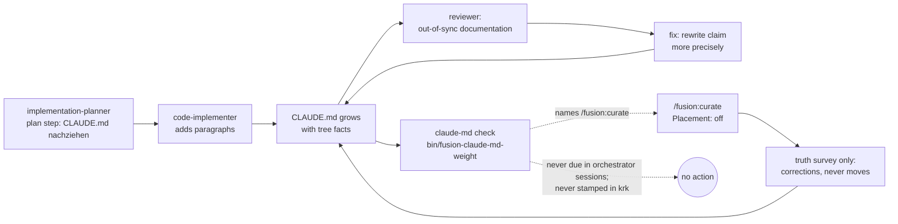

# Analysis: why a consuming project's `CLAUDE.md` grows unchecked under fusion (krk, 179 KB)

**Date:** 2026-10-20 08:35
**Type:** Failure Investigation (with a Gap Analysis of fusion's `CLAUDE.md` contract)
**Status:** Complete
**Requested by:** user, via orchestrator dispatch

## Question

The user expected that, under fusion, a project's `CLAUDE.md` holds pointers only, and that `/fusion:curate` or `/fusion:cleanup` checks and trims it. In the consuming project krk the file has reached 179 260 bytes. This report answers three questions. What does fusion actually promise a consumer about `CLAUDE.md`? Which mechanisms wrote krk's growth? Why did nothing in fusion stop it or undo it? It separates fusion defects from krk-local practice and from Claude Code built-in behaviour. It modifies nothing: krk is read-only here, and no fusion source was edited.

## Scope

- **fusion** `/Users/kai/Projects/productive/F04-FUSION/fusion`: HEAD `2f3de09a` (2026-10-20 08:12 +0200), branch `main`, `## main...origin/main [voraus 3]`. The working tree carries three uncommitted workbench files, none of them a shipped surface. Read: `agents/*.md`, `skills/{curate,cleanup,check,setup}/SKILL.md`, `rules/context-lean-claude-md.md`, `rules/context-manifest.md`, `bin/fusion-claude-md-weight`, `bin/fusion-rules` output per agent, `README-agents.md`. Git history read: `skills/revise-claude-md` (deleted at `1e295729`), `skills/cleanup`, the curator commits `4c41d693` and `e6cd7332`. Work package `260912-0438-human-facing-docs-leave-claude-md` and its decisions and issues.
- **krk** `/Users/kai/Projects/productive/F08-KRK/krk`: HEAD `ac4d1f8c` (2026-10-20 06:15 +0200), branch `main`, `## main...origin/main` (in sync). Read: `CLAUDE.md`, all 77 commits that touch it (`git log -- CLAUDE.md`, sizes per commit via `git show <h>:CLAUDE.md | wc -c`), `fusion-workbench/orchestrator-events.jsonl`, the 53 plan files under `fusion-workbench/work-packages/*/plans/`, the two curator run files under `fusion-workbench/shared/analyses/`, `.fusion-setup`, and whether `.check-stamps` exists.
- **Not run:** nothing in krk was executed except read-only git commands and `bin/fusion-claude-md-weight --root <krk>` from the fusion tree. That helper writes nothing.
- **Working files** (scratch, not evidence stores): `/private/tmp/claude-501/-Users-kai-Projects-productive-F04-FUSION-fusion/b0d39d6c-2a2f-4e28-9633-ee591bf69b1b/scratchpad/krk-growth.txt` (per-commit size series), `/private/tmp/claude-501/-Users-kai-Projects-productive-F04-FUSION-fusion/b0d39d6c-2a2f-4e28-9633-ee591bf69b1b/scratchpad/attr.py` (commit to last-dispatched-agent join).

## Findings

### 1. Evidence inventory

| Artefact | What it shows |
|---|---|
| krk `CLAUDE.md` | 179 260 bytes, 278 lines, 8 `## ` sections. The dispatch's figures were re-measured and confirmed: `## Was man nicht sieht, wenn man es nicht weiß` 124 103 B / 112 lines, `## Projektstand` 25 691, `## Worum es geht` 7 207, `## Bauen und prüfen` 6 264, `## Sprache` 6 110, `## Bindende Grundlage` 5 426; `over=6` at threshold 4000 |
| krk `git log -- CLAUDE.md` | 77 commits, 2026-08-02 to 2026-10-19. Size went 4 260, then 33 533 (08-15), 70 269 (09-08), 81 808 (09-26), 111 610 (09-29), 179 260 (10-19). The author of every commit is the user; the co-author on all but one (`c75972cb`, +26 B) is a Claude model |
| krk `orchestrator-events.jsonl` | 743 `task_start`, 622 `commit`. It lets each commit be joined to the agent last dispatched before it. It holds no `claude-md=` and no `checks_due` line |
| krk plans (53 files) | 44 of them name `CLAUDE.md`, and 12 name the section `Was man nicht sieht` as a write target |
| krk curator runs | `/Users/kai/Projects/productive/F08-KRK/krk/fusion-workbench/shared/analyses/260917-1450-curator-run.md` and `/Users/kai/Projects/productive/F08-KRK/krk/fusion-workbench/shared/analyses/260925-2312-curator-run.md`, both `**Placement:** off` |
| krk `fusion-workbench/.check-stamps` | **absent**. No periodic check was ever stamped in this checkout |
| fusion `bin/fusion-claude-md-weight` run on krk | `claude-md=weighed`, 6 sections over; last line: "Act on a finding with /fusion:curate" |

### 2. What fusion promises a consumer about `CLAUDE.md`

**"Pointers only" is written down, as a convention without force, and no agent that writes `CLAUDE.md` ever reads it.**

| Statement | Where | Binding for consumers? | Who receives it |
|---|---|---|---|
| Lean `CLAUDE.md`: identity, language lines, a few rules every session needs, a pointer table. Everything bound to a topic moves behind the manifest | `rules/context-lean-claude-md.md:30-50` | No. "It is a convention, not machinery: nothing in the module enforces a line count" (`:11-12`) | **No agent.** README-agents.md:185 says it is "shipped, not auto-emitted". `bin/fusion-rules` for code-implementer, implementation-planner, reviewer, orchestrator and document-editor emits only `agent-setup`, `fusion-workbench-conventions`, `critical-stance` and their voice/role files (measured in krk). The policy-curator opens it by hand, and only for a placement run (`agents/policy-curator.md:455`) |
| Ruling: a check is the trigger, the curator the tool, "`/fusion:curate` then covers a consuming project" | `260916-1006_*_…lean-convention-when-the-curator-asks-a-different-question.md` `## Options` 1, `## Recommendation` | Ruled (answered) | Not implemented as ruled; see §4 |
| Policy-curator: "Every edit to `CLAUDE.md` now comes through you, behind approval" | `agents/policy-curator.md:46-52` | Stated as fact | False in krk: since 2026-08-16, 46 of 57 commits touching `CLAUDE.md` came from paths other than the curator |
| code-implementer owns "Code-level documentation (architecture notes, …)" | `agents/code-implementer.md:22` | Ownership grant | It does not exclude `CLAUDE.md`, so a plan step naming it is in scope |
| data-implementer may not edit `CLAUDE.md` "unless the task explicitly names the file" | `agents/data-implementer.md:33` | A guard that opens for any plan naming the file | — |
| implementation-planner / orchestrator routing | `agents/implementation-planner.md:41-42`, `agents/orchestrator.md:181` | Route "architecture, API docs" documentation to code-implementer. Neither says where design invariants belong, or that `CLAUDE.md` is not a place for them | — |
| Reviewer looks for "out-of-sync documentation" | `agents/reviewer.md:64` | Leads to drift findings against `CLAUDE.md` | Its findings are fixed by rewriting the text, never by moving it (§3) |
| Every agent: "Read `CLAUDE.md` for project context, architecture …" | analyst:16, orchestrator:83, requirements-designer:16, state-auditor:14, reviewer:25 | Treats `CLAUDE.md` as the architecture document of record | — |

fusion's own `CLAUDE.md` is lean (8 114 B after `260912-0438`) for two reasons. A growth-bound test exists only in this repository (`hooks/lib/__tests__/surface-growth-bound.test.ts`; fusion `CLAUDE.md` `## Conventions` "Growth bounds"). And a developer ran a hand-dispatched placement pass once. **The practice is fusion's own; the consumer gets the document but neither the bound nor the tool.**

### 3. Who wrote krk's growth

**Timeline in three periods, set against the fusion mechanism live in each:**

| Period | fusion mechanism writing `CLAUDE.md` | Bytes added | Section `Was man nicht sieht` |
|---|---|---|---|
| 08-02 … 08-15 | `/fusion:cleanup` ran the autonomous `revise-claude-md` pass (add/update/prune, no gate). Its Pass 1 explicitly asks for "New architectural invariants", "Non-obvious gotchas — workarounds, ordering constraints, hidden coupling" (`git show 1e295729^:skills/revise-claude-md/SKILL.md`, `## Pass 1 — Add`). Removed at `1e295729` (v9.0.0) | +33 533 (to 33 533) | 2 020 → 14 133; the list is born at `710ce84f` "die Fallenliste ist neu" |
| 08-16 … 09-10 | Cleanup ran the curator survey + gate at the end of every session ("Kuratorenlauf …, am Gate freigegeben", e.g. `5886d046`, `ab11eb8c`, `69dfa195`, `c9b19f40`) | +36 736 (to 70 269) | → 32 448 |
| 09-11 … 10-19 | Cleanup reduced to commit-and-push (`115be68d`, v11.0.0); curate is user-invoked only and asks only the truth question. **Plans now carry their own `CLAUDE.md` step**, executed by code-implementer | **+108 991** (to 179 260) | → 124 103 |

The shift between periods two and three is visible in the plans themselves. In August a plan wrote stale `CLAUDE.md` lines down as "Arbeit des Kurators … gehört nicht in einen Schritt dieses Plans … damit die Abschlusspflege sie nicht suchen muss" (`/Users/kai/Projects/productive/F08-KRK/krk/fusion-workbench/work-packages/260823-2208-vorschau-zeigt-profil-zusammenfassung-statt-metadaten/plans/260824-0640_*_plan-vorschau-zeigt-profil-zusammenfassung-statt-metadaten.md:599`). Once the end-of-session upkeep was gone, the planner absorbed it. Two examples:

- `/Users/kai/Projects/productive/F08-KRK/krk/fusion-workbench/work-packages/261017-1029-zip-und-gz-wie-ordner-im-dateifenster/plans/261017-1036-plan-zip-und-gz-wie-ordner-im-dateifenster.md:345-351`. Step 8, executor code-implementer: "**`CLAUDE.md`:** im Abschnitt „Was man nicht sieht" je ein Absatz zu `archiv::ersetzen` …, zum Umbau …, zur Trennung von `Quelle` und `Stelle` …, zum Pfand …, zur einen Namensregel …". The commit that executed it, `55a87679`, added **+12 220 B**.
- `/Users/kai/Projects/productive/F08-KRK/krk/fusion-workbench/work-packages/261016-0229-secrets-mit-sechs-feldern-schluesselcache-und-verbindungen/plans/261016-0306-plan-secrets-mit-sechs-feldern-schluesselmerker-und-verbindungen.md:240-246`. A plan section headed `### CLAUDE.md-Stellen, die diese Arbeit falsch macht`, which corrects four paragraphs and adds two new ones. Executed in `6067ae99`, **+10 967 B**.

**Attribution by mechanism** (classified from commit body keywords; approximate: a commit that matched several keywords counts once, in the first class that applies):

| Mechanism | Commits | Net bytes | Share |
|---|---|---|---|
| Plan step "HowTo, README und CLAUDE.md nachziehen" / "Plan-Schritt N Doku", executed by code-implementer (or `coder` before v12) | 21 | +86 579 | 48 % |
| Fixes of review findings ("Befunde der Durchsicht", "gegen den heutigen Baum") | 21 | +37 237 | 21 % |
| Curator runs, gated (end-of-cleanup until 09-10, then `/fusion:curate`) | 12 | +28 523 | 16 % |
| Other (feature commits, initial file, specs) | 19 | +24 809 | 14 % |
| Session/reconcile bookkeeping | 4 | +2 112 | 1 % |

A second join gives a cross-check: each commit against the agent last dispatched before it in the event log. It credits about 124 KB to code-implementer/coder, 12 KB to the curator, 3 KB to document-editor, and leaves 37 KB unattributed. Those 37 KB are mostly main-session commits from August.

**Curator runs grow the file too.** `/Users/kai/Projects/productive/F08-KRK/krk/fusion-workbench/shared/analyses/260917-1450-curator-run.md:45`: "Die elf Einträge fassen zusammen 3 409 Bytes an Bestandstext an und schreiben 6 938 zurück." A correction of a statement found false replaces it with a longer true one, and nothing bounds the length of the replacement. Both runs carry `**Placement:** off` (`:10` in each), so neither could propose moving anything.

**What the 124 KB section holds.** There are 54 bold-led paragraphs (`CLAUDE.md:134-240`), most of them 1-6 KB. Nearly every one states a code-level invariant at function granularity: "An einer Archivdatei schreibt genau eine Funktion, `archiv::ersetzen`" (`:190`), "Keine Anfrage an einen Server kann den Hauptfaden erreichen, und das hält der Übersetzer" (`:182`), "Die PIN-Sperre sitzt in `Editormodell::lesen_beginnen`" (`:168`). The paragraphs are grouped by topic: secrets/vault (`:166-178`), remote/sftp (`:180-188`), archive (`:190-198`), editor/undo (`:158-160`, `:232`), preview/image sequence (`:214-218`), keymap (`:150-152`, `:212`). Under `rules/context-lean-claude-md.md` `### Step 2` the right home for them is one of the following. The topic-bound invariants go to the **module header** of the named file (several paragraphs already cite one: `:202` "Modulkopf von `krk-core/src/heimordner/`"), or to a **topic rule file** under `.claude/rules/` loaded through `rules/context-manifest.yaml`. The ones that are rulings go to their **decision record**, which `:188` and `:212` already cite. A few paragraphs bind every session, for example `:134` (state outside the bundle, data loss) and `:148` (`#[must_use]` policy). `## Projektstand` (25 KB) is round-by-round status narrative. The workbench and git already hold it, and the deleted revise skill's own criterion 3d named exactly that as "git-log material, not CLAUDE.md material".

**krk-local accelerants (not fusion defects, but they explain the shape):**

- The section's own preamble licenses growth: "Gezählt sind sie nicht: die Liste wächst mit jeder Runde" (`CLAUDE.md:132`).
- krk has no `./rules/` and no `.claude/rules/` directory (`ls` returns nothing), so the project has no topic file a plan could have targeted instead.
- krk's style asks for maximal precision: every claim cites a file, a function and the probe that holds it. `rules/critical-stance.md` §5 adds to this: a count becomes "the command that derives it" (`:79-81`), which is correct but makes each sentence longer.

**Claude Code built-in:** Claude Code loads `CLAUDE.md` in full into every session, and fusion agents read it again at Setup, so the 179 KB reaches every dispatch. That is roughly 45-50 k tokens; the token figure is an estimate. The user-level `revise-claude-md` skill ("Update CLAUDE.md with learnings from this session") is still installed, but there is **no trace of it in krk**: 0 hits in commit messages and 0 in the event log. It did not contribute.

### 4. Why the cleanup path did not catch it

Coherence self-check, per `rules/design-diagrams.md`: every edge back into `F` adds bytes, and no edge leaves `F` to a node that removes or moves bytes. That gap is the finding. The only node that could relocate content, a curator dispatch with `**Placement:** on`, is not reachable from any command, which is why it does not appear.

| Expected safeguard | Actual behaviour | Evidence |
|---|---|---|
| `/fusion:cleanup` checks `CLAUDE.md` | It does not touch `CLAUDE.md` at all since v11.0.0. "Nothing else — reconciling, archiving, the CLAUDE.md pass … are each their own command" | `skills/cleanup/SKILL.md:2`; `115be68d` |
| `/fusion:curate` trims `CLAUDE.md` | It asks only "is this statement still true?". It passes no `**Placement:**` line, so it **cannot propose a relocation**, and deletions need history-grounded falsification | `agents/policy-curator.md:390,395`; `skills/curate/SKILL.md` Step 2 (only `--full`, `--edges`); `README-agents.md:68` "nobody ships it — … the user asks for a placement run directly" |
| The ruling "check = trigger, curator = tool" | Never closed for consumers. Option 1 ("`/fusion:curate` gains a way to ask for a placement run") was **refused on fusion's own growth bound**: "the skill-body surface stood at 3 bytes after the relocation, and giving the command a way to ask for placement needs more than that" | `260916-1326_*_step-7-runs-fusion-curate-which-passes-no-placement-line-…md`, `Resolved:` |
| The `claude-md` check alerts and leads to action | It reports only, and points at `/fusion:curate`, which (row above) cannot act on a weight finding | `bin/fusion-claude-md-weight:225`; `skills/check/SKILL.md:342-348` |
| The check runs periodically | Only when `/fusion:setup` runs and computes `checks_due` (`skills/setup/SKILL.md:79-92,126-130`). The orchestrator's inlined Setup computes no due list (`agents/orchestrator.md:83-100`, no `checks_due`/`.check-stamps`). krk has **no `.check-stamps`**, although `.fusion-setup` was rewritten and committed on 2026-10-14 (`1fe34c4f`). Every version bump makes all eleven checks due, so the check either never ran in this checkout or ran without stamping. Either way, the event log holds no result | `ls krk/fusion-workbench/` |
| The check existed during the growth | It arrived at v11.5.0 (`fd4472ff`, 2026-09-16), when krk stood at ~74 KB. It was not due even from setup until `e6cd7332` added `claude-md` to setup's array. 105 KB of the growth came after that | `git tag --contains` |
| An over-threshold finding persists | Nothing files an issue or memo; one stamp silences the check for 30 days or until the next version | `skills/check/SKILL.md:7` |

## Implications

1. **Root cause, ranked by contribution.** First: the plan-step mechanism (48 %, and most of the post-09-10 growth). No fusion surface that a planner or implementer loads says that `CLAUDE.md` is not where design invariants go, or where they go instead. Second: review-finding fixes (21 %), which rewrite stale claims and make them longer. Third: curator corrections (16 %), which ask whether a statement is true and never whether it belongs in this file. Fourth, as the seed: the deleted `revise-claude-md` Pass 1, which invited "architectural invariants" and "gotchas" into the file and created the very section that is now 69 % of it.
2. **The removal of 260815 removed a writer but not the demand.** fusion assumed that removing the session-learnings pass made the curator the single writer. In practice the demand for "document what this change did" moved into plans, where nothing gates it.
3. **The lean convention protects only fusion itself.** It is held in place by a test that only fusion's repository runs. The consumer-side tool was ruled and then cut, because the same test charges fusion's skill bodies byte by byte. Fusion's self-imposed growth bound blocked the consumer feature meant to fight growth.
4. **The user's mental model** ("curate or cleanup checks and cleans") matches the 260916 ruling, not the shipped behaviour.

## Recommendations

No implementation here. Each item is a candidate for `implementation-planner`, after the user decides what to file.

| # | Fix | Trade-off |
|---|---|---|
| R1 | `/fusion:curate --placement` passes `**Placement:** on` on both dispatches. This closes the ruling 260916-1006 option 1 | Costs skill-body bytes against a bound with ~0 head-room; needs a cut elsewhere or a head-room ruling. Smallest fix that closes the loop |
| R2 | Emit a short binding rule to implementation-planner, code-implementer, document-editor and reviewer: "a project's `CLAUDE.md` takes no topic-bound content; a design invariant goes to the module header, a topic rule file, or a decision record; a plan step names that destination". This could be a few lines in `fusion-workbench-conventions.md`, or emitting `context-lean-claude-md.md` itself | Charges every dispatch path. A one-paragraph rule is far cheaper than the 179 KB it prevents. This is the fix that removes the main cause |
| R3 | Reviewer: a drift finding against `CLAUDE.md` that cites function-level tree facts is classified as a *placement* finding (route: curate with placement), not a text-fix finding | Small prompt cost; changes routing of a frequent finding class |
| R4 | Make the `claude-md` check reachable: the orchestrator's inlined Setup computes the due list, or the session-start hook emits one line when the weight is over. And when no relocating command is wired, stop pointing the helper's last line at `/fusion:curate` | The hook is cheap and always runs; editing the line in the helper is trivial |
| R5 | Correct `agents/policy-curator.md:46-52` ("Every edit to `CLAUDE.md` now comes through you"), or make it true by routing plan steps that edit `CLAUDE.md` through the curator | Text fix is cheap. Making it true is a large change and conflicts with R2's simpler stance |
| R6 | The curator's corrections carry a byte delta, and a run whose replacements exceed what they replace by a stated factor reports it beside the blast-radius figure | Visibility only; no new tier |

**For krk (user's decision, not fusion's):** the existing route is a hand dispatch, `Agent(fusion:policy-curator)` with `**Mode:** survey` and `**Placement:** on`, as fusion did for itself in `260916-1612-curator-run.md`. The 20 % blast-radius pause will fire, because the 124 KB section alone is 69 % of the file. Before that, krk needs a destination: a `.claude/rules/` topic file per area plus `rules/context-manifest.yaml`, or module headers.

## Filed Issues

None. The orchestrator asked for a list to put to the user; it is in the chat reply.

## Sources

- fusion: `rules/context-lean-claude-md.md:11-12,30-50,186-206,303-321`; `rules/context-manifest.md:1-40`; `README-agents.md:68,185`; `agents/policy-curator.md:9-16,28-71,293-300,380-397,455`; `agents/code-implementer.md:15-22`; `agents/data-implementer.md:28-36`; `agents/implementation-planner.md:41-42`; `agents/reviewer.md:64`; `agents/orchestrator.md:83-100,181,599-602`; `skills/curate/SKILL.md:1-60`; `skills/cleanup/SKILL.md:2`; `skills/check/SKILL.md:1-25,342-348`; `skills/setup/SKILL.md:72-92,126-130`; `bin/fusion-claude-md-weight:1-80,225`; `rules/critical-stance.md:79-81`; commits `1e295729` (revise-claude-md deleted, v9.0.0), `115be68d` (cleanup reduced, v11.0.0), `fd4472ff`/`e6cd7332` (weight helper, setup due list, v11.5.0), `4c41d693`; work package `260912-0438-human-facing-docs-leave-claude-md`: decisions `260916-1006_*_…`, `260916-1126_*_may-the-drift-check-report-weight-when-it-cannot-decide-topic.md`, issue `260916-1326_*_…`.
- krk: `CLAUDE.md:1-48,130-241,250-278`; `git log -p -- CLAUDE.md` (77 commits; bodies of `5886d046`, `ab11eb8c`, `8c111ea2`, `69dfa195`, `c9b19f40`, `a6bf59b3`, `e81a8a4a`); `fusion-workbench/orchestrator-events.jsonl`; plans under `/Users/kai/Projects/productive/F08-KRK/krk/fusion-workbench/work-packages/*/plans/` (the 260824-0640 Vorschau plan :599, the 261016-0306 secrets plan :201-256, the 261017-1036 zip plan :345-353, the 261018-0822 CSV plan :329-333); `/Users/kai/Projects/productive/F08-KRK/krk/fusion-workbench/shared/analyses/260917-1450-curator-run.md:10,37-45`, `/Users/kai/Projects/productive/F08-KRK/krk/fusion-workbench/shared/analyses/260925-2312-curator-run.md:10,37-42`; `fusion-workbench/.fusion-setup`; `.check-stamps` (absent).

## Open Questions

- [ ] Why krk has no `.check-stamps` although setup rewrote the marker on 2026-10-14: whether setup's Step 1 was skipped, or the sessions came only through the orchestrator's inlined Setup. The evidence does not settle it; the consequence (the check produced no action) holds either way.
- [ ] Whether R1's skill-body bytes are worth a head-room ruling, or R2 alone (prevention) is enough and relocation stays a hand dispatch.
