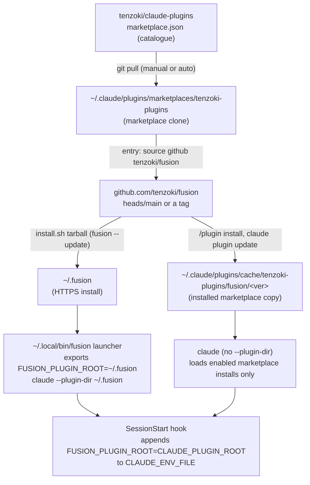

# Analysis: do fusion's documents still describe how fusion is installed, updated, run and released?

**Date:** 2026-10-24 06:06
**Type:** Gap
**Status:** Complete
**Requested by:** user

## Question

Do the shipped and dev-side documents still describe how fusion is actually installed, updated, run and released? The measure is the code that does each of these things, plus the state observed on this machine. Three user questions are tested specifically. Can a user tell which copy of fusion they are running? Do the docs say that a marketplace install can coexist with the `fusion` launcher, and how to remove one? Do they say that a release is not on the machine until `fusion --update` has run?

## Scope

**Ground truth read:** `install.sh` (whole file, including the launcher it writes), the launcher actually installed at `~/.local/bin/fusion`, `hooks/hooks.json` (SessionStart), `bin/fusion-source-root`, `bin/fusion-plugin-cwd`, `bin/fusion-rules` (root logic), `bin/fusion-write` and `bin/fusion-record` (node dependency), `hooks/package.json` and `codec/package.json` (`engines`), `.gitignore`, `git tag`, the plugin-version history of `.claude-plugin/plugin.json`, the marketplace clone at `~/.claude/plugins/marketplaces/tenzoki-plugins` and its fusion entry, `~/.claude/plugins/installed_plugins.json`, `claude plugin --help` and `claude --help` from Claude Code 2.1.310.

**Documents checked:** `README.md`, `README-agents.md`, `README-hooks.md`, `CLAUDE.md`, `skills/help/SKILL.md` (install, update, configure and daily topics), `skills/setup/SKILL.md`, `skills/check/SKILL.md`, every file under `docs/`, `templates/fusion.json`, and `adapters/prior/README.md` (install statements only). I grepped every `agents/*.md`, `rules/*.md` and `skills/*/SKILL.md` for `fusion --update`, `marketplace`, `--plugin-dir`, `~/.fusion`, `install.sh`, `reload-plugins` and the plugin cache path.

**Prior records consulted:** decision `260816-1707_*_which-install-path-is-the-authoritative-one-for-end-users.md` (answered: `heads/main` is the standard and the tag is an opt-in pin; its reconciliations note that no document states this as policy). Decision `260908-1234_*_how-does-a-fix-reach-a-consumer-while-main-carries-unreleased-work.md`. Issues `260908-1324_*_a-work-tree-behind-the-install-hides-skills-the-install-has-and-nothing-warns.md` and `260825-1329_*_every-session-runs-one-release-behind-on-a-bin-helper-the-same-repository-just-added.md`. No prior analysis covers this question.

**Tree:** `/Users/kai/Projects/productive/F04-FUSION/fusion`, HEAD `af76f94f55d50bd8ef160983c50183cb49d1407a` (2026-10-23 21:57 +0200), branch `main`, `## main...origin/main [ahead 8]`. One modified file: `fusion-workbench/orchestrator-events.jsonl`. `origin/main` equals tag `v13.3.3`. The 8 local commits touch only `README-agents.md` among the shipped paths. Line numbers below are against this HEAD.

**Machine state (measured, not documented):**

| Fact | Evidence |
|---|---|
| This session runs `FUSION_PLUGIN_ROOT=/Users/kai/.fusion` | env |
| `~/.fusion` holds 13.3.1, and its `.claude-plugin agents skills rules hooks/dist codec/dist bin` are byte-identical to tag `v13.3.1` | `diff -rq` against `git archive v13.3.1`; installed 2026-10-23 11:39, before `v13.3.2` was tagged (14:05) |
| 13.3.3 is released: tagged, on `origin/main`, and in the marketplace entry (`"version": "13.3.3"`) | `git tag`, `~/.claude/plugins/marketplaces/tenzoki-plugins/.claude-plugin/marketplace.json` |
| The marketplace's fusion entry sources the plugin from `{"source":"github","repo":"tenzoki/fusion"}`, with no ref | same file |
| Three `local`-scope installs of `fusion@tenzoki-plugins` 3.21.0 exist, all pointing at `~/.claude/plugins/cache/tenzoki-plugins/fusion/3.21.0` | `installed_plugins.json`, `claude plugin list --json` |
| None of the three `projectPath`s exists on disk any more (`.../unite-co-creator`, `.../unite-co-creator/research/260916-open-ner-model`, `/private/tmp/axibra-probe`). The entries are orphans | `ls` |
| The plugin cache holds only `fusion/3.21.0`, so release step 6 (`/plugin install`) has not been run on this machine since 3.21.0 | `ls ~/.claude/plugins/cache/tenzoki-plugins/fusion` |

## Findings

### How the copies resolve (structural)

Two independent channels end in two independent copies. Nothing connects them: `fusion --update` never touches `cache/`, and `/plugin install` never touches `~/.fusion`. Each of the user's three questions lands in that gap.

### Gap inventory

Severity: **wrong** = would mislead a user into a failing action. **stale** = outdated number, command, path or rationale. **missing** = a user needs it and no document says it. **fine** = true now, no edit. "Bounded" refers to `README-hooks.md` `### Growth bounds on the shipped text`.

#### Wrong

| # | File:line | What it says | True now? | Corrected wording | Owner | Bounded? |
|---|---|---|---|---|---|---|
| W1 | `install.sh:55-57` | Node missing: "fusion's compliance guard runs as a Node hook; without node it will not fire. Agents still work, but install Node.js to get the guard" | No. The guard is observation-only since 260816 (`CLAUDE.md` "guard and hooks"). Since v13, `bin/fusion-write:214` and `bin/fusion-record:83` `exec node`, so without node no agent can file or transition a record. The floor is `>=20.12.0` (`hooks/package.json:6`, `codec/package.json:6`) | `warn "Node.js 20.12.0 or later ('node') was not found on your PATH."` / `warn "fusion's hooks, its record writer (bin/fusion-write) and /fusion:migrate all run on node: without it no session can file or update a record."` / `warn "Install Node.js 20.12.0+: https://nodejs.org"`. Better still: also warn when `node --version` is below 20.12.0 | code-implementer | no |
| W2 | `README.md:84` | "**Node.js 18+** for the TypeScript hooks" | No: `engines` is `>=20.12.0` in both packages, and `README.md:28` itself says 20.12.0 | "- **Node.js 20.12.0+** for the hooks and the record codec. Both ship pre-compiled (`hooks/dist/`, `codec/dist/`), so no `npm install` is needed at runtime, only `node`." | code-implementer | no |
| W3 | `docs/fusion-intro.md:13` | "Voraussetzungen: Claude Code v2.1.63+, Node.js 18+ (für die Hooks), Python 3 (für den Monitor)." | No (Node floor, as W2) | "Voraussetzungen: Claude Code v2.1.63+, Node.js 20.12.0+ (für Hooks und Record-Codec), Python 3 (für den Monitor)." | code-implementer | no |
| W4 | `README.md:106` | `fusion   # or: claude --agent fusion:orchestrator` | Only on the marketplace path. On the recommended HTTPS path, plain `claude` does not load `~/.fusion`. Where a stale marketplace install is enabled in that project, it loads *that* copy instead (on this machine that would be 3.21.0) | `fusion   # marketplace install: claude --agent fusion:orchestrator` | code-implementer | no |
| W5 | `skills/help/SKILL.md:93` | "Claude Code has no `/plugin upgrade` or `/plugin update`. `/plugin install` on an already-installed plugin reports *"already installed globally"* and does not re-fetch" | No: Claude Code 2.1.310 has `claude plugin update <plugin>` ("Update a plugin to the latest version (restart required to apply)"). Whether a `/plugin update` slash form exists was not measured | Replace lines 87-93 with: "**If you installed via the marketplace:** pull the marketplace clone (caveat below), run `claude plugin update fusion@tenzoki-plugins` in a shell (add `--scope project` or `--scope local` if you installed at that scope), then restart Claude Code." | code-implementer | **yes**, `skills/` (about 1.1 KB of head-room left by my estimate; this edit shrinks) |
| W6 | `docs/fusion-intro.md:210` | "Beim Marketplace-Pfad gibt es keinen `fusion`-Launcher und kein `/plugin update`: dort erst den Marketplace-Clone pullen, dann `uninstall`, `install`, `/reload-plugins`." | No (as W5) | "Beim Marketplace-Pfad gibt es keinen `fusion`-Launcher: dort erst den Marketplace-Clone pullen, dann `claude plugin update fusion@tenzoki-plugins` und Claude Code neu starten." | code-implementer | no |
| W7 | `skills/help/SKILL.md:105` | For the release flow, "read the "Release process" section of `CLAUDE.md` in the fusion source repo (GitHub URL) — that file is dev-only and deliberately not shipped" | No. `CLAUDE.md` `## Release process` is now a one-line pointer to `README-agents.md` `## Releasing`, and `README-agents.md` **is** shipped (`install.sh:85`) | "For the maintainer-side release flow, read `$FUSION_SRC/README-agents.md` `## Releasing`." | code-implementer | **yes**, `skills/` (shrinks) |
| W8 | `README.md:26` | "every release since v5.5.0 is tagged" | No. No tags exist for v10.8–v10.13 or v10.15–v10.18, although `plugin.json` carried 10.8.0, 10.10.0, 10.13.0 and 10.16.0 (`git log -S`), and `README.md:46` itself calls v10.8 through v10.14 releases | "…to pin a release; `git tag` lists the tagged ones (most releases since v5.5.0; v10.8–v10.13 and v10.15–v10.18 have none)…" | code-implementer | no |
| W9 | `README-agents.md:349-353` (release step 6) | "To pick up the new version locally: `git -C ~/.claude/plugins/marketplaces/tenzoki-plugins pull origin main`, then `/plugin install fusion@tenzoki-plugins` and `/reload-plugins`." | Misleading for the maintainer. The copy the maintainer runs is `~/.fusion`, which this step never refreshes; the machine sits at 13.3.1 with 13.3.3 released. Followed literally, `/plugin install` creates a user-scope marketplace copy that then coexists with the launcher's copy (B, below) | "6. **Pick up the release on this machine:** run `fusion --update`, restart the session, and confirm `grep '\"version\"' \"$(fusion --where)/.claude-plugin/plugin.json\"` prints the new version. Only if you also test the marketplace path: pull the marketplace clone and run `claude plugin update fusion@tenzoki-plugins`. Never leave that install enabled in a project you open through the launcher." | code-implementer | no |

#### Stale

| # | File:line | What it says | True now? | Corrected wording | Owner | Bounded? |
|---|---|---|---|---|---|---|
| S1 | `install.sh:96-97` | "hooks/dist/guard.js missing — the compliance guard will not run." | Partly. There is no compliance guard any more; the file is the write-trace hook | "hooks/dist/guard.js missing — fusion's hooks will not run." | code-implementer | no |
| S2 | `README.md:83` | "Claude Code v2.1.63+ (the orchestrator uses the `Agent(...)` tool-restriction syntax introduced there…)" | The rationale is gone: no agent declares a `tools:` line since 260913 (`grep '^tools:' agents/*.md` finds nothing; `README-hooks.md`, the `AskUserQuestion` row). Whether the floor still holds was not measured; the permission measurement cited in `README-agents.md:368` was taken on 2.1.226, and this machine runs 2.1.310 | "**Claude Code v2.1.63+** (the oldest version fusion is known to load on; it is tested on current releases)." The exact floor is an open question below | code-implementer | no |
| S3 | `README-agents.md:367` | "`CLAUDE_PLUGIN_ROOT` resolves to `~/.fusion` under `--plugin-dir`, so the SessionStart hook's `export FUSION_PLUGIN_ROOT=…` and all `bin/` helpers work." | Incomplete. The launcher exports `FUSION_PLUGIN_ROOT` itself (`install.sh:156-160`), because the SessionStart `CLAUDE_ENV_FILE` route "does not reliably propagate into Bash tool calls". The marketplace path has only that route | "- **The launcher exports `FUSION_PLUGIN_ROOT=~/.fusion`** before `exec claude --plugin-dir ~/.fusion`, so every Bash call inherits it. The SessionStart hook's `CLAUDE_ENV_FILE` export is the only route on the marketplace path and on a bare `claude --plugin-dir`, and the launcher's own comment calls it unreliable." | code-implementer | no |
| S4 | `README-agents.md:196` | "`$FUSION_PLUGIN_ROOT` is exported by the plugin's `SessionStart` hook." | Incomplete (as S3) | "`$FUSION_PLUGIN_ROOT` is exported by the `fusion` launcher, and by the plugin's `SessionStart` hook where no launcher started the session." | code-implementer | no |
| S5 | `README-agents.md:365` | Invariants: "**Compiled hooks must be committed.** `hooks/dist/*.js` are in git…; the installer defensively `rm -rf`s `hooks/node_modules`" | Missing half: `codec/dist/fusion-record.js` must be committed too (`.gitignore:11` `!codec/dist/`, `install.sh:98-100`), and the installer also drops `codec/node_modules` (`install.sh:94`) | "- **Compiled hooks and the codec bundle must be committed.** `hooks/dist/*.js` and `codec/dist/fusion-record.js` are in git (`.gitignore` has `!hooks/dist/` and `!codec/dist/`) and are self-contained… The installer defensively `rm -rf`s `hooks/node_modules` and `codec/node_modules` after copy." | code-implementer | no |
| S6 | `README-agents.md:368` | "…which `/fusion:setup` Step 0g offers once to seed" | `/fusion:setup` has no Step 0g. The offer is `/fusion:check`'s `permissions` selector (`skills/check/SKILL.md:173`), run by setup Step 1 when due | "…which `/fusion:check`'s `permissions` check offers to seed (setup runs it when due)" | code-implementer | no |
| S7 | `README-hooks.md:891` | "`/plugin install` keeps returning an old version — Marketplace cache clone at `~/.claude/plugins/marketplaces/` is stale; manual git pull required. Problem 12." | "Problem 12" resolves to nothing in any document (the same holds for Problems 10, 11 and 13 in the same table). It calls the marketplace clone the "cache"; the installed copy lives under `~/.claude/plugins/cache/` | "Marketplace clone at `~/.claude/plugins/marketplaces/tenzoki-plugins` is behind: `git -C` it `pull origin main`, then `claude plugin update fusion@tenzoki-plugins` and restart." (drop "Problem 12") | code-implementer | no |
| S8 | `skills/help/SKILL.md:103` | "the local *marketplace clone* … is what `/plugin install` reads, not the GitHub remote" | Half true. The clone supplies the catalogue (`marketplace.json`, version label). The entry's `source` is `github` `tenzoki/fusion` with no ref, so the plugin itself is fetched from GitHub, from the default branch. The installed copy lands in `~/.claude/plugins/cache/tenzoki-plugins/fusion/<version>` | "the local *marketplace clone* … is the catalogue `/plugin install` reads; the plugin itself comes from `tenzoki/fusion`'s default branch into `~/.claude/plugins/cache/`." | code-implementer | **yes**, `skills/` (keep net-neutral) |
| S9 | `README-agents.md:358` | "The marketplace **cache clone** at `~/.claude/plugins/marketplaces/<name>/` is the source-of-truth `/plugin install` reads" | Terminology as S7/S8; the content is otherwise right | Replace "cache clone" with "marketplace clone" here and in `CLAUDE.md:58`, and add: "The installed marketplace copy is `~/.claude/plugins/cache/<marketplace>/fusion/<version>/`." | code-implementer | `CLAUDE.md` is charged to all eleven dispatch paths at zero head-room: the edit must be byte-neutral or shorter |
| S10 | `CLAUDE.md:10` | "Plugin published to the `tenzoki-plugins` marketplace (repo: `tenzoki/claude-plugins`)." | Incomplete: the recommended distribution is the HTTPS installer from `tenzoki/fusion` (`heads/main`, decision `260816-1707`) | "Plugin distributed by `install.sh` from `tenzoki/fusion` (`heads/main`) and listed in the `tenzoki-plugins` marketplace (`tenzoki/claude-plugins`)." | code-implementer | **CLAUDE.md, zero head-room**: offset by a cut elsewhere in the file |
| S11 | `docs/upgrading-to-v13.md:156-158` | "`fusion --update` … downloads `install.sh` from `main` and runs it with no variables, which reinstalls `heads/main` into `~/.fusion`." | Imprecise. The child `bash` inherits the caller's environment, so `FUSION_REF=… fusion --update` does pin (`docs/upgrading-to-v12.md:24` relies on that). What is lost is the variables the install was *made* with; the launcher records none of them | "…runs it without the variables this install was made with (the launcher does not remember them), which reinstalls `heads/main` into `~/.fusion` and rewrites `~/.local/bin/fusion`." | code-implementer | no |
| S12 | `README.md:21`, `skills/help/SKILL.md:85`, `docs/fusion-intro.md:207` | `fusion --update` "re-download[s] the latest" / "lädt die neueste Version" | Ambiguous. It installs the head of `main`, which is the standard by decision `260816-1707`. Between releases that tree can be newer than the version its `plugin.json` names. `README.md:26` says so; the other two do not | `README.md:21`: `fusion --update     # re-install the head of main into ~/.fusion, then restart the session`. `help:85`: "run `fusion --update` — it re-installs the head of `main` into `~/.fusion` — then restart the session." `fusion-intro:207`: "# installiert den Stand von main nach ~/.fusion, dann Sitzung neu starten" | code-implementer | help: **yes**, `skills/` (about +20 B) |

#### Missing

| # | Gap | Evidence | Where it belongs, with wording | Owner | Bounded? |
|---|---|---|---|---|---|
| M1 | **(a) How to tell which copy and which version you run.** No document says it, and no command prints it. `fusion --where` prints only the directory (`install.sh:120-122`). The SessionStart banner is a static "Fusion loaded." (`hooks/hooks.json`). Setup writes `plugin_version` into `.fusion-setup` but its Done report does not show it (`skills/setup/SKILL.md:74-87,175`) | This session ran 13.3.1 against a released 13.3.3, and nothing said so | `README.md`, after line 24: "**Which copy am I running?** `fusion --where` names the folder; `grep '\"version\"' \"$(fusion --where)/.claude-plugin/plugin.json\"` its version. Inside a session, `grep '\"version\"' \"$FUSION_PLUGIN_ROOT/.claude-plugin/plugin.json\"` names the copy that session actually loaded. On the default ref the version names the last release, and the tree can be newer." Code side: see R2 | code-implementer | README: no |
| M2 | **(b) A marketplace install can coexist with the launcher.** No document says that both can be present, that plain `claude` in a project loads the marketplace copy (W4), or how to list and remove marketplace copies. `fusion --uninstall` removes only `~/.fusion` and the launcher (`install.sh:115-118`). What Claude Code does when one session carries both a `--plugin-dir` fusion and an enabled marketplace fusion was **not measured** | Three 3.21.0 local installs on this machine, all orphaned | `README.md` `### Alternative — Claude Code marketplace`, append: "**Use one path, not both.** A marketplace install is separate from `~/.fusion`: `fusion --update` never refreshes it, `fusion --uninstall` never removes it, and a plain `claude` session in a project where it is enabled loads that copy. `claude plugin list` shows every marketplace install with its scope and project. Remove one with `claude plugin uninstall fusion@tenzoki-plugins --scope <user\|project\|local>`, run from inside the project for `project` and `local`." Add the same sentence to `docs/fusion-intro.md` §9 and one row to `README-hooks.md` `## Where to look when something breaks` ("the session behaves like an old version"). The help install topic needs at most one clause pointing at README | code-implementer | README, docs, README-hooks: no. Help: **yes** if touched |
| M3 | **(c) A release is not on your machine until `fusion --update` and a restart, and nothing tells you a newer one exists.** It is said piecemeal in per-release notes (`README.md:38,44`, `docs/upgrading-to-v1*.md`, `docs/messages-between-checkouts.md:7`, `docs/fusion-intro.md:210`) but never in `README.md`'s install section or the help update topic. No check compares the installed version with the latest release | `~/.fusion` 13.3.1 vs released 13.3.3 | `README.md`, after the `fusion --update` block: "A release reaches your machine only when you run `fusion --update` and then restart Claude Code; nothing updates `~/.fusion` on its own, and nothing tells you a newer release exists. A running session keeps the copy it started with." Help update topic: append "then restart the session" to the `fusion --update` sentence (S12) | code-implementer | README: no. Help: **yes** (S12's +20 B covers it) |
| M4 | **The `heads/main` policy is not stated as policy.** Decision `260816-1707` answered that every `main` commit is installable by the default path. Its two reconciliations record that no document says so. `README.md:26` describes the default; nothing tells a maintainer that pushing `main` between releases ships to every `fusion --update` | Decision record, `## Reconciliation` sections | `README-agents.md` `## Releasing`, step 4: append "Every commit pushed to `main` is what the next `fusion --update` installs, release or not (decision `260816-1707`): push `main` only with what may ship." | code-implementer | no |
| M5 | **`fusion --update` does not carry `FUSION_HOME`/`FUSION_BIN`/`FUSION_REF` from the original install.** It is documented only in `docs/upgrading-to-v13.md:156`. `README.md:26` lists the overrides without saying they are not remembered | `install.sh:110-113` | `README.md:26`, append: "`fusion --update` does not remember them: set them again on each update, or run the installer with them." | code-implementer | no |
| M6 | **Bare `claude --plugin-dir` may run with a stale `FUSION_PLUGIN_ROOT`.** `CLAUDE.md:62`, the release smoke test (`README-agents.md:343`), `docs/upgrading-to-v12.md:171` and `skills/migrate/SKILL.md:59` all start sessions this way. Started from a shell that already exports `FUSION_PLUGIN_ROOT` (any shell spawned from a launcher session, this one included), the agents' `"$FUSION_PLUGIN_ROOT/bin/…"` calls resolve to `~/.fusion` unless the SessionStart env-file export wins, which the launcher calls unreliable. **Not measured** | `install.sh:156-160`; this session's env | `CLAUDE.md:62`: "Use `FUSION_PLUGIN_ROOT=/path/to/this/repo claude --plugin-dir /path/to/this/repo` to load directly from disk…" (byte-neutral against a cut elsewhere) | code-implementer | **CLAUDE.md, zero head-room** |
| M7 | **Removing orphaned local-scope installs.** `claude plugin uninstall --scope local` acts on the current project, and the three recorded project paths no longer exist. No document, and nothing in `claude plugin --help`, says how to drop such an entry | `ls` of the three paths | Open question below; no doc text until it is measured | — | — |

#### Fine (true now, no edit)

| File:line | Statement |
|---|---|
| `install.sh:1-31` | Header: HTTPS, `~/.fusion`, launcher, `--update`/`--uninstall`, overrides with defaults; the pin example `tags/v13.3.3` is the current release |
| `install.sh:84-87` | The copy loop leaves out `catalog/` and `adapters/`, which `README-agents.md:376` and `adapters/prior/README.md:6-8` state correctly |
| `README.md:9-17, 19-20, 22-23, 60-67, 69-79` | Install command, launcher usage, `--yolo` placement, marketplace commands (apart from W4 and the missing M2 text) |
| `README-agents.md:335, 337, 343, 345-348, 362, 366, 370, 372` | Launcher summary, the two repos, validate and smoke steps, the bump/push/tag steps, the version surfaces |
| `README-agents.md:356` | "before rule or guard work in this repo: run `fusion --update` and restart" is true and is the paragraph M3 generalises |
| `skills/help/SKILL.md:49, 80-81, 95-101` | Launcher use, the two install paths, the three install-from paragraphs at 13.3.3 |
| `skills/setup/SKILL.md:155-158`, `skills/news/SKILL.md:39`, `skills/wp-order/SKILL.md:33,46`, `skills/migrate/SKILL.md:40-59,164,174`, `rules/fusion-workbench-conventions.md` (`[ -x ]` paragraph) | "installed copy lacks the helper, run `fusion --update`, restart": true on the launcher path. A marketplace user has no `fusion` command, but that path is documented as not recommended, so I propose no edit to these bounded files |
| `docs/upgrading-to-v12.md:20-24`, `docs/upgrading-to-v13.md:143-154`, the older `docs/upgrading-to-v*.md` | Point-in-time notes; `FUSION_REF=… fusion --update` does pin, because the child inherits the env. Their "uninstall/install/reload sequence on the marketplace path" is historical and stays |
| `CLAUDE.md:28, 58` | Pointers into `README-agents.md` `## Releasing` (apart from the "cache clone" term, S9) |
| `adapters/prior/README.md:6-8` | "Nothing here reaches a Claude Code install" is true by the copy loop |
| `templates/fusion.json` | Says nothing about installation |
| `agents/*.md`, `rules/*.md` | No install or update statement beyond the `[ -x ]`/`fusion --update` miss-branch convention and examples (`agents/policy-curator.md:300`, `rules/context-lean-claude-md.md:106,297`) |

## Implications

1. **The three user questions all fail, and for one reason.** Every document treats the HTTPS path and the marketplace path as two ways to reach one copy. They are two copies with two update channels, and nothing ties them together. On this machine that already shows: the launcher copy is two patch releases behind, and three orphaned 3.21.0 marketplace entries still sit in the registry. No document would have told the user either fact.
2. **The release procedure keeps the marketplace current but never the maintainer's own copy.** Step 6 refreshes a path the maintainer does not use. The cache holding only 3.21.0 shows the step is not being followed, and `~/.fusion` at 13.3.1 shows nothing replaced it. Fixing W9 closes the most direct cause of the observed drift.
3. **Two wrong statements would make a user act wrongly today.** W1/W2/W3 put the Node floor at 18 and say agents work without node. Under v13 both are false: a Node 18 or node-less machine cannot write a single record. W5/W6 send marketplace users through an uninstall/reinstall dance that `claude plugin update` replaces.
4. **The bounded surfaces are tight.** By my estimate `skills/` has about 1.1 KB of head-room left (current 226 874 B against a baseline sum of 188 768 B and 39 260 B head-room). That is approximate: I summed the baseline map and did not run the instrument's floor logic. `CLAUDE.md` has none. So the help-topic fixes must net out: W5 and W7 shrink the file and pay for S8, S12 and M3. The `CLAUDE.md` edits (S9, S10, M6) need a matching cut.

## Recommendations

All edits go to **code-implementer** under fusion's routing (READMEs, docs, skills, `install.sh`, hooks). I filed no issue files: the brief limits this run to the report. The orchestrator can file them from the groups below.

| Rank | Change | Files | Bounded? |
|---|---|---|---|
| R1 | Correct the Node floor and the no-node warning (W1, W2, W3, S1) | `install.sh`, `README.md`, `docs/fusion-intro.md` | no |
| R2 | Make the running version visible (M1, code). Add `fusion --version` to the launcher, printing the version and the ref it was installed from. Have the installer write that ref (and `FUSION_HOME`/`FUSION_BIN`) into `~/.fusion`, so `--update` can reuse them (M5). Put the version into the SessionStart banner | `install.sh`, `hooks/hooks.json` or `hooks/session-start.ts` | hook-test lines, if tests are added |
| R3 | Document versions, coexistence and update reach (M1, M2, M3, M5, W4, S12) | `README.md` `## Install`, `docs/fusion-intro.md` §1 and §9, one `README-hooks.md` breakage row | no |
| R4 | Rewrite release step 6 and state the `heads/main` policy (W9, M4) | `README-agents.md` `## Releasing` | no |
| R5 | Bring the help update topic up to date, net-neutral (W5, W7, S8, S12 with M3's restart clause) | `skills/help/SKILL.md` | **yes**, `skills/` |
| R6 | Tidy the stale facts (W8, S2–S7, S9, S11) | `README.md`, `README-agents.md`, `README-hooks.md`, `docs/upgrading-to-v13.md` | no |
| R7 | `CLAUDE.md` terminology and the dev-testing line (S9, S10, M6), byte-neutral | `CLAUDE.md` | **zero head-room** |
| R8 | Replace the fixed `/tmp/fusion-install.sh` in the launcher's `--update` with a `mktemp` path. On a multi-user host a pre-created file at that path can block or substitute the update | `install.sh:111` | no |

For this machine (user action, not a doc fix): `fusion --update`, then restart. The three orphaned marketplace entries are harmless while no project at those paths exists, but they stay in `claude plugin list` (M7).

## Filed Issues

None. The brief makes this run read-only apart from this report.

## Sources

- `install.sh:1-180`; `~/.local/bin/fusion` (installed launcher, identical in logic)
- `hooks/hooks.json` (SessionStart block); `hooks/package.json:5-6`; `codec/package.json:5-6`; `.gitignore:9-11`
- `bin/fusion-source-root` (header), `bin/fusion-plugin-cwd` (header), `bin/fusion-rules:7-9,206-221,552-558`, `bin/fusion-write:161,183,214`, `bin/fusion-record:61,83`
- `README.md:7-135`; `README-agents.md:1-20,186-225,333-389`; `README-hooks.md:190-205,521-548,880-905`; `CLAUDE.md` (whole)
- `skills/help/SKILL.md:1-121`; `skills/setup/SKILL.md:13,23-175`; `skills/check/SKILL.md:8-32,173`; grep hits in `skills/news`, `skills/wp-order`, `skills/migrate`, `skills/archive`
- `docs/fusion-intro.md:1-20,198-215`; `docs/upgrading-to-v13.md:13-15,138-158`; `docs/upgrading-to-v12.md:18-26,165-175`; `docs/upgrading-to-v10-4.md:24-32`; `docs/messages-between-checkouts.md:5-9`; grep hits across all other `docs/upgrading-to-v*.md`
- `adapters/prior/README.md:1-20`; `templates/fusion.json`
- `hooks/lib/__tests__/surface-growth-bound.test.ts:265-283` (head-room constants), `hooks/lib/__tests__/rules-emission-golden.test.ts:982-1021` (`CLAUDE.md` charge); `npx vitest run lib/__tests__/surface-growth-bound.test.ts` passed (12/12) at HEAD
- `git tag`; `git log -S'"version": "10.8.0"'` (and 10.10.0, 10.13.0, 10.16.0) on `.claude-plugin/plugin.json`; `git diff --stat v13.3.3..HEAD`
- `~/.claude/plugins/installed_plugins.json`, `known_marketplaces.json`, `marketplaces/tenzoki-plugins/.claude-plugin/marketplace.json` (HEAD `fc82d86`, 2026-10-23 20:39); `claude plugin list --json`; `claude plugin --help`, `claude plugin uninstall --help`, `claude --help` (Claude Code 2.1.310)
- Decisions `260816-1707_*_which-install-path-is-the-authoritative-one-for-end-users.md`, `260908-1234_*_how-does-a-fix-reach-a-consumer-while-main-carries-unreleased-work.md`

## Open Questions

- [ ] What does Claude Code do when a session carries both `--plugin-dir ~/.fusion` and an enabled marketplace `fusion@tenzoki-plugins`? Does one shadow the other, do both load, or does it refuse? M2's wording avoids claiming either; a one-project probe would settle it.
- [ ] Does the SessionStart `CLAUDE_ENV_FILE` export reach Bash tool calls on current Claude Code (2.1.310)? The launcher's comment says no. If it does not, the marketplace path runs every agent with `FUSION_PLUGIN_ROOT` unset, and the "alternative" path is broken rather than merely not recommended (bears on S3 and M6).
- [ ] How is an orphaned `local`-scope install removed when its `projectPath` no longer exists (M7)? Candidates are recreating the directory and running `claude plugin uninstall --scope local` from it, or `claude plugin prune`. Neither was tried.
- [ ] Is `2.1.63` still the real Claude Code floor (S2)? Its stated rationale is gone.
- [ ] Should a slash form `/plugin update` be named next to the CLI `claude plugin update` (W5, W6)? Only the CLI was measured.
