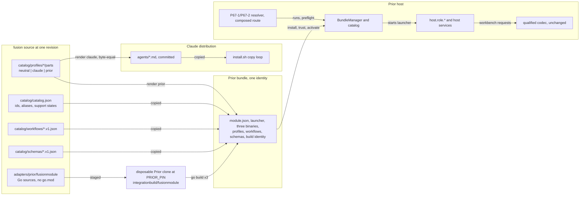
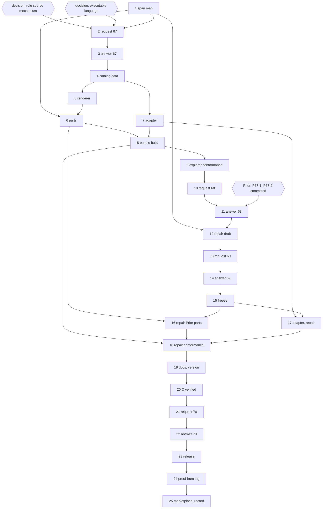

# Implementation Plan: fusion as an external Prior module bundle, the explorer first, then the four-role repair

**Date:** 2026-10-10
**Revised:** 2026-10-10 17:16, to Prior's answer to 67 at `da02626` (`Prior: docs/design/fusion-module-bundle-prior-response.md`, recorded by step 3). Steps 1 to 3 are done and unchanged; steps 4 onward follow the answer; the revision goes back to the user before step 4 runs.
**Spec:** none: planned from the package narrative `261008-1215-fusion-as-an-external-prior-module-bundle.md` and the ruling `261009-1024-fusion-is-the-one-source-of-role-texts-and-workflow-rules-for-both-hosts.md`. Prior's brief is `Prior: docs/design/fusion-prior-workflow-delivery-request.md` at `167c605`; its answer to 67 governs the contract.
**Decidability:** Four questions. (1) Do both hosts run role text from one fusion source? Decidable: the Claude render of a converted role is compared byte for byte with the committed `agents/<id>.md`, and the Prior render's neutral parts are the same bytes (steps 5, 6, 16). (2) Is the Claude distribution unchanged? Decidable: an installed-tree diff between the `v13.0.0` install and the candidate's, and `git diff` over `codec/` (step 20). (3) Did Prior run the real external module, and on which target? **Not decidable from any input fusion has**: only Prior's host observes which process ran, and 67.9 counts a cross-compiled binary as built, not qualified, until it ran on its platform. So fusion's fake-host tests prove protocol conformance on macOS arm64 and say so (steps 9, 18); the acceptance is Prior's written answer, whose bundle digest must equal the one fusion's reproducible build records (steps 11, 22); the Linux targets stay unqualified until Prior reports a run on them. (4) Do the roles behave "the same way" on both hosts? Not decidable from text; the ruling defines it as the same tasks, hand-overs and quality requirements, reduced here to identical neutral role bytes, one workflow definition and frozen result schemas, three decidable comparisons.

## Directive

The narrative's brief, not restated: from one pinned fusion revision, (1) an independently runnable Prior module bundle, (2) the role catalog with rendered Prior assets and explicit support states, (3) the explorer workflow and the four-role repair contract, (4) the unchanged Claude Code distribution; reached when Prior runs a real external explorer, then a complete reviewed repair with a restart and old runs still readable, from the delivered bundle. Requests 59 and 60 stay closed. The ruling binds the shape: fusion authors the host-neutral part of each role and workflow, extracted from today's `agents/*.md`, and generates both host outputs from it; the proof order is the explorer first, then implementer, reviewer and state-auditor.

## Current State

**Fusion**, measured at `main` `4eb4380a`. Outside `fusion-workbench/` the tree differs from `v13.0.0` (`468d8e87`) in `codec/fixtures/prior/REQUESTS.md` alone. Fusion has no Go code, no catalog, no module manifest and no `explorer` agent. `install.sh` copies a fixed list of entries, so a new top-level directory never reaches a Claude install. The span map (`261010-1504-span-map-and-repair-correspondence.md`) gives the byte offsets for the three prompts; its neutral spans cite `CLAUDE.md` 15 times and `rules/user-facing-output.md` 3 times, which 67.2 resolves from the Prior side.

**Prior, pinned at `da02626`**, parent `167c605`; `moduleapi/v1`, `go.mod` and `go.sum` are identical in both (`git diff --stat` prints nothing). Its working tree is dirty and unused. The committed contract as built:

- `moduleapi/v1`: framing (4-byte length, 1 MiB body), HMAC handshake, `Server.Workflows` with a `HostCaller` exposing `CallHost` only, the host-side `ConnectWithServices`, `DecodeManifest`, and the durable role services `host.role.{run,read,complete}.v1`. Standard library only. `github.com/kai/prior` is not fetchable; `go.mod` says `go 1.26.0` and requires four modules the adapter never imports.
- `internal/module.BundleManager`: inspect, install (explicit trust), activate, bind, start. The module receives the two `PRIOR_MODULE_*` variables and nothing else, no `PATH`. The bundle digest is the sha256 of a documented compact file index (`Prior: docs/design/prior-installed-module-bundles.md` `## Inventory and persistence`).
- No CLI uses `BundleManager`; the external catalog resolver and run-provisioning composition are Prior's P67-1 and P67-2, due before request 68, which runs through that library route, not a command (67.6). The embedded `fusion` 1.8.0 still serves Prior's pilot; its 28 000-byte input bound binds no external profile (67.7).

## Approach

**One source, two renders, one adapter.** A new Node package `catalog/` holds the role catalog, the role parts, the workflow definitions and the result schemas, and renders two targets: the Claude render reproduces `agents/<id>.md` byte for byte for the converted roles, the Prior render becomes the bundle's profile assets with the cited rule file inlined. The adapter is Go source under `adapters/prior/fusionmodule/`, authored and delivered by fusion (67.10, A). It has no `go.mod` and compiles nowhere in fusion's tree: `adapters/prior/stage.sh` clones Prior at `adapters/prior/PRIOR_PIN` into a disposable directory, copies the sources to `integrationbuild/fusionmodule/` there, and every `go vet`, `go test` and `go build` runs inside that clone against Prior's root `go.mod` and its own `moduleapi/v1` (67.4, route a): no `replace`, `go.work`, nested module or vendored copy, nothing committed to Prior, and the installed module needs neither checkout. The workflows interpret fusion's definitions over one observe-then-act step executor: each step reads its durable role operation first and acts only on `absent`. Prior provisions runs, resolves instructions from the installed payload, supplies the project context, runs the service preflight and keeps authority, accounting and recovery; fusion's module decides domain sequence, hand-overs and completion. The container's two decisions (role source: option 1, span parts; executable: Go, staged build) are answered.

The graph has no cycle and no edge between the Claude distribution and the Prior host, which is the property item 4 of the brief requires.

**The Claude distribution stays unchanged by construction, and step 20 verifies it.** No step edits `agents/`, `skills/`, `rules/`, `hooks/`, `bin/`, `templates/`, `stilwerk/` or `CLAUDE.md`; step 19 alone changes `.claude-plugin/plugin.json` (the version) and `README-agents.md`. Converted agents are regenerated byte-equal. **Growth bounds:** no bounded surface grows, no head-room is raised and no baseline moves. `catalog/` and `adapters/prior/` keep their tests in their own trees, like `codec/`, so they sit outside every bound (an Open Question).

## Implementation Steps

1. **Span map of three prompts, and the repair correspondence**
   - Executor: analyst
   - Files: `$OUT_ANALYSIS/<stamp>-span-map-and-repair-correspondence.md`
   - Changes: For `agents/code-implementer.md`, `agents/reviewer.md` and `agents/state-auditor.md` at `4eb4380a`, a table of contiguous byte spans, each tagged `neutral` or `claude` with a one-clause reason, cut so that no `neutral` span holds a host token (the token list of decision `261010-1235-how-is-the-host-neutral-role-text-the-source-of-both-the-claude-agents-and-the-prior-profiles.md` `## Constraints`). Then a correspondence table: each step of Prior's embedded repair (`Prior: internal/repair/`, `modules/fusion/integration/` at `167c605`) and each orchestrator rule for implement, review and reconcile (`agents/orchestrator.md`) mapped to one step of a proposed host-neutral repair workflow, or marked unmapped with the reason.
   - Dependencies: none
   - Acceptance: per prompt, the spans' lengths sum to `wc -c` of the file and no two spans overlap; `grep` of each `neutral` span's text for the token list finds nothing; every embedded repair step appears in the correspondence table once.

2. **Request 67: the bundle and explorer contract proposal**
   - Executor: code-implementer
   - Files: `codec/fixtures/prior/REQUESTS.md` (a new section `## Module bundle (request 67, the contract proposal)` appended; no line above edited)
   - Changes: Written against fusion HEAD and Prior `167c605`. Questions 67.1 to 67.8 for G1 to G7 and G11, each with fusion's proposal and the preferred answer form. The proposals: the catalog and profile file shapes of `## Data Structures`; Prior resolves a role's instructions from `profiles/<id>.md` in the installed payload; module id `fusion` with the fusion release version, embedded 1.8.0 runs kept under their own pin; a vendored copy per decision `261010-1235-in-which-language-is-the-prior-module-executable-built-and-how-does-it-consume-priors-module-api.md`; run ids and `audit_ref` passed in the workflow invocation's input, never minted by the module; the output-contract paragraph authored in the Prior profile part and the schema carried in the role input; delivery as a tarball and digest under Prior's existing explicit-trust install. Also the explorer workflow as capability `fusion.explorer.v1`, with input and result schemas adopted from Prior's `explorer-result.json` shape. It asks nothing about the codec.
   - Dependencies: step 1; decisions `261010-1235-how-is-the-host-neutral-role-text-the-source-of-both-the-claude-agents-and-the-prior-profiles.md` and `261010-1235-in-which-language-is-the-prior-module-executable-built-and-how-does-it-consume-priors-module-api.md` answered by the user
   - Acceptance: `git diff --stat HEAD -- codec` lists `codec/fixtures/prior/REQUESTS.md` alone; `cd codec && npm test` green; the section names each of G1 to G7 and G11 once.

3. **Prior's answer to 67, recorded** *(requires user approval: the user relays Prior's answer)*
   - Executor: code-implementer
   - Files: `codec/fixtures/prior/REQUESTS.md` (`### Prior's answer to 67 at <Prior commit>`)
   - Changes: Records each answer by question number and the Prior commit that holds it. Where an answer changes a proposal, the section says which later step it changes.
   - Dependencies: step 2
   - Acceptance: every question 67.x has an answer row with a Prior commit; `git diff --stat` touches that file alone.

4. **Catalog data: ids, support states, explorer workflow and schemas**
   - Executor: data-implementer
   - Files: `catalog/catalog.json`; `catalog/profiles/{explorer,code-implementer,reviewer,state-auditor}/profile.json`; `catalog/workflows/explorer.v1.json`; `catalog/schemas/{catalog,profile,workflow}.schema.json`; `catalog/schemas/{explorer-request,explorer-envelope}.v1.json`; `catalog/schemas/explorer-result.v1.json` (Prior's `modules/fusion/schemas/explorer-result.json` at `167c605`, copied unchanged, `$id` included)
   - Changes: Every Prior id at `167c605` and every Claude agent name appears once, `defect-fixer` as `unsupported` on both hosts (67.3). Explorer: `prior` `supported`, `claude-code` `unsupported` (item 4 of the brief). The three repair roles carry `prior` `planned`, shipped for inspection, refusing dispatch (67.2); every other role `unsupported` for `prior`. `code-reviewer` and `data-reviewer` are aliases of `reviewer` with domain `code` or `ontology`, the domain preserved in the binding. Schemas per `## Data Structures`; no network `$ref`. The workflow definition states the explorer's one step, its hand-over, its completion condition (settled role, schema-valid result within the limit) and `revise_bound` 0, read as 67.5 rules: N permits N+1 attempts, one host-provisioned run each. `requires` names the three `host.role.*` services, the input to Prior's preflight.
   - Dependencies: step 3
   - Acceptance: `node -e` validation of each JSON file against its schema exits 0 (the command written into the step's report); `jq -r '.roles[].id' catalog/catalog.json | sort | uniq -d` prints nothing; `grep -l 'http' catalog/schemas/*.v1.json` lists `explorer-result.v1.json` alone, and `cmp` against `git show 167c605:modules/fusion/schemas/explorer-result.json` prints nothing.

5. **The catalog renderer and its tests**
   - Executor: code-implementer
   - Files: `catalog/package.json`, `catalog/package-lock.json`, `catalog/tsconfig.json`, `catalog/vitest.config.mjs`, `catalog/src/render.ts`, `catalog/src/__tests__/render.test.ts`, `catalog/README.md`
   - Changes: `render claude` writes the Claude output of each role that has parts to `agents/<id>.md`. `render prior <dir>` writes `profiles/<id>.md` for every role whose `prior` state is not `unsupported`, resolving the one directive a `prior` part may carry, `{{include rules/user-facing-output.md}}`, to the file's bytes under a provenance line (path, fusion commit, sha256), so the rendered text has no runtime include (67.2). Tests: byte equality of the Claude render with the committed file, compared as raw bytes; no host token in a `neutral` part (the regexes of step 1's Finding 1) and no Claude token or unresolved include in a Prior render; schema validation; every id resolves, aliases included, each to one canonical role with one domain. Dependency versions follow `hooks/package.json`'s pins.
   - Dependencies: step 4
   - Acceptance: `cd catalog && npm ci && npm test`. Expected red: the byte-equality cases in `catalog/src/__tests__/render.test.ts` for the three prompts, whose parts step 6 writes. Any other red is a stop.

6. **The three prompts as parts, and the Prior overlays that resolve their references**
   - Executor: code-implementer
   - Files: `catalog/profiles/{code-implementer,reviewer,state-auditor}/parts/*.md`; `catalog/profiles/explorer/parts/*.md`
   - Changes: Splits the three prompts at step 1's byte offsets and adds no other cut. Authors the explorer's `neutral` and `prior` parts from Prior's explorer semantics (one bounded repository question, read-only tools, at most four findings, named uncertainties) and `rules/critical-stance.md`; it has no `claude` part. Each `prior` part, the three repair roles' first ones included so the planned assets ship coherent, carries: a `## Setup` heading numbered so step 1's Finding 3 cross-references resolve; the sentence that `CLAUDE.md` in the neutral text means the host-supplied `project_context` of the role input, a missing project fact is reported as missing and no command guessed (67.2); the include of `rules/user-facing-output.md`, its own needed references resolved in the overlay; and the whole output contract, one JSON object matching the `output_contract` schema in the role input, since Prior appends no sentence (67.7). `agents/` is regenerated and must not change.
   - Dependencies: steps 1, 5
   - Acceptance: `cd catalog && npm test` green; `git diff --quiet 4eb4380a -- agents` exits 0; `cd hooks && npm test` green with no `UPDATE_*` variable set.

7. **The adapter sources, the staging script and the explorer workflow**
   - Executor: code-implementer
   - Files: `adapters/prior/PRIOR_PIN` (one line, `da02626`); `adapters/prior/stage.sh`; `adapters/prior/check-imports.sh`; `adapters/prior/fusionmodule/cmd/fusion-module/main.go`; `adapters/prior/fusionmodule/internal/steps/`; `adapters/prior/fusionmodule/internal/explorer/`, with unit tests; `adapters/prior/README.md`
   - Changes: The sources are packages of Prior's module under the import prefix `github.com/kai/prior/integrationbuild/fusionmodule/`, importing `github.com/kai/prior/moduleapi/v1` and the standard library and nothing under `internal/` or `modules/` (67.4). `stage.sh <command>` clones Prior from its local repository at `PRIOR_PIN` into a fresh scratch directory, copies `fusionmodule/` to `integrationbuild/fusionmodule/`, runs `go mod download` once, and runs the command there with `GOWORK=off GOTOOLCHAIN=local`: `test` is `go vet` and `go test` over `./integrationbuild/fusionmodule/...`, a build is step 8's. `check-imports.sh` greps for a forbidden prefix without Go. The executable decodes its identity, serves `fusion.explorer.v1`, validates the invocation against the request schema loaded from the bundle's data files, and performs no service preflight: that is Prior's, before the process starts (67.6). It composes the immutable role input (question, scope, limit, `project_context` copied unchanged, `output_contract` holding the result schema object), keeps it identical across read, run, complete and restart, then reads, runs on `absent`, completes on `answered` with the invocation's `audit_ref` sent only as `RoleCall.audit_ref`, reuses the stored answer on `settled`, and answers `recovery-required` on `accepted` or on a missing or invalid required audit, never a fabricated one (67.5). It validates the answer against the schema and the limit separately (the schema has no `maxItems`) and returns `completed` only for a settled role; `host_evidence` is copied from the host's answer or `null` when none exists (67.6). Every frame is checked against the 1 MiB bound before sending.
   - Dependencies: step 4
   - Acceptance: `adapters/prior/check-imports.sh` exits 0; `adapters/prior/stage.sh test` green, the clone's `git rev-parse HEAD` printed and equal to `PRIOR_PIN`; `find adapters/prior -name go.mod -o -name go.work` prints nothing.

8. **The reproducible bundle build, its identity and the delivery**
   - Executor: code-implementer
   - Files: `adapters/prior/build.sh`; `adapters/prior/launcher/fusion-module.sh`; `adapters/prior/fusionmodule/cmd/fusion-bundle/main.go` (the assembler, built and run natively in the clone, never shipped)
   - Changes: Refuses a dirty fusion tree. Runs `catalog` `render prior`, then, through `stage.sh`, one build per target in Prior's exact form, `GOWORK=off GOTOOLCHAIN=local CGO_ENABLED=0 GOOS=<os> GOARCH=<arch> go build -mod=readonly -trimpath -buildvcs=false -o <out>/bin/<os>-<arch>/fusion-module ./integrationbuild/fusionmodule/cmd/fusion-module`, for `darwin-arm64`, `linux-amd64` and `linux-arm64` (67.4, 67.9). The launcher is the manifest's `executable`, `bin/fusion-module`: `#!/bin/sh`, calls `/usr/bin/uname -s -m` by absolute path, maps the three whitelisted pairs to `bin/<os>-<arch>/fusion-module` relative to its own absolute location, fails on any other, `exec`s the absolute path with the environment preserved, and writes nothing to stdout before the handshake (67.9). The assembler writes `module.json`, `profiles/`, `catalog.json`, `workflows/`, `schemas/` and `build-identity.json` into an empty directory outside both repositories, modes 0500 for launcher and binaries and 0400 otherwise, no link. It computes the bundle digest by Prior's documented index algorithm over every file, `build-identity.json` included, and writes an uncompressed tarball with sorted entries, uid and gid 0, empty names and mtime 0, beside it a `.sha256` sidecar and a `handover.json` (bundle digest, tarball sha256, both revisions, the build commands), none of which enters the payload (67.8). `build.sh deliver` copies the three into `~/.local/share/prior/incoming/fusion/<version>/<bundle-digest-hex>/` and prints the absolute path.
   - Dependencies: steps 6, 7
   - Acceptance: two builds into two fresh directories print the same digest and byte-equal tarballs; `find <dir> -type l` prints nothing; `DecodeManifest` in the clone accepts `module.json`; `tar -tvf` shows mtime 1970 and no user name on every entry; `env -i /bin/sh <dir>/bin/fusion-module </dev/null` execs `bin/darwin-arm64/fusion-module`, which exits on the missing identity with nothing on stdout.

9. **Explorer conformance against a fake host, from the extracted bundle**
   - Executor: code-implementer
   - Files: `adapters/prior/fusionmodule/conformance/host_test.go`, `adapters/prior/fusionmodule/conformance/explorer_test.go`
   - Changes: Go tests run by `stage.sh test` with step 8's bundle directory given by environment, skipped with a named reason when absent. They extract the tarball into a temp directory, start the launcher through `os/exec` with only the two Prior variables, and connect through `moduleapi/v1` `ConnectWithServices` with fake, durable `host.role.*` handlers. Cases: handshake and advertised capability; a valid answer completed with `host_evidence` copied from the fake answer; a schema-invalid answer refused and not completed; five findings against a limit of four refused; a kill after the host persisted the answer, then a fresh process re-invoked with the same operation id and an identical role input, with zero further fake model calls; `settled` reused without a run; `accepted` yields `recovery-required` with `host_evidence: null`; `answered` with no `audit_ref` yields `recovery-required`; a fresh invocation operation id with the same run id accepted; an oversize input and an unknown capability refused. No missing-service case: that preflight is Prior's (67.6). The file header says this is conformance on macOS arm64, not Prior acceptance; the Linux binaries are never started.
   - Dependencies: step 8
   - Acceptance: `FUSION_BUNDLE_DIR=<step-8 dir> adapters/prior/stage.sh test` green with every conformance case run, none skipped.

10. **Request 68: the explorer hand-over**
    - Executor: code-implementer
    - Files: `codec/fixtures/prior/REQUESTS.md` (`## Module bundle (request 68, the explorer)`)
    - Changes: The absolute hand-over path, the bundle digest, the sidecar's tarball sha256, `build-identity.json` and `handover.json` in full, and step 9's result. It names macOS arm64 as the target the conformance run started and the Linux targets as built, not qualified (67.9). It asks Prior to extract, inspect, trust, install and activate the bundle, resolve the explorer's assets from the installed payload, supply `project_context`, provision the run, run the preflight, run one real explorer through the composed route of P67-1 and P67-2 with a real model, restart and re-read it, and answer with the digest and platform it ran. It asks for no CLI command.
    - Dependencies: step 9
    - Acceptance: the digest written equals a fresh step-8 build's; `git diff --stat HEAD -- codec` lists `REQUESTS.md` alone.

11. **Prior's answer to 68, recorded: the explorer proof** *(requires user approval: the user relays Prior's answer)*
    - Executor: code-implementer
    - Files: `codec/fixtures/prior/REQUESTS.md`
    - Changes: Records the answer, the Prior commit, the digest and platform Prior ran, the Prior commit that carries P67-1 and P67-2, and any defect Prior names.
    - Dependencies: step 10; P67-1 and P67-2 in a Prior commit (67.6, 67.10)
    - Acceptance: the recorded digest equals step 10's; `git cat-file -e` confirms the named P67-1/P67-2 commit in Prior's repository; a defect Prior names is filed as an issue in this container before the step closes.

12. **The repair workflow definition and its schemas, drafted**
    - Executor: data-implementer
    - Files: `catalog/workflows/repair.v1.json`; `catalog/schemas/{repair-request,repair-result,implementer-result,review-response,audit-result}.v1.json`; the three repair roles' `profile.json` (`prior` state stays `planned`)
    - Changes: From step 1's correspondence: explorer, implementer, reviewer (domain `code`, independent principal), a bounded revise loop, host integration, state-auditor, close. Each step names its hand-over input, its completion condition and the host services it requires. `review-response` adopts Prior's embedded shape unless step 1 names a reason not to.
    - Dependencies: steps 1, 11
    - Acceptance: schema validation as in step 4; each workflow step names a role or a host service that the catalog or the definition's `requires` list resolves.

13. **Request 69: the repair contract**
    - Executor: code-implementer
    - Files: `codec/fixtures/prior/REQUESTS.md` (`## Module bundle (request 69, the four-role repair)`)
    - Changes: Proposes the host capabilities for G8 to G10 with their bounds. Workbench reads come as pages of a stated size with a continuation handle; workbench writes are codec requests the host executes under its authority, answered within the frame or by a handle. It proposes the attempt map (one host-provisioned run per attempt, `revise_bound` N permitting N+1, persisted and frozen before dispatch) and the roles of each revision, as 67.5 left to this request; restart semantics, independent principals and old-run readability: embedded runs keyed `repair-role:<role>`, the step-11 run, frozen `.v1` schemas (67.3). Cites step 12's files.
    - Dependencies: step 12
    - Acceptance: as step 2, naming each of G8 to G10 and the attempt map once.

14. **Prior's answer to 69, recorded** *(requires user approval: the user relays Prior's answer)*
    - Executor: code-implementer
    - Files: `codec/fixtures/prior/REQUESTS.md`
    - Changes: As step 3.
    - Dependencies: step 13
    - Acceptance: every 69.x answered with a Prior commit.

15. **The repair contract frozen**
    - Executor: data-implementer
    - Files: step 12's files; `catalog/schemas/FROZEN` (one line per published schema: id and sha256)
    - Changes: Applies answer 69. Freezes every `.v1` schema and workflow definition published so far, the explorer's included.
    - Dependencies: step 14
    - Acceptance: `cd catalog && npm test` green, including a case that fails when a file named in `FROZEN` changes.

16. **Prior parts for implementer, reviewer and state-auditor**
    - Executor: code-implementer
    - Files: `catalog/profiles/{code-implementer,reviewer,state-auditor}/parts/*prior*.md`; their `profile.json` `prior` state `supported`
    - Changes: Extends step 6's overlays with Prior's tool and persistence wording per answer 69: implementer confined to its workspace, reviewer and auditor read-only with host persistence. Neutral parts unchanged.
    - Dependencies: steps 6, 15
    - Acceptance: `cd catalog && npm test` green; `git diff --quiet 4eb4380a -- agents` exits 0.

17. **The adapter's repair workflow**
    - Executor: code-implementer
    - Files: `adapters/prior/fusionmodule/internal/repair/`, `adapters/prior/fusionmodule/internal/hostsvc/`, unit tests; `cmd/fusion-module/main.go` registers `fusion.repair.v1`
    - Changes: Interprets `repair.v1.json` on the step executor of step 7. Performs no service preflight: the definition's `requires` list is Prior's input (67.6). Validates the invocation's attempt map against `revise_bound` before any role call and refuses a short one; attempt *i* runs on host-provisioned run *i*, no id reused, the loop bounded as the definition and answer 69 state. Workbench access goes through the answered paging and handle form only.
    - Dependencies: steps 7, 15
    - Acceptance: `adapters/prior/stage.sh test` green.

18. **Repair conformance against a fake host**
    - Executor: code-implementer
    - Files: `adapters/prior/fusionmodule/conformance/repair_test.go`; `adapters/prior/testdata/repair-fixture/`
    - Changes: A toy repository with one failing test, one package and one plan, served by fake host services. Cases: a reviewed repair to audited close; a `revise` verdict looped within its bound on distinct run ids, then `escalate`; a kill at each persisted step boundary, then resume, with zero repeated fake model calls; a corrupted review binding refused; an attempt map short of the bound refused before any role call; step 9's explorer results still decoded by the frozen schemas. No missing-service case: that preflight is Prior's.
    - Dependencies: steps 8, 16, 17
    - Acceptance: `FUSION_BUNDLE_DIR=<fresh build> adapters/prior/stage.sh test` green.

19. **Documentation and the version of the candidate**
    - Executor: code-implementer
    - Files: `README-agents.md` (`## Plugin structure`: the catalog, the generated prompts and their editing route; `## Releasing`: the bundle build, the Prior pin and the delivery directory); `.claude-plugin/plugin.json` (version, proposed 13.1.0)
    - Changes: Names the three generated prompts and the command that regenerates them. `CLAUDE.md` is not edited: it is charged to every dispatch path at zero head-room.
    - Dependencies: step 18
    - Acceptance: `cd hooks && npm test` green with no `UPDATE_*` variable set; `git diff --quiet HEAD -- CLAUDE.md agents skills rules`.

20. **The candidate C verified, the Claude distribution proven unchanged**
    - Executor: analyst
    - Files: `$OUT_ANALYSIS/<stamp>-candidate-c-verification.md`
    - Changes: In an isolated clone at C, runs the three Node suites (`hooks`, `codec`, `catalog`) and `adapters/prior/stage.sh test`, and builds the bundle twice. Installs `v13.0.0` and C with `install.sh` under `env -i` into scratch homes, then diffs the two installed trees.
    - Dependencies: step 19
    - Acceptance: the report records each of: the installed-tree diff lists `.claude-plugin/plugin.json` and `README-agents.md` only; neither tree holds `catalog/` or `adapters/`; `git diff --quiet v13.0.0 C -- agents skills rules hooks bin templates stilwerk`; `git diff --stat v13.0.0 C -- codec` lists `codec/fixtures/prior/REQUESTS.md` alone; both bundle builds print one digest; every suite is green.

21. **Request 70: the hand-over of the bundle built at C**
    - Executor: code-implementer
    - Files: `codec/fixtures/prior/REQUESTS.md` (`## Module bundle (request 70, the reviewed repair at C)`)
    - Changes: C, the digest, the hand-over path, step 20's report, steps 9 and 18's results. It asks Prior to run, from that bundle, a real explorer and then a complete reviewed repair with a restart. It also asks Prior to show that the embedded pilot runs and the step-11 run stay readable, and to answer with the digest it ran. It records the ruling's consequence: Prior replaces its embedded fusion definitions for new work, on its schedule.
    - Dependencies: step 20
    - Acceptance: as step 10.

22. **Prior's answer to 70, recorded** *(requires user approval: the user relays Prior's answer)*
    - Executor: code-implementer
    - Files: `codec/fixtures/prior/REQUESTS.md`
    - Changes: As step 11.
    - Dependencies: step 21
    - Acceptance: as step 11.

23. **The release act: `main` and the tag at C** *(requires user approval: the release)*
    - Executor: code-implementer
    - Files: none in the tree; refs `main` and `v13.1.0` (or the version the user names)
    - Changes: Only on a "Yes" in step 22's record. Fast-forwards `main` to C and tags it. Nothing is rebuilt.
    - Dependencies: step 22
    - Acceptance: `git rev-parse 'v13.1.0^{commit}'` equals C; `git ls-remote origin` shows both refs at C.

24. **The proof from the tag**
    - Executor: analyst
    - Files: `$OUT_ANALYSIS/<stamp>-post-release-proof.md`
    - Changes: Rebuilds the bundle from the tag's archive through `build.sh` and installs the Claude distribution from the tag under `env -i`.
    - Dependencies: step 23
    - Acceptance: the rebuilt digest equals step 22's; the installed tree equals step 20's C install (`diff -r` prints nothing).

25. **The marketplace entry and the closing record** *(requires user approval: the marketplace push, and the push of this record)*
    - Executor: code-implementer
    - Files: the marketplace clone's fusion entry; `codec/fixtures/prior/REQUESTS.md` (`## Module bundle (released as v13.1.0)`)
    - Changes: Version in the marketplace entry. In REQUESTS.md: the released identity, the bundle digest, step 24's result, and requests 67 to 70 as they stand.
    - Dependencies: step 24
    - Acceptance: the entry's `version` equals `plugin.json` at the tag; the section's table lists 67 to 70 each with a Prior commit.

Every edge is a dependency the steps declare, and every declared dependency is an edge. The four Prior answers (3, 11, 14, 22) and the P67-1/P67-2 commit are the only joins between the two repositories.

## Where this work stops

- The work is finished when step 22 records Prior's "Yes": a real external explorer, then a complete reviewed repair with a restart, both from the bundle built at C, with the embedded pilot runs and the step-11 run still readable. The digest Prior names must equal the one step 20 recorded.
- It is also finished only if step 20's report shows the Claude install from C differing from the `v13.0.0` install in `.claude-plugin/plugin.json` and `README-agents.md` alone, neither tree holding `catalog/` or `adapters/`.
- It is also finished only if `git diff --stat v13.0.0 C -- codec` lists `codec/fixtures/prior/REQUESTS.md` alone, so requests 59 and 60 stay closed.
- It is also finished only if no growth-bound baseline or head-room constant changed between `v13.0.0` and C (`git diff v13.0.0 C -- hooks/lib/__tests__` prints nothing).
- The two decisions step 2 depends on stand `answered` before it runs (condition met: both answered 2026-10-10).
- If Prior refuses or defers any of G2, G5, G6 (answer 67), the work stops at that answer (condition did not arise: `da02626` refused and deferred none). If Prior refuses or defers G8 (answer 69), the package is paused, its narrative naming the Prior item it waits for. No embedded or synthetic substitute is built.
- Step 11 does not close before P67-1 and P67-2 are in a Prior commit the record names.
- The Linux targets are delivered built, not qualified; the work does not wait for Prior to qualify them.
- The release act (step 23) requires step 22's "Yes" and the user's approval of the release, in that order. A Prior answer that names any defect is not a "Yes".

## Data Structures

`catalog/catalog.json`: `{"schema": "fusion.catalog/v1", "roles": [{"id", "claude_name" | null, "prior_ids": [..], "aliases": [{"id", "domain"}], "support": {"claude-code": S, "prior": S}}]}`, where `S` is `supported`, `planned` or `unsupported`, never an absent key, and only `supported` is executable on Prior.

`catalog/profiles/<id>/profile.json`: `{"id", "parts": [{"file", "tag": "neutral" | "claude" | "prior"}], "input_schema", "result_schema", "tools_ceiling": [..], "may_delegate", "writes_workbench": {"claude-code": bool, "prior": bool}, "execution_policy": {"claude-code": "claude-guided", "prior": "prior-enforced"}}`; the ceiling, delegation and write declarations constrain the host's grant and create no permission (67.2).

`catalog/workflows/<id>.v1.json`: `{"id", "capability", "steps": [{"id", "role" | "host_service", "input_from", "completion"}], "revise_bound", "requires": [host capability names]}`; `revise_bound` N permits N+1 attempts, one host-provisioned run each.

`explorer-request.v1.json`, the invocation input: `{"question", "path_scope": [..], "findings_limit": 1..4, "run_id", "project_context": {"instructions": [{"path", "sha256", "text"}]}, "recovery": {"audit_ref"} | null}`. The immutable role input: `{"question", "path_scope", "findings_limit", "project_context", "output_contract": <the explorer-result.v1 schema object>}`.

Envelope: `{"domain": {"status": "completed" | "refused" | "recovery-required", "result": <explorer-result.v1> | null, "violations": [..]}, "host_evidence": {"run_id", "principal_id", "observed_at", "role_state"} | null}`.

`build-identity.json`: `{"fusion_revision", "prior_revision", "go_version", "adapter_sources": [{"path", "sha256"}], "targets": [{"os", "arch", "command", "sha256"}], "payload": [{"path", "sha256"}]}`, itself not in `payload`.

## API Changes

New module capabilities `fusion.explorer.v1` and `fusion.repair.v1` (module API v1 `module.invoke`). Host capabilities beyond `host.role.*` are named by Prior's answer to 69. The service preflight, the project context, the run provisioning and the attempt map are Prior's. No change to `bin/`, the hooks, the codec CLI or any Claude entry point.

## Testing Strategy

Three layers. `catalog/`: byte equality, host-token lint, include resolution, schema validation, the frozen-schema guard. `adapters/prior/`: unit tests and fake-host conformance inside the staged Prior clone (`stage.sh test`), conformance on macOS arm64, never acceptance. Prior: the real runs of 68 and 70. The Claude side is held by `cd hooks && npm test` with no golden regenerated (steps 6, 16, 19) and step 20's install diff.

## Risks & Mitigations

| Risk | Mitigation |
|---|---|
| A hand edit to a generated prompt bypasses the catalog | The byte-equality test fails; `README-agents.md` names the route (step 19) |
| Prior's `moduleapi/v1` moves between `PRIOR_PIN` and the revision Prior runs 68 on | The build identity names the pin; a wire break shows in the handshake, which answer 68 reports |
| `go build -mod=readonly` in a fresh clone lacks Prior's four required modules | `stage.sh` runs `go mod download` once in the clone: a build-machine prerequisite, never a bundle dependency |
| The launcher maps a host's `uname` to the wrong binary, or none | The whitelist fails closed; the conformance run starts through the launcher (67.9) |
| A cross-compiled Linux binary never ran anywhere | Reported as built, not qualified (67.9); qualification is Prior's run, never a fusion claim |
| The conformance suite is mistaken for acceptance | File headers and the hand-over sections say which is which; the stop conditions name Prior's answer |
| Explorer or Prior-overlay text carries a stale citation nobody lints | `reference-resolution-lint` does not scan `catalog/`; the catalog test checks tokens and includes; the gap is stated in `catalog/README.md` |

## Open Questions

- [ ] Should the new surfaces `catalog/` and `adapters/prior/` get a growth bound? Recommended: not in this package; `codec/` has none, and no bound is armed on an unmeasured corpus.
- [ ] Release number for C: 13.1.0 is proposed and admissible to Prior (67.3); the user names it at step 23.
