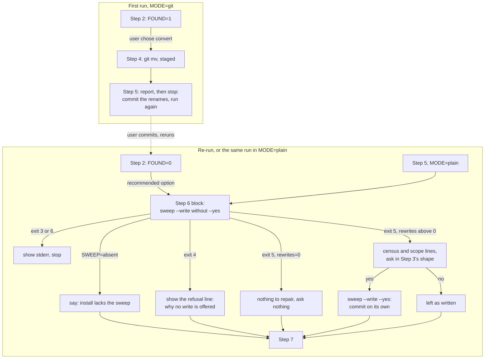

# Implementation Plan: /fusion:migrate Step 6 offers a citation sweep it can actually write

**Date:** 2026-10-15
**Spec:** none — planned from the issue `261014-0830-migrate-step-6-runs-the-citation-sweep-write-on-a-tree-its-own-guard-refuses.md` and its two notes of 2026-10-14
**Decidability:** As the issue frames it, the load-bearing question is "were the renames done while the sweep was never offered?" The tree cannot decide that. No file records whether Step 6 was offered, declined or refused, and git history records it only for runs whose commit message happens to say so (axibra-1 does, krk does not). We therefore change the question. Step 6 asks two others, both decidable on the current tree by the sweep itself: "may the sweep write here now?" (guard (a), `refusal()` in `hooks/citation-sweep.ts`) and "is there anything of the three store-prefixed kinds left to write?" (the census). The sweep's `--write` without `--yes` answers both in one call: exit 4 with the refused condition on stderr, or exit 5 with the census. Whether a v12-format re-run enters Step 6 at all is a scope choice. It is filed as `261015-0633-does-a-migrate-run-on-a-v12-format-workbench-offer-the-citation-sweep-when-its-census-counts-store-prefixed-citations.md`, and its recommended option keeps the entry condition a tree fact (`FOUND=0`).

## Directive

The work package `261014-2003-migrate-step-6-offers-sweep-it-can-write.md` asks for the fix of the issue cited above. Step 6 of `skills/migrate/SKILL.md` runs the sweep's write straight after Step 4's staged renames, which guard (a) refuses with exit 4. A re-run after the commit reaches `FOUND=0` and never offers Step 6 again. The acceptance criteria come from the issue. Prior adds a hard requirement: the fix carries a reproduction of the failure sequence, which so far has only been derived from code, plus a regression test. This plan does not restate the issue.

## Current State

- **`skills/migrate/SKILL.md`** (26 924 bytes, baseline 26 620). `## Step 2`, the `FOUND=0` bullet: "Ask nothing and go to Step 7". `## Step 5` lists what to do next (commit, tell others, `/fusion:setup`) and then flows into Step 6 in the same run. `## Step 6` is prose with inline commands: `[ -x "$SWEEP" ]`, `--dry-run --kinds "$K"`, exits 3 and 6 handled, then `--write --yes --kinds "$K"`, and the sentence "which stays unstaged beside the staged renames". Exit 4 is not named. Line 18 promises that a v12-format workbench "finds nothing and stops without asking".
- **`hooks/citation-sweep.ts`**. `main()` asks `refusal(root, extra, files)` before anything else whenever `--write` is given, with or without `--yes` (the write branch after the corpus is built). `refusal()` returns, in order: `no-git`, `not-a-git-work-tree`, `workbench-untracked`, `dirty-tree` (from `dirtyCorpusPaths()` over `porcelainPaths()`, which returns both halves of an `R` entry), `path-outside-repo`, `path-untracked`. Exit 4 prints nothing on stdout. Exit 5 (`--write` without `--yes`) prints the full census, including `format=`, the three `scope=` lines and the summary line, and only then refuses. Exit codes are in the header's `## Exit codes`.
- **Inference, not executed:** staged renames from Step 4's `git mv` appear in porcelain as `R  <new>\0<old>`, `<new>` is a corpus file, so `dirtyCorpusPaths()` names it and the write is refused `dirty-tree`. The reviewer confirmed the guard by reading it and did not execute the sequence (issue, evidence block). The existing case "passes a pending change outside the corpus and refuses one inside it" in `hooks/lib/__tests__/citation-sweep.test.ts` covers a modified file, not a rename.
- **`hooks/lib/__tests__/store-name-migration.test.ts`** (124 lines) already runs the shipped Step 2 guard and survey blocks and the Step 4 apply block. It lifts them by heading anchor through `extractBashBlock()` (`hooks/lib/__tests__/helpers/prompt-blocks.ts`) and runs them with a real bash, over throwaway trees in both `git` and `plain` mode. Its `tree()` fixture writes no `.fusion-setup`, which the sweep needs to find the workbench. It never runs the sweep. This is where the reproduction and the regression test belong.
- **Growth bounds** (`README-hooks.md` `### Growth bounds on the shipped text`), measured off the current golden `hooks/lib/__tests__/fixtures/surface-growth.golden` and the baselines in `hooks/lib/__tests__/surface-growth-bound.test.ts`. `skills/` stands at 222 391 bytes against a budget of 228 028, a margin of 5 637. The hook tests stand at 24 928 lines against 28 872, a margin of 3 944. Both figures were taken at `313134ed`.
- **A red that predates this plan:** `lib/__tests__/workbench-citation-lint.test.ts` fails at `313134ed` on two dangling tokens in committed records of the package `260928-1338-json-control-data-and-markdown-artefacts`: line 18 of `261010-1045-a-narrative-that-is-a-directory-or-unreadable-makes-the-codec-throw-and-exit-1-for-every-workbench-wide-read.md` and line 9 of `261010-1045-containment-is-lexical-so-a-symlinked-store-sends-codec-writes-outside-the-workbench-and-list-never-sees-them.md` (the lint's own output names both tokens). Every "full hook suite green" below means green apart from exactly these two findings. Any other red is a stop. If those findings are repaired first, the exception lapses.
- **Neighbouring open issue, out of scope:** `261014-0830-migrate-and-setup-skills-name-helper-output-and-exit-paths-the-helpers-do-not-provide.md`, item 2: "tracked entries only" moves untracked children with their directory. It touches the same file and the same byte budget, so this plan leaves it alone and says so.

## Approach

**The run ends at the commit, and the next run picks up where the tree stands.** A git-mode run that moved anything stops at Step 5 and tells the user to commit the renames and run `/fusion:migrate` again. The re-run finds `FOUND=0`, and under the recommended option of the decision record, `FOUND=0` routes to Step 6 rather than straight to Step 7. In `MODE=plain` there is nothing to commit, so Step 5 continues into Step 6 as it does today.

**Step 6 asks the sweep instead of predicting it.** Today's `--dry-run` is replaced by one shipped bash block that calls `"$SWEEP" --write --kinds "$K"` without `--yes`. That is the sweep's own two-guard sequence, so the skill copies no part of the guard's predicate (`HYG-SOT`). The exit code routes:

The exit codes are disjoint, and the five outcomes cover every exit the sweep documents for this call. Exit 0 cannot occur without `--yes`, and exit 1 or 2 is a usage error or a missing workbench, which Step 1 has already ruled out. The skill shows those two the way it shows 3 and 6. Exit 4 never stops the run. Its refusal line names the reason (`not-a-git-work-tree` and `workbench-untracked` in plain mode, `dirty-tree` on a re-run made before the commit), and the next run reaches Step 6 again whatever happened here. That is why this branch needs no stop and no reason parsing. The issue asked to "skip the write offer in MODE=plain and say why". This design meets that through the guard's own refusal, not through a second test in the skill that could disagree with the guard.

**The reproduction comes first, and its outcome gates everything after it.** Step 1 runs the documented sequence as shipped against a fixture v11 workbench in git. If the write over staged renames is not refused with exit 4 `dirty-tree`, the defect as filed does not exist, and the work stops there (`## Where this work stops`).

## Implementation Steps

1. **Reproduce the refusal on the shipped sequence**
   - Executor: code-implementer
   - Files: `hooks/lib/__tests__/store-name-migration.test.ts`, `hooks/lib/__tests__/fixtures/surface-growth.golden`
   - Changes: Add a `describe` block for the sweep over the renamed tree. Give the fixture a `.fusion-setup` and two records whose bodies cite moved paths: one `circles/<dir>/<dir>.md` (a `package-record`) and one `shared/planning/<stem>.md` (a `record`). The cases are:
     - (a) Git mode: commit the fixture, run the shipped survey and apply blocks, then run the write exactly as `## Step 6` of the current text spells it, `"$FUSION_PLUGIN_ROOT/bin/fusion-citation-sweep" --write --yes --kinds record,package-record,package-dir`, from the project root with `FUSION_PLUGIN_ROOT` set to the plugin root. Assert exit 4, empty stdout, a stderr line matching `refused (dirty-tree)` that names a renamed path, and both record files byte-identical to before.
     - (b) The same tree after `git commit` of the staged renames: the same call exits 0 and the census counts at least the two planted rewrites.
     - (c) Plain mode, the same fixture without `git init`: exit 4, with a stderr line matching `refused \((not-a-git-work-tree|workbench-untracked|dirty-tree)\)`. That is the existing tolerance in `citation-sweep.test.ts` for a tmpdir that sits inside a repository.

     These cases pin the guard property the skill relies on. They stay true after the fix, and they never go red with it. Regenerate the surface golden in the same step (`cd hooks && UPDATE_SURFACE_GOLDEN=1 npx vitest run lib/__tests__/surface-growth-bound.test.ts`, which rewrites the golden and fails on purpose; then run the bound again). The golden is that command's output, owned by the step whose edit moves it.
   - Acceptance: report the observed exit and stderr of case (a) verbatim, with the result of `npx vitest run lib/__tests__/store-name-migration.test.ts lib/__tests__/surface-growth-bound.test.ts`. **Gate:** if case (a) does not exit 4 `dirty-tree`, keep the case as the observation it is, assert what was observed, report, and stop. Steps 2 to 6 do not start.
   - Dependencies: none

2. **Route the re-run to Step 6, end the git-mode rename run at Step 5, and make Step 6 one shipped block**
   - Executor: code-implementer
   - Files: `skills/migrate/SKILL.md`, `hooks/lib/__tests__/fixtures/surface-growth.golden`
   - Changes, assuming option 1 of the decision record:
     - `## Step 2`, the `FOUND=0` bullet: ask nothing about renames and go to Step 6.
     - `## Step 5`: the "what to do next" paragraph keeps its order. Then, in `MODE=git` after a run that moved anything, the step ends the run: commit the renames as one commit, then run `/fusion:migrate` again, and the re-run offers the citation repairs and Step 7. In `MODE=plain`, go on to Step 6.
     - `## Step 6`: one bash block, anchored so a test can lift it. It sets `SWEEP` and `K`, prints `SWEEP=absent` when `[ -x "$SWEEP" ]` fails, and otherwise runs `"$SWEEP" --write --kinds "$K"` with stderr left visible and echoes the exit code. The prose under the block routes as in the diagram in `## Approach`. Exits 1, 2, 3 and 6 show stderr and stop. Exit 4 shows the refusal line, says no write is offered for that reason, notes that `dirty-tree` clears with a commit or a stash and that a re-run offers this step again, and goes to Step 7. Exit 5 with `rewrites=0` asks nothing. Exit 5 with rewrites above zero reports the summary and the three `scope=` lines, naming the `archive/` and `extra-paths` shares, and asks. On a yes the step runs `"$SWEEP" --write --yes --kinds "$K"` and says the record content it wrote is committed as its own commit. Delete "which stays unstaged beside the staged renames". Keep the `bare-record` paragraph, shortened where the bytes demand it.
     - Line 18: a run on a v12-format workbench renames nothing and asks only about citations the sweep still counts.
     - Under option 2 instead: the `FOUND=0` bullet routes to Step 6 too, and Step 6's exit-5 branch asks only when the census's first line reads `format=legacy`. Otherwise the step says the repair is a direct sweep call and goes to Step 7. Nothing else in this step changes.
   - Byte budget: net growth of `skills/migrate/SKILL.md` at most 800 bytes over its current 26 924. The block replaces the inline commands, so cut Step 6's prose first. A red bound is answered by a cut in this file, never by a baseline or head-room edit. Regenerate the surface golden as in step 1.
   - Acceptance: `npx vitest run lib/__tests__/store-name-migration.test.ts lib/__tests__/surface-growth-bound.test.ts lib/__tests__/path-literal-lint.test.ts lib/__tests__/glob-nomatch-lint.test.ts` is green. The existing survey and apply cases still lift their blocks by the same anchors.
   - Dependencies: step 1 (its gate passed); the user's answer to the decision record

3. **Regression test: the documented sequence reaches a write with no exit 4**
   - Executor: code-implementer
   - Files: `hooks/lib/__tests__/store-name-migration.test.ts`, `hooks/lib/__tests__/fixtures/surface-growth.golden`
   - Changes: Lift the new Step 6 block by its anchor. Assert that the skill text contains the exact write command the yes-branch names, and run that string as lifted. The cases are:
     - (a) Git, the issue's acceptance: fixture v11 workbench, survey, apply, `git commit` as Step 5 directs, survey reads `FOUND=0`, the Step 6 block exits 5 with rewrites above zero and no `refused (` on stderr, the yes-branch write exits 0, the Step 6 block again reads rewrites=0. Assert no exit 4 anywhere in the sequence.
     - (b) Plain, the issue's second criterion: the apply runs in `mode=plain`, and the Step 6 block exits 4 with the refusal line on stderr, the line Step 6 shows as its reason.
     - (c) A re-run before the commit: the Step 6 block exits 4 `dirty-tree`.
     - (d) Option 1 only: a JSON-controlled v12 workbench (the `jsonWorkbenchAt` helper the sweep tests use) carrying `circles/` citations, krk's shape. The Step 6 block offers, exit 5 with rewrites above zero.
     - (e) Two text assertions on the routing the blocks cannot carry: the `FOUND=0` bullet names Step 6, and Step 5 names running `/fusion:migrate` again.

     Regenerate the golden.
   - Acceptance: the full hook suite (`cd hooks && npm test`) is green, the growth bounds included.
   - Dependencies: step 2

4. **Bring the two upgrade notes and the README to the two-run sequence**
   - Executor: code-implementer
   - Files: `docs/upgrading-to-v13.md`, `docs/upgrading-to-v12.md`, `README.md`
   - Changes: In `docs/upgrading-to-v13.md`, `## Migrating your workbench` step 3: a run that renames stores stops after the rename, the user commits and runs `/fusion:migrate` again, and the citation repairs and the JSON migration come on that run. In `docs/upgrading-to-v12.md`, the paragraph after "Commit the migration as one commit": the repair is offered on the run after the rename commit, not as the last step of the same run. Give the "Upgrading from v11.11.2" paragraph of `README.md` one clause, "then run it again", after "commit the renames as one commit". Leave `README-hooks.md` and the header of `hooks/citation-sweep.ts` alone: both still say Step 6 sweeps after the rename and before Step 7, which stays true.
   - Acceptance: `npx vitest run lib/__tests__/reference-resolution-lint.test.ts lib/__tests__/workbench-citation-lint.test.ts` is green. No bounded surface is touched.
   - Dependencies: step 2

5. **Record the resolution on the issue**
   - Executor: code-implementer
   - Files: the issue `261014-0830-migrate-step-6-runs-the-citation-sweep-write-on-a-tree-its-own-guard-refuses.md` (in the container of the package `261008-1215-fusion-as-an-external-prior-module-bundle`)
   - Changes: Append `---` and a `Resolved:` line naming the reproduction (step 1, with the observed refusal), the skill change (`skills/migrate/SKILL.md` `## Step 5`, `## Step 6`, the `## Step 2` `FOUND=0` bullet) and the regression cases (`hooks/lib/__tests__/store-name-migration.test.ts`), in anchor form with no commit hash. Write no transition. The dispatcher closes the issue with `--disposition '{"kind":"fixed","reason_ref":null}'` after reading the `Verification:` line.
   - Acceptance: run the full hook suite after this write, since the workbench citation lint reads the record. Green.
   - Dependencies: steps 3 and 4

6. **Release surfaces (optional; the user may skip this step)**
   - Executor: code-implementer
   - Files: `.claude-plugin/plugin.json`, `skills/help/SKILL.md` (`### 4. Update`), `install.sh` (the header's `FUSION_REF=tags/v<version>` example), `README.md` (the same pin example), `hooks/lib/__tests__/fixtures/surface-growth.golden`
   - Changes: Bump 13.1.1 to 13.1.2, per decision `261014-0830-does-a-shipped-file-change-after-a-release-tag-take-a-version-bump-when-the-bump-changes-the-prior-bundle-digest.md` (option 1). The help topic gains a 13.1.2 paragraph, relabels the paragraphs below it and drops the oldest, staying inside the skills margin left after step 2. Bring the two pin examples to 13.1.2. Regenerate the golden. The marketplace entry, the commits, the push and the tag are outside this plan (`README-agents.md` `## Releasing`). No Prior bundle is owed, since nothing the bundle carries for Prior changed.
   - Acceptance: the full hook suite is green, and `claude plugin validate .` reports passed.
   - Dependencies: step 5

## Where this work stops

- Step 1's case (a) does not exit 4 `dirty-tree` on staged renames: the work stops after step 1 with the observation reported, and nothing else in this plan is done.
- The decision record has an answer the user gave, and steps 2 and 3 implement that option, not the other one.
- On a fixture v11 workbench in git, the shipped sequence (survey, apply, commit, re-run, Step 6 block, the yes-branch write) runs with no exit 4 and ends at rewrites=0.
- On a plain workbench, the Step 6 block exits 4 and the skill shows the guard's refusal line as the reason no write is offered.
- `skills/migrate/SKILL.md` grew by at most 800 bytes, and every growth bound is green with no baseline or head-room constant edited.
- The issue carries a `Resolved:` line, and the full hook suite ran green after it was written.
- Before any release of this fix, the version is 13.1.2 on every surface step 6 names, or step 6 was skipped and the user knows nothing ships until it runs. (Condition did not arise at planning time: a pending affected migration run. The user knows of none.)

## Data Structures

None.

## API Changes

None in any helper. The skill's Step 6 changes the call it makes: `--write` without `--yes` replaces `--dry-run`. That is an existing mode of `bin/fusion-citation-sweep` (exit 5, census printed), so the sweep itself does not change.

## Testing Strategy

The reproduction and the regression run the shipped text, never a pasted copy of it, following the existing convention of `store-name-migration.test.ts`. Step 1 pins the guard's behaviour on the exact sequence the issue derived, and step 3 runs the corrected sequence end to end in both modes. Two prose routings cannot be executed (Step 2's `FOUND=0` bullet and Step 5's stop), so they get one text assertion each. That is the honest limit of what a test proves about a skill body: the agent following the prose is still read, not run.

## Risks & Mitigations

| Risk | Mitigation |
|---|---|
| Step 1 does not reproduce (for example, porcelain lists the staged rename differently than inferred) | Gate in step 1: stop and report. A fix for an unconfirmed defect is not built. |
| A user re-runs before committing and Step 7 then runs over uncommitted renames | This was possible before the fix as well (Step 7 ran in the same run as the renames). Step 6's exit-4 line says to commit first. `bin/fusion-migrate` survey already reads a staged rename (`hooks/lib/__tests__/migrate.test.ts`, the staged-rename person case). |
| Collisions, or "tracked entries only", leave `FOUND=1` for good, so Step 6 is never reached | Unchanged by this plan, and the same already holds for Step 7. Step 5 names each collision to resolve by hand. Item 2 of the neighbouring issue stays its own fix. |
| Option 1 makes a declined offer recur on every run | Stated in the decision record. The census tells the user each time what the write would change. |
| The skills byte margin (5 637) is shared by steps 2 and 6 | Step 2 is capped at 800 bytes. Step 6's help paragraph drops the oldest one in the same edit. |
| `README-hooks.md` says no pipeline or workflow runs the sweep, while `/fusion:migrate` does after a yes | This predates the plan and this plan does not change it. inference: "run by a person" is read as the user's yes. Left to the policy-curator if anyone wants it reconciled. |

## Open Questions

- [ ] Does a v12-format re-run offer the sweep whenever the census counts rewrites, JSON-controlled workbenches like krk included (option 1, recommended), or only while the workbench is Markdown-controlled (option 2)? Filed as `261015-0633-does-a-migrate-run-on-a-v12-format-workbench-offer-the-citation-sweep-when-its-census-counts-store-prefixed-citations.md`. Steps 2 and 3 wait on it.
- [ ] Does step 6 (release surfaces) run in this package, or ride the next release?
