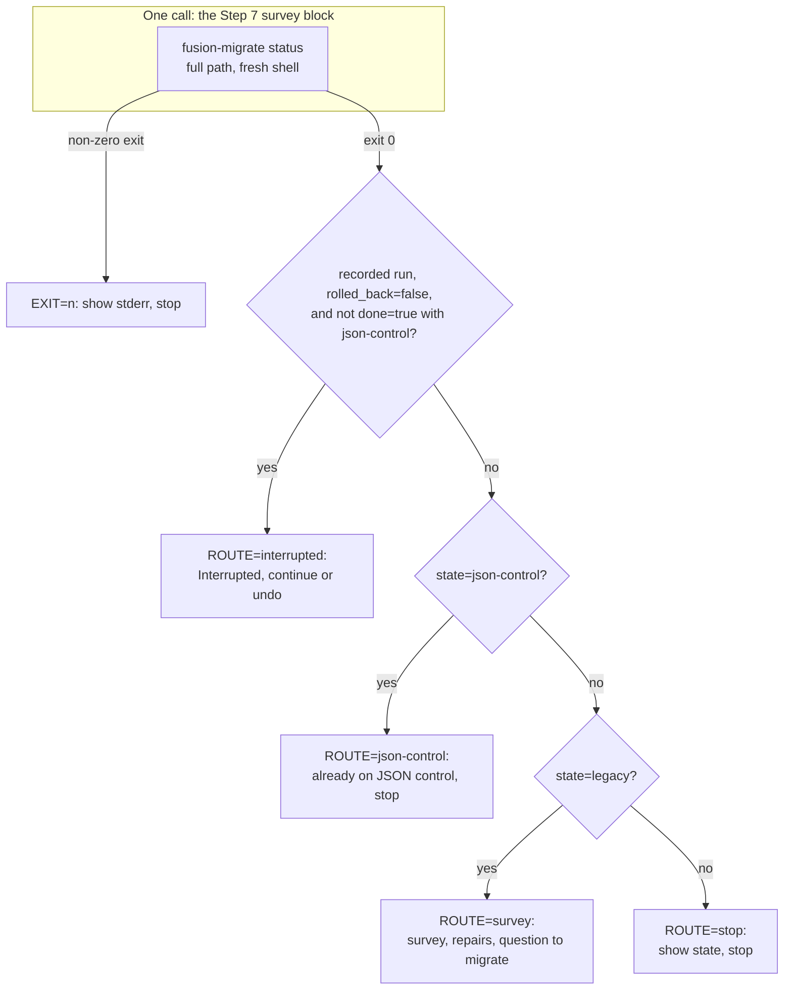
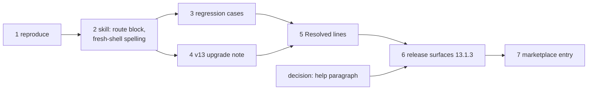

# Implementation Plan: /fusion:migrate Step 7 recognises a JSON-controlled workbench with no local migration session

**Date:** 2026-10-15
**Spec:** none. Planned from the issue `261015-1310-migrate-step-7-reads-a-json-controlled-workbench-with-no-local-session-as-unmigrated-and-tells-the-user-to-fix-its-manifest-by-hand.md` (its Evidence, Fix direction and Acceptance), with its sibling `261015-1310-migrate-step-7-and-step-1-carry-shell-variables-across-separate-bash-calls.md` folded in (see `## Approach`).
**Decidability:** The load-bearing question is "is this workbench already on JSON control?" Step 7 answers it today from `done=true` in `bin/fusion-migrate status`. That field reads the migration session under `$HOME/.fusion-migrate/<hash>`, which records only runs made on this machine, so it cannot answer the question for a workbench migrated elsewhere or created JSON-native. The question is decidable from the tree. `status` already prints `state=`, which is the codec's `inspect` reading of `workbench.json` (`codec/src/store.ts`: `legacy`, `json-control` or `unsupported`). The mechanism changes accordingly: the tree's `state=` decides whether the workbench is on JSON control, and the session decides only whether a run made on this machine is still in flight. Both are inputs `status` prints, so the routing is computed from one call's output.

## Directive

The work package `261015-1549-migrate-step-7-recognises-json-control-without-session.md` asks for the fix of the issue above. Since 13.1.2 every `FOUND=0` run reaches Step 7, and `skills/help/SKILL.md` `### 4. Update` advises re-running `/fusion:migrate` on JSON-controlled workbenches. Such a run prints `run=none`, falls through to `survey` and `repair --list`, and tells the user to fix `workbench.json` and every control file by hand. The issue's acceptance holds as written: with no session under `$HOME/.fusion-migrate/`, Step 7 says the workbench is already on JSON control and stops, asking nothing and naming no finding, and a test runs that case.

## Current State

- **`skills/migrate/SKILL.md`** (27 468 bytes, growth baseline 26 620). In `## Step 7 — Repair, then migrate to JSON control`, the paragraph after the Node block reads "Set `M="$FUSION_PLUGIN_ROOT/bin/fusion-migrate"`; every call below runs from `$ROOT`." `**Survey.**` reads "Run `"$M" status`. With `done=true` and `rolled_back=false` the workbench is already on JSON control: say so and stop. With a recorded run that is not done, go to *Interrupted* below. Otherwise run `"$M" survey` …". There is no bash block in Step 7 after the Node check, so no test can lift the status call today. `"$M"` is spelled in 12 places (`grep -o '"\$M"' skills/migrate/SKILL.md | wc -l`). `## Step 1 — Locate the workbench` sets `ROOT` in its block and says "`cd "$ROOT"`" in prose.
- **`hooks/migrate.ts` `status()`.** It prints `session=`, `state=` (from `inspect`), `fence=`, `backup=` and `repairs=`. With no `state.json` in the session it adds `run=none` and nothing else. With one it adds `migration=`, `planned=`, `chunks=`, `verified=`, `done=` and `rolled_back=`. `drive()` writes `workbench.json` at `verify`, then the setup metadata, then `maintenance end`, and only then sets `done=true`. So a run interrupted after `verify` shows `state=json-control` together with `done=false`, and a stop on `state=json-control` "whatever `run=` says", as the issue's fix direction words it, would skip a resume that is owed. The plan's routing keeps that case on *Interrupted*. A rollback interrupted after the manifest was removed shows `done=true`, `rolled_back=false` and `state=legacy`. Today's text reads that as "already on JSON control", which is wrong too.
- **Verified by the planner on 2026-10-15** in a scratch copy: `codec/fixtures/workbench/.fusion-setup` and `workbench.json` under `fusion-workbench/`, `HOME` set to a directory holding an empty `.fusion-migrate/`. `bin/fusion-migrate status` printed `state=json-control`, `fence=-` and `run=none`, with no `done=` line, and exited 0. `survey` printed `layout=json-control` and `findings=blocking	manifest-present	1`. `repair --list` printed `blocking=1` and `unrepairable=… it stays blocking until the Markdown is fixed by hand`. `status` created no session directory. A prototype of the routing block in `## Approach` (379 bytes) gave the expected route in all six cases of step 3 (a) to (f), using hand-written minimal `state.json` files (`workbench`, `migration_id`, `plan: null`, `schedule: null`, `rollback: null`, `done`, `rolled_back`).
- **`hooks/lib/__tests__/store-name-migration.test.ts`** (214 lines) already has `FRESH_ENV` ("shell variables do not outlive the call that set them"), `jsonWorkbenchAt` and the "Step 6 as shipped" pattern of lifting blocks by anchor through `extractBashBlock()` (`hooks/lib/__tests__/helpers/prompt-blocks.ts`, the first bash block after the anchor line). `FRESH_ENV` carries the real `HOME`, so the Step 7 cases override `HOME` with a temp directory.
- **Growth bounds**, measured at `7a4cd8a7` with `surface-growth-bound.test.ts` green. `skills/` stands at 222 575 bytes against a budget of 228 028, a margin of 5 453. The hook tests stand at 25 018 lines against 28 872, a margin of 3 854.
- **`reference-resolution-lint`** pins counts (`BASELINE = { paths: 2049, anchors: 371, stampBare: 11 }`). Spelling `$FUSION_PLUGIN_ROOT/bin/fusion-migrate` in each Step 7 command adds path tokens, and on 2026-10-15 the same change in Step 6 moved `paths` up and was re-approved with an attribution entry. This pin is a different instrument from the growth bounds. Re-approving it is the response its own message prescribes, and the user approves the numbers.
- **A red that predates this plan:** `lib/__tests__/workbench-citation-lint.test.ts` fails at `7a4cd8a7` with two dangling-citation findings, the two named in the previous package's plan. Every "suite green" below means green apart from exactly those findings. Any other red, including a third finding in that lint, is a stop.
- **Neighbouring open issues, deliberately left out:**
  - `261015-1310-migrate-step-6-yes-branch-flows-into-step-7-before-the-sweep-rewrites-are-committed.md` (M1). It changes where Step 6's yes-branch ends, a routing decision about Step 6. After this fix it no longer applies to a JSON-controlled workbench, since Step 7 stops there. The closing review advised doing M1 and M2 with H1. This plan takes M2 and not M1, because M1's fix is a design choice about Step 6 (stop for a commit, or check the tree in Step 7) that nobody has made.
  - `261015-1310-migrate-step-5-routing-prose-leaves-a-gap-and-two-next-step-orders.md` (L1, including line 18's "asks only about citations").
  - `261015-1310-store-name-migration-test-pins-less-than-two-case-names-claim.md` (L2).
  - `261014-0830-migrate-and-setup-skills-name-helper-output-and-exit-paths-the-helpers-do-not-provide.md`, whose item 1 touches Step 7's `**Repairs**` paragraph.

## Approach

**One routing table, computed by the shipped block instead of read off prose.** `**Survey.**` becomes a lifted bash block. It runs `status` with the helper's full path, echoes every line, prints `EXIT=<n>` on a non-zero exit, and otherwise prints one `ROUTE=` line computed by `awk` from that output. The rules are first-match, so they are disjoint by construction, and they are complete because the last rule takes every remaining input:

1. A recorded run (`rolled_back=false` present) that is not settled, meaning not both `done=true` and `state=json-control`: `ROUTE=interrupted`.
2. `state=json-control`: `ROUTE=json-control`. The workbench is already on JSON control, whether it was migrated here, elsewhere, or created JSON-native. Say so and stop, asking nothing and naming no finding.
3. `state=legacy`: `ROUTE=survey`, which is today's survey, repairs and question.
4. Anything else (`unsupported`): `ROUTE=stop`. Show the `state=` line and stop.

The routing reads only what `status` prints. It copies no part of the helper's logic: `run` keeps its own `previous?.done` no-op, and `status` keeps being the report it is. Putting the route into `status` itself (a `next=` line) was considered and not taken. That would change a helper's output contract and its tests to answer a question that belongs to the skill.

**The sibling issue is folded in, and here is why.** The fix rewrites the `**Survey.**` paragraph, and the "Set `M=…`" sentence sits directly above it. The issue's test requirement (run Step 7's status call) only works in `FRESH_ENV` if that call spells the full path. Doing that for one call and leaving `"$M"` in the other eleven would leave Step 7 half on one spelling and half on the other. So every Step 7 command spells `"$FUSION_PLUGIN_ROOT/bin/fusion-migrate"`, as Step 6 does since `42d8f1bc`. The "Set `M=`" sentence goes. Step 1's `cd "$ROOT"` moves into its block, and one sentence says the working directory persists between calls while variables do not. That sentence is the sibling issue's own second option. This widens the package beyond the one issue its narrative names. The step that carries it (step 2, last bullet group, and step 3 (h)) can be dropped without touching the rest, at the cost of the half-spelled state above. See `## Open Questions`.

**Reproduce first, gate on it.** Step 1 runs the call the current text spells, over a JSON fixture with an empty session directory, and fails the gate unless it shows `state=json-control`, `run=none` and no `done=` line. With that output the current `**Survey.**` routes to `survey`.

## Implementation Steps

1. **Reproduce the misread on the call the current text spells**
   - Executor: code-implementer
   - Files: `hooks/lib/__tests__/store-name-migration.test.ts`, `hooks/lib/__tests__/fixtures/surface-growth.golden`
   - Changes: Add a `describe` block, "Step 7 on a JSON-controlled workbench with no local session". The fixture is `jsonWorkbenchAt(root)` under a fresh temp root, and the env is `{ ...FRESH_ENV, HOME: <fresh temp dir holding an empty .fusion-migrate/> }`. The cases are:
     - (a) Run `"$FUSION_PLUGIN_ROOT/bin/fusion-migrate" status` (the current text's `"$M" status` with `M` as the text sets it) from the root. Assert exit 0, a `state=json-control` line, a `run=none` line and no `done=` line.
     - (b) On the same tree, `survey` prints `layout=json-control` and a `blocking=` line of class `manifest-present`, and `repair --list` prints an `unrepairable=` line. These are the findings the current text would name for the user to fix by hand.

     Both cases describe helper behaviour that stays true after the fix, so they never go red with it. Regenerate the surface golden: `cd hooks && UPDATE_SURFACE_GOLDEN=1 npx vitest run lib/__tests__/surface-growth-bound.test.ts` (it rewrites the golden and fails on purpose), then run the bound again.
   - Acceptance: report the observed stdout of (a) verbatim, quote the current `**Survey.**` paragraph's first three sentences, and give the result of `cd hooks && npx vitest run lib/__tests__/store-name-migration.test.ts lib/__tests__/surface-growth-bound.test.ts` (green). **Gate:** if (a) prints a `done=` line, or a `state=` other than `json-control`, keep the case asserting what was observed, report, and stop. Steps 2 to 7 do not start.
   - Dependencies: none

2. **Step 7 routes on the tree's state through one lifted block, and every command runs in a fresh shell**
   - Executor: code-implementer
   - Files: `skills/migrate/SKILL.md`, `hooks/lib/__tests__/reference-resolution-lint.test.ts` (the `BASELINE` constant and its attribution entry only), `hooks/lib/__tests__/fixtures/surface-growth.golden`
   - Changes:
     - `## Step 7`, `**Survey.**`: one anchored bash block. The anchor line starts `**Survey.**` and the block is the first one after it. Its shape, as prototyped:
       `S="$("$FUSION_PLUGIN_ROOT/bin/fusion-migrate" status)"; E=$?; printf '%s\n' "$S"; [ "$E" -eq 0 ] || { echo "EXIT=$E"; exit 0; }; printf '%s\n' "$S" | awk -F= '{v[$1]=$2} END {print "ROUTE=" (v["rolled_back"]=="false" && !(v["done"]=="true" && v["state"]=="json-control") ? "interrupted" : v["state"]=="json-control" ? "json-control" : v["state"]=="legacy" ? "survey" : "stop")}'`
       Under it, one line per route, as in `## Approach`. `EXIT=` shows the stderr line and stops. `ROUTE=interrupted` goes to *Interrupted*. `ROUTE=json-control` says the workbench is already on JSON control, whatever `run=` says (migrated here, in another checkout, or created so), and stops, asking nothing and naming no finding. `ROUTE=stop` shows the `state=` line and stops. `ROUTE=survey` continues with the existing survey sentence, which now spells the full path.
     - `**Interrupted.**`: "On exit 7, or `ROUTE=interrupted`", replacing "or a recorded run that is not done".
     - The fold-in of the sibling issue: delete "Set `M="$FUSION_PLUGIN_ROOT/bin/fusion-migrate"`; every call below runs from `$ROOT`." and say instead that every call below runs from the project root Step 1 changed to. Every command the skill runs spells `"$FUSION_PLUGIN_ROOT/bin/fusion-migrate"`. Helper names shown to the user in `**Report.**` may read `bin/fusion-migrate …`, as `docs/upgrading-to-v13.md` does. `## Step 1`: put `cd "$ROOT"` inside the block, and replace the prose with one sentence: the working directory persists between calls and variables do not, so no later command uses `$ROOT`.
   - Byte budget: net growth of `skills/migrate/SKILL.md` at most 1 100 bytes over 27 468, so at most 28 568. That covers the block (about 380), the route lines (about 250) and the full-path spelling (about +36 per command over 12 spellings, less the deleted sentence). Cut first in Step 7's own prose. A red growth bound is answered by a cut in this file, never by a baseline or head-room edit. Regenerate the surface golden in this step.
   - `reference-resolution-lint`: measure the delta by putting HEAD's copy of `skills/migrate/SKILL.md` back in place, as the 2026-09-15 entry did, and confirm the whole delta is this file. Write the new figures into `BASELINE` with a one-line attribution entry in the established form ("Re-approved 2026-10-15: paths A -> B …; in `skills/migrate/SKILL.md` `## Step 7` …"). Report the numbers so the user can re-approve them at commit.
   - Acceptance: `cd hooks && npx vitest run lib/__tests__/store-name-migration.test.ts lib/__tests__/surface-growth-bound.test.ts lib/__tests__/reference-resolution-lint.test.ts lib/__tests__/path-literal-lint.test.ts lib/__tests__/glob-nomatch-lint.test.ts` is green. Step 1's cases and the existing Step 2, Step 4 and Step 6 cases still lift their blocks by the same anchors. `wc -c skills/migrate/SKILL.md` is at most 28 568.
   - Dependencies: step 1 (its gate passed)

3. **Regression: the shipped Step 7 block routes every case, the issue's first**
   - Executor: code-implementer
   - Files: `hooks/lib/__tests__/store-name-migration.test.ts`, `hooks/lib/__tests__/fixtures/surface-growth.golden`
   - Changes: Lift the block with `extractBashBlock(md("migrate"), "**Survey.**")` and run it with bash in the env of step 1, each case with its own temp `HOME`. Write a session state by taking the `session=` path from a `status` call, so the hash is not recomputed, and writing a minimal `state.json` there with `workbench` set to the realpath of the workbench. The cases are:
     - (a) The issue's acceptance: `jsonWorkbenchAt`, empty `.fusion-migrate/`, gives `ROUTE=json-control`, and the output carries no `blocking=`, `finding=` or `unrepairable=` line. Add a text assertion on the line under the block: the `ROUTE=json-control` sentence says "already on JSON control" and "stop", and the skill's `survey` command appears only after the `ROUTE=survey` sentence.
     - (b) A v12 Markdown workbench (`.fusion-setup` only, no `workbench.json`) with no session gives `ROUTE=survey`.
     - (c) JSON with `done=false` and `rolled_back=false` (interrupted after `verify`) gives `ROUTE=interrupted`.
     - (d) JSON with `done=true` and `rolled_back=false` (migrated here) gives `ROUTE=json-control`.
     - (e) Legacy with `done=true` and `rolled_back=false` (a rollback interrupted after the manifest left) gives `ROUTE=interrupted`.
     - (f) Legacy with `rolled_back=true` gives `ROUTE=survey`.
     - (g) An unreadable `workbench.json` gives `ROUTE=stop`. inference: `codec/src/store.ts` reads it as `state=unsupported` and `inspect` shows that state rather than refusing it (`codec/src/cli/ops.ts`, the comment above `readable()`). If the run shows a non-zero exit instead, assert `EXIT=` and say so in the report.
     - (h) The sibling issue's acceptance: the file contains no `"$M"` and no "Set `M=`", `$ROOT` appears only inside Step 1's block, and that block contains `cd "$ROOT"`.

     Steps 1 and 3 together add at most 90 lines to the test file. Regenerate the golden.
   - Acceptance: `cd hooks && npm test` is green apart from exactly the two pre-existing `workbench-citation-lint` findings.
   - Dependencies: step 2

4. **Bring the v13 upgrade note to the new stop**
   - Executor: code-implementer
   - Files: `docs/upgrading-to-v13.md`
   - Changes: In `## Migrating your workbench`, item 3, add one sentence to the **The JSON migration** bullet: a workbench already on JSON control (migrated in this checkout, in another, or created by setup) is reported as such, and nothing is surveyed or asked. Nothing else changes. `docs/` carries no growth bound.
   - Acceptance: `cd hooks && npx vitest run lib/__tests__/reference-resolution-lint.test.ts` is green with the `BASELINE` step 2 wrote, so this sentence adds no citation.
   - Dependencies: step 2

5. **Record the resolution on both issues**
   - Executor: code-implementer
   - Files: `261015-1310-migrate-step-7-reads-a-json-controlled-workbench-with-no-local-session-as-unmigrated-and-tells-the-user-to-fix-its-manifest-by-hand.md` and `261015-1310-migrate-step-7-and-step-1-carry-shell-variables-across-separate-bash-calls.md`, both in the container of the package `261014-2003-migrate-step-6-offers-sweep-it-can-write`
   - Changes: Append `---` and a `Resolved:` line to each, in anchor form with no commit hash. The first names the reproduction (step 1, with the observed `status` output), the routing block (`skills/migrate/SKILL.md` `## Step 7 — Repair, then migrate to JSON control`, `**Survey.**`) and the regression cases (`hooks/lib/__tests__/store-name-migration.test.ts`). The second names the full-path spelling across Step 7, the `cd` folded into `## Step 1 — Locate the workbench`, and case (h). Write no transition. The dispatcher closes each with `--disposition '{"kind":"fixed","reason_ref":null}'` after reading the `Verification:` line.
   - Acceptance: after both writes, run `cd hooks && npm test`. It is green apart from exactly the two pre-existing `workbench-citation-lint` findings, so the new lines add no third finding.
   - Dependencies: steps 3 and 4

6. **Release surfaces for 13.1.3**
   - Executor: code-implementer
   - Files: `.claude-plugin/plugin.json`, `skills/help/SKILL.md` (`### 4. Update`), `install.sh` (the header's `FUSION_REF=tags/v13.1.2` example), `README.md` (the same pin example), `hooks/lib/__tests__/fixtures/surface-growth.golden`. Under option 2 of the decision record, also `README-agents.md` `## Releasing`. Under option 1, also `hooks/lib/__tests__/reference-resolution-lint.test.ts` (`BASELINE` and its entry).
   - Changes: Bump 13.1.2 to 13.1.3 in `plugin.json` and in both pin examples. Edit the help topic as the user's answer to `261015-1559-does-the-help-update-topic-at-13-1-3-drop-the-v13-migration-paragraph-or-fold-the-patch-into-the-13-1-2-paragraph.md` directs. The 13.1.3 sentence is: no migration, `fusion --update` is the whole update, and a re-run of `/fusion:migrate` on a JSON-controlled workbench now says it is already on JSON control and stops. Under option 2, reword `## Releasing` step 0's "carries the last three releases" to the paragraph reading. Under option 1, re-measure `reference-resolution-lint` and write `BASELINE` and its entry for the user's re-approval. Regenerate the golden. No Prior bundle is owed: `grep -rl migrate catalog adapters/prior` (excluding `node_modules`) found nothing the bundle carries.
   - Acceptance: `cd hooks && npm test` is green apart from the two pre-existing findings. `claude plugin validate .` reports passed. `claude --plugin-dir . --agent fusion:orchestrator -p "reply SMOKE-OK"` answers. The result of `bin/fusion-review-coverage --since v13.1.2` is stated in the report (advisory, per `260815-2109_*_may-a-circle-close-over-an-uncovered-review-range-and-who-decides.md`, option 1).
   - Dependencies: step 5; the user's answer to the decision record

7. **Marketplace entry for 13.1.3**
   - Executor: data-implementer
   - Files: `/Users/kai/Projects/productive/F03-CLAUDE-plugin-marketplace/claude-plugins/.claude-plugin/marketplace.json`
   - Changes: Set fusion's `version` to `13.1.3`. Change nothing else. `plugin.json`'s `description` does not change in step 6, so the description pair stays as it is. Before dispatching this step, the dispatcher runs `git -C /Users/kai/Projects/productive/F03-CLAUDE-plugin-marketplace/claude-plugins pull --rebase origin main` (`README-agents.md` `## Releasing`, step 2). The executor makes no git call.
   - Acceptance: the file parses as JSON, and fusion's entry reads `"version": "13.1.3"`, equal to `.claude-plugin/plugin.json`.
   - Dependencies: step 6

## Where this work stops

- Step 1's case (a) does not show `state=json-control`, `run=none` and no `done=` line: the work stops after step 1 with the observation reported, and nothing else in this plan is done.
- On a JSON-controlled workbench with no session under `$HOME/.fusion-migrate/`, the shipped Step 7 block prints `ROUTE=json-control` and no finding, and the line under it says "already on JSON control" and stop.
- Cases (b) to (g) of step 3 each print the route `## Approach` assigns them.
- `skills/migrate/SKILL.md` holds no `"$M"` and no "Set `M=`", and `$ROOT` stands only inside Step 1's block, or the user dropped the fold-in at plan approval and the half-spelled Step 7 is named as a known residual.
- `skills/migrate/SKILL.md` is at most 28 568 bytes, and every growth bound is green with no baseline or head-room constant edited.
- Every move of `reference-resolution-lint`'s `BASELINE` carries its attribution entry, and the user re-approved its numbers.
- Both issues carry a `Resolved:` line, and the full hook suite ran after those writes with no red beyond the two pre-existing `workbench-citation-lint` findings.
- The decision record has the user's answer, and step 6 implements that option.
- Before the release commit is pushed, `plugin.json`, both pin examples and `marketplace.json` read 13.1.3. Commit, push, tag `v13.1.3` and the local cache pull are the dispatcher's, after the user's approval (`README-agents.md` `## Releasing`, steps 4 to 6), and are not steps of this plan.

## Data Structures

None. The test's minimal `state.json` carries the `State` fields `status()` reads (`hooks/migrate.ts`), and nothing is added to that type.

## API Changes

None in any helper. The skill now reads `state=` from `status`, which `status` has always printed.

## Testing Strategy

The reproduction and the regression run the shipped text, never a pasted copy, following this test file's existing convention. Step 1 pins the helper output the misread came from. Step 3 runs the new routing block over each cell of the session-by-state split, the in-flight cases included, because the issue's literal fix direction would have broken those. Two things cannot be executed: the prose an agent follows under each `ROUTE=` line, and the order of the route lines and the `survey` command. They get one text assertion each, which is the honest limit of what a test proves about a skill body.

## Risks & Mitigations

| Risk | Mitigation |
|---|---|
| Step 1 does not reproduce (for example, `status` starts printing `done=` without a session) | Gate in step 1: stop and report. |
| The `awk` route parses a value containing `=` or a tab wrongly | It reads only `state`, `done` and `rolled_back`, whose values are single tokens. The `session=` path is never compared. Cases (a) to (g) pin it. |
| A JSON-controlled workbench with a foreign fence standing (`fence=` not `-`, no session here) is reported as "already on JSON control" | True of its format, so this stays in scope. Whether the stop should also show `fence=` is in `## Open Questions` and is not built here. |
| A JSON-controlled workbench whose rollback this machine began and the codec refused (fence standing, `done=true`) routes to `json-control`, as today | Unchanged from the current text. *Interrupted* is still reached from that rollback's own exit 8 in the run that hit it. |
| The fold-in of the sibling issue moves `reference-resolution-lint` | Measured by swap-back, written with its entry, and re-approved by the user (step 2). |
| The skills margin (5 453) is shared by steps 2 and 6 | Step 2 is capped at 1 100 bytes. Under option 2, step 6 adds about one sentence. Under option 1 it drops a paragraph and shrinks. |

## Open Questions

- [ ] Fold the sibling issue `261015-1310-migrate-step-7-and-step-1-carry-shell-variables-across-separate-bash-calls.md` into this package, as planned (step 2's last bullet group and case 3 (h))? The package narrative names one issue. Dropping the fold-in leaves Step 7 with one full-path call and eleven `"$M"` calls.
- [ ] Should `ROUTE=json-control` also show the `fence=` line when it is not `-`? Not built. With no session here, nothing on this machine can resume or end such a fence. The open issue `261010-1045-check-routes-a-migrations-fence-to-the-archive-helper-only.md` is the nearer home for that.
- [ ] Step 6's help paragraph: the decision record `261015-1559-does-the-help-update-topic-at-13-1-3-drop-the-v13-migration-paragraph-or-fold-the-patch-into-the-13-1-2-paragraph.md` (option 2 recommended). Step 6 waits on it.
