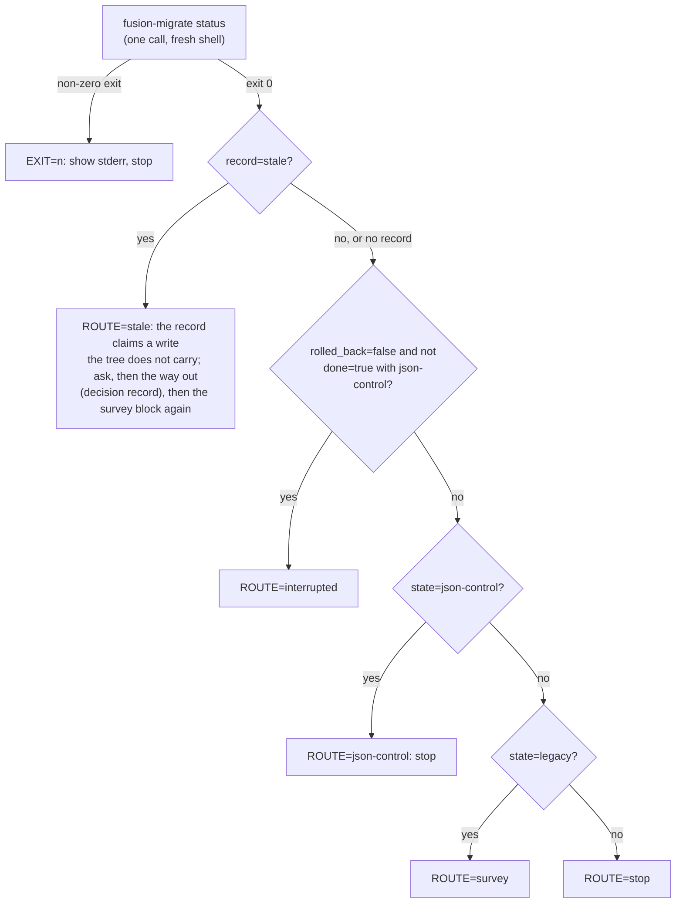
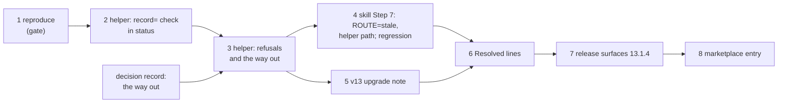

# Implementation Plan: /fusion:migrate Step 7, a way out of a stale migration session, and the helper path in every instruction

**Date:** 2026-10-16
**Spec:** none. Planned from the two issues the closing review of `261015-1549-migrate-step-7-recognises-json-control-without-session` filed: `261015-2223-migrate-step-7-routes-a-stale-done-session-over-a-legacy-tree-to-interrupted-where-neither-option-gets-out.md` (its Evidence, Fix direction and Acceptance, and the untested sibling cell the review notes under M1) and `261015-2223-migrate-step-7-still-tells-the-agent-to-run-two-subcommands-without-the-helper-path.md`.
**Decidability:** The load-bearing question is "does this migration session's record describe this tree?" The reviewer suggested answering it from the session alone: `status` prints whether a rollback is in flight. That is not decidable from the session. The planner measured that a refused `rollback` over the stale cell writes `rollback: {begin_id, end_id}` into `state.json` before the codec refuses, so after a single undo attempt the stale cell carries the same session fields as a rollback that was really interrupted. The question is decidable from the tree, against hashes the record already holds. A record names its last write: the plan index at `s.plan.path` with `s.plan.sha256`, and the stored answer of rollback chunk 0 under its scheduled operation id. The tree either carries that write or it does not (`hooks/migrate.ts` `stored()`, a file hash, and `inspect`'s `state`). The mechanism changes accordingly: the helper computes `record=current|stale` from tree evidence, `status` prints it, Step 7 routes on it, and `run`, `resume` and `rollback` refuse a stale record before they write anything.

## Directive

The work package `261016-0236-migrate-step-7-stale-session-and-helper-path.md` asks for the fix of both issues. The medium issue's acceptance holds as written. A test over the shipped Step 7 block, on a real migrated tree reset with git, gets a route other than `interrupted`. The text under that route names a way out that works. Case (e)'s fixture writes a real `rollback` value, and its label matches the state it builds. The low issue's acceptance: both instructions spell the helper path, or say "the same helper". The package also takes the sibling cell the review noted but did not file (`state=json-control`, `done=false`, an abandoned local attempt overtaken by another checkout's migrated tree). It has the same root, and the same check answers it.

## Current State

- **The dead end, reproduced by the planner on 2026-10-16** in a scratch git repository holding a copy of `codec/fixtures/legacy-v12/workbench` plus a `.fusion-setup`, with `HOME` outside the repository. The steps were `bin/fusion-migrate run` (exit 0, `result=json-control`), commit, `git reset --hard HEAD~1`. `.json-state/` carries its own `.gitignore` of `*`, so it survives the reset, and `archive/migrations/<id>/plan.json` does not. The results:
  - `status`: `state=legacy`, `fence=-`, `planned=yes`, `chunks=1/1`, `verified=yes`, `done=true`, `rolled_back=false`.
  - `resume`: `result=no-op`, exit 0.
  - `rollback`: exit 8, `conflict/plan-file-changed: archive/migrations/migration-20261016-v12/plan.json is no regular file`. **Afterwards `state.json` holds `rollback: {begin_id, end_id}`** (`hooks/migrate.ts` `rollback`, which writes the ids before the first request).
  - `run`: `result=no-op` with `note=nothing was sent: the session records this migration as verified`.
  - **The way out works.** `run --session <fresh dir>` over the same reset tree exited 0 with `result=json-control` and reused the id `migration-20261016-v12`. The codec accepted it next to the old answers in `.json-state/ops/`.
  - A trap the tests must avoid: a `HOME` inside the repository root gets committed by `git add -A` and removed by the reset. The planner's first attempt lost its session that way. `hooks/lib/__tests__/migrate.test.ts` `project()` puts `home` at `<root>/home`, inside the repository, so step 1 excludes it (`.git/info/exclude`).
- **`hooks/migrate.ts`.** `status()` prints `session=`, `state=`, `fence=`, `backup=` and `repairs=`, plus `run=none` with no `state.json`, or else `migration=`, `planned=`, `chunks=`, `verified=`, `done=` and `rolled_back=`. It does not print `state.json`'s `rollback`. `run` no-ops on `previous?.done && !previous.rolled_back`. `resumeRun` returns `result=no-op` on `s.done`. `rollback` writes `s.rollback` and then sends. Rollback chunk 0 removes the plan files and stores its answer in the intent before any plan file is gone (`codec/README.md` `## migration`, "Rollback chunk 0"). So a rollback that was really interrupted after chunk 0 has no `plan.json` but does have chunk 0's stored answer, while the stale cell has neither.
- **`bin/fusion-migrate`** execs `hooks/dist/migrate.js`. `hooks/dist/*.js` is committed (`README-agents.md` `## Releasing`, "Compiled hooks must be committed"). `npm test` compiles into a private staging tree and syncs it into `hooks/dist/` before vitest runs (`hooks/scripts/run-tests.mjs`). A bare `npx vitest run` does not compile, so it runs `bin/fusion-migrate` against whatever `hooks/dist/migrate.js` already holds. **Every step that edits `hooks/migrate.ts` runs `cd hooks && npm run build` before any targeted test, or runs targeted tests as `npm test -- <files>`.** `lib/__tests__/committed-dist.test.ts` checks the committed `dist` against the committed source, so the dispatcher commits `hooks/dist/migrate.js` together with `hooks/migrate.ts`. The wrapper's usage text is `sed -n '3,13p'` of its own header.
- **`skills/migrate/SKILL.md`** is 28 530 bytes (growth baseline 26 620). `## Step 7 — Repair, then migrate to JSON control` `**Survey.**` has one lifted block whose `awk` prints `ROUTE=interrupted|json-control|survey|stop`, first match wins. The two instructions from the low issue are "After each applied repair run `repair --list` again" and, in `**Interrupted.**`, "the way out (`rollback` again or `rollback --end-fence`)".
- **`hooks/lib/__tests__/store-name-migration.test.ts`** (275 lines). `describe("Step 7 as shipped: …")` writes hand-made `state.json` files with `plan: null, schedule: null, rollback: null` over `jsonWorkbenchAt` trees. Under the new check, case (c) "JSON, run interrupted after verify" with `plan: null` would read as stale (a JSON tree that no plan of this record produced), and case (e) models no real state, as the review found. Both are re-fixtured on real migrated trees in step 4.
- **Growth bounds**, read off `hooks/lib/__tests__/fixtures/surface-growth.golden` and the constants at `46bc80f8`. `skills/` is 223 873 bytes against a budget of 228 028 (188 768 baseline + 39 260 head-room), a margin of 4 155. The hook tests are 25 079 lines against 28 872, a margin of 3 793. `README-hooks.md` and `docs/` carry no bound.
- **`reference-resolution-lint`** pins `BASELINE = { paths: 2059, anchors: 371, stampBare: 11 }`, last re-approved on 2026-10-15. Any step that adds or removes a path or anchor citation in shipped prose moves it. The response is the one the previous package used: measure by swapping HEAD's copy of the edited file back in place, write the figures with an attribution entry, and have the user re-approve them at commit.
- **A red that predates this plan:** `lib/__tests__/workbench-citation-lint.test.ts` fails with two dangling-citation findings in package `260928-1338`, as the closing review recorded. Every "suite green" below means green apart from exactly those two findings. Any other red, a third finding in that lint included, is a stop.
- **The help topic** (`skills/help/SKILL.md` `### 4. Update`) opens with "Coming from 13.1.2 or earlier", covering 13.1.2 and 13.1.3. `README-agents.md` `## Releasing` step 0 now says a patch release that needs no migration joins its predecessor's paragraph, which is relabelled to cover it.

## Approach

**One check, owned by the helper, answers both cells.** The root is the one the review names under "Cross-cutting observations": the session is keyed by machine and path, not by tree. So the fix is not another routing special case in the skill. It is one predicate in `hooks/migrate.ts` that says whether the record's last write is in the tree, and it is used everywhere the record is trusted:

- `status` prints it as `record=current|stale` after `rolled_back=`, whenever a run is recorded.
- `run`, `resume` and `rollback` refuse a stale record with exit 5 before they write anything, and name the way out. The refused `rollback` therefore no longer writes `s.rollback` over the stale cell.
- The way out acts only on a stale record. What that way out is waits on the decision record below.
- Step 7's `awk` gains one first rule, `record=stale` gives `ROUTE=stale`. All the other rules stay as they are, so the existing table is untouched for a current record and for no record.

The predicate, defined in `## Data Structures`, names only positive contradictions. A tree that is unreadable (`state=unsupported`) never makes a record stale by its state alone. A rolled-back record claims nothing in flight, so it is never stale.



**The way out is a user choice, filed as a record:** `261016-0246-how-does-a-migration-session-whose-record-the-tree-no-longer-carries-get-out-of-the-way.md`. The options are (1) a guarded helper subcommand `set-aside --consent` that renames the session directory to `<dir>.stale-<UTC stamp>`, (2) the skill has the agent `mv` it, and (3) `run` moves it itself. Option 1 is recommended. Steps 1 and 2 do not wait on the answer. Steps 3 onward do, and each names its variant per option. Under every option, nothing is deleted: the backup and repair log stay readable beside the session path.

**Reproduce first, gate on it.** Step 1 runs the reviewer's sequence on a real migrated tree in the helper's own test file, through the shipped Step 7 block as well, and asserts the dead end as observed. It also asserts that a fresh session gets out. If the dead end does not reproduce, the work stops. If a fresh session does not get out, it stops too, because then no option in the record is a working way out.

**The low issue is folded into step 4**, because that step edits Step 7 anyway. The extended case (h) asserts the general property instead of the two phrases: no Step 7 sentence says "run `<subcommand>`" without the helper path.



## Implementation Steps

1. **Reproduce the dead end on a real migrated tree reset with git**
   - Executor: code-implementer
   - Files: `hooks/lib/__tests__/migrate.test.ts`, `hooks/lib/__tests__/fixtures/surface-growth.golden`
   - Changes: Add one `it` under `describe("bin/fusion-migrate migrates, rolls back and restores …")`, labelled for issue `261015-2223` ("a done session over a tree reset with git"). Build it from `project()`. First append `home/` to `<root>/.git/info/exclude`, so the session survives the reset (see `## Current State`). Then run `mig(root, home, "run")` and expect exit 0, commit with `git add -A` and `git commit`, and run `git reset --hard HEAD~1`. Assert the observed dead end:
     - (i) `status` gives `state=legacy`, `done=true` and `rolled_back=false`.
     - (ii) The shipped `**Survey.**` block prints `ROUTE=interrupted`. Lift it with `extractBashBlock` (import from `./helpers/prompt-blocks.js`, and read the skill through `REPO_ROOT`), and run it with `bash -c` in `root` under `{ PATH, HOME: home, FUSION_PLUGIN_ROOT: REPO_ROOT }`.
     - (iii) `resume` exits 0 with `result=no-op`.
     - (iv) `rollback` exits 8 with `plan-file-changed`, twice. After the first, `state.json` holds a non-null `rollback`.
     - (v) `run` exits 0 with `result=no-op`.
     - (vi) `run --session <root>/fresh` exits 0 with `result=json-control`.

     Case (vi) stays true after the fix. Cases (ii) to (v) describe the defect: step 3 rewrites (iii) to (v), and step 4 removes (ii). Regenerate the golden: `cd hooks && UPDATE_SURFACE_GOLDEN=1 npx vitest run lib/__tests__/surface-growth-bound.test.ts`, which fails on purpose, then run the bound again.
   - Acceptance: report the observed `status` lines and the `rollback` stderr verbatim, and the result of `cd hooks && npm test -- lib/__tests__/migrate.test.ts lib/__tests__/surface-growth-bound.test.ts` (green). **Gate:** if (i) to (v) do not show the dead end, or (vi) does not exit 0 with `result=json-control`, keep the case asserting what was observed, report, and stop. Steps 2 to 8 do not start.
   - Dependencies: none

2. **The helper decides whether the record describes the tree, and `status` prints it**
   - Executor: code-implementer
   - Files: `hooks/migrate.ts`, `hooks/dist/migrate.js` (by `npm run build`), `hooks/lib/__tests__/migrate.test.ts`, `hooks/lib/__tests__/fixtures/surface-growth.golden`
   - Changes: Add one function, for example `stale(wb, s, state)`, implementing the predicate in `## Data Structures`. It reuses `stored()` and `sha()` and computes nothing the record does not already name. `status()` appends `record=stale` or `record=current` after `rolled_back=` whenever `state.json` exists. Its doc comment states the predicate and why it reads the tree rather than `s.rollback` (the refused-undo measurement). Nothing else changes in this step: `run`, `resume` and `rollback` behave as before, so step 1's case stays green. Run `cd hooks && npm run build`. Add these cases to `migrate.test.ts`, each on a real tree:
     - (a) In step 1's case, `status` after the reset, and again after the refused `rollback`, prints `record=stale`.
     - (b) A tree migrated here prints `record=current`.
     - (c) A rollback really interrupted after chunk 0 prints `record=current`. Build it by running `run`, then a complete `rollback`, then flipping `rolled_back` back to `false` in `state.json`. That models a real cut, after `maintenance end` and before the final session write. `plan.json` is gone, rollback chunk 0's answer is stored, and `rollback` is non-null.
     - (d) The sibling cell prints `record=stale`: a copy of a migrated tree with a session recording `plan: null`, `done: false` and `rollback: null`, with `workbench` set to the copy's realpath. Add a second row with a `plan` whose `sha256` differs from the tree's `plan.json`.
   - Acceptance: `cd hooks && npm test -- lib/__tests__/migrate.test.ts lib/__tests__/store-name-migration.test.ts lib/__tests__/surface-growth-bound.test.ts` is green, with the Step 7 routing unchanged because the skill does not read `record=` yet. `git -C <repo> status --porcelain hooks/dist/migrate.js` shows it modified.
   - Dependencies: step 1 (its gate passed)

3. **`run`, `resume` and `rollback` refuse a stale record, and the way out the user chose**
   - Executor: code-implementer
   - Files: `hooks/migrate.ts`, `hooks/dist/migrate.js`, `bin/fusion-migrate` (header, usage range, `case` list), `README-hooks.md` (the `migrate.ts` row under `## Files` and the `bin/fusion-migrate` row of `### The bin/ helper roster`), `hooks/lib/__tests__/migrate.test.ts`, `hooks/lib/__tests__/fixtures/surface-growth.golden`, and `hooks/lib/__tests__/reference-resolution-lint.test.ts` (`BASELINE` and its entry only, if it moves)
   - Changes, under every option: `recorded()` (for `resume` and `rollback`) and `run`'s first check call the predicate. A stale record is refused with exit 5 before any write. `rollback` checks before it sets `s.rollback`. The message says what the record claims (`<migration_id>`, done, or a run or rollback in flight), what the tree shows, and the way out. `rollback --end-fence` keeps its own precondition. Add "a session whose record the tree does not carry" to exit 5's list in the wrapper header.
     - **Option 1:** add `set-aside --consent` to `TAKES`, to the wrapper's `case` and usage lines (the range becomes `3,14p`), and to the header's subcommand account. It refuses with exit 5 unless the record is stale, and without `--consent`. It renames the session directory to `<dir>.stale-<UTC yyyymmddThhmmssZ>`, refusing if that name exists, and prints `set-aside=<new path>` and `result=no-record`. The refusal message names `bin/fusion-migrate set-aside --consent`.
     - **Option 2:** no subcommand. The refusal names the session directory, moving it aside, and `--session <dir>`.
     - **Option 3:** `run` over a stale record renames the directory as in option 1 and goes on to its preconditions, printing `set-aside=<new path>` first. `resume` and `rollback` refuse and name `run`. Update the header's `run` account and "A second run sends nothing" accordingly.

     Rewrite step 1's (iii) to (v) as the regression: each exits 5 naming the way out, and `state.json` is byte-identical afterwards. Then the way out (option 1: `set-aside --consent`; option 2: the test's own rename; option 3: `run`) followed by `run`, if not already run, exits 0 with `result=json-control`, and `status` prints `record=current`. Add: (e) step 2's case (c) is not refused, and `rollback` there exits 0 with `result=legacy`. (f) Under options 1 and 3, the move is refused on a current record and the directory stays. Bring the two `README-hooks.md` rows to the new contract in one clause each. Run `cd hooks && npm run build`.
   - Acceptance: `cd hooks && npm test -- lib/__tests__/migrate.test.ts lib/__tests__/hook-route-exclusion.test.ts lib/__tests__/reference-resolution-lint.test.ts lib/__tests__/surface-growth-bound.test.ts` is green. Step 1's case (ii) stays green here, because the skill does not read `record=` until step 4. If `reference-resolution-lint` moved, report the swap-back measurement and the new figures for re-approval.
   - Dependencies: step 2; the user's answer to the decision record

4. **Step 7 routes a stale record to its own line, spells the helper in every instruction, and its regression runs on real trees**
   - Executor: code-implementer
   - Files: `skills/migrate/SKILL.md`, `hooks/lib/__tests__/store-name-migration.test.ts`, `hooks/lib/__tests__/migrate.test.ts` (step 1's case (ii) only), `hooks/lib/__tests__/fixtures/surface-growth.golden`, `hooks/lib/__tests__/reference-resolution-lint.test.ts` (`BASELINE` and its entry only)
   - Changes in the skill:
     - `**Survey.**` block: prepend `v["record"]=="stale" ? "stale" :` to the `awk` conditional. Change nothing else in the block.
     - One route line, **`ROUTE=stale`**: the session records a migration this tree does not carry, for example after git discarded or reverted it. Show the `migration=` and `state=` lines and ask the user, as a numbered chat question, to confirm the tree is the one they want. Then, on a yes, take the way out the decision chose (option 1: run `"$FUSION_PLUGIN_ROOT/bin/fusion-migrate" set-aside --consent`; option 2: the move of the `session=` path; option 3: go to `**The question to migrate.**`, whose `run` moves it). Then, under options 1 and 2, run the survey block again. On a no, stop.
     - `**Interrupted.**` stays as it is apart from the low issue's fix.
     - The low issue: "After each applied repair run `"$FUSION_PLUGIN_ROOT/bin/fusion-migrate" repair --list` again", and "the way out (the same helper's `rollback` again or `rollback --end-fence`)".
   - Byte budget: `skills/migrate/SKILL.md` at most 29 000 bytes under options 1 and 3, and at most 29 150 under option 2, whose line carries the command and its condition. Cut first in Step 7's own prose. A red growth bound is answered by a cut in this file, never by a baseline or head-room edit.
   - Changes in the test: re-fixture the session cases of `describe("Step 7 as shipped: …")` on real trees. A `beforeAll` builds one migrated and committed tree from `codec/fixtures/legacy-v12/workbench` with git, as step 1 does, using the `FRESH_ENV` `HOME` override. Each case copies that root with `cpSync` (`.git` and `.json-state/` included) and writes the session's `state.json` into the copy's own session directory, taken from a `status` call, with `workbench` rewritten to the copy's realpath. Then:
     - (c) JSON, interrupted after verify: the real state with `done: false`. That is the cut between the setup write and the final session write. Route `interrupted`.
     - (d) JSON, migrated here. Route `json-control`.
     - (e) Markdown, rollback interrupted after the manifest left: step 2's case (c) state. Route `interrupted`. **The label now matches the state.**
     - (f) Markdown, rolled back: a complete rollback. Route `survey`.
     - (i) The medium issue's acceptance: the reset tree with the done session, before and after one refused `rollback`. Route `stale`, and the `ROUTE=stale` line names the way out (a text assertion on the decided command or move).
     - (j) The sibling: the migrated copy with a `plan: null`, `done: false` session. Route `stale`.
     - (a), (b) and (g) keep their no-session fixtures.
     - (h) is extended: no Step 7 sentence matches ``run `(survey|repair|run|resume|rollback|status|set-aside)\b`` (a subcommand to run without the helper path), and `**Interrupted.**` says "the same helper".

     The `awk` edit turns step 1's case (ii) in `migrate.test.ts` red, since it asserts `ROUTE=interrupted`. Remove that assertion, because case (i) here supersedes it. Steps 1 to 4 add at most 140 lines across both test files. Regenerate the golden.
   - `reference-resolution-lint`: measure by swapping HEAD's copy of `skills/migrate/SKILL.md` back in place, confirm the whole delta is this file, and write `BASELINE` with a one-line attribution entry in the established form ("Re-approved 2026-10-16: paths A -> B …; in `skills/migrate/SKILL.md` `## Step 7` …"). Report the numbers so the user can re-approve them.
   - Acceptance: `cd hooks && npm test` is green apart from exactly the two pre-existing `workbench-citation-lint` findings. `wc -c skills/migrate/SKILL.md` is within the option's cap.
   - Dependencies: step 3

5. **Bring the v13 upgrade note to the stale record**
   - Executor: code-implementer
   - Files: `docs/upgrading-to-v13.md`, and `hooks/lib/__tests__/reference-resolution-lint.test.ts` if it moves
   - Changes: In the **Undo** paragraph (after "`bin/fusion-migrate status` says where a workbench stands."), add one sentence. A session recording a migration the tree no longer carries, for example after git discarded it, is reported as `record=stale`, and nothing acts on it until the way out the decision chose (named exactly) moves it aside. Nothing is deleted. Nothing else changes.
   - Acceptance: `cd hooks && npm test -- lib/__tests__/reference-resolution-lint.test.ts` is green, with a `BASELINE` written and attributed if this sentence moved it.
   - Dependencies: step 3

6. **Record the resolution on both issues**
   - Executor: code-implementer
   - Files: `261015-2223-migrate-step-7-routes-a-stale-done-session-over-a-legacy-tree-to-interrupted-where-neither-option-gets-out.md` and `261015-2223-migrate-step-7-still-tells-the-agent-to-run-two-subcommands-without-the-helper-path.md`, both in the container of the package `261015-1549-migrate-step-7-recognises-json-control-without-session`
   - Changes: Append `---` and a `Resolved:` line to each, in anchor form with no commit hash. The first names:
     - the reproduction (step 1, with the observed refusal),
     - the check (`hooks/migrate.ts` `status`, `record=`),
     - the refusals and the way out (per the decision record `261016-0246-how-does-a-migration-session-whose-record-the-tree-no-longer-carries-get-out-of-the-way.md`),
     - the route (`skills/migrate/SKILL.md` `## Step 7 — Repair, then migrate to JSON control`, `**Survey.**`),
     - the re-fixtured case (e) and the sibling case (j) (`hooks/lib/__tests__/store-name-migration.test.ts`).

     The second names the two respelled instructions and case (h). Write no transition. The dispatcher closes each with `--disposition '{"kind":"fixed","reason_ref":null}'` after reading the `Verification:` line, and moves the decision record to `implemented` at commit.
   - Acceptance: after both writes, run `cd hooks && npm test`. It is green apart from exactly the two pre-existing `workbench-citation-lint` findings, so the new lines add no third finding.
   - Dependencies: steps 4 and 5

7. **Release surfaces for 13.1.4**
   - Executor: code-implementer
   - Files: `.claude-plugin/plugin.json`, `skills/help/SKILL.md` (`### 4. Update`), `install.sh` (the header's `FUSION_REF=tags/v13.1.3` example), `README.md` (the same pin example), `hooks/lib/__tests__/fixtures/surface-growth.golden`, and `hooks/lib/__tests__/reference-resolution-lint.test.ts` if it moves
   - Changes: Bump 13.1.3 to 13.1.4 in `plugin.json` and in both pin examples. Help topic, per `README-agents.md` `## Releasing` step 0 as reworded (a patch release that needs no migration joins its predecessor's paragraph, which is relabelled to cover it):
     - Relabel "Coming from 13.1.2 or earlier" to "Coming from 13.1.3 or earlier".
     - Make "13.1.2 and 13.1.3 need no migration" read "13.1.2 to 13.1.4 need no migration".
     - Add one sentence: 13.1.4 changes one thing. When a migration recorded on this machine is no longer in the tree (git discarded or reverted it), `/fusion:migrate` says so and offers to move that record aside, instead of offering a continue or undo that cannot work.
     - Keep the other two paragraphs.

     `plugin.json`'s `description` does not change, so the description pair stays as it is. Regenerate the golden. Re-check that no Prior bundle is owed: `grep -rl migrate catalog adapters/prior`, excluding `node_modules`, finds nothing the bundle carries. `docs/upgrading-to-v12.md` describes nothing this release changes.
   - Acceptance:
     - `cd hooks && npm test` is green apart from the two pre-existing findings.
     - `claude plugin validate .` reports passed.
     - `claude --plugin-dir . --agent fusion:orchestrator -p "reply SMOKE-OK"` answers.
     - The report states the result of `bin/fusion-review-coverage --since v13.1.3` (advisory, per `260815-2109_*_may-a-circle-close-over-an-uncovered-review-range-and-who-decides.md`, option 1).
     - `grep -n "13.1.3" .claude-plugin/plugin.json install.sh README.md` finds no stale pin.
   - Dependencies: step 6

8. **Marketplace entry for 13.1.4**
   - Executor: data-implementer
   - Files: `/Users/kai/Projects/productive/F03-CLAUDE-plugin-marketplace/claude-plugins/.claude-plugin/marketplace.json`
   - Changes: Set fusion's `version` to `13.1.4`. Change nothing else. The description pair stays as it is, because step 7 leaves `plugin.json`'s `description` alone. Before dispatching this step, the dispatcher runs `git -C /Users/kai/Projects/productive/F03-CLAUDE-plugin-marketplace/claude-plugins pull --rebase origin main` (`README-agents.md` `## Releasing`, step 2). The executor makes no git call.
   - Acceptance: the file parses as JSON, and fusion's entry reads `"version": "13.1.4"`, equal to `.claude-plugin/plugin.json`.
   - Dependencies: step 7

## Where this work stops

- Step 1's case does not show the dead end ((i) to (v)), or a fresh `--session` run over the reset tree does not exit 0 with `result=json-control`: the work stops after step 1 with the observation reported, and nothing else in this plan is done.
- On a real migrated tree reset with git, the shipped Step 7 block prints `ROUTE=stale`, before and after one refused `rollback`, and the line under it names the way out the decision chose.
- After that way out, `run` over the same tree exits 0 with `result=json-control`, and `status` prints `record=current`.
- `run`, `resume` and `rollback` over a stale record each exit 5, and `state.json` is byte-identical afterwards.
- A rollback really interrupted after chunk 0 prints `record=current`, routes to `interrupted`, and `rollback` there exits 0 with `result=legacy`.
- The sibling cell (a migrated tree under a `plan: null`, `done: false` record) routes to `stale`.
- Case (e) builds a state with a non-null `rollback` that a real interruption leaves, and its label names that state.
- No Step 7 sentence tells the agent to run a subcommand without the helper path, and `**Interrupted.**` says "the same helper".
- `skills/migrate/SKILL.md` is within its option's cap (29 000 bytes, or 29 150 under option 2), and every growth bound is green with no baseline or head-room constant edited.
- Every move of `reference-resolution-lint`'s `BASELINE` carries its attribution entry, and the user re-approved its numbers.
- The decision record has the user's answer, and steps 3 to 5 implement that option.
- `hooks/dist/migrate.js` is the compile of `hooks/migrate.ts` as edited, and it is staged with it for the release commit.
- Both issues carry a `Resolved:` line, and the full hook suite ran after those writes with no red beyond the two pre-existing `workbench-citation-lint` findings.
- Before the release commit is pushed, `plugin.json`, both pin examples and `marketplace.json` read 13.1.4, and the help topic's first paragraph covers 13.1.4. Commit, push, tag `v13.1.4` and the local cache pull are the dispatcher's, after the user's approval (`README-agents.md` `## Releasing`, steps 4 to 6), and are not steps of this plan.

## Data Structures

No new field in `State`. The predicate over the existing record `s`, the workbench path `wb` and `inspect`'s `state`:

```
stale(s) :=
     s.workbench !== wb
  || ( !s.rolled_back && (
         s.plan === null     ? state === "json-control"            // a manifest no plan of this record produced
       : s.rollback === null ? !planHolds || (s.done && state === "legacy")
       :                       !planHolds && !chunk0Stored ))       // rollback begun: before chunk 0 the index stands, after it chunk 0's answer does
planHolds    := s.plan.path is a regular file in wb whose sha256 is s.plan.sha256
chunk0Stored := stored(wb, the operation id s.schedule.rollback assigns to chunk 0)
```

The branches are exhaustive over `(rolled_back, plan === null, rollback === null)`. `plan === null` with a non-null `rollback` does not occur, because `rollback` over an unplanned record sets `rolled_back`, and the first branch covers it anyway. `record=current` is the negation.

## API Changes

- `bin/fusion-migrate status` prints one line more, `record=current|stale`, whenever a run is recorded. The change is additive, and no caller compares the whole output.
- `run`, `resume` and `rollback` gain an exit-5 refusal for a stale record.
- Under option 1, a subcommand `set-aside --consent`. Under option 3, `run` moves a stale record aside before its preconditions.

## Testing Strategy

The reproduction runs the reviewer's exact sequence on a real tree, never a hand-written `state.json`, because the hand-written fixture is what let case (e) pass while it modelled nothing. The helper's own test file pins the predicate on four real states: reset, migrated here, rollback interrupted after chunk 0, and overtaken. It also pins the refusals and the way out end to end, and it ends in a working `run`. The Step 7 regression lifts the shipped block and runs it over copies of one real migrated tree, so every session cell it claims is one a real run produces. Where a cell needs an interruption, the test flips one field at a real cut point between a codec write and the following session write. The prose under `ROUTE=stale`, and the general shape of the run instructions, get one text assertion each. That is the honest limit of what a test proves about a skill body.

## Risks & Mitigations

| Risk | Mitigation |
|---|---|
| Step 1 does not reproduce, or a fresh session does not get out | Gate in step 1: stop and report. |
| A targeted `npx vitest run` exercises a stale `hooks/dist/migrate.js` | Steps 2 and 3 run `npm run build` first, or `npm test -- <files>`, which compiles. Their acceptance checks that `hooks/dist/migrate.js` is modified. |
| The predicate reads a record as stale that a real interruption left current | Each branch is pinned on a real state: (b), (c) and (e) are current, (a) and (d) are stale. Rollback chunk 0's answer is written in its intent before any plan file goes (`codec/README.md` `## migration`), so no real cut has neither the index nor chunk 0's answer while a rollback is begun. |
| A tree partly restored by hand (`git checkout -- .` over an uncommitted migration, with untracked plan files and manifest left behind) reads as current | Out of scope. The predicate checks the record's last write, not every write. That tree is damaged in ways no session check repairs, and `survey` or the codec report it. Named here as a residual. |
| A JSON-controlled tree whose rollback began here and was refused before any chunk (fence standing, `done=true`) still routes to `json-control` | Unchanged from 13.1.3, and recorded there. `rollback`'s own exit 8 in the run that hit it names the way out. |
| The test HOME is committed and reset away | Step 1 excludes `home/` in `.git/info/exclude`, and step 4's `FRESH_ENV` `HOME` sits outside the copied root. |
| The skills margin (4 155) is shared by steps 4 and 7 | Step 4 is capped at +470 or +620 bytes, and step 7 adds about one sentence (about 200 bytes). |

## Open Questions

- [ ] The way out of a stale record: decision record `261016-0246-how-does-a-migration-session-whose-record-the-tree-no-longer-carries-get-out-of-the-way.md` (option 1 recommended). Steps 3 to 5 wait on it.
- [ ] The issue `261010-1045-a-migration-backup-that-fails-to-verify-once-blocks-every-later-run-and-no-message-names-the-way-out.md` is the same pattern from the backup side, as the review notes. Under option 1, `set-aside` could later serve it too, but its precondition (a stale record) does not cover a backup that fails to verify. Not built here, so this package stays one issue pair.
