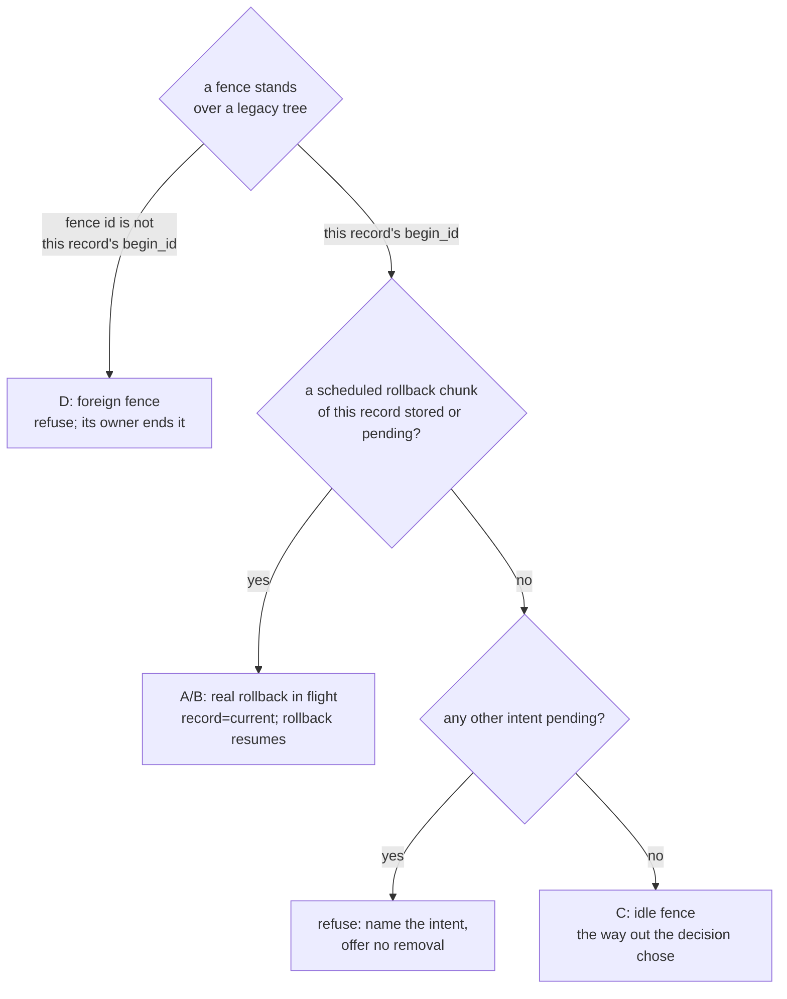
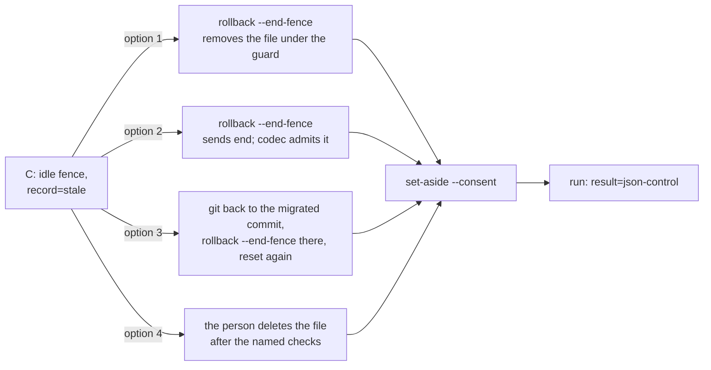
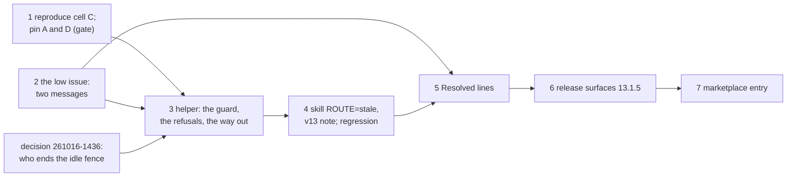

# Implementation Plan: /fusion:migrate, a rollback fence that outlives a git reset, and the two set-aside messages

**Date:** 2026-10-16
**Spec:** none. Planned from the package narrative `261016-1431-migrate-rollback-fence-after-reset-and-set-aside-messages.md` and the two issues it names: `261016-1052-a-rollback-fence-left-in-json-state-survives-a-git-reset-and-set-aside-then-leads-to-a-run-that-refuses-for-good.md` (medium) and `261016-1052-the-stale-record-refusal-drops-the-session-flag-and-set-aside-names-resume-for-a-rolled-back-record.md` (low). Precedent: `261016-0246-plan-migrate-step-7-a-way-out-of-a-stale-session-and-the-helper-path.md` and its closing review `261016-1052-reviewer-closing-pass-over-the-migrate-step-7-stale-session-package.md`.
**Decidability:** The load-bearing question is "may this fence, standing over a tree that is legacy again, be ended without discarding a real half-done rollback?" `.json-state/` alone cannot answer it, because nothing there records who began a fence. On a reset tree an archive fence and an idle rollback fence look the same, so any mechanism that judges from the codec's state alone approximates an ownership it cannot see. The question can be answered from the inputs the migrate helper holds:
- the session record names the fence it began (`s.rollback.begin_id`) and every rollback chunk id it scheduled (`s.schedule.rollback`);
- `inspect` names the standing fence, any pending intent and the store state;
- `ops/` and `journal/` say whether any of those chunks is stored or pending.

A real rollback reaches a legacy tree only by landing one of those chunks. So "this record's fence, and no chunk of this record's rollback landed or pending" separates the idle fence (cell C) from a real rollback (cells A and B) and from a foreign fence (D). The decision record `261016-1436-how-is-a-rollback-fence-ended-that-a-git-reset-left-standing-over-a-legacy-tree.md` has the table. The mechanism therefore stays with the helper, which owns the session record. What the decision settles is who removes the fence once the helper has answered: the helper itself (option 1), the codec on request (option 2), the codec on the JSON-controlled tree reached back through git (option 3), or a person (option 4).

## Directive

The package asks for the fix of both issues, with the ruling on the fence first. The medium issue's acceptance: a test in `hooks/lib/__tests__/migrate.test.ts` runs its steps 1 to 4, and after the way out the skill names, `run` exits 0 with `result=json-control`. Its alternative branch, that Step 7 does not promise a way out and names what the user does instead, is what option 4 reaches. The low issue's acceptance: a stale refusal under an explicit `--session` names that `--session`, and `set-aside --consent` over a rolled-back record exits 5 and names `run`.

## Current State

- **`hooks/migrate.ts`** (701 lines; the compiled `hooks/dist/migrate.js` is committed, and `lib/__tests__/committed-dist.test.ts` checks the pair).
  - `refusedFirstChunk` leaves the fence standing when no work was stored since the plan, and keeps `s.rollback`.
  - `endLeftFence` (`rollback --end-fence`) throws exit 5 unless `i.state === "json-control"`, the fence is `s.rollback.begin_id` and the last rollback chunk is not stored. It runs before `current()`, so it already works on a stale record and under `--session`.
  - `preconditions` refuses any fence or pending intent with "`resume`, `rollback` or the archive helper that set it closes it".
  - `stale()` reads cell C as stale: `s.rollback` is non-null, the plan index is gone, and chunk 0 is not stored.
  - `current()` names `bin/fusion-migrate set-aside --consent` and never the caller's `--session`.
  - `setAside()` refuses a current record with "`resume` or `rollback` acts on it", including for a rolled-back record, where `run` is the command that acts.
  - `setAside()` moves a stale record aside whatever fence stands. That is the move after which, in cell C, nothing can end the fence.
- **The codec** admits `maintenance end` on a legacy store only with a complete rollback's chunk 0 evidence (`codec/src/migration.ts` `cleanupEvidence`; `codec/README.md` `## migration`). That rule is "question 51, as Prior answered it", so it is a contract shared with Prior. A refusal before the intent stores nothing (`codec/README.md` `## The kernel and the journal`). `readFence`'s refusal detail admits removing a fence once "a known complete state [is] verified, under the fence" (`codec/src/store.ts`). `bin/fusion-record`'s and `bin/fusion-archive`'s headers say deleting the fence file "is no recovery" for a lost move inventory.
- **`bin/fusion-migrate`** (160 lines). Its header documents `rollback --end-fence` ("ends the fence such a refusal left standing"), `set-aside` and the exit table. The usage range is `sed -n '3,15p'`.
- **`hooks/lib/__tests__/migrate.test.ts`** (340 lines).
  - `project()` builds a two-chunk fixture, with `home` inside the repository root, so a case that resets excludes `home/` in `.git/info/exclude`.
  - The case at "a refusal a restore clears leaves the fence" builds the refused rollback with an edited narrative (`BENCH`).
  - The case at "resumes after a kill" has the kill stand-in, which kills after the real codec answers a request matching `{phase, chunk}`.
  - The case at "a done session over a tree reset with git" is the 13.1.4 regression for the stale record. The case at "record=current over a migrated tree…" builds the overtaken copy under `--session <home>/overtaken`.
- **`hooks/lib/__tests__/store-name-migration.test.ts`** (314 lines). Case (i) asserts that the `ROUTE=stale` line's first `run` command is `"$FUSION_PLUGIN_ROOT/bin/fusion-migrate" set-aside --consent`. Case (h) asserts that no Step 7 sentence matches ``run `(survey|repair|run|resume|rollback|status|set-aside)\b``.
- **`skills/migrate/SKILL.md`** is 28 998 bytes against the 29 000 cap. The `ROUTE=stale` line ends "show its `set-aside=` line (nothing is deleted) and say a re-run of `/fusion:migrate` continues". That is the promise cell C breaks. Review finding L2 notes that it also differs from the decision's "the survey block again".
- **`docs/upgrading-to-v13.md`** `**Undo.**` ends "run `/fusion:migrate` again afterwards to continue", the same promise.
- **Growth bounds** (golden at HEAD). `skills/` totals 224 526 bytes against 228 028 (188 768 + 39 260). The hook tests total 25 194 lines against 28 872 (24 037 + 4 835). `README-hooks.md`, `docs/` and `bin/` carry no bound.
- **`reference-resolution-lint`** pins `BASELINE = { paths: 2061, anchors: 371, stampBare: 11 }`. Any move must be measured by swapping HEAD's copy of each edited file back in place, written with an attribution entry, and named to the user for re-approval at commit.
- **Pre-existing reds**: `lib/__tests__/workbench-citation-lint.test.ts` reports two findings, one each in `261010-1045-a-narrative-that-is-a-directory-or-unreadable-makes-the-codec-throw-and-exit-1-for-every-workbench-wide-read.md` (line 18) and `261010-1045-containment-is-lexical-so-a-symlinked-store-sends-codec-writes-outside-the-workbench-and-list-never-sees-them.md` (line 9). They are not this package's. Every "green" below means green apart from exactly those two findings. Any other red, including a third finding in that lint, is a stop.
- **The help topic** (`skills/help/SKILL.md` `### 4. Update`) opens with "Coming from 13.1.3 or earlier: 13.1.2 to 13.1.4 need no migration", followed by three per-release sentences. `README-agents.md` `## Releasing` step 0 has a patch release that needs no migration join its predecessor's paragraph, relabelled.

## Approach

**One guard, one place.** Cell C differs from a real rollback by a fact the helper can check: this record's fence stands, and none of this record's rollback chunks is stored or pending. Every option in the decision rests on that check. They differ only in who removes the fence once it holds. So the plan puts the check in one function in `hooks/migrate.ts`. Its callers (`set-aside`, `run`'s fence refusal, `current()`'s message, and under options 1 and 2 `rollback --end-fence`) all read the same answer, and none of them carries a rule of its own.



The way out in cell C, per the decision (option 1 recommended):



**What does not wait on the decision.** The reproduction and its negative pins (step 1) and the low issue (step 2) do not. Neither does the stale-route text in the skill and the v13 note: they stop promising, and they show the helper's stderr. That text changes in step 4 only because it follows step 3's messages. The low issue is independent of the fence in logic. It edits the same file as the fence work, so it runs first and step 3 builds on its message forms.

**The skill names no fence command.** Every option puts its way out into the helper's stderr. `ROUTE=stale` then says: on exit 0 run the survey block again, which also closes review L2; on exit 5 show the stderr and stop. That keeps `skills/migrate/SKILL.md` within its cap and keeps every variant of the way out in tested code.



## Implementation Steps

1. **Reproduce cell C, and pin cells A and D as they stand**
   - Executor: code-implementer
   - Files: `hooks/lib/__tests__/migrate.test.ts`, `hooks/lib/__tests__/fixtures/surface-growth.golden`
   - Changes: add three `it` cases under `describe("bin/fusion-migrate migrates, rolls back and restores …")`, labelled for issue `261016-1052`. All three run the helper from the work tree: `hooks/dist/migrate.js` as committed, no build needed.
     - **Cell C, the issue's sequence.** Start from `project()` and append `home/` to `<root>/.git/info/exclude`. Then: `run` (exit 0), `git add -A`, `git commit`. Append a line to `BENCH`, then `rollback`, which exits 8 with stderr matching `after-state-changed[\s\S]*fence .* stands`. Then `git reset -q --hard HEAD~1`. Assert as observed:
       - (i) `status` has `state=legacy`, `fence=` other than `-`, and `record=stale`;
       - (ii) `set-aside --consent` exits 0;
       - (iii) `run` exits 5 with stderr matching `a fence or a pending intent stands`;
       - (iv) `rollback --end-fence --session <the set-aside path>` exits 5 with stderr matching `no fence of a refused rollback stands on a store under JSON control`;
       - (v) `.json-state/maintenance.json` is byte-identical from before the reset to the end of the case.

       Cases (ii) to (iv) describe the defect, and step 3 rewrites them.
     - **Cell A, a real rollback in flight over a legacy tree.** Reuse the kill stand-in from the case "resumes after a kill …". Factor its plugin-copy setup into one local helper both cases call, rather than copying it. Run `run`, then set the kill to `{phase: "rollback", chunk: 2}` and run `rollback`, which exits 7. Assert:
       - `status` has `state=legacy`, `fence=` other than `-`, and `record=current`;
       - `.json-state/ops/<schedule.rollback chunk 2 id>.json` exists;
       - `rollback --end-fence` exits 5 and `maintenance.json` is byte-identical;
       - with the kill cleared, `rollback` exits 0 with `result=legacy`.
     - **Cell D, a fence this record did not begin.** Run `run`, `git add -A`, `git commit` (with `home/` excluded). Then send `{"op":"maintenance","operation_id":"<fresh uuid>","action":"begin"}` through `bin/fusion-record` with the workbench as cwd, and run `git reset -q --hard HEAD~1`. Assert that `rollback --end-fence` exits 5, that `maintenance.json` is byte-identical, and that `fence=` names the fresh id.

     Regenerate the golden: `cd hooks && UPDATE_SURFACE_GOLDEN=1 npx vitest run lib/__tests__/surface-growth-bound.test.ts`, which fails on purpose, then run the bound again.
   - Acceptance: report verbatim the observed `status` lines of cells C and A and the stderr of C's (iii) and (iv). `cd hooks && npm test -- lib/__tests__/migrate.test.ts lib/__tests__/surface-growth-bound.test.ts` is green. **Gate:** if cell C does not show the dead end ((i) to (iv)), or cell A or D does not hold its fence byte-identical, keep each case asserting what was observed, report it, and stop. Steps 3 to 7 do not start. Step 2 may still run.
   - Dependencies: none

2. **The low issue: the stale refusal names the caller's `--session`, and `set-aside` names `run` for a rolled-back record**
   - Executor: code-implementer
   - Files: `hooks/migrate.ts`, `hooks/dist/migrate.js` (by `cd hooks && npm run build`), `hooks/lib/__tests__/migrate.test.ts`, `hooks/lib/__tests__/fixtures/surface-growth.golden`
   - Changes:
     - In `current()`, append ` --session ${session}` to the named `set-aside --consent` command whenever `session !== sessionDir(wb, undefined)`. Change nothing else in the message.
     - In `setAside()`, word the current-record refusal by state. For `s.rolled_back`: "`run` starts a new migration". Otherwise: "`resume` or `rollback` acts on it", as now.
     - Fix review L3, a comment-only change in `stale()`'s doc comment: "an unreadable tree … [is] never stale" becomes "an unreadable tree never makes a record stale by its state alone".
     - Run `cd hooks && npm run build`.

     Tests:
     - (a) In the case "record=current over a migrated tree…", the overtaken copy's `run` under `--session <home>/overtaken` exits 5. Its stderr contains `set-aside --consent --session <home>/overtaken`.
     - (b) In the case "a done session over a tree reset with git", the default-session refusal's command reads exactly `` `bin/fusion-migrate set-aside --consent` ``, with no `--session` before its closing backtick.
     - (c) After that case's complete `rollback` (before the flip to `rolled_back: false`), `set-aside --consent` exits 5. Its stderr matches `` `run` starts a new migration `` and does not contain `` `resume` ``.

     At most 20 test lines. Regenerate the golden.
   - Acceptance: `cd hooks && npm test -- lib/__tests__/migrate.test.ts lib/__tests__/committed-dist.test.ts lib/__tests__/surface-growth-bound.test.ts` is green. `git -C /Users/kai/Projects/productive/F04-FUSION/fusion status --porcelain hooks/dist/migrate.js` shows the file modified. This is a single-path status, not a whole-tree command.
   - Dependencies: none. It edits the same two files as steps 1 and 3, so the dispatcher runs it on its own, after step 1 and before step 3.

3. **The helper: one guard for the fence over a legacy tree, the refusals that read it, and the way out the user chose**
   - Executor: code-implementer
   - Files: `hooks/migrate.ts`, `hooks/dist/migrate.js`, `bin/fusion-migrate` (header only), `README-hooks.md` (the `migrate.ts` row under `## Files` and the `bin/fusion-migrate` row of `### The bin/ helper roster`), `hooks/lib/__tests__/migrate.test.ts`, `hooks/lib/__tests__/fixtures/surface-growth.golden`, and `hooks/lib/__tests__/reference-resolution-lint.test.ts` (`BASELINE` and its entry only, if it moves). Under option 2 also: `codec/src/migration.ts`, `codec/README.md` `## migration`, `codec/dist/fusion-record.js`, `codec/fixtures/protocol-session-migration/` (regenerated under `UPDATE_PROTOCOL_SESSION_MIGRATION=1`) and the codec's own tests. Option 2 does not start until Prior has answered the request filed in `codec/fixtures/prior/REQUESTS.md`.
   - Changes under every option:
     - **The guard.** Add one function, for example `idleFence(wb, s, i)`. It returns the fence id when all of these hold, and null otherwise:
       - `i.state === "legacy"`;
       - `s.rollback !== null`;
       - `i.maintenance?.operation_id === s.rollback.begin_id`;
       - `i.pending === null`;
       - no id of `s.schedule?.rollback` has `ops/<id>.json` or `journal/<id>/`.

       Its doc comment cites the decision's table, and says why the chunk evidence separates cell C from cells A and B.
     - **`setAside()`** refuses with exit 5 over a stale record while any fence or pending intent stands, before `--consent` is read and before anything is moved.
       - Where `idleFence` holds, the message names the decided way out.
       - Otherwise it names what stands (the fence id, or the intent) and says that `run` refuses while it stands and that the tool that set it closes it. Nothing is offered for removal.
     - **`preconditions`**, on a standing fence: it looks for a sibling `${session}.stale-*` directory whose `state.json` has `rollback.begin_id` equal to the fence id. Where one exists, it names the decided way out under `--session <that dir>`. Where none does, the message stays as it is.
     - **`current()`**: when `idleFence` holds for the stale record, the way out it names is the fence's way out first, then `set-aside --consent`.
     - **Docs.** The wrapper header's `set-aside` and exit-5 lines gain "a fence or pending intent standing over the stale record". The two `README-hooks.md` rows each gain one clause.
   - Changes per option. Only the chosen one is built:
     - **Option 1:** `endLeftFence` gains a legacy branch. When `stale()` is non-null and `idleFence` names the fence, it:
       - refuses if `.json-state/write.lock` exists;
       - re-reads `maintenance.json` and refuses unless it parses as exactly that fence;
       - unlinks the file;
       - sets `s.rollback = null` and writes the state into the session it was called with;
       - prints `fence-ended=<id>`, `result=legacy` and `note=no rollback chunk landed under it; set-aside --consent, then run`.

       Otherwise the existing exit 5, with "on a store under JSON control" replaced by "nor an idle fence of this record over a legacy store". The header's account of `rollback --end-fence` names the verification it performs and why that is the known complete state `readFence`'s detail requires. It also says that `bin/fusion-record`'s "no recovery" sentence concerns a lost move inventory. Every message names `rollback --end-fence`, with `--session <dir>` where the session is not the default.
     - **Option 2:** as option 1, except that the legacy branch sends `{op: "maintenance", operation_id: s.rollback.end_id, action: "end", fence}` and the codec admits it under the new `cleanupEvidence` branch. That branch requires the fence's `begin` stored, no intent pending, and every stored migration rollback answer listed in a stored chunk 0's `progress`. The codec's unit case and the recorded session are extended with each admitted and refused shape.
     - **Option 3:** `endLeftFence` is unchanged. The messages name the round trip: check out the commit that carries the migration (`git reflog` shows it), run `bin/fusion-migrate rollback --end-fence` there, reset back, then `set-aside --consent` and `run`.
     - **Option 4:** `endLeftFence` is unchanged. The messages name deleting `.json-state/maintenance.json` once `status` shows `record=stale`, no rollback chunk is stored and no intent is pending.

     Tests: rewrite step 1's cell C (ii) to (iv) as the regression.
     - `set-aside --consent` over cell C exits 5, names the decided way out, and leaves the session directory where it is.
     - The test then takes that way out: option 1 or 2, `rollback --end-fence`; option 3, the round trip with `git reset -q --hard <migrated commit>`, `rollback --end-fence` and `git reset -q --hard HEAD~1`; option 4, the deletion.
     - Then `status` shows `fence=-`. `set-aside --consent` exits 0, and `run` exits 0 with `result=json-control`.

     Add a second cell C row, the record a 13.1.4 user already set aside, modelled by renaming the session directory to `<dir>.stale-20261016T000000Z` by hand. `run` exits 5 and names the way out under `--session <that dir>`. Taking it, then `run`, gives `result=json-control`. Cells A and D from step 1 stay as they are and stay green, together with a one-line assertion each that the way out of the chosen option exits 5 there and leaves `maintenance.json` byte-identical. Under options 1 and 2, add one more row: `rollback --end-fence` over cell C while a file `.json-state/write.lock` exists exits 5. At most 90 test lines in this step. Run `cd hooks && npm run build`. Regenerate the golden.
   - Acceptance: `cd hooks && npm test -- lib/__tests__/migrate.test.ts lib/__tests__/committed-dist.test.ts lib/__tests__/hook-route-exclusion.test.ts lib/__tests__/reference-resolution-lint.test.ts lib/__tests__/surface-growth-bound.test.ts` is green. Under option 2, `cd codec && npm test` is green as well. Then run `cd hooks && npm test -- lib/__tests__/store-name-migration.test.ts`. This step leaves the skill alone, so no red is expected there, and any red in it or elsewhere is a stop. If `reference-resolution-lint` moved (the README rows or the wrapper header), report the swap-back measurement and the new figures for the user's re-approval.
   - Dependencies: step 1 (its gate passed), step 2, and the user's answer to `261016-1436-how-is-a-rollback-fence-ended-that-a-git-reset-left-standing-over-a-legacy-tree.md`

4. **Step 7 and the v13 note stop promising a re-run, and show the helper's way out**
   - Executor: code-implementer
   - Files: `skills/migrate/SKILL.md`, `docs/upgrading-to-v13.md`, `hooks/lib/__tests__/store-name-migration.test.ts`, `hooks/lib/__tests__/migrate.test.ts` (one assertion in the cell C case), `hooks/lib/__tests__/fixtures/surface-growth.golden`, `hooks/lib/__tests__/reference-resolution-lint.test.ts` (`BASELINE` and its entry only, if it moves)
   - Changes:
     - **The skill's `ROUTE=stale` line.** Replace "show its `set-aside=` line (nothing is deleted) and say a re-run of `/fusion:migrate` continues" with, in substance: on exit 0, show its `set-aside=` line (nothing is deleted) and run the survey block again; on exit 5, show its stderr, which names what stands and the way out, and stop. This is about +55 bytes. Cut at least as much elsewhere in Step 7's own prose, without moving the `**Survey.**` block, any command or any question. The parenthesis "(git discarded or reverted it, or another checkout migrated)" is one candidate. Keep `set-aside --consent` as the line's first `run` command, because case (i) reads it.
     - **The v13 note's `**Undo.**` paragraph.** Replace "run `/fusion:migrate` again afterwards to continue" with one sentence: when a fence the undo left stands, the helper refuses to set the record aside and names how that fence is ended. Name the decided way out in words, not as a new path citation.
   - Changes in the tests:
     - In `store-name-migration.test.ts`, extend case (i). The `ROUTE=stale` line no longer contains `re-run`, and it contains `stderr` and `survey block again`.
     - In `migrate.test.ts`, the cell C case lifts the shipped `**Survey.**` block, with `extractBashBlock` from `./helpers/prompt-blocks.js` as the 13.1.4 case did, runs it after the reset, and asserts `ROUTE=stale`.
     - At most 15 test lines. Regenerate the golden.
   - Byte budget: `wc -c skills/migrate/SKILL.md` at most 29 000. A red growth bound is answered by a further cut in this file, never by a baseline or head-room edit.
   - `reference-resolution-lint`: if it moves, measure by swapping HEAD's copies of `skills/migrate/SKILL.md` and `docs/upgrading-to-v13.md` back in place, confirm that the whole delta is those files, and write `BASELINE` with an attribution entry in the established form. Report the figures for the user's re-approval.
   - Acceptance: `cd hooks && npm test` is green apart from exactly the two pre-existing `workbench-citation-lint` findings, and `wc -c skills/migrate/SKILL.md` prints at most 29000.
   - Dependencies: step 3

5. **Record the resolution on both issues**
   - Executor: code-implementer
   - Files: the two issue narratives in the container of `261016-0236-migrate-step-7-stale-session-and-helper-path`: `261016-1052-a-rollback-fence-left-in-json-state-survives-a-git-reset-and-set-aside-then-leads-to-a-run-that-refuses-for-good.md` and `261016-1052-the-stale-record-refusal-drops-the-session-flag-and-set-aside-names-resume-for-a-rolled-back-record.md`
   - Changes: append `---` and a `Resolved:` line to each, in anchor form with no commit hash.
     - The medium issue's line names:
       - the reproduction and pins (step 1, cells C, A and D);
       - the guard and the way out per `261016-1436-how-is-a-rollback-fence-ended-that-a-git-reset-left-standing-over-a-legacy-tree.md` (`hooks/migrate.ts` `setAside`, `preconditions`, and `endLeftFence` under options 1 and 2);
       - the route text (`skills/migrate/SKILL.md` `## Step 7 — Repair, then migrate to JSON control`, `**Survey.**`);
       - the v13 note (`docs/upgrading-to-v13.md`, `**Undo.**`).
     - The low issue's line names `hooks/migrate.ts` `current()` and `setAside()` and step 2's tests.

     Write no transition. The dispatcher closes each issue with `--disposition '{"kind":"fixed","reason_ref":null}'` after reading the `Verification:` line. At commit it writes the decision's `Implemented:` line and moves the decision to `implemented`, after the `Answered:` line the user's ruling produced.
   - Acceptance: after both writes, `cd hooks && npm test` is green apart from exactly the two pre-existing `workbench-citation-lint` findings, so the new lines add no third finding.
   - Dependencies: steps 2 and 4

6. **Release surfaces for 13.1.5**
   - Executor: code-implementer
   - Files: `.claude-plugin/plugin.json`, `skills/help/SKILL.md` (`### 4. Update`), `install.sh` (the header's `FUSION_REF=tags/v13.1.4` example), `README.md` (the same pin example), `hooks/lib/__tests__/fixtures/surface-growth.golden`, and `hooks/lib/__tests__/reference-resolution-lint.test.ts` if it moves
   - Changes:
     - Bump 13.1.4 to 13.1.5 in `plugin.json` and in both pin examples.
     - Help topic, per `README-agents.md` `## Releasing` step 0. A patch that needs no migration joins its predecessor's paragraph, which is relabelled:
       - "Coming from 13.1.3 or earlier" becomes "Coming from 13.1.4 or earlier";
       - "13.1.2 to 13.1.4 need no migration" becomes "13.1.2 to 13.1.5 need no migration";
       - add one sentence before the 13.1.4 one, at most about 200 bytes. 13.1.5: when an undo that git then discarded left the store locked, `/fusion:migrate` no longer sets the old record aside into a run that cannot start; it names how that lock is ended. Word the "how" to the decided option.
       - Keep the other two paragraphs.
     - `plugin.json`'s `description` does not change, so the description pair stays as it is.
     - Regenerate the golden.
     - `docs/upgrading-to-v12.md` describes nothing this release changes. Confirm with `grep -n "fusion-migrate\|set-aside\|end-fence" docs/upgrading-to-v12.md` and report the result.
   - Acceptance:
     - `cd hooks && npm test` is green apart from the two pre-existing findings.
     - `claude plugin validate .` reports passed.
     - `claude --plugin-dir . --agent fusion:orchestrator -p "reply SMOKE-OK"` answers.
     - The report states the result of `bin/fusion-review-coverage --since v13.1.4` (advisory, per `260815-2109_*_may-a-circle-close-over-an-uncovered-review-range-and-who-decides.md`, option 1).
     - `grep -n "13.1.4" .claude-plugin/plugin.json install.sh README.md` finds no stale pin.
   - Dependencies: step 5

7. **Marketplace entry for 13.1.5**
   - Executor: data-implementer
   - Files: `<marketplace>/.claude-plugin/marketplace.json`. The 13.1.4 release used `/Users/kai/Projects/productive/F03-CLAUDE-plugin-marketplace/claude-plugins`, and `README-agents.md` `## Releasing` has the dispatcher confirm the clone's location with the user at release.
   - Changes: set fusion's `version` to `13.1.5`, and change nothing else. The description pair stays as it is. Before dispatching this step, the dispatcher runs `git -C <marketplace> pull --rebase origin main` (step 2 of `## Releasing`). The executor makes no git call.
   - Acceptance: the file parses as JSON (`node -e 'JSON.parse(require("fs").readFileSync(process.argv[1],"utf8"))' <marketplace>/.claude-plugin/marketplace.json` exits 0), and fusion's entry reads `"version": "13.1.5"`, equal to `.claude-plugin/plugin.json`.
   - Dependencies: step 6

**Scratch-root rule for every step.** Executors run no whole-tree git command in the live repository. The tests create their own repositories under the system temp directory, through `project()`. Any manual reproduction runs only inside a scratch root, entered with an absolute `cd` on its own line and verified with `pwd` before any destructive git call. Nothing in this plan commits. Commit, push, tag and the cache pull are the dispatcher's, after the user's approval (`README-agents.md` `## Releasing`, steps 4 to 6).

## Where this work stops

- Step 1's cell C does not show the dead end, or cell A or D does not keep its fence byte-identical: the work stops after step 1 with the observation reported. Steps 3 to 7 are not done, and step 2 may still be done.
- The decision `261016-1436-how-is-a-rollback-fence-ended-that-a-git-reset-left-standing-over-a-legacy-tree.md` carries the user's answer, and step 3 builds that option and no other.
- Under option 2: Prior has answered the request in `codec/fixtures/prior/REQUESTS.md`, or step 3 does not start.
- Over cell C (the issue's steps 1 to 4), `set-aside --consent` exits 5 and names the decided way out. After that way out, `status` shows `fence=-`, `set-aside --consent` exits 0, and `run` exits 0 with `result=json-control`.
- A record already set aside under 13.1.4 over cell C: `run`'s refusal names the way out under that record's `--session`, and taking it leads to `result=json-control`.
- Over cell A (a rollback cut after its first chunk, legacy tree) and cell D (a fence this record did not begin), the chosen way out exits 5, `maintenance.json` is byte-identical, and in cell A `rollback` then exits 0 with `result=legacy`.
- A stale refusal under an explicit `--session` names that `--session`. `set-aside --consent` over a rolled-back record exits 5 and names `run`.
- The `ROUTE=stale` line and `docs/upgrading-to-v13.md` `**Undo.**` no longer promise that a re-run continues. The line runs the survey block again on exit 0 and shows the stderr on exit 5.
- `wc -c skills/migrate/SKILL.md` is at most 29 000, and every growth bound is green with no baseline or head-room constant edited.
- Every move of `reference-resolution-lint`'s `BASELINE` carries its attribution entry, and the user re-approved its figures.
- `hooks/dist/migrate.js` is the compile of `hooks/migrate.ts` as edited, and it is staged with it for the release commit. Under option 2 the same holds for `codec/dist/fusion-record.js` and `codec/src/`.
- Both issues carry a `Resolved:` line, and the full hook suite ran after those writes with no red beyond the two pre-existing `workbench-citation-lint` findings.
- Before the release commit is pushed, `plugin.json`, both pin examples and `marketplace.json` read 13.1.5, and the help topic's first paragraph covers 13.1.5.

## Data Structures

No new field in `State` and no new session file. The guard, over the existing record `s` and `inspect`'s answer `i`:

```
idleFence(wb, s, i) :=
     i.state === "legacy"
  && s.rollback !== null
  && i.maintenance?.operation_id === s.rollback.begin_id
  && i.pending === null
  && none of s.schedule?.rollback[*].operation_id has ops/<id>.json or journal/<id>/
  ? s.rollback.begin_id : null
```

It is disjoint from the three other cells of the decision's table. Cell A and cell B each have a stored or pending scheduled chunk, the first after activation in A and chunk 0 in B. Cell D fails the id. A pending intent elsewhere fails `i.pending === null` and gets its own refusal, with no removal.

## API Changes

- `set-aside --consent` refuses with exit 5 over a stale record while a fence or a pending intent stands, and names the way out or what stands.
- `run`'s fence refusal names a set-aside sibling's `--session` when that record began the fence.
- Option 1 or 2 only: `rollback --end-fence` also ends this record's idle fence over a legacy store, printing `fence-ended=<id>` and `result=legacy`.
- Option 2 only: the codec's `maintenance end` on a legacy store gains one admitted shape, a contract change agreed with Prior.

## Testing Strategy

Every cell is built by real runs over `project()`'s two-chunk fixture, never by a hand-written `.json-state/`:
- C is built by the issue's own sequence.
- A by the existing kill stand-in at rollback chunk 2.
- D by a real `maintenance begin` through `bin/fusion-record`.

Cells A and D are pinned before any code changes (step 1), so the fence work cannot loosen them unseen. Each guard condition has a row whose failure would end a fence it must not end. The skill route gets one routing assertion over the shipped block and one text assertion. That is the honest limit of what a test proves about a skill body.

## Risks & Mitigations

| Risk | Mitigation |
|---|---|
| The guard ends the fence of a real half-done rollback | It requires that no scheduled chunk of the record is stored or pending. Cell A is pinned in step 1 and re-asserted in step 3, cell B is the existing chunk-0 case, and cell D fails the id. A red test stops the step. |
| Option 1 removes a codec-owned file outside the codec's lock | It refuses while `write.lock` exists and re-reads the bytes before the unlink. On a legacy store the codec refuses every mutation except a `plan`, which the fence blocks, and the chunk-0 `end`, which the guard excludes. The header names the verification. |
| Option 2 stalls on Prior | Step 3 does not start before Prior's answer. Steps 1, 2 and the honest skill text in step 4 do not depend on it. The decision names this cost. |
| Option 3's round trip finds no migrated commit (reflog expired, migrated elsewhere) | The message says so. The residual is named in the decision, and the user chose it knowing that. |
| `skills/migrate/SKILL.md` crosses 29 000 | Step 4 cuts in Step 7's own prose first. No baseline or head-room edit. |
| A targeted `npx vitest run` exercises a stale `hooks/dist/migrate.js` | Steps 2 and 3 run `npm run build`. Every acceptance uses `npm test -- <files>`, which compiles first. |
| The help paragraph grows to four per-release sentences, which the closing review called past what a reader scans | The 13.1.5 sentence is capped at about 200 bytes. Step 0's join rule is followed as it stands, and the observation is left to the review that reads the release. |
| A pending intent surviving a reset (inference in the medium issue) stays a dead end | `set-aside` now refuses and names it instead of promising a run. A way to end it is not built here (Open Questions). |

## Open Questions

- [ ] Who ends the idle fence: `261016-1436-how-is-a-rollback-fence-ended-that-a-git-reset-left-standing-over-a-legacy-tree.md`, with option 1 recommended. Step 3 and everything after it wait on it.
- [ ] A pending intent under `.json-state/journal/` that survives a reset is the same class, per the medium issue, and was not reproduced. This plan only makes `set-aside` refuse and name it. A way to end it would be its own issue once reproduced.
