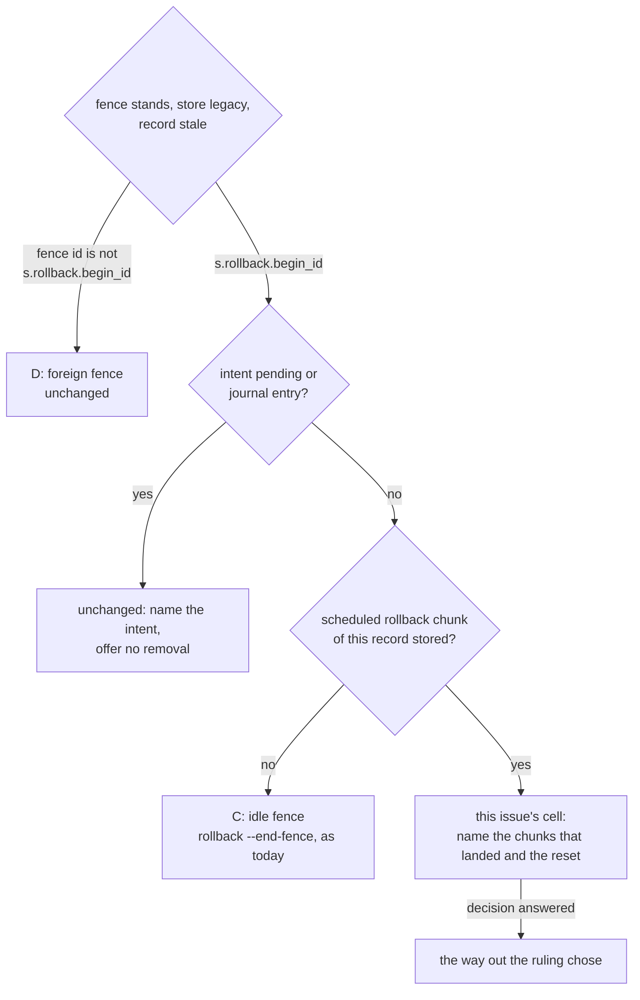
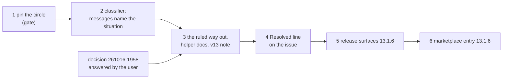

# Implementation Plan: /fusion:migrate, a rollback cut after it landed chunks and then reset with git, names its situation and the ruled way out

**Date:** 2026-10-16
**Spec:** none. Planned from the package narrative `261016-1951-migrate-rollback-cut-then-reset-circular-refusals.md` and the issue it names, `261016-1807-a-rollback-cut-after-its-first-chunk-then-reset-with-git-gets-refusals-that-point-at-each-other.md` (low). Precedent: `261016-1438-plan-migrate-a-rollback-fence-after-a-git-reset-and-the-two-set-aside-messages.md`, its ruling `261016-1436-how-is-a-rollback-fence-ended-that-a-git-reset-left-standing-over-a-legacy-tree.md`, and its closing review `261016-1807-reviewer-closing-pass-over-the-migrate-rollback-fence-after-reset-package.md`.
**Decidability:** The plan rests on two questions.
- **"Is this the cell where a rollback of this record landed chunks and the tree was then reset?"** This is decidable from what the helper already holds:
  - `inspect` gives `state=legacy` and the standing fence;
  - the fence id equals `s.rollback.begin_id`;
  - `stale()` is non-null;
  - at least one id in `s.schedule.rollback` has a stored answer under `.json-state/ops/`. That id is never chunk 0's, because a stored chunk 0 makes the record current.

  The messages in step 2 rest on this question alone.
- **"Does the fence still guard a half-done rollback?"** This is the way-out question. It is **not** decidable from the chunk evidence that `idleFence` uses today. That evidence is a proxy, and this cell is where the proxy and the fact come apart: chunks landed, yet git discarded what they wrote. The question is decidable from the proposal `.json-state/migration/<id>.json`, which survives the reset and is checked against `s.proposal.sha256`. It lists every `control_path`, and every rewritten narrative's `after_sha256`. "No control path stands and no rewritten narrative is at its after-hash" is the fact itself.

  Option 3 of the decision `261016-1958-is-a-rollback-fence-ended-when-the-rollback-landed-chunks-and-a-git-reset-then-took-the-tree-back-to-markdown.md` changes the mechanism to that question. Options 1 and 2 leave the question to nobody, or to a person. A proposal that is missing, or at other bytes, leaves it undecided, and undecided is never read as "none".

## Directive

The fix of the low issue, as the package narrative asks. Its acceptance:
- In `hooks/lib/__tests__/migrate.test.ts`, the case "cell A reset with git" is extended.
- The stderr of `rollback` and of `set-aside --consent` names neither `set-aside --consent` as a way out while the fence stands, nor "the tool that set it" without naming it.
- That stderr names this record's landed rollback chunks.
- `maintenance.json` stays byte-identical.
- If a way out is decided, the case takes it and ends at `result=legacy` or `result=json-control`.

Whether a way out exists, and whether it is safe, is the decision `261016-1958-is-a-rollback-fence-ended-when-the-rollback-landed-chunks-and-a-git-reset-then-took-the-tree-back-to-markdown.md`. The user answers it. Step 3 builds the answered option and no other.

## Current State

- **`hooks/migrate.ts`** (804 lines; the compiled `hooks/dist/migrate.js` is committed, checked by `lib/__tests__/committed-dist.test.ts`).
  - `idleFence(wb, s, i)` returns the fence id only when no id of `s.schedule.rollback` is stored. In this cell chunk 2's is, so it returns null.
  - `current()` therefore names `` `bin/fusion-migrate set-aside --consent` `` as the way out. `rollback`, `resume` and `run` all reach `current()` first.
  - In `setAside()` the stale-and-standing branch, when `idleFence` is null, says "the tool that set it closes it" and names no tool.
  - In `endLeftFence()` the legacy branch is not taken, so the generic refusal is given ("no fence of a refused rollback stands on a store under JSON control, nor an idle fence …").
  - `preconditions()` finds a set-aside sibling that began the fence (`asideBegan`). It names `rollback --end-fence --session <aside>` "once no rollback chunk of that record landed", which in this cell refuses too. A record that 13.1.4 set aside before the 13.1.5 refusal existed meets that circle.
- **Measured in a scratch copy of `d3c9eeae`** (this planner's probe, using the issue's sequence and the `killPlugin()` stand-in). It reproduced the issue's three messages verbatim in substance:
  - `rollback`, `resume` and `run` exit 5 and name `set-aside --consent`;
  - `set-aside --consent` exits 5 with "the tool that set it closes it";
  - `rollback --end-fence` exits 5 generically;
  - the fence stayed byte-identical.

  After `git reset --hard <migrated commit>`, `rollback` exits 8 with `chunk-out-of-order`. So the round trip the issue suggests is no way out, as the decision records. With the fence removed by hand, `set-aside --consent` and `run` give `result=json-control`, and the old rollback's stored answers do not stop the new plan.
- **`hooks/lib/__tests__/migrate.test.ts`** (451 lines).
  - The case "cell A reset with git and cell C with a fence of another id" pins `record=stale`, a `--end-fence` exit 5 and the fence byte-identical, and checks no message.
  - `cellC()`, and the cases "cell C: set-aside refuses and names rollback --end-fence …" and "cell C set aside under 13.1.4 …", pin the wording "no rollback chunk landed under it" in the `set-aside` stderr and in the `note=` line.
- **`skills/migrate/SKILL.md`** is 28 997 bytes against the 29 000 cap. Its `ROUTE=stale` line already shows the helper's stderr on exit 5, and no step here edits it.
- **`docs/upgrading-to-v13.md`** `**Undo.**` ends "a `rollback --end-fence` of the same record, once no rollback chunk landed under it".
- **`bin/fusion-migrate`**'s header (the `rollback --end-fence` and `set-aside` entries) and the `migrate.ts` row under `README-hooks.md` `## Files` both state the "no rollback chunk" condition.
- **Growth bounds** (golden at HEAD):
  - `skills/` totals 224 712 bytes against 228 028.
  - The hook tests total 25 306 lines against 28 872.
  - `help/SKILL.md` stands at 16 046 against its baseline of 16 919.
  - `README-hooks.md`, `docs/` and `bin/` carry no bound.
- **`reference-resolution-lint`** pins `BASELINE = { paths: 2061, anchors: 371, stampBare: 11 }`. Any move is measured by swapping HEAD's copy of each edited file back in place, written with an attribution entry in the established form, and named to the user for re-approval at commit.
- **Pre-existing reds**: `lib/__tests__/workbench-citation-lint.test.ts` reports exactly two findings, the tokens `260928-1200-open-package` and `261010-1200-q`. They are not this package's. Every "green" below means green apart from exactly those two. Any other red, a third finding in that lint included, is a stop.

## Approach

**One classifier, read by every message.** The cell is a fact the helper can check, so the plan adds one function that answers it. `current()`, `setAside()`, `endLeftFence()`'s refusal and `preconditions()`'s sibling branch all read that function, and none carries a rule of its own. It sits beside `idleFence` and feeds it: the idle cell is the case where no rollback chunk landed.



**What does not wait on the decision.** Step 1 reproduces and pins today's circle. Step 2 makes every message name the situation in words and stop naming a step that refuses. That is the minimum outcome, and it is final under option 1. Step 3 changes only the clause that says what the user does, and under option 3 the guard behind `rollback --end-fence`.



The closing review is the orchestrator's dispatch of the reviewer, which is not an executor of this plan. It runs after step 5's release commit and before the tag, and `## Where this work stops` makes it a precondition of the tag.

## Implementation Steps

1. **Pin the circle in the case "cell A reset with git", and gate on it**
   - Executor: code-implementer
   - Files: `hooks/lib/__tests__/migrate.test.ts`, `hooks/lib/__tests__/fixtures/surface-growth.golden`
   - Changes: in the case "cell A reset with git and cell C with a fence of another id", after the `git reset -q --hard HEAD~1` and before `cellC()`, assert what the tree shows today. The assertions are written as observed, labelled for issue `261016-1807`.
     - (i) `status` gives `state=legacy`, `fence=` other than `-`, and `record=stale`.
     - (ii) `.json-state/ops/<schedule.rollback chunk 2 id>.json` exists. Read the id from the session's `state.json`, as the case "cell A" does.
     - (iii) `rollback`, `resume` and `run` each exit 5, with stderr containing `` `bin/fusion-migrate set-aside --consent` ``.
     - (iv) `set-aside --consent` exits 5, with stderr containing `the tool that set it closes it`, and the session directory still exists.
     - (v) `rollback --end-fence` exits 5, with stderr matching `no fence of a refused rollback stands on a store under JSON control`.
     - (vi) `.json-state/maintenance.json` is byte-identical from just after the reset to the end of this sub-sequence.

     Assertions (iii) to (v) describe the defect, and step 2 rewrites them. Use the case's own `cut` runner, which runs the plugin copy with no kill set, for every call. At most 15 test lines. No source change and no build. Regenerate the golden: run `cd hooks && UPDATE_SURFACE_GOLDEN=1 npx vitest run lib/__tests__/surface-growth-bound.test.ts`, which fails on purpose, then run the bound again.
   - Acceptance: the report quotes the observed `status` line set and the first 200 characters of each stderr in (iii) to (v). `cd hooks && npm test -- lib/__tests__/migrate.test.ts lib/__tests__/surface-growth-bound.test.ts` is green. **Gate:** if (i) to (vi) do not all hold as written, keep each assertion as observed, report it, and stop. Steps 2 to 6 do not start.
   - Dependencies: none

2. **One classifier for this record's fence over a reset tree, and every message names the situation instead of a step that refuses**
   - Executor: code-implementer
   - Files: `hooks/migrate.ts`, `hooks/dist/migrate.js` (by `cd hooks && npm run build`), `hooks/lib/__tests__/migrate.test.ts`, `hooks/lib/__tests__/fixtures/surface-growth.golden`
   - Changes in `hooks/migrate.ts`:
     - **The classifier.** Add one function, for example `ownFence(wb, s, i)`. It returns `{ fence, landed }` when all of these hold, and null otherwise:
       - `i.state === "legacy"`;
       - `s.rollback !== null`;
       - `i.maintenance?.operation_id === s.rollback.begin_id`.

       `landed` is the ascending list of chunk numbers in `s.schedule?.rollback` whose answer is stored. `idleFence` reads it, keeping all its other conditions as they are (`i.pending`, `journal/`), and requires `landed` to be empty. Its result does not change for any input. Its doc comment cites the decision `261016-1958-is-a-rollback-fence-ended-when-the-rollback-landed-chunks-and-a-git-reset-then-took-the-tree-back-to-markdown.md` beside 261016-1436.
     - **The situation, in one message helper.** Add `landedThenReset(wb, session, cell)`, which returns two clauses. The first is the situation, in substance: "a rollback of this record landed rollback chunk(s) <landed>, then the tree was reset to Markdown, so its plan index is gone and the fence <id> that rollback began stands". The second is the way-out clause, a separate small function so that step 3 replaces that function alone. In this step it reads: "no command of this helper ends that fence; nothing was written or lost". Neither clause names `set-aside --consent` or "the tool that set it".
     - **`current()`**: when the record is stale and `ownFence` holds with `landed` non-empty, the text after "Nothing was sent or written." is `landedThenReset(…)` and not the `set-aside` way out. Every other branch is unchanged.
     - **`setAside()`**, in the stale-and-standing branch: when `idleFence` is null and `ownFence` holds with `landed` non-empty, it says `landedThenReset(…)` followed by "Nothing was moved." The generic branch stays for cell D and for a pending intent.
     - **`endLeftFence()`**: before the generic refusal, when `ownFence` holds with `landed` non-empty and the record is stale, it refuses with exit 5 and `landedThenReset(…)` followed by "nothing was sent".
     - **`preconditions()`**: when `asideBegan` finds a sibling, it reads that sibling's state and evaluates `ownFence` against it. With `landed` non-empty, it says `landedThenReset` under `--session <aside>`. Otherwise it keeps today's message.

     Run `cd hooks && npm run build`.
   - Changes in the tests:
     - Rewrite step 1's (iii) to (v). For each of `rollback`, `resume` and `run`: exit 5, stderr matches `rollback chunks? 2[\s\S]*reset`, and does not contain `set-aside --consent`. `set-aside --consent`: exit 5, stderr matches the same pattern, does not contain `the tool that set it`, and the session directory still stands. `rollback --end-fence`: exit 5, stderr matches the same pattern and no longer reads `no fence of a refused rollback stands`. (vi) stays.
     - Add one row for a record that 13.1.4 set aside: rename the session to `<dir>.stale-20261016T000000Z`. `run` exits 5, its stderr matches the same pattern and names `--session <that dir>`, it does not contain `once no rollback chunk of that record landed`, and the fence stays byte-identical.

     At most 25 test lines. The cell C, cell A and cell D cases stay unchanged and green. Regenerate the golden.
   - Acceptance: `cd hooks && npm test -- lib/__tests__/migrate.test.ts lib/__tests__/committed-dist.test.ts lib/__tests__/surface-growth-bound.test.ts lib/__tests__/store-name-migration.test.ts` is green. `git -C /Users/kai/Projects/productive/F04-FUSION/fusion status --porcelain hooks/dist/migrate.js` shows the file modified. That is a single-path status, not a whole-tree command.
   - Dependencies: step 1, with its gate passed

3. **The way out the decision chose, the helper's documentation, and the v13 note**
   - Executor: code-implementer
   - Files: `hooks/migrate.ts`, `hooks/dist/migrate.js`, `hooks/lib/__tests__/migrate.test.ts`, `hooks/lib/__tests__/fixtures/surface-growth.golden`, `bin/fusion-migrate` (header only), `README-hooks.md` (the `migrate.ts` row under `## Files`), `docs/upgrading-to-v13.md` (`**Undo.**`), and `hooks/lib/__tests__/reference-resolution-lint.test.ts` (`BASELINE` and its entry only, if it moves)
   - Changes per option. Only the answered option is built:
     - **Option 1 (messages only).**
       - No change to `hooks/migrate.ts` or to the tests. Step 2's way-out clause is final.
       - The header's `rollback --end-fence` entry gains one clause: a rollback that landed chunks before the reset is named, and its fence is not ended. The `README-hooks.md` row gains the same clause.
       - `**Undo.**` gains one sentence: when the undo had landed chunks before git reset the tree, the helper names that, and no command of it ends that fence.
     - **Option 2 (the hand deletion, named).**
       - The way-out clause names deleting `.json-state/maintenance.json` once three things hold: `status` shows `record=stale`, `journal/` is empty, and no control path of the migration stands. For the last it names one `find`-free check the user can run, for example `ls` of the first control path the proposal lists, or the helper's own count printed in the clause. Choose the form that is shortest and still exact.
       - Test: the extended case deletes the file after the refusal. Then `set-aside --consent` exits 0, and `run` exits 0 with `result=json-control`.
       - Docs as under option 1, naming the deletion and its conditions.
     - **Option 3 (`rollback --end-fence` asks the direct question).**
       - **The guard.** `idleFence`, renamed if the executor finds a clearer name, drops the condition that `landed` is empty and takes the residue check in its place. The proposal at `s.proposal.path` must read at `s.proposal.sha256`. No `records[*].control_path` may stand (`lstat` fails). No record with a non-null `rewrite` may have its narrative at `rewrite.after_sha256`. An unreadable proposal, or one at other bytes, makes it return null. Every other condition stays: stale, legacy, the fence is `begin_id`, no pending intent, empty `journal/`. So do `endLeftFence`'s write-lock check and its byte re-read.
       - **The messages.**
         - `landedThenReset`'s way-out clause, where the guard holds, becomes `endFenceWay` followed by "then `set-aside --consent`", as cell C's message reads. Where it does not hold, the clause names the first standing control path, or "the proposal is missing or at other bytes", and says the fence stays.
         - `endFenceWay`, the `note=` line of `endLeftFence` and `preconditions()`'s sibling message stop saying "no rollback chunk landed under it" or "once no rollback chunk of that record landed". They say instead that the tree carries none of this migration's control files.
         - The header's `## Ending a fence over a legacy tree` names the residue check and why it replaces the chunk evidence.
       - **Tests.**
         - The extended case takes the way out: `rollback --end-fence` exits 0 with `fence-ended=<the fence id>` and `result=legacy`, `status` shows `fence=-`, `set-aside --consent` exits 0, and `run` exits 0 with `result=json-control`.
         - The 13.1.4 row takes `rollback --end-fence --session <aside>`, and `run` then gives `result=json-control`.
         - Negative rows, each leaving `maintenance.json` byte-identical with `--end-fence` exiting 5: (a) the same kill at `{phase: "rollback", chunk: 2}` with no commit and no reset, and the plan index `archive/migrations/<id>/plan.json` deleted by hand, so `status` shows `record=stale` while chunk 1's control files stand; (b) the reset cell with one byte appended to the proposal, after which the byte is removed and the case goes on.
         - Update the wording assertions in the two cell C cases to the new text. That is the only change those cases take. Their exits and results stay as they are.
       - **Docs.** The header's `rollback --end-fence` entry replaces "no rollback chunk of it is stored" with "the tree carries none of its control files (by the proposal kept under .json-state/)". The `README-hooks.md` row makes the same replacement. `**Undo.**` replaces "once no rollback chunk landed under it" with "once the tree carries none of that migration's control files".

     Under every option: at most 60 test lines in this step. Run `cd hooks && npm run build` when `hooks/migrate.ts` changed. Regenerate the golden. `skills/migrate/SKILL.md` is not edited.
   - `reference-resolution-lint`: if it moves, measure by swapping HEAD's copies of every file this step edited back in place, and confirm the whole delta is those files. Write `BASELINE` with an attribution entry in the established form, and report the figures for the user's re-approval.
   - Acceptance: `cd hooks && npm test` is green apart from exactly the two pre-existing `workbench-citation-lint` findings, `wc -c skills/migrate/SKILL.md` prints 28997, and under option 3 the cell A, cell B (the chunk-0 case) and cell D cases pass with no assertion changed. The report names the option built and quotes the stderr of `set-aside --consent` in the extended case.
   - Dependencies: step 2, and the user's answer to `261016-1958-is-a-rollback-fence-ended-when-the-rollback-landed-chunks-and-a-git-reset-then-took-the-tree-back-to-markdown.md`

4. **Record the resolution on the issue**
   - Executor: code-implementer
   - Files: `261016-1807-a-rollback-cut-after-its-first-chunk-then-reset-with-git-gets-refusals-that-point-at-each-other.md`, in the container of `261016-1431-migrate-rollback-fence-after-reset-and-set-aside-messages`
   - Changes: append `---` and one `Resolved:` line, in anchor form with no commit hash. It names:
     - the pin and its rewrite (`hooks/lib/__tests__/migrate.test.ts`, the case "cell A reset with git …");
     - the classifier and the messages (`hooks/migrate.ts` `current`, `setAside`, `endLeftFence`, `preconditions`);
     - the way out per `261016-1958-is-a-rollback-fence-ended-when-the-rollback-landed-chunks-and-a-git-reset-then-took-the-tree-back-to-markdown.md` and the option built;
     - the v13 note (`docs/upgrading-to-v13.md`, `**Undo.**`).

     Write no transition. The dispatcher closes the issue with `--disposition '{"kind":"fixed","reason_ref":null}'` after reading the `Verification:` line. At commit it writes the decision's `Implemented:` line and moves the decision to `implemented`, after the `Answered:` line the user's ruling produced.
   - Acceptance: after the write, `cd hooks && npm test` is green apart from exactly the two pre-existing `workbench-citation-lint` findings. So the new line adds no third finding.
   - Dependencies: step 3

5. **Release surfaces for 13.1.6**
   - Executor: code-implementer
   - Files: `.claude-plugin/plugin.json`, `install.sh` (the header's `FUSION_REF=tags/v13.1.5` example), `README.md` (the same pin example), `skills/help/SKILL.md` (`### 4. Update`), `hooks/lib/__tests__/fixtures/surface-growth.golden`, and `hooks/lib/__tests__/reference-resolution-lint.test.ts` if it moves
   - Changes:
     - Bump 13.1.5 to 13.1.6 in `plugin.json` and in both pin examples. `plugin.json`'s `description` does not change.
     - The help topic, per `README-agents.md` `## Releasing` step 0. A patch that needs no migration joins its predecessor's paragraph, which is relabelled:
       - "Coming from 13.1.4 or earlier" becomes "Coming from 13.1.5 or earlier";
       - "13.1.2 to 13.1.5 need no migration" becomes "13.1.2 to 13.1.6 need no migration";
       - add one sentence of at most about 200 bytes before the 13.1.5 one. In substance, 13.1.6: when an undo had landed part of its work before git reset the tree, `/fusion:migrate` says so instead of naming steps that refuse. Under option 3 add "and `rollback --end-fence` ends the lock it left"; under option 2, "and names how to end it by hand".
       - Keep the other two paragraphs.
     - Regenerate the golden.
     - `docs/upgrading-to-v12.md` describes nothing this release changes. Confirm with `grep -n "fusion-migrate\|set-aside\|end-fence" docs/upgrading-to-v12.md` and report the result.
   - Acceptance:
     - `cd hooks && npm test` is green apart from the two pre-existing findings.
     - `claude plugin validate .` reports passed.
     - `claude --plugin-dir . --agent fusion:orchestrator -p "reply SMOKE-OK"` answers.
     - The report states the result of `bin/fusion-review-coverage --since v13.1.5` (advisory, per `260815-2109_*_may-a-circle-close-over-an-uncovered-review-range-and-who-decides.md`, option 1).
     - `grep -n "13\.1\.5" .claude-plugin/plugin.json install.sh README.md` finds no stale pin.
   - Dependencies: step 4

6. **Marketplace entry for 13.1.6**
   - Executor: data-implementer
   - Files: `<marketplace>/.claude-plugin/marketplace.json`. The 13.1.5 release used `/Users/kai/Projects/productive/F03-CLAUDE-plugin-marketplace/claude-plugins`, and `README-agents.md` `## Releasing` has the dispatcher confirm the clone's location with the user at release.
   - Changes: set fusion's `version` to `13.1.6`, and change nothing else. Before dispatching this step, the dispatcher runs `git -C <marketplace> pull --rebase origin main`. The executor makes no git call.
   - Acceptance: `node -e 'JSON.parse(require("fs").readFileSync(process.argv[1],"utf8"))' <marketplace>/.claude-plugin/marketplace.json` exits 0, and fusion's entry reads `"version": "13.1.6"`, equal to `.claude-plugin/plugin.json`.
   - Dependencies: step 5

**Scratch-root rule for every step.** Executors run no whole-tree git command in the live repository. The tests create their own repositories under the system temp directory, through `project()`. Any manual reproduction runs only inside a scratch root, entered with an absolute `cd` on its own line and checked with `pwd` before any destructive git call. Nothing in this plan commits. Commit, push, tag, the closing review's dispatch and the cache pull are the dispatcher's, after the user's approval (`README-agents.md` `## Releasing`).

## Where this work stops

- Step 1's assertions (i) to (vi) do not hold as written: the work stops after step 1, with the observation reported, and steps 2 to 6 are not done.
- Over this cell, the stderr of `rollback`, `resume`, `run`, `set-aside --consent` and `rollback --end-fence` names rollback chunk 2 as landed and the reset. None of them names `set-aside --consent` while the fence stands, and none says "the tool that set it" without naming it.
- A record set aside under 13.1.4 over this cell: `run`'s refusal names the situation under that record's `--session`, and no longer says "once no rollback chunk of that record landed".
- `.json-state/maintenance.json` is byte-identical across every subcommand the extended case runs before a way out is taken. Under option 1 it is byte-identical to the end of the case.
- The decision `261016-1958-is-a-rollback-fence-ended-when-the-rollback-landed-chunks-and-a-git-reset-then-took-the-tree-back-to-markdown.md` carries the user's answer, and step 3 builds that option and no other.
- Under option 2 or 3, the extended case takes the way out and ends with `run` at `result=json-control`.
- Under option 3: negative row (a), a hand-made stale tree carrying control files, and negative row (b), the proposal at other bytes, each exit 5 with `maintenance.json` byte-identical. The cell A, cell B and cell D cases pass with no assertion changed.
- `wc -c skills/migrate/SKILL.md` prints 28997. Every growth bound is green, and no baseline or head-room constant was edited.
- Every move of `reference-resolution-lint`'s `BASELINE` carries its attribution entry, and the user re-approved its figures. With no move, `BASELINE` reads 2061/371/11.
- `hooks/dist/migrate.js` is the compile of `hooks/migrate.ts` as edited, and it is staged with it in the same commit.
- The issue carries a `Resolved:` line, and the full hook suite ran after that write with no red beyond the two pre-existing `workbench-citation-lint` findings.
- Before the tag `v13.1.6` is created, a closing review of the range since `v13.1.5` is filed in this package's reviews store. Its verdict is accept, or every finding it rates above Low is answered.
- Before the push, `plugin.json`, both pin examples and `marketplace.json` read 13.1.6, and the help topic's first paragraph covers 13.1.6.

## Data Structures

No new field in `State`, no new session file, and no codec change. Over the existing record `s` and `inspect`'s answer `i`:

```
ownFence(wb, s, i) :=
     i.state === "legacy" && s.rollback !== null && i.maintenance?.operation_id === s.rollback.begin_id
  ? { fence: s.rollback.begin_id, landed: chunks of s.schedule.rollback with ops/<id>.json, ascending }
  : null

today, and under options 1 and 2:
idleFence := ownFence && landed = [] && i.pending === null && journal/ empty ? fence : null

under option 3 only:
idleFence := ownFence && i.pending === null && journal/ empty
             && proposal at s.proposal.sha256
             && no records[*].control_path stands
             && no rewritten narrative at rewrite.after_sha256 ? fence : null
```

`endLeftFence`'s legacy branch also keeps `stale() !== null`, the write-lock check and the byte re-read under every option.

## API Changes

- In this cell, `rollback`, `resume`, `run`, `set-aside --consent` and `rollback --end-fence` keep their exit code 5. Their stderr names the situation.
- Option 3 only: `rollback --end-fence` also ends this record's fence over a reset tree whose rollback landed chunks, once the tree carries none of the migration's control state. It prints `fence-ended=<id>` and `result=legacy`.

## Testing Strategy

The cell is built by real runs only, using the existing kill stand-in at rollback chunk 2, a real commit and a real `git reset`. Nothing in `.json-state/` is written by hand, apart from the byte appended to the proposal in option 3's negative row (b). Step 1 pins today's circle before any code changes, so the rewrite in step 2 is a visible diff of assertions, not a fresh claim.

Under option 3, each guard condition has a row whose failure would end a fence that must stay:
- a hand-made stale tree carrying control files, row (a);
- a proposal that does not verify, row (b);
- cell A before a reset (record current);
- cell B (chunk 0 stored);
- cell D (a foreign id);
- the write-lock row of cell C.

The skill is not edited, so `store-name-migration.test.ts` runs only as a regression.

## Risks & Mitigations

| Risk | Mitigation |
|---|---|
| Option 3 ends the fence over a tree that still carries half a rollback | The residue check reads every control path and rewrite the proposal lists. Row (a) builds exactly that tree and expects exit 5 with the fence byte-identical. Cells A, B and D stay pinned. |
| The proposal is gone or edited, and the guard reads that as "no residue" | An unreadable proposal, or one at other bytes, returns null, so it is undecided and the fence stays. Row (b) pins this. |
| Option 3's guard change shifts cell C's behaviour | It is stricter for cell C: a reset that left a control file now keeps the fence. The two cell C cases change only their wording assertions, and their exits and results are unchanged. |
| The old migration's stored rollback answers, or its untracked `archive/migrations/<id>/rollback.json`, disturb the next run | The probe's `run` succeeded over both, and `run` reports the file as untracked. Option 3 removes neither, and the extended case asserts `result=json-control`. |
| Step 2's wording is replaced again in step 3 | Step 2 splits the situation clause from the way-out clause, so step 3 replaces one small function and the situation text stays. |
| `skills/migrate/SKILL.md` needs a change after all | No step edits it, because its `ROUTE=stale` line shows the stderr on exit 5. If a step finds it must change, that is a stop to report, since the file has 3 bytes left. |
| A targeted `npx vitest run` exercises a stale `hooks/dist/migrate.js` | Steps 2 and 3 run `npm run build`, and every acceptance uses `npm test -- <files>`, which compiles first. |
| The help paragraph grows to five per-release sentences | The 13.1.6 sentence is capped at about 200 bytes. Step 0's join rule is followed as it stands, and the length is left to the closing review to remark on. |

## Open Questions

- [ ] Whether this fence may be ended, and by whom: `261016-1958-is-a-rollback-fence-ended-when-the-rollback-landed-chunks-and-a-git-reset-then-took-the-tree-back-to-markdown.md`. Option 3 is recommended. Step 3 and every step after it wait on the answer, and steps 1 and 2 do not.
