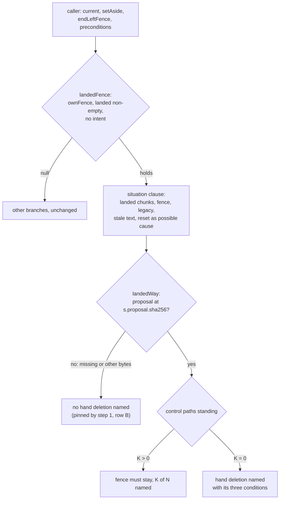
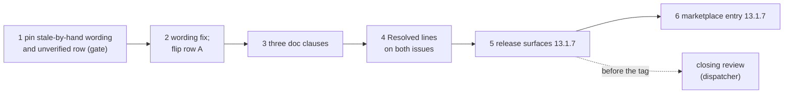

# Implementation Plan: /fusion:migrate, the landed-fence message claims only what it checked, and the unverified-proposal branch is pinned and documented

**Date:** 2026-10-16
**Spec:** none. Planned from the package narrative `261016-2328-migrate-landed-fence-wording-and-unverified-proposal-branch.md` and the two low issues it names, `261016-2123-migrate-landed-fence-message-asserts-a-git-reset-it-never-checked.md` and `261016-2123-migrate-proposal-unverified-branch-of-the-hand-deletion-is-untested-and-undocumented.md`, both filed by the closing review `261016-2123-reviewer-closing-pass-over-the-migrate-rollback-cut-then-reset-package.md`. Precedent and model: `261016-2000-plan-migrate-rollback-cut-then-reset-circular-refusals.md` and its ruling `261016-1958-is-a-rollback-fence-ended-when-the-rollback-landed-chunks-and-a-git-reset-then-took-the-tree-back-to-markdown.md` (option 2).
**Decidability:** The plan rests on one question: **"What may the landed-fence message say about the tree?"** It is decidable from what the helper already holds. Every caller of `landedThenReset` has established four facts before it calls:
- `inspect` reads `state=legacy` (`ownFence`);
- the standing fence is `s.rollback.begin_id` (`ownFence`);
- the scheduled rollback chunks in `own.landed` have stored answers (`ownFence`);
- `stale()` returned non-null. With `s.rollback` set, its text is either "the record is kept for …" or "neither the plan index … nor rollback chunk 0's answer is in the tree".

A git reset is not among these facts, and no input the helper holds decides it. A reset and a hand deletion of the plan index leave the same tree. So the message states those four facts and gives the reset as a possible cause only. It never asserts the reset. This needs no change of mechanism and no new ruling. The safety question, whether the hand deletion may be named, keeps the mechanism option 2 of the ruling put in place. The proposal must verify at `s.proposal.sha256` and no control path it lists may stand. This plan pins that mechanism and does not change it.

## Directive

The fix of both low issues, with their fix direction and acceptance as the brief.

- **Wording.** The situation sentence states what the helper observed, not an inferred cause. The K>0 branch drops "nothing was written or lost". Acceptance: on a stale tree made by hand (no reset, the plan index deleted), `set-aside --consent` exits 5. Its stderr does not say the tree was reset and does not contain "nothing was written or lost". `.json-state/maintenance.json` stays byte-identical. The extended "cell A reset with git" case stays green.
- **Unverified branch.** The extended case gains one row: a byte is appended to the proposal, then `set-aside --consent` exits 5. Its stderr contains "missing or at other bytes" and does not name the hand deletion. `maintenance.json` stays byte-identical. Each of the three doc surfaces gains one clause.

What does not change is safety behaviour. The hand deletion stays named only when the proposal verifies at its hash and no control path stands. The helper removes nothing. Every exit code stays as it is.

## Current State

- **`hooks/migrate.ts`** (866 lines; `hooks/dist/migrate.js` is committed and checked by `lib/__tests__/committed-dist.test.ts`).
  - `ownFence` (line 384) and `landedFence` (line 416) classify the cell. The doc comment of `landedFence` reads "a rollback cut, then a git reset to Markdown", which is the same unchecked cause.
  - `landedWay` (line 430) begins every branch with `head`, which is "no command of this helper ends that fence, and nothing was written or lost". The branches:
    - an unreadable proposal, or one at other bytes, gives "the proposal … is missing or at other bytes, … no hand deletion is named";
    - with K>0 control paths standing, "(K of the N control paths the proposal lists stand), so the fence must stay";
    - with K=0, the hand deletion and its three conditions.
  - `landedThenReset` (line 447) gives the situation: "…landed rollback chunk(s) N, then the tree was reset to Markdown, so its plan index is gone and the fence F that rollback began stands; " followed by `landedWay`.
  - Callers:
    - `current` (line 734). Its sentence already prints stale's text: "…does not carry it: ${shows}. Nothing was sent or written. " followed by the situation.
    - `setAside` (line 747), followed by "Nothing was moved."
    - `endLeftFence` (line 630), followed by "; nothing was sent".
    - `preconditions` (line 479), under `--session <aside>`.

    Each caller already says what this call did not write. That makes "nothing was written or lost" redundant where it is true, and false where it is not.
- **`hooks/lib/__tests__/migrate.test.ts`** (488 lines).
  - The case "cell A: a rollback cut after its first chunk over a legacy tree is current …" builds the probe's tree: a kill at `{phase: "rollback", chunk: 2}`, with no commit and no reset. It reads `s` from `state.json`, and it ends with `cut("rollback")` completing. Deleting the plan index `s.plan.path` before that last call, and restoring its bytes afterwards, gives the issue's hand-made stale tree without a new case.
  - The case "cell A reset with git and cell C with a fence of another id" pins K=1 (`(1 of the`, no `maintenance.json`) and K=0 (`aside.stderr` names the deletion). It never touches the proposal. Its `named` matcher, `/rollback chunks? 2[\s\S]*reset/`, needs the word "reset" somewhere after the chunks. The new wording keeps that word in the hedged cause, so this matcher stays as it is.
- **Measured at HEAD `4055be29`.** No skill, doc, README or other test quotes "reset to Markdown", "written or lost" or "plan index is gone" (grep over `hooks/lib`, `skills`, `bin`, `docs` and the three READMEs). The wording lives in `hooks/migrate.ts` alone.
- **Doc surfaces of the hand deletion.** Each lists three conditions and leaves the unverified case out:
  - `bin/fusion-migrate` header, the `rollback --end-fence` entry ("…and no control path the proposal lists stands; while any does, it names no deletion. It removes nothing there.");
  - the `migrate.ts` row under `README-hooks.md` `## Files` ("…and names none while any does.");
  - `docs/upgrading-to-v13.md` `**Undo.**` ("…naming no deletion while any does; it deletes nothing.").
- **Bounds at HEAD.**
  - `skills/migrate/SKILL.md` is 28 997 bytes and is not edited.
  - `skills/` totals 224 869 bytes, and `skills/help/SKILL.md` is 16 203.
  - The hook tests total 25 343 lines, with `migrate.test.ts` at 488.
  - `reference-resolution-lint` `BASELINE = { paths: 2061, anchors: 371, stampBare: 11 }`.
- **Pre-existing reds.** `lib/__tests__/workbench-citation-lint.test.ts` reports exactly two findings, one in each of the files `261010-1045-a-narrative-that-is-a-directory-or-unreadable-makes-the-codec-throw-and-exit-1-for-every-workbench-wide-read.md` and `261010-1045-containment-is-lexical-so-a-symlinked-store-sends-codec-writes-outside-the-workbench-and-list-never-sees-them.md`. They are not this package's. Every "green" below means green apart from exactly those two findings. A third finding, or any other red, is a stop.
- **Release state.** `plugin.json`, `install.sh`'s `FUSION_REF=tags/v13.1.6` example and `README.md`'s pin example read 13.1.6. The help paragraph is "Coming from 13.1.5 or earlier: 13.1.2 to 13.1.6 need no migration; …".

## Approach

**One source for what the message says about the tree.** The situation clause stops inventing a cause and quotes the finding `stale()` already produced, which is the same text `status` and `current` use. No new check is added and no caller grows a rule of its own. The clause is composed in one place:

> a rollback of this record landed rollback chunk(s) <landed>, and the fence <F> it began stands over a tree that reads as legacy Markdown, where <stale's text> (a git reset after that rollback leaves a tree so)

Every factual clause maps to one check. "landed rollback chunk(s)" is `ownFence`'s `landed`. "the fence F it began stands" is the fence equal to `begin_id`. "reads as legacy Markdown" is `i.state`. "<stale's text>" is `stale()` itself. The parenthesis names a possible cause and asserts none. In `current`, whose first sentence already prints `stale`'s text, the landed branch alone drops its own `: ${shows}`, so the finding appears once.

**The way-out clause loses only its false half.** `head` becomes "no command of this helper ends that fence". The callers' own "Nothing was moved", "nothing was sent" and "Nothing was sent or written" already say what this call wrote. The three branches of `landedWay`, and their conditions, are untouched.



**Order.** Step 1 pins both observations before any source changes. The false wording is pinned as observed, and the unverified branch as its correct, final behaviour. That gives a gate. Step 2 rewrites the wording and flips only the step 1 assertions that describe the defect. Step 3 documents the unverified branch. Step 4 records both resolutions. Steps 5 and 6 release 13.1.7.



The closing review is the orchestrator's dispatch of the reviewer, which is not an executor of this plan. It runs after step 5's release commit and before the tag, and `## Where this work stops` makes it a precondition of the tag.

**No decision record.** The issues' fix direction settles the wording without a user choice, because every clause either restates a check or is plainly hedged. The safety rule is the existing ruling, unchanged.

## Implementation Steps

1. **Pin the false wording on a stale tree made by hand, and the unverified-proposal branch, and gate on both**
   - Executor: code-implementer
   - Files: `hooks/lib/__tests__/migrate.test.ts`, `hooks/lib/__tests__/fixtures/surface-growth.golden`
   - Changes:
     - **Row A, in the case "cell A: a rollback cut after its first chunk over a legacy tree is current …".** Insert it after the existing `--end-fence` assertion and before `const back = cut("rollback")`. It is labelled in a comment by the backticked full basename `261016-2123-migrate-landed-fence-message-asserts-a-git-reset-it-never-checked.md`, never a bare stamp.
       - Read the bytes of `s.plan.path` and delete the file.
       - Assert: `status` shows `record=stale`. Then `set-aside --consent` exits 5, its stderr matches `/rollback chunks? 2/`, and it contains `then the tree was reset to Markdown` and `nothing was written or lost` (today's text, as observed). It does not contain ``maintenance.json` by hand``. The session directory still exists, and `.json-state/maintenance.json` is byte-identical to its read before the deletion.
       - Write the plan index's bytes back. `status` shows `record=current` again, and the case goes on to its `cut("rollback")` unchanged.
     - **Row B, in the case "cell A reset with git and cell C with a fence of another id".** Insert it after `rmSync(join(wb, ctl))` (K is 0 again) and before the `aside.stderr` K=0 assertion. Label it by the backticked full basename `261016-2123-migrate-proposal-unverified-branch-of-the-hand-deletion-is-untested-and-undocumented.md`.
       - Read the proposal bytes at `s.proposal.path` and append one byte.
       - Assert: `set-aside --consent` exits 5. Its stderr contains `` `the proposal ${s.proposal.path} is missing or at other bytes` ``, so the match anchors on the proposal and not on `stale`'s plan-index text. It does not contain ``maintenance.json` by hand``. `FENCE` is byte-identical.
       - Write the original bytes back, then assert that a fresh `set-aside --consent` exits 5 and its stderr does contain ``maintenance.json` by hand``. That paired positive makes the row fail if the `sha(raw) !== s.proposal.sha256` check is deleted. The case then continues unchanged.

     At most 16 test lines, both rows together. No source change and no build. Regenerate the golden: run `cd hooks && UPDATE_SURFACE_GOLDEN=1 npx vitest run lib/__tests__/surface-growth-bound.test.ts`, which fails on purpose, then run the bound again.
   - Acceptance: `cd hooks && npm test -- lib/__tests__/migrate.test.ts lib/__tests__/surface-growth-bound.test.ts` is green. The report quotes the first 300 characters of row A's and row B's `set-aside --consent` stderr. **Gate:** if any assertion of rows A or B does not hold as written, keep it as observed, report it, and stop. Steps 2 to 6 do not start.
   - Dependencies: none

2. **The situation clause states the four checked facts and gives the reset as a possible cause; the way-out clause drops "nothing was written or lost"**
   - Executor: code-implementer
   - Files: `hooks/migrate.ts`, `hooks/dist/migrate.js` (by `cd hooks && npm run build`), `hooks/lib/__tests__/migrate.test.ts`, `hooks/lib/__tests__/fixtures/surface-growth.golden`
   - Changes in `hooks/migrate.ts`:
     - `landedThenReset` takes `stale`'s finding as a parameter, `shows: string`. Every caller already holds it or computes it from values it holds: `current` has `shows`; `setAside` has `shows`; `endLeftFence` and `preconditions` call `stale(…)` in their guard, so bind that result. It returns, in substance: "a rollback of this record landed rollback chunk(s) <landed>, and the fence <F> it began stands over a tree that reads as legacy Markdown, where <shows> (a git reset after that rollback leaves a tree so); " followed by `landedWay(…)`. The exact phrasing is the executor's, under three constraints:
       - (a) every factual clause is one of `ownFence`'s three facts or `stale`'s text;
       - (b) the cause appears only as a possible one, and the substring `reset` stays in it;
       - (c) none of `the tree was reset`, `so its plan index is gone` or `nothing was written or lost` appears.
     - `landedWay`: `head` becomes "no command of this helper ends that fence". Its three branches, their conditions, the `lstat` safe direction and their texts after `head` are unchanged byte for byte.
     - `current`, in the landed branch only: the first sentence drops `: ${shows}`, since the situation clause carries it. Every other branch of `current` is unchanged.
     - The doc comments of `landedFence` and `landedThenReset` stop stating the reset as the cell's cause. They describe it as the four facts, a reset being the usual way there. A citation in them keeps the backticked full basename form.

     Run `cd hooks && npm run build`.
   - Changes in the tests: row A's two positive substrings flip. Its stderr now matches `/rollback chunks? 2/`, does not match `/the tree was reset|so its plan index is gone/`, does not contain `nothing was written or lost`, and does contain `rollback chunk 0's answer`, which is `stale`'s observed text. Every other assertion of rows A and B, and of the case "cell A reset with git …" (its `named` matcher, K=1, K=0, the 13.1.4 row, the hand deletion and `run` at `result=json-control`), stays unchanged. No more than 4 test lines net.
   - Acceptance: `cd hooks && npm test -- lib/__tests__/migrate.test.ts lib/__tests__/committed-dist.test.ts lib/__tests__/surface-growth-bound.test.ts lib/__tests__/store-name-migration.test.ts` is green. `git -C /Users/kai/Projects/productive/F04-FUSION/fusion diff --stat -- hooks/migrate.ts hooks/dist/migrate.js` shows both modified. That is a path-limited diff, not a whole-tree command. `git -C /Users/kai/Projects/productive/F04-FUSION/fusion diff -- hooks/migrate.ts` shows no change inside `ownFence`, `landedFence`'s body, `idleFence`, `stale` or the condition lines of `landedWay`. The report quotes row A's new stderr in full.
   - Dependencies: step 1, with its gate passed

3. **The unverified-proposal branch in the three doc surfaces**
   - Executor: code-implementer
   - Files: `bin/fusion-migrate` (header only), `README-hooks.md` (the `migrate.ts` row under `## Files`), `docs/upgrading-to-v13.md` (`**Undo.**`)
   - Changes: one short clause each, saying that no deletion is named when the proposal kept under `.json-state/migration/` is missing or at other bytes.
     - Header, `rollback --end-fence` entry: "while any does, or while the proposal is missing or at other bytes, it names no deletion."
     - `README-hooks.md` row: "and names none while any does or while the proposal is missing or at other bytes."
     - `**Undo.**`: "naming no deletion while any does or while the proposal it counts them from is missing or at other bytes;".

     No other wording changes. No new path or anchor citation is added; the clause names `.json-state/migration/` in prose at most, as the surfaces already name `.json-state/maintenance.json`. `skills/migrate/SKILL.md` is not edited.
   - Acceptance: `cd hooks && npm test` is green apart from exactly the two pre-existing `workbench-citation-lint` findings, and `reference-resolution-lint` passes at `BASELINE` 2061/371/11 with no edit to that file. `wc -c skills/migrate/SKILL.md` prints 28997. If `reference-resolution-lint` moves, that is a stop: reword the clause until it does not, and never edit `BASELINE`.
   - Dependencies: step 2

4. **Record the resolution on both issues**
   - Executor: code-implementer
   - Files: `261016-2123-migrate-landed-fence-message-asserts-a-git-reset-it-never-checked.md` and `261016-2123-migrate-proposal-unverified-branch-of-the-hand-deletion-is-untested-and-undocumented.md`, both in the issues store of the container `261016-1951-migrate-rollback-cut-then-reset-circular-refusals`
   - Changes: append `---` and one `Resolved:` line to each, in anchor form with no commit hash, citing this plan by its plain basename `261016-2331-plan-migrate-landed-fence-wording-and-unverified-proposal-branch.md`.
     - The wording issue names steps 1 and 2: row A in `hooks/lib/__tests__/migrate.test.ts`, the case "cell A: a rollback cut after its first chunk …", and `hooks/migrate.ts` `landedThenReset` and `landedWay`.
     - The branch issue names steps 1 and 3: row B in the case "cell A reset with git …", and the three doc surfaces.

     Write no transition. The dispatcher closes each issue with `--disposition '{"kind":"fixed","reason_ref":null}'` after reading the `Verification:` line.
   - Acceptance: after both writes, `cd hooks && npm test` is green apart from exactly the two pre-existing `workbench-citation-lint` findings, so the new lines add no third finding, and `reference-resolution-lint` passes unedited.
   - Dependencies: step 3

5. **Release surfaces for 13.1.7**
   - Executor: code-implementer
   - Files: `.claude-plugin/plugin.json`, `install.sh` (the header's `FUSION_REF=tags/v13.1.6` example), `README.md` (the same pin example), `skills/help/SKILL.md` (`### 4. Update`, the first paragraph), `hooks/lib/__tests__/fixtures/surface-growth.golden`
   - Changes:
     - Bump 13.1.6 to 13.1.7 in `plugin.json` and in both pin examples. `plugin.json`'s `description` does not change.
     - The help paragraph, per `README-agents.md` `## Releasing` step 0. A patch that needs no migration joins its predecessor's paragraph:
       - "Coming from 13.1.5 or earlier" becomes "Coming from 13.1.6 or earlier";
       - "13.1.2 to 13.1.6 need no migration" becomes "13.1.2 to 13.1.7 need no migration";
       - one sentence of at most about 150 bytes goes before the 13.1.6 one, with no path or anchor citation. In substance: "13.1.7: that message states only what it checked, and says when it cannot verify the migration's file list."
       - The other paragraphs stay.
     - Regenerate the golden.
   - Acceptance:
     - `cd hooks && npm test` is green apart from the two pre-existing findings, and `reference-resolution-lint` passes at 2061/371/11 unedited. A move is a stop: reword, never edit `BASELINE`.
     - `wc -c skills/migrate/SKILL.md` prints 28997.
     - `claude plugin validate .` reports passed.
     - `claude --plugin-dir . --agent fusion:orchestrator -p "reply SMOKE-OK"` answers.
     - The report states the output of `bin/fusion-review-coverage --since v13.1.6`, which is advisory.
     - `grep -n "13\.1\.6" .claude-plugin/plugin.json install.sh README.md` finds no stale pin.
   - Dependencies: step 4

6. **Marketplace entry for 13.1.7**
   - Executor: data-implementer
   - Files: `/Users/kai/Projects/productive/F03-CLAUDE-plugin-marketplace/claude-plugins/.claude-plugin/marketplace.json`
   - Changes: set fusion's `version` to `13.1.7`, and change nothing else. Before dispatching this step, the dispatcher runs `git -C /Users/kai/Projects/productive/F03-CLAUDE-plugin-marketplace/claude-plugins pull --rebase origin main`. The executor makes no git call.
   - Acceptance: `node -e 'JSON.parse(require("fs").readFileSync(process.argv[1],"utf8"))' /Users/kai/Projects/productive/F03-CLAUDE-plugin-marketplace/claude-plugins/.claude-plugin/marketplace.json` exits 0, and fusion's entry reads `"version": "13.1.7"`, equal to `.claude-plugin/plugin.json`.
   - Dependencies: step 5

**Scratch-root rule for every step.** Executors run no whole-tree git command in the live repository. The tests create their own repositories under the system temp directory, through `project()`. Any manual reproduction runs only inside a scratch root, entered with an absolute `cd` and checked with `pwd` before any destructive git call. Nothing in this plan commits. Commit, push, tag, the closing review's dispatch and the cache pull are the dispatcher's (`README-agents.md` `## Releasing`). The dispatcher stages `hooks/dist/migrate.js` in the same commit as `hooks/migrate.ts`.

## Where this work stops

- Any assertion of step 1's rows A or B does not hold as written: the work stops after step 1, with the observation reported, and steps 2 to 6 are not done.
- On the stale tree made by hand (row A), `set-aside --consent` exits 5. Its stderr names rollback chunk 2, matches neither `the tree was reset` nor `so its plan index is gone`, does not contain `nothing was written or lost`, and does not name the hand deletion. `maintenance.json` is byte-identical.
- Row B: with one byte appended to the proposal, `set-aside --consent` exits 5 and names "the proposal … is missing or at other bytes", not the hand deletion, with `FENCE` byte-identical. With the byte removed, it names the hand deletion again.
- The case "cell A reset with git and cell C with a fence of another id" passes, with every assertion it had at `4055be29` unchanged.
- `ownFence`, `idleFence`, `stale`, `landedFence`'s body and the conditions of `landedWay` are unchanged in `hooks/migrate.ts`. Every exit code in the migrate tests is unchanged.
- `bin/fusion-migrate`'s header, the `migrate.ts` row of `README-hooks.md` and `docs/upgrading-to-v13.md` `**Undo.**` each carry one clause saying that no deletion is named when the proposal is missing or at other bytes.
- `wc -c skills/migrate/SKILL.md` prints 28997. Every growth bound is green, and no baseline or head-room constant was edited.
- `reference-resolution-lint`'s `BASELINE` reads 2061/371/11, unedited, and the lint passes.
- `hooks/dist/migrate.js` is the compile of `hooks/migrate.ts` as edited, staged in the same commit.
- Both issues carry a `Resolved:` line, and the full hook suite ran after those writes with no red beyond the two pre-existing `workbench-citation-lint` findings.
- Before the tag `v13.1.7` is created, a closing review of the range since `v13.1.6` is filed in this package's reviews store. Its verdict is accept, or every finding it rates above Low is answered.
- Before the push, `plugin.json`, both pin examples and `marketplace.json` read 13.1.7, and the help topic's first paragraph reads "Coming from 13.1.6 or earlier" and "13.1.2 to 13.1.7 need no migration".

## Data Structures

None. No field in `State`, no session file and no codec change. The only signature change is internal:

```
landedThenReset(wb, session, s, own, shows)   // shows: stale()'s non-null text, which the caller already holds
```

## API Changes

None in exit codes, stdout keys or subcommands. In the landed-fence cell, the stderr of `rollback`, `resume`, `run`, `set-aside --consent` and `rollback --end-fence` reads differently: it gives the observed situation with the reset as a possible cause, and the way-out clause no longer says "nothing was written or lost".

## Testing Strategy

Both trees come from real runs only, using the existing kill stand-in at rollback chunk 2, plus one deletion of a file and one appended byte. Each is undone byte for byte so that the host case goes on as before. Row A reuses the case that already builds the probe's tree, so no new case and no new timeout cost is added. Step 1 pins today's text first, which makes step 2's rewrite a visible flip of assertions. Row B carries a paired positive: the restored proposal names the deletion again. Without that pair, a row that merely failed to name the deletion would pass for any reason. Rows A and B together cover the issues' acceptance. The unchanged reset case is the regression for the reset cell.

## Risks & Mitigations

| Risk | Mitigation |
|---|---|
| The new wording drops the word `reset`, so the reset case's `named` matcher goes red, and fixing that would change an assertion the issue says stays | Constraint (b) of step 2 keeps `reset` in the hedged cause. The stop clause requires that case's assertions unchanged. |
| `stale`'s text is "the record is kept for …" in a foreign-workbench cell, and a hard-coded "plan index gone" would be false there too | The clause quotes `stale`'s own text, whatever it is, and claims nothing else. |
| `current` prints `stale`'s text twice | Step 2 drops `: ${shows}` from `current`'s first sentence in the landed branch only. |
| Row B's match hits `stale`'s "plan index … missing or at other bytes" instead of the proposal branch | Row B anchors on `the proposal ${s.proposal.path} is missing or at other bytes`. |
| The wording change slips into a guard change | Step 2's acceptance reads the diff for `ownFence`, `landedFence`, `idleFence`, `stale` and `landedWay`'s conditions. Rows A and B and the unchanged reset case pin the outcomes. |
| A doc clause or the help sentence moves `reference-resolution-lint` | No new citation is added. A move is a stop: the clause is reworded, never the `BASELINE`. |
| A comment cites a record by a bare stamp | Steps 1 and 2 cite by backticked full basename only. |
| A targeted `npx vitest run` exercises a stale `dist` | Step 2 runs `npm run build`, and every acceptance uses `npm test -- <files>`. |

## Open Questions

None. The wording follows the issues' fix direction, and the safety rule is the existing ruling `261016-1958-is-a-rollback-fence-ended-when-the-rollback-landed-chunks-and-a-git-reset-then-took-the-tree-back-to-markdown.md`, unchanged.
