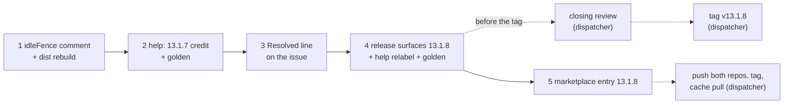

# Implementation Plan: the help topic's 13.1.7 credit, the `idleFence` comment, and release 13.1.8

**Date:** 2026-10-17
**Spec:** none. Planned from the package narrative `261017-0819-help-13-1-7-credit-and-idlefence-comment.md`, the low issue `261017-0000-help-13-1-7-note-credits-the-release-with-a-proposal-check-13-1-6-already-had.md`, and the cross-cutting note of the closing review `261017-0000-reviewer-closing-pass-over-the-migrate-landed-fence-wording-package.md`. Both records sit in the container `261016-2328-migrate-landed-fence-wording-and-unverified-proposal-branch`. Model: that container's plan `261016-2331-plan-migrate-landed-fence-wording-and-unverified-proposal-branch.md`.
**Decidability:** The plan rests on one question: **"What may each of the two texts claim?"** It is decidable from the inputs at hand. For the help sentence, `git diff 74992939..ddab3bf1 -- hooks/migrate.ts` shows which conditions 13.1.7 changed: only `head` in `landedWay`, never the `catch` branch. For the comment, `idleFence`'s own return expression is what it checks: `ownFence`, `own.landed.length > 0` and `intentStands`. A git reset is not among these. Both texts are rewritten to claim no more than those facts. No change of mechanism and no ruling is needed.

## Directive

Two wording fixes with no behaviour change, released as fusion 13.1.8.

- **Help credit (the issue).** In `skills/help/SKILL.md` `### 4. Update`, the 13.1.7 sentence credits 13.1.7 with the wording change alone. The issue's acceptance applies: the sentence does not present the unverified-proposal refusal as new in 13.1.7, the growth bounds stay green, and `reference-resolution-lint` passes at its `BASELINE` with no edit to it.
- **`idleFence` comment (the review's note).** The doc comment states what the function checks. It names a git reset only as one way into the cell, never as the cell's cause.
- **Release 13.1.8.** No condition, message or exit code in `hooks/migrate.ts` moves.

## Current State

Measured at HEAD `c934c9ce`.

- **`skills/help/SKILL.md`**, line 95, is 16 353 bytes. The paragraph reads "**Coming from 13.1.6 or earlier:** 13.1.2 to 13.1.7 need no migration; `fusion --update` is the whole update. Each changes only `/fusion:migrate`. 13.1.7: the message for an undo that landed part of its work states only what it checked, and names no deletion while it cannot verify the file list. 13.1.6: …". The clause after "and" is the defect.
- **`hooks/migrate.ts`**, the `idleFence` doc comment (lines 395 to 409). Its last sentence reads "A rollback that landed chunks and then met a git reset fails it too, and `landedFence` names that cell (the decision `261016-1958-…`, beside `261016-1436-…`)". Both decision basenames are backticked in full. The function's return expression (line 412) checks no reset. `hooks/dist/migrate.js` keeps comments, so it carries "met a git reset" once, and `lib/__tests__/committed-dist.test.ts` compares the committed dist with a fresh build.
- **Growth bounds.** The skills surface is bounded in aggregate, not per file. `SKILL_BASELINE` summed over the live files gives a floor of 188 768. `SKILL_HEAD_ROOM` is 39 260, so the budget is 228 028. `skills/*/SKILL.md` totals 225 019 today, which leaves **3 009 bytes**. The golden `hooks/lib/__tests__/fixtures/surface-growth.golden` records `help/SKILL.md 16353` and must be regenerated after every byte change to that file. `hooks/migrate.ts` is not a bounded surface. No test line is added by this plan.
- **`reference-resolution-lint`.** `BASELINE = { paths: 2061, anchors: 371, stampBare: 11 }` is compared with `toEqual`, so the lint goes red if a count falls as well as if it rises. The comment's two backticked basenames stay byte-identical. No path, anchor or bare stamp is added or removed anywhere.
- **Pre-existing reds.** `lib/__tests__/workbench-citation-lint.test.ts` reports exactly two findings, one each in the files `261010-1045-a-narrative-that-is-a-directory-or-unreadable-makes-the-codec-throw-and-exit-1-for-every-workbench-wide-read.md` and `261010-1045-containment-is-lexical-so-a-symlinked-store-sends-codec-writes-outside-the-workbench-and-list-never-sees-them.md`. They are not this package's. Every "green" below means green apart from exactly those two findings. A third finding, or any other red, is a stop.
- **Release state.** `.claude-plugin/plugin.json` `version`, the `install.sh` header's `FUSION_REF=tags/v13.1.7` (line 29), `README.md`'s pin example (line 26) and fusion's entry in `marketplace.json` all read 13.1.7. `plugin.json`'s `description` is not touched, so the fifth surface (the description pair) cannot drift. No `docs/upgrading-to-v12.md` content changes.

## Approach

**One rule for both texts: claim only what was checked or changed.** The help sentence keeps the 13.1.7 wording credit and drops the refusal clause. The comment replaces "and then met a git reset" with what `idleFence` tests, which is landed chunks under the own fence, and names the reset as one way there. Neither text gains a citation, so neither counter of `reference-resolution-lint` moves.

The 13.1.8 help entry is written in the same rule. 13.1.8 changes nothing that runs, so the paragraph's "Each changes only `/fusion:migrate`" is scoped to the releases it is true of.

The closing review is the orchestrator's dispatch of the reviewer, which is not an executor of this plan. It runs after step 4's release commit and before the tag. `## Where this work stops` makes it a precondition of the tag.

**No decision record.** Both fixes follow the issue's fix direction and the review's note. No choice binds work beyond this plan.

## Implementation Steps

1. **The `idleFence` doc comment states what the function checks**
   - Executor: code-implementer
   - Files: `hooks/migrate.ts` (the `idleFence` doc comment only), `hooks/dist/migrate.js` (by `cd hooks && npm run build`)
   - Changes: replace "A rollback that landed chunks and then met a git reset fails it too, and `landedFence` names that cell" with, in substance, "A rollback that landed chunks fails it too, whatever brought the tree back to legacy Markdown after them (a git reset is one way), and `landedFence` names that cell". The exact phrasing is the executor's, under three constraints:
     - (a) the text does not contain `met a git reset` or `then met`;
     - (b) the reset appears only as one possible way into the cell;
     - (c) the parenthesis that follows, with its two backticked full basenames, is byte-identical, and no record stamp appears outside backticks.

     No other line of `hooks/migrate.ts` changes. Then run `cd hooks && npm run build`.
   - Acceptance:
     - `cd hooks && npm test -- lib/__tests__/migrate.test.ts lib/__tests__/committed-dist.test.ts lib/__tests__/reference-resolution-lint.test.ts` is green.
     - `git -C /Users/kai/Projects/productive/F04-FUSION/fusion diff -U0 -- hooks/migrate.ts` shows changed lines only inside the `idleFence` doc comment, each beginning with ` *`.
     - `git -C /Users/kai/Projects/productive/F04-FUSION/fusion diff -U0 -- hooks/dist/migrate.js` shows only the matching comment lines.
     - `grep -c "met a git reset" hooks/migrate.ts hooks/dist/migrate.js` prints 0 for both.
   - Dependencies: none

2. **The help topic credits 13.1.7 with the wording alone**
   - Executor: code-implementer
   - Files: `skills/help/SKILL.md` (`### 4. Update`, the paragraph "Coming from 13.1.6 or earlier"), `hooks/lib/__tests__/fixtures/surface-growth.golden`
   - Changes: the 13.1.7 sentence becomes "13.1.7: the message for an undo that landed part of its work states only what it checked." The clause ", and names no deletion while it cannot verify the file list" goes. No other sentence changes in this step. Regenerate the golden: run `cd hooks && UPDATE_SURFACE_GOLDEN=1 npx vitest run lib/__tests__/surface-growth-bound.test.ts`, which fails on purpose, then run the bound again.
   - Acceptance:
     - `cd hooks && npm test -- lib/__tests__/surface-growth-bound.test.ts lib/__tests__/reference-resolution-lint.test.ts` is green, with `BASELINE` unedited and no head-room constant or `SKILL_BASELINE` entry edited.
     - `grep -c "cannot verify the file list" skills/help/SKILL.md` prints 0.
   - Dependencies: step 1

3. **Record the resolution on the issue**
   - Executor: code-implementer
   - Files: `261017-0000-help-13-1-7-note-credits-the-release-with-a-proposal-check-13-1-6-already-had.md` in the issues store of the container `261016-2328-migrate-landed-fence-wording-and-unverified-proposal-branch`
   - Changes: append `---` and one `Resolved:` line in anchor form, with no commit hash. It cites this plan by its plain basename `261017-0821-plan-help-13-1-7-credit-and-idlefence-comment.md`, step 2, and `skills/help/SKILL.md` `### 4. Update`. Write no transition. The dispatcher closes the issue with `--disposition '{"kind":"fixed","reason_ref":null}'`.
   - Acceptance: after the write, `cd hooks && npm test` is green apart from exactly the two pre-existing `workbench-citation-lint` findings, so the new line adds no third, and `reference-resolution-lint` passes unedited.
   - Dependencies: step 2

4. **Release surfaces for 13.1.8**
   - Executor: code-implementer
   - Files: `.claude-plugin/plugin.json`, `install.sh` (header pin example), `README.md` (pin example), `skills/help/SKILL.md` (the same paragraph), `hooks/lib/__tests__/fixtures/surface-growth.golden`
   - Changes:
     - Bump 13.1.7 to 13.1.8 in `plugin.json` `version` and in both `FUSION_REF=tags/v…` examples. `description` is unchanged.
     - The help paragraph, per `README-agents.md` `## Releasing` step 0. A patch that needs no migration joins its predecessor's paragraph:
       - "Coming from 13.1.6 or earlier" becomes "Coming from 13.1.7 or earlier";
       - "13.1.2 to 13.1.7 need no migration" becomes "13.1.2 to 13.1.8 need no migration";
       - "Each changes only `/fusion:migrate`." becomes "13.1.2 to 13.1.7 each change only `/fusion:migrate`.";
       - one sentence goes before the 13.1.7 one, in substance "13.1.8 changes nothing that runs; it corrects the 13.1.7 note." It is at most 80 bytes and carries no path or anchor citation.
       - The other two paragraphs stay as they are.
     - Regenerate the golden, as in step 2.
   - Acceptance:
     - `cd hooks && npm test` is green apart from the two pre-existing findings. `reference-resolution-lint` passes at 2061/371/11 unedited; a move is a stop, and the fix is to reword, never to edit `BASELINE`.
     - `claude plugin validate .` reports passed.
     - `claude --plugin-dir . --agent fusion:orchestrator -p "reply SMOKE-OK"` answers.
     - `grep -n "13\.1\.7" .claude-plugin/plugin.json install.sh README.md` finds no stale pin.
     - The report states the output of `bin/fusion-review-coverage --since v13.1.7`, which is advisory.
   - Dependencies: step 3

5. **Marketplace entry for 13.1.8**
   - Executor: data-implementer
   - Files: `/Users/kai/Projects/productive/F03-CLAUDE-plugin-marketplace/claude-plugins/.claude-plugin/marketplace.json`
   - Changes: set fusion's `version` to `13.1.8` and change nothing else. Before dispatching this step, the dispatcher runs `git -C /Users/kai/Projects/productive/F03-CLAUDE-plugin-marketplace/claude-plugins pull --rebase origin main`. The executor makes no git call.
   - Acceptance: `node -e 'JSON.parse(require("fs").readFileSync(process.argv[1],"utf8"))' /Users/kai/Projects/productive/F03-CLAUDE-plugin-marketplace/claude-plugins/.claude-plugin/marketplace.json` exits 0, and fusion's entry reads `"version": "13.1.8"`, the same as `.claude-plugin/plugin.json`.
   - Dependencies: step 4

**Rules for every step.** Executors run no whole-tree git command in the live repository; only the path-limited `diff` calls above are allowed. Nothing in this plan commits. Commit, push, tag, the closing review's dispatch and the cache pull (`git -C ~/.claude/plugins/marketplaces/tenzoki-plugins pull origin main`) belong to the dispatcher (`README-agents.md` `## Releasing`). The dispatcher stages `hooks/dist/migrate.js` in the same commit as `hooks/migrate.ts`.

## Where this work stops

- `hooks/migrate.ts` differs from `c934c9ce` only inside the `idleFence` doc comment, and that comment contains neither `met a git reset` nor `then met`.
- `hooks/dist/migrate.js` is the build of the edited source, `committed-dist` is green, and both files sit in the same commit.
- Every exit code, condition and message string in `hooks/migrate.ts` is unchanged, and `migrate.test.ts` passes with no edit to it.
- The 13.1.7 sentence in `skills/help/SKILL.md` `### 4. Update` does not contain `cannot verify the file list`.
- The issue carries a `Resolved:` line, and the full hook suite ran after that write with no red beyond the two pre-existing `workbench-citation-lint` findings.
- Every growth bound is green with the golden regenerated, and no baseline, `SKILL_BASELINE` entry or head-room constant was edited.
- `reference-resolution-lint`'s `BASELINE` reads 2061/371/11, unedited, and the lint passes.
- The help paragraph reads "Coming from 13.1.7 or earlier" and "13.1.2 to 13.1.8 need no migration", and it carries a 13.1.8 sentence saying it changes nothing that runs.
- Before the tag `v13.1.8` is created, a closing review of the range since `v13.1.7` is filed in this package's reviews store, and its verdict is accept or every finding it rates above Low is answered.
- Before the push, `plugin.json`, both pin examples and `marketplace.json` read 13.1.8.
- The tag `v13.1.8` is on the pushed `main` commit, and the marketplace cache clone has been pulled.

## Data Structures

None.

## API Changes

None. No stderr text, stdout key, exit code or subcommand changes. The only user-visible change is the help topic's update paragraph.

## Testing Strategy

There is no behaviour to test. The guards are the existing suite:
- `committed-dist` proves the dist matches the edited source.
- `migrate.test.ts`, unedited, proves no message or exit code moved.
- `surface-growth-bound` holds the help bytes.
- `reference-resolution-lint` proves no citation was added or lost.

The issue's acceptance is checked by grep on the removed clause.

## Risks & Mitigations

| Risk | Mitigation |
|---|---|
| The comment rewrite drops or alters a backticked basename, and `reference-resolution-lint` goes red because a count fell | Constraint (c) in step 1 keeps the parenthesis byte-identical. The lint runs in step 1's acceptance. |
| A rewrite leaves a bare record stamp in the comment, which raises `stampBare` | Constraint (c) in step 1. |
| The dist is not rebuilt and `committed-dist` goes red | Step 1 runs `npm run build`, and its acceptance includes `committed-dist`. |
| The help paragraph's "Each changes only `/fusion:migrate`" becomes false for 13.1.8 | Step 4 scopes that sentence to 13.1.2 to 13.1.7. |
| The help edits exceed the skills head-room | Net change is under 100 bytes against 3 009 left. The golden is regenerated and the bound runs in steps 2 and 4. |
| The tag goes out before the closing review, as happened at v10.0.0 | The precondition is a clause in `## Where this work stops`, which the orchestrator reads back at the closing approval. |

## Open Questions

None. The help wording follows the issue's fix direction, and the comment wording follows the closing review's note.
