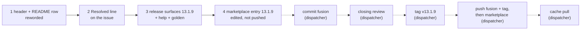

# Implementation Plan: the landed-cell wording in the `bin/fusion-migrate` header and `README-hooks.md`, and release 13.1.9

**Date:** 2026-10-17
**Spec:** none. Planned from the package narrative `261017-1026-migrate-landed-cell-docs-reset-wording.md` and the low issue `261017-0849-migrate-landed-cell-docs-in-the-helper-header-and-readme-hooks-still-presuppose-a-git-reset.md`, which sits in the issues store of the container `261017-0819-help-13-1-7-credit-and-idlefence-comment`. Model: that container's plan `261017-0821-plan-help-13-1-7-credit-and-idlefence-comment.md`.
**Decidability:** The plan rests on one question: **"What may the two descriptions of the landed cell claim?"** It is decidable from the inputs at hand. `landedFence` in `hooks/migrate.ts` returns the fence when `ownFence` holds (the record is legacy and the fence is its own), rollback chunks of the record landed, and no intent stands. No reset is read; the function's own doc comment says nothing checks for one. Both texts are rewritten to claim no more than that, in the words `docs/upgrading-to-v13.md` already uses. No change of mechanism and no ruling is needed.

## Directive

A wording fix with no behaviour change, released as fusion 13.1.9.

- **The issue.** The `rollback --end-fence` entry of the `bin/fusion-migrate` header and the `migrate.ts` row of `README-hooks.md` `## Files` each say the rollback chunks landed "before the reset". The issue's acceptance applies: neither text contains "before the reset", each names a reset only as one possible way into the cell, and `reference-resolution-lint` passes at its `BASELINE` with no edit to it.
- **Release 13.1.9.** No condition, message or exit code in `hooks/migrate.ts` or `bin/fusion-migrate` moves.

## Current State

Measured at HEAD `b2436db4`.

- **`bin/fusion-migrate`** is a bash script (`file` reports "Bourne-Again shell script"), not a wrapper around compiled output, so no dist rebuild follows an edit to it. The defect sits in the header's `rollback --end-fence` entry, lines 71 to 76: "Where rollback chunks landed before the reset, it names them and the hand deletion of that file once `status` shows record=stale, …". The sentence before it ("Over a tree a git reset made legacy again, where the codec cannot end it, …", lines 66 to 70) describes the quiet cell with no chunk landed. That wording is the ruling `261016-1436-how-is-a-rollback-fence-ended-that-a-git-reset-left-standing-over-a-legacy-tree.md`'s and is out of scope.
- **No test pins the header text.** The tests that name `bin/fusion-migrate` (`migrate.test.ts`, `hook-route-exclusion.test.ts`, `store-name-migration.test.ts`) run it or stub it; none reads its comment lines. `reference-resolution-lint.test.ts` does scan `bin/` header comments for citations, so the backticked `status` in lines 71 to 76 stays byte-identical.
- **`README-hooks.md`** line 235, the `migrate.ts` row: "…; where rollback chunks landed before the reset, its refusal names them and the hand deletion of `.json-state/maintenance.json` once `status` shows `record=stale`, `journal/` is empty …". The clause before it ("a fence its own refused rollback left over a tree a git reset made legacy again, with no rollback chunk landed under it, …") is again the quiet cell and is out of scope. `README-hooks.md` is not a bounded surface and is not in `hooks/lib/__tests__/fixtures/surface-growth.golden`.
- **The model wording.** `docs/upgrading-to-v13.md` `**Undo.**`: "Where chunks of the undo had landed and the tree then reads as legacy Markdown (a git reset is one way there), the helper says so …".
- **Repository grep.** `grep -rn "before the reset"` outside `fusion-workbench/`, `node_modules/` and `dist/` finds exactly the two lines above. Two near matches were read and left alone:
  - the 13.1.6 sentence in `skills/help/SKILL.md` `### 4. Update` ("when an undo had landed part of its work before git reset the tree"), a release credit that describes the case 13.1.6 handled, not the cell as it is checked now;
  - a comment in `hooks/lib/__tests__/migrate.test.ts` (line 437) that describes its own fixture, which does run a reset.
- **Growth bounds.** The skills surface is bounded in aggregate. `SKILL_BASELINE` floor 188 768 plus `SKILL_HEAD_ROOM` 39 260 gives 228 028; `skills/*/SKILL.md` totals 225 038 today, which leaves **2 990 bytes**. The golden records `help/SKILL.md 16372` and is regenerated after every byte change to that file. No test line is added by this plan.
- **`reference-resolution-lint`.** `BASELINE = { paths: 2061, anchors: 371, stampBare: 11 }`, compared with `toEqual`, so a fall is as red as a rise. Every backticked token in the two edited clauses stays byte-identical, and no path, anchor or bare stamp is added or removed.
- **Pre-existing reds.** `lib/__tests__/workbench-citation-lint.test.ts` reports exactly two findings, one in each of the two issue files stamped 261010-1045. They are not this package's. Every "green" below means green apart from exactly those two findings; a third finding, or any other red, is a stop.
- **Release state.** `.claude-plugin/plugin.json` `version`, the `install.sh` header's pin example (line 29), `README.md`'s pin example (line 26) and fusion's entry in `marketplace.json` all read 13.1.8. The help paragraph (line 95) reads "**Coming from 13.1.7 or earlier:** 13.1.2 to 13.1.8 need no migration; … 13.1.2 to 13.1.7 each change only `/fusion:migrate`. 13.1.8 changes nothing that runs; it corrects the 13.1.7 note. …". `plugin.json`'s `description` is not touched, so the description pair cannot drift. No `docs/upgrading-to-v12.md` content changes.

## Approach

**One rule for both texts: claim only what `landedFence` checks.** Each "landed before the reset" becomes "landed and the tree then reads as legacy Markdown (a git reset is one way there)", the wording of `docs/upgrading-to-v13.md`. Nothing else in either clause moves, so neither counter of `reference-resolution-lint` moves.

The 13.1.9 help entry follows the same rule: 13.1.9 changes nothing that runs, and "13.1.2 to 13.1.7 each change only `/fusion:migrate`" stays as it is, since it is still true of exactly that range.

The closing review is the orchestrator's dispatch of the reviewer, which is not an executor of this plan. Unlike the 13.1.8 release, the marketplace entry is edited before anything is pushed, so the review sees every version surface at 13.1.9.

**No decision record.** The fix follows the issue's fix direction. No choice binds work beyond this plan.

## Implementation Steps

1. **The two landed-cell descriptions claim only what is checked**
   - Executor: code-implementer
   - Files: `bin/fusion-migrate` (the header's `rollback --end-fence` entry only), `README-hooks.md` (the `migrate.ts` row of `## Files` only)
   - Changes:
     - In `bin/fusion-migrate`, "Where rollback chunks landed before the reset, it names them" becomes, in substance, "Where rollback chunks of it landed and the tree then reads as legacy Markdown (a git reset is one way there), it names them". The lines from there to "It removes nothing there." may be re-wrapped, keeping the `#` prefix and the entry's indentation.
     - In `README-hooks.md` line 235, "where rollback chunks landed before the reset, its refusal names them" becomes, in substance, "where rollback chunks landed and the tree then reads as legacy Markdown (a git reset is one way there), its refusal names them". The row stays one line.
     - The exact phrasing is the executor's, under three constraints: (a) neither text contains `before the reset`; (b) a reset appears only as one possible way into the cell; (c) every backticked token in both clauses is byte-identical, no backticked token is added, and no record stamp appears.
     - The quiet-cell sentence before each clause ("Over a tree a git reset made legacy again", "left over a tree a git reset made legacy again") does not change. No code line of `bin/fusion-migrate` changes.
   - Acceptance:
     - `cd hooks && npm test -- lib/__tests__/migrate.test.ts lib/__tests__/reference-resolution-lint.test.ts` is green, with `BASELINE` unedited.
     - `grep -c "before the reset" bin/fusion-migrate README-hooks.md` prints 0 for both.
     - `grep -c "a git reset is one way there" bin/fusion-migrate README-hooks.md` prints 1 for both, or the executor's equivalent phrase is quoted in the report.
     - `git -C /Users/kai/Projects/productive/F04-FUSION/fusion diff -U0 -- bin/fusion-migrate` shows changed lines only inside the `rollback --end-fence` entry, each beginning with `#`.
     - `git -C /Users/kai/Projects/productive/F04-FUSION/fusion diff -U0 -- README-hooks.md` shows line 235 only.
   - Dependencies: none

2. **Record the resolution on the issue**
   - Executor: code-implementer
   - Files: `261017-0849-migrate-landed-cell-docs-in-the-helper-header-and-readme-hooks-still-presuppose-a-git-reset.md` in the issues store of the container `261017-0819-help-13-1-7-credit-and-idlefence-comment`
   - Changes: append `---` and one `Resolved:` line in anchor form, with no commit hash. It cites this plan by its plain basename `261017-1027-plan-migrate-landed-cell-docs-reset-wording.md`, step 1, `bin/fusion-migrate` and `README-hooks.md` `## Files`. Write no transition. The dispatcher closes the issue with `--disposition '{"kind":"fixed","reason_ref":null}'`.
   - Acceptance: after the write, `cd hooks && npm test` is green apart from exactly the two pre-existing `workbench-citation-lint` findings, so the new line adds no third, and `reference-resolution-lint` passes unedited.
   - Dependencies: step 1

3. **Release surfaces for 13.1.9**
   - Executor: code-implementer
   - Files: `.claude-plugin/plugin.json`, `install.sh` (header pin example), `README.md` (pin example), `skills/help/SKILL.md` (`### 4. Update`, the paragraph "Coming from 13.1.7 or earlier"), `hooks/lib/__tests__/fixtures/surface-growth.golden`
   - Changes:
     - Bump 13.1.8 to 13.1.9 in `plugin.json` `version` and in both `FUSION_REF=tags/v…` examples. `description` is unchanged.
     - The help paragraph, per `README-agents.md` `## Releasing` step 0 (a patch that needs no migration joins its predecessor's paragraph):
       - "Coming from 13.1.7 or earlier" becomes "Coming from 13.1.8 or earlier";
       - "13.1.2 to 13.1.8 need no migration" becomes "13.1.2 to 13.1.9 need no migration";
       - "13.1.2 to 13.1.7 each change only `/fusion:migrate`." stays as it is;
       - one sentence goes before the 13.1.8 one, in substance "13.1.9 changes nothing that runs; it corrects two descriptions of an undo." It is at most 80 bytes and carries no path or anchor citation.
       - The other two paragraphs stay as they are.
     - Regenerate the golden: run `cd hooks && UPDATE_SURFACE_GOLDEN=1 npx vitest run lib/__tests__/surface-growth-bound.test.ts`, which fails on purpose, then run the bound again.
   - Acceptance:
     - `cd hooks && npm test` is green apart from the two pre-existing findings. `reference-resolution-lint` passes at 2061/371/11 unedited; a move is a stop, and the fix is to reword, never to edit `BASELINE`. No head-room constant or `SKILL_BASELINE` entry is edited.
     - `claude plugin validate .` reports passed.
     - `claude --plugin-dir . --agent fusion:orchestrator -p "reply SMOKE-OK"` answers.
     - `grep -n "13\.1\.8" .claude-plugin/plugin.json install.sh README.md` finds no stale pin.
     - The report states the output of `bin/fusion-review-coverage --since v13.1.8`, which is advisory.
   - Dependencies: step 2

4. **Marketplace entry for 13.1.9, edited before anything is pushed**
   - Executor: data-implementer
   - Files: `/Users/kai/Projects/productive/F03-CLAUDE-plugin-marketplace/claude-plugins/.claude-plugin/marketplace.json`
   - Changes: set fusion's `version` to `13.1.9` and change nothing else. Before dispatching this step, the dispatcher runs `git -C /Users/kai/Projects/productive/F03-CLAUDE-plugin-marketplace/claude-plugins pull --rebase origin main`. The executor makes no git call; the edit stays uncommitted and unpushed until the dispatcher's push sequence.
   - Acceptance: `node -e 'JSON.parse(require("fs").readFileSync(process.argv[1],"utf8"))' /Users/kai/Projects/productive/F03-CLAUDE-plugin-marketplace/claude-plugins/.claude-plugin/marketplace.json` exits 0, and fusion's entry reads `"version": "13.1.9"`, the same as `.claude-plugin/plugin.json`.
   - Dependencies: step 3

**Rules for every step.** Executors run no whole-tree git command in the live repository; only the path-limited `diff` calls above are allowed. Nothing in this plan commits or pushes. Commit, the closing review's dispatch, the tag, the pushes and the cache pull (`git -C ~/.claude/plugins/marketplaces/tenzoki-plugins pull origin main`) belong to the dispatcher (`README-agents.md` `## Releasing`), in this order: commit fusion, closing review, tag `v13.1.9`, push fusion and the tag, commit and push the marketplace, cache pull.

## Where this work stops

- `bin/fusion-migrate` differs from `b2436db4` only in comment lines of the `rollback --end-fence` entry, and contains no `before the reset`.
- The `migrate.ts` row of `README-hooks.md` `## Files` contains no `before the reset`, and no other line of `README-hooks.md` changed.
- In each of the two texts a reset is named only as one possible way into the landed cell, and the quiet-cell sentence before it is unchanged.
- Every exit code, condition and message string in `hooks/migrate.ts` and `bin/fusion-migrate` is unchanged, and `migrate.test.ts` passes with no edit to it.
- The issue carries a `Resolved:` line, and the full hook suite ran after that write with no red beyond the two pre-existing `workbench-citation-lint` findings.
- Every growth bound is green with the golden regenerated, and no baseline, `SKILL_BASELINE` entry or head-room constant was edited.
- `reference-resolution-lint`'s `BASELINE` reads 2061/371/11, unedited, and the lint passes.
- The help paragraph reads "Coming from 13.1.8 or earlier" and "13.1.2 to 13.1.9 need no migration", still says "13.1.2 to 13.1.7 each change only", and carries a 13.1.9 sentence saying it changes nothing that runs.
- Before anything is pushed, `plugin.json`, both pin examples and the marketplace working clone's `marketplace.json` read 13.1.9.
- Before the tag `v13.1.9` is created, a closing review of the range since `v13.1.8` is filed in this package's reviews store, and its verdict is accept or every finding it rates above Low is answered.
- The tag `v13.1.9` is on the pushed fusion `main` commit, and the fusion push happened before the marketplace push.
- After both pushes, the marketplace cache clone has been pulled.

## Data Structures

None.

## API Changes

None. No stderr text, stdout key, exit code or subcommand changes. The only user-visible change is the help topic's update paragraph.

## Testing Strategy

There is no behaviour to test. The guards are the existing suite:
- `migrate.test.ts`, unedited, proves no message or exit code moved.
- `reference-resolution-lint`, which scans `bin/` headers and `README-hooks.md`, proves no citation was added or lost.
- `surface-growth-bound` holds the help bytes.

The issue's acceptance is checked by grep on the removed phrase.

## Risks & Mitigations

| Risk | Mitigation |
|---|---|
| A rewrite alters or drops a backticked token (`status`, `.json-state/maintenance.json`, `record=stale`, `journal/`), and a lint count falls | Constraint (c) in step 1; the lint runs in step 1's acceptance. |
| The rewrite also touches the quiet-cell sentence, whose wording a ruling owns | Step 1 names that sentence as unchanged, and the diff checks confine the change. |
| The help paragraph's "each change only `/fusion:migrate`" becomes false | It stays scoped to 13.1.2 to 13.1.7; 13.1.9 gets its own sentence. |
| The help edit exceeds the skills head-room | Net change is under 100 bytes against 2 990 left; the golden is regenerated and the bound runs in step 3. |
| The marketplace entry lags the fusion push, as the order at 13.1.8 allowed | Step 4 precedes every push, and a stop clause checks the marketplace version before anything is pushed. |
| The tag goes out before the closing review, as happened at v10.0.0 | The precondition is a clause in `## Where this work stops`, which the orchestrator reads back at the closing approval. |

## Open Questions

None. The wording follows the issue's fix direction and `docs/upgrading-to-v13.md` `**Undo.**`.
