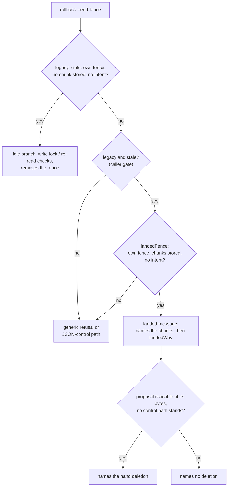
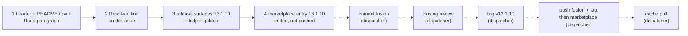

# Implementation Plan: the landed-cell clause names every condition its message is printed under, and release 13.1.10

**Date:** 2026-10-17
**Spec:** none. Planned from the package narrative `261017-1605-migrate-landed-cell-docs-stale-condition.md` and the low issue `261017-1049-migrate-landed-cell-docs-drop-the-stale-condition-so-an-interrupted-rollback-meets-their-premise.md`, which sits in the issues store of the container `261017-1026-migrate-landed-cell-docs-reset-wording`. Model: that container's plan `261017-1027-plan-migrate-landed-cell-docs-reset-wording.md`.
**Decidability:** The plan rests on one question: **"Under exactly which conditions does `rollback --end-fence` print the landed message, and do the texts that describe it state that set?"** It is decidable from `hooks/migrate.ts` alone, and this plan reads it there, not off one function: every caller of `landedFence`, the gate each caller puts in front of it, and `stale`, `ownFence` and `intentStands` themselves. The derived set has five conditions (below). The two texts the issue names state two of them; the undo paragraph of `docs/upgrading-to-v13.md` states four, by context. All three are rewritten to state the five, no more and no less. No change of mechanism and no ruling is needed: no condition, message or exit code moves.

## Directive

A wording fix with no behaviour change, released as fusion 13.1.10. This is the third round on these sentences (13.1.7, 13.1.9, now 13.1.10). Each earlier round read one layer of a conjunction spread over two: `landedFence`'s own conditions, and the `stale` gate every caller puts in front of it. This round derives the whole conjunction first and gives the executor the wording.

- **The issue.** Its acceptance applies: neither text states a premise that cell A (a rollback cut after a chunk, record current) meets; each names the stale record as a condition of the landed clause; neither contains "before the reset"; `reference-resolution-lint` passes at its `BASELINE` with no edit to it.
- **Beyond the issue, from the same reading.** The no-intent condition is missing from all three texts. It is a real cell, not a corner: a rollback cut mid-chunk leaves its intent under `.json-state/journal/`, which a git reset does not remove, and there `rollback --end-fence` prints the generic refusal. The undo paragraph shares that gap and is fixed in the same step.
- **Release 13.1.10.** Nothing that runs changes.

## Current State

Measured at HEAD `8273bd4e`.

### The condition set, derived from `hooks/migrate.ts`

The landed message is the text `landedThenReset` builds ("a rollback of this record landed rollback chunk(s) N, and the fence F it began stands over a tree that reads as legacy Markdown, where … (a git reset after that rollback is one way here); …"). It is reached only through `landedFence`, which has four callers:

| Caller | Subcommand | Gate in front of `landedFence` | Record the conditions are read on |
|---|---|---|---|
| `endLeftFence` (line 612) | `rollback --end-fence` | first the idle branch (`stale` non-null and `idleFence`), then `shows = i.state === "legacy" ? stale(…) : null`, `landedFence` only when `shows !== null` | the session's record |
| `current` (line 731) | `run` (when a previous, not rolled-back record exists), `resume`, `rollback` | returns early when `stale` is null | the session's record |
| `setAside` (line 743) | `set-aside` | `shows !== null && standing(i)` | the session's record |
| `preconditions` (line 470) | `run` | tree legacy, `standing(i)`, a set-aside record whose `rollback.begin_id` is the fence, `stale` of that record non-null | the set-aside record |

`landedFence` returns non-null iff `ownFence` is non-null, its `landed` list is non-empty, and `intentStands` is false:
- `ownFence`: `i.state === "legacy"`, `s.rollback !== null`, and the standing fence's `operation_id` is `s.rollback.begin_id`; `landed` is the chunks of `s.schedule.rollback` whose answers are stored.
- `intentStands`: `inspect`'s `pending` is non-null, or `.json-state/journal/` holds an entry not starting with `.`.
- `stale`: non-null exactly when `status` prints `record=stale` (same function, same `inspect` state). For a record with a rollback begun it is non-null when the record is kept for another workbench, or when neither the plan index (at its recorded bytes) nor rollback chunk 0's answer (stored or in its intent) is in the tree. A rolled-back record is never stale.

**The set.** In every caller, the landed message is printed if and only if all five hold, for the record the command acts on (for `run`'s precondition, the set-aside record whose rollback began the fence):

1. **the record is stale** (`status` shows `record=stale`);
2. **the fence standing is the one this record's rollback began**;
3. **at least one rollback chunk of that rollback is stored** (landed);
4. **no intent is pending** (no `pending` in `inspect`, nothing under `.json-state/journal/`);
5. **the tree reads as legacy Markdown**.

Nothing else gates the message: no write lock, no proposal check, no re-read of the fence file. The proposal check only chooses which way out the message names (`landedWay`). A git reset is never read; it is one way into the cell.

For `rollback --end-fence` specifically, the idle branch before it needs condition 3 negated, so the two branches are disjoint. When the five do not all hold and the idle branch does not apply, the subcommand gives the generic refusal "no fence of a refused rollback stands on a store under JSON control, nor an idle fence of this record over a legacy store; nothing was sent" (or acts under JSON control). The cells that fall there and that a text must not claim: cell A (1 fails: record current), a mid-chunk cut followed by a reset (4 fails), a fence of another id (2 fails, cell D).

### The texts, checked against the set

| Text | States | Missing | In scope |
|---|---|---|---|
| `bin/fusion-migrate` header, `rollback --end-fence` entry (lines 71 to 77): "Where rollback chunks of it landed and the tree then reads as legacy Markdown (a git reset is one way there), it names them …" | 3, 5 | 1, 2, 4 | yes (the issue) |
| `README-hooks.md` line 235, the `migrate.ts` row: "where rollback chunks landed and the tree then reads as legacy Markdown (a git reset is one way there), its refusal names them …" | 3, 5 | 1, 2, 4 | yes (the issue) |
| `docs/upgrading-to-v13.md` `**Undo.**` (lines 114 to 119): "Where chunks of the undo had landed and the tree then reads as legacy Markdown (a git reset is one way there), the helper says so …" | 3, 5; 1 by context (the paragraph's `record=stale` sentence); 2 by context ("a fence the undo left") | 4 | **yes**: it shares the no-intent gap |
| `landedFence` doc comment: "`ownFence` where rollback chunks of this record landed and no intent stands; …" | describes the function, which does not read `stale`, and says so of nothing it does not check | nothing it claims is false | **no**: correct as a description of the function |
| `landedThenReset` doc comment: "only what the caller checked (the chunks landed, the fence, the legacy tree and `stale`'s finding `shows`)" | describes what the message text says, which names no intent | nothing it claims is false | **no**; editing `hooks/migrate.ts` would also mean a dist rebuild for a comment |

The clauses beside the landed clause that must stay true and do not change:
- **The quiet-cell sentence.** Header: "Over a tree a git reset made legacy again, where the codec cannot end it, it removes .json-state/maintenance.json itself, only when the record is stale, the fence is the one its rollback began, no rollback chunk of it is stored, no intent is pending, no write lock stands and the file re-reads as that fence". README: "a fence its own refused rollback left over a tree a git reset made legacy again, with no rollback chunk landed under it, …". The ruling `261016-1436-how-is-a-rollback-fence-ended-that-a-git-reset-left-standing-over-a-legacy-tree.md` owns that wording; it is out of scope and unchanged.
- **The hand-deletion conditions.** "once `status` shows record=stale, .json-state/journal/ is empty and no control path the proposal lists stands; while any does, or while the proposal is missing or at other bytes, it names no deletion. It removes nothing there." These are conditions on the later deletion, checked against `landedWay`: a missing or changed proposal names no deletion, a standing control path names none, otherwise the deletion is named with those three conditions. They stay true and byte-identical. With condition 1 in the premise, `record=stale` in the once-clause repeats it; that is kept, since it states what must still hold at the moment of deletion.

### Repository and bounds

- **Other paraphrases.** `grep` for the landed cell over `skills/`, `docs/`, `README*.md`, `rules/`, `agents/` and `bin/` finds only the three texts above, the 13.1.6 and 13.1.7 release credits in `skills/help/SKILL.md` (release history, left alone), and the `bin/fusion-migrate` row of `README-hooks.md` (line 358), which describes the idle fence only and is correct.
- **No test pins any of the three texts.** `reference-resolution-lint.test.ts` scans `bin/` headers, `README-hooks.md` and `docs/` for backticked citations: `BASELINE = { paths: 2061, anchors: 371, stampBare: 11 }`, compared with `toEqual`. The new words carry no backticks; every existing backticked token stays byte-identical.
- **Growth bounds.** `docs/` and `README-hooks.md` are not bounded surfaces. The skills surface is: `SKILL_BASELINE` floor 188 768 plus `SKILL_HEAD_ROOM` 39 260 gives 228 028; the golden total is 225 113, leaving **2 915 bytes**. The golden records `help/SKILL.md 16447`.
- **Pre-existing reds.** `workbench-citation-lint` reports exactly two findings, one in each of the two issue files stamped 261010-1045. Every "green" below means green apart from exactly those two; a third finding or any other red is a stop.
- **Release state.** `plugin.json` `version`, the `install.sh` pin example (line 29), the `README.md` pin example (line 26) and fusion's entry in the marketplace clone's `marketplace.json` all read 13.1.9. The help paragraph (line 95) reads "**Coming from 13.1.8 or earlier:** 13.1.2 to 13.1.9 need no migration; … 13.1.2 to 13.1.7 each change only `/fusion:migrate`. 13.1.9 changes nothing that runs; it corrects two descriptions of an undo. 13.1.8 …".

## Approach

**One rule for all three texts: the landed clause states the five conditions, and only those.** The header's quiet-cell sentence already lists its conditions in a fixed form ("the record is stale, the fence is the one its rollback began, no rollback chunk of it is stored, no intent is pending"). The landed clause takes the same form with condition 3 flipped and the two removal-only checks (write lock, re-read) absent, so a reader can check the two branches against each other and against the code line by line. A reset stays named only as one way into the cell.

**No decision record.** The fix follows the issue's fix direction, widened only to a condition the same code reading shows missing. No choice binds work beyond this plan.

## Implementation Steps

1. **The landed clause states the five conditions in all three texts**
   - Executor: code-implementer
   - Files: `bin/fusion-migrate` (the header's `rollback --end-fence` entry only), `README-hooks.md` (the `migrate.ts` row of `## Files` only), `docs/upgrading-to-v13.md` (the `**Undo.**` paragraph only)
   - Changes:
     - **`bin/fusion-migrate`.** Replace the lines from "Where rollback chunks of it landed" through "It removes nothing there." with this text, wrapped to the entry's existing indentation and `#` prefix:
       > Where the record is stale, the fence is the one its rollback began, rollback chunks of it are stored, no intent is pending and the tree reads as legacy Markdown (a git reset is one way there), it names those chunks and the hand deletion of that file once `status` shows record=stale, .json-state/journal/ is empty and no control path the proposal lists stands; while any does, or while the proposal is missing or at other bytes, it names no deletion. It removes nothing there.
     - **`README-hooks.md` line 235.** Replace "where rollback chunks landed and the tree then reads as legacy Markdown (a git reset is one way there), its refusal names them" with:
       > where the record is stale, the fence is the one the record's own rollback began, chunks of that rollback landed, no intent is pending and the tree reads as legacy Markdown (a git reset is one way there), its refusal names them

       Everything from " and the hand deletion of `.json-state/maintenance.json`" to the end of the row is unchanged. The row stays one line.
     - **`docs/upgrading-to-v13.md`.** Replace "Where chunks of the undo had landed and the tree then reads as legacy Markdown (a git reset is one way there), the helper says so" with:
       > Where that fence stands over a stale record, chunks of the undo had landed, no intent is pending and the tree then reads as legacy Markdown (a git reset is one way there), the helper says so

       ("that fence" is the fence the undo left, named in the sentence before.) The lines of that sentence may be re-wrapped; nothing after "the helper says so" changes.
     - **Constraints, if the executor departs from the quoted text:** (a) each landed clause names exactly the five conditions, the stale record, the record's own rollback fence, chunks of that rollback landed, no intent pending, a legacy tree, and no other condition (no write lock, no proposal, no re-read); (b) a reset appears only as one possible way into the cell; (c) no text contains "before the reset"; (d) every backticked token is byte-identical, no backticked token is added, and no record stamp appears; (e) the quiet-cell sentence before the landed clause in the header and the README row, and the hand-deletion once-clause after it, are byte-identical.
     - No code line of `bin/fusion-migrate` and no line of `hooks/migrate.ts` changes.
   - Acceptance:
     - `cd hooks && npm test -- lib/__tests__/migrate.test.ts lib/__tests__/reference-resolution-lint.test.ts` is green, with `BASELINE` unedited and `migrate.test.ts` unedited.
     - `grep -c "before the reset" bin/fusion-migrate README-hooks.md docs/upgrading-to-v13.md` prints 0 for each.
     - In each of the three texts, the landed clause contains "stale", "no intent is pending" and "a git reset is one way there"; the report quotes the three new clauses.
     - `git -C /Users/kai/Projects/productive/F04-FUSION/fusion diff -U0 -- bin/fusion-migrate` shows changed lines only inside the `rollback --end-fence` entry, each beginning with `#`.
     - `git -C /Users/kai/Projects/productive/F04-FUSION/fusion diff -U0 -- README-hooks.md` shows line 235 only.
     - `git -C /Users/kai/Projects/productive/F04-FUSION/fusion diff -U0 -- docs/upgrading-to-v13.md` shows changed lines only inside the `**Undo.**` paragraph.
   - Dependencies: none

2. **Record the resolution on the issue**
   - Executor: code-implementer
   - Files: `261017-1049-migrate-landed-cell-docs-drop-the-stale-condition-so-an-interrupted-rollback-meets-their-premise.md` in the issues store of the container `261017-1026-migrate-landed-cell-docs-reset-wording`
   - Changes: append `---` and one `Resolved:` line in the form the sibling issue `261017-0849-migrate-landed-cell-docs-in-the-helper-header-and-readme-hooks-still-presuppose-a-git-reset.md` uses, with no commit hash. It cites this plan by its plain basename `261017-1610-plan-migrate-landed-cell-docs-stale-condition.md`, step 1, `bin/fusion-migrate`, `README-hooks.md` `## Files` and `docs/upgrading-to-v13.md`, and says in one sentence that each landed clause now names the stale record, the record's own rollback fence, landed chunks, no pending intent and a legacy tree, the undo paragraph included for the missing intent condition. It quotes no token from the two 261010-1045 issue files. Write no transition; the dispatcher closes the issue with `--disposition '{"kind":"fixed","reason_ref":null}'`.
   - Acceptance: after the write, `cd hooks && npm test` is green apart from exactly the two pre-existing `workbench-citation-lint` findings, so the new line adds no third, and `reference-resolution-lint` passes unedited.
   - Dependencies: step 1

3. **Release surfaces for 13.1.10**
   - Executor: code-implementer
   - Files: `.claude-plugin/plugin.json`, `install.sh` (header pin example), `README.md` (pin example), `skills/help/SKILL.md` (`### 4. Update`, the paragraph "Coming from 13.1.8 or earlier"), `hooks/lib/__tests__/fixtures/surface-growth.golden`
   - Changes:
     - Bump 13.1.9 to 13.1.10 in `plugin.json` `version` and in both `FUSION_REF=tags/v…` examples. `description` is unchanged.
     - The help paragraph, per `README-agents.md` `## Releasing` step 0:
       - "Coming from 13.1.8 or earlier" becomes "Coming from 13.1.9 or earlier";
       - "13.1.2 to 13.1.9 need no migration" becomes "13.1.2 to 13.1.10 need no migration";
       - "13.1.2 to 13.1.7 each change only `/fusion:migrate`." stays as it is;
       - one sentence goes before the 13.1.9 one, in substance "13.1.10 changes nothing that runs; it corrects three descriptions of an undo." It is at most 80 bytes and carries no path or anchor citation;
       - the other two paragraphs stay as they are.
     - Regenerate the golden: `cd hooks && UPDATE_SURFACE_GOLDEN=1 npx vitest run lib/__tests__/surface-growth-bound.test.ts`, which fails on purpose, then run the bound again.
   - Acceptance:
     - `cd hooks && npm test` is green apart from the two pre-existing findings. `reference-resolution-lint` passes at 2061/371/11 unedited; a move is a stop, and the fix is to reword, never to edit `BASELINE`. No head-room constant or `SKILL_BASELINE` entry is edited.
     - `claude plugin validate .` reports passed.
     - `claude --plugin-dir . --agent fusion:orchestrator -p "reply SMOKE-OK"` answers.
     - `grep -n "13\.1\.9" .claude-plugin/plugin.json install.sh README.md` finds no stale pin.
     - The report states the output of `bin/fusion-review-coverage --since v13.1.9`, which is advisory.
   - Dependencies: step 2

4. **Marketplace entry for 13.1.10, edited before anything is pushed**
   - Executor: data-implementer
   - Files: `/Users/kai/Projects/productive/F03-CLAUDE-plugin-marketplace/claude-plugins/.claude-plugin/marketplace.json`
   - Changes: set fusion's `version` to `13.1.10` and change nothing else. Before dispatching this step, the dispatcher runs `git -C /Users/kai/Projects/productive/F03-CLAUDE-plugin-marketplace/claude-plugins pull --rebase origin main`. The executor makes no git call; the edit stays uncommitted and unpushed until the dispatcher's push sequence.
   - Acceptance: `node -e 'JSON.parse(require("fs").readFileSync(process.argv[1],"utf8"))' /Users/kai/Projects/productive/F03-CLAUDE-plugin-marketplace/claude-plugins/.claude-plugin/marketplace.json` exits 0, and fusion's entry reads `"version": "13.1.10"`, the same as `.claude-plugin/plugin.json`.
   - Dependencies: step 3

**Rules for every step.** Executors run no whole-tree git command in the live repository; only the path-limited `diff` calls above are allowed. Nothing in this plan commits or pushes. Commit, the closing review's dispatch, the tag, the pushes and the cache pull (`git -C ~/.claude/plugins/marketplaces/tenzoki-plugins pull origin main`) belong to the dispatcher (`README-agents.md` `## Releasing`), in this order: commit fusion, closing review, tag `v13.1.10`, push fusion and the tag, commit and push the marketplace, cache pull. The closing review is asked to check the three new clauses against the five-condition set in `## Current State`, caller by caller.

## Where this work stops

- `bin/fusion-migrate` differs from `8273bd4e` only in comment lines of the `rollback --end-fence` entry.
- In the `bin/fusion-migrate` header, the `migrate.ts` row of `README-hooks.md` and the `**Undo.**` paragraph of `docs/upgrading-to-v13.md`, the landed clause names the stale record, the record's own rollback fence, landed chunks of that rollback, no pending intent and a legacy tree, and no other condition.
- None of the three texts contains "before the reset", and each names a reset only as one possible way into the cell.
- The quiet-cell sentence and the hand-deletion once-clause beside each landed clause are unchanged, and no other line of `README-hooks.md` changed.
- Every exit code, condition and message string in `hooks/migrate.ts` and `bin/fusion-migrate` is unchanged, and `migrate.test.ts` passes with no edit to it.
- The issue carries a `Resolved:` line, and the full hook suite ran after that write with no red beyond the two pre-existing `workbench-citation-lint` findings.
- Every growth bound is green with the golden regenerated, and no baseline, `SKILL_BASELINE` entry or head-room constant was edited.
- `reference-resolution-lint`'s `BASELINE` reads 2061/371/11, unedited, and the lint passes.
- The help paragraph reads "Coming from 13.1.9 or earlier" and "13.1.2 to 13.1.10 need no migration", still says "13.1.2 to 13.1.7 each change only", and carries a 13.1.10 sentence saying it changes nothing that runs.
- Before anything is pushed, `plugin.json`, both pin examples and the marketplace working clone's `marketplace.json` read 13.1.10.
- Before the tag `v13.1.10` is created, a closing review of the range since `v13.1.9` is filed in this package's reviews store, and its verdict is accept or every finding it rates above Low is answered.
- The tag `v13.1.10` is on the pushed fusion `main` commit, and the fusion push happened before the marketplace push.
- After both pushes, the marketplace cache clone has been pulled.

## Data Structures

None.

## API Changes

None. No stderr text, stdout key, exit code or subcommand changes. The only user-visible change is the help topic's update paragraph.

## Testing Strategy

There is no behaviour to test. The guards are the existing suite:
- `migrate.test.ts`, unedited, proves no message or exit code moved. Its cell A test (record current, `--end-fence` exit 5, fence kept) and its "cell A reset with git" test (record stale, chunk 2 named) are the two sides of condition 1.
- `reference-resolution-lint` proves no citation was added or lost in the three scanned texts.
- `surface-growth-bound` holds the help bytes.

The issue's acceptance and the five conditions are checked by grep and by the closing review's reading against `## Current State`.

## Risks & Mitigations

| Risk | Mitigation |
|---|---|
| A fourth round: the wording again covers only part of the conjunction | The set is derived from all four callers and the three helpers they rest on, written down here, and the quoted target text states each condition once; the closing review checks caller by caller. |
| The new clause states more than the code checks (a write lock, the proposal) | Constraint (a) excludes them by name; the proposal is only in the way-out clause, which is unchanged. |
| A rewrite alters or drops a backticked token, and a lint count falls | Constraint (d); the lint runs in step 1's acceptance. |
| The rewrite touches the ruling-owned quiet-cell sentence | Constraint (e) and the diff checks confine the change. |
| "its" in the README row reads as the rollback's rather than `rollback --end-fence`'s | The new clause says "the record's own rollback", so the only remaining "its" is the existing "its refusal". |
| The help edit exceeds the skills head-room | Net change is under 100 bytes against 2 915 left; the golden is regenerated and the bound runs in step 3. |
| The marketplace entry lags the fusion push | Step 4 precedes every push, and a stop clause checks the marketplace version before anything is pushed. |
| The tag goes out before the closing review | The precondition is a clause in `## Where this work stops`. |

## Open Questions

None. The wording follows the issue's fix direction, extended to the no-intent condition the same code reading shows missing.
