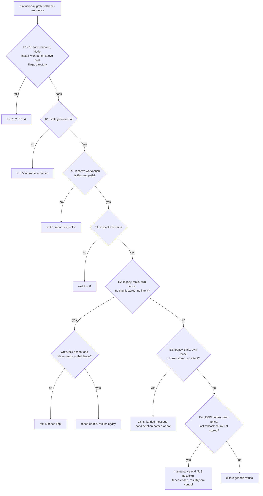
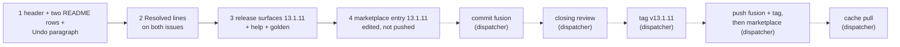

# Implementation Plan: the undo docs claim only what holds after every check in front of them, and release 13.1.11

**Date:** 2026-10-17
**Spec:** none. Planned from the package narrative `261017-1659-migrate-landed-cell-docs-entry-path-conditions.md` and the two low issues in the issues store of the container `261017-1605-migrate-landed-cell-docs-stale-condition`: `261017-1637-migrate-end-fence-landed-clause-promises-the-message-for-a-session-recorded-for-another-workbench-path.md` and `261017-1637-migrate-undo-note-names-end-fence-for-an-undo-cut-mid-chunk-where-an-intent-pending-makes-it-refuse.md`. Model: `261017-1610-plan-migrate-landed-cell-docs-stale-condition.md`.
**Decidability:** The plan rests on one question: **"For each sentence of the swept texts, does every cell that meets its stated premise get what it promises, once every check that runs before the promised outcome is counted?"** It is decidable from `bin/fusion-migrate` (the wrapper) and `hooks/migrate.ts` alone, and this plan reads it from the wrapper's first line to each message, not from one function: the wrapper's exits, `main`'s argument checks, `recorded`, every codec call, every branch in front of the message and every tree read that can throw. The full trace is under `## Current State`. Four earlier rounds each read one layer and missed the one in front of it; this round counts every layer, and where a full listing would be unreadable it bounds the sentence instead ("only when", "past the exits 1 to 4", "for a session that records this workbench"), so a refusal earlier on the path cannot make a sentence false. No change of mechanism and no ruling is needed: no condition, message or exit code moves.

## Directive

A wording fix with no behaviour change, released as fusion 13.1.11. This is the fifth round on these sentences (13.1.7, 13.1.9, 13.1.10, now 13.1.11).

- **The two issues.** Their acceptance applies. The landed clause in the header and in the `migrate.ts` row excludes a session recorded for another workbench path, which `recorded` refuses first. No sentence of the `**Undo.**` paragraph names `rollback --end-fence` as the way out of a cell an undo cut mid-chunk and then reset reaches, because a pending intent makes that command refuse. `reference-resolution-lint` passes with no edit to its `BASELINE`.
- **Beyond the issues, from the same trace.** Every sentence of the three passages the brief names was checked against the trace, and every one that over-claims is fixed (the table under `### Sentence by sentence`). Two more passages state the same claims about the same commands: the header's `set-aside` entry and the `bin/fusion-migrate` row of `README-hooks.md`. They are fixed in the same step, because leaving them as they are would ship a release whose header and README disagree with the rewritten Undo paragraph on the same claim. This widens the brief by those two passages, and the dispatcher may strike them before step 1 runs.
- **Out of scope, filed.** Two findings of the trace are not docs over-claims in these passages, and each is filed as a low issue in this package's issues store: `261017-1708-migrate-messages-name-end-fence-as-ending-a-fence-it-then-refuses-to-end.md` (three messages in `hooks/migrate.ts` name `rollback --end-fence` as the way out of cells where it refuses, which is a code change) and `261017-1708-migrate-header-run-entry-lists-its-preconditions-without-the-legacy-state-check.md` (the header's `run` entry).
- **Revised in place, 2026-10-17, before step 1 ran.** The code-implementer stopped on two cells the first sentence table did not test. (1) A session that records another workbench path and is rolled back: `stale` returns "the record is kept for …" before its rolled-back check, so `status` prints `record=stale`, but `run` calls `current` only for a record that is not rolled back and goes on to write a new `state.json` into that session. So "`run`, `resume` and `rollback` refuse such a record" was false for `run` in all four passages that say it. Each now bounds the claim to a record of this workbench; a rolled-back record of this workbench always reads current, so the bound is exact. (2) The header's `set-aside` entry said the three "name this" where a stale record of this workbench has no chunk landed under its own fence; `rollback --end-fence` there gives the generic refusal (E5), so the claim now excepts the --end-fence form. `### Cells by record, path and tree` enumerates the combinations the first table missed, and every target text was re-checked against it. The `run` behaviour is filed as `261017-1717-migrate-run-reuses-a-rolled-back-session-recorded-for-another-workbench-path.md`, code, not part of 13.1.11.
- **Release 13.1.11.** Nothing that runs changes.

## Current State

Measured at HEAD `0f2e098e`. `plugin.json`, both pin examples and the help paragraph read 13.1.10.

### The trace: every check from the CLI entry to each message

**The common prefix.** Every subcommand runs these, in this order, before its own code:

| # | Where | Check | Refusal |
|---|---|---|---|
| P1 | `bin/fusion-migrate` | the subcommand is one of the eight | usage, exit 2 |
| P2 | `bin/fusion-migrate` | `node` on PATH and at least `codec/package.json`'s engines | exit 4 |
| P3 | `bin/fusion-migrate` | `bin/fusion-workbench-root` is executable | exit 3 |
| P4 | `bin/fusion-migrate` | a workbench is found above the working directory; that one is passed, whatever the session records | exit 1 |
| P5 | `bin/fusion-migrate` | `hooks/dist/migrate.js` and the codec bundle exist | exit 3 |
| P6 | `main` | each flag is one the subcommand takes, or `--session`; a valued flag has a value | exit 2 |
| P7 | `main` | the workbench path is a directory (a missing one throws, an internal fault) | exit 2, or exit 3 |
| P8 | `main` | `wb` is the real path; the session is `--session`, else `~/.fusion-migrate/<12 hex of wb>` | none |

**Throughout.** Every codec request (`send`) ends in exit 7 when the codec does not answer (bundle missing, timeout, crash), and in exit 8 when it refuses. `inspect` itself is refused over journal data it cannot read (`codec/README.md`, `inspect.pending`). A session `state.json` that does not parse, a tree file `stale` or `intentStands` cannot read, and a failing `unlink`, `rename` or session write all throw outside `Stop`, which is exit 3. None of these can be ruled out by the workbench's state alone, so every text bounds its claims by them once rather than listing them per sentence.

**`rollback --end-fence`** (`rollback` with `endFence`, then `endLeftFence`):

| # | Check | Outcome |
|---|---|---|
| R1 | `recorded`: `state.json` exists | else exit 5, "no run is recorded in <session>" |
| R2 | `recorded`: `s.workbench === wb` | else exit 5, "<session> records X, not Y". Runs before the store is read, so `stale`'s first reason (a record kept for another workbench) never reaches E2 or E3 (issue 1) |
| E1 | `inspect` | exit 7 or 8 |
| E2 | idle branch: legacy tree, `stale` non-null, `idleFence` (`ownFence`: `s.rollback` set and the standing fence is `s.rollback.begin_id`; no scheduled rollback chunk stored; no intent: `inspect.pending` null and nothing under `.json-state/journal/` but dot-entries) | E2a `write.lock` stands: exit 5, fence kept. E2b the fence file does not re-read as that fence: exit 5. Else unlink, `s.rollback = null`, `fence-ended=`, `result=legacy`, exit 0 |
| E3 | landed branch: legacy tree, `stale` non-null, `landedFence` (`ownFence`, at least one rollback chunk stored, no intent) | exit 5, the landed message; `landedWay` reads the proposal (missing or other bytes: no deletion named) and counts its control paths (any standing: no deletion named), else names the hand deletion with its three conditions. Nothing further can refuse |
| E4 | JSON branch: `s.rollback` set, tree under JSON control, standing fence is `s.rollback.begin_id`, rollback chunk `apply.length` not stored | `maintenance end` through the codec (exit 7 or 8 possible), `s.rollback = null`, `fence-ended=`, `result=json-control` |
| E5 | none of the above | exit 5, the generic refusal |

E2 and E3 are disjoint (no chunk stored against at least one), and both need a legacy tree, which E4 excludes. **So the landed message is printed if and only if P1 to P8, R1, R2 and E1 pass and the five conditions of 13.1.10 hold** (stale record, own fence, chunks stored, no intent, legacy tree). With R2 passed, "stale" can only mean its other reasons.

**`set-aside`** (`setAside`): S1 `readState` (no record: exit 5; no `recorded`, so a record kept for another path goes on); S2 `inspect` (7, 8); S3 `stale` and `standing` (`inspect.maintenance` or `inspect.pending` only, **not** a journal entry): where both hold, the landed message if `landedFence`, else the idle way (`endFenceWay`, naming `rollback --end-fence`) if `idleFence`, else "a fence or a pending intent stands …; the tool that set it closes it", exit 5 each; S4 not stale: exit 5, record=current; S5 no `--consent`: exit 5; S6 the target `<dir>.stale-<stamp>` exists: exit 5; S7 rename, `result=no-record`.

**`run`**: U1 `readState` of the previous record; U2 for one not rolled back, and only then, `current` (no `recorded`; a rolled-back record skips U2 to U4 whatever path it records, though `stale`'s first reason makes `status` print `record=stale` for one of another path): `inspect` (7, 8), then for a stale record the landed message if `landedFence`, else the set-aside way, preceded by the idle way where `idleFence`, exit 5; U3 a previous done record: no-op, exit 0; U4 a previous unfinished record: exit 5; U5 `preconditions`: v11 store names, `inspect`, `migration` implemented, tree legacy, `standing` (the sibling `<session>.stale-*` lookup chooses the way named), each exit 5; U6 the backup (exit 9); U7 survey and blocking findings (exit 6); U8 proposal, the new `state.json` written into the session, then `drive` (7, 8). `ensureBackup` keeps a backup the session already holds.

**`resume`**: `recorded` (R1, R2), `current` as U2, "being or was rolled back" (exit 5), done: no-op, then `drive`.

**`rollback`** (plain): `recorded` (R1, R2), `current` as U2, rolled back: no-op exit 0, nothing planned (exit 5 where the plan landed or is pending, else the proposal removed, `result=nothing-planned`), `inspect`, the fence's `begin` (7, 8), the chunks (7, 8; a refused first chunk after activation goes to `refusedFirstChunk`: with work since the plan the fence is ended, without it the fence stays), the fence's `end`, `result=legacy`.

### Cells by record, path and tree

The combinations the first table did not enumerate. "This" and "other" are the path the record names against the real path; "stale" is what `status` prints. `stale` reads the path first, so a record of another path is stale whether rolled back or not; a rolled-back record of this path is never stale. Tree state and a pending intent matter only where a fence stands.

| # | Path | Rolled back | `status` | `run` | `resume`, plain `rollback` | `rollback --end-fence` | `set-aside --consent` |
|---|---|---|---|---|---|---|---|
| C1 | this | yes | current | starts a new run | `resume` exit 5 (rolled back), `rollback` no-op | E2/E3 need stale, so E4 or E5 | exit 5, record=current |
| C2 | this | no | current | no-op if done, else exit 5 | act on it | E4 if its qualifying JSON fence stands, else E5 | exit 5, record=current |
| C3 | this | no | stale, legacy tree, no fence | `current`: exit 5 naming set-aside | `current`: exit 5 naming set-aside | E5 | renames |
| C4 | this | no | stale, legacy tree, own fence, no chunk, no intent | `current`: exit 5, idle way then set-aside | same | E2: removes the fence (no refusal) | exit 5, idle way naming `--end-fence` |
| C5 | this | no | stale, legacy tree, own fence, chunks, no intent | `current`: exit 5, landed message (no set-aside) | same | E3: landed message | exit 5, landed message |
| C6 | this | no | stale, own fence, intent pending (any tree) | `current`: exit 5 naming set-aside | same | E5 | exit 5, "the tool that set it closes it" |
| C7 | this | no | stale, JSON-control tree, own fence | `current`: exit 5 naming set-aside | same | E4 if the last rollback chunk is not stored, else E5 | exit 5, "the tool that set it closes it" |
| C8 | this | no | stale, a fence not its own (cell D) or a codec-reported intent without fence | `current`: exit 5 naming set-aside | same | E5 | exit 5, "the tool that set it closes it" |
| C9 | other | no | stale | `current`: exit 5 naming set-aside (with the idle way, or the landed message, as C3 to C8 by fence) | R2: exit 5, "records X, not Y", names nothing | R2: exit 5 | as C3 to C8 by fence; the idle way names `--end-fence`, which R2 then refuses (filed) |
| C10 | other | yes | stale | **no refusal**: preconditions, backup kept, new `state.json` written (filed) | R2: exit 5 | R2: exit 5 | renames where no fence or codec-reported intent stands, else exit 5 as by fence |

What each target text claims, checked against C1 to C10:
- **"refused by run, resume and rollback"** holds for C3 to C9 and fails for `run` in C10. Bounded to a record of this workbench (C3 to C8), it holds for all three, with the --end-fence form excepted for C4. The `migrate.ts` row also says what happens with another path (C9, C10), unbackticked.
- **"name this"** (header `set-aside`): for a record of this workbench with no rollback chunk landed under a fence of its own, `run`, `resume` and plain `rollback` name set-aside in C3, C4, C6, C7 and C8; `rollback --end-fence` does not (E2 or E5). Hence the --end-fence exception. C5 is excluded by the bound.
- **set-aside "renames … never while a fence or an intent the codec reports as pending stands"**: renames in C3 and C10 without a fence; refuses in every cell with one. Holds.
- **set-aside "naming `rollback --end-fence` where that ends the fence over a legacy tree"**: `--end-fence` ends a fence over a legacy tree only in C4, and set-aside names it there. C7's E4 is under JSON control, outside the clause. C9's naming is where it does not end it, which the clause does not claim against (filed). Holds.
- **The `--end-fence` sentences** (header entry, `migrate.ts` row): bounded to a session of this workbench, so C9 and C10 are outside; C4 is the idle sentence's only cell, C5 the landed sentence's, C7 and C2 the JSON sentence's. Hold.
- **Undo, "refuses to set the record aside" where a fence the undo left stands**: C1 and C2 refuse as record=current, C4 to C10 with a fence refuse. Holds. **"while an intent is pending, it names no command"**: C6, and the same branch for another path. Holds. **"names a `rollback --end-fence` … which removes the fence once that command's own checks pass"**: C4, and C9's idle cell, where R2 is one of that command's own checks. Holds.
- **Undo, the landed sentence**: C5 and its other-path twin in set-aside. Holds.

### Sentence by sentence

Every sentence of the three passages the brief names, and of the two same-claim passages added, against the trace. "Sufficient" means the sentence promises an outcome where its premise holds; "necessary" means it says the outcome happens only when its conditions hold, which extra checks cannot falsify.

**`bin/fusion-migrate` header**

| Sentence | Kind | Finding | Change |
|---|---|---|---|
| (new, after the paragraph ending "git is required too, and is asked.") | bound | the throughout-faults and P1 to P7 would falsify every sufficient sentence in every entry | add one sentence bounding every entry by exits 1 to 4, 7 and 8 |
| `rollback --end-fence`: "ends the fence such a refusal left standing; the codec then refuses every later rollback of this migration." | sufficient | R1, R2 refuse first; over a legacy tree E4 is never reached; `maintenance end` can be refused | a leading sentence bounds the entry to a session that records this workbench; the sentence is bounded to a store still under JSON control and names the refusal it means |
| idle sentence "Over a tree a git reset made legacy again … only when the record is stale, … re-reads as that fence: no codec write landed under it." | necessary | true: every listed check is in E2; extra checks (R1, R2, E1) cannot falsify "only when". Ruling-owned | **unchanged**, byte-identical |
| landed sentence "Where the record is stale, the fence is the one its rollback began, … It removes nothing there." | sufficient | false for R2 (issue 1); with the entry-level session bound and the header-level exit bound, it holds by the trace's "if and only if" | **unchanged** text; the two new bounds cover it |
| `set-aside`: "with --consent, renames … to <dir>.stale-<UTC stamp>; deletes nothing." | sufficient | S6 refuses where the target exists | add "never over an existing directory" |
| `set-aside`: "`run`, `resume` and `rollback` refuse such a record and name this." | sufficient | `run` does not refuse a rolled-back record of another path (C10); `rollback --end-fence` removes an idle fence (C4) and gives E5, not set-aside, in C3, C6, C8; `resume` and `rollback` refuse another path at R2, naming nothing (C9); `current` names the landed way in C5 | "refuse" bounded to a record of this workbench, the --end-fence form excepted; "name this" to such a record with no rollback chunk landed under its own fence, again excepting the --end-fence form |
| `set-aside`: "Refuses while a fence or pending intent stands over the stale record, naming `rollback --end-fence` where it ends it." | sufficient | `standing` reads only the codec-reported intent, while "no intent is pending" in the landed and idle sentences counts journal entries too; over a stale record under JSON control E4 would end the fence but set-aside names "the tool that set it" | "an intent the codec reports as pending"; "where that ends the fence over a legacy tree" |

**`README-hooks.md` `## Files`, the `migrate.ts` row**

| Clause | Kind | Finding | Change |
|---|---|---|---|
| "The migration entry: … reads … applies … writes the proposal … drives `plan`, …, naming the workbench by its real path" | description | no refusal claim | unchanged |
| "the session directory outside the workbench holds the backup, the repair log and every operation id" | description | describes the default session; no refusal claim on the five commands | unchanged |
| "so `resume` and `rollback` send the next unanswered request under its recorded id" | sufficient | a stale record, R1, R2 and the no-op branches send nothing | "where they send" |
| (new) | bound | as in the header | "Past the exits 1 to 4 of the wrapper's table, and where the codec answers and admits each request (else 7 or 8):" |
| "a record … (`status` prints `record=stale`) is refused by `run`, `resume` and `rollback` before any write" | sufficient | `run` goes on for C10; `rollback --end-fence` removes an idle fence (C4) | "a record of this workbench"; "the fence removal of the --end-fence form below aside"; one unbackticked parenthesis for another path (C9, C10) |
| "and `set-aside --consent` renames its session directory aside, deleting nothing, never while a fence or pending intent stands" | sufficient | S6; and "pending intent" means here only the codec-reported one (`standing`), unlike the landed clause's "no intent is pending" | "never over an existing directory and never while a fence or an intent the codec reports as pending stands" |
| idle clause "a fence its own refused rollback left over a tree a git reset made legacy again, with no rollback chunk landed under it, `rollback --end-fence` removes that fence itself, the one codec-owned file it removes" | sufficient | R1, R2 (issue 1), a record the tree still carries (an uncommitted migration reset leaves the plan files and reads current, per `stale`'s comment), a pending intent (issue 2's class), E2a, E2b. Ruling-owned | turned into the ruling's own "only when" list, led by the session bound (below) |
| landed clause "where the record is stale, … its refusal names them and the hand deletion … at other bytes." | sufficient | R2 (issue 1) | "for such a session," in front; the rest byte-identical |
| "It writes no control, plan or answer byte. Run through `bin/fusion-migrate`, …" | description | true (the fence file removal is the "codec-owned file" the row names) | unchanged |

**`README-hooks.md` `## Files`, the `bin/fusion-migrate` row** (added): "`record=stale` (…) makes `run`, `resume` and `rollback` refuse and `set-aside --consent` rename the session aside, refused while a fence or pending intent stands, which `rollback --end-fence` ends over a legacy tree when the record's own idle rollback set it." Sufficient on four counts: `run` goes on for C10, E2 is not a refusal, `standing` is narrower than "pending intent", and the `--end-fence` clause falls to R2, E2a, E2b. The other sentences of the row are descriptions or the exit table and stay.

**`docs/upgrading-to-v13.md` `**Undo.**`**

| Sentence | Kind | Finding | Change |
|---|---|---|---|
| "`bin/fusion-migrate rollback` restores the workbench from the migration's own journal while no ordinary write has followed it." | sufficient | a stale record (`current`), R2, the plan-pending refusal, and a first-chunk refusal a retry clears (a lock timeout, a receipt or narrative changed by hand) all stop it with no ordinary write | "can restore … only while" |
| "The first ordinary write … ends that: the rollback is refused from then on, …" | sufficient | true: the codec's audit refuses every rollback of the migration (`workSincePlan`), and a stale record or R2 refuses earlier, which is still a refusal | unchanged |
| "`bin/fusion-migrate status` says where a workbench stands." | description | true | unchanged; one bound sentence follows it |
| "A session that records a migration the tree no longer carries, for example after git discarded it, is reported as `record=stale`, and `run`, `resume` and `rollback` refuse it." | sufficient twice | `stale`'s own comment: an uncommitted migration reset leaves the plan files and reads current, so "reported as stale" over-claims; `run` goes on for C10; `rollback --end-fence` removes an idle fence instead of refusing (C4) | defined by what status reports, bounded to a session that records this workbench, the git discard kept as an example; the --end-fence form excepted |
| "`/fusion:migrate` says so and offers to set it aside (…), which renames the session directory and deletes nothing, then surveys again." | sufficient | `skills/migrate/SKILL.md` `ROUTE=stale` surveys again on exit 0 only and stops on exit 5 | bounded to where nothing below stands in its way |
| "Where a fence the undo left still stands, the helper refuses to set the record aside and names how that fence is ended: a `rollback --end-fence` of the same record, once no rollback chunk landed under it." | sufficient | refusing holds in every cell (S3 or S4). Naming `--end-fence` fails with an intent pending (issue 2), over a record the tree still carries (S4 names `resume` or `rollback`), under JSON control (`ownFence` needs a legacy tree), and for a moved session (named, but R2 then refuses) | split: the refusal stays unconditional; over a stale record, the pending-intent cell names no command, and the idle cell names `--end-fence` "which removes the fence once that command's own checks pass" |
| "Where that fence stands over a stale record, chunks of the undo had landed, no intent is pending and the tree then reads as legacy Markdown …, the helper says so and names deleting … it deletes nothing." | sufficient | true in its set-aside context: `setAside` does not call `recorded`, and issue 1 reproduced the landed message there for a moved session | unchanged, byte-identical |

### The ruling's sentences

`261016-1436-how-is-a-rollback-fence-ended-that-a-git-reset-left-standing-over-a-legacy-tree.md` decided that `rollback --end-fence` removes the fence itself over a legacy tree "only when the checks in code hold (record stale, fence id matches the record's begin_id, no chunk and no intent stored or pending, no write.lock, bytes re-read first)". What this plan does with the sentences describing that:
- **Header idle sentence:** unchanged. It already has the "only when" form and lists exactly those checks.
- **`migrate.ts` row idle clause:** it said the command removes the fence where no chunk landed, a sufficient claim the trace falsifies. It now lists the ruling's own checks in "only when" form, behind the session bound. That restates what the ruling decided and adds no condition the ruling lacks; nothing it decided changes.
- **`bin/fusion-migrate` row:** "when" becomes "only when", with the session bound.

### Repository and bounds

- **Other paraphrases.** `grep -l -- end-fence` over `README*.md`, `docs/`, `skills/`, `rules/`, `agents/`, `bin/` and `hooks/migrate.ts` finds the passages above, `skills/help/SKILL.md` (release credits, left alone), `skills/migrate/SKILL.md` (the exit-8 sentence of `**Interrupted.**`, about a refused first chunk, which names both ways as the message does; the skill stands at 28 997 bytes and is not touched) and the messages in `hooks/migrate.ts` (filed, see `## Directive`).
- **`reference-resolution-lint`** scans `bin/` headers, `README-hooks.md` and `docs/`: `BASELINE = { paths: 2061, anchors: 371, stampBare: 11 }`, compared with `toEqual`. The rule here is stricter than the lint: the multiset of backticked tokens in each of the three files is unchanged. New words carry no backticks and no record stamp; `--end-fence` appears in new text unbackticked.
- **Usage text.** `usage()` prints header lines 3 to 15; every edit is below line 20.
- **Growth bounds.** `docs/`, `README-hooks.md` and `bin/` headers are not bounded surfaces. The skills surface is: the golden total is 225 192 bytes and records `help/SKILL.md 16526`; at the `SKILL_BASELINE` floor and `SKILL_HEAD_ROOM` 39 260 that the 13.1.10 plan measured (cap 228 028), about 2 836 bytes are left. The executor re-measures.
- **Pre-existing reds.** `workbench-citation-lint` reports exactly two findings, one in each of the two issue files stamped 261010-1045; re-run after the two issues of this plan were filed, it still reports exactly those two. Every "green" below means green apart from exactly those two.
- **No test pins the swept texts.** `migrate.test.ts` pins messages and exit codes, not the docs.

## Approach

One rule for every sentence: **a sentence states a sufficient condition only where the trace shows it sufficient after every earlier check; otherwise it is bounded.** Three bounds, each placed once per text where it covers every sentence after it:
1. **The environment bound**, once per text: exits 1 to 4 and an unanswered or refused codec request (7, 8). These cannot be ruled out by state, so they are named once, not per sentence.
2. **The session bound**: a session that records this workbench's real path. It removes R1 and R2, and with it `stale`'s first reason, from the `rollback --end-fence` sentences.
3. **The "only when" form** for a removal with more checks than a sentence can list readably, which is the ruling's own form.

Everything else is fixed by naming the missing condition (the intent, the legacy tree, the existing target directory, the --end-fence exception).

**No decision record.** The wording follows the issues' fix directions and the trace; the ruling's checks are restated, not changed, and no choice binds work beyond this plan.

## Implementation Steps

1. **Every swept sentence claims only what the trace shows after the checks in front of it**
   - Executor: code-implementer
   - Files: `bin/fusion-migrate` (the paragraph ending "git is required too, and is asked.", the `rollback --end-fence` entry, the `set-aside` entry; comment lines only), `README-hooks.md` (`## Files`: the `migrate.ts` row and the `bin/fusion-migrate` row only), `docs/upgrading-to-v13.md` (the `**Undo.**` paragraph only)
   - Changes. Quoted text is the target; wrap header text to the existing `#` prefix and the entry's 19-space indentation, keep each README row one line.
     - **`bin/fusion-migrate`, A.** After the line ending "git is required too, and is asked.", add, as part of that paragraph:
       > Each entry below holds past the exits 1 to 4 and where the codec answers and admits each request it is sent (else exit 7 or 8).
     - **`bin/fusion-migrate`, B.** In the `rollback --end-fence` entry, replace "ends the fence such a refusal left standing; the codec then refuses every later rollback of this migration." with:
       > every sentence here is about a session that records a run of this workbench; one that records another workbench path, or none, is exit 5 before the store is read. On a store still under JSON control it ends the fence a refused first rollback chunk left standing; the codec then refuses every later rollback of this migration.

       The idle sentence ("Over a tree a git reset made legacy again …") and the landed sentence ("Where the record is stale, … It removes nothing there.") stay byte-identical.
     - **`bin/fusion-migrate`, C.** Replace the whole `set-aside` entry text with:
       > with --consent, renames a session whose record the tree does not carry (`status` prints record=stale) to <dir>.stale-<UTC stamp>, never over an existing directory; deletes nothing. `run`, `resume` and `rollback` refuse such a record where it records this workbench, the fence removal of --end-fence above aside; where it also has no rollback chunk landed under a fence of its own, those three name this, the --end-fence form excepted. Refuses while a fence or an intent the codec reports as pending stands over the stale record, naming `rollback --end-fence` where that ends the fence over a legacy tree.
     - **`README-hooks.md`, the `migrate.ts` row.** Replace the span from "so `resume` and `rollback` send the next unanswered request under its recorded id;" through "while the proposal is missing or at other bytes." with:
       > so `resume` and `rollback`, where they send, send the next unanswered request under its recorded id. Past the exits 1 to 4 of the wrapper's table, and where the codec answers and admits each request (else 7 or 8): a record of this workbench whose last write the tree does not carry (`status` prints `record=stale`) is refused by `run`, `resume` and `rollback` before any write, the fence removal of the --end-fence form below aside (of another workbench path: resume and rollback refuse it, run only while it is not rolled back), and `set-aside --consent` renames its session directory aside, deleting nothing, never over an existing directory and never while a fence or an intent the codec reports as pending stands; for a session that records this workbench's real path (one that records another, or none, is refused before the store is read), `rollback --end-fence` removes a fence its own refused rollback left over a tree a git reset made legacy again, the one codec-owned file it removes, only when the record is stale, no rollback chunk landed under that fence, no intent is pending, no write lock stands and the file re-reads as that fence; for such a session, where the record is stale, the fence is the one the record's own rollback began, chunks of that rollback landed, no intent is pending and the tree reads as legacy Markdown (a git reset is one way there), its refusal names them and the hand deletion of `.json-state/maintenance.json` once `status` shows `record=stale`, `journal/` is empty and no control path the proposal lists stands, and names none while any does or while the proposal is missing or at other bytes.

       Everything before "so `resume`" and from " It writes no control, plan or answer byte." on is unchanged.
     - **`README-hooks.md`, the `bin/fusion-migrate` row.** Replace "makes `run`, `resume` and `rollback` refuse and `set-aside --consent` rename the session aside, refused while a fence or pending intent stands, which `rollback --end-fence` ends over a legacy tree when the record's own idle rollback set it." with:
       > makes `run`, `resume` and `rollback` refuse a record of this workbench, the --end-fence form aside, and `set-aside --consent` rename the session aside, refused while a fence or an intent the codec reports as pending stands; `rollback --end-fence` ends such a fence over a legacy tree only when the record's own idle rollback set it and the session records this workbench.
     - **`docs/upgrading-to-v13.md`, `**Undo.**`.** Replace the paragraph from "`bin/fusion-migrate rollback` restores" through "once no rollback chunk landed under it." with (lines may be re-wrapped near the paragraph's existing width):
       > `bin/fusion-migrate rollback` can restore the workbench from the migration's own journal only while no ordinary write has followed it. The first ordinary write, such as a claim, a filed issue or a transition, ends that: the rollback is refused from then on, and the way forward is a fix rather than a return. `bin/fusion-migrate status` says where a workbench stands. This and each refusal below hold once the helper runs and its codec answers; where either fails, its exit code says so instead. A session that records this workbench and that status reports as `record=stale`, for example after git discarded the migration it records, is refused by `run`, `resume` and `rollback`, the --end-fence form below aside. `/fusion:migrate` says so and offers to set it aside (the same helper's `set-aside --consent`); where nothing below stands in its way, that renames the session directory and deletes nothing, and the skill then surveys again. Where a fence the undo left still stands, the helper refuses to set the record aside. Over a stale record, while an intent is pending, it names no command for that fence and says the tool that set it closes it; with no intent pending, no rollback chunk landed under the fence and a tree that reads as legacy Markdown, it names a `rollback --end-fence` of the same record, which removes the fence once that command's own checks pass.

       The next sentence ("Where that fence stands over a stale record, chunks of the undo had landed, …") through "it deletes nothing." stays byte-identical.
     - **Constraints, if the executor departs from the quoted text:** (a) no sentence promises an outcome a cell in the trace meets the premise of without getting it, counting P1 to P8, R1, R2, every codec call, S6 and each of the cells C1 to C10; (b) the multiset of backticked tokens in each of the three files is unchanged, and no record stamp is added; (c) the header's idle sentence and landed sentence, and the Undo paragraph's landed sentence, are byte-identical; (d) "no intent is pending" keeps its journal-inclusive sense, and the narrower check is always "an intent the codec reports as pending"; (e) a git reset appears only as one possible way into a cell, and no text contains "before the reset".
     - No code line of `bin/fusion-migrate` and no line of `hooks/migrate.ts` changes.
   - Acceptance:
     - `cd hooks && npm test -- lib/__tests__/migrate.test.ts lib/__tests__/reference-resolution-lint.test.ts` is green, with `BASELINE` and `migrate.test.ts` unedited.
     - For each of `bin/fusion-migrate`, `README-hooks.md` and `docs/upgrading-to-v13.md`, `diff <(git -C /Users/kai/Projects/productive/F04-FUSION/fusion show HEAD:<file> | grep -o '`[^`]*`' | sort) <(grep -o '`[^`]*`' /Users/kai/Projects/productive/F04-FUSION/fusion/<file> | sort)` prints nothing.
     - `git -C /Users/kai/Projects/productive/F04-FUSION/fusion diff -U0 -- bin/fusion-migrate` shows changed lines only in the three named places, each beginning with `#`; `bash -n bin/fusion-migrate` exits 0 and `bin/fusion-migrate` with no argument prints the same usage block as before.
     - `git -C /Users/kai/Projects/productive/F04-FUSION/fusion diff -U0 -- README-hooks.md` shows the `migrate.ts` row and the `bin/fusion-migrate` row only.
     - `git -C /Users/kai/Projects/productive/F04-FUSION/fusion diff -U0 -- docs/upgrading-to-v13.md` shows changed lines only inside the `**Undo.**` paragraph.
     - `grep -c "before the reset"` prints 0 for each of the three files; `grep -c "an intent the codec reports as pending" README-hooks.md` prints 2, and the header's `set-aside` entry, read with its line breaks and `#` prefixes joined, contains the phrase once.
     - The report quotes every changed sentence and, for each, the trace rows it was checked against.
   - Dependencies: none

2. **Record the resolution on both issues**
   - Executor: code-implementer
   - Files: `261017-1637-migrate-end-fence-landed-clause-promises-the-message-for-a-session-recorded-for-another-workbench-path.md` and `261017-1637-migrate-undo-note-names-end-fence-for-an-undo-cut-mid-chunk-where-an-intent-pending-makes-it-refuse.md`, both in the issues store of the container `261017-1605-migrate-landed-cell-docs-stale-condition`
   - Changes: append `---` and one `Resolved:` line to each, in the form `261017-1049-migrate-landed-cell-docs-drop-the-stale-condition-so-an-interrupted-rollback-meets-their-premise.md` uses, with no commit hash, citing this plan by its plain basename `261017-1708-plan-migrate-landed-cell-docs-entry-path-conditions.md`, step 1. The first says that the header entry is now bounded to a session that records this workbench, so a session recorded for another path, refused first, is outside the landed clause, and the `migrate.ts` row's idle and landed clauses carry the same bound, the idle clause in the ruling's "only when" form. The second says that the Undo paragraph now names no command for the fence while an intent is pending, and names `rollback --end-fence` only with no intent pending, no rollback chunk landed and a legacy tree. Neither quotes a token from the two 261010-1045 issue files. Write no transition; the dispatcher closes each with `--disposition '{"kind":"fixed","reason_ref":null}'`.
   - Acceptance: after both writes, `cd hooks && npm test` is green apart from exactly the two pre-existing `workbench-citation-lint` findings, and `reference-resolution-lint` passes unedited.
   - Dependencies: step 1

3. **Release surfaces for 13.1.11**
   - Executor: code-implementer
   - Files: `.claude-plugin/plugin.json`, `install.sh` (header pin example), `README.md` (pin example), `skills/help/SKILL.md` (`### 4. Update`, the paragraph "Coming from 13.1.9 or earlier"), `hooks/lib/__tests__/fixtures/surface-growth.golden`
   - Changes:
     - 13.1.10 to 13.1.11 in `plugin.json` `version` and in both `FUSION_REF=tags/v…` examples; `description` unchanged.
     - The help paragraph, per `README-agents.md` `## Releasing` step 0: "Coming from 13.1.9 or earlier" becomes "Coming from 13.1.10 or earlier"; "13.1.2 to 13.1.10 need no migration" becomes "13.1.2 to 13.1.11 need no migration"; "13.1.2 to 13.1.7 each change only `/fusion:migrate`." stays; one sentence goes before the 13.1.10 one, in substance "13.1.11 changes nothing that runs; it bounds what the undo descriptions claim.", at most 80 bytes, no path or anchor citation; the other paragraphs stay.
     - Regenerate the golden: `cd hooks && UPDATE_SURFACE_GOLDEN=1 npx vitest run lib/__tests__/surface-growth-bound.test.ts`, which fails on purpose, then run the bound again.
   - Acceptance:
     - `cd hooks && npm test` is green apart from the two pre-existing findings; `reference-resolution-lint` passes at 2061/371/11 unedited (a move is a stop, fixed by rewording, never by editing `BASELINE`); no head-room constant or `SKILL_BASELINE` entry is edited.
     - `claude plugin validate .` reports passed.
     - `claude --plugin-dir . --agent fusion:orchestrator -p "reply SMOKE-OK"` answers.
     - `grep -n "13\.1\.10" .claude-plugin/plugin.json install.sh README.md` finds no stale pin.
     - The report states the output of `bin/fusion-review-coverage --since v13.1.10`, which is advisory.
   - Dependencies: step 2

4. **Marketplace entry for 13.1.11, edited before anything is pushed**
   - Executor: data-implementer
   - Files: `/Users/kai/Projects/productive/F03-CLAUDE-plugin-marketplace/claude-plugins/.claude-plugin/marketplace.json`
   - Changes: set fusion's `version` to `13.1.11` and change nothing else. Before dispatching this step, the dispatcher runs `git -C /Users/kai/Projects/productive/F03-CLAUDE-plugin-marketplace/claude-plugins pull --rebase origin main`. The executor makes no git call; the edit stays uncommitted and unpushed until the dispatcher's push sequence.
   - Acceptance: `node -e 'JSON.parse(require("fs").readFileSync(process.argv[1],"utf8"))' /Users/kai/Projects/productive/F03-CLAUDE-plugin-marketplace/claude-plugins/.claude-plugin/marketplace.json` exits 0, and fusion's entry reads `"version": "13.1.11"`, the same as `.claude-plugin/plugin.json`.
   - Dependencies: step 3

**Rules for every step.** Executors run no whole-tree git command in the live repository; only the path-limited `diff` and `show` calls above are allowed. Nothing in this plan commits or pushes. Commit, the closing review's dispatch, the tag, the pushes and the cache pull (`git -C ~/.claude/plugins/marketplaces/tenzoki-plugins pull origin main`) belong to the dispatcher (`README-agents.md` `## Releasing`), in this order: commit fusion, closing review, tag `v13.1.11`, push fusion and the tag, commit and push the marketplace, cache pull. The closing review is asked to check every changed sentence against the trace in `## Current State`, row by row, from P1 on, and against the cells C1 to C10, and to say for each whether a check earlier on the path or an unlisted cell can falsify it.

## Where this work stops

- `bin/fusion-migrate` differs from `0f2e098e` only in comment lines: the sentence added after "git is required too, and is asked.", the first sentence of the `rollback --end-fence` entry, and the `set-aside` entry.
- The header's idle and landed sentences in the `rollback --end-fence` entry, and the landed sentence of the `**Undo.**` paragraph, are byte-identical to `0f2e098e`.
- The header's `rollback --end-fence` entry is bounded to a session that records this workbench, and the `migrate.ts` row's idle and landed clauses are bounded the same way.
- No sentence of the `**Undo.**` paragraph names `rollback --end-fence` as the way out where an intent is pending.
- `README-hooks.md` differs from `0f2e098e` only in the `migrate.ts` row and the `bin/fusion-migrate` row.
- Every "refused by `run`, `resume` and `rollback`" claim in the edited passages is bounded to a record of this workbench.
- Every exit code, condition and message string in `hooks/migrate.ts` and `bin/fusion-migrate` is unchanged, and `migrate.test.ts` passes unedited.
- In each of the three edited files the multiset of backticked tokens equals `0f2e098e`'s, and `reference-resolution-lint`'s `BASELINE` reads 2061/371/11, unedited, and the lint passes.
- Both issues carry a `Resolved:` line, and the full hook suite ran after the second write with no red beyond the two pre-existing `workbench-citation-lint` findings.
- Every growth bound is green with the golden regenerated, and no baseline, `SKILL_BASELINE` entry or head-room constant was edited.
- The help paragraph reads "Coming from 13.1.10 or earlier" and "13.1.2 to 13.1.11 need no migration", still says "13.1.2 to 13.1.7 each change only", and carries a 13.1.11 sentence saying it changes nothing that runs.
- Before anything is pushed, `plugin.json`, both pin examples and the marketplace working clone's `marketplace.json` read 13.1.11.
- Before the tag `v13.1.11` is created, a closing review of the range since `v13.1.10` is filed in this package's reviews store, and its verdict is accept or every finding it rates above Low is answered.
- The tag `v13.1.11` is on the pushed fusion `main` commit, and the fusion push happened before the marketplace push.
- After both pushes, the marketplace cache clone has been pulled.
- Either step 1 changed the two added passages (the header's `set-aside` entry and the `bin/fusion-migrate` row), or the dispatcher struck them before step 1 ran and step 1's report says so.

## Data Structures

None.

## API Changes

None. No stderr text, stdout key, exit code or subcommand changes. The only user-visible change beyond the docs is the help topic's update paragraph.

## Testing Strategy

There is no behaviour to test. The guards are the existing suite and the review:
- `migrate.test.ts`, unedited, proves no message or exit code moved.
- `reference-resolution-lint` and the per-file backtick multiset check prove no citation was added or lost.
- `surface-growth-bound` holds the help bytes.
- The closing review reads each changed sentence against the trace. The two issues' reproductions (the moved session, the mid-chunk cut then reset) are the cells the review checks first; neither needs re-running, since no code changes.

## Risks & Mitigations

| Risk | Mitigation |
|---|---|
| A sixth round: a check still in front of a message, or a cell, is missed | The trace starts at the wrapper's first line and names every check, codec call and throwing read; the three bounds cover the classes that cannot be listed per sentence; the review is asked to read row by row from P1. |
| A bound reads as an evasion and hides the real conditions | Each bound is placed once and names what it excludes (the exit numbers, the session's recorded path); the condition lists the cells need stay in full. |
| "pending intent" keeps two senses and a reader conflates them | Constraint (d): the narrower one is always "an intent the codec reports as pending". |
| A rewrite alters or drops a backticked token and a lint count moves | The per-file multiset check and the lint run in step 1's acceptance. |
| The edit touches the ruling-owned idle sentence of the header | Constraint (c) and the diff checks; the README idle clause is restated in the ruling's own "only when" list, which `### The ruling's sentences` sets out. |
| The header edit breaks the usage text or the script | Every edit is below line 20; `bash -n` and the no-argument usage run are in the acceptance. |
| The help edit exceeds the skills head-room | Net change under 100 bytes against about 2 836 left; the golden is regenerated and the bound runs in step 3. |
| The marketplace entry lags the fusion push | Step 4 precedes every push, and a stop clause checks the version before anything is pushed. |
| The tag goes out before the closing review | The precondition is a clause in `## Where this work stops`. |

## Open Questions

- [ ] Keep the two added passages (the header's `set-aside` entry and the `bin/fusion-migrate` row of `README-hooks.md`) in step 1? Recommended yes: they state the claims step 1 corrects elsewhere, and the trace shows them false in the same cells. Striking them leaves the header and README contradicting the Undo paragraph.
- The code-message defect, the header's `run` entry and `run`'s reuse of a rolled-back session of another path are filed as `261017-1708-migrate-messages-name-end-fence-as-ending-a-fence-it-then-refuses-to-end.md`, `261017-1708-migrate-header-run-entry-lists-its-preconditions-without-the-legacy-state-check.md` and `261017-1717-migrate-run-reuses-a-rolled-back-session-recorded-for-another-workbench-path.md` in this package's issues store; they are not part of 13.1.11.
