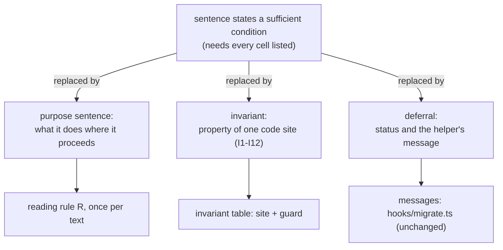

# Implementation Plan: the migrate undo docs say what each command is for and what it never does, defer every refusal condition to `status` and the helper's messages, and release 13.1.12

**Date:** 2026-10-17
**Spec:** none. Planned from the package narrative `261017-1812-migrate-docs-defer-conditions-to-status-and-messages.md`, the previous plan `261017-1708-plan-migrate-landed-cell-docs-entry-path-conditions.md` (its trace and cells C1 to C10) and its closing review `261017-1747-reviewer-closing-pass-over-the-migrate-landed-cell-docs-entry-path-conditions-package.md`.
**Decidability:** The plan rests on one question: **"Does every sentence the shortened texts keep hold on every path through `bin/fusion-migrate` and `hooks/migrate.ts`?"** The five previous rounds asked a different question: does each sufficient condition hold in every cell? That question could only be answered by listing cells, and each round missed one. This plan changes the mechanism. A kept sentence is one of two kinds. (1) A **purpose** sentence says what a command does where it proceeds. One header sentence makes that reading explicit, and so does the "where it proceeds" or "is for" wording in the README and the upgrade note. (2) An **invariant** is a property of one code site: the only `unlinkSync` in `endLeftFence`, the only `renameSync` in `setAside`, the guards in front of each, and the one message that names a hand deletion. Whether an invariant holds is decided by reading that site and its guards, without listing cells. Everything conditional (which command refuses where, and what it suggests) is left to `status` and the message the helper prints. The invariant table under `## Current State` gives the site for each kept claim.

## Summary for the decision

- **What changes for a reader.** The texts stop listing the conditions under which `run`, `resume`, `rollback`, `rollback --end-fence` and `set-aside` refuse. Those lists drifted in every release from 13.1.7 to 13.1.11, and each closing review found one more cell they did not cover. Instead, each passage says what the command is for and a few things it never does. For everything else it sends the reader to `bin/fusion-migrate status` and to the message the helper prints.
- **What is kept, as invariants.** `rollback --end-fence` ends no fence but the one its record's rollback began. It removes no workbench file itself but `.json-state/maintenance.json`, and that one only where no rollback chunk of the record is stored. Only the helper's own message says whether that file may be deleted by hand. `set-aside` deletes nothing. It renames no record that reads as current, and renames nothing while the codec reports a fence or a pending intent or where the new name already exists. `run` sends no migration request while the session holds a record that is not rolled back.
- **Passages.** Three are the ones the brief names: the `bin/fusion-migrate` header (its `rollback --end-fence` and `set-aside` entries and its `run` entry), the `migrate.ts` and `bin/fusion-migrate` rows of `README-hooks.md`, and the `**Undo.**` paragraph of `docs/upgrading-to-v13.md`. Three more are proposed: the header's bound sentence (replaced by a reading rule), the exit table's line for 5 (its refusal list), and the plain `rollback` entry's exit-8 sentence (two cells falsify it). The dispatcher may strike these three before step 1 runs. See `## Open Questions`.
- **Issues.** The three open low issues named in the brief become moot, because the sentences they correct are gone. Each gets a `Resolved:` line (step 2). Three new low issues were found and filed in this package's issues store. They are not part of 13.1.12.
- **What does not move.** No code line, message, exit code or condition changes. `reference-resolution-lint` stays at 2061/371/11: the cut spans carry no path, anchor or stamp token the lint counts, and the two `bin/fusion-migrate` tokens in the Undo paragraph are kept. `skills/migrate/SKILL.md` is not touched.
- **Release.** 13.1.12, in the order of the previous plans: marketplace edited before any push, review before the tag, fusion pushed before the marketplace, cache pull last.

## Directive

A docs change with no behaviour change, released as fusion 13.1.12. This is the user's choice of 2026-10-17 (the package narrative). Its result: the passages say what each command is for and what holds unconditionally, and they defer the exact conditions to `bin/fusion-migrate status` and to the message the helper prints. What rulings `261016-1436-how-is-a-rollback-fence-ended-that-a-git-reset-left-standing-over-a-legacy-tree.md` and `261016-1958-is-a-rollback-fence-ended-when-the-rollback-landed-chunks-and-a-git-reset-then-took-the-tree-back-to-markdown.md` decided stays decided. Neither one binds the docs to list its checks. The first rules on what the code checks before it removes the fence file. The second rules that "the messages name the situation, and name the hand deletion … with the conditions the user checks first". The shortened texts leave that to the messages, which is where the second ruling put it. The idle sentence earlier plans kept byte-identical as "ruling-owned" is therefore not owned by the ruling, and it goes.

## Current State

Measured at HEAD `68ff12b7`. `plugin.json`, both pin examples and the help paragraph read 13.1.11.

### The passages as they stand

- **`bin/fusion-migrate` header.** The sentence after "git is required too, and is asked." bounds every entry by exits 1 to 4, 7 and 8. The `run` entry lists "preconditions in this order", three of them. Issue `261017-1708-migrate-header-run-entry-lists-its-preconditions-without-the-legacy-state-check.md` shows that two checks are missing and that the third is described more widely than `standing` reads. The `rollback` entry describes the two branches of a refused first chunk. The `rollback --end-fence` entry has a session bound, a JSON sentence, the idle sentence (six conditions) and the landed sentence (eight conditions, with the hand deletion). The `set-aside` entry carries two exceptions, worded two different ways. The exit table's line for 5 lists refusal classes.
- **`README-hooks.md`.** The `migrate.ts` row is 2 606 bytes in one cell. Its middle restates the header's conditions, and one of them is false (issue `261017-1747-migrate-refusal-claims-except-only-the-legacy-fence-removal-where-end-fence-also-ends-a-json-fence-over-a-stale-record.md`). The `bin/fusion-migrate` row restates the refusal claim and the idle conditions in short form.
- **`docs/upgrading-to-v13.md` `**Undo.**`.** Its bound sentence covers only "this and each refusal" and says "answers" where the header says "answers and admits" (issue `261017-1747-migrate-undo-note-environment-bound-covers-only-status-and-refusals-and-omits-a-codec-refusal.md`). It then gives the refusal claim, the pending-intent and idle cells, and the landed sentence with the three hand-deletion conditions.

### Where the old claims fail, and why listing cannot converge

The 13.1.11 review found the JSON-control branch of `rollback --end-fence` (C7) missing from a refusal claim. While planning this round I found more cells the current texts get wrong:
- **Plain `rollback`, exit 8.** "With none, the refusal is one a retry or a restore clears" puts `work === null` in with "none", but the code calls that case undecided. "It ends that fence" is false where `endRollbackFence` itself fails.
- **Exit table, 5 and 6.** "Nothing was written" leaves out the session backup `run` takes before `serialise` and before the blocking refusal. Filed, see below.
- **Messages.** The idle-way message names `rollback --end-fence` for a record of another workbench path, and R2 then refuses it (C9). This is already filed, as the code issue `261017-1708-migrate-messages-name-end-fence-as-ending-a-fence-it-then-refuses-to-end.md`. It means a doc sentence that promises the message "names the way out" would be false. The target texts therefore say a message "may suggest a next step".

Each cell is one more condition for a sentence that states a sufficient one. The plan stops stating them.

### The invariants kept, and why each holds on every path

| # | Claim kept (where) | Code site | Why no path escapes |
|---|---|---|---|
| I1 | `rollback --end-fence` removes no workbench file itself but `.json-state/maintenance.json` (header, both README rows, Undo) | `endLeftFence`: one `unlinkSync(file)`, `file = join(wb, ".json-state/maintenance.json")`; `rollback` returns `endLeftFence` right after `recorded` | `endLeftFence` has no other `unlinkSync`, `rmSync` or `renameSync`. Its other writes are `writeState` (the session's `state.json` through a tmp file and a rename, outside the workbench by default; with a `--session` inside it, that is a rewrite of `state.json`, not a removal) and, on the JSON branch, the codec's `maintenance end`. The codec does the removal there, so "itself" is part of the claim. `recorded` and `inspect` write nothing. |
| I2 | It removes that file only where no rollback chunk of the record is stored (header, README `migrate.ts` row, Undo: "no chunk of the undo landed") | the guard `if (idle !== null)` in front of the `unlinkSync`; `idleFence` | `idle` is non-null only where `idleFence` returns a fence, and that needs `ownFence` (legacy tree, standing fence = `s.rollback.begin_id`) with `own.landed.length === 0` (no scheduled rollback chunk stored) and no `intentStands`. |
| I3 | It ends no fence but the one its record's rollback began (header; README "the fence the record's own rollback began") | legacy branch: the re-read `again.operation_id !== idle` refuses; JSON branch: `i.maintenance?.operation_id !== s.rollback.begin_id` refuses, then `maintenance end` names `fence: s.rollback.begin_id` | Neither branch ends a fence whose id is not `s.rollback.begin_id`, and the codec answers an `end` naming another fence with `conflict` (`codec/README.md`, the `maintenance` table). |
| I4 | After it ends a fence under JSON control, the codec refuses every later rollback of this migration (header only, unchanged in substance) | `codec/README.md` `## migration`, "The baseline" bullet: only three stored answers are exempt from the audit, and any other later operation is `after-state-changed` | The stored answer of the rollback fence's `end` is none of the three. This is a codec property, the same claim the `note=` line of `endLeftFence` prints, and the 13.1.11 review checked it. |
| I5 | Whether the file may be deleted by hand is said only by the helper's message (header, README `migrate.ts` row by deferral, Undo: "only where the helper's message names that deletion") | `landedWay`, the only message text in `hooks/migrate.ts` that names a deletion by hand (`grep -n "by hand" hooks/migrate.ts`: `landedWay`, plus the comment above `refusedFirstChunk`, which names no deletion) | After the edit, no swept passage names a hand deletion except by deferring to the message. The helper itself never deletes in the landed cell, by I2. |
| I6 | `set-aside` deletes nothing and renames nothing else (header, both README rows, Undo) | `setAside`: one `renameSync(session, to)` | No other fs mutation in `setAside`. One residue, stated so the claim stays honest: `rename(2)` replaces an empty directory created at `to` by another process between the `existsSync` check and the rename. That is another process's act, not this call's, and I9 says only what the check does. |
| I7 | It renames no record that reads as current (header) | `if (shows === null) throw …record=current…` before the rename | `status` prints `record=current` exactly where `stale(wb, s, i.state)` is null, the same function and arguments. |
| I8 | It renames nothing while the codec reports a fence or a pending intent (header, Undo: "while a fence the undo left still stands") | `if (shows !== null && standing(i)) throw`, and the `shows === null` throw | The rename is reached only where `stale` is non-null and `standing` is false. `standing` is `inspect`'s `maintenance` or `pending`. A fence file present makes `inspect` report `maintenance`, or refuse (`maintenance-unreadable`, exit 8). Either way, nothing is renamed. |
| I9 | It renames nothing where the new name exists (header) | `if (existsSync(to)) throw` immediately before `renameSync` | As written. The race is under I6. |
| I10 | While the session holds a record not rolled back, `run` sends no migration request (header) | `run`'s first three statements | For such a record, `current` runs first (`inspect` only), then either the no-op return (done) or the "is recorded" refusal. No `op: "migration"` is sent. A rolled-back record is outside the premise (C10). |
| I11 | Plain `rollback`: on a refused first chunk after activation it ends that fence only where work stored since the plan already bars every rollback, otherwise the fence stays (header) | `refusedFirstChunk`: `if (work === null \|\| work.length === 0) return new Stop(…)` before `endRollbackFence`; `workSincePlan`'s comment and the codec's audit (I4's source) | An end is attempted only with `work.length > 0`. With `null` or empty no request is sent. Nothing is claimed about whether an attempted end succeeds. |
| I12 | A refused precondition of `run` is exit 5 and names itself; a v11 store name is routed to the rename, a codec without `migration` to an update (header) | `preconditions` and the two refusals in `run` before it | Each `Stop(EXIT.precondition, …)` there names its condition. The two routes are in the message strings. |
| R | Each entry says what the subcommand does where it proceeds; where it stops, stderr says why and `status` shows where the run stands (header reading rule; README and Undo "where they proceed" or "is for") | `main`'s `catch` (`say(e.message)` for a `Stop`, a fault text otherwise); the wrapper's `printf` before each `exit 1`, `3` and `4`; `usage` for `exit 2` | Every non-zero exit prints a reason. `status` prints `state=` and `fence=`, plus `record=` where a run is recorded, or stops and says why. |
| S | `record=stale` means the session's record and the tree disagree (both README rows, Undo) | `stale` | It returns non-null only on a positive contradiction (its comment: "Only positive contradictions count"). The direction is stale ⇒ disagree, never the converse, which an uncommitted reset would falsify. |

The Undo paragraph's first two sentences ("can restore … only while", "refused from then on") stay as they are. The 13.1.11 review checked both.

### Spot check against the earlier cells and the review's extra cells

The invariants do not depend on the cell. This check is for the reviewer, who knows the cells:
- **C4** (idle legacy fence): `--end-fence` unlinks, with no chunk stored (I2). `set-aside` refuses (I8).
- **C5** (landed): `--end-fence` refuses and removes nothing (I2). Its message says whether a hand deletion is named (I5).
- **C7** (JSON-control stale record, own fence; the cell behind 261017-1747): `--end-fence` ends it through the codec. No kept sentence claims a refusal, so the cell has nothing left to falsify.
- **C9** (record of another path): `--end-fence` stops at R2, and R says stderr says why. The set-aside message suggests `--end-fence`, and "may suggest a next step" promises nothing about it.
- **C10** (rolled-back record of another path): `run` starts a new run. No kept sentence says `run` refuses, and I10's premise excludes a rolled-back record.
- **Journal-only intent:** `set-aside` may rename, and no kept sentence says it would not. `--end-fence` does not unlink (`intentStands`, I2).
- **E2a write lock, refused `inspect`:** a stop with a message (R). Nothing is removed (I1, I2) and nothing is renamed (I8).

### Lint, tests, skills, bounds

- **`reference-resolution-lint`** counts plugin paths anywhere in a scanned line (`PLUGIN_PATH_RE`, backticked or not), adjacent `file` `## heading` anchors, and bare stamps. Measured at HEAD: the cut spans contain no match. In the header, the path tokens are on lines 18, 20, 35, 130 and 131, all outside the edited entries. In the README `migrate.ts` row, the three `lib/…` tokens and `bin/fusion-migrate` are in the kept head and tail. The `bin/fusion-migrate` row's cut span has none. The Undo paragraph carries `bin/fusion-migrate` twice, and both are kept. `.json-state/…` and `journal/` match no plugin directory, and `/fusion:migrate` is class (d), existence only. **So the counts do not move, and `BASELINE` stays unedited.** No new text may add a plugin path, an anchor or a stamp. Step 1's acceptance checks this per file.
- **`workbench-citation-lint`:** two pre-existing findings, one in each of the two issue files stamped 261010-1045. No new record quotes their tokens. The three issues filed by this plan cite only existing basenames and this plan.
- **Tests that read the passages:** none. `migrate.test.ts` pins messages and exit codes. `hook-route-exclusion.test.ts` stubs the file. `derivable-enumerations-lint` reads only the first cell of the `bin/…` rows. `usage()` prints header lines 3 to 15, and every edit is below line 20.
- **Skills:** `skills/migrate/SKILL.md` (28 997 bytes) routes on `status`'s `record=` and on exit codes. For `ROUTE=stale` it shows set-aside's stderr on exit 5, and it relies on no sentence of the swept prose. Its **Interrupted.** sentence over-promises in one rare cell (filed, not touched). `skills/help/SKILL.md` names `rollback --end-fence` only in the 13.1.5 credit, which is history and stays.
- **Growth bounds:** `docs/`, `README-hooks.md` and the `bin/` headers are not bounded. The skills surface golden total is 225 272, and the cap measured by the 13.1.10 plan is 228 028, so about 2 756 bytes remain. The help sentence adds under 80. The executor re-measures.

### Filed while planning (Low; not part of 13.1.12)

- `261017-1823-migrate-exit-table-nothing-was-written-for-5-and-6-does-not-count-the-backup-run-takes-into-the-session.md`: step 1 keeps the exit-5 line's "Nothing was written by this call." byte-identical, and this issue owns it.
- `261017-1823-migrate-ts-header-session-section-restates-the-refusal-claims-the-docs-no-longer-carry.md`: a code comment, so it needs a dist rebuild, outside a no-code release.
- `261017-1823-migrate-skill-interrupted-says-an-exit-8-rollback-names-the-way-out-where-ending-its-fence-was-refused.md`: the skill is at its cap.

## Approach

One rule applies to every swept sentence: **keep it only as a purpose sentence under the reading rule, or as an invariant whose code site the table names; otherwise cut it and leave it to `status` and the message.** Tokens the lint counts stay where they are.

```mermaid
flowchart LR
    S1["1 header + 2 README rows<br/>+ Undo paragraph"] --> S2["2 Resolved lines<br/>on the 3 issues"]
    S2 --> S3["3 release surfaces 13.1.12<br/>+ help + golden"]
    S3 --> S4["4 marketplace 13.1.12<br/>edited, not pushed"]
    S4 -.-> C["commit fusion, stating the<br/>review-coverage result (dispatcher)"]
    C -.-> R["closing review (dispatcher)"]
    R -.-> T["tag v13.1.12 (dispatcher)"]
    T -.-> P["push fusion + tag,<br/>then marketplace (dispatcher)"]
    P -.-> K["cache pull (dispatcher)"]
```

**No decision record.** The approach is the user's word in the package narrative and applies to these passages. Whether it should bind future docs work is an open question below, and the recommendation is no record.

## Implementation Steps

1. **The swept passages state purpose and invariants only, and defer every condition**
   - Executor: code-implementer
   - Files: `bin/fusion-migrate` (comment lines only: the sentence after "git is required too, and is asked.", the `run`, `rollback`, `rollback --end-fence` and `set-aside` entries, the exit table's line for 5), `README-hooks.md` (`## Files`: the `migrate.ts` row and the `bin/fusion-migrate` row only), `docs/upgrading-to-v13.md` (the `**Undo.**` paragraph only)
   - Changes. Quoted text is the target. In the header, keep the `#` prefix and the entries' 19-space continuation indent, and wrap near the existing width. Keep each README row on one line.
     - **Header, R.** Replace the two lines "Each entry below holds past the exits 1 to 4 and where the codec answers and admits each request it is sent (else exit 7 or 8)." with:
       > Each entry says what the subcommand does where it proceeds; where it stops, stderr says why (the exit table below) and `status` shows where the run stands.
     - **Header, `run`.** Replace the entry text, from "preconditions in this order:" through "A second run sends nothing.", with:
       > the migration: its preconditions; a live .session-marker reported, untracked and ignored files listed; the backup; the survey, and a refusal while any blocking finding remains, printing those lines first; then the proposal into .json-state/migration/, plan, one apply per chunk, verify, setup metadata and `maintenance end`. A refused precondition is exit 5 and names itself on stderr; a v11 store name is routed to /fusion:migrate's rename, a codec without `migration` to an update. While the session holds a record not rolled back, it sends no migration request.
     - **Header, `rollback`.** Keep "every landed chunk in reverse, … Resumable." and "Restores the frozen post-repair input." Replace the rest, from "When the codec refuses the first chunk (exit 8)," through "stderr names the way out.", with:
       > When the codec refuses the first chunk after activation, it ends that fence only where work stored since the plan already bars every rollback of this migration (the codec's audit); otherwise the fence stays.
     - **Header, `rollback --end-fence`.** Replace the whole entry text, from "every sentence here is about" through "It removes nothing there.", with:
       > ends the fence this session's rollback began and left standing: on a store under JSON control through the codec's `maintenance end`, after which the codec refuses every later rollback of this migration; over a tree that reads as legacy Markdown again (a git reset is one way there), where the codec cannot, by removing .json-state/maintenance.json itself. It ends no other fence and removes no other file of the workbench, and it removes that one only where no rollback chunk of the record is stored. Whether the file may be deleted by hand is said only by the helper's own message.
     - **Header, `set-aside`.** Replace the whole entry text with:
       > with --consent, renames the session directory to <dir>.stale-<UTC stamp>, so its backup, repair log and ids stay readable through --session; for a record `status` reports as record=stale. It deletes nothing and renames nothing else; it renames no record that reads as current, nothing while the codec reports a fence or a pending intent, and nothing where the new name exists.
     - **Header, exit 5.** Replace "a precondition refused: v11 store names, … or restore-backup's or set-aside's conditions." with "a precondition refused, named on stderr." and keep "Nothing was written by this call." byte-identical (owned by the issue filed for it).
     - **`README-hooks.md`, the `migrate.ts` row.** Replace the span from " Past the exits 1 to 4 of the wrapper's table," through "while the proposal is missing or at other bytes." with:
       > `record=stale`, which `status` prints, means the session's record and the tree disagree. Where they proceed, `set-aside --consent` renames such a session directory aside, and `rollback --end-fence` ends the fence the record's own rollback began and left standing. Whatever they do, set-aside deletes nothing, and `.json-state/maintenance.json` is the one workbench file --end-fence removes itself, only where no rollback chunk of the record is stored. Which command refuses where, and what it suggests next, is in `status` and in the message each prints.

       Everything up to "under its recorded id." and from " It writes no control, plan or answer byte." on is unchanged.
     - **`README-hooks.md`, the `bin/fusion-migrate` row.** Replace the span from "and `status`, whose `record=stale` (a record the tree does not carry)" through "and the session records this workbench." with:
       > and `status`, whose `record=stale` means the session's record and the tree disagree; `set-aside --consent` is for setting such a session aside, by a rename that deletes nothing, and `rollback --end-fence` for the fence the record's own rollback left standing, removing itself no workbench file but `.json-state/maintenance.json`. Each refusal names its reason on stderr.
     - **`docs/upgrading-to-v13.md`, `**Undo.**`.** Replace the whole paragraph (from "**Undo.**" through "it deletes nothing.") with the following, wrapped near the existing width:
       > **Undo.** `bin/fusion-migrate rollback` can restore the workbench from the migration's own journal only while no ordinary write has followed it. The first ordinary write, such as a claim, a filed issue or a transition, ends that: the rollback is refused from then on, and the way forward is a fix rather than a return. `bin/fusion-migrate status` says where a workbench stands, or why it cannot. Its `record=stale` means the session's record and the tree disagree, for example after git discarded the migration it records; `/fusion:migrate` then offers to set that record aside with the same helper's `set-aside --consent`, which deletes nothing and, where it succeeds, renames the session directory. Set-aside renames nothing while a fence the undo left still stands. Wherever the helper stops, its message says why and may suggest a next step, such as a `rollback --end-fence` of the same record. That command removes no file itself but `.json-state/maintenance.json`, and that one only where no chunk of the undo landed. Delete that file by hand only where the helper's message names that deletion.
     - **Constraints, if the executor departs from the quoted text.** (a) Every kept sentence is either a purpose sentence under R (header) or under "where they proceed" or "is for" (README), or an invariant in the table under `## Current State`. Nothing else states when a command refuses or what it names. (b) No new text adds a plugin path, a `file` `## heading` anchor or a record stamp, and the two `bin/fusion-migrate` tokens of the Undo paragraph stay. (c) No sentence promises that a message names a way out. A message "says why" and "may suggest". (d) A git reset appears only as one way into a state. (e) The exit-5 line keeps "Nothing was written by this call." byte-identical.
     - No code line of `bin/fusion-migrate` and no line of `hooks/migrate.ts` changes.
   - Acceptance:
     - `cd hooks && npm test -- lib/__tests__/migrate.test.ts lib/__tests__/reference-resolution-lint.test.ts` is green, with `BASELINE` and `migrate.test.ts` unedited. A lint count that moves is a stop: put the token back, never edit `BASELINE`.
     - For each of `bin/fusion-migrate`, `README-hooks.md` and `docs/upgrading-to-v13.md`, the sorted list of plugin-path matches is unchanged: `diff <(git -C /Users/kai/Projects/productive/F04-FUSION/fusion show HEAD:<file> | grep -oP '(?<![A-Za-z0-9_./-])((?:rules|agents|skills|docs|hooks|bin|templates|stilwerk|lib)/[A-Za-z0-9<>$*{}…][A-Za-z0-9._<>$*{}…/-]*[A-Za-z0-9>}]|\.claude-plugin/plugin\.json|README(?:-[a-z]+)?\.md|CLAUDE\.md|install\.sh|settings\.json)' | sort) <(grep -oP '<same pattern>' /Users/kai/Projects/productive/F04-FUSION/fusion/<file> | sort)` prints nothing.
     - `git -C /Users/kai/Projects/productive/F04-FUSION/fusion diff -U0 -- bin/fusion-migrate` shows changed lines only in the six named places, each beginning with `#`. `bash -n bin/fusion-migrate` exits 0, and `bin/fusion-migrate` with no argument prints the same usage block as at HEAD.
     - `git -C /Users/kai/Projects/productive/F04-FUSION/fusion diff -U0 -- README-hooks.md` shows only the `migrate.ts` row and the `bin/fusion-migrate` row. The `diff -U0` of `docs/upgrading-to-v13.md` shows changed lines only inside the `**Undo.**` paragraph.
     - `git -C /Users/kai/Projects/productive/F04-FUSION/fusion diff -U0 -- bin/fusion-migrate README-hooks.md docs/upgrading-to-v13.md | grep '^+' | grep -cE 'write lock|no intent is pending|proposal lists|is empty|before the reset|names the way out'` prints 0.
     - The report quotes every kept sentence and gives for each its row in the invariant table (I1 to I12, R, S) or "purpose under R".
   - Dependencies: none

2. **Record the resolution on the three issues**
   - Executor: code-implementer
   - Files: in the issues store of the container `261017-1659-migrate-landed-cell-docs-entry-path-conditions`: `261017-1747-migrate-refusal-claims-except-only-the-legacy-fence-removal-where-end-fence-also-ends-a-json-fence-over-a-stale-record.md`, `261017-1747-migrate-undo-note-environment-bound-covers-only-status-and-refusals-and-omits-a-codec-refusal.md`, `261017-1708-migrate-header-run-entry-lists-its-preconditions-without-the-legacy-state-check.md`
   - Changes: append `---` and one `Resolved:` line to each, citing this plan by its plain basename `261017-1823-plan-migrate-docs-defer-conditions-to-status-and-messages.md`, step 1, with no commit hash and no token from the two 261010-1045 issue files.
     - Refusal-claims issue: no sentence now claims that `run`, `resume` and `rollback` refuse a stale record, so the JSON-control branch of `rollback --end-fence` falsifies none, and the header's `set-aside` entry carries no exception phrase. Its acceptance is met because the claim was removed, not reworded.
     - Undo-bound issue: the bound sentence is gone, and every remaining promise of the paragraph holds under any exit (I1, I2, I8, R, S, plus the two unchanged sentences). The first half of its acceptance is met. The second half, that the bound matches the header's, is moot because there is no bound.
     - Run-entry issue: the entry no longer lists preconditions in an order, and it no longer describes the intent check. The defect (an ordered list that leaves out refusals) no longer exists. The fix direction it asked for (a complete list) was replaced by deferral to the messages, and the line says so.
     - Write no transition. Recommended dispositions for the dispatcher: `{"kind":"fixed","reason_ref":null}` for the first two, and `fixed` also for the run-entry issue, with its `Resolved:` line naming the replaced fix direction. `superseded` is the alternative there if the dispatcher reads its acceptance literally.
   - Acceptance: after the three writes, `cd hooks && npm test` is green apart from exactly the two pre-existing `workbench-citation-lint` findings, and `reference-resolution-lint` passes unedited.
   - Dependencies: step 1

3. **Release surfaces for 13.1.12**
   - Executor: code-implementer
   - Files: `.claude-plugin/plugin.json`, `install.sh` (header pin example), `README.md` (pin example), `skills/help/SKILL.md` (`### 4. Update`, the paragraph "Coming from 13.1.10 or earlier"), `hooks/lib/__tests__/fixtures/surface-growth.golden`
   - Changes:
     - Change 13.1.11 to 13.1.12 in `plugin.json` `version` and in both `FUSION_REF=tags/v…` examples. `description` is unchanged.
     - The help paragraph (`README-agents.md` `## Releasing` step 0): "Coming from 13.1.10 or earlier" becomes "Coming from 13.1.11 or earlier", and "13.1.2 to 13.1.11 need no migration" becomes "13.1.2 to 13.1.12 need no migration". "13.1.2 to 13.1.7 each change only `/fusion:migrate`." stays. Insert one sentence before the 13.1.11 sentence: "13.1.12 changes nothing that runs; it shortens the undo descriptions." It must stay under 80 bytes, with no path or anchor citation. The other paragraphs stay.
     - Regenerate the golden: `cd hooks && UPDATE_SURFACE_GOLDEN=1 npx vitest run lib/__tests__/surface-growth-bound.test.ts` (it fails on purpose), then run the bound again.
   - Acceptance:
     - `cd hooks && npm test` is green apart from the two pre-existing findings. `reference-resolution-lint` passes at 2061/371/11, unedited. No head-room constant or `SKILL_BASELINE` entry is edited.
     - `claude plugin validate .` reports passed. `claude --plugin-dir . --agent fusion:orchestrator -p "reply SMOKE-OK"` answers.
     - `grep -n "13\.1\.11" .claude-plugin/plugin.json install.sh README.md` finds no stale pin.
     - The report states the output of `bin/fusion-review-coverage --since v13.1.11`, and the dispatcher puts that result in the release commit message.
   - Dependencies: step 2

4. **Marketplace entry for 13.1.12, edited before anything is pushed**
   - Executor: data-implementer
   - Files: `/Users/kai/Projects/productive/F03-CLAUDE-plugin-marketplace/claude-plugins/.claude-plugin/marketplace.json`
   - Changes: set fusion's `version` to `13.1.12` and change nothing else. Before dispatching this step, the dispatcher runs `git -C /Users/kai/Projects/productive/F03-CLAUDE-plugin-marketplace/claude-plugins pull --rebase origin main`. The executor makes no git call, and the edit stays uncommitted and unpushed until the dispatcher's push sequence.
   - Acceptance: `node -e 'JSON.parse(require("fs").readFileSync(process.argv[1],"utf8"))' /Users/kai/Projects/productive/F03-CLAUDE-plugin-marketplace/claude-plugins/.claude-plugin/marketplace.json` exits 0, and fusion's entry reads `"version": "13.1.12"`, the same as `.claude-plugin/plugin.json`.
   - Dependencies: step 3

**Rules for every step.** Executors run no whole-tree git command in the live repository. Only the path-limited `diff` and `show` calls above are allowed. Nothing in this plan commits or pushes. The dispatcher does the following, in this order (`README-agents.md` `## Releasing`): commit fusion, with the release commit stating the `bin/fusion-review-coverage` result; dispatch the closing review; tag `v13.1.12`; push fusion and the tag; commit and push the marketplace; pull the cache clone (`git -C ~/.claude/plugins/marketplaces/tenzoki-plugins pull origin main`). The closing review is asked to check every kept sentence against its row in the invariant table, reading the named code site and its guards. It should say whether any path reaches the site without the guard, and whether any kept sentence is neither a purpose sentence under the reading rule nor an invariant.

## Where this work stops

- `bin/fusion-migrate` differs from `68ff12b7` only in comment lines, in six places: the sentence after "git is required too, and is asked.", the `run`, `rollback`, `rollback --end-fence` and `set-aside` entries, and the exit table's line for 5. Or the dispatcher struck the R sentence, the `rollback` entry or the exit-5 line before step 1 ran, and step 1's report says which.
- No swept passage states when `run`, `resume`, `rollback`, `rollback --end-fence` or `set-aside` refuse, other than by deferring to `status` and the helper's message.
- Every kept sentence of the swept passages is a purpose sentence or an invariant, and step 1's report maps each one to its table row.
- No swept passage names a hand deletion of `.json-state/maintenance.json` except by deferring to the helper's message.
- `README-hooks.md` differs from `68ff12b7` only in the `migrate.ts` row and the `bin/fusion-migrate` row. `docs/upgrading-to-v13.md` differs only inside the `**Undo.**` paragraph.
- Every exit code, condition and message string in `hooks/migrate.ts` and `bin/fusion-migrate` is unchanged, and `migrate.test.ts` passes unedited.
- In each of the three edited files, the sorted plugin-path matches equal `68ff12b7`'s. `reference-resolution-lint`'s `BASELINE` reads 2061/371/11, unedited, and the lint passes.
- The three issues carry a `Resolved:` line, and the full hook suite ran after the third write with no red beyond the two pre-existing `workbench-citation-lint` findings.
- Every growth bound is green with the golden regenerated. No baseline, `SKILL_BASELINE` entry or head-room constant was edited, and `skills/migrate/SKILL.md` is byte-identical to `68ff12b7`.
- The help paragraph reads "Coming from 13.1.11 or earlier" and "13.1.2 to 13.1.12 need no migration", still says "13.1.2 to 13.1.7 each change only", and carries a 13.1.12 sentence saying it changes nothing that runs.
- Before anything is pushed, `plugin.json`, both pin examples and the marketplace working clone's `marketplace.json` read 13.1.12.
- The release commit states the `bin/fusion-review-coverage --since v13.1.11` result.
- Before the tag `v13.1.12` is created, a closing review of the range since `v13.1.11` is filed in this package's reviews store, and its verdict is accept, or every finding it rates above Low is answered.
- The tag `v13.1.12` is on the pushed fusion `main` commit, and the fusion push happened before the marketplace push.
- After both pushes, the marketplace cache clone has been pulled.

## Data Structures

None.

## API Changes

None. No stderr text, stdout key, exit code or subcommand changes. Beyond the docs, the only user-visible change is the help topic's update paragraph.

## Testing Strategy

There is no behaviour to test. The guards are the existing suite and the review:
- `migrate.test.ts`, unedited, shows that no message or exit code moved.
- `reference-resolution-lint` and the per-file path-match diff show that no counted citation was added or lost.
- `surface-growth-bound` holds the help bytes.
- The closing review reads each kept sentence against its code site. This replaces the cell-by-cell check that failed five times. The review's extra cells (C7, C9, C10, the journal-only intent, E2a, a refused `inspect`) are the spot check under `## Current State`.

## Risks & Mitigations

| Risk | Mitigation |
|---|---|
| A sixth round: a kept sentence still fails on some path | Only two kinds of sentence survive. Each invariant is tied to one code site and its guard, which the review reads directly. Purpose sentences are covered by the reading rule R, whose own claim (every stop prints a reason) is checked against `main`'s `catch` and the wrapper's exits. |
| Readers lose information they used, such as when `--end-fence` works | That information is in the helper's message at the moment it applies, and `status` shows the state. The cut text was wrong in some cell in every release from 13.1.7 to 13.1.11. |
| A message is itself wrong (C9, filed as 261017-1708) and the docs now defer to it | The texts promise only that a message "says why" and "may suggest". The code issue remains open and owns the message. |
| A lint count moves | The cut spans were measured to carry no counted token, and step 1's acceptance diffs the matches per file before running the lint. |
| The header edit breaks the usage text or the script | Every edit is below line 20. `bash -n` and the no-argument usage run are in the acceptance. |
| The proposed widenings (R, `rollback`, exit 5) enlarge what the review must check | Each is a cut, not an addition, and each kept sentence there has a table row (R, I11, none). The dispatcher can strike them. |
| The marketplace entry lags the fusion push, or the tag precedes the review | Step 4 precedes every push, and two stopping clauses check the order. |

## Open Questions

- [ ] **Keep the three proposed widenings in step 1?** These are: the header's bound sentence replaced by the reading rule R, the plain `rollback` entry's exit-8 sentence, and the exit-5 line's refusal list. Recommended yes. R is what makes the purpose sentences unconditional. The `rollback` sentence is false in two cells (`work === null`, and an end that fails). The exit-5 list is the drift pattern issue 261017-1708's evidence names. Striking R would bring back a bound sentence the purpose sentences then depend on.
- [ ] **Should "migrate docs state purpose and invariants, and defer conditions to `status` and the messages" bind future docs edits as a decision record?** Recommended no for now. It is the user's word for this package, and the shortened texts carry it. If a later package rewords these passages again by listing conditions, that is the moment to file the record.
- The three issues filed while planning (exit-table writes, the `hooks/migrate.ts` header's `## The session`, and the skill's **Interrupted.** sentence) and the open code issues `261017-1708-migrate-messages-name-end-fence-as-ending-a-fence-it-then-refuses-to-end.md` and `261017-1717-migrate-run-reuses-a-rolled-back-session-recorded-for-another-workbench-path.md` are not part of 13.1.12.
