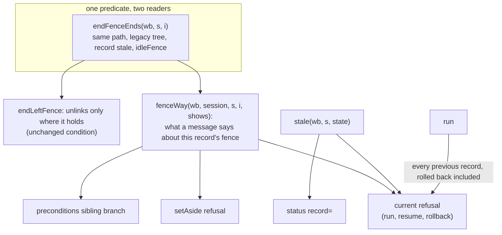

# Implementation Plan: `/fusion:migrate` code fixes (foreign rolled-back session, suggestions that refuse, a later refused rollback chunk), released as 13.1.13

**Date:** 2026-10-17
**Spec:** none. Planned from the package narrative `261017-2019-migrate-code-issues-end-fence-suggestion-foreign-session-later-chunk.md` and the three issues it names: `261017-1708-migrate-messages-name-end-fence-as-ending-a-fence-it-then-refuses-to-end.md`, `261017-1717-migrate-run-reuses-a-rolled-back-session-recorded-for-another-workbench-path.md` and `261017-1908-migrate-rollback-treats-a-later-chunk-refused-in-the-same-call-as-the-first-chunk-after-activation.md`.
**Decidability:** There are three load-bearing questions, and one of them needs a change of mechanism. (1) **"Is this session's record this workbench's?"** It is decidable: `stale` already compares the recorded path with the real path, and `status`, the skill's `ROUTE=stale` and `resume`/`rollback` already act on that answer. Only `run` skips it for a rolled-back record. (2) **"Would the command a message suggests pass its own checks on the record it names?"** It is decidable from the inputs the message already has (the record, `inspect`, the stored answers, the journal). It stays decidable only if the message asks the **same predicate** the command asks. Writing the conditions out a second time is how the three wrong suggestions arose. So the mechanism is one shared predicate, not a corrected copy. (3) **"Was the refused rollback chunk the first one after activation?"** That is **not decidable** from what the code reads today, an `inspect` taken before the loop. The mechanism changes to evidence the loop holds itself: the tree was under JSON control when the call began, and no rollback chunk was sent and stored in this call.

## Summary for the decision

Three low-severity code defects in `hooks/migrate.ts`. Each one gets a test that fails first. Then come the fix, a rebuilt `hooks/dist/migrate.js` and release 13.1.13. **This release changes behaviour**: one new refusal and changed message texts. No exit code, stdout key or subcommand changes.

**Please decide four things (recommendations marked):**

**A. A rolled-back session recorded for another workbench path (261017-1717-…).** `run` keeps that session's backup and repair log and overwrites its `state.json`.
1. **`run` refuses it with exit 5, as it refuses every other record that `status` reports as `record=stale`, and names `set-aside --consent` (recommended).** Set-aside renames the old session aside and deletes nothing. The next `run` then starts a fresh session with a fresh backup of *this* tree. The change is one condition in `run` plus the wording of the refusal for a rolled-back record. **No new decision record:** this applies the existing ruling `261016-0246-how-does-a-migration-session-whose-record-the-tree-no-longer-carries-get-out-of-the-way.md` (option 1: a stale record is refused, and set-aside is the guarded way out) to the one cell where `run` missed it. The `Resolved:` line cites that ruling.
2. `run` moves the old session aside itself and starts fresh. Not recommended: the ruling above rejected exactly this (its option 3, "drops the consent"). Choosing it means filing a new decision record in this package's decisions store that supersedes that part of the ruling.
3. Keep the reuse and document it. Not recommended: `restore-backup` from that session would put the other tree back, and the other tree's repair log would feed the new proposal. The issue's acceptance would then require a decision record (this package's decisions store) and a header sentence stating what is kept.

   On the issue's open doubt: "the frozen post-repair input" in the header's `rollback` entry is the codec's frozen plan input, not the session backup. `codec/README.md` says that rollback restores it, "not the external pre-repair backup, which is the host's `bin/fusion-migrate restore-backup`". So no ruling about the backup supports reusing it across paths.

**B. What the messages say where a suggested command would refuse (261017-1708-…, plus one sibling cell I found and filed).**
1. **Name a command only where its own checks pass. Elsewhere say why and defer to `status` (recommended).** This follows the approach 13.1.12 took in the docs.
2. As 1, but in the one cell where a working command exists (the set-aside sibling record still reads as current), also name `rollback --session <that dir>`, pinned by a test that runs it.
3. Keep the messages and document the cells. Ruled out: the issue's acceptance is that no message suggests a command that then refuses.

**C. The sibling cell found while planning.** It is filed as `261017-2028-migrate-stale-record-refusal-names-set-aside-as-the-way-out-where-a-fence-or-intent-stands-that-set-aside-refuses-on.md`. The stale-record refusal of `run`, `resume` and `rollback` names `set-aside --consent` while a fence or intent stands that set-aside refuses on. Cell D (a foreign fence over a reset tree) is one example. **Fix it in this package (recommended):** it is the same message function and the same shared predicate. Or leave it open for later.

**D. Which low comment and doc issues ride along.**
1. **All five (recommended).** Each is a comment line or a shrink, with its fix fully specified in its own issue, and this release goes out anyway:
   - the `hooks/migrate.ts` header `## The session` sentence (`261017-1823-migrate-ts-header-session-section-restates-the-refusal-claims-the-docs-no-longer-carry.md`). Step 4 edits the code it describes, and its "refused by `run`" half becomes true then.
   - three `bin/fusion-migrate` header lines: exit 5/6 "nothing was written" (`261017-1823-migrate-exit-table-nothing-was-written-for-5-and-6-does-not-count-the-backup-run-takes-into-the-session.md`), the `rollback --end-fence` "itself" (`261017-1908-migrate-header-end-fence-entry-says-it-removes-no-other-workbench-file-without-the-itself-its-json-branch-needs.md`) and the `status` entry (`261017-1908-migrate-header-status-entry-reads-record-as-whether-the-tree-carries-the-last-write-which-stale-does-not-decide.md`).
   - the skill's **Interrupted.** sentence (`261017-1823-migrate-skill-interrupted-says-an-exit-8-rollback-names-the-way-out-where-ending-its-fence-was-refused.md`). This one rides only as a **cut**: `skills/migrate/SKILL.md` stands at 28 997 bytes against its 29 000 cap, and the fix shortens the sentence by about 100 bytes. Step 2 strengthens the case for it: after step 2, a later refused chunk prints the codec's refusal alone, so the sentence's promise of a way out is false in one more cell.
2. Only the `hooks/migrate.ts` comment, which is the narrative's literal rule ("where a step already touches those lines"). The other four stay open for a later docs release.

**Not in scope, filed:** `261017-2028-migrate-repair-apply-and-restore-backup-use-a-session-recorded-for-another-workbench-path.md`. This is the same root as A, in two more subcommands. It needs a decision first, because a backup taken by a repair before any `run` records no path that could be compared.

**Release:** 13.1.13, in the order of the previous plans: marketplace edited before any push, closing review before the tag, fusion pushed before the marketplace, cache pull last. The release commit states the review-coverage result. "13.1.2 to 13.1.13 need no migration" still holds: nothing about the workbench format changes, only `/fusion:migrate`'s helper.

## Directive

Fix the three open low issues against `hooks/migrate.ts` behaviour, test first. An issue that does not reproduce is reported and closed as not reproduced, not fixed blind. The user chose this as one package in ordinary mode on 2026-10-17 (narrative). The guard against removing anything a rollback still needs stays as it is: no fence is removed by the helper beyond what it removes today. The fixes change which messages name `rollback --end-fence` or `set-aside`, and when `run` refuses. They never widen when `endLeftFence` unlinks or when `setAside` renames.

## Current State

Measured at HEAD `ef64ae79`. `plugin.json`, both pin examples and the help paragraph read 13.1.12.

### The three defects in the code

- **Foreign rolled-back session (A).** `run` starts `if (previous && !previous.rolled_back) current(wb, session, previous);`, so a rolled-back record never reaches `stale`. For a record of another path, `stale` returns "the record is kept for …" before its own `rolled_back` line, so `status` prints `record=stale` and Step 7's survey routes `ROUTE=stale`. `run` disagrees with both: it goes through `preconditions` and `ensureBackup` (which returns at once because `backup.sha256` exists), and `compose` and `serialise` read that session's repair log. It then writes a new `state.json` for this workbench into the other session. `resume` and `rollback` refuse it at `recorded`.
- **Suggestions that refuse (B, C).** Four message sites decide what to suggest from conditions written out a second time, not from the predicate the suggested command applies:
  - `setAside`: it names `endFenceWay` wherever `idleFence` holds. `rollback --end-fence` first calls `recorded`, and that refuses a record of another path.
  - `current` (used by `run`, `resume` and `rollback`): the same `idleFence` test for the "first, … `rollback --end-fence` ends it" prefix, then `set-aside --consent` in every case. But `setAside` refuses whenever `stale` is non-null and `standing(i)` holds, so `set-aside` is a way out only when nothing stands, or when the end-fence step before it clears what stands.
  - `preconditions`, sibling branch: where `landedFence` is null, it says "`rollback --end-fence --session <aside>` ends it once no rollback chunk of that record landed". `landedFence` is also null where the sibling reads as current, where an intent is pending, or where the sibling records another path. In each of those, `endLeftFence` (or `recorded` before it) refuses.
  - `endLeftFence` itself: `idle = i.state === "legacy" && stale(...) !== null ? idleFence(...) : null`. Together with `recorded` in front of it, this is the predicate "`rollback --end-fence` ends this fence".
- **Later chunk taken for the first (261017-1908-…).** `rollback` takes `const i = inspect(wb)` before the loop. Its `catch` sends any exit-8 refusal to `refusedFirstChunk` while `i.state === "json-control"`. The first reverse chunk after activation removes the manifest, so a refusal of the second chunk in the same call reaches `refusedFirstChunk`. That function then suggests `rollback --end-fence` "to end the fence and stay under JSON control" over a store that is already legacy (no work stored), or it sends `maintenance end` to a legacy store, which the codec refuses.

### Tests and bounds

- `hooks/lib/__tests__/migrate.test.ts` (503 lines) runs `bin/fusion-migrate` against `hooks/dist/migrate.js`. `npm test` builds into a staging tree and syncs into `hooks/dist/` (`hooks/scripts/run-tests.mjs`), so a test run rebuilds the entry. `killPlugin()` provides a stand-in codec that runs the real one and can kill a named request. `cellC()` builds the idle-fence cell.
- The existing message pins that must keep passing: the cell C `set-aside` text "no rollback chunk landed under it; `bin/fusion-migrate rollback --end-fence` ends it, then `bin/fusion-migrate set-aside --consent`", the cell C `run` text "first, the fence … `rollback --end-fence` ends it; then … `set-aside --consent`", "`bin/fusion-migrate rollback --end-fence --session <aside>` ends it" (cell C set aside under 13.1.4), and the done-reset refusals' "does not carry it … `set-aside --consent` … `--session …\.stale-`".
- **Hook-test head-room:** 25 358 lines against a budget of 28 872 (floor 24 037 + 4 835). That leaves 3 514 lines, measured with the bound's own method over `hooks/lib/__tests__/**.ts`. This plan adds about 60 to 100.
- **Skills:** 225 342 bytes against 228 028, so 2 686 bytes of margin for the help sentence. `skills/migrate/SKILL.md` stands at 28 997 bytes against the 29 000 cap carried through the previous migrate plans.
- `reference-resolution-lint` `BASELINE` is 2061/371/11. A record cited in a code or test comment is a backticked full basename, never a bare stamp. `workbench-citation-lint` carries 2 pre-existing findings in the two 261010-1045 issue files. Their tokens are not quoted anywhere in this package.

### Docs that quote what changes

None of the changed message texts is quoted in `README-hooks.md` (the `migrate.ts` and `bin/fusion-migrate` rows defer to "the message each prints"), `docs/upgrading-to-v13.md` `**Undo.**` ("may suggest a next step, such as a `rollback --end-fence` of the same record", which stays true) or `skills/help/SKILL.md`. The `bin/fusion-migrate` header's `run` entry ("While the session holds a record not rolled back, it sends no migration request.") stays true. Step 7 of `skills/migrate/SKILL.md` already routes the foreign rolled-back session to `ROUTE=stale` and set-aside. After fix A, `run` agrees with it.

## Approach

- **A (option 1).** `run` calls `current` for every previous record. For a rolled-back record of this workbench, `stale` is null and nothing changes. For one of another path, the refusal is the same exit 5 every stale record gets, worded for a rolled-back record.
- **B and C (option B1, C fixed).** One predicate, `endFenceEnds`, becomes the condition `endLeftFence` already uses. A single message function, `fenceWay`, decides what each refusal says about a fence that this record's rollback began. It uses the branch order of `endLeftFence` and splits its input into disjoint classes:
  - intent pending
  - rollback chunks landed (the existing `landedThenReset` text)
  - record reads as current
  - record of another path
  - `endFenceEnds` holds: the existing `endFenceWay` text.

  Every class but the last says why `rollback --end-fence` does not end the fence, and points to `status`. `current` names `set-aside --consent` only where nothing stands, or after an end-fence step that `endFenceEnds` admits. A fence this record did not begin keeps the generic text and loses the set-aside suggestion.
- **261017-1908-….** The loop counts the rollback chunks it sends and the codec stores in this call. The `catch` takes the first-chunk branch only when the call began under JSON control and that count is 0. Any other refusal is rethrown unchanged: the codec's refusal and nothing else, with the fence left alone. Re-reading `inspect` inside the `catch` was considered and rejected. It sends a request after a refusal, and a failure of that request would hide the refusal.

## Implementation Steps

1. **Reproduce the later-chunk defect with a failing test**
   - Executor: code-implementer
   - Files: `hooks/lib/__tests__/migrate.test.ts`
   - Changes:
     - Let `killPlugin()`'s stand-in take an optional `touch` (an absolute path) in its rule. When the rule matches and carries `touch`, the stand-in appends one line to that file and forwards the request to the real codec instead of exiting. A rule without `touch` behaves exactly as today.
     - Add one case, citing the issue by its backticked full basename in a comment, in the `describe` that holds the cell cases:
       - `run` through the stand-in with no rule.
       - Read chunk 1's writes from `archive/migrations/<id>/chunks/1.json`, as the resume case does. Pick one `control` path and save its bytes.
       - Set the rule `{phase: "rollback", chunk: 1, touch: <that file>}` and run `rollback`.
       - Expect exit 8. Expect stderr to match `/rollback chunk 1 refused/` and to match none of `/--end-fence/`, `/stay under JSON control/` and `/ending the fence/`. `status` shows `state=legacy` and a fence that is not `-`.
       - Then clear the rule, put the saved bytes back and run `rollback` again: exit 0 and `result=legacy`.
   - Acceptance: `cd hooks && npm test -- lib/__tests__/migrate.test.ts` shows **exactly this new case red**, and its failure is the stderr naming `--end-fence` (or `ending the fence`). Every other case stays green.
   - **Stop clause:** if the new case is green before any change to `hooks/migrate.ts`, the defect does not reproduce. Report the observed stderr. Skip step 2. Step 8 closes `261017-1908-migrate-rollback-treats-a-later-chunk-refused-in-the-same-call-as-the-first-chunk-after-activation.md` with `Resolved:` "not reproduced", the test kept as a regression pin, and recommends the disposition `not-reproduced` if `codec/schemas/record.schema.json` offers that kind (else `invalid`). The same stop applies when the codec refuses chunk 2 instead of chunk 1. That means the construction is wrong, not the code: report it, and do not fix blind.
   - Dependencies: none

2. **Decide "first chunk after activation" from evidence the loop holds**
   - Executor: code-implementer
   - Files: `hooks/migrate.ts` (`rollback` only), `hooks/dist/migrate.js` (rebuilt)
   - Changes:
     - In `rollback`, count the chunks the loop sends that return without throwing.
     - In the `catch`, rethrow `e` unchanged unless it is an exit-8 `Stop`, `i.state === "json-control"` and the count is 0.
     - Replace the comment there with one that says why this is the first chunk after activation: the call began activated, and no chunk landed in it. A rollback chunk stored before the call implies a legacy tree, because the first one removes the manifest.
     - `refusedFirstChunk` and its messages are unchanged.
     - Rebuild with `cd hooks && npm run build`.
   - Acceptance:
     - `cd hooks && npm test -- lib/__tests__/migrate.test.ts` is fully green, step 1's case included.
     - `cd hooks && npm run build && git -C /Users/kai/Projects/productive/F04-FUSION/fusion diff --stat -- hooks/dist/` lists only `hooks/dist/migrate.js`.
   - Dependencies: step 1

3. **Reproduce the foreign rolled-back session with a failing test**
   - Executor: code-implementer
   - Files: `hooks/lib/__tests__/migrate.test.ts`
   - Changes: add one case, citing the issue by its backticked full basename:
     - `project()`, `run`, `rollback` (exit 0, `result=legacy`).
     - Note the session directory from `status`, then `renameSync(root, root + "-moved")`. This is the same project moved on disk. Its `home` moves with it, so the session is now at the moved home under the old hash.
     - Append one line to a live narrative of the moved tree, so its tree differs from the session's backup.
     - From the moved root, run `run --session <the moved session>`. Expect exit 5, with stderr naming the old workbench path and `` `bin/fusion-migrate set-aside --consent --session <the moved session>` ``. Expect `state.json`, `backup.sha256` and the moved tree's `treeHash` byte-identical to their values before the call.
     - Then `set-aside --consent --session <the moved session>` exits 0.
     - Then `run` with the moved root's default session exits 0 with `result=json-control`, and that session's `backup.sha256` equals the moved tree's `treeHash` taken before that `run`.
   - Acceptance: `cd hooks && npm test -- lib/__tests__/migrate.test.ts` shows exactly this new case red, with the first `run` exiting 0 (or anything but 5). Every other case is green.
   - **Stop clause:** if the first `run` already exits 5 before step 4, the defect does not reproduce. Report what `run` printed, skip step 4, and step 8 closes `261017-1717-migrate-run-reuses-a-rolled-back-session-recorded-for-another-workbench-path.md` as not reproduced, the case kept as a pin.
   - Dependencies: step 2

4. **`run` applies the stale-record check to every previous record (decision A, option 1)**
   - Executor: code-implementer
   - Files: `hooks/migrate.ts` (`run` and `current` only), `hooks/dist/migrate.js` (rebuilt)
   - Changes:
     - In `run`, call `current(wb, session, previous)` whenever `previous` is not null. The no-op and "a run … is recorded" branches below it keep their `!previous.rolled_back` conditions.
     - In `current`, the claim for a rolled-back record reads "rolled back" (today it falls through to "a rollback in flight", because a completed rollback keeps `s.rollback`). For such a record, word the opening so it does not say the tree fails to carry a rolled-back record. Suggested: "`<session>` records `<id>` as rolled back, kept for `<X>`, not this workbench. Nothing was sent or written." The way out stays the existing set-aside tail.
     - No other message changes in this step.
     - Rebuild.
   - Acceptance:
     - `cd hooks && npm test -- lib/__tests__/migrate.test.ts lib/__tests__/store-name-migration.test.ts` is green, step 3's case included, with no existing case edited.
     - `hooks/dist/` differs only in `migrate.js`.
   - Dependencies: step 3. If the user chose A2 or A3 at plan review, this step is not run as written: the dispatcher sends the plan back for revision before it.

5. **Reproduce the suggestions that refuse, one failing case per cell**
   - Executor: code-implementer
   - Files: `hooks/lib/__tests__/migrate.test.ts`
   - Changes: add the cases below, each citing its issue (261017-1708-… or 261017-2028-migrate-stale-record-refusal-…) by backticked full basename. Each one asserts that no stderr matches ``/--end-fence(?: --session \S+)?` ends it/`` where that command would refuse, and that every stderr names `status`. Each case also runs the command the old text suggested and expects it to refuse, which shows the cell is real. The fence file stays byte-identical throughout.
     - (a) **Moved session, own idle fence.** `cellC()`, then rename its root as in step 3. From the moved root, `set-aside --consent --session <moved session>` and `run --session <moved session>` each exit 5, and neither suggests `rollback --end-fence`. `run` also does not suggest `set-aside --consent`. `rollback --end-fence --session <moved session>` exits 5 with "records".
     - (b) **Set-aside sibling that reads as current.** Cell A as in the existing case (the stand-in kills rollback chunk 2), then rename the session to `<session>.stale-20261017T000000Z` by hand. `run` exits 5 and does not suggest end-fence. `rollback --end-fence --session <aside>` exits 5.
     - (c) **Set-aside sibling with an intent pending.**
       - Migrate and commit. Make one directory that holds a control file of chunk 2 read-only, and run `rollback`. Expect exit 7 and chunk 2's intent left under `.json-state/journal/`, as the resume case does for `apply`.
       - Restore the mode, then `git reset --hard HEAD~1`, then rename the session aside by hand.
       - `run` exits 5 and does not suggest end-fence. `rollback --end-fence --session <aside>` exits 5.
     - (d) **Cell D.** `run`, `resume` and `rollback` each exit 5 and do not suggest `set-aside --consent`. `set-aside --consent` exits 5.
   - Acceptance: each case that reproduces is red and every other case is green. The report lists, per cell, red or green before any change to `hooks/migrate.ts` and the stderr seen.
   - **Stop clause, per cell:** a cell whose case is green before step 6, or whose construction does not reach the cell (for example, (c) leaves no intent, or the codec refuses `inspect` there), is reported with what it printed. It is not fixed blind: its case is dropped, or kept as a pin if green, and step 6 does not touch that site for it. If none of (a) to (c) reproduces, step 8 closes 261017-1708-… as not reproduced. If (d) does not reproduce, step 8 closes 261017-2028-migrate-stale-record-refusal-… the same way.
   - Dependencies: step 4

6. **One predicate decides every end-fence and set-aside suggestion (decisions B1 and C)**
   - Executor: code-implementer
   - Files: `hooks/migrate.ts` (`endLeftFence`, `setAside`, `current`, `preconditions`, plus the new `endFenceEnds` and `fenceWay` beside `idleFence`), `hooks/dist/migrate.js` (rebuilt)
   - Changes:
     - **`endFenceEnds(wb, s, i): string | null`**: `s.workbench === wb && i.state === "legacy" && stale(wb, s, i.state) !== null ? idleFence(wb, s, i) : null`. `endLeftFence` computes `idle` with it. The write-lock check, the re-read and the unlink after it are unchanged, so no fence is removed that is not removed today.
     - **`fenceWay(wb, session, s, i, shows)`** returns null where `ownFence` is null (a fence this record did not begin). Otherwise it returns one of the texts below, in this order. The classes are disjoint, and together they cover every case where `ownFence` holds.
       1. An intent is pending: "an intent is pending, so `rollback --end-fence` does not end that fence; `<status>` shows where it stands".
       2. Rollback chunks landed: the existing `landedThenReset(...)` text, unchanged.
       3. `shows === null`: "that record reads as current against this tree, so `rollback --end-fence` does not end that fence; `<status>` shows where it stands".
       4. `s.workbench !== wb`: "`<session>` records `<X>`, not this workbench, so `rollback --end-fence` refuses that fence from here; `<status>` shows where it stands".
       5. Otherwise: the existing `endFenceWay(...)` text. This class must hold exactly where `endFenceEnds` is non-null, so implement its test as `endFenceEnds(...) !== null`, not as a restatement.

       Here `<status>` is `command(wb, session, "status")`, so a non-default session carries `--session`.
     - **`setAside`**, the `shows !== null && standing(i)` branch: where `fenceWay` gives class 5, keep today's text. Where it gives class 1, 3 or 4, print that text and "Nothing was moved." Where it is null, keep today's generic text.
     - **`current`**: keep the `landedFence` branch first, as it is. Then:
       - nothing stands: today's set-aside way out, unchanged.
       - class 5: today's "first, … ends it; then … `set-aside --consent` …" text, unchanged.
       - anything else that stands: state what the tree shows, "Nothing was sent or written.", then the `fenceWay` text, or for a foreign fence "a fence or a pending intent stands (`<json>`), and set-aside refuses while it stands; `<status>` shows where it stands". Name no set-aside here.
     - **`preconditions`**, sibling branch: class 5 becomes "`` `bin/fusion-migrate rollback --end-fence --session <aside>` `` ends it, then run again". The "once no rollback chunk of that record landed" condition goes, because it is now checked. Class 2 keeps today's `landedThenReset` text. Classes 1, 3 and 4 give "the record set aside in `<aside>` began it: " followed by the `fenceWay` text under that record's `--session`. The branch for no sibling is unchanged.
     - Word every new text so it never suggests, as ending or clearing something, a command whose checks would fail. A negative mention ("does not end", "refuses") is allowed. Keep `Nothing was … .` on every refusal that has it today.
     - Rebuild.
   - Acceptance:
     - `cd hooks && npm test -- lib/__tests__/migrate.test.ts lib/__tests__/store-name-migration.test.ts` is green, step 5's reproduced cases included, with no pre-existing case edited.
     - `grep -n "idleFence(" hooks/migrate.ts` shows only its definition and the one call inside `endFenceEnds`. No message site and no other helper calls it directly.
     - `hooks/dist/` differs only in `migrate.js`.
   - Dependencies: step 5

7. **Comment and doc ride-alongs (decision D)**
   - Executor: code-implementer
   - Files:
     - `hooks/migrate.ts` (the header's `## The session`, its last sentence only)
     - `hooks/dist/migrate.js` (rebuilt)
     - `bin/fusion-migrate` (comment lines only: the exit table's lines for 5 and 6, the `rollback --end-fence` entry's removal sentence, the `status` entry)
     - `skills/migrate/SKILL.md` (`## Step 7`, `**Interrupted.**`, its last sentence only)
   - Changes:
     - **`## The session`**: replace "The session is keyed by machine and path, not by tree: a record whose last write the tree does not carry (`stale`) is refused by `run`, `resume` and `rollback`, and `set-aside --consent` renames its directory aside, never while a fence or pending intent stands that `run` would refuse on." with "The session is keyed by machine and path, not by tree. `set-aside --consent` renames no record that reads as current and nothing while the codec reports a fence or an intent; which subcommand refuses a record `stale` reads as stale is said by its message."
     - **Exit table**: line 5 becomes "a precondition refused, named on stderr." Drop "Nothing was written by this call." Line 6 drops "; nothing was written" and ends after "a file changed)." This is the issue's own "drop the clause" direction, matching 13.1.12's deferral to the messages.
     - **`rollback --end-fence`**: "It ends no other fence and removes no other file of the workbench" becomes "It ends no other fence and itself removes no other file of the workbench".
     - **`status`**: "where the recorded run stands, and with record= whether the tree carries the record's last write." becomes "where the recorded run stands, and with record=stale that the session's record and the tree disagree."
     - **Skill**: replace "A `rollback` refused with exit 8 says on stderr whether its fence stands and, if so, the way out (the same helper's `rollback` again or `rollback --end-fence`): show it and ask which." with "On a `rollback` refused with exit 8, show its stderr and ask how to go on." The file must shrink.
     - New words carry no plugin path, `file` `## heading` anchor or record stamp, so the lint stays at `BASELINE`. Header lines keep the `#` prefix and the 19-space continuation indent.
     - Rebuild.
     - **Under D2**, only the `## The session` edit is made, and the other three files are untouched.
   - Acceptance:
     - `cd hooks && npm test -- lib/__tests__/migrate.test.ts lib/__tests__/reference-resolution-lint.test.ts lib/__tests__/surface-growth-bound.test.ts` is green with `BASELINE` unedited. A lint count that moves is a stop: put the token back.
     - `wc -c < skills/migrate/SKILL.md` prints less than 28 997.
     - `git -C /Users/kai/Projects/productive/F04-FUSION/fusion diff -U0 -- bin/fusion-migrate` shows changed lines only in the four named places, each beginning with `#`. `bash -n bin/fusion-migrate` exits 0, and `bin/fusion-migrate` with no argument prints the same usage block as at HEAD.
     - The `hooks/migrate.ts` diff of this step is inside the header comment.
   - Dependencies: step 6

8. **Record the outcome on every issue this package touched**
   - Executor: code-implementer
   - Files:
     - the three named issues: 261017-1708-… and 261017-1717-… in the issues store of container `261017-1659-migrate-landed-cell-docs-entry-path-conditions`, and 261017-1908-migrate-rollback-… in container `261017-1812-migrate-docs-defer-conditions-to-status-and-messages`
     - `261017-2028-migrate-stale-record-refusal-names-set-aside-as-the-way-out-where-a-fence-or-intent-stands-that-set-aside-refuses-on.md` in this package's issues store
     - under D1, the five ride-along issues in container 261017-1812-…
   - Changes:
     - Append `---` and one `Resolved:` line to each, citing this plan by its plain basename and the step, with no commit hash and no token from the two 261010-1045 issue files.
     - The 261017-1717-… line cites `261016-0246-how-does-a-migration-session-whose-record-the-tree-no-longer-carries-get-out-of-the-way.md` (option 1) as the ruling applied.
     - A not-reproduced issue (stop clauses in steps 1, 3 and 5) says so, and names the test kept as a pin.
     - Write no transition. Recommended dispositions for the dispatcher: `fixed` for each fixed issue, `not-reproduced` (or the nearest closed-set kind in `codec/schemas/record.schema.json`) for any not reproduced.
     - `261017-2028-migrate-repair-apply-and-restore-backup-use-a-session-recorded-for-another-workbench-path.md` stays open.
   - Acceptance: after the last write, `cd hooks && npm test` is green apart from exactly the two pre-existing `workbench-citation-lint` findings.
   - Dependencies: step 7

9. **Release surfaces for 13.1.13**
   - Executor: code-implementer
   - Files: `.claude-plugin/plugin.json`, `install.sh` (header pin example), `README.md` (pin example), `skills/help/SKILL.md` (`### 4. Update`, the paragraph "Coming from 13.1.11 or earlier"), `hooks/lib/__tests__/fixtures/surface-growth.golden`
   - Changes:
     - Change 13.1.12 to 13.1.13 in `plugin.json` `version` and in both `FUSION_REF=tags/v…` examples. `description` is unchanged.
     - The help paragraph joins its predecessor, per `README-agents.md` `## Releasing` step 0:
       - "Coming from 13.1.11 or earlier" becomes "Coming from 13.1.12 or earlier".
       - "13.1.2 to 13.1.12 need no migration" becomes "13.1.2 to 13.1.13 need no migration".
       - "13.1.2 to 13.1.7 each change only `/fusion:migrate`." stays.
       - Insert one sentence before the 13.1.12 sentence that says what changes, under 260 bytes and with no path or anchor citation. Suggested: "13.1.13 changes only `/fusion:migrate`: `run` refuses a rolled-back record kept for another path, a later undo step that is refused reports only the refusal, and the undo messages suggest `rollback --end-fence` and `set-aside` only where they would act." Under C left open, drop "and `set-aside`". Under B2, the wording is unchanged.
     - Regenerate the golden: `cd hooks && UPDATE_SURFACE_GOLDEN=1 npx vitest run lib/__tests__/surface-growth-bound.test.ts` (it fails on purpose), then run the bound again.
   - Acceptance:
     - `cd hooks && npm test` is green apart from the two pre-existing findings. `reference-resolution-lint` passes at 2061/371/11, unedited. No head-room constant, `SKILL_BASELINE` or `TEST_LINE_BASELINE` entry is edited.
     - `claude plugin validate .` reports passed, and `claude --plugin-dir . --agent fusion:orchestrator -p "reply SMOKE-OK"` answers.
     - `grep -n "13\.1\.12" .claude-plugin/plugin.json install.sh README.md` finds no stale pin.
     - `cd hooks && npm run build && git -C /Users/kai/Projects/productive/F04-FUSION/fusion status --short -- hooks/dist/` lists `hooks/dist/migrate.js` only. `committed-dist` is then green once the dispatcher commits source and dist together.
     - The report states the output of `bin/fusion-review-coverage --since v13.1.12`, and the dispatcher puts that result in the release commit message.
   - Dependencies: step 8

10. **Marketplace entry for 13.1.13, edited before anything is pushed**
    - Executor: data-implementer
    - Files: `/Users/kai/Projects/productive/F03-CLAUDE-plugin-marketplace/claude-plugins/.claude-plugin/marketplace.json`
    - Changes: set fusion's `version` to `13.1.13` and change nothing else. Before dispatching this step, the dispatcher runs `git -C /Users/kai/Projects/productive/F03-CLAUDE-plugin-marketplace/claude-plugins pull --rebase origin main`. The executor makes no git call, and the edit stays uncommitted until the dispatcher's push sequence.
    - Acceptance: `node -e 'JSON.parse(require("fs").readFileSync(process.argv[1],"utf8"))' /Users/kai/Projects/productive/F03-CLAUDE-plugin-marketplace/claude-plugins/.claude-plugin/marketplace.json` exits 0, and fusion's entry reads `"version": "13.1.13"`, the same as `.claude-plugin/plugin.json`.
    - Dependencies: step 9

```mermaid
flowchart LR
    S1["1 test: later chunk (red)"] --> S2["2 fix rollback count"]
    S2 --> S3["3 test: foreign rolled-back session (red)"]
    S3 --> S4["4 run checks every record"]
    S4 --> S5["5 tests: four suggestion cells (red)"]
    S5 --> S6["6 one predicate + fenceWay"]
    S6 --> S7["7 ride-along comments, skill cut"]
    S7 --> S8["8 Resolved lines"]
    S8 --> S9["9 release surfaces 13.1.13"]
    S9 --> S10["10 marketplace edited, not pushed"]
    S10 -.-> C["commit fusion, stating<br/>review coverage (dispatcher)"]
    C -.-> R["closing review (dispatcher)"]
    R -.-> T["tag v13.1.13"]
    T -.-> P["push fusion + tag,<br/>then marketplace"]
    P -.-> K["cache pull"]
```

Steps 1 to 6 are sequential because all of them edit `hooks/migrate.ts` or `migrate.test.ts`.

**Rules for every step.** Executors run no whole-tree git command in the live repository. Only the path-limited `diff`, `status` and `show` calls above are allowed. Every test run is `npm test`, which rebuilds `hooks/dist/`. Nothing in this plan commits or pushes. The dispatcher does the following, in this order (`README-agents.md` `## Releasing`):
- (a) Commit fusion, source and `hooks/dist/migrate.js` together, with the release commit stating the `bin/fusion-review-coverage` result.
- (b) Dispatch the closing review over the range since `v13.1.12`.
- (c) Tag `v13.1.13`.
- (d) Push fusion and the tag.
- (e) Commit and push the marketplace.
- (f) Pull the cache clone (`git -C ~/.claude/plugins/marketplaces/tenzoki-plugins pull origin main`).

The closing review is asked to check four things:
- every message site that names `rollback --end-fence` or `set-aside --consent` reaches that text only through `endFenceEnds` or a nothing-stands test
- `endLeftFence`'s unlink condition is unchanged in substance
- the count in `rollback` cannot be non-zero for the first chunk
- each test reproduced its cell before the fix (step reports).

## Where this work stops

- Each of the three named issues either has a fix whose test was red before the fix and green after, or is closed as not reproduced with its test kept as a pin. Step reports show which, per issue and per cell.
- `run` refuses with exit 5, before any write, a rolled-back session whose `state.json` records another workbench path, and names `set-aside --consent`. A rolled-back session of this workbench still starts a new migration. (Under A2 or A3 this clause is replaced in the revised plan.)
- No message of `hooks/migrate.ts` suggests `rollback --end-fence` except where `endFenceEnds` holds for the record it names. No refusal from `current` suggests `set-aside --consent` while a fence or intent stands that the same message names no admitted step to end first.
- `endLeftFence` unlinks `.json-state/maintenance.json` under the same conditions as at `ef64ae79`, and `setAside` renames under the same conditions.
- A rollback chunk refused after another chunk landed in the same call exits 8 with the codec's refusal and reaches no `refusedFirstChunk` text and no `maintenance end`.
- `hooks/dist/migrate.js` is the build of the committed `hooks/migrate.ts`, and `committed-dist` is green on the release commit.
- Under D1: the four comment lines of `bin/fusion-migrate` and the `## The session` sentence read as step 7 says, and `skills/migrate/SKILL.md` is smaller than 28 997 bytes. Under D2: only the `## The session` sentence changed, and `skills/migrate/SKILL.md` is byte-identical to `ef64ae79`.
- `README-hooks.md` and `docs/upgrading-to-v13.md` are byte-identical to `ef64ae79`, and no sentence in them quotes a changed message.
- Every growth bound is green with the golden regenerated. No baseline or head-room constant was edited. `reference-resolution-lint` reads 2061/371/11, unedited, and the full suite shows no red beyond the two pre-existing `workbench-citation-lint` findings.
- The help paragraph reads "Coming from 13.1.12 or earlier" and "13.1.2 to 13.1.13 need no migration", and carries a 13.1.13 sentence saying what changes.
- Before anything is pushed, `plugin.json`, both pin examples and the marketplace working clone's `marketplace.json` read 13.1.13.
- The release commit states the `bin/fusion-review-coverage --since v13.1.12` result.
- Before the tag `v13.1.13` is created, a closing review of the range since `v13.1.12` is filed in this package's reviews store, and its verdict is accept, or every finding it rates above Low is answered.
- The tag `v13.1.13` is on the pushed fusion `main` commit, and the fusion push happened before the marketplace push.
- After both pushes, the marketplace cache clone has been pulled.

## Data Structures

None. `State` is unchanged.

## API Changes

- `run`: a new exit-5 refusal for a rolled-back session recorded for another workbench path.
- Changed stderr texts:
  - `set-aside` and `current` (`run`, `resume`, `rollback`), where a fence or intent stands that the suggested command would not clear.
  - `preconditions`' sibling branch.
  - a refused later rollback chunk, which now prints the codec's refusal alone.
- No exit code, stdout key, flag or subcommand changes.

## Testing Strategy

- Test first: steps 1, 3 and 5 each add cases that must be red against the unchanged code. Each fix step turns them green with no existing case edited.
- Every new case runs the command the old message suggested and shows that it refuses. A reproduction is therefore a behaviour observed, not only a string pinned.
- The fence file and `state.json` are compared byte for byte wherever the guard is in play, so no fix can widen a removal or a rename unnoticed.
- `store-name-migration.test.ts` runs after steps 4 and 6, because Step 7's routing reads `status`, and `run` now agrees with it.
- The full suite runs after step 8, then at release.

## Risks & Mitigations

| Risk | Mitigation |
|---|---|
| A test construction does not reach its cell, notably (c) the pending intent after a reset | Per-cell stop clause: report and drop, never fix blind. The issue is closed as not reproduced only when none of its cells reproduces. |
| The shared predicate drifts again, because someone writes a new message site with its own conditions | `endFenceEnds` is the only test for class 5. The step 6 acceptance greps that no message site calls `idleFence` directly, and the review checks it. |
| A fix changes when the helper removes or renames | `endLeftFence`'s unlink and `setAside`'s rename keep their guards. The new cases compare the fence file byte for byte, and a stopping clause names it. |
| Fix A strands a user who wants to reuse the old session's backup | Set-aside renames the old session and deletes nothing. Its backup stays readable under `--session <dir>.stale-…`. |
| Repair and restore-backup keep the same foreign-session gap | Filed as `261017-2028-migrate-repair-apply-and-restore-backup-use-a-session-recorded-for-another-workbench-path.md`. It needs a decision on binding a backup to a path, so it is not in this release. |
| Hook-test or skills bound | 3 514 lines and 2 686 bytes of margin. The skill edit is a shrink. No constant moves. |
| `committed-dist` red on the release commit | Every code step rebuilds, step 9 checks that `hooks/dist/` holds only `migrate.js` changes, and the dispatcher commits source and dist together. |
| The marketplace lags the push, or the tag precedes the review | Step 10 comes before any push, and two stopping clauses check the order. |

## Open Questions

- [ ] **A**: the foreign rolled-back session. Options 1 to 3 under `## Summary for the decision`. Recommended 1, with no new decision record (it applies `261016-0246-how-does-a-migration-session-whose-record-the-tree-no-longer-carries-get-out-of-the-way.md`). A2 needs a superseding decision record in this package's decisions store. A3 needs a decision record there that says reuse is intended.
- [ ] **B**: what a message says where the suggested command would refuse. Recommended 1, say why and defer to `status`. Option 2 also names `rollback --session <aside>` for the current-sibling cell.
- [ ] **C**: fix the set-aside sibling cell (261017-2028-migrate-stale-record-refusal-…) in this package. Recommended yes.
- [ ] **D**: ride-alongs. Recommended D1 (all five, the skill one as a cut). D2 keeps only the `hooks/migrate.ts` comment.
- Not a question for this package: whether a session backup should be bound to the path it was taken from. That is the decision `261017-2028-migrate-repair-apply-and-restore-backup-use-a-session-recorded-for-another-workbench-path.md` asks for first.
