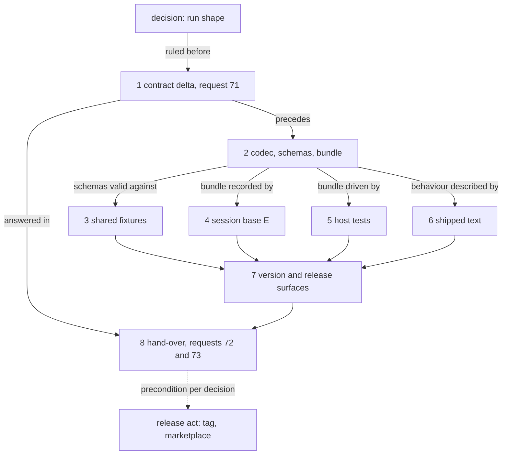

# Implementation Plan: /fusion:migrate converts a legacy workbench that holds no record

**Date:** 2026-10-19
**Spec:** none — planned from the work package's narrative `261019-0906-migrate-an-empty-legacy-workbench.md` and the user's ruling, filed as `261019-0913-which-route-takes-a-legacy-workbench-that-holds-no-record-to-json-control.md`
**Decidability:** Does a proposal that names no record yield a run in which no later phase (apply, verify, `maintenance end`, rollback before and after activation, chunk 0) needs a branch of its own? Decidable from the codec source, and answered yes for the shape this plan builds: every later phase keys on the chunk count being at least one and on chunk 1's apply id (`readIndex`, `chunkOneFence`, `landedChunks`, `exemptSet`, `chunkZero` in `codec/src/migration.ts`), and none on a write count; the kernel commits an intent with an empty write list (`mutate` in `codec/src/kernel.ts`). So the cut always emitting chunk 1, empty when there is no pair, keeps every phase's order and every refusal Prior qualified. Read at `836046ad`; the shape itself is put to the user in `261019-0913-how-does-the-shared-migration-contract-shape-a-run-that-converts-no-pair.md` and to Prior as request 71.

## Directive

The work package's directive, unchanged: a legacy workbench with no record pair reaches JSON control through `/fusion:migrate`, which converts nothing and writes its receipt and the manifest; Setup and `bin/fusion-paths` then accept it; the codec's shared contract and fixtures say so for both hosts. The user chose the migration over `initialize` (`261019-0913-which-route-takes-a-legacy-workbench-that-holds-no-record-to-json-control.md`). "Writes only the receipt and the manifest" is read as "converts and rewrites no record": the receipt binds the frozen plan and its parts by hash, so the plan files under `archive/migrations/<id>/` stand beside it, as for every migration.

## Current State

**Where the rule "at least one pair" lives**, enumerated by reading and by `grep -rn "names no record\|at least one pair"` over `codec/`, `hooks/`, `bin/`, `skills/` and the READMEs at `836046ad`:

| Site | What it holds | Changes |
|---|---|---|
| `codec/src/migration.ts` `migrationPlan`, the proposal step | `if (order.length === 0) return invalid(… names no record; a migration converts at least one pair)` | removed |
| `codec/src/migration.ts` `cut` | `close()` returns on an empty group, so no pair gives zero chunks | emits chunk 1 when no chunk was emitted |
| `codec/src/migration.ts` `readIndex` | `chunks === 0` is `plan-file-changed` | unchanged: an index keeps at least one chunk |
| `codec/schemas/migration-plan.schema.json` `$defs/chunk` | `writes` `minItems: 1` | `minItems: 0` |
| the same file, `$defs/part_entry` | `writes` `minimum: 1` on a chunk entry | `minimum: 0` |
| the same file, `$defs/schedule` | `apply` `minItems: 1`, `rollback` `minItems: 2` | unchanged |
| `codec/schemas/migration-proposal.schema.json` | `records` has no `minProperties`; `operation_ids.apply` `minItems: 1`, `rollback` `minItems: 2` | description only |
| `codec/schemas/protocol.schema.json` | description: "apply lands one chunk per request, chunk 1 first setting the fence" | description only, one clause |
| `hooks/lib/legacy-import.ts` `composeProposal` | no guard; zero records compose to `records: []` and zero counts | none; a test proves it |
| `hooks/migrate.ts` `run` | `chunks = Math.floor(writes / 48) + 1`, so zero writes already schedule one apply id and two rollback ids | none |
| `bin/fusion-migrate`, `skills/setup/SKILL.md` | no statement of the rule; Setup's `result=legacy` line stays true | none |
| `skills/migrate/SKILL.md` Step 7 | "This workbench's records are ready to move …; the move runs in chunks" | one sentence for the zero-count case |
| `codec/README.md` `## migration` | "The writes are cut … into chunks of at most 50"; apply's fence for n = 1 | two sentences |

**What the user's refused run left.** The plan phase stores no answer for a refusal (`refuse` in `codec/src/kernel.ts` returns before `writeAnswer`), so `~/.fusion-migrate/<12 hex>/state.json` records `plan: null`, `done: false`, the proposal under `.json-state/migration/` and its operation ids. `stale()` in `hooks/migrate.ts` reads such a record as current on a legacy tree, so `/fusion:migrate` Step 7 routes it to `ROUTE=interrupted` and offers `resume` (resends the same plan request under its recorded id, which the fixed codec answers) or `rollback` (removes the proposal, `result=nothing-planned`, after which `run` starts afresh). No skill text or helper change is needed to clear it; step 5 tests both routes.

**The shared contract.** `codec/dist/fusion-record.js` is `sha256:fb1703619c94bd2ed6ef8b753e70dd38e36dcb26da0775fb4e19274ed11bb66f`, 699 011 bytes, the bundle Prior qualified under request 64; `git log v13.1.0..HEAD -- codec/dist codec/src codec/schemas` is empty. The module bundle under `adapters/prior/` carries no codec byte (`grep codec adapters/prior/build.sh` is empty), so it does not move. The shared manifest holds 370 entries, 76 of them under the three migration schemas, 15 valid (`node -e` over `codec/fixtures/manifest.json` at `836046ad`). The recorded session `codec/fixtures/protocol-session-migration/` holds exchanges 01 to 70 over bases A to D, regenerated only under `UPDATE_PROTOCOL_SESSION_MIGRATION=1` by `codec/src/__tests__/round-trip-cli-migration.test.ts`. The last request number in `codec/fixtures/prior/REQUESTS.md` is 70.

## Approach

One integral change: **the cut always yields at least one chunk**, the convention `split` already follows for the parts ("at least one part even with no item"). A store with no pair is frozen as chunk 1 with an empty write list. Nothing else in the codec moves: apply 1 sets the fence named by its own id and commits an intent with no write, verify runs its eight checks over a json-control view holding no control file and writes the receipt and the manifest, the host ends chunk 1's fence, and a rollback after activation, chunk 0 and the legacy `end` run as recorded. The host already schedules the ids this shape needs. The alternative shapes (no chunk, the fence moved to verify, or no fence) each need a branch at four sites; they are recorded in `261019-0913-how-does-the-shared-migration-contract-shape-a-run-that-converts-no-pair.md` for the user's ruling.

The contract follows the precedent of the qualified revisions: the delta is written first (request 71), the implementation lands with any correction Prior asks for folded in before the hand-over, and the hand-over asks Prior to re-snapshot the fixtures and re-pin the bundle (requests 72 and 73). Whether the tag waits for Prior is `261019-0913-may-a-codec-revision-after-13-1-0-be-tagged-before-prior-re-qualifies-its-bundle.md`.

```mermaid
sequenceDiagram
    participant H as host (bin/fusion-migrate)
    participant C as codec (bin/fusion-record)
    H->>C: survey
    C-->>H: legacy, eligible_sha256
    H->>C: plan (records {}, apply 1 id, rollback 2 ids)
    C-->>H: index, chunk 1 with 0 writes, schedule
    H->>C: apply chunk 1
    Note over C: fence set, named by apply 1's id; intent with no write
    C-->>H: chunk 1, fence, writes []
    H->>C: verify
    Note over C: eight checks over a view with no control file; receipt, then workbench.json
    C-->>H: receipt, manifest revision
    H->>H: .fusion-setup gains migration metadata
    H->>C: maintenance end, naming apply 1's id
    C-->>H: fence removed; store is json-control
```

## Implementation Steps

1. **Write the contract delta, request 71**
   - Executor: code-implementer
   - Files: `codec/fixtures/prior/REQUESTS.md`
   - Changes: append one section, `## Record-less migration (request 71, the contract delta)`, after `## Module bundle (released as v13.1.0)`, editing no line above it. Its head names the commit it is written against and the bundle Prior holds (`fb170361…`). It states the user's ruling and the case met on the Prior repository; the one change of shape (the cut yields at least one chunk; chunk 1 may carry no write; the plan step's refusal is withdrawn); the two schema bounds that move (`$defs/chunk` `writes` to `minItems: 0`, `$defs/part_entry` `writes` to `minimum: 0`) and the three descriptions; what does not move (the schedule's and the proposal's `minItems`, `readIndex`'s refusal of an index with no chunk, the fence, the exempt set, chunk 0, the journal); the recorded bytes it will move (base E appended to `protocol-session-migration/`, exchanges 01 to 70 unchanged; the new fixtures; the bundle); and the version boundary (an older codec refuses a record-less plan's index under its schema, so only a migration request of the qualified bundle over such a workbench is refused, every other operation reads it). It asks: **71(a)** does Prior accept a record-less run as one chunk with no write under section 8; **71(b)** does Prior accept the two relaxed bounds and the withdrawn refusal as the whole schema delta; **71(c)** does Prior read "a migration converts nothing and writes its receipt and the manifest" as within section 8.3's activation rule.
   - Acceptance: `git diff codec/fixtures/prior/REQUESTS.md` adds lines after the last section and changes none above it; `cd hooks && npm test` green, which runs the reference and citation lints over the new text.
   - Dependencies: none in this plan; runs after the user rules on `261019-0913-how-does-the-shared-migration-contract-shape-a-run-that-converts-no-pair.md`.

2. **Let the codec freeze, apply, verify and roll back a record-less plan**
   - Executor: code-implementer
   - Files: `codec/src/migration.ts`, `codec/schemas/migration-plan.schema.json`, `codec/schemas/migration-proposal.schema.json`, `codec/schemas/protocol.schema.json`, `codec/src/__tests__/migration.test.ts`, `codec/dist/fusion-record.js`
   - Changes: in `migrationPlan` remove the `order.length === 0` refusal. In `cut`, let the closing call emit a chunk when no chunk has been emitted yet, so no pair gives chunk 1 with `writes: []` and a part entry with `writes: 0`; state it in `cut`'s doc comment and in the file header's `plan` line. Relax the two bounds in `migration-plan.schema.json`, and add one clause each to the `chunk` description, to `migration-proposal.schema.json`'s description ("a proposal naming no record is admitted; the cut then makes one chunk with no write") and to `protocol.schema.json`'s `migration` sentence ("chunk 1 sets the fence also when it carries no write"). No other function changes. Tests in `migration.test.ts`, over a legacy root holding `.fusion-setup` and one memo under `shared/memos/`: plan freezes one chunk of zero writes and the five part kinds; apply 1 sets the fence and lands no file outside the plan area; verify writes the receipt (eight checks passed, every count 0) and the manifest; `inspect` answers `json-control`; the second-run plan answers the no-op; a rollback after activation (`maintenance begin`, rollback 1 removing manifest and receipt and writing `rollback.json`, rollback 0) and the legacy `end` return the frozen input; a rollback before activation (apply 1 landed, rollback 1, rollback 0, `end`) and a full abort (rollback 0, no fence) do the same. The existing cases stay as they are and are the regression that a non-empty migration is unchanged. `npm test` rebuilds the bundle; commit it with the source and schemas in one commit, because the schemas are inlined into it.
   - Acceptance: `cd codec && npm run typecheck` exits 0 and `CODEC_REQUIRE_GOLDENS=1 npm test` is green, `round-trip-cli-migration.test.ts` included with no recorded file rewritten; `git status --porcelain -- codec/fixtures` is empty; `cd hooks && npm test` green (its migrate cases run the new bundle).
   - Dependencies: 1

3. **Add the shared fixtures for a record-less migration**
   - Executor: data-implementer. Hand-authored JSON fixture data and its index entries carry no code, so they are the data-implementer's under the routing rules; the schemas they validate against are build contract and stay with step 2.
   - Files: `codec/fixtures/valid/migration/proposal-no-records.json`, `codec/fixtures/valid/migration/chunk-no-writes.json`, `codec/fixtures/valid/migration/index-one-chunk-no-writes.json`, `codec/fixtures/valid/migration/part-records-no-records.json`, `codec/fixtures/invalid/migration/index-chunk-part-writes-negative.json`, `codec/fixtures/manifest.json`
   - Changes: the four valid files after the existing `proposal.json`, `chunk.json`, `index.json` and `part-records.json`, each changed only where a record-less run differs (`records: {}`, every count 0, one apply and two rollback ids; `writes: []`; a chunk part entry with `writes: 0`); the invalid file pins the new lower bound (`writes: -1`, `schema-invalid`). One manifest entry each, with a `note` naming the record-less run and this package, after the existing migration entries.
   - Acceptance: `cd codec && npx vitest run src/__tests__/fixtures.test.ts` green; the manifest holds 375 entries, 81 under the three migration schemas, 19 valid (the same `node -e` count as `## Current State`).
   - Dependencies: 2

4. **Record base E in the migration session**
   - Executor: code-implementer
   - Files: `codec/src/__tests__/round-trip-cli-migration.test.ts`, `codec/fixtures/protocol-session-migration/README.md`, `codec/fixtures/protocol-session-migration/seed/71-survey/` (new), `codec/fixtures/protocol-session-migration/seed/72-plan/` (new), `codec/fixtures/protocol-session-migration/71-*.json` onwards (new, generated)
   - Changes: a fifth base, E, over an empty root seeded with `.fusion-setup` and one memo (no record, no legacy-v12 copy): survey, plan (one chunk, zero writes), apply 1, `inspect` under the fence, verify, `maintenance end` naming apply 1's id, `inspect` (`json-control`), `list` (empty), `maintenance begin`, rollback 1 (the first after activation), rollback 0, the legacy `end`, `inspect` (legacy, no fence). The test header and the README gain base E in their exchange lists, base table and replay steps; the README's count of exchanges is derived from the files, not restated. Regenerate with `cd codec && UPDATE_PROTOCOL_SESSION_MIGRATION=1 npx vitest run src/__tests__/round-trip-cli-migration.test.ts`, then run it again without the flag.
   - Acceptance: the run without the flag is green; `git status --porcelain -- codec/fixtures/protocol-session-migration` lists only new files and the README, so no file of exchanges 01 to 70 and no existing seed changed; any changed existing exchange is a stop, reported with its diff.
   - Dependencies: 2

5. **Prove the host route end to end, and the way out of a refused plan**
   - Executor: code-implementer
   - Files: `hooks/lib/__tests__/migrate.test.ts`, `hooks/lib/__tests__/legacy-import.test.ts`
   - Changes: in `legacy-import.test.ts`, `composeProposal` over a record-less tree gives `records: []` and zero counts, and over a tree whose only record is a closed issue gives `records: []` with `plain-terminal` 1. In `migrate.test.ts`, through `bin/fusion-migrate` with the plugin and Node alone: `survey` prints every `count=` at 0; `run` ends `result=json-control`, `status` shows `chunks=1/1`, `verified=yes`, `done=true`; `bin/fusion-record` `inspect` answers `json-control` and `bin/fusion-paths implementation-planner` exits 0 where it exited 3 before; `rollback` ends `result=legacy` with the tree as the backup holds it, `.json-state/` aside. Then the user's case: a `run` under a stub codec that answers plan with the old refusal (the existing stub mechanism of `migrate.test.ts`) exits 8 and leaves `planned=no`; with the real codec, `resume` ends `result=json-control`; in a second root, `rollback` ends `result=nothing-planned` and a fresh `run` ends `result=json-control`. No hook source changes; if one turns out to be needed, stop and report it, since this plan expects none.
   - Acceptance: `cd hooks && npm test` green, `surface-growth-bound.test.ts` included. A red growth bound is a stop: the way out is a cut in the added lines, never a baseline or head-room edit. Inference from `wc -l` over `hooks/lib/__tests__/**.ts` against `TEST_LINE_BASELINE` plus `TEST_LINE_HEAD_ROOM` at `836046ad`: about 3 500 lines of margin, so the cases above are expected to fit.
   - Dependencies: 2

6. **Bring the shipped text to the new rule**
   - Executor: code-implementer
   - Files: `codec/README.md`, `skills/migrate/SKILL.md`
   - Changes: in `codec/README.md` `## migration`, the `plan` paragraph says a proposal naming no record is admitted and the cut then makes one chunk with no write, and the `apply` paragraph says chunk 1 sets its fence whether or not it carries a write. In `skills/migrate/SKILL.md` Step 7, before the question to migrate, one sentence: when every `count=` of the cut is 0, say the workbench holds no record, nothing is converted or rewritten, and the run writes its frozen plan, its receipt and the manifest. `skills/setup/SKILL.md` and `bin/fusion-migrate` stay as they are; their text is true for the new case.
   - Acceptance: `cd hooks && npm test` green, `surface-growth-bound.test.ts` included. **Growth-bound flag:** `skills/*/SKILL.md` is bounded; inference from `cat skills/*/SKILL.md | wc -c` (225 342) against `SKILL_BASELINE` plus `SKILL_HEAD_ROOM` (228 028) at `836046ad`: about 2 700 bytes of margin, and the sentence is under 300. A red bound is a stop and a cut, never a raise.
   - Dependencies: 2

7. **Bump the version and the in-repo release surfaces**
   - Executor: code-implementer
   - Files: `.claude-plugin/plugin.json`, `skills/help/SKILL.md` (`### 4. Update`), `install.sh` (header pin example), `README.md` (pin example)
   - Changes: the version the user rules at plan approval (`## Open Questions`), on every surface `README-agents.md` `## Releasing` names inside this repository; the update topic follows that section's paragraph rule. The marketplace entry, the tag and the push are the release act, outside this plan.
   - Acceptance: the four surfaces name one version; `claude plugin validate .` reports passed; `cd hooks && npm test` green. **Growth-bound flag:** the help topic is under the `skills/` bound and its own byte ceiling, which this step shares with step 6.
   - Dependencies: 3, 4, 5, 6

8. **Hand over: requests 72 and 73**
   - Executor: code-implementer
   - Files: `codec/fixtures/prior/REQUESTS.md`
   - Changes: append `## Record-less migration (the hand-over, requests 72 and 73)`, in the shape of `## FJ05 (the takeover revision, requests 63 and 64)`: written against the head; Prior's answer to 71 and how this revision meets it; the commits by step; the bundle's new size and digest beside `fb170361…`; what changed for Prior's two pins (the two schemas, the five fixtures and the manifest, base E's new files and the README, the test file); the version boundary measured by extracting `fb170361…` from git by its blob and running it over the workbench base E leaves after verify (reads answer, a `migration` request is refused, no byte moves); the figures of both suites. **72**: re-snapshot the shared fixtures and run `TestFusionCodecSharedManifest`, with the counts per schema. **73**: re-pin the bundle, replay every recorded session through its deltas with base E added, re-qualify, with Prior's conformance run.
   - Acceptance: `git diff` adds lines after the last section only; every digest and count in it is re-taken at the head it names; `cd hooks && npm test` green after the write.
   - Dependencies: 1, 7



## Where this work stops

- The user has ruled on `261019-0913-how-does-the-shared-migration-contract-shape-a-run-that-converts-no-pair.md`; a ruling other than option 1 stops this plan before step 2, to be re-planned.
- Steps 1 to 8 are done, each with its acceptance met.
- Prior's answer to request 71 is recorded in `codec/fixtures/prior/REQUESTS.md`, and any correction it asks for has landed before step 8 is written.
- A record-less legacy workbench migrates to `json-control` through `bin/fusion-migrate run`, and the record a refused plan left reaches `json-control` through `resume`, in the suites (step 5).
- The user has run the fix on the Prior repository (from this checkout's `bin/fusion-migrate`, or an installed release) and it answered `result=json-control`, after which `/fusion:setup` there reused the workbench rather than routing to `/fusion:migrate`.
- **Precondition of the tag**, an act after this plan: the condition the user rules in `261019-0913-may-a-codec-revision-after-13-1-0-be-tagged-before-prior-re-qualifies-its-bundle.md` holds (under option 1, Prior's answer to requests 72 and 73 is recorded as complete for the new digest; under option 2, Prior's answer to 71 accepts the shape; under option 3, nothing beyond this list).

## Data Structures

No new type. A frozen plan of a record-less run differs from today's in two values only:

```json
{ "part": "chunk", "n": 1, "path": "archive/migrations/<id>/chunks/1.json", "sha256": "sha256:…", "writes": 0 }
```

and `chunks/1.json` with `"writes": []`. The records part 1 carries `records: {}` and every count 0; the receipt carries the eight checks and those counts.

## API Changes

None to the protocol's requests or answers. `migration plan` stops refusing a proposal with no record; `apply` on such a plan answers `writes: []` and `revisions: {}` in the established envelope.

## Testing Strategy

- **Codec** (step 2): the record-less run phase by phase, rollback before and after activation, full abort, second-run no-op; the existing `migration.test.ts` and `round-trip-cli-migration.test.ts` cases unchanged as the regression for a non-empty migration.
- **Shared fixtures** (step 3): the schema bounds, valid and invalid, through `fixtures.test.ts`, which Prior's Go harness mirrors.
- **Recorded session** (step 4): base E byte for byte; the unchanged exchanges 01 to 70 are the cross-host regression.
- **Host** (step 5): `bin/fusion-migrate` end to end on a record-less tree, `bin/fusion-paths` after it, rollback, and both ways out of the record a refused plan left.

Validation commands, each run from the repository root's subdirectory named:

- `cd codec && npm run typecheck`
- `cd codec && CODEC_REQUIRE_GOLDENS=1 npm test` (rebuilds `codec/dist/fusion-record.js` first)
- `cd codec && UPDATE_PROTOCOL_SESSION_MIGRATION=1 npx vitest run src/__tests__/round-trip-cli-migration.test.ts`, step 4 only, then the same without the flag
- `cd hooks && npm run build && npm test` (no hook source changes, so `hooks/dist/` is expected unchanged; `committed-dist.test.ts` holds it)
- `claude plugin validate .`, step 7

## Risks & Mitigations

| Risk | Mitigation |
|---|---|
| Prior asks for another shape under 71 | The delta precedes the code; a different answer re-plans steps 2 to 6 before anything is handed over. |
| Regenerating the session rewrites an existing exchange | Step 4's acceptance: only new files and the README may change; any other diff is a stop. |
| A checkout on 13.1.12 or older tries to roll back a record-less migration | The qualified bundle refuses the plan's index under its schema (`plan-file-changed`); ordinary reads and writes are unaffected. Measured and stated in step 8's version boundary; `/fusion:migrate`'s existing sentence that every installation updates before writing again covers it. |
| The user's tree changed since the refused plan's survey | `resume` is then refused `conflict/source-changed`; `rollback` (`result=nothing-planned`) and a fresh `run` clear it, as step 5 proves. |
| Growth bounds on `skills/` and the hook tests | Steps 5, 6 and 7 carry the flag; a red bound is cut, never raised. |

## Open Questions

- [ ] The run's shape in the shared contract: `261019-0913-how-does-the-shared-migration-contract-shape-a-run-that-converts-no-pair.md` (recommendation: option 1, one chunk with no write). Blocks step 2.
- [ ] Whether the tag waits for Prior: `261019-0913-may-a-codec-revision-after-13-1-0-be-tagged-before-prior-re-qualifies-its-bundle.md` (recommendation: option 2). Sets the tag's precondition in `## Where this work stops`.
- [ ] The version for step 7: 13.2.0, since the shared codec contract widens for the first time since 13.0.0, or 13.1.13 as a defect fix. Recommendation: 13.2.0. Only this plan needs the answer.
- [ ] The reading of the ruling: "writes only the receipt and the manifest" as "converts and rewrites no record", with the frozen plan files the receipt binds standing beside it. Confirm at plan approval.
