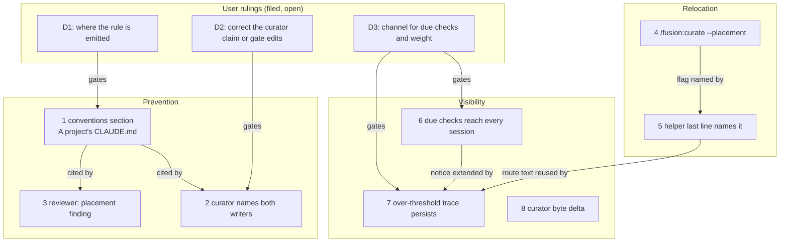

# Implementation Plan: a consuming project's CLAUDE.md stays a pointer file

**Date:** 2026-10-20
**Spec:** none. Planned from the work package `261020-0917-consumer-claude-md-stays-lean.md`, the analysis `261020-0835-why-a-consumers-claude-md-grows-unchecked.md` and the eight issues stamped `261020-0916-`.
**Decidability:** The load-bearing question is "does this passage belong in a file every session loads?". It cannot be decided from the text: a topic is a property of the reader's work, not of the passage (`260916-1126_*_may-the-drift-check-report-weight-when-it-cannot-decide-topic.md`). So no step builds a classifier. The mechanism changes instead. The question goes to the writer when the text is written (a rule in the always-on conventions, read at plan approval) and to the user when text is moved (`/fusion:curate --placement`, behind the ledger approval). Only decidable facts are machine-computed: each section's byte weight, which checks are due from `.check-stamps` and the plugin version, the last recorded `over` count, and a ledger's byte delta.
**Cross-references:** 261020-0925-how-does-the-lean-claude-md-rule-reach-the-agents-that-write-claude-md.md, 261020-0925-is-the-curators-sole-writer-claim-corrected-or-are-executor-edits-to-claude-md-gated.md, 261020-0925-how-do-due-checks-and-an-over-threshold-claude-md-reach-a-session-that-never-runs-setup.md, 260916-1006_*_how-does-a-consuming-project-bring-its-claude-md-to-the-lean-convention-when-the-curator-asks-a-different-question.md, 260916-1326_*_step-7-runs-fusion-curate-which-passes-no-placement-line-so-it-can-propose-no-relocation.md

## Directive

The package narrative states what this work is for and when it is reached. The plan does not restate it. In short: an agent that writes a consumer's `CLAUDE.md` is told what may go there and where topic-bound content goes instead. A weight finding over threshold reaches the user in an ordinary session and points at a command that can relocate. Each of the eight issues is closed against its **Acceptance:** line. krk is not edited.

## Current State

Everything below was measured at HEAD `4f17492a` (fusion 13.2.0) unless a line says otherwise.

- **No writer receives the rule.** `rules/context-lean-claude-md.md` (17 060 bytes) is emitted to no agent (`README-agents.md` `## Plugin structure`, the "Mechanism docs" bullet). Only the policy-curator opens it, by hand, on a placement run (`agents/policy-curator.md` `### Ledger entry schema`).
- **The curator's text claims it is the only writer.** `agents/policy-curator.md` `### You are the only path to CLAUDE.md, and that does not widen your remit` says so, and `skills/curate/SKILL.md` calls the command "the one path to `CLAUDE.md`". Both are false in krk.
- **The reviewer's drift findings.** `agents/reviewer.md` `## Code review standards` item 9 ("out-of-sync documentation") gives no placement reading, so every `CLAUDE.md` drift finding becomes a text fix.
- **The relocation route.** `/fusion:curate` passes no `**Placement:**` line (`skills/curate/SKILL.md` Step 2, and Step 6 says "The apply dispatch takes no such line"). `README-agents.md` `## Dispatch parameters` says of `**Placement:**` "nobody ships it". When `260916-1326_*_step-7-runs-fusion-curate-which-passes-no-placement-line-so-it-can-propose-no-relocation.md` refused a flag, the skill surface had 3 bytes left. It has 2 778 now.
- **The helper's last line.** `bin/fusion-claude-md-weight` ends with "Act on a finding with /fusion:curate", and `hooks/lib/__tests__/claude-md-weight.test.ts` (clause 4) pins that text.
- **The due list.** It is computed only inside the inline `node -e` block of `skills/setup/SKILL.md` Step 0, which also writes the marker. The orchestrator's inlined Setup (`agents/orchestrator.md` `## Setup`) computes none. The `claude-md` stamp in `skills/check/SKILL.md` `## Stamp what you ran` records `{at, version}` and no result.
- **The curator's byte figures.** The run file already carries per-surface bytes before and after (`agents/policy-curator.md` `## The run file` item 3). Neither the approval question nor the blast-radius check names the net delta, and nothing flags a ledger that writes back far more than it replaces.

### Growth-bound head-room, measured

| Surface | Bound | Now | Budget | Head-room |
|---|---|---|---|---|
| `agents/*.md` | `surface-growth-bound.test.ts`, bytes | 323 031 | 310 567 + 18 000 | **5 536** |
| `skills/*/SKILL.md` | same, bytes | 225 250 | 188 768 + 39 260 | **2 778** |
| hook tests | same, lines | 25 437 | 24 037 + 4 835 | **3 435** |
| dispatch path, per agent | `rules-emission-golden.test.ts`, bytes, head-room 0 | see below | `fixtures/dispatch-path.baseline` row | slack below |

Dispatch-path slack (row minus prompt + emitted rules + `CLAUDE.md`, run from this repository's root): reviewer **519**, analyst 738, implementation-planner 821, requirements-designer 932, data-implementer 1 043, state-auditor 1 082, document-editor 1 100, code-implementer 1 141, consultant 1 512, policy-curator 1 724, orchestrator 3 719.

Re-measure with: `cd /Users/kai/Projects/productive/F04-FUSION/fusion/hooks && npx vitest run lib/__tests__/surface-growth-bound.test.ts lib/__tests__/rules-emission-golden.test.ts` (both green at `4f17492a`). When a bound is green the test prints no head-room figure, so the table above was computed with the bound's own arithmetic (`helpers/growth-bound.ts` `growth()`).

## Approach

The fix is one rule placed where every agent reads it, plus the one missing route to relocate content, plus making a fact that is already decided visible. Nothing new judges topics.

Coherence check: there are 11 nodes and 9 edges in three layers, with no cycles and no orphans. S8 has no edge because it depends on nothing in this plan and nothing depends on it. Every edge matches a dependency declared in the step list below, and every declared dependency is an edge. A decision gates a step: the step does not start before the decision is answered.

**Execution order is the step order, one step at a time.** Several steps regenerate the same golden fixtures (`surface-growth.golden`, `rules-emission.golden`), so parallel steps would conflict on them even where the graph shows no dependency.

**Each step that adds shipped text carries a byte budget.** The executor measures the actual addition. If the addition exceeds the budget, the executor stops and reports the figure. No head-room constant or baseline is edited by any step. A raise needs a user ruling this plan does not have.

## Implementation Steps

1. **The lean rule enters the always-on conventions**
   - Executor: code-implementer
   - Source: `261020-0916-lean-claude-md-rule-reaches-no-agent-that-writes-claude-md.md`; ruling `261020-0925-how-does-the-lean-claude-md-rule-reach-the-agents-that-write-claude-md.md` (option 2 assumed here; if the user rules otherwise, this step's text is replaced by the ruled option before it starts)
   - Files: `rules/fusion-workbench-conventions.md`, `hooks/lib/__tests__/fixtures/rules-emission.golden` (regenerated), `README-agents.md` (`## Plugin structure`, the "Mechanism docs" bullet)
   - Changes:
     - Delete `## Rule-file provenance` whole. It is 704 bytes and a second pointer to `rules/rule-file-provenance.md`, which the authoring-home table at the head of the file already names with the same trigger.
     - In its place, add `## A project's CLAUDE.md`, within 704 bytes. It says four things. A project's `CLAUDE.md` holds what every session needs whatever the work: identity, the language lines, the rules binding every edit, and pointers. Topic-bound content goes elsewhere: a module's invariant to that module's header, a topic's rules to a project rule file the manifest loads (`rules/context-manifest.md`), a ruling to its decision record. A plan step that writes `CLAUDE.md` names why its content binds every session, or targets one of those destinations instead. The test is `rules/context-lean-claude-md.md` `## How to tell "always-on" from "on-demand"`, cited and not restated. A 644-byte draft is in decision D1 option 2.
     - In `README-agents.md`, the "Mechanism docs" bullet gains one clause naming the new section as the operative core that every agent receives.
     - Regenerate the rules golden.
   - Budget: net ≤ 0 bytes on the shared component, so all eleven dispatch-path rows keep at least their current slack. Draft figure: −60.
   - Acceptance (the issue's line): the `bin/fusion-rules` output for implementation-planner, code-implementer, document-editor and reviewer contains a binding rule that names `CLAUDE.md`'s allowed content and the destinations for topic-bound content, and that says a plan step targeting `CLAUDE.md` must name why the content binds every session. The suite is green after this step's own golden regeneration. Any other red is a stop.
   - Verification: `cd /Users/kai/Projects/productive/F04-FUSION/fusion && for a in implementation-planner code-implementer document-editor reviewer; do FUSION_PLUGIN_ROOT=$PWD bin/fusion-rules $a | grep -c 'rules/fusion-workbench-conventions.md'; done && grep -n "^## A project's CLAUDE.md" rules/fusion-workbench-conventions.md && cd hooks && npm test`
   - Dependencies: D1 answered

2. **The curator's text names both writers of `CLAUDE.md`**
   - Executor: code-implementer
   - Source: `261020-0916-plan-steps-write-claude-md-past-every-approval.md`; ruling `261020-0925-is-the-curators-sole-writer-claim-corrected-or-are-executor-edits-to-claude-md-gated.md` (option 1 assumed. If the user rules option 2, this step stops and the plan is replaced, because that option widens the curator's remit, which is outside this plan)
   - Files: `agents/policy-curator.md` (`### You are the only path to CLAUDE.md, and that does not widen your remit`: heading and first paragraph), `skills/curate/SKILL.md` (opening paragraph, "the one path to `CLAUDE.md`"), `hooks/lib/__tests__/fixtures/surface-growth.golden` (regenerated)
   - Changes:
     - Reword the heading so it no longer claims sole authorship, for example "### You are one of two paths to `CLAUDE.md`, and that does not widen your remit". Before renaming, grep the shipped text (`agents skills rules bin hooks/lib README*.md docs`) for citations of the old heading and retarget each one.
     - Replace "Every edit to `CLAUDE.md` now comes through you, behind approval." with a statement of the two writers: a plan step an implementer executes, behind plan approval, and the curator, behind its ledger. Cite `rules/fusion-workbench-conventions.md` `## A project's CLAUDE.md` as what bounds either one.
     - In the curate skill, drop or correct the sole-path phrase.
   - Budget: +120 bytes on `agents/` (head-room 5 536; curator path slack 1 724), ≤ 0 on `skills/`.
   - Acceptance (the issue's line): the curator text states the actual writers, and the prompt and the behaviour agree. No shipped sentence still claims a single writer of `CLAUDE.md`.
   - Verification: `cd /Users/kai/Projects/productive/F04-FUSION/fusion && ! grep -rnE 'only path to .CLAUDE|one path to .CLAUDE|comes through you, behind approval' agents skills rules README.md README-agents.md README-hooks.md && cd hooks && npm test`
   - Dependencies: step 1; D2 answered

3. **Reviewer: a `CLAUDE.md` drift finding on a function-level fact is a placement finding**
   - Executor: code-implementer
   - Source: `261020-0916-reviewer-claude-md-drift-findings-always-route-to-a-text-fix.md`
   - Files: `agents/reviewer.md` (`## Code review standards`, item 9), a test asserting the clause (one `it` added to an existing test that reads `agents/reviewer.md`, or a new file of at most 30 lines), `hooks/lib/__tests__/fixtures/surface-growth.golden` (regenerated)
   - Changes:
     - Item 9 gains one sentence: a `CLAUDE.md` claim that drifted and states a fact about one file or function is a **placement** finding. Its fix is a move to the destination `rules/fusion-workbench-conventions.md` `## A project's CLAUDE.md` names, leaving one pointer line, and never a longer rewrite in place. The draft is 277 bytes.
     - The issue the reviewer files carries the destination. The route is code-implementer when the destination is a source file's header, and the user's `/fusion:curate --placement` when the destination is a project rule file. The reviewer text does not need to name the command, so this step does not depend on step 4.
     - The test asserts that the reviewer prompt's item 9 names `CLAUDE.md`, `placement` and the conventions anchor.
   - Budget: +300 bytes on `agents/`. Reviewer path: slack 519, plus 60 from step 1, leaves at least 279 after this step. About +25 hook-test lines.
   - Acceptance (the issue's line): the reviewer prompt classifies a `CLAUDE.md` drift finding on a function-level fact as a placement finding with a route that relocates, and a test shows the classification. Stated plainly: the test can pin that the clause is present. It cannot pin how a model applies it. The behaviour is checked by reading the next review that meets such a finding.
   - Verification: `cd /Users/kai/Projects/productive/F04-FUSION/fusion && grep -n "placement" agents/reviewer.md && cd hooks && npm test`
   - Dependencies: step 1

4. **`/fusion:curate --placement` asks for a placement run**
   - Executor: code-implementer
   - Source: `261020-0916-curate-cannot-ask-for-a-placement-run.md`; realises the open half of `260916-1006_*_how-does-a-consuming-project-bring-its-claude-md-to-the-lean-convention-when-the-curator-asks-a-different-question.md` (answered, options 1 and 3: the check is the trigger, the curator the tool). The executor appends that record's `Implemented:` line.
   - Files: `skills/curate/SKILL.md` (frontmatter `description` if it names the arguments, the argument paragraph, `## Step 2 — Dispatch the policy-curator to survey`, `## Step 6 — Dispatch the policy-curator to apply`), `agents/policy-curator.md` (`## Dispatch parameters`, the "Placement is asked for on the same principle" paragraph), `README-agents.md` (`## Dispatch parameters`, the `**Placement:**` row), `hooks/lib/__tests__/fixtures/surface-growth.golden` (regenerated)
   - Changes:
     - The skill takes a third optional argument, `--placement`. With it, the survey dispatch carries `**Placement:** on`, and so does the apply dispatch, after the three mandated lines. That keeps the apply pass's reading of a relocation entry unambiguous. Step 2's sentence "The apply dispatch takes no such line" is narrowed to `**Scope:**` and `**Edges:**`.
     - The curator paragraph stops saying that `/fusion:curate` passes no `**Placement:**` line. It says the command passes the line on both dispatches only when the user typed `--placement`, so a plain run still proposes no relocation.
     - The README row's "nobody ships it" becomes `/fusion:curate`, only with `--placement`, on both dispatches.
     - The opt-in default is unchanged.
   - Budget: +450 bytes on `skills/` (head-room 2 778; 260916-1326 refused this at 3 bytes) and +60 on `agents/`. No cut and no raise needed.
   - Acceptance (the issue's line): `/fusion:curate` has a documented `--placement` that sends `**Placement:** on` on the survey and apply dispatches, and `npm test` stays green under the growth bounds with no head-room or baseline edited.
   - Verification: `cd /Users/kai/Projects/productive/F04-FUSION/fusion && grep -n -- "--placement" skills/curate/SKILL.md agents/policy-curator.md README-agents.md && cd hooks && npm test`
   - Dependencies: none

5. **The weight helper's last line names a route that can act**
   - Executor: code-implementer
   - Source: `261020-0916-claude-md-weight-helper-points-at-a-command-that-cannot-act.md`
   - Files: `bin/fusion-claude-md-weight` (last `echo` and the header's output example), `hooks/lib/__tests__/claude-md-weight.test.ts` (clause 4 expectations), `skills/check/SKILL.md` (`## claude-md — where CLAUDE.md carries its weight`, "`/fusion:curate` as what acts on them")
   - Changes:
     - The helper's last line becomes, for example: "Act on a finding with /fusion:curate --placement: it proposes moving a section behind a pointer, behind your approval; this helper never writes."
     - The test's regex and `toContain` follow the new text.
     - The check skill names `/fusion:curate --placement`.
   - Budget: about +15 bytes on `skills/`, test lines ±3. `bin/` is unbounded.
   - Acceptance (the issue's line): the helper's advice names a route that can act on an over-threshold section.
   - Verification: `cd /Users/kai/Projects/productive/F04-FUSION/fusion && printf '# t\n\n## a\n%05000d\n## b\nx\n' 0 > /private/tmp/claude-501/-Users-kai-Projects-productive-F04-FUSION-fusion/b0d39d6c-2a2f-4e28-9633-ee591bf69b1b/scratchpad/CLAUDE.md && bin/fusion-claude-md-weight --root /private/tmp/claude-501/-Users-kai-Projects-productive-F04-FUSION-fusion/b0d39d6c-2a2f-4e28-9633-ee591bf69b1b/scratchpad | tail -1 && cd hooks && npm test`
   - Dependencies: step 4

6. **Due checks reach every session, setup or not**
   - Executor: code-implementer
   - Source: `261020-0916-claude-md-check-never-runs-in-orchestrator-sessions.md`; ruling `261020-0925-how-do-due-checks-and-an-over-threshold-claude-md-reach-a-session-that-never-runs-setup.md` (option 2 assumed)
   - Files (option 2): a new `hooks/lib/checks-due.ts` (the selector list and the due computation, moved verbatim out of setup's inline block), a new SessionStart entry point under `hooks/` with its `hooks/dist/*.js` build, `hooks/hooks.json` (one SessionStart command after `session-start.js`), a new `bin/fusion-checks-due` wrapper printing `checks_due=<list|none|unread>` (the pattern `bin/fusion-events` uses over `hooks/events-query.ts`), `skills/setup/SKILL.md` Step 0 (the inline due computation is replaced by the helper call; the marker write stays), `README-hooks.md` (`## Files`, `### The bin/ helper roster`, and the `hooks/lib` table that `derivable-enumerations-lint.test.ts` holds in set equality), tests for the computation, the notice and the wiring, `hooks/lib/__tests__/fixtures/surface-growth.golden` (regenerated)
   - Changes:
     - One computation, two callers.
     - The notice runs only where a workbench is found. It prints one English `systemMessage` line when the due list is not empty, for example "fusion: periodic checks due (claude-md, upstream): run /fusion:check". It prints nothing when no checks are due, and never blocks.
     - `checks_due=unread` (no node, version unreadable) produces no notice, and setup keeps reporting it as it does today.
   - Option 1 instead, if ruled: `agents/orchestrator.md` `## Setup` step 5 gains one bullet, within 250 bytes, telling the orchestrator to run `/fusion:setup` Step 0 and Step 1 as `$FUSION_PLUGIN_ROOT/skills/setup/SKILL.md` states them. No hook, no helper.
   - Budget: option 2: skills about −300 bytes (setup shrinks), about +200 hook-test lines (head-room 3 435), no agent bytes. Option 1: +250 bytes on `agents/` and on the orchestrator path (slack 3 719, plus 60).
   - Acceptance (the issue's line): a session started through the orchestrator without `/fusion:setup` either runs the due checks or surfaces one line naming that they are due. This is verified in a fresh consumer workbench: one with `.fusion-setup` and no `.check-stamps` gets the line naming all eleven selectors; after all eleven are stamped at the current version, it gets no line.
   - Verification (option 2): `cd /Users/kai/Projects/productive/F04-FUSION/fusion/hooks && npm run build && npm test && cd /private/tmp/claude-501/-Users-kai-Projects-productive-F04-FUSION-fusion/b0d39d6c-2a2f-4e28-9633-ee591bf69b1b/scratchpad && mkdir -p due-probe/fusion-workbench && printf '{"setup_at":"x","plugin_version":"0"}\n' > due-probe/fusion-workbench/.fusion-setup && cd due-probe && FUSION_PLUGIN_ROOT=/Users/kai/Projects/productive/F04-FUSION/fusion /Users/kai/Projects/productive/F04-FUSION/fusion/bin/fusion-checks-due`
   - Dependencies: D3 answered

7. **An over-threshold `claude-md` result persists and resurfaces**
   - Executor: code-implementer
   - Source: `261020-0916-claude-md-over-threshold-finding-persists-nowhere.md`; ruling `261020-0925-how-do-due-checks-and-an-over-threshold-claude-md-reach-a-session-that-never-runs-setup.md`
   - Files: `skills/check/SKILL.md` (`## claude-md — where CLAUDE.md carries its weight`, `## Stamp what you ran`: the `claude-md` stamp records the helper's `over=` count, `0` for `clean` and `absent`, and no stamp for `unread`), `hooks/lib/checks-due.ts` and the step-6 notice (option 2), their tests, `hooks/lib/__tests__/fixtures/surface-growth.golden` (regenerated)
   - Changes:
     - While the last recorded `claude-md.over` is above 0, the notice prints a second line even when the check is not due, for example "fusion: CLAUDE.md had 6 sections over 4000 bytes at the last check (2026-10-20): /fusion:curate --placement proposes moving them".
     - The line clears when a later check records `over=0`. It asks nothing.
     - Option 1 instead: setup Step 0 prints `claude-md-last=over=<n> (<date>)` from the same stamp field.
   - Budget: about +150 bytes on `skills/` and about +50 hook-test lines.
   - Acceptance (the issue's line): a weighed result with `over>0` leaves a durable trace (the stamp record) that a later session surfaces, without asking anything at each session.
   - Verification: `cd /Users/kai/Projects/productive/F04-FUSION/fusion/hooks && npm run build && npm test`, then repeat the step-6 probe with a stamp file carrying `{"claude-md":{"at":"<today>","version":"<current>","over":6}}` and confirm the second line appears and the due line does not.
   - Dependencies: step 5, step 6

8. **The curator's survey states its net byte delta beside the blast-radius figure**
   - Executor: code-implementer
   - Source: `261020-0916-curator-corrections-carry-no-byte-delta.md`
   - Files: `agents/policy-curator.md` (`### Blast-radius stop`; `## Tool Discipline`, the sentence listing the four things a survey report carries), `skills/curate/SKILL.md` (`## Step 3 — Read what the survey returned` item 3; `## Step 5 — The approval`, the clause naming the blast-radius check), `hooks/lib/__tests__/fixtures/surface-growth.golden` (regenerated)
   - Changes:
     - Every survey states, per surface, the ledger's net byte delta: After bytes minus Before bytes, summed over the surface's entries.
     - The survey says so in one clause when a surface's entries write back more than 1.5 times the bytes they replace. krk's run of 2026-09-17 wrote back 2.03 times. The factor is a reporting cut-off, never a stop.
     - The approval question carries the delta in the same clause as the blast-radius check.
     - The run file's existing before/after sizes (`## The run file` item 3) already meet the run-file half of the issue. This step adds the half the user reads at approval, and the flag.
   - Budget: +300 bytes on `agents/` (curator path: 1 724, plus 60, minus steps 2 and 4, leaves at least 1 300 after this step) and +100 on `skills/`.
   - Acceptance (the issue's line): the curator's run file and approval question state the net byte delta beside the blast-radius figure, and a run whose replacements exceed the stated factor says so.
   - Verification: `cd /Users/kai/Projects/productive/F04-FUSION/fusion && grep -n "byte delta" agents/policy-curator.md skills/curate/SKILL.md && cd hooks && npm test`
   - Dependencies: none

**Declined:** none. Each of the eight issues has a fix inside the bounds. Step 8's issue is the only one partly met already (the run file half), and the step says so rather than duplicating it.

### Cumulative growth budget

| Surface | Head-room now | Steps 1–8 (option 2 for D3) | Left |
|---|---|---|---|
| `agents/*.md` bytes | 5 536 | +120 +300 +60 +300 = +780 | ≥ 4 756 |
| `skills/*/SKILL.md` bytes | 2 778 | 0 +450 +15 −300 +150 +100 = +415 | ≥ 2 363 |
| hook-test lines | 3 435 | +25 +3 +200 +50 = +278 | ≥ 3 157 |
| dispatch path, reviewer | 519 | −60 (shared cut) +300 | ≥ 279 |
| dispatch path, policy-curator | 1 724 | −60 +120 +60 +300 | ≥ 1 304 |
| dispatch path, every other row | ≥ 738 | −60 | ≥ 798 |

The only cut needed is step 1's deletion of `## Rule-file provenance`, and it pays for the shared addition. No surface needs a head-room raise, so no step asks for a ruling on one. If D1 is ruled option 1 or 3, a ruling would be needed: option 1 costs about 16 KB per writing path and option 3 about 750 bytes against the reviewer's 519.

## Where this work stops

- D1, D2 and D3 are answered before steps 1, 2, 6 and 7 start (they are answered: yes or no).
- Each of the eight `261020-0916-` issues is closed against its **Acceptance:** line by the orchestrator, after reading the executor's `Verification:` line (all eight closed: yes or no).
- `cd hooks && npm test` is green at the commit of the last step, with no head-room constant, no `*_BASELINE` map and no row of `dispatch-path.baseline` edited by this work (yes or no).
- `260916-1006_*_how-does-a-consuming-project-bring-its-claude-md-to-the-lean-convention-when-the-curator-asks-a-different-question.md` is at `implemented`, citing step 4's commit (yes or no).
- No file under `/Users/kai/Projects/productive/F08-KRK/krk` is edited by this work (yes or no).
- Precondition for the later release, which is not part of this work: `claude plugin validate .` passes, and the four version surfaces of `README-agents.md` `## Releasing` move together (yes or no at release time).

## Data Structures

- `fusion-workbench/.check-stamps`, the `claude-md` entry: `{ "at": "YYYY-MM-DD", "version": "<plugin version>", "over": <integer ≥ 0> }`. `over` is new (step 7). An entry without `over` reads as "no recorded result" and prints no second line, so stamps written before this change stay valid.

## API Changes

- `/fusion:curate [--full] [--edges] [--placement]`: new third flag (step 4).
- `bin/fusion-checks-due`: new helper, `checks_due=<comma list>|none|unread`, exit 0 always (step 6, option 2).
- `bin/fusion-claude-md-weight`: last line reworded, nothing else changed (step 5).
- A new SessionStart hook command in `hooks/hooks.json` (step 6, option 2).

## Testing Strategy

- Every step ends with `cd hooks && npm test`. The two bound tests are the growth gate. A red bound is a stop, never a regeneration.
- The golden fixtures are regenerated only by the step whose files moved them, with the command in each test's header. The diff is read before the second, unflagged run.
- Step 3's test pins the clause's presence. The behaviour is checked by reading the next review that meets such a finding.
- Steps 6 and 7 are probed in a throwaway workbench under the scratchpad, never in krk.
- An end-to-end check after step 4, using `claude --plugin-dir /Users/kai/Projects/productive/F04-FUSION/fusion`: run `/fusion:curate --placement` against this repository's own `CLAUDE.md`. The survey's run file carries a placement-classification section, or says it proposed no relocation. Reject at the approval, so nothing is applied.

## Risks & Mitigations

| Risk | Mitigation |
|---|---|
| The conventions section restates `context-lean-claude-md.md` and drifts from it | It names destinations and the plan-step duty only and cites the test by anchor. `reference-resolution-lint` resolves the anchor |
| A plan step still writes topic content into `CLAUDE.md` and the user approves it | Accepted: the plan approval is the gate (D2). The SessionStart over line (step 7) catches the result afterwards |
| The SessionStart over line becomes noise in a project that keeps its file over threshold on purpose | `--threshold` exists on the helper. A project can re-stamp after a deliberate decision. Flagged in D3's cons for the user to weigh |
| Deleting `## Rule-file provenance` loses its "read before you edit `rules/`" instruction | The authoring-home table row keeps the trigger, and `agents/policy-curator.md` Setup step 5 cites the file directly for the one agent whose routine work it is |
| Moving the due computation changes setup's output | The helper prints the same `checks_due=` token. Setup's reporting text is unchanged |
| An executor's measured addition exceeds its step's budget | The step stops and reports. No raise without a user ruling |

## Open Questions

- [ ] D1: `261020-0925-how-does-the-lean-claude-md-rule-reach-the-agents-that-write-claude-md.md`. Whole file, conventions section (recommended), or new conditional rule file.
- [ ] D2: `261020-0925-is-the-curators-sole-writer-claim-corrected-or-are-executor-edits-to-claude-md-gated.md`. Correct the text (recommended), gate executor edits, or correct the text and add an observation.
- [ ] D3: `261020-0925-how-do-due-checks-and-an-over-threshold-claude-md-reach-a-session-that-never-runs-setup.md`. SessionStart notice (recommended), orchestrator Setup, or event row.
- [ ] Step 8's factor of 1.5 is this plan's choice of reporting cut-off. Say so at plan approval if you want another figure.

## Release note (not a step)

The work adds a user-visible flag and a SessionStart hook, so the next release is a minor bump (13.3.0) by the procedure in `README-agents.md` `## Releasing`. It is not executed by this plan.
