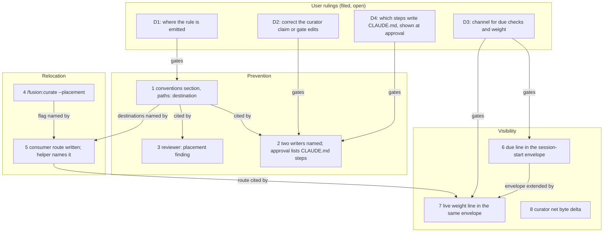

# Implementation Plan: a consuming project's CLAUDE.md stays a pointer file

**Date:** 2026-10-20 (revised 2026-10-20 10:03 after review `261020-0934-review-of-plan-consumer-claude-md-stays-lean.md`; the user chose Modify with all eight of its changes)
**Spec:** none. Planned from the work package `261020-0917-consumer-claude-md-stays-lean.md`, the analysis `261020-0835-why-a-consumers-claude-md-grows-unchecked.md` and the eight issues stamped `261020-0916-`.
**Decidability:** The load-bearing question is "does this passage belong in a file every session loads?". It cannot be decided from the text, because a topic is a property of the reader's work and not of the passage (`260916-1126_*_may-the-drift-check-report-weight-when-it-cannot-decide-topic.md`). So no step builds a classifier. The mechanism changes instead. The question goes to the writer when the text is written (a rule in the always-on conventions) and to the user at two points: at plan approval, where the decidable fact "this step's `Files:` names `CLAUDE.md`" is now listed (D4), and when text is moved (`/fusion:curate --placement`, behind the ledger approval). Only decidable facts are machine-computed: whether a step's `Files:` names `CLAUDE.md`, each section's byte weight (recomputed at each session start, never stored), which checks are due from `.check-stamps` and the plugin version, and a ledger's net byte delta.
**Cross-references:** 261020-0925-how-does-the-lean-claude-md-rule-reach-the-agents-that-write-claude-md.md, 261020-0925-is-the-curators-sole-writer-claim-corrected-or-are-executor-edits-to-claude-md-gated.md, 261020-0925-how-do-due-checks-and-an-over-threshold-claude-md-reach-a-session-that-never-runs-setup.md, 261020-1003-does-the-plan-approval-show-which-steps-write-claude-md-and-from-where.md, 261020-0934-review-of-plan-consumer-claude-md-stays-lean.md, 260916-1006_*_how-does-a-consuming-project-bring-its-claude-md-to-the-lean-convention-when-the-curator-asks-a-different-question.md, 260916-1326_*_step-7-runs-fusion-curate-which-passes-no-placement-line-so-it-can-propose-no-relocation.md, 260810-0710_*_should-a-rule-be-allowed-to-land-without-the-check-that-enforces-it.md

## Directive

The package narrative states what this work is for and when it is reached. The plan does not restate it. In short: an agent that writes a consumer's `CLAUDE.md` is told what may go there and where topic-bound content goes instead, to a destination that Claude Code does not load at every start. The user sees at plan approval which steps write the file. A weight finding over threshold reaches the user in an ordinary session and points at a route that can relocate, including the parts of that route the curator cannot do alone. Each of the eight issues is closed against its **Acceptance:** line, with two departures named below for the user to accept or refuse at approval. krk is not edited.

## Current State

Everything below was measured at HEAD `ff93a03d` (fusion 13.2.0). No shipped file has changed since `4f17492a`, where the first version measured (`git diff --stat 4f17492a ff93a03d -- agents skills rules hooks bin README*.md CLAUDE.md` is empty).

- **No writer receives the rule.** `rules/context-lean-claude-md.md` (17 060 bytes) is emitted to no agent (`README-agents.md` `## Plugin structure`, the "Mechanism docs" bullet). Only the policy-curator opens it, by hand, on a placement run (`agents/policy-curator.md` `### Ledger entry schema`).
- **The destination the convention names does not take bytes out of a session.** `rules/context-lean-claude-md.md` `## The canonical-home split` sends project-wide topic rules to `.claude/rules/`, and `### Step 3 — what a passage that fails the test becomes` names no destination type at all. Claude Code loads every `.claude/rules/*.md` without `paths:` frontmatter "at launch with the same priority as `.claude/CLAUDE.md`". A rule with `paths:` loads only when Claude reads, writes or edits a matching file (https://code.claude.com/docs/en/memory, "Organize rules with `.claude/rules/`" → "Set up rules" and "Path-specific rules", read 2026-10-20). No fusion rule mentions `paths:`: `grep -n 'paths:' bin/fusion-rules rules/context-manifest.md rules/context-lean-claude-md.md agents/policy-curator.md` returns nothing. `rules/context-manifest.yaml` controls only what `bin/fusion-rules` emits to fusion agents.
- **`bin/fusion-rules` emits `.claude/rules/` files by filename pattern and ignores `paths:`.** `emit_pattern_in_dir` globs `*<pattern>*.md`, with the patterns `coding`, `ontology`, `normative`, `verb` and `analyst` per agent (`bin/fusion-rules`, the `PATTERNS=` case block and `emit_pattern_in_dir`). A path-scoped file whose name contains one of those words is still emitted whole to those agents.
- **The curator's limits on a relocation.** It may create `./rules/` and `.claude/rules/` files that an approved relocation names (`agents/policy-curator.md` `## Scope`, "You may edit, and only after approval"). It may not touch `rules/context-manifest.yaml` (`### Explicitly not in your remit`, exclusion 4) or code (exclusion 5), so it cannot write a module header. A relocation whose destination is outside its surfaces is held `stale` until the owning executor has written the destination (`## Reporting work you may not do`, third bullet). The 20 % blast-radius pause counts relocated bytes in full (`### Blast-radius stop`). krk's largest section is 124 103 of 179 260 bytes, so the pause will fire.
- **The curator's text claims it is the only writer.** `agents/policy-curator.md` `### You are the only path to CLAUDE.md, and that does not widen your remit` says so, and `skills/curate/SKILL.md` calls the command "the one path to `CLAUDE.md`". Both are false in krk.
- **The plan approval shows nothing about `CLAUDE.md`.** `agents/orchestrator.md`, **Plan** step 6, says "Present the plan summary" and names no content. The planner's step template (`agents/implementation-planner.md` `## Plan Output Format`) has no field for it.
- **The reviewer's drift findings.** `agents/reviewer.md` `## Code review standards` item 9 ("out-of-sync documentation") gives no placement reading, so every `CLAUDE.md` drift finding becomes a text fix.
- **The relocation route.** `/fusion:curate` passes no `**Placement:**` line (`skills/curate/SKILL.md` Step 2, and Step 6 says "The apply dispatch takes no such line"). `README-agents.md` `## Dispatch parameters` says of `**Placement:**` "nobody ships it". When `260916-1326_*_step-7-runs-fusion-curate-which-passes-no-placement-line-so-it-can-propose-no-relocation.md` refused a flag, the skill surface had 3 bytes left. It has 2 778 now.
- **The helper's last line.** `bin/fusion-claude-md-weight` ends with "Act on a finding with /fusion:curate: it is the tool that writes CLAUDE.md, and this helper never does." `hooks/lib/__tests__/claude-md-weight.test.ts` (clause 4) pins that text. `README-hooks.md` `### The bin/ helper roster`, the `bin/fusion-claude-md-weight` row, says the helper "names `/fusion:curate` as what acts on a finding". The helper took 0.044 s on krk's file.
- **The due list.** It is computed only inside the inline `node -e` block of `skills/setup/SKILL.md` Step 0, which also writes the marker. The orchestrator's inlined Setup (`agents/orchestrator.md` `## Setup`) computes none. A version bump makes all eleven selectors due.
- **SessionStart.** `hooks/hooks.json` registers five SessionStart commands. The second one prints the static banner "Orchestrator sessions: run /fusion:setup before any other work.". `hooks/session-start.ts` already calls `findWorkbenchRoot` and writes exactly one envelope through `emitEnvelope`, which today carries only the subdirectory warning.
- **The curator's byte figures.** The run file already carries per-surface bytes before and after (`agents/policy-curator.md` `## The run file` item 3). Neither the approval question nor the blast-radius check names the net delta.
- **A pin the first version missed.** `hooks/lib/__tests__/reference-resolution-lint.test.ts` pins the count of resolved citations (`BASELINE = { paths: 2058, anchors: 371, stampBare: 11 }`). Any step that adds or removes a path or anchor citation in the shipped text moves it. Its failure text says that re-approval is "the expected response" and part of the change. It is a citation-count pin, not a growth bound, so re-approving it is not the head-room edit this plan forbids.

### Growth-bound head-room, measured

Re-measured at `ff93a03d`. Both bound tests are green (34/34). Same figures as the first version, because no shipped file moved.

| Surface | Bound | Now | Budget | Head-room |
|---|---|---|---|---|
| `agents/*.md` | `surface-growth-bound.test.ts`, bytes | 323 031 | 310 567 + 18 000 | **5 536** |
| `skills/*/SKILL.md` | same, bytes | 225 250 | 188 768 + 39 260 | **2 778** |
| hook tests | same, lines | 25 437 | 24 037 + 4 835 | **3 435** |
| dispatch path, per agent | `rules-emission-golden.test.ts`, bytes, head-room 0 | see below | `fixtures/dispatch-path.baseline` row | slack below |

Dispatch-path slack (row total minus prompt, emitted rules and `CLAUDE.md`, run from this repository's root): reviewer **519**, analyst 738, implementation-planner 821, requirements-designer 932, data-implementer 1 043, state-auditor 1 082, document-editor 1 100, code-implementer 1 141, consultant 1 512, policy-curator 1 724, orchestrator 3 719.

Re-measure with: `cd /Users/kai/Projects/productive/F04-FUSION/fusion/hooks && npx vitest run lib/__tests__/surface-growth-bound.test.ts lib/__tests__/rules-emission-golden.test.ts`. A green bound prints no head-room figure, so the table was computed with the bound's own arithmetic (`helpers/growth-bound.ts` `growth()`). The slack line came from `cd /Users/kai/Projects/productive/F04-FUSION/fusion && for a in <agent>; do p=$(wc -c < agents/$a.md); r=$(FUSION_PLUGIN_ROOT=$PWD bin/fusion-rules $a | xargs cat | wc -c); c=$(wc -c < CLAUDE.md); t=$(awk -v a="[$a]" '$0==a{f=1;next} f&&/total/{print $2;exit}' hooks/lib/__tests__/fixtures/dispatch-path.baseline); echo "$a $((t-p-r-c))"; done`.

## Approach

The fix has four parts. One rule, placed where every agent reads it, names a destination that actually leaves the always-loaded set. The one decidable fact about the main cause is listed at the approval the user already gives. The missing relocation route is added and written down with its limits. And the weight and the due checks are shown at session start, computed from their sources each time. Nothing new judges topics.

Coherence check: there are 12 nodes and 11 edges in three layers, with no cycles. S8 is the one node with no edge: it depends on nothing in this plan and nothing depends on it. Every edge matches a dependency declared in the step list below, and every declared dependency is an edge. A decision gates a step: the step does not start before the decision is answered. The fan-in on S2 (D2, D4, S1) and on S7 (D3, S5, S6) is the design, not a hairball: S2 carries both approval-side changes, and S7 joins the route and the envelope.

**Execution order is the step order, one step at a time.** Several steps regenerate the same golden fixtures (`surface-growth.golden`, `rules-emission.golden`) and move the same citation pin, so parallel steps would conflict even where the graph shows no dependency.

**Each step that adds shipped text carries a byte budget.** The executor measures the actual addition. If the addition exceeds the budget, the executor stops and reports the figure. No growth-bound head-room constant, no `*_BASELINE` map of `surface-growth-bound.test.ts` and no row of `dispatch-path.baseline` is edited by any step. A raise needs a user ruling this plan does not have.

**Every step's acceptance has the same shape for the suite.** The step's own golden regeneration and, where its citations moved, a re-approval of `reference-resolution-lint.test.ts` `BASELINE` are expected. The re-approval follows the test's own message: the received numbers are checked against the edit by swapping HEAD's copy of each edited file back in place, and the entry is written into the `BASELINE` line with that measurement. Any other red is a stop.

## Implementation Steps

1. **The lean rule enters the always-on conventions, with a destination that leaves the always-loaded set**
   - Executor: code-implementer
   - Source: `261020-0916-lean-claude-md-rule-reaches-no-agent-that-writes-claude-md.md`; ruling `261020-0925-how-does-the-lean-claude-md-rule-reach-the-agents-that-write-claude-md.md` (option 2 assumed here; if the user rules otherwise, this step's text is replaced by the ruled option before it starts); review `261020-0934-review-of-plan-consumer-claude-md-stays-lean.md` recommendation 1
   - Files: `rules/fusion-workbench-conventions.md`, `rules/context-lean-claude-md.md` (`### Step 3 — what a passage that fails the test becomes`), `hooks/lib/__tests__/fixtures/rules-emission.golden` (regenerated), `hooks/lib/__tests__/reference-resolution-lint.test.ts` (`BASELINE` re-approval only), `README-agents.md` (`## Plugin structure`, the "Mechanism docs" bullet)
   - Changes:
     - Delete `## Rule-file provenance` whole. It is 704 bytes and a second pointer to `rules/rule-file-provenance.md`. The authoring-home table at the head of the file already names that file with the same trigger. Nothing in the shipped text cites the heading (the review's grep over `agents skills rules bin hooks/lib README*.md docs templates`).
     - In its place, add `## A project's CLAUDE.md`. The draft below measures 688 bytes:

       > A project's `CLAUDE.md` loads into every session, so it holds only what every session needs: identity, the language lines, the rules binding every edit, and pointers. Topic-bound content goes where only its readers load it: a function's invariant to its module's header, or to `.claude/rules/<topic>.md` with `paths:` frontmatter (without it, Claude Code loads the file at every start, like `CLAUDE.md`); a ruling to its decision record. A plan step that writes `CLAUDE.md` names why its content binds every session. The test, and who writes which destination: `$FUSION_PLUGIN_ROOT/rules/context-lean-claude-md.md` `## How to tell "always-on" from "on-demand"`.

       The `$FUSION_PLUGIN_ROOT/` prefix is load-bearing. In a consuming project a bare `rules/...` resolves against the project's own rule directory. `reference-resolution-lint` declares the variable as naming the plugin tree, so the citation is still checked.
     - In `rules/context-lean-claude-md.md` `### Step 3`, before "Where the cut emptied a section", add one paragraph naming the destination by kind. A function's or module's invariant goes to that module's header, which code-implementer writes, or to `.claude/rules/<topic>.md` with a `paths:` glob over the module. A fusion-only rule goes to `./rules/<topic>.md` behind the manifest. An unscoped `.claude/rules/` file is not a relocation, because Claude Code loads it at launch with the same priority as `CLAUDE.md`. The paragraph cites https://code.claude.com/docs/en/memory "Path-specific rules". This file is emitted to no agent and carries no growth bound.
     - In `README-agents.md`, the "Mechanism docs" bullet gains one clause naming the new section as the operative core every agent receives.
     - Regenerate the rules golden. Re-approve the citation pin (expected: paths about −2, anchors about +1; the executor reports the measured figures).
   - Budget: net ≤ 0 bytes on the shared component. Draft figure: −16, so every dispatch-path row gains 16 bytes of slack.
   - Acceptance (the issue's line): the `bin/fusion-rules` output for implementation-planner, code-implementer, document-editor and reviewer contains a binding rule. The rule names `CLAUDE.md`'s allowed content and the destinations for topic-bound content, including `paths:` for a `.claude/rules/` destination, and says a plan step targeting `CLAUDE.md` must name why the content binds every session. Expected reds: `rules-emission-golden.test.ts` (golden) and `reference-resolution-lint.test.ts` (pin), both cleared inside this step. Any other red is a stop.
   - Verification: `cd /Users/kai/Projects/productive/F04-FUSION/fusion && for a in implementation-planner code-implementer document-editor reviewer; do FUSION_PLUGIN_ROOT=$PWD bin/fusion-rules $a | grep -c 'rules/fusion-workbench-conventions.md'; done && grep -n "^## A project's CLAUDE.md" rules/fusion-workbench-conventions.md && grep -n 'paths:' rules/fusion-workbench-conventions.md rules/context-lean-claude-md.md && cd hooks && npm test`
   - Dependencies: D1 answered

2. **The two writers of `CLAUDE.md` are named, and the plan approval lists the steps that write it**
   - Executor: code-implementer
   - Source: `261020-0916-plan-steps-write-claude-md-past-every-approval.md`; ruling `261020-0925-is-the-curators-sole-writer-claim-corrected-or-are-executor-edits-to-claude-md-gated.md` (option 1 assumed; if the user rules option 2, this step stops and the plan is replaced, because that option widens the curator's remit, which is outside this plan); ruling `261020-1003-does-the-plan-approval-show-which-steps-write-claude-md-and-from-where.md` (option 3 assumed); review recommendation 2
   - Files: `agents/policy-curator.md` (`### You are the only path to CLAUDE.md, and that does not widen your remit`: heading and first paragraph), `skills/curate/SKILL.md` (opening paragraph, "the one path to `CLAUDE.md`"), `agents/orchestrator.md` (**Plan** step 6, `APPROVAL: Plan review`), `agents/implementation-planner.md` (`## Plan Output Format`, the step template), `hooks/lib/__tests__/fixtures/surface-growth.golden` (regenerated), `hooks/lib/__tests__/fixtures/rules-emission.golden` only if a dispatch-path row's report moves, `hooks/lib/__tests__/reference-resolution-lint.test.ts` (`BASELINE` re-approval only, if moved)
   - Changes:
     - Reword the curator heading so it no longer claims sole authorship, for example "### You are one of two paths to `CLAUDE.md`, and that does not widen your remit". Before renaming, grep the shipped text (`agents skills rules bin hooks/lib README*.md docs`) for citations of the old heading and retarget each one.
     - Replace "Every edit to `CLAUDE.md` now comes through you, behind approval." with a statement of the two writers: a plan step an implementer executes, behind plan approval, and the curator, behind its ledger. Cite `rules/fusion-workbench-conventions.md` `## A project's CLAUDE.md` as what bounds either one.
     - In the curate skill, drop or correct the sole-path phrase.
     - D4 option 3. The planner's step template gains, after `Files:`, the line `   - CLAUDE.md: <why every session needs this content; only on a step whose Files names `CLAUDE.md`>` (draft 101 bytes). The orchestrator's **Plan** step 6 gains, after "Present the plan summary.", the sentence "The summary lists every step whose `Files:` names `CLAUDE.md`, each with its `CLAUDE.md:` line, or says there is none." (draft 120 bytes). The field name `CLAUDE.md:` is the one token the two prompts share. If D4 is ruled option 1 or 2, only that half is written.
   - Budget: `agents/` +350 in total: curator +120 (path slack 1 724 + 16), orchestrator +120 (slack 3 719 + 16), planner +110 (slack 821 + 16, leaves at least 727). `skills/` ≤ 0.
   - Acceptance (the issue's line): the curator text states the actual writers, and the prompt and the behaviour agree. No shipped sentence still claims a single writer of `CLAUDE.md`. Added for D4: the orchestrator's plan-approval step names the `CLAUDE.md` listing, and the planner template carries the `CLAUDE.md:` field. Expected reds: `surface-growth-bound.test.ts` (golden) and, if moved, `reference-resolution-lint.test.ts` (pin), both cleared inside this step. Any other red is a stop.
   - Verification: `cd /Users/kai/Projects/productive/F04-FUSION/fusion && ! grep -rnE 'only path to .CLAUDE|one path to .CLAUDE|comes through you, behind approval' agents skills rules README.md README-agents.md README-hooks.md && grep -n 'CLAUDE.md:' agents/orchestrator.md agents/implementation-planner.md && cd hooks && npm test`
   - Dependencies: step 1; D2 answered; D4 answered

3. **Reviewer: a `CLAUDE.md` drift finding on a function-level fact is a placement finding**
   - Executor: code-implementer
   - Source: `261020-0916-reviewer-claude-md-drift-findings-always-route-to-a-text-fix.md`; review recommendation 6
   - Files: `agents/reviewer.md` (`## Code review standards`, item 9), `hooks/lib/__tests__/fixtures/surface-growth.golden` (regenerated), `hooks/lib/__tests__/reference-resolution-lint.test.ts` (`BASELINE` re-approval only, if moved)
   - Changes:
     - Item 9 gains one sentence: a `CLAUDE.md` claim that drifted and states a fact about one file or function is a **placement** finding. Its fix is a move to the destination that `rules/fusion-workbench-conventions.md` `## A project's CLAUDE.md` names, leaving one pointer line, and never a longer rewrite in place. The draft is 277 bytes.
     - The issue the reviewer files carries the destination. The route is code-implementer when the destination is a source file's header, and the user's `/fusion:curate --placement` when the destination is a project rule file. The reviewer text does not need to name the command, so this step does not depend on step 4.
     - **No test is added.** A test can only pin that the clause is present in the prompt. Decision `260810-0710_*_should-a-rule-be-allowed-to-land-without-the-check-that-enforces-it.md` names such checks "change-detectors" and "the decorative-lint problem" in its Constraints. The behaviour is checked by reading the next review that meets such a finding.
   - Budget: +300 bytes on `agents/`. Reviewer path: slack 519 + 16 from step 1, which leaves at least 235 after this step. fusion's own `CLAUDE.md` is in every dispatch-path sum, so later growth there spends this margin first; the executor names the remaining slack in its report. Hook-test lines: 0.
   - Acceptance: the reviewer prompt classifies a `CLAUDE.md` drift finding on a function-level fact as a placement finding with a route that relocates. **Departure from the issue's line**, which also asks that "a test or fixture shows the classification": that half is declined for the reason above. The orchestrator closes the issue with the departure stated in its `Resolved:` line, and only if the user accepted it at plan approval. Otherwise the issue stays open on that half. Expected reds: `surface-growth-bound.test.ts` (golden) and, if moved, the citation pin. Any other red is a stop.
   - Verification: `cd /Users/kai/Projects/productive/F04-FUSION/fusion && grep -n "placement" agents/reviewer.md && cd hooks && npm test`
   - Dependencies: step 1

4. **`/fusion:curate --placement` asks for a placement run**
   - Executor: code-implementer
   - Source: `261020-0916-curate-cannot-ask-for-a-placement-run.md`; realises the open half of `260916-1006_*_how-does-a-consuming-project-bring-its-claude-md-to-the-lean-convention-when-the-curator-asks-a-different-question.md` (answered, options 1 and 3: the check is the trigger, the curator the tool). The executor appends that record's `Implemented:` line.
   - Files: `skills/curate/SKILL.md` (frontmatter `description` if it names the arguments, the argument paragraph, `## Step 2 — Dispatch the policy-curator to survey`, `## Step 6 — Dispatch the policy-curator to apply`), `agents/policy-curator.md` (`## Dispatch parameters`, the "Placement is asked for on the same principle" paragraph), `README-agents.md` (`## Dispatch parameters`, the `**Placement:**` row), `hooks/lib/__tests__/fixtures/surface-growth.golden` (regenerated), `hooks/lib/__tests__/reference-resolution-lint.test.ts` (`BASELINE` re-approval only, if moved)
   - Changes:
     - The skill takes a third optional argument, `--placement`. With it, the survey dispatch carries `**Placement:** on`, and so does the apply dispatch, after the three mandated lines. That keeps the apply pass's reading of a relocation entry unambiguous. Step 2's sentence "The apply dispatch takes no such line" is narrowed to `**Scope:**` and `**Edges:**`.
     - The curator paragraph stops saying that `/fusion:curate` passes no `**Placement:**` line. It says the command passes the line on both dispatches only when the user typed `--placement`, so a plain run still proposes no relocation.
     - The README row's "nobody ships it" becomes `/fusion:curate`, only with `--placement`, on both dispatches.
     - The opt-in default is unchanged.
   - Budget: +450 bytes on `skills/` (head-room 2 778; 260916-1326 refused this at 3 bytes) and +60 on `agents/` (curator path). No cut and no raise needed.
   - Acceptance (the issue's line): `/fusion:curate` has a documented `--placement` that sends `**Placement:** on` on the survey and apply dispatches, and `npm test` stays green under the growth bounds with no head-room or growth baseline edited. Expected reds: the golden and, if moved, the citation pin, both cleared inside this step.
   - Verification: `cd /Users/kai/Projects/productive/F04-FUSION/fusion && grep -n -- "--placement" skills/curate/SKILL.md agents/policy-curator.md README-agents.md && cd hooks && npm test`
   - Dependencies: none

5. **The consumer's relocation route is written down, and the weight helper names it**
   - Executor: code-implementer
   - Source: `261020-0916-claude-md-weight-helper-points-at-a-command-that-cannot-act.md`; review recommendations 3 and 5
   - Files: `rules/context-lean-claude-md.md` (new `### Relocating in a consuming project`, after `### A passage moves; it is not deleted`), `bin/fusion-claude-md-weight` (last `echo` and the header's output example), `hooks/lib/__tests__/claude-md-weight.test.ts` (clause 4 expectations), `skills/check/SKILL.md` (`## claude-md — where CLAUDE.md carries its weight`, "`/fusion:curate` as what acts on them"), `README-hooks.md` (`### The bin/ helper roster`, the `bin/fusion-claude-md-weight` row: "names `/fusion:curate` as what acts on a finding"), `hooks/lib/__tests__/fixtures/surface-growth.golden` (regenerated), `hooks/lib/__tests__/reference-resolution-lint.test.ts` (`BASELINE` re-approval only, if moved)
   - Changes:
     - The new subsection, draft 746 bytes, in a file with no growth bound:

       > `/fusion:curate --placement` proposes the moves and cuts the source; it does not finish them alone. The curator writes `./rules/` and `.claude/rules/` files, never a module header and never `rules/context-manifest.yaml`. An entry whose destination is a header or the manifest stays `stale` until a code-implementer plan (header) or a data-implementer step (manifest) has written it; a second `/fusion:curate --placement` then cuts the source. A section over a fifth of the file trips the curator's blast-radius pause. A `.claude/rules/` file whose name contains a `bin/fusion-rules` pattern word (`coding`, `ontology`, `normative`, `verb`, `analyst`) is also emitted whole to those agents, `paths:` or not.

     - The helper's last line names the command and the route, with the route's path resolved from the helper's own location so it is true in a consumer, for example: "Act on a finding with /fusion:curate --placement, behind your approval; what it cannot write itself: `<plugin>/rules/context-lean-claude-md.md` `### Relocating in a consuming project`. This helper never writes." `<plugin>` is `$(cd "$(dirname "$0")/.." && pwd)`.
     - The test's regex and `toContain` follow the new text.
     - The check skill and the README row name `/fusion:curate --placement` and the subsection.
   - Budget: about +30 bytes on `skills/`, test lines ±3. `bin/`, `rules/context-lean-claude-md.md` and `README-hooks.md` are unbounded.
   - Acceptance (the issue's line): the helper's advice names a route that can act on an over-threshold section. The route names the parts the curator cannot write and who writes them. Expected reds: `claude-md-weight.test.ts` until its expectations follow, the golden and, if moved, the citation pin, all cleared inside this step.
   - Verification: `cd /Users/kai/Projects/productive/F04-FUSION/fusion && printf '# t\n\n## a\n%05000d\n## b\nx\n' 0 > /private/tmp/claude-501/-Users-kai-Projects-productive-F04-FUSION-fusion/b0d39d6c-2a2f-4e28-9633-ee591bf69b1b/scratchpad/CLAUDE.md && bin/fusion-claude-md-weight --root /private/tmp/claude-501/-Users-kai-Projects-productive-F04-FUSION-fusion/b0d39d6c-2a2f-4e28-9633-ee591bf69b1b/scratchpad | tail -1 && grep -n '^### Relocating in a consuming project' rules/context-lean-claude-md.md && grep -n 'curate --placement' README-hooks.md && cd hooks && npm test`
   - Dependencies: step 1 (the destinations the route names), step 4 (the flag)

6. **Due checks reach every session, setup or not, in the existing session-start envelope**
   - Executor: code-implementer
   - Source: `261020-0916-claude-md-check-never-runs-in-orchestrator-sessions.md`; ruling `261020-0925-how-do-due-checks-and-an-over-threshold-claude-md-reach-a-session-that-never-runs-setup.md` (option 4 assumed; option 2 shares this step unchanged); review recommendation 4
   - Files (option 4 or 2): a new `hooks/lib/checks-due.ts` (the selector list and the due computation, moved verbatim out of setup's inline block), a new `hooks/checks-due.ts` entry with its `hooks/dist/checks-due.js` build, a new `bin/fusion-checks-due` thin wrapper printing `checks_due=<list|none|unread>` (the pattern `bin/fusion-staging-drift` uses over `hooks/dist/staging-drift.js`), `hooks/session-start.ts` (the envelope carries a due line), `skills/setup/SKILL.md` Step 0 (the inline due computation is replaced by the helper call; the marker write stays), `README-hooks.md` (`## Files`, the `session-start` entry; `### The bin/ helper roster`; the `hooks/lib` table that `derivable-enumerations-lint.test.ts` holds in set equality), tests for the computation and the envelope line (in or beside `session-start-subdirectory.test.ts`), `hooks/lib/__tests__/fixtures/surface-growth.golden` (regenerated), `hooks/lib/__tests__/reference-resolution-lint.test.ts` (`BASELINE` re-approval only, if moved)
   - Changes:
     - One computation, two callers: setup Step 0 through `bin/fusion-checks-due`, and `hooks/session-start.ts` by import.
     - No new SessionStart command and no `hooks/hooks.json` edit. `emitEnvelope` takes a list of lines instead of one warning. The lines are the subdirectory warning, then the due line, then (step 7) the weight line, joined into the one `systemMessage`. With no line, it writes `{}` as today.
     - The due line is printed only where a workbench is found and the due list is not empty, for example "fusion: periodic checks due (claude-md, upstream): run /fusion:check". It never blocks. Any failure in the computation drops the line and fails open, as the hook already does.
     - `checks_due=unread` (no node, or the version is unreadable) produces no line, and setup keeps reporting it as it does today.
     - The static banner in `hooks/hooks.json` is left as it is. Folding it into the envelope would change what a session outside any workbench sees, which is outside this plan. The risk table names the two banners side by side.
   - Option 1 instead, if ruled: `agents/orchestrator.md` `## Setup` step 5 gains one bullet, within 250 bytes, telling the orchestrator to run `/fusion:setup` Step 0 and Step 1 as `$FUSION_PLUGIN_ROOT/skills/setup/SKILL.md` states them. No hook, no helper.
   - Budget: option 4 or 2: skills about −250 bytes (setup shrinks), about +100 hook-test lines (head-room 3 435), no agent bytes. Option 1: +250 bytes on `agents/` and on the orchestrator path (slack 3 719 + 16 − 120 from step 2).
   - Acceptance (the issue's line): a session started through the orchestrator without `/fusion:setup` either runs the due checks or surfaces one line naming that they are due. This is verified in a fresh consumer workbench. One with `.fusion-setup` and no `.check-stamps` gets the line naming all eleven selectors. After all eleven are stamped at the current version, it gets no line. Expected reds: the golden, `derivable-enumerations-lint.test.ts` until the `hooks/lib` table row lands, and, if moved, the citation pin, all cleared inside this step.
   - Verification (option 4 or 2): `cd /Users/kai/Projects/productive/F04-FUSION/fusion/hooks && npm run build && npm test && mkdir -p /private/tmp/claude-501/-Users-kai-Projects-productive-F04-FUSION-fusion/b0d39d6c-2a2f-4e28-9633-ee591bf69b1b/scratchpad/due-probe/fusion-workbench && printf '{"setup_at":"x","plugin_version":"0"}\n' > /private/tmp/claude-501/-Users-kai-Projects-productive-F04-FUSION-fusion/b0d39d6c-2a2f-4e28-9633-ee591bf69b1b/scratchpad/due-probe/fusion-workbench/.fusion-setup && cd /private/tmp/claude-501/-Users-kai-Projects-productive-F04-FUSION-fusion/b0d39d6c-2a2f-4e28-9633-ee591bf69b1b/scratchpad/due-probe && FUSION_PLUGIN_ROOT=/Users/kai/Projects/productive/F04-FUSION/fusion /Users/kai/Projects/productive/F04-FUSION/fusion/bin/fusion-checks-due && echo '{}' | CLAUDE_PLUGIN_ROOT=/Users/kai/Projects/productive/F04-FUSION/fusion node /Users/kai/Projects/productive/F04-FUSION/fusion/hooks/dist/session-start.js`
   - Dependencies: D3 answered

7. **A `CLAUDE.md` over threshold is named at every session start until it is lean**
   - Executor: code-implementer
   - Source: `261020-0916-claude-md-over-threshold-finding-persists-nowhere.md`; ruling `261020-0925-how-do-due-checks-and-an-over-threshold-claude-md-reach-a-session-that-never-runs-setup.md` (option 4 assumed); review recommendation 4
   - Files (option 4): `hooks/session-start.ts` (the weight line), its test, `README-hooks.md` (`## Files`, the `session-start` entry), `skills/check/SKILL.md` (`## claude-md — where CLAUDE.md carries its weight`: one clause saying a session start names an over file until it is lean), `hooks/lib/__tests__/fixtures/surface-growth.golden` (regenerated), `hooks/lib/__tests__/reference-resolution-lint.test.ts` (`BASELINE` re-approval only, if moved)
   - Changes (option 4):
     - Where a workbench is found, the hook runs `bin/fusion-claude-md-weight --root <the workbench's parent>` through `pluginRoot()`, with a 2-second timeout. It reads `over=` and the first `over` row. On any failure, timeout or a missing helper it prints nothing.
     - While `over` is above 0 it adds one line to the envelope, for example "fusion: CLAUDE.md has 6 sections over 4000 bytes (largest: ## Was man nicht sieht, 124103 B): /fusion:curate --placement; route: <plugin>/rules/context-lean-claude-md.md ### Relocating in a consuming project". The line asks nothing.
     - Nothing is stored. The line clears at the first session start after the file is under the threshold.
   - Option 2 instead, if ruled: `skills/check/SKILL.md` `## Stamp what you ran` makes the `claude-md` stamp record the helper's `over=` count (`0` for `clean` and `absent`, no stamp for `unread`), and the hook reads that field instead of running the helper. The `.check-stamps` schema change under `## Data Structures` applies. Option 1 instead: setup Step 0 prints `claude-md-last=over=<n> (<date>)` from the same stamp field.
   - Budget: option 4: ≤ +80 bytes on `skills/`, about +50 hook-test lines. Option 2: about +150 bytes on `skills/`, about +100 hook-test lines.
   - Acceptance: a `CLAUDE.md` with `over>0` is named at every later session start, without asking anything, until it is lean. **Departure from the issue's line under option 4**: the issue names "a durable trace (event row or record)". Here the durable trace is the file itself, recomputed at each start, because a stored count can show a file as over after it has become lean. The orchestrator closes the issue with that departure stated in its `Resolved:` line, and only under a D3 ruling of option 4. Under option 2 the issue's line is met as written. Expected reds: the golden and, if moved, the citation pin. Any other red is a stop.
   - Verification (option 4): `cd /Users/kai/Projects/productive/F04-FUSION/fusion/hooks && npm run build && npm test && cp /private/tmp/claude-501/-Users-kai-Projects-productive-F04-FUSION-fusion/b0d39d6c-2a2f-4e28-9633-ee591bf69b1b/scratchpad/CLAUDE.md /private/tmp/claude-501/-Users-kai-Projects-productive-F04-FUSION-fusion/b0d39d6c-2a2f-4e28-9633-ee591bf69b1b/scratchpad/due-probe/CLAUDE.md && cd /private/tmp/claude-501/-Users-kai-Projects-productive-F04-FUSION-fusion/b0d39d6c-2a2f-4e28-9633-ee591bf69b1b/scratchpad/due-probe && echo '{}' | CLAUDE_PLUGIN_ROOT=/Users/kai/Projects/productive/F04-FUSION/fusion node /Users/kai/Projects/productive/F04-FUSION/fusion/hooks/dist/session-start.js`. The weight line is present. Then replace the probe `CLAUDE.md` with `# t` and run the hook again: the weight line is gone.
   - Dependencies: step 5 (the route the line cites), step 6 (the envelope); D3 answered

8. **The curator's survey always states its net byte delta beside the blast-radius figure**
   - Executor: code-implementer
   - Source: `261020-0916-curator-corrections-carry-no-byte-delta.md`; review recommendation 7
   - Files: `agents/policy-curator.md` (`### Blast-radius stop`; `## Tool Discipline`, the sentence listing the four things a survey report carries), `skills/curate/SKILL.md` (`## Step 3 — Read what the survey returned` item 3; `## Step 5 — The approval`, the clause naming the blast-radius check), `hooks/lib/__tests__/fixtures/surface-growth.golden` (regenerated), `hooks/lib/__tests__/reference-resolution-lint.test.ts` (`BASELINE` re-approval only, if moved)
   - Changes:
     - Every survey states, per surface and always, the ledger's net byte delta: After bytes minus Before bytes, summed over the surface's entries. This is decidable and is what the user decides against.
     - The approval question carries the delta in the same clause as the blast-radius check.
     - **The flag is the user's choice at plan approval** (Open Questions). If it is kept, the survey says so in one clause when a surface's entries write back more than 1.5 times the bytes they replace, and the prompt states that the factor rests on one measurement: krk's run of 2026-09-17 wrote back 2.03 times. It is a reporting cut-off, never a stop. A corrected sentence can legitimately be longer than the false one it replaces, which is why the delta and not the flag is what always appears. If the flag is declined, nothing about a factor is written.
     - The run file's existing before/after sizes (`## The run file` item 3) already meet the run-file half of the issue. This step adds the half the user reads at approval.
   - Budget: without the flag, +200 bytes on `agents/` and +100 on `skills/`. With it, +300 and +100. Curator path: 1 724 + 16 − 120 (step 2) − 60 (step 4) − 300 leaves at least 1 260.
   - Acceptance (the issue's line): the curator's run file and approval question state the net byte delta beside the blast-radius figure. If the flag is kept, a run whose replacements exceed the stated factor says so. **If the flag is declined, that clause of the issue's line is a departure**, closed with the user's ruling cited in the `Resolved:` line. Expected reds: the golden and, if moved, the citation pin. Any other red is a stop.
   - Verification: `cd /Users/kai/Projects/productive/F04-FUSION/fusion && grep -n "byte delta" agents/policy-curator.md skills/curate/SKILL.md && cd hooks && npm test`
   - Dependencies: none

**Declined:** none of the eight issues. Three of their acceptance lines are met with a named departure, each put to the user at approval: step 3 (no presence test), step 7 under D3 option 4 (live, not stored), and step 8 if the flag is declined. Step 8's issue is also partly met already (the run-file half), and the step says so rather than duplicating it.

### Cumulative growth budget

Steps 1–8 with D1 option 2, D2 option 1, D3 option 4, D4 option 3 and the step 8 flag kept (the upper bound).

| Surface | Head-room now | Steps 1–8 | Left |
|---|---|---|---|
| `agents/*.md` bytes | 5 536 | +350 (2) +300 (3) +60 (4) +300 (8) = +1 010 | ≥ 4 526 |
| `skills/*/SKILL.md` bytes | 2 778 | 0 (2) +450 (4) +30 (5) −250 (6) +80 (7) +100 (8) = +410 | ≥ 2 368 |
| hook-test lines | 3 435 | +3 (5) +100 (6) +50 (7) = +153 | ≥ 3 282 |
| dispatch path, reviewer | 519 | −16 (1) +300 (3) | ≥ 235 |
| dispatch path, implementation-planner | 821 | −16 (1) +110 (2) | ≥ 727 |
| dispatch path, policy-curator | 1 724 | −16 (1) +120 (2) +60 (4) +300 (8) | ≥ 1 260 |
| dispatch path, orchestrator | 3 719 | −16 (1) +120 (2) | ≥ 3 615 |
| dispatch path, every other row | ≥ 738 | −16 (1) | ≥ 754 |

Against the first version: agents +230 (the D4 lines; 100 less if the step 8 flag is declined), skills −5, hook-test lines −125 (no presence test, no new SessionStart entry point, no stamp field), and the shared cut is −16 instead of −60 because the destination wording and the `$FUSION_PLUGIN_ROOT/` prefix cost 44 bytes. The only cut needed is step 1's deletion of `## Rule-file provenance`, and it pays for the shared addition. No surface needs a head-room raise. If D1 is ruled option 1 or 3, a ruling would be needed: option 1 costs about 16 KB per writing path, and option 3 costs about 750 bytes against the reviewer's 519.

## Where this work stops

- D1, D2, D3 and D4 are answered before steps 1, 2, 6 and 7 start (answered: yes or no).
- The user has accepted or refused, at plan approval, each of the three named departures: step 3 without a test, step 7 live under D3 option 4, and step 8's flag (each: yes or no).
- Each of the eight `261020-0916-` issues is closed against its **Acceptance:** line, or against the accepted departure, by the orchestrator after reading the executor's `Verification:` line. An issue whose departure was refused stays open on that half (all eight dispositioned: yes or no).
- `cd hooks && npm test` is green at the commit of the last step. No growth-bound head-room constant, no `*_BASELINE` map of `surface-growth-bound.test.ts` and no row of `dispatch-path.baseline` was edited by this work. The only pin edited is `reference-resolution-lint.test.ts` `BASELINE`, each time with its swap measurement (yes or no).
- The end-to-end probe under `## Testing Strategy` ran against a scratchpad copy of krk's `CLAUDE.md`, and its four observations are in the closing report (yes or no).
- `260916-1006_*_how-does-a-consuming-project-bring-its-claude-md-to-the-lean-convention-when-the-curator-asks-a-different-question.md` is at `implemented`, citing step 4's commit (yes or no).
- No file under `/Users/kai/Projects/productive/F08-KRK/krk` is edited by this work. `git -C /Users/kai/Projects/productive/F08-KRK/krk status --porcelain` and `shasum /Users/kai/Projects/productive/F08-KRK/krk/CLAUDE.md` read the same before the probe and after it (yes or no).
- Precondition for the later release, which is not part of this work: `claude plugin validate .` passes, and the four version surfaces of `README-agents.md` `## Releasing` move together (yes or no at release time).

## Data Structures

- Under D3 option 4: none. The weight is recomputed and stored nowhere.
- Under D3 option 2 only: `fusion-workbench/.check-stamps`, the `claude-md` entry, becomes `{ "at": "YYYY-MM-DD", "version": "<plugin version>", "over": <integer ≥ 0> }`. An entry without `over` reads as "no recorded result" and prints no weight line, so older stamps stay valid.
- Under D4 option 2 or 3: the plan step template gains the optional field `CLAUDE.md: <reason>`, written only on a step whose `Files:` names `CLAUDE.md`.

## API Changes

- `/fusion:curate [--full] [--edges] [--placement]`: new third flag (step 4).
- `bin/fusion-checks-due`: new helper, `checks_due=<comma list>|none|unread`, exit 0 always (step 6, D3 option 4 or 2).
- `bin/fusion-claude-md-weight`: last line reworded and naming the route at a resolved path, nothing else changed (step 5).
- `hooks/session-start.ts`: the one envelope carries up to three lines (subdirectory warning, due line, weight line). `hooks/hooks.json` is unchanged (steps 6 and 7).

## Testing Strategy

- Every step ends with `cd hooks && npm test`. The two bound tests are the growth gate. A red bound is a stop, never a regeneration.
- The golden fixtures are regenerated only by the step whose files moved them, with the command in each test's header. The diff is read before the second, unflagged run. The citation pin is re-approved by its own message's procedure.
- Step 3 adds no test. The behaviour is checked by reading the next review that meets such a finding.
- Steps 6 and 7 are probed in a throwaway workbench under the scratchpad, never in krk.
- **End-to-end probe after step 7, against a copy of krk's `CLAUDE.md`.** fusion's own `CLAUDE.md` is clean (`over=0`) and would prove little. The copy exercises the relocation entries, the destinations and the blast-radius pause. krk is only read.
  1. Set up: `P=/private/tmp/claude-501/-Users-kai-Projects-productive-F04-FUSION-fusion/b0d39d6c-2a2f-4e28-9633-ee591bf69b1b/scratchpad/krk-probe; git -C /Users/kai/Projects/productive/F08-KRK/krk status --porcelain > $P.before; shasum /Users/kai/Projects/productive/F08-KRK/krk/CLAUDE.md >> $P.before; mkdir -p $P && cp /Users/kai/Projects/productive/F08-KRK/krk/CLAUDE.md $P/CLAUDE.md && git -C $P init -q && git -C $P add CLAUDE.md && git -C $P commit -qm probe`
  2. In `$P`, start `claude --plugin-dir /Users/kai/Projects/productive/F04-FUSION/fusion`, run `/fusion:setup`, and decline its due checks.
  3. Start a second session in `$P`. **Observation 1:** the session-start message carries the due line naming all eleven selectors and the weight line naming 6 sections, with the largest at 124 103 bytes.
  4. Run `/fusion:curate --placement`. **Observation 2:** the blast-radius pause is asked before the ledger counts. **Observation 3:** the ledger's relocation entries name destinations by kind: a module header marked as code-implementer work and held `stale`, or a `.claude/rules/<topic>.md` with `paths:`, and none an unscoped `.claude/rules/` file. **Observation 4:** the survey states the net byte delta per surface. Reject at the approval, so nothing is applied.
  5. Compare: `git -C /Users/kai/Projects/productive/F08-KRK/krk status --porcelain > $P.after; shasum /Users/kai/Projects/productive/F08-KRK/krk/CLAUDE.md >> $P.after; diff $P.before $P.after`. No output.
  - A missed observation is a finding against the step that owns it, not a reason to edit the probe.

## Risks & Mitigations

| Risk | Mitigation |
|---|---|
| The conventions section restates `context-lean-claude-md.md` and drifts from it | It names destinations and the plan-step duty only, and cites the test by anchor. `reference-resolution-lint` resolves the `$FUSION_PLUGIN_ROOT/` anchor |
| A relocation lands in an unscoped `.claude/rules/` file and only moves the weight | The destination wording names `paths:` in both the section and `### Step 3`, and the probe's observation 3 checks it |
| A path-scoped `.claude/rules/` file is still emitted whole to fusion agents because its name matches a pattern word | The route subsection names the five words. Changing `bin/fusion-rules` to honour `paths:` is out of scope |
| A plan step still writes topic content into `CLAUDE.md` and the user approves it | The approval now lists such steps with their reason (D4). After the fact, the session-start weight line catches the result |
| The due line appears after every release in every project until `/fusion:check` runs | Accepted and named in D3. It clears with one action |
| The due line sits beside the static "run /fusion:setup" banner and repeats it | Accepted. Folding the static banner into the envelope changes what a non-workbench session sees, which is outside this plan |
| A project keeps a section over the threshold on purpose and sees the weight line at every start | Named in D3 option 4's cons. No silence key is added. A later ruling can add one |
| The weight helper hangs or is missing at session start | 2-second timeout, fail silent, no line |
| Deleting `## Rule-file provenance` loses its "read before you edit `rules/`" instruction | The authoring-home table row keeps the trigger, `agents/policy-curator.md` Setup step 5 cites the file directly, and `provenance-header-lint.test.ts` enforces the header in this repository |
| Moving the due computation changes setup's output | The helper prints the same `checks_due=` token. Setup's reporting text is unchanged |
| The reviewer path ends at 235 bytes of slack | The step reports the remaining slack. Any later growth of fusion's own `CLAUDE.md` spends it first |
| An executor's measured addition exceeds its step's budget | The step stops and reports. No raise without a user ruling |

## Open Questions

- [ ] D1: `261020-0925-how-does-the-lean-claude-md-rule-reach-the-agents-that-write-claude-md.md`. Whole file, conventions section with the `paths:` destination (recommended), or new conditional rule file.
- [ ] D2: `261020-0925-is-the-curators-sole-writer-claim-corrected-or-are-executor-edits-to-claude-md-gated.md`. Correct the text (recommended, together with D4), gate executor edits, or correct the text and add an observation.
- [ ] D3: `261020-0925-how-do-due-checks-and-an-over-threshold-claude-md-reach-a-session-that-never-runs-setup.md`. Orchestrator Setup, session-start notice with a stored weight, event row, or session-start notice with a live weight (recommended).
- [ ] D4: `261020-1003-does-the-plan-approval-show-which-steps-write-claude-md-and-from-where.md`. Orchestrator summary, planner template field, or both (recommended).
- [ ] Step 8: keep the 1.5× flag or not. It rests on one measurement (krk 2.03×). The net delta is printed either way.
- [ ] Step 3: accept that the issue's "test or fixture" half is declined (recommended, per `260810-0710_*_should-a-rule-be-allowed-to-land-without-the-check-that-enforces-it.md`), or require a test, at about +25 hook-test lines.
- [ ] `260810-0710_*_should-a-rule-be-allowed-to-land-without-the-check-that-enforces-it.md` is still deferred, and this plan is a fresh instance of its question. The user may want a note added there. This plan does not write one.

## Release note (not a step)

The work adds a user-visible flag and new session-start lines, so the next release is a minor bump (13.3.0) by the procedure in `README-agents.md` `## Releasing`. It is not executed by this plan.
