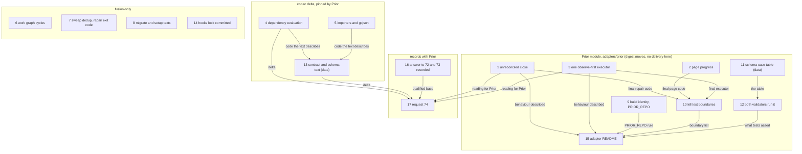

# Implementation Plan: the twelve follow-up issues of the prior-bundle closing review

**Date:** 2026-10-22
**Spec:** none: planned from the package narrative `261022-1604-prior-bundle-closing-review-follow-ups.md`, the closing review `261014-0830-reviewer-closing-pass-over-the-prior-module-bundle-package.md` and the twelve issue records it filed.
**Decidability:** Twelve questions of one form: does the defect an issue names still occur after its step? Each is decidable from fusion's own inputs, through the acceptance test the issue states (a unit or conformance test, a fixture run of a helper, a grep of a document against the code it describes). Two questions are not decidable from any input fusion has. The first is whether Prior's host reads the module's new answers as the contract intends: a close with `reconciled: false` mapped to `recovery-required` (step 1), and the explorer's `audit_ref` no longer sent to a run it started (step 3). The second is whether Prior accepts the codec delta of steps 4 and 13. Only Prior's host and Prior's answer observe either. The mechanism changes accordingly: the fake-host tests prove the module's behaviour on macOS arm64 and claim nothing more, and step 17 puts both readings and the codec delta to Prior as request 74. No issue's closure waits for that answer. The release tag does (`## Where this work stops`).

## Directive

The package narrative's brief, not restated: close each of the twelve open issues the closing review filed in `261008-1215-fusion-as-an-external-prior-module-bundle`, fixed with a verification that passed or closed with a disposition the user accepted. The narrative's correction stands: twelve, not eleven.

## Current State

Measured at `main` `11440a0a` (v13.3.0). Every issue was re-read against HEAD, and **all twelve still reproduce**; none is fixed on disk.

| Issue | Re-checked at HEAD |
|---|---|
| `261014-0830-the-repair-module-answers-completed-on-a-close-whose-reconciled-is-false.md` | `repair.go` close branch and `hostsvc.Closure()` unchanged; `git log 60141589..HEAD -- adapters catalog` is empty |
| `261014-0830-the-workbench-page-assembler-accepts-a-zero-length-page-and-loops-on-it.md` | `decodePage` admits `page_bytes` 0 with `next_offset == offset` |
| `261014-0830-the-explorer-sends-the-recovery-audit-ref-to-a-run-it-started-itself.md` | `explorer.go` still calls `steps.Execute(ctx, client, request, auditRef)`; `role.go` completes a self-started run with it |
| `261014-0830-dependency-evaluation-fails-an-edge-on-one-dangling-evidence-binding-and-reads-unvalidated-targets.md` | `transitions.ts` `dependencySatisfied` refuses inside the binding loop; `ops.ts` `edgeEntries` reads the target unvalidated; `work-graph.ts` skips `status === "cycle"` |
| `261014-0830-the-prior-importers-accept-input-their-schemas-refuse-and-check-no-revision-hash.md` | the importers and hash helpers still have no caller outside tests; none is in `codec/dist/fusion-record.js` (`grep -c` prints 0) |
| `261014-0830-citation-sweep-gojson-and-migrate-repair-carry-three-small-checking-gaps.md` | explicit sweep paths are pushed without the `inCorpus` check; `GO_TIME` and `goQuote` unchanged; `hooks/migrate.ts` maps every `applyRepair` throw to `EXIT.backup` (9) |
| `261014-0830-migrate-and-setup-skills-name-helper-output-and-exit-paths-the-helpers-do-not-provide.md` | `ask=` line carries no `offered`; Step 7 text still says the person "comes only from the git author"; `fold_store` moves a directory whole in tracked-only mode; setup reads every exit 6 as "no store"; the no-Node fallback rewrites the marker whole |
| `261014-0830-the-bundle-build-identity-hashes-git-ignored-files-the-dirty-check-cannot-see.md` | `inventory()` walks every file; `build.sh` dirty check omits ignored paths |
| `261014-0830-the-repair-kill-test-omits-the-reviewer-and-auditor-compose-and-the-page-boundaries.md` | the `boundaries` slice has no reviewer or auditor compose and no `page:` slot |
| `261014-0830-the-go-schema-validator-is-checked-against-the-explorer-schemas-only.md` | `TestShippedSchemas` loads the four explorer schemas only |
| `261014-0830-the-adapter-readme-describes-the-step-7-explorer-only-state-in-places.md` | the three passages unchanged; `PRIOR_REPO` defaults to `/Users/kai/Projects/productive/F09-Prior` in `build.sh` and `stage.sh` |
| `261012-2126-hooks-package-lock-json-is-ignored-and-untracked-so-npm-ci-cannot-run-in-a-clone-and-codec-gitignore-says-otherwise.md` | `git ls-files hooks/package-lock.json` is empty; root `.gitignore` line 7 ignores every lock; `codec/.gitignore` still claims the hooks lock was force-added. `catalog/package-lock.json` is tracked by a force-add, the same fragility |

Two issues the review filed are already `closed` and outside scope: `261012-2126-the-installed-tree-diff-at-c-lists-five-files-where-step-20-names-three-because-install-sh-copies-hooks-and-codec-whole.md` and `261014-0830-migrate-step-6-runs-the-citation-sweep-write-on-a-tree-its-own-guard-refuses.md`.

**What binds the work from outside the issues.**

- **Every change under `adapters/prior/fusionmodule/` moves the bundle digest**, because `build-identity.json` inventories those files. The bundle Prior accepted at answer 70 stays as it is; the next one needs Prior's acceptance. Binding: `261014-0830-does-a-shipped-file-change-after-a-release-tag-take-a-version-bump-when-the-bump-changes-the-prior-bundle-digest.md` (option 1, Prior's position recorded there).
- **Every change under `codec/` that reaches `codec/dist/`, `codec/contract/` or `codec/schemas/` is a codec revision Prior pins.** Prior's codec pin (`Prior: tests/testdata/fusion-codec/UPSTREAM.json`) holds `fixtures/`, `schemas/` and `contract/`, and Prior's runtime refuses a codec bundle whose digest is not `QualifiedCodecDigest`. A release tag after such a revision waits for Prior's acceptance of the contract delta: `261019-0913-may-a-codec-revision-after-13-1-0-be-tagged-before-prior-re-qualifies-its-bundle.md` (option 2, which its question says binds every later codec revision). `codec/src/prior/` is not in the bundle, so steps that touch only it move no pinned byte.
- **Prior has answered requests 72 and 73, and fusion has not recorded it.** Read-only, at Prior `3c29dcf` (`Prior: docs/design/fusion-recordless-migration-request72-73-prior-response.md`, 2026-10-21): "72 and 73: complete", `sha256:dfab3f21…` qualified and now `QualifiedCodecDigest`. `codec/fixtures/prior/REQUESTS.md` ends at the 72/73 hand-over. Under the convention that Prior's answers reach fusion through the user, step 16 records it on the user's relay. So the codec delta here stacks on a qualified base rather than an open one, and the clause in REQUESTS.md that sends a non-qualification "to the user before any later codec revision is planned" did not fire.
- **`skills/*/SKILL.md` and `hooks/` edits fall under the growth bounds** (`README-hooks.md` `### Growth bounds on the shipped text`). A red bound is answered by a cut, never by a baseline edit.

## Approach

The twelve issues fall on four surfaces with different release consequences, and the plan groups by surface so that each consequence is paid once.

1. **The Prior module (Go, `adapters/prior/`)**: steps 1 to 3, 9, 10, 12 and 15. Fixed and tested now against the fake host; no bundle is built for delivery here. The cross-cutting observation of the review (A3, a rule the two workflows hold differently) is answered by **one** executor rule in `internal/steps`, which repair and explorer both call, rather than by a second copy of repair's wrapper in the explorer.
2. **The codec (`codec/`)**: steps 4, 5 and 13. One codec delta, put to Prior once (step 17). The dependency fix follows the contract as written (`min_accepted: 1`), and the code moves to it. The contract does not retreat to the code: one accepted binding satisfies `succeeded`, and a dangling binding is already reported by `reconcile`'s `evidenceEntries` on the target, so no second report is added.
3. **fusion-only hooks and skills**: steps 6, 7, 8 and 14. They ship with an ordinary release and need nobody outside.
4. **Records with Prior**: steps 16 and 17, in `codec/fixtures/prior/REQUESTS.md`, additions only.

The four case-split defects the review groups (A1 `reconciled`, A2 page progress, E2 dangling bindings, plus the cycle entries) are each closed by adding the missing branch to the existing split, never by a fallback beside it.



## Implementation Steps

1. **The repair module refuses to report an unreconciled close as completed**
   - Executor: code-implementer
   - Files: `adapters/prior/fusionmodule/internal/repair/repair.go`, `adapters/prior/fusionmodule/internal/repair/repair_test.go`
   - Changes: After `reply.Closure()` decodes, a closure with `Reconciled == false` ends the workflow `recovery-required` with violation code `closure.unreconciled`, the closure kept in the envelope as the frozen `repair-result.v1.json` admits; `reconciled: true` stays `completed`. The close-to-status split then names both values. No frozen schema or workflow byte changes. Prior's note of 2026-10-14 says its qualified close never answers `completed` with `reconciled: false`, so this branch is a guard on a case Prior does not produce; the issue's fix direction keeps the guard either way. Append `Resolved:` to the issue narrative.
   - Dependencies: none
   - Acceptance: `PRIOR_REPO=/Users/kai/Projects/productive/F09-Prior adapters/prior/stage.sh test` green, with a new test in `internal/repair` whose fake close answers `{"record":…,"before":…,"after":…,"reconciled":false}` and asserts an envelope status other than `completed`; `TestAcceptedFirstAttemptRunsToClose` green; `cd catalog && shasum -a 256 -c schemas/FROZEN` passes.

2. **The page assembler refuses a page that makes no progress**
   - Executor: code-implementer
   - Files: `adapters/prior/fusionmodule/internal/hostsvc/hostsvc.go`, `adapters/prior/fusionmodule/internal/hostsvc/hostsvc_test.go`
   - Changes: In `decodePage`, a non-null `next_offset` requires `page_bytes > 0` (equivalently `*next_offset > offset`); otherwise the page is a violation (`ErrReply`). The loop in `assemble` then always advances or stops. Append `Resolved:` to the issue narrative.
   - Dependencies: none
   - Acceptance: `PRIOR_REPO=/Users/kai/Projects/productive/F09-Prior adapters/prior/stage.sh test` green, with a test in `internal/hostsvc` whose fake host answers a first page `{"offset":0,"page_bytes":0,"next_offset":0,"total_bytes":10,…}` and asserts `errors.Is(err, ErrReply)` after at most one page call.

3. **One observe-first executor for both workflows**
   - Executor: code-implementer
   - Files: `adapters/prior/fusionmodule/internal/steps/role.go`, `adapters/prior/fusionmodule/internal/steps/role_test.go`, `adapters/prior/fusionmodule/internal/repair/repair.go`, `adapters/prior/fusionmodule/internal/explorer/explorer.go`, `adapters/prior/fusionmodule/internal/explorer/explorer_test.go`
   - Changes: `steps.Execute` takes the 69.3 placement as its own rule. The audit reference goes only to the completion of a run whose **first** read was `answered`, never to a run this call started on `absent`, and the returned `Observation` says whether the reference was consumed. Repair's private `execute` wrapper reduces to the consumption bookkeeping (`w.auditRef` cleared when consumed) and calls `steps.Execute`; the explorer gets the same behaviour through the same call. The doc comment on `Execute` cites 69.3 beside 67.5. Append `Resolved:` to the issue narrative.
   - Dependencies: none
   - Acceptance: `PRIOR_REPO=/Users/kai/Projects/productive/F09-Prior adapters/prior/stage.sh test` green, with a test in `internal/explorer` where the invocation carries `audit_ref`, the fake run starts `absent`, and the completion records no audit reference; `TestRestartReusesTheStoredAnswerWithoutARun`, `TestMissingRequiredAuditIsRecoveryRequired` and every `internal/repair` test green unchanged.

4. **Dependency evaluation follows its contract** *(requires user approval: this lands a codec revision, and every release tag after it waits for Prior's acceptance of request 74)*
   - Executor: code-implementer
   - Files: `codec/src/transitions.ts`, `codec/src/cli/ops.ts`, `codec/src/__tests__/transitions.test.ts`, `codec/src/__tests__/ops.test.ts`, `codec/dist/fusion-record.js` (rebuilt by the test run)
   - Changes: `dependencySatisfied` counts the bindings it has records for and treats a binding with no supplied record as not accepted, so one accepted binding satisfies `succeeded` as `min_accepted: 1` says; with none accepted the refusal stays `missing-evidence`. The dangling binding stays reported where `reconcile` already reports it, `evidenceEntries` on the target package. `edgeEntries` validates the target package's control data against its schema before evaluating the condition, and a schema-invalid target is an `unmet` entry carrying the schema finding's class and reason, whatever its `status` says. Append the codec half of `Resolved:` to the dependency issue only once step 6 has also landed (the issue closes on both).
   - Dependencies: none
   - Acceptance: `cd codec && npm run typecheck && CODEC_REQUIRE_GOLDENS=1 npm test` green, holding a case with one accepted and one dangling binding (`satisfied`) and a case with a schema-invalid `done` target (`unmet`); `git status --porcelain -- codec/fixtures` empty (no recorded exchange moves; a red that asks for one is a stop, reported, never a re-record); `cd hooks && npm test` green.

5. **The Prior importers check what their schemas require, and gojson writes only what Go writes** *(requires user approval: enforcing over rewording, `## Open Questions`)*
   - Executor: code-implementer
   - Files: `codec/src/prior/candidates.ts`, `codec/src/prior/packages.ts`, `codec/src/prior/campaign.ts`, `codec/src/prior/common.ts`, `codec/src/prior/gojson.ts`, `codec/src/__tests__/prior-mapping.test.ts`
   - Changes: Each importer checks its input against `GO_STRUCTS` before mapping and refuses with the Go path on a missing or mistyped field rather than throwing. Every block it produces is run through the codec's existing `validate()` inside `guarded`, so the schemas' conditional rules are enforced by the schemas themselves rather than restated in the mappers. `importCampaignState` and `importRegister` recompute `charter_hash`, each aggregate `Revision` and each qualification's `evidence_hash` with the existing helpers (`computeCharterHash`, `computePriorRevision`, `computeEvidenceHash`) and refuse a mismatch. `nonEmpty` and `emptyToNull` refuse a non-string. `GO_TIME` admits only Go's RFC 3339 output (no trailing-zero fraction, `Z` or a non-zero offset); `goQuote` writes a lone surrogate as U+FFFD. The stale "unconfirmed" comment at the head of `packages.ts` is corrected to what `codec/contract/prior-mapping.json` says. Append `Resolved:` to the importer issue; append the gojson half of `Resolved:` to the three-gaps issue, which closes when step 7 also lands.
   - Dependencies: none
   - Acceptance: `cd codec && npm run typecheck && CODEC_REQUIRE_GOLDENS=1 npm test` green, holding refusals naming the Go path for a candidate lacking `MergeInto`, one with `Source: null`, and an `admitted` one with no qualification; a refusal for a wrong `charter_hash`; `gojson` refusals for `…T00:00:00.10Z` and for a lone surrogate. `grep -c 'importRegister\|GO_TIME' codec/dist/fusion-record.js` prints 0, and `shasum -a 256 codec/dist/fusion-record.js` equals the value step 4 left: this step moves no bundle byte.

6. **The work graph reports the cycles the codec reports**
   - Executor: code-implementer
   - Files: `hooks/lib/work-graph.ts`, `hooks/lib/__tests__/work-graph.test.ts`, `hooks/lib/__tests__/fusion-work-order.test.ts`, `hooks/dist/` (rebuilt)
   - Changes: Codec `reconcile` entries with `status: "cycle"` are no longer skipped. Each one becomes a cycle in the report, with its members named by directory where the package is known and by id otherwise, and merged without duplicates with the cycles the graph finds over its own live nodes. A cycle through a terminal or unreadable package therefore appears, and the verdict is never acyclic while the codec reports one, as `dependencies.json` says ("never silently cut").
   - Dependencies: none
   - Acceptance: `cd hooks && npm test` green, holding a fixture whose only cycle runs through a `done` package and asserting that `bin/fusion-work-order` prints it under `cycles=` with a count of 1.

7. **The citation sweep counts an explicit path once, and the migrate repair keeps exit 9 for a failed backup**
   - Executor: code-implementer
   - Files: `hooks/citation-sweep.ts`, `hooks/migrate.ts`, `hooks/lib/legacy-repair.ts` (only if the backup failure needs a distinguishable error type), `hooks/lib/__tests__/citation-sweep.test.ts`, `hooks/lib/__tests__/migrate.test.ts`, `hooks/dist/` (rebuilt)
   - Changes: Explicit `<path>` arguments go through the same real-path set as the declared paths, so a file already in the workbench corpus is not added again. In `repair`, only the backup-verification failure `ensureBackup` throws maps to `EXIT.backup` (9); any other exception maps to `EXIT.fault` (3), its message kept. `bin/fusion-migrate`'s exit table and `skills/migrate/SKILL.md` are checked against the result; the skill's sentence on exit 9 stays true, and a sentence naming exit 3 is added there only if the skill handles exit codes at that call. Append the two hooks halves of `Resolved:` to the three-gaps issue.
   - Dependencies: none
   - Acceptance: `cd hooks && npm test` green, holding a sweep census with `fusion-workbench/x.md` passed explicitly that counts it once in `files=` and `rewrites=`, and a `repair --apply` whose `applyRepair` throws an I/O error and exits 3, not 9; no growth-bound red (a red is answered by a cut).

8. **The migrate and setup skills describe the helpers they call** *(requires user approval: the no-Node marker fallback, `## Open Questions`)*
   - Executor: code-implementer
   - Files: `hooks/migrate.ts`, `hooks/lib/__tests__/migrate.test.ts`, `hooks/dist/` (rebuilt), `skills/migrate/SKILL.md`, `skills/setup/SKILL.md`
   - Changes: (1) The `ask=` line gains the question's `offered` values as a seventh tab-separated field (`-` when none), and Step 7 tells the reader to offer that value and names the `text` form beside `choice`, `actor` and `person`. (2) `fold_store` in tracked-only mode descends into every directory rather than moving it whole, so each tracked file moves by its own `git mv` and an untracked child stays where it is, as option 2's sentence promises. (3) Setup's `exit=6` branch reads the reason on the `fusion-write:` line. `target-not-empty` keeps today's text. `manifest-present` says the directory already holds a JSON-controlled workbench and routes as `result=reused` would, or stops with that statement, whichever the helper's header says is safe. (4) The no-Node marker fallback stops overwriting the marker: it writes a fresh marker only when none exists, and otherwise substitutes the `plugin_version` value in place, leaving every other key. Append `Resolved:` to the issue narrative.
   - Dependencies: none
   - Acceptance: `cd hooks && npm test` green, the `ask=` field asserted in `migrate.test.ts`; on a fixture workbench in a scratch directory, each of the four passages matches a run of the helper it names: `repair --list` prints the offered person, a tracked-only fold leaves an untracked child in place, `fusion-write initialize` over a manifest-present directory prints the reason the new branch keys on, and the fallback run with `PATH` stripped of `node` keeps an extra key in `.fusion-setup`; the commands and their output go into the step's report; no growth-bound red.

9. **The bundle build refuses ignored files in its inputs, and `PRIOR_REPO` is required** *(requires user approval: `PRIOR_REPO` becomes mandatory on this machine too, `## Open Questions`)*
   - Executor: code-implementer
   - Files: `adapters/prior/build.sh`, `adapters/prior/stage.sh`
   - Changes: `fusion_revision` treats any path that `git status --porcelain --ignored --untracked-files=all -- adapters/prior/fusionmodule adapters/prior/launcher` lists as ignored (`!!`) as dirt, under the same refusal and the same `FUSION_BUILD_ALLOW_DIRTY=1` override that marks `+dirty`. The identity's semantics, which Prior reads, are unchanged, and only the guard sees more. Both scripts drop the personal default and exit 2 with a usage line naming `PRIOR_REPO` when it is unset; the header comments say so. Append `Resolved:` to the build-identity issue.
   - Dependencies: none
   - Acceptance: with `touch adapters/prior/fusionmodule/.DS_Store`, `PRIOR_REPO=/Users/kai/Projects/productive/F09-Prior adapters/prior/build.sh build` exits non-zero naming that file (the file removed afterwards); `env -u PRIOR_REPO adapters/prior/stage.sh test` and `env -u PRIOR_REPO adapters/prior/build.sh build` each exit 2 naming `PRIOR_REPO`; `grep -rn '/Users/' adapters/prior/build.sh adapters/prior/stage.sh` prints nothing; `PRIOR_REPO=/Users/kai/Projects/productive/F09-Prior adapters/prior/stage.sh test` green.

10. **The kill test covers the boundaries its name claims**
    - Executor: code-implementer
    - Files: `adapters/prior/fusionmodule/conformance/repair_test.go`, and the fixture under `adapters/prior/fusionmodule/internal/fixture/` only if the record read is not yet multi-page there
    - Changes: Adds `{"after the reviewer was composed", api.RoleComposeCapability, "run-review-0"}`, `{"after the auditor was composed", api.RoleComposeCapability, "run-audit"}` and one boundary after a `page:<handle>:<offset>` read of the multi-page record to the sixteen listed. Each resumes to the clean run's envelope bytes with no further model call.
    - Dependencies: steps 1, 2, 3
    - Acceptance: `FUSION_BUILD_ALLOW_DIRTY=1 PRIOR_REPO=/Users/kai/Projects/productive/F09-Prior adapters/prior/build.sh build <scratch>` succeeds, then `FUSION_BUNDLE_DIR=<scratch> PRIOR_REPO=/Users/kai/Projects/productive/F09-Prior adapters/prior/stage.sh test` green, its verbose run listing the three new sub-tests by name beside the sixteen existing ones. Append `Resolved:` to the kill-test issue.

11. **The repair-schema contract cases, as one shared table**
    - Executor: data-implementer
    - Files: `catalog/testdata/repair-schema-cases.v1.json` (new; outside `schemas/`, so neither `FROZEN` nor the bundle payload names it)
    - Changes: One case per row in the shape of `## Data Structures`. It holds at least the five verification-form cases the issue lists (`done` with `exit` 0 valid; `exit` with `detail`, `done` with `did-not-finish`, `none` with `command`, `escalated` with `stopped_at` null, all invalid) and one valid case per `repair-result` status branch (`completed`, `refused`, `recovery-required`, `escalated`). Further negative cases cover the keywords the issue names: a `oneOf` branch with a `false` property, a nested `if`/`then` over `const` or `enum`, and a `$ref` into `$defs`. Each verdict is checked with ajv 2020 in a scratch script before it is written; the script stays out of the tree.
    - Dependencies: none
    - Acceptance: `node -e` over the file (the command in the step's report) prints the per-schema counts and exits 0 only if every row names a schema in `catalog/schemas/` and carries a boolean `valid`; `cd catalog && shasum -a 256 -c schemas/FROZEN` passes.

12. **Both validators run the shared table**
    - Executor: code-implementer
    - Files: `catalog/src/__tests__/schema-cases.test.ts` (new), `adapters/prior/fusionmodule/internal/steps/schema_cases_test.go` (new), `adapters/prior/fusionmodule/internal/steps/schema.go` (only where the Go validator disagrees with ajv)
    - Changes: The catalog test compiles each named schema with `Ajv2020` as `render.test.ts` does and asserts every row's verdict. The Go test reads the same file through `FUSION_CATALOG_DIR`, compiles each schema with `steps.CompileSchema` and asserts the same verdicts. A disagreement is the defect the issue anticipates: `schema.go` is fixed to agree, and the table is never edited to match it. Append `Resolved:` to the Go-validator issue.
    - Dependencies: step 11
    - Acceptance: `cd catalog && npm test` green; `PRIOR_REPO=/Users/kai/Projects/productive/F09-Prior adapters/prior/stage.sh test` green; both tests fail when one row's `valid` is flipped in a scratch copy (checked once, reported, not committed); `shasum -a 256 -c schemas/FROZEN` passes.

13. **The codec's contract and schema texts claim what the code does**
    - Executor: data-implementer
    - Files: `codec/contract/dependencies.json` (`notes`), `codec/schemas/package.schema.json` (`description`), `codec/schemas/campaign.schema.json` (`description`), `codec/dist/fusion-record.js` (rebuilt by the test run, since the schemas are inlined)
    - Changes: The `dependencies.json` note says where cycle detection runs, as step 4's code runs it (`set-dependencies` and `reconcile`; `validate` only if it does). `package.schema.json` credits the distinct-and-acyclic rule to `setDependenciesPlan` in `codec/src/cli/ops.ts`, not to `transitions.ts`. `campaign.schema.json` says dependencies name package ids, and drops "unconfirmed" only if `codec/contract/prior-mapping.json` no longer marks the mapping unconfirmed; otherwise that clause stays. No schema keyword, no `$id` and no contract value changes: descriptions and notes only.
    - Dependencies: steps 4, 5
    - Acceptance: `cd codec && CODEC_REQUIRE_GOLDENS=1 npm test` green; `git diff -U0 codec/contract codec/schemas` changes only `description` and `notes` strings (`jq` over old and new with those keys deleted compares equal, the command in the report); `git status --porcelain -- codec/fixtures` empty. Append the remaining half of `Resolved:` to the dependency issue (with step 6 landed it closes) and the description half to the importer issue.

14. **Every Node package commits its lock** *(requires user approval: committing over documenting, `## Open Questions`)*
    - Executor: code-implementer
    - Files: `.gitignore` (the `package-lock.json` line), `codec/.gitignore` (the negation and its comment), `hooks/package-lock.json` (added)
    - Changes: The root rule that ignores every `package-lock.json` goes, so the three packages' locks are tracked by one rule rather than by a negation in one and force-adds in two. `codec/.gitignore` loses its negation and the false comment. `hooks/package-lock.json` is added as it stands in the work tree, after `cd hooks && npm ci` has shown it consistent with `package.json`. `install.sh` copies `hooks/` whole, so installs gain the lock file as they already carry `codec/`'s; that is inert at runtime.
    - Dependencies: none
    - Acceptance: `cd hooks && npm ci && npm test` green in the work tree; `git ls-files hooks/package-lock.json codec/package-lock.json catalog/package-lock.json` lists all three; after the dispatcher's commit, `git clone <repo> <scratch> && cd <scratch>/hooks && npm ci` exits 0 (run by the dispatcher, reported with the commit). Append `Resolved:` to the lock issue.

15. **The adapter README describes the module as it stands**
    - Executor: code-implementer
    - Files: `adapters/prior/README.md`
    - Changes: The header names answer 69 beside 67 and the repair host file beside `external_explorer.go`, the file read from Prior at `PRIOR_PIN`. The Testing bullets say what the tests assert after steps 10 and 12: four roles resolve, the reviewer through its two aliases; the repair schemas are exercised by the shared table; the kill test lists its boundaries. The explorer's completion paragraph states step 3's rule, and the close paragraph states step 1's branch. `PRIOR_REPO` is documented as required.
    - Dependencies: steps 1, 3, 9, 10, 12
    - Acceptance: `grep -n 'request 67 and its two follow-ups' adapters/prior/README.md` prints nothing or a line that also names 69; `grep -c 'sixteen' adapters/prior/README.md` is 0 unless the sentence it is in enumerates the list; `grep -rn '/Users/' adapters/prior/README.md` prints nothing; `cd hooks && npm test` green. Append `Resolved:` to the README issue.

16. **Prior's answer to 72 and 73, recorded** *(requires user approval: the user relays Prior's answer)*
    - Executor: code-implementer
    - Files: `codec/fixtures/prior/REQUESTS.md` (`### Prior's answer to 72 and 73 at 3c29dcf`, appended; no line above edited)
    - Changes: Records each answer by request number and the Prior commit that carries it (72 at `01cf2fd`, 73 at `d372bc0`, the response document at `3c29dcf`), the qualified digest `sha256:dfab3f21…`, the counts Prior reports against request 72's table, and a `### Requests 64 and 67 to 73, as they stand` table that supersedes the earlier one. The planner read these figures from Prior's repository, read-only; the record carries what the user relays, and any difference from the figures here is reported, not reconciled.
    - Dependencies: none
    - Acceptance: `git diff codec/fixtures/prior/REQUESTS.md` adds lines after the last section and changes none above it; `cd codec && CODEC_REQUIRE_GOLDENS=1 npm test` and `cd hooks && npm test` green.

17. **Request 74: the codec delta and two module readings, put to Prior**
    - Executor: code-implementer
    - Files: `codec/fixtures/prior/REQUESTS.md` (`## Dependency evaluation and module follow-ups (request 74)`, appended)
    - Changes: Written against the fusion commit that holds steps 4, 5 and 13, with the base stated as the qualified `dfab3f21…` at `ec76d4fd`. It gives the codec bundle's new size and sha256, and the pinned files that moved, by the counting command of request 72's section with the commit replaced. 74(a) asks Prior to accept the delta: one accepted binding satisfies `succeeded` despite a dangling one, a schema-invalid target is `unmet`, and the text corrections. 74(b) asks Prior to confirm two readings for the **next** module bundle, which this request does not deliver: a completed close with `reconciled: false` answers `recovery-required` with `closure.unreconciled` (step 1), and the explorer sends `audit_ref` only to a run first read at `answered` (step 3, the 69.3 rule applied to 67.5). It states that the tag waits for 74(a)'s acceptance (`261019-0913-may-a-codec-revision-after-13-1-0-be-tagged-before-prior-re-qualifies-its-bundle.md`, option 2) and that re-pinning may follow the tag.
    - Dependencies: steps 1, 3, 4, 5, 13, 16
    - Acceptance: `git diff codec/fixtures/prior/REQUESTS.md` adds lines after the last section and changes none above it; the moved-file listing in the section is the command's verbatim output; `cd codec && CODEC_REQUIRE_GOLDENS=1 npm test` and `cd hooks && npm test` green.

**Closing the issues.** The twelve records live in the done package's issue store, `261008-1215-fusion-as-an-external-prior-module-bundle`. Each executor appends its `Resolved:` line there, and the dispatcher sends `transition --to closed --disposition '{"kind":"fixed","reason_ref":null}'` once it has read the step's `Verification:` line. Three issues close on more than one step: the dependency issue on steps 4, 6 and 13, the three-gaps issue on steps 5 and 7, and the Go-validator issue on steps 11 and 12. Each such issue is transitioned once, after its last step.

| Issue | Closed by step(s) |
|---|---|
| unreconciled close | 1 |
| zero-length page | 2 |
| explorer `audit_ref` | 3 |
| dependency evaluation | 4, 6, 13 |
| Prior importers | 5, 13 |
| three small checking gaps | 5, 7 |
| migrate and setup skills | 8 |
| build identity | 9 |
| kill test | 10 |
| Go schema validator | 11, 12 |
| hooks lock | 14 |
| adapter README | 9, 15 |

## Where this work stops

- The work is finished when each of the twelve issues in the table above stands `closed`, either fixed with its step's acceptance passed or closed with a disposition the user accepted.
- Also only if no byte of a frozen catalog asset moved: `cd catalog && shasum -a 256 -c schemas/FROZEN` passes at the last step's commit.
- Also only if no growth-bound baseline or head-room constant changed: `git diff 11440a0a HEAD -- hooks/lib/__tests__/surface-growth-bound.test.ts hooks/lib/__tests__/rules-emission-golden.test.ts hooks/lib/__tests__/helpers/growth-bound.ts hooks/lib/__tests__/fixtures` prints nothing.
- Also only if `git status --porcelain -- codec/fixtures` shows nothing but `codec/fixtures/prior/REQUESTS.md` across the codec steps: no recorded exchange, seed or golden was re-recorded.
- This package builds no bundle for delivery and hands none to Prior. The next module bundle, which carries steps 1 to 3, 9, 10 and 12, is its own act and needs Prior's acceptance (`261014-0830-does-a-shipped-file-change-after-a-release-tag-take-a-version-bump-when-the-bump-changes-the-prior-bundle-digest.md`, Prior's position).
- A release tag on any commit holding step 4 waits for Prior's acceptance of request 74(a), recorded in `codec/fixtures/prior/REQUESTS.md` (`261019-0913-may-a-codec-revision-after-13-1-0-be-tagged-before-prior-re-qualifies-its-bundle.md`, option 2). This package does not tag, and its closure does not wait for that answer.
- The `v13.1.0` tag and the bundle Prior accepted at answer 70 stay as they are.
- Step 16 runs only on the user's relay of Prior's answer to 72 and 73. Step 17 runs only after step 16 is recorded.

## Data Structures

`catalog/testdata/repair-schema-cases.v1.json`:

```json
{
  "schema": "fusion.schema-cases/v1",
  "cases": [
    { "name": "<unique, short>", "schema": "<file name under catalog/schemas/>", "pointer": "<JSON pointer into that schema, \"\" for the root>", "document": {}, "valid": true }
  ]
}
```

`pointer` lets a case target a `$defs` entry (for example a verification form) without wrapping it in a whole envelope; `""` validates against the root. Both tests resolve the pointer the same way. The Go side compiles the root and validates at the pointer only if `steps.CompileSchema` can address a `$defs` entry. Otherwise every case is written against the root, and the data step is told before it starts.

No other new type. Step 3 adds one exported field to `steps.Observation` (whether the audit reference was consumed).

## API Changes

No change to `bin/`, a codec request shape, or a Claude entry point. `bin/fusion-migrate repair --list` prints one more field on each `ask=` line (step 8). `bin/fusion-migrate repair --apply` exits 3, not 9, on an exception other than a failed backup (step 7). `adapters/prior/build.sh` and `stage.sh` exit 2 without `PRIOR_REPO` (step 9). The module's envelope gains no field; a close with `reconciled: false` now yields `recovery-required` (step 1).

## Testing Strategy

- `adapters/prior/`: `stage.sh test` per step (unit and fake-host conformance, macOS arm64, never acceptance by Prior); the kill test against a `+dirty` scratch bundle (step 10).
- `catalog/`: `npm test`, the frozen guard, the shared table (step 12).
- `codec/`: `npm run typecheck` and `CODEC_REQUIRE_GOLDENS=1 npm test`, with `codec/fixtures` unmoved.
- `hooks/`: `npm test` after every hooks or skills edit and after every codec rebuild, since its migrate cases run the bundle.
- Fixture runs of the helpers for step 8, recorded in the step's report.

## Risks & Mitigations

| Risk | Mitigation |
|---|---|
| The issue records sit in a `done` package, and the codec might refuse a transition there | The records are live (`open`), and `## Terminal states are history` restricts terminal records only; if the codec refuses, the dispatcher reports the `fusion-write:` line and the closure moves to the user, never to a hand edit of a control file |
| A codec rebuild reorders or re-records a golden | Steps 4, 5 and 13 require `codec/fixtures` unmoved; a red asking for a re-record is a stop |
| The Go validator disagrees with ajv on a new case and the fix in `schema.go` widens what it accepts | The table is the authority and ajv decides each row before it is written (step 11); `schema.go` is fixed to the table, never the table to `schema.go` |
| Step 3 changes how the explorer completes a run Prior's host expects to see completed with an audit reference | The issue's inference is that the host refuses or ignores such a reference; 74(b) asks Prior, and no bundle ships before the answer |
| The `ask=` field added in step 8 breaks a reader that splits on a fixed field count | `migrate.test.ts` asserts the new shape; the skill is the only documented reader, and step 8 edits it in the same step |
| Skill edits trip a growth bound | A red is answered by a cut in the same step, never by a baseline edit |
| Removing the root lock rule exposes a stray `package-lock.json` elsewhere | `find . -name package-lock.json -not -path '*/node_modules/*'` at planning time lists the three package locks only |

## Open Questions

Each of these is a choice an issue leaves open. The plan takes the first option named, and the user confirms or overrides it at plan approval. None binds work beyond this plan, so none is filed as a decision record.

- [ ] **Step 4, landing a codec revision now.** Every release tag after step 4 waits for Prior's acceptance of request 74(a). The alternative is to hold steps 4, 5 and 13 back until the fusion-only and module steps have been tagged.
- [ ] **Step 5, enforce or reword.** Recommended: enforce (input check against `GO_STRUCTS`, `validate()` on every block, hash recomputation), reusing the codec's validator and the existing hash helpers. The alternative is to reword the schema descriptions so they claim no check, leaving the importers as they are until one is wired in.
- [ ] **Step 8, the no-Node marker fallback.** Recommended: write fresh only when absent, otherwise substitute `plugin_version` in place. The alternative is to refuse to write a marker without Node, which contradicts the setup sentence that the workbench is still set up on `(no node on PATH)`.
- [ ] **Step 9, `PRIOR_REPO`.** Recommended: required, exit 2 when unset; this machine then needs `PRIOR_REPO` exported. The alternative is to keep the default and document it as the author's machine.
- [ ] **Step 14, commit or document.** Recommended: commit `hooks/package-lock.json` and drop the root ignore rule, matching what `codec/` and `catalog/` already do. The alternative is to correct `codec/.gitignore`'s comment and leave `hooks/` on `npm install`.
- [ ] **74(b), the status for an unreconciled close.** The plan follows the issue and uses `recovery-required` with `closure.unreconciled`. If Prior answers that `refused` fits better, the change lands with the next bundle as a new issue, not by reopening this one.
