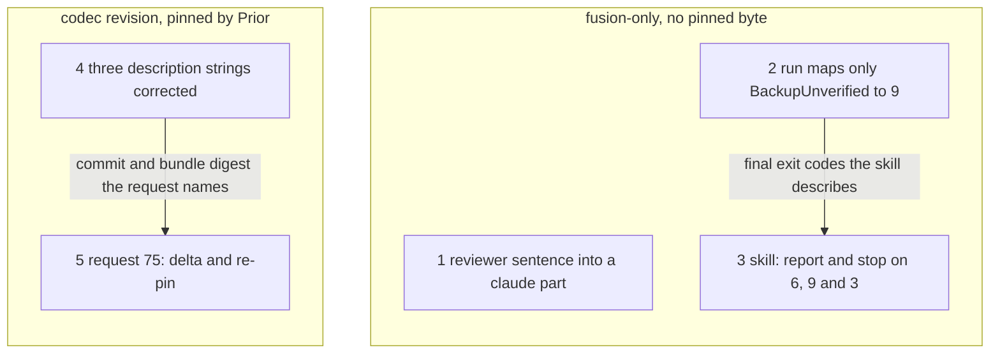

# Implementation Plan: the four issues the Prior follow-ups package left open

**Date:** 2026-10-22
**Spec:** none: planned from the package narrative `261022-2229-four-issues-left-by-the-prior-follow-ups.md`, the four issue records it names, the predecessor plan `261022-1611-plan-prior-bundle-closing-review-follow-ups.md` and its closing review `261022-2142-reviewer-closing-review-of-the-prior-bundle-follow-ups.md`.
**Decidability:** Four questions of one form: does the defect an issue names still occur after its step? Each is decidable from fusion's own inputs. The render test compares bytes, the migrate test asserts an exit code, the codec texts are checked by `grep` and by a `jq` comparison with the strings removed, and the skill sentence is read against the exits `hooks/migrate.ts` produces. One question is not decidable from anything fusion holds: whether Prior accepts the three corrected codec strings as the whole delta from `d6fc9da0…`, and re-pins the resulting bundle. Only Prior's answer observes that. The mechanism changes accordingly. Step 5 puts the delta and the re-pin to Prior as request 75. No issue's closure waits for the answer; a release tag on a commit holding step 4 does (`## Where this work stops`).

## Directive

The package narrative's brief, not restated: close each of the four open issues in the issue store of `261022-1604-prior-bundle-closing-review-follow-ups`. Each closes fixed, with a verification that passed, or with a disposition the user accepted. The codec-text fix travels to Prior with fusion's next codec request, the re-pin of `d6fc9da0…`.

## Current State

Measured at `main` `0db5d0de` (`v13.3.0-22`, `.claude-plugin/plugin.json` 13.3.0, no tag since `v13.3.0`). All four issues reproduce at HEAD.

| Issue | Re-checked at HEAD |
|---|---|
| `261022-1712-catalog-render-test-no-longer-reproduces-agents-reviewer-md-since-91395e02.md` | `91395e02` appended one sentence to item 9 of `agents/reviewer.md` (`## Code review standards`). The source line, `catalog/profiles/reviewer/parts/06-neutral.md` line 21, still ends at "out-of-sync documentation.". 13 819 − 13 522 = 297 bytes, the size of that sentence, so it is the whole difference. |
| `261022-1806-migrate-run-maps-every-ensurebackup-failure-to-exit-9-including-a-copy-io-error.md` | `run()` in `hooks/migrate.ts` wraps `ensureBackup` in a `catch` that throws `EXIT.backup` for any error. `repair()` in the same file already splits on `BackupUnverified` (9) and maps everything else to `EXIT.fault` (3). |
| `261022-2143-three-pinned-codec-texts-still-say-proposed-mapping-or-every-cycle-after-step-13.md` | `codec/contract/dependencies.json` line 42 says "reports every cycle"; `codec/schemas/campaign.schema.json` line 346 says "is a proposal in codec/contract/prior-mapping.json"; `codec/contract/prior-mapping.json` line 41 says "Proposed correspondence". All 7 `state_mapping` rows are `confirmed: true`. |
| `261022-2143-migrate-skill-repair-apply-sentence-no-longer-tells-the-reader-to-stop-on-exit-6-or-9.md` | `skills/migrate/SKILL.md` line 201 binds "report it and stop" to exit 3 alone. Line 209, the `run` sentence, names exits 6, 5 and 8 and gives exits 9 and 3 no instruction. That gap predates `a740170a`. |

**What binds the work from outside the issues.**

- **Prior's pins reach only the codec.** Measured read-only at Prior `b711b62`: `fusion-codec/UPSTREAM.json` holds `codec/` `contract/` (all three contract files, `prior-mapping.json` among them), `schemas/` and `fixtures/`. `fusion-fj01/UPSTREAM.json` holds `codec/fixtures/`, `codec/dist/fusion-record.js`, `codec/package.json` and `bin/fusion-record`. No path under `catalog/`, `agents/`, `skills/` or `hooks/` is pinned, so steps 1 to 3 move no pinned byte.
- **Two of the three codec strings are inlined into the bundle.** `grep -c` over `codec/dist/fusion-record.js` finds "reports every cycle" and "is a proposal in" once each and "Proposed correspondence" not at all. Step 4 therefore moves the bundle off `d6fc9da0…`. `prior-mapping.json` moves only the codec pin.
- **The tag condition is already ruled.** `261019-0913-may-a-codec-revision-after-13-1-0-be-tagged-before-prior-re-qualifies-its-bundle.md` (option 2) says that a release tag after a codec revision waits for Prior's acceptance of the contract delta, and that a re-pin may follow the tag. Its question states that the answer binds every later codec revision. Request 74(a) put three description and note corrections to Prior as part of the delta, and Prior accepted them as such. A description-only revision is therefore a delta under that ruling, and this plan files no new decision on it.
- **The tag for `d6fc9da0…` is unblocked and not cut.** Prior accepted 74(a) at `b711b62` (`codec/fixtures/prior/REQUESTS.md` `### Prior's answer to 74 at b711b62`), and no request is open. Prior's runtime keeps `dfab3f21…` until a re-pin.
- **Prior's hand-over bears on order, not on scope.** `Prior: docs/design/fusion-full-surface-handover-to-fusion.md` (Prior `7ac0845`) asks for a later request carrying H1 to H9. That request is to name the codec digest its bundle carries. When that digest is not Prior's `QualifiedCodecDigest`, Prior answers fusion's re-pin request first, and its install step waits on that answer. The hand-over reserves no number. The B2 question about `orchestrator-events.jsonl` is outside this package. Two consequences follow. The re-pin request takes number 75, which is free (`REQUESTS.md` names no request above 74), and the hand-over request follows under a later number. Correcting the three strings before the re-pin also means the bundle Prior qualifies under 75 is the one the hand-over bundle carries. Deferring them would force a second re-pin after the hand-over.
- **Growth bounds.** Steps 2 and 3 grow `hooks/lib/__tests__/` and `skills/migrate/SKILL.md`. The surface golden is then regenerated with `UPDATE_SURFACE_GOLDEN=1`, which records the movement. A red bound is answered by a cut, and a baseline or head-room constant is never edited.
- **The catalog's own rule decides where the reviewer sentence goes.** `catalog/README.md` `## Editing a converted prompt` puts Claude Code mechanics in a `claude` part. A neutral part's rule-file citation is resolved on Prior only through an include directive. The reviewer's Prior overlay includes `rules/user-facing-output.md` alone. The `91395e02` sentence cites `rules/fusion-workbench-conventions.md` `## A project's CLAUDE.md` and routes the finding to `code-implementer` or the user's curate run. On Prior the reviewer files nothing and the host routes, so the sentence is Claude Code mechanics.

## Approach

The four issues fall on two release surfaces, and the plan orders them so that each consequence is paid once.

1. **fusion-only (steps 1 to 3).** None of these steps touches a pinned byte. Step 1 restores the catalog as the source of `agents/reviewer.md`. Steps 2 and 3 make `bin/fusion-migrate` and the skill that calls it agree on exits 9 and 3.
2. **The codec and Prior (steps 4 and 5).** One description-only codec revision, put to Prior once in request 75. Request 75 combines the delta acceptance with the re-pin that 74 already announced. The combination saves Prior one round-trip, and it means the bundle Prior re-pins is the one the hand-over request will carry.

The reviewer sentence is moved into the catalog by splitting the neutral part at the byte where `91395e02` appended it. The split leaves the Claude render byte-identical to the committed prompt and the Prior render byte-identical to today's. That one cut answers the issue's "say which" question: the rendered Prior profile, and with it the module bundle's payload, does not move. Only `build-identity.json`'s fusion revision moves, as it does at every commit.

## Implementation Steps

1. **The reviewer's code review standards render from the catalog again**
   - Executor: code-implementer
   - Files: `catalog/profiles/reviewer/parts/06-neutral.md` (truncated), `catalog/profiles/reviewer/parts/06a-claude.md` (new), `catalog/profiles/reviewer/parts/06b-neutral.md` (new), `catalog/profiles/reviewer/profile.json` (`parts`)
   - Changes: Split the current `06-neutral.md` at the byte after "out-of-sync documentation." on item 9's line, before its newline. `06-neutral.md` keeps everything up to and including that full stop, with no trailing newline. `06a-claude.md` holds the 297 bytes `91395e02` appended, from the leading space through "curate run.", exactly as they stand in `agents/reviewer.md` line 64, with no trailing newline. `06b-neutral.md` holds the rest of the old part, beginning with the newline that ends item 9. `profile.json` lists the three files in that order, in place of the one entry, tagged `neutral`, `claude`, `neutral`. No `prior` part is added: on Prior this role files nothing and the host routes findings (`05-prior.md`), so the sentence has no Prior counterpart. `agents/reviewer.md` is not edited. Run `cd catalog && npm run render -- claude`; it must leave `agents/` unchanged. The `06a`/`06b` names fit the schema pattern `^parts/[a-z0-9-]+\.md$` and leave every other part's name alone. If a catalog test asserts the `NN-<tag>` shape, report that test and stop rather than renumbering. Append `Resolved:` to the issue, stating that the rendered Prior profile is unchanged and that the module bundle payload therefore does not move.
   - Dependencies: none
   - Acceptance: `cd catalog && npm run render -- claude && git status --porcelain -- ../agents` prints nothing; `cd catalog && npm test` green, the `render claude > reproduces agents/reviewer.md` case among them; `npm run render -- prior <scratch-before>` at `0db5d0de` (a `git worktree` or `git archive` export) and `npm run render -- prior <scratch-after>` after the change give a byte-identical `profiles/reviewer.md` (`cmp` silent, command and output in the report); `cd catalog && shasum -a 256 -c schemas/FROZEN` passes; `PRIOR_REPO=/Users/kai/Projects/productive/F09-Prior adapters/prior/stage.sh test` green; `cd hooks && npm test` green.

2. **`run` keeps exit 9 for a backup that does not verify, and reports a copy fault as exit 3**
   - Executor: code-implementer
   - Files: `hooks/migrate.ts` (`run`), `hooks/lib/__tests__/migrate.test.ts`, `hooks/dist/` (rebuilt), `hooks/lib/__tests__/fixtures/surface-growth.golden` (regenerated), `bin/fusion-migrate` (header exit table, only if a line there claims otherwise)
   - Changes: In `run`, the `catch` around `ensureBackup` maps `BackupUnverified` to `EXIT.backup` with today's message. Any other error maps to `EXIT.fault` with its message, says nothing was migrated, and names `${session}` as possibly holding a partial copy. `repair` already uses this split, so the two call sites now agree. One test drives `bin/fusion-migrate run` into an I/O error inside the copy itself, for example a session target the copy cannot write. It asserts exit 3, stderr naming the error, no `backup.sha256`, and an unchanged workbench tree hash. The implementer confirms the fault is raised inside `ensureBackup` and not in `preconditions`, from the stderr text. Read the `bin/fusion-migrate` exit table against the result: rows 3 and 9 already fit ("an internal fault"; "the backup does not verify"), so expect no edit. Regenerate the surface golden: `cd hooks && UPDATE_SURFACE_GOLDEN=1 npx vitest run lib/__tests__/surface-growth-bound.test.ts`, which fails once on purpose, then rerun without the flag. Append `Resolved:` to the issue.
   - Dependencies: none
   - Acceptance: `cd hooks && npm test` green, the new case among them; the existing "an I/O error inside a repair is exit 3" and "does not verify" (exit 9) cases still pass; no growth-bound red, and a red is answered by a cut; `git diff -- hooks/lib/__tests__/fixtures` moves `surface-growth.golden` alone.

3. **The migrate skill tells the reader to report and stop on every failing exit of `repair --apply` and `run`**
   - Executor: code-implementer
   - Files: `skills/migrate/SKILL.md` (the `repair --apply` paragraph under the repairs step, and the `**Run.**` paragraph), `hooks/lib/__tests__/fixtures/surface-growth.golden` (regenerated)
   - Changes: The `repair --apply` sentence becomes one instruction over its three exits, in the issue's words or close to them: "Exit 6 means it was not applied (stderr says why); exit 9 means the backup did not verify and nothing was repaired; exit 3 is any other fault, named on stderr, and a file may already be written: report whichever it is and stop." The `run` sentence "Exit 5 or 8: show the reason and stop." names 9 and 3 beside them, because after step 2 `run` produces both. This edit goes beyond the issue's letter. It is the neighbouring sentence of the same defect class, which the closing review's cross-cutting observation names. Regenerate the surface golden as in step 2. Append `Resolved:` to the issue.
   - Dependencies: step 2
   - Acceptance: line by line, the `repair --apply` sentence gives exits 6, 9 and 3 each "report … and stop", and the `run` sentence gives 5, 8, 9 and 3 "show the reason and stop" (quoted in the report); `cd hooks && npm test` green, the growth bounds included; a red is answered by a cut in `skills/migrate/SKILL.md`, never by a baseline or head-room edit.

4. **The three pinned codec strings claim what the code and the table do** *(requires user approval: this lands a codec revision, and a release tag on any commit holding it waits for Prior's acceptance of 75(a); `## Open Questions` 1)*
   - Executor: data-implementer
   - Files: `codec/contract/dependencies.json` (`notes[2]`), `codec/schemas/campaign.schema.json` (the `$defs` formation package `description`), `codec/contract/prior-mapping.json` (`state_mapping.description`), `codec/dist/fusion-record.js` (rebuilt by `npm test`, since the first two are inlined)
   - Changes: (1) `notes[2]` says what `cyclesOf` in `codec/src/cli/ops.ts` does. `reconcile` reports a cycle through every package in its scope that lies on one, the first in edge order for each package no reported cycle covers yet, and it does not report every cycle. (2) The `$defs` string drops "is a proposal in codec/contract/prior-mapping.json". It names `prior-mapping.json` `state_mapping`, every row confirmed and applied by no importer, as the root description already says, and keeps "not a field here". (3) `state_mapping.description` drops "Proposed": the rows are the confirmed correspondence. No keyword, `$id`, contract value or row changes: descriptions and notes only. Record the bundle's size and `sha256` after the rebuild in the step's report; step 5 needs them.
   - Dependencies: none (ordered after steps 1 to 3 so that the user's answer to `## Open Questions` 1 can be taken before it lands)
   - Acceptance: `grep -n 'every cycle' codec/contract/dependencies.json` prints nothing; `grep -n -i 'proposal\|proposed' codec/schemas/campaign.schema.json codec/contract/prior-mapping.json` prints nothing; for each of the three files, `jq -S 'del(.. | .description?, .notes?)'` over `git show 0db5d0de:<file>` and over the work tree compares equal (command and output in the report); `cd codec && npm run typecheck && CODEC_REQUIRE_GOLDENS=1 npm test` green; `git status --porcelain -- codec/fixtures` prints nothing; `cd hooks && npm test` green, since its migrate cases run the bundle.

5. **Request 75: the text delta and the re-pin, put to Prior**
   - Executor: code-implementer
   - Files: `codec/fixtures/prior/REQUESTS.md` (`## Text delta and re-pin (request 75)`, appended; no line above edited)
   - Changes: Written against the fusion commit that holds step 4, call it `C`, in the shape of request 74's section. The **written-against** paragraph names `C`, its `git describe`, the Prior head read and the Prior commit both pins were read at. The **base** paragraph names `d6fc9da0…` (699 729 bytes), accepted as a delta under 74(a) but not qualified, and `QualifiedCodecDigest` `dfab3f21…` at `ec76d4fd`. The **bundle** paragraph gives the size and `sha256` at `C`, checked by `shasum -a 256`, `wc -c` and `git show C:codec/dist/fusion-record.js | shasum -a 256`. The **pin table** lists the moved paths from request 74's counting command with `a69220dc` replaced by `C` and the pin read at Prior's current head, verbatim, with `$PRIOR` set to `/Users/kai/Projects/productive/F09-Prior` and Prior read only. 75(a) asks whether Prior accepts the three strings as the whole delta from `d6fc9da0…`, quoting each string before and after. 75(b) asks Prior to re-snapshot both pins at `C`, re-pin the new bundle as `QualifiedCodecDigest`, and replay the recorded exchanges through it, the replay 74's answer deferred to "the re-snapshot and re-pin request". `### What fusion does with the answer` states three things. The tag on a commit holding step 4 waits for 75(a) under `261019-0913-may-a-codec-revision-after-13-1-0-be-tagged-before-prior-re-qualifies-its-bundle.md` (option 2). 75(b) may follow the tag. The hand-over request for H1 to H9 follows under a later number and names this request's digest as the codec its bundle carries. The request does not take up the B2 question. A `### Requests 64 and 67 to 75, as they stand` table supersedes the last one, with 75 **asked**.
   - Dependencies: step 4
   - Acceptance: `git diff codec/fixtures/prior/REQUESTS.md` adds lines after the last section and changes none above it; the moved-file listing is the command's verbatim output, re-run once by the dispatcher before the commit; the digest named equals `shasum -a 256 codec/dist/fusion-record.js` at `C`; `cd codec && CODEC_REQUIRE_GOLDENS=1 npm test` and `cd hooks && npm test` green; `git status --porcelain -- codec/fixtures` names `prior/REQUESTS.md` alone. Append `Resolved:` to the codec-text issue, naming `C` and request 75.

**Closing the issues.** The four records live in the issue store of `261022-1604-prior-bundle-closing-review-follow-ups`, a `done` package. The predecessor closed its records in a `done` package's store the same way. Each executor appends its `Resolved:` line there. The dispatcher sends `transition --to closed --disposition '{"kind":"fixed","reason_ref":null}'` once it has read the step's `Verification:` line.

| Issue | Closed by step |
|---|---|
| `261022-1712-…` catalog render test | 1 |
| `261022-1806-…` `run` exit 9 | 2 |
| `261022-2143-…` migrate skill sentence | 3 |
| `261022-2143-…` three pinned codec texts | 4 and 5, transitioned once after 5 |

## Where this work stops

- The work is finished when each of the four issues in the table above stands `closed`, fixed with its step's acceptance passed or closed with a disposition the user accepted.
- Also only if no byte of a frozen catalog asset moved: `cd catalog && shasum -a 256 -c schemas/FROZEN` passes at the last step's commit.
- Also only if no growth-bound baseline or head-room constant changed: `git diff 0db5d0de HEAD -- hooks/lib/__tests__/surface-growth-bound.test.ts hooks/lib/__tests__/rules-emission-golden.test.ts hooks/lib/__tests__/helpers/growth-bound.ts hooks/lib/__tests__/fixtures/dispatch-path.baseline hooks/lib/__tests__/fixtures/rules-emission.golden` prints nothing. `hooks/lib/__tests__/fixtures/surface-growth.golden` is outside that set on purpose: it is regenerated in steps 2 and 3 and is not a baseline.
- Also only if `git diff --name-only 0db5d0de HEAD -- codec/fixtures` names `codec/fixtures/prior/REQUESTS.md` alone, and its diff only adds lines after the section that ended at `0db5d0de`. No recorded exchange, seed or golden was re-recorded.
- This package does not tag. A release tag on any commit holding step 4 waits for Prior's acceptance of request 75(a), recorded in `codec/fixtures/prior/REQUESTS.md` (`261019-0913-may-a-codec-revision-after-13-1-0-be-tagged-before-prior-re-qualifies-its-bundle.md`, option 2). The package's closure does not wait for that answer.
- A release tag on a commit that holds steps 1 to 3 and not step 4 carries `d6fc9da0…`. 74(a) has already met its condition. Whether such a tag is cut is `## Open Questions` 1, and cutting it is a release act outside this package.
- This package builds no module bundle and hands none to Prior; Prior's repository is read and never written.

## Data Structures

None.

## API Changes

`bin/fusion-migrate run` exits 3, not 9, when the backup copy fails for any reason other than a tree hash that does not verify (step 2). No other helper, codec request shape or entry point changes. The codec contract and schemas change in three description and note strings, with no keyword (step 4).

## Testing Strategy

- `catalog/`: `npm test`, the frozen guard, and a before-and-after Prior render of the reviewer profile (step 1).
- `adapters/prior/`: `stage.sh test` with `PRIOR_REPO` exported, as a regression check on step 1. No bundle is built.
- `hooks/`: `npm test` after steps 1 to 5; the new `run` copy-fault case (step 2); the surface golden regenerated where steps 2 and 3 move it.
- `codec/`: `npm run typecheck` and `CODEC_REQUIRE_GOLDENS=1 npm test`, `codec/fixtures` unmoved apart from `REQUESTS.md` (steps 4 and 5).

## Risks & Mitigations

| Risk | Mitigation |
|---|---|
| A neutral part without a trailing newline trips a catalog check, or the renderer adds a separator between parts | The Claude render's byte equality is the acceptance, so any separator shows as a red. On a red that is the renderer's and not the split's, the step reports and stops |
| The `run` copy fault cannot be induced without tripping `preconditions` first | The test asserts the stderr text that only the new `catch` writes; if no fixture reaches `ensureBackup`'s copy, the step reports that and stops rather than testing a stand-in |
| A partial copy left by an exit-3 copy fault makes the next `run` exit 9, because `ensureBackup` copies over a non-empty target | The new message names the session as possibly holding a partial copy. Recovering from it is outside this issue; if the user wants it handled, it is a new issue |
| The skill edits trip the skills bound | The added clauses are short; a red is answered by a cut in `skills/migrate/SKILL.md` in the same step |
| A codec rebuild re-records a golden | Step 4 requires `codec/fixtures` unmoved; a red asking for a re-record is a stop |
| Prior corrects or refuses 75(a) | The string lands corrected before any tag carries step 4, or the user rules. The issue stays closed, and a correction is a new issue |
| The hand-over request is written before 75 is answered | Request 75 states that the hand-over request names its digest, and Prior has said its install step waits on the re-pin answer. No fusion step here depends on the order |
| The `91395e02` class of defect recurs: a generated prompt is edited by hand and `cd hooks && npm test` stays green | `README-agents.md` and `catalog/README.md` already say "edit the part, never the prompt", and catalog's suite catches the slip. No new mechanism is planned here |

## Open Questions

None of these binds work beyond this plan, so none is filed as a decision record. The plan takes the default named, and the user confirms or overrides it at plan approval.

- [ ] **1. Cut a release before step 4 lands?** The tag condition for `d6fc9da0…` has been met since Prior's answer to 74. Once step 4 lands, every later tag waits for 75(a). **Default: no release inside this package.** Steps 1 to 5 run straight through, and the next tag waits for 75(a), which Prior answered within the hour for 74. The alternative is to cut 13.4.0, carrying `d6fc9da0…` and steps 1 to 3, after step 3 and before step 4 lands. The user would release with no wait. That release's codec would then never be qualified by Prior, because 75 re-pins the bundle step 4 produces.
- [ ] **2. Is a description-only codec revision a delta under `261019-0913-…` option 2?** This plan reads it as one, because 74(a) put the same class of change to Prior as part of the delta and the record says it binds every later codec revision. Reading it otherwise would let the tag skip 75(a). That reading would be a new decision superseding option 2 for this class, not a choice this plan can make.
- [ ] **3. Where the reviewer sentence lives.** **Default: a `claude` part (step 1).** The sentence cites a rule file the Prior profile does not carry and routes to Claude-side agents and a skill. The alternative is to append it to the neutral part. The Prior reviewer would then gain an unresolvable citation, and the Prior render and the module bundle payload would move.
- [ ] **4. Step 3 extends to the `run` sentence.** **Default: yes.** After step 2, exits 9 and 3 from `run` would otherwise have no instruction, which is the same defect class. The alternative is to edit only the `repair --apply` sentence, as the issue's letter says, and file the `run` sentence as a new issue.
