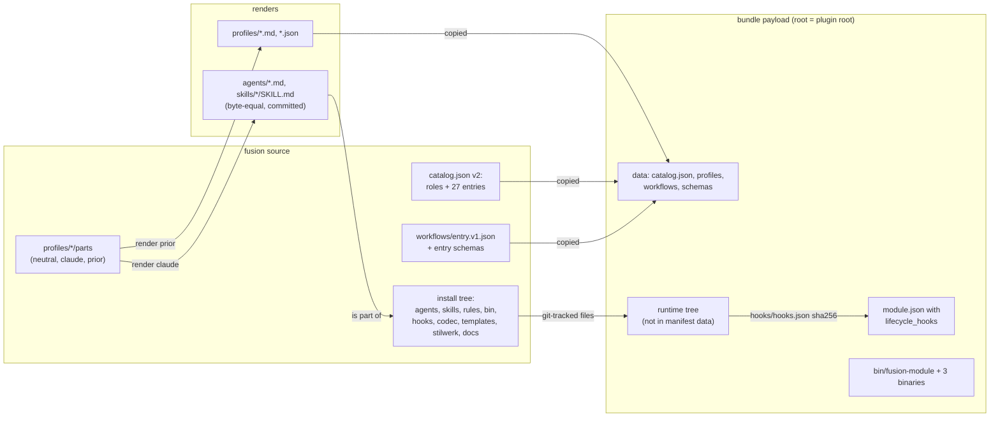
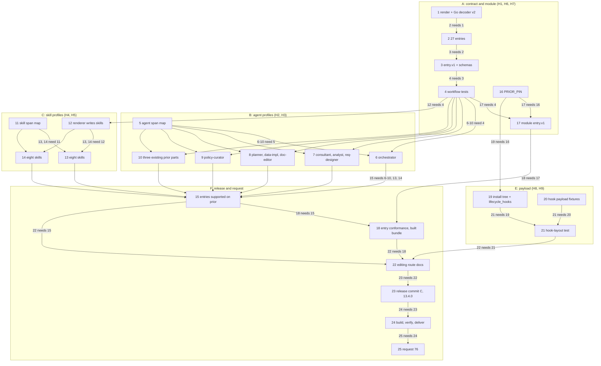

# Implementation Plan: Prior's full-surface hand-over, H1 to H9, and the hand-over request

**Date:** 2026-10-23
**Spec:** none — planned from the work package brief `261023-1846-prior-full-surface-handover-h1-to-h9.md` and from `Prior: docs/design/fusion-full-surface-handover-to-fusion.md` at Prior `7ac0845` (`sha256:9eca479aa14f5de81cadfd5a004d08dc9c9eca486f13a782640eb719a4748254`), read only.
**Decidability:** The load-bearing question is whether the bundle built here lets Prior start each of the 27 fusion functions with the same structural effect as Claude Code. Fusion cannot decide that: only Prior's runs against its recorded baselines can, and that is Prior's step 28 and its comparison runs. Fusion's mechanisms answer three narrower questions, each decidable from inputs fusion holds: (1) is Claude Code under fusion unchanged, decided by byte equality of every Claude render against the committed `agents/*.md` and `skills/*/SKILL.md`; (2) does the module interpret `entry.v1` as specified, decided by conformance against a fake host; (3) do the bundled hooks behave as the plugin tree's, decided by running both on the same payloads and comparing stdout and every written file. One sub-question the hand-over implicitly poses is not decidable from fusion's text, namely which files a helper, hook or skill reads at run time. The plan does not predict it: the payload carries the tree an install holds (decision `261023-1854-which-plugin-tree-does-the-bundle-payload-carry-for-the-helper-runtime.md`, recommended option 2), which is the change of mechanism `rules/critical-stance.md` §4 asks for.

## Directive

The user asked on 261023 whether H1 to H9 were implemented, and on hearing that none is, asked for the work to be filed, claimed and planned. The goal: implement in fusion the nine requirements Prior handed over so that Prior can host the full fusion surface, then put the hand-over to Prior as request 76 in `codec/fixtures/prior/REQUESTS.md`, carrying everything the hand-over's `## What the request should carry` lists and fusion's position on the B2 question. Prior reads the request row by row against H1 to H9 (its step 45); each row must be met or carry fusion's reason for being deliberately different.

## Current State

Verified at fusion `8530c67c` (v13.3.3), Prior read at `08c57fb`:

- **Catalog.** `catalog/catalog.json` is `{"schema": "fusion.catalog/v1", "roles": [...]}`, 16 roles. Three roles are converted to span parts and generate their prompts byte for byte (`code-implementer`, `reviewer`, `state-auditor`, plus `explorer` with no Claude prompt). `catalog/src/render.ts` holds the renderer and Prior's exact key sets (`PRIOR_CATALOG_KEYS = ["schema", "roles"]`). `catalog/schemas/FROZEN` freezes 14 published assets; `catalog/src/__tests__/frozen.test.ts` requires FROZEN to name exactly every `*.v1.json` on disk. `HOST_TOKENS` in `catalog/src/__tests__/render.test.ts` forbids Claude mechanics in a `neutral` part.
- **Module.** `adapters/prior/fusionmodule/` serves `fusion.explorer.v1` and `fusion.repair.v1`; `internal/steps/catalog.go` `LoadCatalog` decodes the catalog with the same exact key set and the literal `fusion.catalog/v1`. `adapters/prior/PRIOR_PIN` is `10ad78b…`. Prior's `moduleapi/v1` changed once since, at `bfdddd0` (`git log 10ad78b..08c57fb -- moduleapi/v1 go.mod`), adding `entry_wire.go` and `Manifest.LifecycleHooks`.
- **Bundle.** `adapters/prior/fusionmodule/cmd/fusion-bundle/main.go` assembles data files (rendered profiles, `catalog.json`, `workflows/*.v1.json`, `schemas/*.v1.json`), the launcher `bin/fusion-module` and three binaries. No helper runtime and no hook is in the payload. Data files are written 0400 and listed in the manifest's `data`, which the module reads in full at start (1 MiB bound per file).
- **Prior's side.** The three entry services are model tools, not module calls: `Prior: internal/supervisor/general_tools.go` binds `host.question.v1`, `host.exec.v1` and `host.dispatch.v1` as tools of both model loops. The contained executor mounts payload parts at `/opt/fusion/<part>`: required `bin`, `rules`, `codec/dist`; deferred `hooks`, `agents/orchestrator.md`, `.claude-plugin/plugin.json` (`Prior: internal/supervisor/exec.go`). Admission reads entry arguments in the inventory's shape `{items: [{name, kind, required, values?}]}` with kinds `flag`, `option`, `positional`, `parameter-line`, `first-message` (`Prior: internal/fusionhost/admission.go`). Prior's catalog loader decodes `catalog.json` with exactly `schema` and `roles` (`Prior: internal/fusionhost/external_catalog.go` `parseExternalCatalog`); entries arrive with its step 28.
- **Codec.** `codec/dist/fusion-record.js` is `sha256:b404745831dd921bfbae78f52df49604d22f4f78b7c07bce067cc9078e262e2d`, unchanged since `aa4277d8` (`git log aa4277d8..HEAD -- codec/dist codec/contract codec/schemas codec/package.json bin/fusion-record` is empty) and Prior's `QualifiedCodecDigest` since `08c57fb`. So no re-pin request has to precede the hand-over, provided no step here moves a codec byte.
- **Requests.** `REQUESTS.md` ends with `### Prior's answer to 75(b) at 08c57fb`; no request is open; request 75's `### What fusion does with the answer` promises the hand-over "under a number it assigns after this one", naming `b4047458…`. The next free number is **76**.
- **What the hand-over's lists miss**, read in fusion's tree: `bin/fusion-paths` and `bin/fusion-rules` read `agents/<name>.md` and `skills/<name>/SKILL.md`; sixteen `bin/` helpers start `hooks/dist/*.js`; `/fusion:help` reads `docs/` and the three READMEs; every `SKILL.md` carries host tokens the neutral-part lint refuses. These findings drive decisions D3 and D4 below.
- **Growth bounds.** `README-hooks.md` `### Growth bounds on the shipped text` bounds `agents/*.md`, `skills/*/SKILL.md` and the hook test suite, and charges `CLAUDE.md` to every dispatch path at zero head-room. `catalog/` and `adapters/` are bounded by nothing.

## Approach

**One mechanism per concern, each one already in the tree.** The role catalog and its span-part renderer (decision `261010-1235-…`, option 1) become the source for all 27 entries; the generic workflow joins `explorer.v1` and `repair.v1` under the existing workflow shape and freeze rule; the module interprets it on the existing observe-then-act executor; the bundle assembler adds the plugin's runtime tree beside the data files it already writes; the request follows requests 70 and 75 in form.

**The Claude distribution does not change.** Every converted agent and skill is a render whose bytes equal the committed file, held by test; no step edits a bounded surface's bytes except the release step's help paragraph, which every release adds. So no growth bound is spent by the conversion, and `CLAUDE.md` is not touched. If an executor finds that an edit to `agents/`, `skills/` or a rule file is needed after all, it stops and reports: the way out of a red bound is a cut, or the head-room raise `260927-2319_*_does-the-growth-bound-on-shipped-text-yield-to-the-dual-host-prompt-set.md` allows, never a baseline edit.

**Five choice points are decisions for the user**, filed in this package and cited, not decided here. The plan is written against each recommended option; a different answer changes the steps named in `## Open Questions`, and the plan is re-filed.

| Id | Decision record | Recommended | Steps it gates |
|---|---|---|---|
| D1 | `261023-1854-under-prior-do-the-hook-rows-keep-going-to-orchestrator-events-jsonl.md` | option 1, narrow the treatment row to match B2 | 25 |
| D2 | `261023-1854-does-the-catalog-gain-entries-under-fusion-catalog-v1-or-as-v2.md` | option 2, `fusion.catalog/v2` | 1, 2 |
| D3 | `261023-1854-how-does-a-skill-become-a-profile-when-its-body-carries-claude-mechanics.md` | option 1, span parts for skills and agents, files generated | 5 to 14 |
| D4 | `261023-1854-which-plugin-tree-does-the-bundle-payload-carry-for-the-helper-runtime.md` | option 2, the tree an install holds | 19, 21 |
| D5 | `261023-1854-which-schemas-bind-an-entry-run-of-an-agent-that-is-also-a-workflow-role.md` | option 1, the workflow's declared schemas bind an entry run | 3, 6 to 10, 13, 14, 17 |

**Where fusion departs from a "Likely place" or a stated mechanism, and why:**

| H | Hand-over suggestion | This plan | Reason |
|---|---|---|---|
| H1 | `entries` beside `roles` | the same, under `fusion.catalog/v2` if D2 rules so | the name says the shape for two exact-key decoders (D2) |
| H1 | "argument schema" | the inventory's argument declaration `{items: [{name, kind, required, values?, note?}]}` | it is the shape Prior's admission already reads; derived from fusion's own sources, so rows differ from Prior's inventory where fusion's text does (for instance, Prior's inventory lists `**Work-item:**` for `code-implementer`, which `agents/code-implementer.md` does not parse; the roster is `README-agents.md` `## Dispatch parameters`) |
| H2, H3 | `catalog/profiles/<id>/` | the same; agent entries name the role's profile | D5: the workflow's schemas bind an entry run, so one profile per agent suffices |
| H4, H5 | neutral part read from `SKILL.md`, "never a copy" | span parts under `catalog/profiles/skill-<name>/`, `SKILL.md` generated byte-equal | D3: the host-token lint and ruling `261009-1024-…` exclude Claude mechanics from Prior text; one mechanism for all 27 |
| H6 | the run step names a role | the run step is a `host_service: host.role.run.v1` step whose `input_from` takes the role from the invocation's entry | a generic workflow has no fixed role, and the existing workflow shape admits this form without a schema change (one of `role` or `host_service`); the test "every host_service appears in requires" covers it |
| H7 | `internal/hostsvc/` gains three new clients | none; the fake host gains the three services | Prior offers the three as model tools (`Prior: internal/supervisor/general_tools.go`); the module calls none of them, it declares them in `entry.v1` `requires` so Prior grants them to the role run |
| H7 | `FUSION-MODULE` as spelled | `PRIOR_REPO=/Users/kai/Projects/productive/F09-Prior` prefixed | `stage.sh` exits 2 without it (`adapters/prior/README.md` `## How the sources are built`) |
| H8 | payload carries `bin/`, `rules/`, `codec/dist/`, `templates/`, `stilwerk/` | the whole tree an install holds | D4: the listed parts do not run without `agents/`, `skills/`, `hooks/dist/` and `docs/` |
| H9 | step 38's recorded payloads | payload fixtures authored in fusion from the field set of Prior's analysis `### 1. Per command` | the hand-over states the run log "is in neither repository" |

**Release target: fusion 13.4.0.** A minor version: the repository gains a module capability (`fusion.entry.v1`) and a larger bundle, and the Claude Code distribution gains only the release's own help paragraph and the request text. The bundle's version is `plugin.json`'s (`fusion-bundle` `fusionVersion`), and decision `261014-0830-…` (option 1) rules that a shipped change takes a version; a second bundle under 13.3.3 would be the gap that record closed. Release steps follow `README-agents.md` `## Releasing`, and the bundle is built after the release commit, never before it (`### The Prior module bundle`).

## Implementation Steps

Check commands, cited by name below. Each is one line; run from anywhere.

- `FUSION-CATALOG`: `cd /Users/kai/Projects/productive/F04-FUSION/fusion/catalog && npm ci && npm test`
- `FUSION-MODULE`: `PRIOR_REPO=/Users/kai/Projects/productive/F09-Prior /Users/kai/Projects/productive/F04-FUSION/fusion/adapters/prior/stage.sh test`
- `CHECK-IMPORTS`: `/Users/kai/Projects/productive/F04-FUSION/fusion/adapters/prior/check-imports.sh`
- `HOOKS-WT` (runs against the committed `HEAD`, so after the step's commit): `git -C /Users/kai/Projects/productive/F04-FUSION/fusion worktree add /private/tmp/fusion-hooks-check HEAD && cd /private/tmp/fusion-hooks-check/hooks && npm ci && npm test; git -C /Users/kai/Projects/productive/F04-FUSION/fusion worktree remove --force /private/tmp/fusion-hooks-check`
- `CODEC-PIN`: `shasum -a 256 /Users/kai/Projects/productive/F04-FUSION/fusion/codec/dist/fusion-record.js` prints `b404745831dd921bfbae78f52df49604d22f4f78b7c07bce067cc9078e262e2d`

The hand-over's Acceptance and Verification lines are quoted where a step realises them ("H-line"), so Prior's row-by-row check finds them; a fusion criterion is added beside them, never in their place.

### Contract: H1, H6, H7 (package A, this package if the split is taken)

1. **Renderer and module decoder read the v2 catalog with entries**
   - Executor: code-implementer
   - Files: `catalog/src/render.ts`, `catalog/src/__tests__/render.test.ts`, `catalog/testdata/` (new catalog fixtures), `adapters/prior/fusionmodule/internal/steps/catalog.go` and its tests, `catalog/README.md`
   - Changes: `Catalog` gains `entries: Entry[]` with `{id, kind, profile, class, arguments, requires, support}`; `PRIOR_CATALOG_KEYS` becomes `["schema", "roles", "entries"]`, a new `PRIOR_ENTRY_KEYS`, and the schema literal is the one D2 rules (`fusion.catalog/v2` recommended); `checkPriorCatalogKeys` checks entries too. `renderPrior` emits `profiles/<profile>.{md,json}` for every entry whose `prior` support is not `unsupported`, as it does for roles, once per profile id. New tests over fixture catalogs: entry ids unique and equal to a Claude agent name or a skill directory name; `kind` `agent` iff `agents/<id>.md` exists, `skill` iff `skills/<id>/SKILL.md` exists; `class` one of `asks`, `dispatches`, `plain`; `requires` a subset of `host.question.v1`, `host.exec.v1`, `host.dispatch.v1`; argument kinds from Prior's five; an entry supported on `prior` names a profile with at least one `prior` part, and the service tool names its `prior` parts mention equal its `requires`. The Go decoder accepts the same document with the same exact key sets and refuses one more or one fewer key. `catalog/README.md` `## Layout` and `## The two commands` describe entries.
   - Acceptance: the new fixture tests pass; the tests that read the live `catalog/catalog.json` (`catalog/src/__tests__/render.test.ts`, and in `FUSION-MODULE` the `internal/steps` catalog tests reading it through `FUSION_CATALOG_DIR`) are red, as expected until step 2 writes the v2 document; any other red is a stop.
   - Verification: `FUSION-CATALOG`, then `FUSION-MODULE`, each red only in the files named
   - Dependencies: none (D2 answered)

2. **The 27 entries in the catalog**
   - Executor: data-implementer
   - Files: `catalog/schemas/catalog.schema.json`, `catalog/catalog.json`
   - Changes: the schema's `schema` const per D2 and a `$defs/entry`, its description stating the invariants step 1's tests enforce. `catalog.json` gains 27 entries, one per row of the hand-over's `## The 27 entries`: `kind` and `class` as that table gives them (Prior's inventory, class rule C1, narrow); `profile` the agent's role id or `skill-<name>`; `arguments` derived from fusion's own sources, the skill's `argument-hint` frontmatter and body for skills and `README-agents.md` `## Dispatch parameters` plus the first message for agents; `requires` from the step-5 and step-11 span maps where they exist, else the hand-over's class (`asks` implies `host.question.v1`, `dispatches` `host.dispatch.v1`) plus `host.exec.v1` for every entry whose text calls a `bin/` helper; `support` `{"claude-code": "supported", "prior": "unsupported"}` for all 27. `roles` unchanged. A short note beside the step's commit lists every argument row that differs from Prior's inventory and why, for step 25.
   - Acceptance: H-line "`FUSION-CATALOG` exits 0; the frozen-asset test is updated through its documented route, not bypassed" (no frozen asset moves here); `FUSION-MODULE` exits 0; `jq '.entries|length' catalog/catalog.json` prints 27 and `jq '[.entries[].class]|group_by(.)|map({(.[0]):length})|add' catalog/catalog.json` prints 14 `asks`, 2 `dispatches`, 11 `plain`.
   - Verification: `FUSION-CATALOG`, then `FUSION-MODULE`
   - Dependencies: 1

3. **The `entry.v1` workflow and its two schemas**
   - Executor: data-implementer
   - Files: `catalog/workflows/entry.v1.json`, `catalog/schemas/entry-request.v1.json`, `catalog/schemas/entry-result.v1.json`, `catalog/schemas/FROZEN`, `catalog/schemas/workflow.schema.json` (description only)
   - Changes: capability `fusion.entry.v1`; steps `compose` (`host.role.compose.v1`), `workspace` (`host.workspace.v1`), `run` (`host_service: host.role.run.v1`, `input_from` naming the entry's profile as the role, `role_input_schema` `schemas/entry-request.v1.json`, `forwarded` `verbatim`, `recovery_ref`), with `completion` `result_schema` `schemas/entry-result.v1.json`, `capture` (`host.capture.v1`), `integrate` (`host.integrate.v1`), then `snapshot`/`workbench` as the request-69 contract uses them and `push` only when the entry declares a remote. `revise_bound` 0. `requires` exactly the six request-69 services, `host.role.read.v1`, `host.role.run.v1`, `host.role.complete.v1` as every workflow's role steps need, and the three entry services. `entry-request.v1.json`: `{run_id, entry: {id, kind, profile}, arguments: [{name, value}], project_context, route?, audit_ref?}`; `entry-result.v1.json`: `{status: completed | refused | recovery-required | ended, ending: {class, reason}, questions: [...], commits: [...], violations: [...]}`, closed objects in the style of the frozen repair schemas. FROZEN gains three lines under a comment that they are fusion's proposal in request 76, not yet accepted by Prior. `workflow.schema.json`'s description gains the sentence that a `host_service` step may take its role from the invocation.
   - Acceptance: H-line "the workflow validates against `workflow.schema.json`; `FUSION-CATALOG` exits 0"; `frozen.test.ts` passes with 17 assets; `FUSION-MODULE` exits 0 (no module code reads the new file yet).
   - Verification: `FUSION-CATALOG`, then `FUSION-MODULE`
   - Dependencies: 2 (D5 answered)

4. **Catalog tests for the generic workflow**
   - Executor: code-implementer
   - Files: `catalog/src/__tests__/render.test.ts`, `catalog/src/__tests__/schema-cases.test.ts`, `catalog/testdata/entry-schema-cases.v1.json` (new shared case table, as `repair-schema-cases.v1.json`)
   - Changes: tests that `entry.v1` validates; that its `requires` equals the nine services plus the three role services; that every entry's `requires` is a subset of the workflow's; that a role-from-invocation step resolves for every entry supported on `prior`; and a shared case table for the two entry schemas, which the Go validator runs in step 17 as it runs the repair table.
   - Acceptance: `FUSION-CATALOG` exits 0.
   - Verification: `FUSION-CATALOG`
   - Dependencies: 3

16. **Move the Prior build pin to the entry wire**
   - Executor: code-implementer
   - Files: `adapters/prior/PRIOR_PIN`, `adapters/prior/README.md` (`## Layout` row, `### Moving the pin`), `README-agents.md` `### The Prior module bundle` (the pin sentence)
   - Changes: the pin to Prior's `main` head at the time of the step, at or after `bfdddd0`; record `git -C /Users/kai/Projects/productive/F09-Prior diff 10ad78b <new> --stat -- moduleapi/v1 go.mod go.sum` in the commit message, which at `08c57fb` names `entry_wire.go`, `manifest.go`, `protocol.json`'s Go side and their tests.
   - Acceptance: `FUSION-MODULE` and `CHECK-IMPORTS` exit 0 at the new pin with no source change; if they do not, the wire change is followed in this step and named.
   - Verification: `FUSION-MODULE`, then `CHECK-IMPORTS`
   - Dependencies: none

17. **Module support for `entry.v1`**
   - Executor: code-implementer
   - Files: `adapters/prior/fusionmodule/internal/entry/` (new) and tests, `adapters/prior/fusionmodule/internal/steps/` (entry profile and workflow loading; the shared entry case table in `schema_cases_test.go`), `adapters/prior/fusionmodule/internal/fixture/` (fake `host.question.v1`, `host.exec.v1`, `host.dispatch.v1` recorded inside a scripted role run, and the entry services of request 69), `adapters/prior/fusionmodule/cmd/fusion-module/main.go`, `adapters/prior/README.md`
   - Changes: interpret `entry.v1` on the existing step executor and serve `fusion.entry.v1` beside the two capabilities; the run step resolves the entry's profile through the catalog's entries and validates role input and result against the definition's schemas (D5); observe before acting on restart as `internal/repair/` does, with the same read table and audit-reference rule (`steps.Execute`); no client for the three entry services (see `## Approach`).
   - Acceptance: H-line "`FUSION-MODULE` passes; `adapters/prior/check-imports.sh` passes; conformance drives one `plain`, one `dispatches` and one `asks` entry against the fake host", here at unit level over the fixture payload (`help`, `reconcile`, `memo` proposed; any one per class serves), the built-bundle run being step 18; a kill after each persisted boundary and a resume reproduce the envelope with zero further role runs.
   - Verification: `FUSION-MODULE`, then `CHECK-IMPORTS`
   - Dependencies: 4, 16

### Agent profiles: H2, H3 (package B)

5. **Span map of the eight agents and the three existing `prior` parts**
   - Executor: analyst
   - Files: `$OUT_ANALYSIS/<stamp>-agent-span-map-for-entry-profiles.md` (the analyst's own store)
   - Changes: for `orchestrator`, `consultant`, `analyst`, `requirements-designer`, `implementation-planner`, `data-implementer`, `document-editor`, `policy-curator`: each span of `agents/<id>.md` classed `neutral` or `claude` by `HOST_TOKENS`, and for each `claude` span what the `prior` replacement must say in terms of `host.exec.v1` (Setup and every helper call), `host.question.v1` (each `AskUserQuestion`), `host.dispatch.v1` (each `Agent(`), with chat questions left as turn ends (Prior step 14). For `code-implementer`, `reviewer`, `state-auditor`: which of the three services their `prior` parts lack. The per-entry `requires` set. Method as `261010-1504-span-map-and-repair-correspondence.md`.
   - Acceptance: every byte of the eight prompts lies in exactly one span (the analyst states the check it ran); every `claude` span has a stated replacement.
   - Verification: the report's own tiling check, re-run by the reviewer of step 6
   - Dependencies: none (D3 answered)

6. **Profile: `orchestrator`**
   - Executor: code-implementer
   - Files: `catalog/profiles/orchestrator/profile.json`, `catalog/profiles/orchestrator/parts/*.md`
   - Changes: the parts per step 5; `profile.json` with the seven Prior keys, `input_schema`/`result_schema` the entry schemas (D5), `tools_ceiling` from the span map, `execution_policy` `{"claude-code": "claude-guided", "prior": "prior-enforced"}`. `agents/orchestrator.md` becomes render output.
   - Acceptance: H-line "`npm run render -- claude` reproduces each `agents/<id>.md` byte for byte, so Claude Code under fusion is unchanged; `npm run render -- prior <tmp>` emits the four profiles; the hooks suite passes in a worktree", for this id; `git diff --exit-code agents/` after the Claude render.
   - Verification: `FUSION-CATALOG`, then `HOOKS-WT`
   - Dependencies: 4, 5

7. **Profiles: `consultant`, `analyst`, `requirements-designer`**
   - Executor: code-implementer
   - Files: `catalog/profiles/{consultant,analyst,requirements-designer}/`
   - Changes: as step 6.
   - Acceptance: as step 6, for these ids; with step 6 this completes H2's four.
   - Verification: `FUSION-CATALOG`, then `HOOKS-WT`
   - Dependencies: 4, 5

8. **Profiles: `implementation-planner`, `data-implementer`, `document-editor`**
   - Executor: code-implementer
   - Files: `catalog/profiles/{implementation-planner,data-implementer,document-editor}/`
   - Changes: as step 6.
   - Acceptance: as step 6, for these ids.
   - Verification: `FUSION-CATALOG`, then `HOOKS-WT`
   - Dependencies: 4, 5

9. **Profile: `policy-curator`**
   - Executor: code-implementer
   - Files: `catalog/profiles/policy-curator/`
   - Changes: as step 6.
   - Acceptance: as step 6; with step 8 this completes H3's four new ids.
   - Verification: `FUSION-CATALOG`, then `HOOKS-WT`
   - Dependencies: 4, 5

10. **The three services in the existing `prior` parts**
    - Executor: code-implementer
    - Files: `catalog/profiles/{code-implementer,reviewer,state-auditor}/parts/*-prior.md` where step 5 found a service missing
    - Changes: add the three services to those `prior` parts. `profile.json` of the three is unchanged (D5).
    - Acceptance: H-line "as step 21; every agent in the catalog has a `prior` part"; the rendered Prior profiles of the three move, the Claude renders do not; the explorer and repair conformance stays green (`FUSION-MODULE`).
    - Verification: `FUSION-CATALOG`, then `HOOKS-WT`, then `FUSION-MODULE`
    - Dependencies: 4, 5

### Skill profiles: H4, H5 (package C)

11. **Span map of the sixteen skills**
    - Executor: analyst
    - Files: `$OUT_ANALYSIS/<stamp>-skill-span-map-for-entry-profiles.md`
    - Changes: as step 5, for every `skills/<name>/SKILL.md`, frontmatter included (it is Claude mechanics: the Claude render must reproduce it, the Prior render does not carry it).
    - Acceptance: as step 5.
    - Verification: the report's tiling check
    - Dependencies: none (D3 answered)

12. **The renderer writes skills**
    - Executor: code-implementer
    - Files: `catalog/src/render.ts`, `catalog/src/__tests__/render.test.ts`, `catalog/README.md` (`## Editing a converted prompt` covers skills)
    - Changes: a profile `skill-<name>` renders its Claude output to `skills/<name>/SKILL.md` (the `claude` target resolved from the entry's kind, never from the profile id's prefix); the byte-equality test covers skills as it covers agents; the host-token test applies to skill parts unchanged.
    - Acceptance: H4's render test in the form D3 gives it: each skill's Claude render equals the committed `SKILL.md` byte for byte; `FUSION-CATALOG` exits 0 with no skill profile written yet (skipped as "no profile").
    - Verification: `FUSION-CATALOG`
    - Dependencies: 4

13. **Skill profiles: `setup`, `check`, `wp`, `wp-order`, `reconcile`, `curate`, `discuss`, `commit`**
    - Executor: code-implementer
    - Files: `catalog/profiles/skill-<name>/` for the eight
    - Changes: parts per step 11; `profile.json` with the entry schemas (D5).
    - Acceptance: H-line "a render test proves each neutral part equals the committed `SKILL.md` body; `FUSION-CATALOG` exits 0", read under D3 as: each Claude render equals the committed `SKILL.md`; `git diff --exit-code skills/` after the Claude render; `HOOKS-WT` passes.
    - Verification: `FUSION-CATALOG`, then `HOOKS-WT`
    - Dependencies: 11, 12

14. **Skill profiles: `cleanup`, `archive`, `memo`, `post`, `news`, `cadence`, `migrate`, `help`**
    - Executor: code-implementer
    - Files: `catalog/profiles/skill-<name>/` for the eight
    - Changes: as step 13.
    - Acceptance: H-line "as step 23; all 16 skills have profiles"; as step 13.
    - Verification: `FUSION-CATALOG`, then `HOOKS-WT`
    - Dependencies: 11, 12

### Bundle payload: H8, H9 (package E)

19. **The payload carries the install tree and the hook declaration**
    - Executor: code-implementer
    - Files: `adapters/prior/fusionmodule/cmd/fusion-bundle/main.go` and a new `main_test.go`, `adapters/prior/build.sh` (header and usage text only, if the assembler's flags change), `adapters/prior/README.md` `## Building the bundle`, `README-agents.md` `### The Prior module bundle`
    - Changes: after the data files, the assembler copies every file `git -C <fusion-root> ls-files -s -- <entries>` lists for the entries of `install.sh`'s copy loop, at the payload root in the plugin's layout, mode 0500 for git mode `100755` and 0400 otherwise, none of them in the manifest's `data`. A test parses the loop out of `install.sh` and fails when the assembler's list differs. The manifest gains `lifecycle_hooks`: `path` `hooks/hooks.json`, `sha256` of those bytes, `protocol_subset` with events `SessionStart`, `PreToolUse`, `PostToolUse`, `SubagentStop`, reply forms and fields as step 21 measures them. The assembler refuses a runtime path that collides with a data path or with `bin/fusion-module`. Node's floor is stated by the carried `hooks/package.json` and `codec/package.json` `engines` (`>=20.12.0`).
    - Acceptance: H-line (payload part) "`build.sh build` twice in fresh directories yields the same digest; `build.sh verify` passes", which Prior's `InspectBundle` reaching `VerifyFile` for the declaration proves; the bundled `bin/fusion-paths orchestrator` run from the unpacked payload against a fixture workbench prints the same keys as from the plugin tree.
    - Verification: `PRIOR_REPO=/Users/kai/Projects/productive/F09-Prior /Users/kai/Projects/productive/F04-FUSION/fusion/adapters/prior/build.sh build`, twice, then `build.sh verify <out>`, then `FUSION-MODULE`
    - Dependencies: 16 (D4 answered)

20. **Hook payload fixtures**
    - Executor: data-implementer
    - Files: `adapters/prior/testdata/hook-payloads/<command>/*.json` (new), `adapters/prior/testdata/hook-payloads/README.md`
    - Changes: one stdin payload per registered command and per branch that writes something: SessionStart (fresh and resumed session), PreToolUse and PostToolUse for `Write`, `Edit`, `Bash` and `Agent` with the fields Prior's analysis on fusion hook surfaces (Prior, 2026-10-22) `### 1. Per command` names (`session_id`, `tool_name`, `tool_input`, `tool_use_id`, `tool_response`, `agent_id`), SubagentStop; the README cites that section at Prior `08c57fb` as the field source and says the payloads are fusion's, since the hand-over states the original run log is in neither repository.
    - Acceptance: every command in `hooks/hooks.json` has at least one payload; each file parses as JSON.
    - Verification: `for f in /Users/kai/Projects/productive/F04-FUSION/fusion/adapters/prior/testdata/hook-payloads/*/*.json; do jq -e . "$f" >/dev/null || echo "bad $f"; done`
    - Dependencies: none

21. **Hook-layout conformance**
    - Executor: code-implementer
    - Files: `adapters/prior/fusionmodule/conformance/hooks_test.go` (new), `adapters/prior/README.md` `### Conformance against a built bundle`
    - Changes: unpack the bundle; build one fixture repository with a workbench (`git init`, fixed identity, `fusion-workbench/.fusion-setup`); run each `hooks.json` command twice per payload, once with `CLAUDE_PLUGIN_ROOT` at the unpacked payload and once at the plugin tree, each in a fresh copy of the fixture; compare stdout and every file written, timestamps and generated identifiers normalised. Assert that every reply observed lies inside the declared `protocol_subset`, so the declaration is measured, not copied. No hook source changes.
    - Acceptance: H-line "the hook-layout test unpacks the bundle and runs each bundled hook program with step 38's recorded payloads; stdout and every file written equal the same run from the plugin tree, timestamps aside. `FUSION-MODULE` passes, and the hooks suite passes in a worktree", with fusion's payloads of step 20 in place of step 38's.
    - Verification: `FUSION_BUNDLE_DIR=<out of step 19> FUSION-MODULE`, then `HOOKS-WT`
    - Dependencies: 19, 20

### Release and request (package F)

15. **Entries go `supported` on Prior**
    - Executor: data-implementer
    - Files: `catalog/catalog.json`
    - Changes: `support.prior` to `supported` for every entry whose profile has a `prior` part, and `requires` brought to the services those parts name.
    - Acceptance: `FUSION-CATALOG` exits 0, including step 1's invariant that a supported entry's `requires` equals its `prior` parts' service names; `npm run render -- prior <tmp>` writes 27 entry profiles (24 new texts plus the three role texts) and reports nothing missing.
    - Verification: `FUSION-CATALOG`, then `cd /Users/kai/Projects/productive/F04-FUSION/fusion/catalog && npm run render -- prior "$(mktemp -d)"`
    - Dependencies: 6, 7, 8, 9, 10, 13, 14

18. **Conformance of `entry.v1` against a built bundle**
    - Executor: code-implementer
    - Files: `adapters/prior/fusionmodule/conformance/entry_test.go` (new), `adapters/prior/README.md`
    - Changes: start the extracted launcher as Prior's host does and drive one `plain`, one `dispatches` and one `asks` entry through `fusion.entry.v1` against the fake host, with a scripted role run that makes the class's service calls.
    - Acceptance: H7's conformance clause against the built bundle; the explorer and repair cases stay green.
    - Verification: `PRIOR_REPO=/Users/kai/Projects/productive/F09-Prior /Users/kai/Projects/productive/F04-FUSION/fusion/adapters/prior/build.sh build <out>`, then `FUSION_BUNDLE_DIR=<out> FUSION-MODULE`, then `CHECK-IMPORTS`
    - Dependencies: 15, 17

22. **The editing route, written where editors read it**
    - Executor: code-implementer
    - Files: `README-agents.md` (`## The agents`, `### skills/ — one file per slash command`, `## Adding a new agent`, `## Releasing` step 0), `catalog/README.md`
    - Changes: state that every agent and skill is render output of `catalog/profiles/`, with the three-command route; add `FUSION-CATALOG` to release step 0, because the hooks suite reads the generated files and would not notice a hand edit. `CLAUDE.md` is not touched (zero head-room on the dispatch paths); its `agents/*.md` row already points at `README-agents.md` `## The agents`.
    - Acceptance: `HOOKS-WT` passes (the reference-resolution lint reads the READMEs).
    - Verification: `HOOKS-WT`
    - Dependencies: 15, 18, 21

23. **Release commit for 13.4.0, the candidate commit C**
    - Executor: code-implementer
    - Files: `.claude-plugin/plugin.json` (`version` 13.4.0), `install.sh` header pin example, `README.md` pin example, `catalog/profiles/skill-help/parts/` (the `### 4. Update` paragraph for 13.4.0, rendered into `skills/help/SKILL.md`)
    - Changes: `README-agents.md` `## Releasing` step 0 and step 1 on the fusion side; the marketplace bump and the tag wait (see `## Where this work stops`). `bin/fusion-review-coverage --since v13.3.3` is run and its result stated in the commit message. The help paragraph is the one bounded-surface addition in the plan; if `skills/` growth turns red, the paragraph is cut, not the bound.
    - Acceptance: `claude plugin validate .` reports passed; `claude --plugin-dir . --agent fusion:orchestrator -p "reply SMOKE-OK"` replies; `FUSION-CATALOG` and `HOOKS-WT` pass; `CODEC-PIN` prints `b4047458…`.
    - Verification: `cd /Users/kai/Projects/productive/F04-FUSION/fusion && claude plugin validate .`, then `FUSION-CATALOG`, then `HOOKS-WT`, then `CODEC-PIN`
    - Dependencies: 22

24. **Build, verify, conform and deliver the bundle at C**
    - Executor: code-implementer
    - Files: none in either repository; outputs under `TMPDIR` and `~/.local/share/prior/incoming/fusion/13.4.0/<digest-hex>/`
    - Changes: `build.sh build` twice into fresh directories; `diff -r` of the two; `build.sh verify`; the conformance suite with `FUSION_BUNDLE_DIR`; `build.sh deliver`. The executor reports the bundle digest, tarball sha256, file count, delivered path, `PRIOR_PIN`, `fusion_revision` (C, never `+dirty`) and the conformance case counts for step 25.
    - Acceptance: H8 H-line "`build.sh build` twice in fresh directories yields the same digest; `build.sh verify` passes; `build.sh deliver` prints the incoming path"; the conformance suite passes; `CODEC-PIN` holds.
    - Verification: `PRIOR_REPO=/Users/kai/Projects/productive/F09-Prior /Users/kai/Projects/productive/F04-FUSION/fusion/adapters/prior/build.sh deliver`
    - Dependencies: 23

25. **Request 76, the hand-over**
    - Executor: data-implementer
    - Files: `codec/fixtures/prior/REQUESTS.md` (append only)
    - Changes: a section `## Full fusion surface (request 76)` in the form of requests 70 and 75: **Written against** (fusion C and the request commit's parent, Prior's head as read, both pins read with `git show`); **The bundle** (item 1: digest, delivered path, tarball sha256, `PRIOR_PIN`, conformance results from step 24); **the codec the bundle carries** (`b4047458…`, Prior's `QualifiedCodecDigest` since `08c57fb`, so no re-pin precedes this request); **The 27 entries** (item 2: id, kind, class, profile, support, arguments); **Host services required** (item 3: the six request-69 services and `host.question.v1`, `host.exec.v1`, `host.dispatch.v1`, plus the three `host.role.*` the run step uses); **The `lifecycle_hooks` declaration** (item 4: path, sha256, `protocol_subset`, and the hook files it covers: `hooks/hooks.json`, `hooks/dist/` and the helpers, now inside the install tree); **What Prior is asked to run** (item 5: install, trust and activate as distinct recorded actions; a conformance run with a scripted backend for one `plain`, one `dispatches` and one `asks` entry; preferred form of the answer: a response document at a Prior commit giving each H row and each carry item one verdict); **H1 to H9, row by row**: met, or deliberately different with fusion's reason (the departure table of `## Approach`, the argument rows that differ from Prior's inventory, and the mount list Prior is asked to widen to the install tree's top-level entries); **The B2 question**: fusion's ruling as D1 records it, or the statement that fusion has not ruled; **Decisions Prior is asked to confirm**: D2, D4, D5 and the `entry.v1` run-step form; **What fusion does with the answer** (accepted, corrected, refused, deferred, as at 74 and 75; and that a correction to a frozen entry schema is a new version beside it); **Requests 64 and 67 to 76, as they stand** (76 asked). No line above is edited. The `### What fusion does with the answer` clause of request 75 about the hand-over is answered by this section.
    - Acceptance: every one of the five "carry" items and the codec digest is present under its own heading; H1 to H9 each have one row; the digest and path equal step 24's report; `CODEC-PIN` holds; the file is appended to, never edited above (`git diff` of the file shows additions only).
    - Verification: `git -C /Users/kai/Projects/productive/F04-FUSION/fusion diff --numstat -- codec/fixtures/prior/REQUESTS.md` prints `<n> 0`, then `CODEC-PIN`
    - Dependencies: 24 (D1 ruled, or its absence stated)

### Order of the steps

The step list is the full dependency definition; every edge below is one it declares. Step numbers are anchors, so the listing order above groups by package rather than by number.

Packages B, C and E can run in parallel once A's steps 4 and 16 are done; E needs only step 16. The fan-in at step 15 is the one point where every profile must exist.

## Proposed split

The work is too large for one package run in one line. By the figures: 24 prompt files of 527 kB to split into span parts (`wc -c` over the eight agents and sixteen skills), a new Go workflow interpreter with conformance, a payload change with a cross-process hook test, and a release with a cross-repository request. Each of those is a unit somebody can finish, review and close on its own, and four of them can run in parallel. We propose five packages, the user confirming the split as the orchestrator's maintenance operation (`rules/fusion-workbench-conventions.md` `## Work packages`):

| Package | Steps | H | Depends on |
|---|---|---|---|
| A, this package, its brief narrowed to the contract and the module | 1, 2, 3, 4, 16, 17 | H1, H6, H7 | none |
| B, agent profiles | 5 to 10 | H2, H3 | A (`terminal`) |
| C, skill profiles | 11 to 14 | H4, H5 | A |
| E, bundle payload with hooks | 19, 20, 21 | H8 (payload), H9 | A (step 16) |
| F, release 13.4.0 and request 76 | 15, 18, 22, 23, 24, 25 | H7 (built-bundle conformance), H8 (deliver), the request | A, B, C, E |

Each new package's plan carries its steps from this plan by citation, keeping their numbers as anchors. If the user prefers one package, this plan runs as written, in the order of the graph.

## Where this work stops

- The work is finished when request 76 is appended to `codec/fixtures/prior/REQUESTS.md` at a committed fusion commit, carrying the five items, the codec digest, a row for each of H1 to H9 and fusion's position on B2, and the user has been told the commit to report to Prior.
- No step starts while the decision it is gated on (the table in `## Approach`) is `open`; a ruling other than the recommended one re-files this plan before its gated steps start.
- No codec byte moves: `CODEC-PIN` prints `b4047458…` at C and at the request commit. If any step needs a codec change, the work stops there, because a re-pin request would then have to precede request 76.
- The Claude distribution is unchanged except for the 13.4.0 help paragraph and `REQUESTS.md`: at C, `git diff v13.3.3 C -- agents skills rules hooks bin templates stilwerk docs` shows only `skills/help/SKILL.md`'s `### 4. Update` paragraph. Any other difference is a stop.
- The bundle is delivered only from a clean C whose `plugin.json` names 13.4.0; a `+dirty` identity is never handed over.
- **The tag `v13.4.0` and the marketplace bump are not part of this work.** They wait for Prior's answer to request 76, as `v13.1.0` waited for request 70 (`## Module bundle (released as v13.1.0)` in `REQUESTS.md`), unless the user rules otherwise (`## Open Questions`). Until the tag, main takes no commit to a shipped file other than `REQUESTS.md`; one that must land first moves the candidate, and C, the build and the request are redone under 13.4.1.
- A Prior correction to a frozen entry schema is answered with a new schema version beside it and a new request, never an edit of the frozen file.

## Data Structures

- `catalog.json` (v2 per D2): `{schema, roles: [...unchanged], entries: [{id, kind: "skill" | "agent", profile, class: "asks" | "dispatches" | "plain", arguments: {items: [{name, kind: "flag" | "option" | "positional" | "parameter-line" | "first-message", required, values?, note?}], note?}, requires: [host service], support: {"claude-code", "prior"}}]}`.
- `profiles/<profile>.json`: the seven Prior keys, unchanged in shape; agent and skill entry profiles name `schemas/entry-request.v1.json` and `schemas/entry-result.v1.json`.
- `workflows/entry.v1.json`: the existing `fusion.workflow/v1` shape; the run step is a `host_service: host.role.run.v1` step whose `input_from` names the role from the invocation.
- `module.json`: the existing manifest plus `lifecycle_hooks: {path: "hooks/hooks.json", sha256, protocol_subset: {events, reply_forms, reply_fields}}`.
- Payload root: the module's data and executables, plus the install tree in the plugin's layout, outside `data`.

## API Changes

- Module capability `fusion.entry.v1`, beside `fusion.explorer.v1` and `fusion.repair.v1`.
- Catalog document `fusion.catalog/v2` (per D2), proposed to Prior in request 76.
- Two published schemas, `entry-request.v1.json` and `entry-result.v1.json`, frozen as fusion's proposal.
- No Claude Code surface changes.

## Testing Strategy

Every Claude render is held byte-equal to the committed file, which is the proof that Claude Code under fusion did not change. The catalog suite holds the entry invariants and the schema case table; the Go side runs the same table. The module is proven at unit level over the fixture payload (step 17) and against the built bundle (step 18), with kills at every persisted boundary. The payload is proven by Prior's own inspector (`build.sh verify`), by a byte-for-byte rebuild, and by running every hook from the bundle and from the plugin tree on the same inputs (step 21). `HOOKS-WT` runs after every step that touches generated prompts or READMEs. What none of this proves is Prior's own host behaviour; that is Prior's run of the delivered bundle, asked for in request 76.

## Risks & Mitigations

| Risk | Mitigation |
|---|---|
| Splitting `orchestrator.md` (95 kB) and `policy-curator.md` (79 kB) into parts goes wrong in a way the byte test cannot see: a `claude` span whose `prior` replacement says something else | the span map (step 5) states each replacement before any part is written; the reviewer of each profile step reads parts against the map |
| A hand edit of a generated `agents/*.md` or `SKILL.md` passes the hooks suite and diverges from the parts | release step 0 gains `FUSION-CATALOG` (step 22); the next Claude render overwrites the edit and the byte test names the file |
| Prior corrects the entry schemas after they are frozen | the FROZEN comment marks them as a proposal; a correction costs a `v2` beside them, which the freeze rule already prescribes |
| Prior refuses the larger mount list or the v2 catalog | both are stated as requests in 76 with reasons; Prior's answer is recorded and the user rules before any rebuild |
| The bundle grows to about 1 530 files and 12 MB plus the three binaries | Prior's extractor limits are 16 384 entries and 512 MB (`build.sh` verify probe); the runtime tree is outside `data`, so the module's 1 MiB per-file read bound is not touched |
| A main commit to a shipped file between C and the tag | `## Where this work stops` forbids it until the tag; if unavoidable, the candidate moves to 13.4.1 |
| The help paragraph turns the `skills/` growth bound red | cut the paragraph to fit; the head-room raise of `260927-2319_*_…` is the fallback only on a ruling |
| The executor of a profile step lacks a fresh session for a changed agent | no agent here is dispatched from the session that changes it; the renders are byte-equal, so the installed prompts are what they were |

## Open Questions

- [ ] D1 to D5, as filed (table in `## Approach`). Under D3 option 2 or 3, steps 5 to 14 are re-planned; under D4 option 1 or 3, steps 19 and 21; under D5 option 2 or 3, steps 3, 6 to 10, 13, 14 and 17; under D2 option 1, steps 1 and 2 keep `fusion.catalog/v1`.
- [ ] Does the `v13.4.0` tag wait for Prior's answer to request 76, as `v13.1.0` waited for request 70? The plan assumes yes; the alternative is to tag C at step 23 and ship any Prior correction as 13.4.x. Only this release is affected, so it is a question here and not a record.
- [ ] If D1 is ruled option 1, how is `260922-1059_*_which-treatment-do-the-stores-and-root-files-the-nomenclature-table-omits-take.md` annotated? It is `answered` and its answer covers fourteen rows; the new record narrows one, so a whole-record `Superseded by:` would overstate it. The orchestrator decides the annotation when it records the ruling.
- [ ] Which service carries the push of `entry.v1`? The hand-over names "push when declared" but none of the nine services is a push; Prior's step 17 calls it "a typed operation after integration". Request 76 asks; until answered, step 3 writes no push step and says so in the workflow's description.
- [ ] The dispatch carried `**Work-item:**`, while this agent's parameter is `**Work package:**` (`README-agents.md` `## Dispatch parameters`). The value was used as the work package; the keyword is the dispatcher's to correct.
