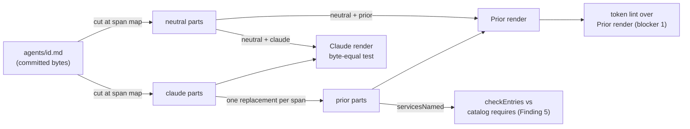

# Analysis: span map of the eight agent prompts, and the entry services of the three converted profiles

**Date:** 2026-10-24 21:11
**Type:** Impact (span map) and Gap (entry services of the existing `prior` parts)
**Status:** Complete
**Requested by:** orchestrator, step 5 of `261023-1854-plan-prior-full-surface-handover-h1-to-h9.md`, for work package `261023-1915-prior-handover-b-agent-profiles`

## Question

Where can `agents/orchestrator.md`, `consultant.md`, `analyst.md`, `requirements-designer.md`, `implementation-planner.md`, `data-implementer.md`, `document-editor.md` and `policy-curator.md` be cut, so that each `neutral` part holds no `HOST_TOKENS` hit and the Claude render stays byte-equal? For each `claude` span, what must the `prior` replacement say in terms of `host.exec.v1`, `host.question.v1` and `host.dispatch.v1`? Which of the three services do the `prior` parts of `code-implementer`, `reviewer` and `state-auditor` lack? And what `requires` set does each agent entry have, compared with `catalog/catalog.json`?

## Scope

- **fusion.** The eight prompts were read with `git show HEAD:agents/<id>.md`. HEAD is `22d16e6aba303199b3dc8fb307598beb79837a20`, committed 2026-10-24 18:02:13 +0200, on branch `main`, `## main...origin/main`. `git diff --quiet HEAD -- agents/` exits 0, so the tree and HEAD agree on every prompt. Also read: `catalog/src/render.ts` (`ENTRY_SERVICES`, `servicesNamed`, `checkEntries`, `priorProfiles`), `catalog/src/__tests__/render.test.ts` (`HOST_TOKENS`, the neutral lint, and the token lint over the live Prior render), `catalog/README.md`, `catalog/catalog.json`, `catalog/workflows/entry.v1.json`, `catalog/schemas/entry-*.v1.json`, and every part under `catalog/profiles/{code-implementer,reviewer,state-auditor}/`.
- **Method.** As `261010-1504-span-map-and-repair-correspondence.md` (`## Findings` `### 1` to `### 3`, and `### Acceptance, as run`). The departures are stated under Finding 1.
- **Prior (read only).** `docs/design/fusion-full-surface-handover-to-fusion.md` (H2, H3), `docs/qualification/fusion-surface/inventory.json` (agent entries 17 to 27), `moduleapi/v1/entry_wire.go` (`ExecCall`, `QuestionCall`, `DispatchCall`), and `internal/fusionhost/{repair_catalog,role_grants,external_catalog}.go`. These were read from the working tree while HEAD moved from `df0e1c0` (2026-10-24 18:44 +0200, `## main...backup/main [voraus 49]`) to `d2ebe611` (2026-10-24 21:07 +0200, `## main...backup/main`). `git diff --stat df0e1c0 d2ebe61` over those files is empty, so every claim below holds at `d2ebe611`.
- **Decisions in force.** D3 `261023-1854-how-does-a-skill-become-a-profile-when-its-body-carries-claude-mechanics.md` (option 1), D5 `261023-1854-which-schemas-bind-an-entry-run-of-an-agent-that-is-also-a-workflow-role.md` (option 1) and D1 `261023-1854-under-prior-do-the-hook-rows-keep-going-to-orchestrator-events-jsonl.md` (option 1) are all `answered`.

## Findings

### 1. Tagging rule, and where it departs from 261010-1504

A line is `claude` when it meets either of two conditions:

- **(a)** It carries a `HOST_TOKENS` hit. The regexes are those in `render.test.ts`, with the helper list read off the live `bin/`.
- **(b)** It states a Claude Code mechanic that Prior has no counterpart for. These are the agent-definition frontmatter, Claude tool surfaces (the MCP tools, WebSearch/WebFetch, Vision, the `Skill` tool, the Bash tool's CWD reset, the `Write` tool, a backgrounded Agent dispatch, the deleted `tools:` allowlist), and the role's own commit mechanics (staging, the commit lock, the staging check).

Every other line is `neutral`.

Two departures from 261010-1504, both deliberate:

- **The persistence clause is dropped.** There, every instruction about how records persist was `claude`, because the repair roles write no workbench on Prior. An entry run does write. It runs fusion's helpers through `host.exec.v1` from the mounted install tree (H8, D4 option 2), and D1 keeps the event log. So a sentence about persistence is `claude` here only through (a) or the commit clause of (b). "Emit `x`" lines and the event-log schema stay `neutral`.
- **Cuts fall on whole lines** so that the parts are easy to cut. There is one exception: `orchestrator.md` line 374, a 2597-byte paragraph whose only token is `` `$OUT_DECISION` ``. It is cut around that 15-byte clause. A neutral run that is only whitespace joins the `claude` span before it.

The Setup span keeps the shape of 261010-1504: the heading plus items 1 and 2, with later items `claude` only by (a). The `prior` part that replaces Setup must keep the heading and the numbers 1 and 2, so that the neutral items 3 onward still follow.

### 2. Span counts

| Agent | Bytes | Spans | claude | neutral | Neutral bytes |
|---|---|---|---|---|---|
| orchestrator | 95734 | 64 | 32 | 32 | 54499 (56 %) |
| consultant | 13046 | 16 | 8 | 8 | 9761 (74 %) |
| analyst | 21484 | 26 | 13 | 13 | 16207 (75 %) |
| requirements-designer | 17664 | 22 | 11 | 11 | 9289 (52 %) |
| implementation-planner | 20617 | 26 | 13 | 13 | 14412 (69 %) |
| data-implementer | 16036 | 18 | 9 | 9 | 12215 (76 %) |
| document-editor | 13230 | 10 | 5 | 5 | 10712 (80 %) |
| policy-curator | 79045 | 56 | 28 | 28 | 64904 (82 %) |
| **total** | 276856 | 238 | 119 | 119 | 191999 (69 %) |

Three spans account for the orchestrator's low share: Setup (span 7, 10475 bytes), Step 4 items 3 to 7 (span 37, 9048 bytes) and the Staging check (span 55, 5821 bytes). All three are Claude-session and commit mechanics.

The requirements-designer is low for a different reason. Five long paragraphs (lines 41 to 55) each carry one store key or `/fusion:direct`. Mid-line cuts there would raise the share. They are optional and change nothing else.

### 3. Replacement classes: what each `prior` part must say

The span tables in Finding 4 name one or more of these codes per `claude` span. "Through `host.exec.v1`" means one `ExecCall` with an exact `argv`, a `directory`, and the `environment` names the call needs. How the helper and the keys may be spelled in that text is open; see Finding 8, blocker 1.

| Code | Claude text | The `prior` replacement says |
|---|---|---|
| `FM` | frontmatter | A profile header like `code-implementer/parts/01-prior.md`, naming no service. Prior takes identity from `catalog.json` and `profile.json`. |
| `SETUP` | Setup heading, items 1-2 | **The service binding of the profile.** The host provisioned the workspace and froze the role input. Items 1 and 2 locate the workbench and run the rule lister and the path resolver for `<id>` through `host.exec.v1`, then read every emitted path and hold every `KEY=value` line. A non-zero exit ends the run, with the slash-command advice replaced by "the project has no fusion workbench". Then, only for the services in the entry's `requires`: "where this text dispatches or invokes an agent, call `host.dispatch.v1` with that agent's entry id and the dispatch text as input", and "where it puts a structured clarification question, call `host.question.v1` with the question and its options". A question the text puts as chat text ends the turn (Prior step 14). |
| `STORE` | a `$OUT_*`/`$SCAN_*` key | The same store, as the resolver's output named it at Setup item 2, every directory of a `SCAN` value searched. |
| `REC` | a `bin/fusion-*` call (`write`, `record`, `rules`, `paths`, `claimed-package`, `count-sources`, `review-coverage`, `cadence-anchor`, `edge-answers`, `work-order`, `identity`, `events`) | The same operation through `host.exec.v1`, its exit code and stdout read as the Claude text reads them. |
| `SLASH` | `/fusion:<name>` | "the `<name>` entry", for example "the curate entry". `/fusion:direct` (requirements-designer line 55) becomes "the removed direct command". |
| `QNEG` | "you do not receive `AskUserQuestion`" | Run as a child of another role, you put no question to the user. You return it and stop. **Name no service the entry does not require.** requirements-designer and implementation-planner may say that a dispatch child has no `host.question.v1`. analyst, document-editor and policy-curator must not name it at all. |
| `QSTYLE` | `AskUserQuestion` named as an output surface | requirements-designer and implementation-planner: `host.question.v1` question text, with the same self-containment rule. data-implementer: dropped, because it has no question point and its `requires` has no `host.question.v1`. |
| `QCHAT` | the orchestrator's dialog ban | Every question is plain text and ends the turn. This role holds no question tool. Do not name `host.question.v1` (Finding 5). |
| `TOOLS` | Claude tool list | The host's file tools within `tools_ceiling`, plus `host.exec.v1`. There is no MCP server, no web search and no LSP. An external fact that cannot be checked is reported as unverified. |
| `SHELL` | the Bash-tool CWD reset | `host.exec.v1` takes a `directory` on every call. Give it every time, and never rely on a previous one. |
| `SKILL` | the `Skill` tool, `dl-brand-pptx` then `pptx` | Prior offers no skill service. A branded deck cannot be rendered there, so a run asked for one ends with a report saying so. Markdown and translation are unchanged. |
| `COMMIT` | stage, commit, lock, staging check | The role does not stage, commit or take a lock. The host captures the workspace after the run (`host.capture.v1`) and integrates it as the run's commit (`host.integrate.v1`), so no record can be left unstaged. "Never run `git add`/`git commit`" is true on both hosts and is restated. |
| `DISPBG` | backgrounded dispatch, monitor ETA | `host.dispatch.v1` returns when the child run ends. There is no background dispatch and no monitor. |
| `ALLOW` | the deleted `tools:` allowlist | The entries this role dispatches through `host.dispatch.v1` are the ids listed. The host grants the services in `requires` and nothing more. |
| `GUARD` | the `[ -x ]` install-age guard, `fusion --update` | The payload is the install tree (D4), so the helper is present. The guarded form is still run through `host.exec.v1`, and an absent helper is reported, never repaired. |
| `PLUGIN` | read `$FUSION_PLUGIN_ROOT/rules/<file>` | Read that rule file from the bundle's install tree through `host.exec.v1`, or inline it with `{{include rules/<file>}}` as the repair profiles do. |

### 4. Span maps

Offsets are bytes into `git show 22d16e6a:agents/<id>.md`, half-open. Lines are 1-based. In a "Reason" cell, `$X` names the token the line carries. A blank "Replacement" cell means a neutral span.

#### orchestrator (95734 bytes, 64 spans)

| # | Bytes [start, end) | Len | Lines | Tag | Reason | Replacement |
|---|---|---|---|---|---|---|
| 1 | [0, 528) | 528 | 1-4 | claude | frontmatter | FM |
| 2 | [528, 551) | 23 | 5-7 | neutral |  |  |
| 3 | [551, 1326) | 775 | 8-18 | claude | MANDATORY Setup-first block: /fusion:setup, monitor | SETUP — fold into the binding: Setup runs first, through host.exec.v1; no monitor on Prior |
| 4 | [1326, 2372) | 1046 | 19-29 | neutral |  |  |
| 5 | [2372, 2780) | 408 | 30-30 | claude | the dialog ban names AskUserQuestion | QCHAT |
| 6 | [2780, 3571) | 791 | 31-35 | neutral |  |  |
| 7 | [3571, 14046) | 10475 | 36-108 | claude | Setup steps 0, 0b (monitor), 1 (brief), 2 (rules, paths, identity fragment, exit 4), 3-5 up to the source-count guard | SETUP — binding names host.exec.v1 and host.dispatch.v1; keep steps 0-5 and the bullet "Detect workbench domain" so neutral 110-133 reads as its continuation; 0b is "no monitor on Prior"; the identity fragment comes from the environment names host.exec.v1 passes |
| 8 | [14046, 14056) | 10 | 109-110 | neutral |  |  |
| 9 | [14056, 14123) | 67 | 111-111 | claude | pseudo-code line calls bin/fusion-count-sources | REC — one pseudo-code line, inside the fence that neutral 110 opens |
| 10 | [14123, 15639) | 1516 | 112-128 | neutral |  |  |
| 11 | [15639, 16638) | 999 | 129-129 | claude | domain table names bin/fusion-count-sources | REC |
| 12 | [16638, 18670) | 2032 | 130-133 | neutral |  |  |
| 13 | [18670, 19644) | 974 | 134-134 | claude | claimed package via bin/fusion-claimed-package | REC |
| 14 | [19644, 21513) | 1869 | 135-141 | neutral |  |  |
| 15 | [21513, 22084) | 571 | 142-142 | claude | event log create-if-missing; bin/fusion-events | REC — the log stays on Prior (D1 option 1) |
| 16 | [22084, 23105) | 1021 | 143-158 | neutral |  |  |
| 17 | [23105, 23879) | 774 | 159-159 | claude | may-invoke list: /fusion:discuss, the deleted tools: allowlist, MCP, ToolSearch, WebSearch | SLASH+ALLOW — dispatch through host.dispatch.v1 to these entry ids |
| 18 | [23879, 23959) | 80 | 160-160 | neutral |  |  |
| 19 | [23959, 24024) | 65 | 161-161 | claude | stage files and create git commits | COMMIT |
| 20 | [24024, 24121) | 97 | 162-162 | neutral |  |  |
| 21 | [24121, 24736) | 615 | 163-164 | claude | record state via bin/fusion-write transition; $OUT_PACKAGES | REC; STORE |
| 22 | [24736, 25134) | 398 | 165-177 | neutral |  |  |
| 23 | [25134, 25345) | 211 | 178-178 | claude | routing row: a package.json is bin/fusion-write's | REC |
| 24 | [25345, 27939) | 2594 | 179-197 | neutral |  |  |
| 25 | [27939, 28562) | 623 | 198-198 | claude | no queue; $SCAN_ISSUES/$SCAN_PLANS | STORE |
| 26 | [28562, 28868) | 306 | 199-205 | neutral |  |  |
| 27 | [28868, 29742) | 874 | 206-206 | claude | adopt plan via bin/fusion-write adopt-plan | REC |
| 28 | [29742, 30735) | 993 | 207-217 | neutral |  |  |
| 29 | [30735, 31400) | 665 | 218-218 | claude | ask to file and claim; rerun bin/fusion-paths | REC — the question is chat (QCHAT) |
| 30 | [31400, 33288) | 1888 | 219-230 | neutral |  |  |
| 31 | [33288, 33506) | 218 | 231-231 | claude | mark source via bin/fusion-write transition | REC |
| 32 | [33506, 35383) | 1877 | 232-243 | neutral |  |  |
| 33 | [35383, 36244) | 861 | 244-246 | claude | executor commits under the lock; backgrounded dispatch, monitor ETA | COMMIT; DISPBG |
| 34 | [36244, 37359) | 1115 | 247-256 | neutral |  |  |
| 35 | [37359, 37579) | 220 | 257-257 | claude | out-of-scope revert; issue at $OUT_ISSUE | STORE |
| 36 | [37579, 39405) | 1826 | 258-270 | neutral |  |  |
| 37 | [39405, 48453) | 9048 | 271-301 | claude | Step 4 items 3-7: message file via Write, /tmp path, staging list, commit lock, commit event, staging check | COMMIT — items 1-2 (validation, one self-healing dispatch) stay neutral |
| 38 | [48453, 49779) | 1326 | 302-317 | neutral |  |  |
| 39 | [49779, 50040) | 261 | 318-324 | claude | coverage read: guarded bin/fusion-review-coverage | REC+GUARD |
| 40 | [50040, 59662) | 9622 | 325-374 | neutral |  |  |
| 41 | [59662, 59677) | 15 | 374-374 | claude | `` `$OUT_DECISION` `` inside the autonomous paragraph | STORE — the one mid-line cut |
| 42 | [59677, 60855) | 1178 | 374-388 | neutral |  |  |
| 43 | [60855, 62422) | 1567 | 389-391 | claude | Rebalance: read $FUSION_PLUGIN_ROOT/rules/orchestrator-rebalance.md, fusion --update; the two keys of that procedure | PLUGIN+GUARD; STORE |
| 44 | [62422, 62441) | 19 | 392-394 | neutral |  |  |
| 45 | [62441, 63178) | 737 | 395-397 | claude | bin/fusion-write, /fusion:wp; $OUT_PACKAGES/$SCAN_PACKAGES | REC+SLASH; STORE |
| 46 | [63178, 66216) | 3038 | 398-416 | neutral |  |  |
| 47 | [66216, 66474) | 258 | 417-417 | claude | claim reads bin/fusion-identity | REC |
| 48 | [66474, 74225) | 7751 | 418-458 | neutral |  |  |
| 49 | [74225, 75409) | 1184 | 459-461 | claude | summary figures from bin/fusion-review-coverage; staging check one last time | REC; COMMIT |
| 50 | [75409, 75471) | 62 | 462-462 | neutral |  |  |
| 51 | [75471, 76472) | 1001 | 463-464 | claude | commit the session_end row under the lock; clear the session marker | COMMIT+REC |
| 52 | [76472, 76590) | 118 | 465-466 | neutral |  |  |
| 53 | [76590, 76934) | 344 | 467-467 | claude | report records no commit carries | COMMIT |
| 54 | [76934, 78104) | 1170 | 468-481 | neutral |  |  |
| 55 | [78104, 83925) | 5821 | 482-519 | claude | Staging check section | COMMIT |
| 56 | [83925, 85280) | 1355 | 520-547 | neutral |  |  |
| 57 | [85280, 85702) | 422 | 548-548 | claude | machine-written rows, fusion-commit-lock | COMMIT |
| 58 | [85702, 87960) | 2258 | 549-569 | neutral |  |  |
| 59 | [87960, 88071) | 111 | 570-570 | claude | commit row by fusion-commit-lock | COMMIT |
| 60 | [88071, 91957) | 3886 | 571-599 | neutral |  |  |
| 61 | [91957, 92359) | 402 | 600-600 | claude | consultant row: /fusion:discuss | SLASH |
| 62 | [92359, 94057) | 1698 | 601-603 | neutral |  |  |
| 63 | [94057, 94198) | 141 | 604-604 | claude | never-invokes: the deleted tools: allowlist | ALLOW |
| 64 | [94198, 95734) | 1536 | 605-617 | neutral |  |  |

#### consultant (13046 bytes, 16 spans)

| # | Bytes [start, end) | Len | Lines | Tag | Reason | Replacement |
|---|---|---|---|---|---|---|
| 1 | [0, 523) | 523 | 1-4 | claude | frontmatter | FM |
| 2 | [523, 2347) | 1824 | 5-22 | neutral |  |  |
| 3 | [2347, 3338) | 991 | 23-26 | claude | Setup heading, items 1-2 | SETUP — binding names host.exec.v1 and host.dispatch.v1 (the "dispatch `analyst`" of lines 74 and 90) |
| 4 | [3338, 3607) | 269 | 27-28 | neutral |  |  |
| 5 | [3607, 3715) | 108 | 29-29 | claude | Setup item 5: $SCAN_ISSUES/$SCAN_DECISIONS/$SCAN_PLANS | STORE |
| 6 | [3715, 3974) | 259 | 30-36 | neutral |  |  |
| 7 | [3974, 4082) | 108 | 37-38 | claude | $OUT_CONSULT, $OUT_ISSUE | STORE |
| 8 | [4082, 7677) | 3595 | 39-71 | neutral |  |  |
| 9 | [7677, 7910) | 233 | 72-72 | claude | $OUT_CONSULT | STORE |
| 10 | [7910, 9344) | 1434 | 73-91 | neutral |  |  |
| 11 | [9344, 9399) | 55 | 92-92 | claude | report file under $OUT_CONSULT | STORE |
| 12 | [9399, 10348) | 949 | 93-133 | neutral |  |  |
| 13 | [10348, 10802) | 454 | 134-141 | claude | Tools: Read/Glob/Grep, Write/Edit, WebSearch, WebFetch, context7 and searxng MCP | TOOLS |
| 14 | [10802, 11749) | 947 | 142-153 | neutral |  |  |
| 15 | [11749, 12562) | 813 | 154-154 | claude | long-form surface names $OUT_CONSULT | STORE |
| 16 | [12562, 13046) | 484 | 155-162 | neutral |  |  |

#### analyst (21484 bytes, 26 spans)

| # | Bytes [start, end) | Len | Lines | Tag | Reason | Replacement |
|---|---|---|---|---|---|---|
| 1 | [0, 673) | 673 | 1-4 | claude | frontmatter | FM |
| 2 | [673, 1205) | 532 | 5-11 | neutral |  |  |
| 3 | [1205, 2271) | 1066 | 12-15 | claude | Setup heading, items 1-2 | SETUP — host.exec.v1 only |
| 4 | [2271, 2475) | 204 | 16-17 | neutral |  |  |
| 5 | [2475, 2981) | 506 | 18-18 | claude | Setup item 5: $SCAN_*, bin/fusion-record list | STORE+REC |
| 6 | [2981, 3423) | 442 | 19-31 | neutral |  |  |
| 7 | [3423, 3954) | 531 | 32-36 | claude | $OUT_ANALYSIS, $OUT_ISSUE, $OUT_DECISION | STORE |
| 8 | [3954, 4358) | 404 | 37-42 | neutral |  |  |
| 9 | [4358, 4896) | 538 | 43-43 | claude | dispatched child: no AskUserQuestion | QNEG — name no service |
| 10 | [4896, 9491) | 4595 | 44-138 | neutral |  |  |
| 11 | [9491, 9728) | 237 | 139-139 | claude | $OUT_DECISION, bin/fusion-write create | STORE+REC |
| 12 | [9728, 10223) | 495 | 140-142 | neutral |  |  |
| 13 | [10223, 10368) | 145 | 143-143 | claude | $OUT_DECISION, $OUT_ANALYSIS | STORE |
| 14 | [10368, 10932) | 564 | 144-153 | neutral |  |  |
| 15 | [10932, 11393) | 461 | 154-156 | claude | $SCAN_DECISIONS, $OUT_DECISION, $OUT_ANALYSIS | STORE |
| 16 | [11393, 15017) | 3624 | 157-208 | neutral |  |  |
| 17 | [15017, 15269) | 252 | 209-209 | claude | $OUT_ANALYSIS | STORE |
| 18 | [15269, 15586) | 317 | 210-216 | neutral |  |  |
| 19 | [15586, 15759) | 173 | 217-217 | claude | $SCAN_ISSUES/PLANS/REVIEWS/ANALYSES | STORE |
| 20 | [15759, 16624) | 865 | 218-224 | neutral |  |  |
| 21 | [16624, 16753) | 129 | 225-225 | claude | $OUT_ANALYSIS | STORE |
| 22 | [16753, 18788) | 2035 | 226-268 | neutral |  |  |
| 23 | [18788, 18849) | 61 | 269-269 | claude | template line: issue under $OUT_ISSUE | STORE — a template line inside the report template's fence |
| 24 | [18849, 19739) | 890 | 270-289 | neutral |  |  |
| 25 | [19739, 20244) | 505 | 290-298 | claude | Tools: Grep/Glob/Read, Vision, context7 MCP, web search, git | TOOLS |
| 26 | [20244, 21484) | 1240 | 299-311 | neutral |  |  |

#### requirements-designer (17664 bytes, 22 spans)

| # | Bytes [start, end) | Len | Lines | Tag | Reason | Replacement |
|---|---|---|---|---|---|---|
| 1 | [0, 694) | 694 | 1-4 | claude | frontmatter | FM |
| 2 | [694, 1228) | 534 | 5-11 | neutral |  |  |
| 3 | [1228, 2604) | 1376 | 12-15 | claude | Setup heading, items 1-2 (the resolver's second argument from `**Work package:**`) | SETUP — host.question.v1 and host.exec.v1; the Work package value is the resolver's second argv element |
| 4 | [2604, 2994) | 390 | 16-25 | neutral |  |  |
| 5 | [2994, 3553) | 559 | 26-28 | claude | $OUT_PLAN; $SCAN_PACKAGES | STORE |
| 6 | [3553, 4076) | 523 | 29-40 | neutral |  |  |
| 7 | [4076, 5231) | 1155 | 41-45 | claude | $OUT_PLAN (twice); $SCAN_PACKAGES | STORE |
| 8 | [5231, 5598) | 367 | 46-50 | neutral |  |  |
| 9 | [5598, 6081) | 483 | 51-51 | claude | `**Work package:**` to bin/fusion-paths; $OUT_PLAN | STORE+REC |
| 10 | [6081, 6565) | 484 | 52-54 | neutral |  |  |
| 11 | [6565, 7633) | 1068 | 55-55 | claude | the two removed modes, /fusion:direct | SLASH |
| 12 | [7633, 8354) | 721 | 56-69 | neutral |  |  |
| 13 | [8354, 9094) | 740 | 70-70 | claude | dispatched child: no AskUserQuestion | QNEG — may name host.question.v1 |
| 14 | [9094, 9707) | 613 | 71-86 | neutral |  |  |
| 15 | [9707, 10005) | 298 | 87-87 | claude | $SCAN_PLANS | STORE |
| 16 | [10005, 11374) | 1369 | 88-106 | neutral |  |  |
| 17 | [11374, 11987) | 613 | 107-107 | claude | $OUT_DECISION, bin/fusion-write create, $OUT_ISSUE, $SCAN_* | STORE+REC |
| 18 | [11987, 12803) | 816 | 108-122 | neutral |  |  |
| 19 | [12803, 13078) | 275 | 123-123 | claude | $OUT_PLAN, bin/fusion-write create | STORE+REC |
| 20 | [13078, 16304) | 3226 | 124-208 | neutral |  |  |
| 21 | [16304, 17418) | 1114 | 209-211 | claude | Output Style names AskUserQuestion text twice | QSTYLE — host.question.v1 question text |
| 22 | [17418, 17664) | 246 | 212-217 | neutral |  |  |

#### implementation-planner (20617 bytes, 26 spans)

| # | Bytes [start, end) | Len | Lines | Tag | Reason | Replacement |
|---|---|---|---|---|---|---|
| 1 | [0, 339) | 339 | 1-4 | claude | frontmatter | FM |
| 2 | [339, 562) | 223 | 5-9 | neutral |  |  |
| 3 | [562, 1894) | 1332 | 10-13 | claude | Setup heading, items 1-2 | SETUP — host.question.v1 and host.exec.v1; Work package as second argv element |
| 4 | [1894, 2055) | 161 | 14-21 | neutral |  |  |
| 5 | [2055, 2418) | 363 | 22-22 | claude | $OUT_PLAN, $OUT_ISSUE, $OUT_DECISION | STORE |
| 6 | [2418, 6590) | 4172 | 23-50 | neutral |  |  |
| 7 | [6590, 7176) | 586 | 51-51 | claude | `**Work package:**` to bin/fusion-paths | STORE+REC |
| 8 | [7176, 7246) | 70 | 52-54 | neutral |  |  |
| 9 | [7246, 7512) | 266 | 55-55 | claude | $SCAN_DECISIONS via bin/fusion-record list | STORE+REC |
| 10 | [7512, 8186) | 674 | 56-60 | neutral |  |  |
| 11 | [8186, 9145) | 959 | 61-61 | claude | files decisions: bin/fusion-write, $OUT_DECISION | STORE+REC |
| 12 | [9145, 9553) | 408 | 62-67 | neutral |  |  |
| 13 | [9553, 10080) | 527 | 68-68 | claude | dispatched child: no AskUserQuestion | QNEG — may name host.question.v1 |
| 14 | [10080, 10374) | 294 | 69-75 | neutral |  |  |
| 15 | [10374, 10747) | 373 | 76-76 | claude | $SCAN_PLANS | STORE |
| 16 | [10747, 11648) | 901 | 77-84 | neutral |  |  |
| 17 | [11648, 12053) | 405 | 85-86 | claude | $SCAN_ANALYSES; research step is the context7 MCP | STORE; TOOLS |
| 18 | [12053, 12648) | 595 | 87-87 | neutral |  |  |
| 19 | [12648, 12977) | 329 | 88-88 | claude | $OUT_PLAN, bin/fusion-write create | STORE+REC |
| 20 | [12977, 18179) | 5202 | 89-166 | neutral |  |  |
| 21 | [18179, 18436) | 257 | 167-173 | claude | Tools: context7 MCP | TOOLS |
| 22 | [18436, 18791) | 355 | 174-186 | neutral |  |  |
| 23 | [18791, 18966) | 175 | 187-188 | claude | $SCAN_ANALYSES, $SCAN_DECISIONS, $SCAN_ISSUES | STORE |
| 24 | [18966, 19104) | 138 | 189-193 | neutral |  |  |
| 25 | [19104, 19398) | 294 | 194-194 | claude | Output Style names AskUserQuestion text | QSTYLE — host.question.v1 question text |
| 26 | [19398, 20617) | 1219 | 195-202 | neutral |  |  |

#### data-implementer (16036 bytes, 18 spans)

| # | Bytes [start, end) | Len | Lines | Tag | Reason | Replacement |
|---|---|---|---|---|---|---|
| 1 | [0, 478) | 478 | 1-4 | claude | frontmatter | FM |
| 2 | [478, 932) | 454 | 5-9 | neutral |  |  |
| 3 | [932, 2016) | 1084 | 10-13 | claude | Setup heading, items 1-2 | SETUP — host.exec.v1 only |
| 4 | [2016, 2264) | 248 | 14-18 | neutral |  |  |
| 5 | [2264, 2640) | 376 | 19-19 | claude | $SCAN_PLANS/$SCAN_DECISIONS/$SCAN_ISSUES | STORE |
| 6 | [2640, 4333) | 1693 | 20-43 | neutral |  |  |
| 7 | [4333, 5112) | 779 | 44-46 | claude | who commits, bin/fusion-commit-lock; stop and file at $OUT_ISSUE | COMMIT; STORE — "never `git add`/`git commit`" restated, true on both hosts |
| 8 | [5112, 5581) | 469 | 47-54 | neutral |  |  |
| 9 | [5581, 5627) | 46 | 55-55 | claude | $SCAN_PLANS | STORE |
| 10 | [5627, 5819) | 192 | 56-58 | neutral |  |  |
| 11 | [5819, 6222) | 403 | 59-59 | claude | source record note and transition; $SCAN_DECISIONS | STORE+REC |
| 12 | [6222, 13713) | 7491 | 60-125 | neutral |  |  |
| 13 | [13713, 13847) | 134 | 126-126 | claude | $SCAN_PLANS | STORE |
| 14 | [13847, 14328) | 481 | 127-134 | neutral |  |  |
| 15 | [14328, 14696) | 368 | 135-141 | claude | Bash-tool CWD reset; Tools, context7 MCP | SHELL; TOOLS |
| 16 | [14696, 15369) | 673 | 142-154 | neutral |  |  |
| 17 | [15369, 15522) | 153 | 155-155 | claude | Output Style names AskUserQuestion text | QSTYLE — dropped |
| 18 | [15522, 16036) | 514 | 156-165 | neutral |  |  |

#### document-editor (13230 bytes, 10 spans)

| # | Bytes [start, end) | Len | Lines | Tag | Reason | Replacement |
|---|---|---|---|---|---|---|
| 1 | [0, 644) | 644 | 1-4 | claude | frontmatter | FM |
| 2 | [644, 1233) | 589 | 5-11 | neutral |  |  |
| 3 | [1233, 2234) | 1001 | 12-15 | claude | Setup heading, items 1-2 | SETUP — host.exec.v1 only |
| 4 | [2234, 7906) | 5672 | 16-62 | neutral |  |  |
| 5 | [7906, 8261) | 355 | 63-63 | claude | no bin/fusion-paths key, no OUT_* deliverable key | STORE+REC — "you resolve no store; everything you produce lives project-side" |
| 6 | [8261, 8282) | 21 | 64-66 | neutral |  |  |
| 7 | [8282, 8527) | 245 | 67-67 | claude | dispatched child: no AskUserQuestion | QNEG — name no service |
| 8 | [8527, 9311) | 784 | 68-71 | neutral |  |  |
| 9 | [9311, 9584) | 273 | 72-72 | claude | Skill tool: dl-brand-pptx then pptx | SKILL |
| 10 | [9584, 13230) | 3646 | 73-107 | neutral |  |  |

#### policy-curator (79045 bytes, 56 spans)

| # | Bytes [start, end) | Len | Lines | Tag | Reason | Replacement |
|---|---|---|---|---|---|---|
| 1 | [0, 675) | 675 | 1-4 | claude | frontmatter, names /fusion:curate | FM |
| 2 | [675, 1139) | 464 | 5-11 | neutral |  |  |
| 3 | [1139, 1220) | 81 | 12-12 | claude | surface 1 is $SCAN_DECISIONS | STORE |
| 4 | [1220, 2326) | 1106 | 13-19 | neutral |  |  |
| 5 | [2326, 3325) | 999 | 20-23 | claude | Setup heading, items 1-2 | SETUP — host.exec.v1 only; numbers 1-2 so neutral items 3-4 follow |
| 6 | [3325, 3616) | 291 | 24-25 | neutral |  |  |
| 7 | [3616, 4028) | 412 | 26-26 | claude | Setup item 5: $FUSION_PLUGIN_ROOT/rules/rule-file-provenance.md | PLUGIN |
| 8 | [4028, 9365) | 5337 | 27-67 | neutral |  |  |
| 9 | [9365, 9695) | 330 | 68-69 | claude | /fusion:archive; bin/fusion-rules | SLASH+REC |
| 10 | [9695, 15193) | 5498 | 70-118 | neutral |  |  |
| 11 | [15193, 15637) | 444 | 119-120 | claude | sources 1-2: $SCAN_PACKAGES, $SCAN_DECISIONS | STORE |
| 12 | [15637, 15870) | 233 | 121-121 | neutral |  |  |
| 13 | [15870, 15935) | 65 | 122-122 | claude | source 4: $SCAN_REVIEWS, $SCAN_ANALYSES | STORE |
| 14 | [15935, 16487) | 552 | 123-126 | neutral |  |  |
| 15 | [16487, 17340) | 853 | 127-127 | claude | anchor via bin/fusion-cadence-anchor get/set | REC+GUARD |
| 16 | [17340, 19844) | 2504 | 128-161 | neutral |  |  |
| 17 | [19844, 20105) | 261 | 162-162 | claude | $OUT_DECISION, bin/fusion-write create | STORE+REC |
| 18 | [20105, 20362) | 257 | 163-168 | neutral |  |  |
| 19 | [20362, 20550) | 188 | 169-169 | claude | placement through bin/fusion-paths | REC |
| 20 | [20550, 21117) | 567 | 170-174 | neutral |  |  |
| 21 | [21117, 21222) | 105 | 175-175 | claude | $SCAN_ISSUES | STORE |
| 22 | [21222, 22537) | 1315 | 176-187 | neutral |  |  |
| 23 | [22537, 23116) | 579 | 188-188 | claude | $SCAN_PACKAGES via bin/fusion-record list | STORE+REC |
| 24 | [23116, 24338) | 1222 | 189-193 | neutral |  |  |
| 25 | [24338, 24850) | 512 | 194-194 | claude | /fusion:migrate | SLASH |
| 26 | [24850, 36910) | 12060 | 195-245 | neutral |  |  |
| 27 | [36910, 38372) | 1462 | 246-248 | claude | suppression read via bin/fusion-edge-answers, guarded; not through $SCAN_ANALYSES | REC+GUARD; STORE |
| 28 | [38372, 39477) | 1105 | 249-259 | neutral |  |  |
| 29 | [39477, 39970) | 493 | 260-260 | claude | bin/fusion-work-order | REC |
| 30 | [39970, 47516) | 7546 | 261-317 | neutral |  |  |
| 31 | [47516, 47967) | 451 | 318-318 | claude | relocation step 4: $OUT_ISSUE | STORE |
| 32 | [47967, 51685) | 3718 | 319-332 | neutral |  |  |
| 33 | [51685, 52485) | 800 | 333-333 | claude | bin/fusion-write set-dependencies | REC |
| 34 | [52485, 56670) | 4185 | 334-362 | neutral |  |  |
| 35 | [56670, 56972) | 302 | 363-363 | claude | $OUT_ISSUE | STORE |
| 36 | [56972, 59674) | 2702 | 364-374 | neutral |  |  |
| 37 | [59674, 60366) | 692 | 375-376 | claude | the curate path holds AskUserQuestion; a dispatched child does not receive it | SLASH+QNEG — "the curate entry puts the approval itself"; name no question service |
| 38 | [60366, 62157) | 1791 | 377-396 | neutral |  |  |
| 39 | [62157, 63143) | 986 | 397-399 | claude | /fusion:curate passes `**Placement:**`, `**Edges:**` | SLASH |
| 40 | [63143, 63650) | 507 | 400-409 | neutral |  |  |
| 41 | [63650, 63799) | 149 | 410-410 | claude | run file under $OUT_ANALYSIS | STORE |
| 42 | [63799, 64036) | 237 | 411-415 | neutral |  |  |
| 43 | [64036, 64802) | 766 | 416-416 | claude | run files across $WORKBENCH, not $SCAN_ANALYSES; bin/fusion-edge-answers | STORE+REC |
| 44 | [64802, 65638) | 836 | 417-419 | neutral |  |  |
| 45 | [65638, 66149) | 511 | 420-420 | claude | bin/fusion-edge-answers | REC |
| 46 | [66149, 69934) | 3785 | 421-456 | neutral |  |  |
| 47 | [69934, 70502) | 568 | 457-457 | claude | $FUSION_PLUGIN_ROOT/rules/context-lean-claude-md.md; bin/fusion-rules | PLUGIN+REC |
| 48 | [70502, 72505) | 2003 | 458-464 | neutral |  |  |
| 49 | [72505, 73336) | 831 | 465-465 | claude | revert path; bin/fusion-paths | REC |
| 50 | [73336, 75313) | 1977 | 466-484 | neutral |  |  |
| 51 | [75313, 75441) | 128 | 485-485 | claude | $SCAN_DECISIONS | STORE |
| 52 | [75441, 76140) | 699 | 486-491 | neutral |  |  |
| 53 | [76140, 76455) | 315 | 492-494 | claude | $OUT_ANALYSIS, $OUT_DECISION, $OUT_ISSUE | STORE |
| 54 | [76455, 76874) | 419 | 495-503 | neutral |  |  |
| 55 | [76874, 77057) | 183 | 504-505 | claude | /fusion:archive; bin/fusion-rules | SLASH+REC |
| 56 | [77057, 79045) | 1988 | 506-522 | neutral |  |  |

### 5. The `requires` set per entry

Following H2's own mapping, a service is required when the text uses what that service replaces. `host.exec.v1` replaces a helper call, `host.question.v1` an `AskUserQuestion`, and `host.dispatch.v1` an Agent-tool dispatch. A chat question needs nothing, because Prior serves it as a turn end. Neither the class nor this map implies the other: the class is the hand-over's (C1, narrow).

| Entry | Class (catalog = Prior) | `requires` from this map | `catalog.json` `requires` | Agrees | Basis |
|---|---|---|---|---|---|
| orchestrator | asks | `host.exec.v1`, `host.dispatch.v1` | `host.question.v1`, `host.exec.v1` | **no** | Line 30 bans `AskUserQuestion`: "Every question you put to the user is plain chat text". Prior's inventory gives every one of its nine question points `chat-text`. It dispatches ten agents (lines 159, 587-600; inventory `dispatches`). |
| consultant | dispatches | `host.exec.v1`, `host.dispatch.v1` | the same | yes | Dispatches `analyst` (lines 74, 90). It asks only in chat ("ask scope", line 61). |
| analyst | plain | `host.exec.v1` | the same | yes | Its only question channel is chat or return (lines 42-43). |
| requirements-designer | asks | `host.question.v1`, `host.exec.v1` | the same | yes | Output Style names "`AskUserQuestion` text during the clarification flow" (lines 209, 211). Prior's inventory reads the channel as `unfixed`. |
| implementation-planner | asks | `host.question.v1`, `host.exec.v1` | the same | yes, read as for requirements-designer | Output Style names "AskUserQuestion text when clarifying technical decisions" (line 194). Tool Discipline says chat (line 67), and Prior's inventory reads `chat-text`. If the user reads the line as chat, `host.question.v1` drops out, and it must drop out of requirements-designer too, whose text is the same. |
| data-implementer | plain | `host.exec.v1` | the same | yes | Line 155 lists `AskUserQuestion` among surfaces, but no step asks. Prior's inventory gives no question points. |
| document-editor | plain | `host.exec.v1` | the same | yes | Setup helpers only. |
| policy-curator | asks | `host.exec.v1` | `host.question.v1`, `host.exec.v1` | **no** | Run top-level, it holds the approval "yourself in chat" (line 374), and Prior's inventory reads `chat-text`. The `AskUserQuestion` of line 375 belongs to the curate skill, not to this agent. |
| code-implementer | plain | `host.exec.v1` | the same | yes | Setup helpers. Its `claude` span 21 names `AskUserQuestion` only as a style surface. |
| reviewer | plain | `host.exec.v1` | the same | yes | Setup and `fusion-record`/`fusion-write`. |
| state-auditor | plain | `host.exec.v1` | the same | yes | Setup, `fusion-record`, `fusion-write`. The `AskUserQuestion` of its span 14 belongs to the orchestrator. |

The two disagreements come from plan step 2's fallback rule: "`asks` implies `host.question.v1`" where no span map existed yet. Plan step 15 brings `requires` "to the services those parts name", which corrects both, provided the `prior` parts follow this map. Until then, `checkEntries` does not compare them, because all 27 entries are `prior: unsupported` (`render.ts` `checkEntries`, `if (e.support.prior !== "supported") continue`).

### 6. The three converted profiles

No `prior` part of `code-implementer`, `reviewer` or `state-auditor` names any of the three services. `grep -c 'host\.\(question\|exec\|dispatch\)\.v1'` returns 0 for every `*-prior.md`. Each entry requires `host.exec.v1` alone (Finding 5), so step 10 adds **`host.exec.v1` and nothing else** to the three. Adding either other service would make `checkEntries` refuse the entry at step 15.

Adding it is not a one-sentence change, because the existing `prior` parts state the opposite of an entry run:

| Profile | `prior` part | States | Entry run on Claude does (Prior inventory) |
|---|---|---|---|
| code-implementer | 01 | "Prior dispatches it as the implement step of `workflows/repair.v1.json`" | also an entry, `fusion.entry.v1` |
| code-implementer | 03 item 3 | "There is no shell", only `process.check` | runs Setup helpers and the build through `host.exec.v1` |
| code-implementer | 05, 13 | "this role writes no workbench record on Prior" | `record-edit`, `record-create` (entry 20) |
| reviewer | 03, 05 | role input carries the material; writes no workbench record | review files, issues (entry 22) |
| state-auditor | 03, 06 | no workbench to find; "On Prior you edit nothing" | `record-state-change`, `record-edit`, `record-create` (entry 23) |

All three `profile.json` files declare `writes_workbench.prior` `false`, and Prior's repair loader refuses `true` (`internal/fusionhost/repair_catalog.go:33`). Under D5 one profile serves both run kinds. So the `prior` parts must branch on the role input (an implementer, review or audit request, against an entry request), and the write grant needs a ruling. That ruling is filed as decision `261024-2111-does-an-entry-run-of-a-repair-role-write-the-workbench-on-prior.md`.

### 7. `profile.json` for the eight new profiles (inference)

Plan step 6 takes `tools_ceiling` "from the span map". These values are read off each prompt's Scope section. They are a proposal, not a measurement. Commands run through `host.exec.v1`, which is not a tool class. `input_schema`/`result_schema` are the entry schemas (D5). `execution_policy` is `{"claude-code": "claude-guided", "prior": "prior-enforced"}`.

| Profile | `tools_ceiling` | `may_delegate` | `writes_workbench` (claude-code, prior) | Basis |
|---|---|---|---|---|
| orchestrator | read, list, search, create, write, git-inspect | true | true, true | coordinates; writes records and notes; never edits code |
| consultant | read, list, search, create, write, git-inspect | true | true, true | writes only inside the workbench (lines 33-39); dispatches analyst |
| analyst | read, list, search, create, write, git-inspect | false | true, true | own reports, issues, decisions (lines 30-34) |
| requirements-designer | read, list, search, create, write | false | true, true | spec and issues only (line 26) |
| implementation-planner | read, list, search, create, write | false | true, true | plans, issues, decisions (line 22) |
| data-implementer | read, list, search, create, write, rename, delete, git-inspect | false | true, true | data files, source-record notes (lines 23-27, 59) |
| document-editor | read, list, search, create, write | false | false, false | writes nothing in the workbench (line 63) |
| policy-curator | read, list, search, create, write, delete, git-inspect | false | true, true | retiring a rule file is deleting it (line 56); git log as evidence source 3 |

`writes_workbench.prior` `true` needs Prior's grant (`internal/fusionhost/role_grants.go:37-38, 68`). Request 76 has to ask for it for seven profiles.

### 8. What would block steps 6 to 10

| # | Blocker | Steps | Evidence | Route |
|---|---|---|---|---|
| 1 | **The Prior-render token lint refuses every spelling of a helper call.** `render prior (live catalog)` runs `HOST_TOKENS` over each rendered profile outside inlined rules. `$FUSION_PLUGIN_ROOT`, `bin/fusion-*`, bare helper names and `OUT_*`/`SCAN_*` (with or without `$`) are all refused. `host.exec.v1` needs an exact `argv` (`ExecCall`). The three repair profiles are rendered today, so step 10 turns `FUSION-CATALOG` red. The eight new ones render from step 15. | 6-10 | `render.test.ts:858-865`; Prior `moduleapi/v1/entry_wire.go:85-96` | decision `261024-2111-may-an-entry-profiles-prior-part-spell-the-helper-calls-its-host-exec-runs.md` (recommended: split the lint; only `Agent(`, `AskUserQuestion` and slash commands stay refused in `prior` parts) |
| 2 | **The repair profiles' `prior` parts and `writes_workbench.prior: false` contradict an entry run.** | 10 | Finding 6 | decision `261024-2111-does-an-entry-run-of-a-repair-role-write-the-workbench-on-prior.md` (recommended: the workflow grants the write, as D5 has the workflow bind the schemas) |
| 3 | **H2's acceptance line "`npm run render -- prior <tmp>` emits the four profiles" cannot pass at steps 6 to 9.** `priorProfiles` skips every referrer whose `prior` state is `unsupported`, and roles and entries of the eight are all `unsupported` until step 15. | 6-9 | `render.ts` `priorProfiles`; `catalog.json` | Read the H-line as met at step 15. Or render steps 6 to 9 against a scratch copy of the catalog with the entry set to `planned`, which renders a profile with parts. Plan wording only, no code. |
| 4 | **Service names are matched by substring.** `servicesNamed` is `text.includes(s)` over all `prior` parts of a profile. So a negative sentence ("you are granted no `host.question.v1`") counts as naming it. | 6-10, 15 | `render.ts:486-488` | The `QNEG`/`QCHAT` rows of Finding 3. analyst, document-editor, policy-curator, orchestrator, data-implementer and the three repair roles must not spell `host.question.v1`. Only orchestrator and consultant may spell `host.dispatch.v1`. |
| 5 | Growth bounds | none | Every Claude render is byte-equal by construction (the tiling check below), so no `agents/*.md` byte moves, and `catalog/` is bounded by nothing (plan `## Current State`). | none |
| 6 | Cut cleanliness | none | All cuts fall on line boundaries, except orchestrator span 41. Two cuts fall inside a code fence: orchestrator span 9, the pseudo-code fence 110-125, and analyst span 23, the report template. Bytes concatenate exactly, and the `prior` part replacing each one is a line of the same kind. No prompt contains a `{{` (checked with `grep -n '{{'`), so no part trips the include-directive rule. | none |
| 7 | `catalog/README.md` `## Editing a converted prompt` names three generated prompts. | 6-9 | the README text | Each step adds its ids. This is documentation, not a test. |

Blocker 1 rests on a test, not on the ruling it protects. The ruling `261009-1024-fusion-is-the-one-source-of-role-texts-and-workflow-rules-for-both-hosts.md` lets each host adapt "Werkzeuge und Aufrufmechanik". The decision record states the three options.

### 9. What the neutral spans still carry (residue)

None of these is a `HOST_TOKENS` hit. As in 261010-1504 Finding 3, the referents must come from the Prior side. Counts are over the neutral bytes of each prompt.

| Residue | orch | cons | anal | r-d | i-p | d-i | d-e | p-c |
|---|---|---|---|---|---|---|---|---|
| `CLAUDE.md` | 6 | 4 | 2 | 1 | 2 | 6 | 3 | 14 |
| `rules/*.md` citations | 11 | 4 | 8 | 1 | 7 | 0 | 6 | 16 |
| `agents/*.md` citations | 0 | 0 | 0 | 0 | 2 | 4 | 0 | 5 |
| Claude tool names in prose (context7, web search, Vision, `dl-brand-pptx`) | 0 | 3 | 2 | 0 | 0 | 0 | 3 | 0 |
| hook names or `hooks/` | 5 | 0 | 0 | 0 | 1 | 1 | 0 | 3 |

One reading differs from the repair roles. For the policy-curator, `CLAUDE.md` is one of the three surfaces it **edits**: on Prior it means the file in the workspace. It is not the host-supplied `project_context` that `catalog/README.md` makes it mean for the converted roles. The policy-curator's binding part has to say so.



Self-check: 9 nodes and 10 edges, flowing left to right, with no cycle and no orphan. Every edge is a relation the prose names: the cut (Finding 4), the replacement (Finding 3), the two renders and their tests (Finding 8), and the service comparison (Finding 5).

## Implications

Steps 6 to 9 can cut the parts from the tables above by copying byte ranges. Each Claude render then equals the committed prompt by construction. Writing the `prior` parts is the real work, and its form waits on blocker 1. Without that ruling, a step-6 `prior` part either names no command, which means a weaker contract and a model that guesses the `argv`, or names one and fails the lint from step 15 on. Step 10 also waits on blocker 2, because what the three `prior` parts say about the workbench depends on it.

The `requires` column of Finding 5 is the value step 15 writes. Two entries change: orchestrator gains `host.dispatch.v1` and loses `host.question.v1`, and policy-curator loses `host.question.v1`. Their class stays `asks`, because Prior's class rule counts chat questions, so request 76 will show `asks` entries without `host.question.v1`. That is consistent with H2's "a question the text puts as chat needs no mapping".

## Recommendations

1. **Orchestrator:** put the two decision records to the user before dispatching step 6. Both recommend option 1.
2. **code-implementer, steps 6 to 9:** cut at the offsets in Finding 4, add no other cut, and write each `prior` part to its Finding 3 class. Give each profile one Setup binding part that names exactly its Finding 5 services and no other service anywhere. Use the `profile.json` values of Finding 7 unless the user rules otherwise.
3. **code-implementer, step 10:** add `host.exec.v1` only, with the run-kind branch the second decision rules.
4. **Plan text:** read H2's "emits the four profiles" as met at step 15 (blocker 3). Optionally, recommend mid-line cuts for requirements-designer lines 41 to 55.
5. **Reviewer of step 6:** re-run the tiling check below. It reads `HEAD`, so it must be run before step 6's commit changes any `agents/` byte (none should change).

## Filed Issues

None. The two choice points are decision records, not defects:

- `261024-2111-may-an-entry-profiles-prior-part-spell-the-helper-calls-its-host-exec-runs.md`
- `261024-2111-does-an-entry-run-of-a-repair-role-write-the-workbench-on-prior.md`

## Sources

- `git show 22d16e6a:agents/{orchestrator,consultant,analyst,requirements-designer,implementation-planner,data-implementer,document-editor,policy-curator}.md`
- `catalog/src/render.ts` (`ENTRY_SERVICES` l.59, `servicesNamed` l.486, `checkEntries` l.502, `priorProfiles`); `catalog/src/__tests__/render.test.ts` (`HELPER_SUFFIXES`, `HOST_TOKENS` l.96-104, neutral lint l.285, Prior-render lint l.858); `catalog/README.md`; `catalog/catalog.json`; `catalog/workflows/entry.v1.json`; `catalog/schemas/entry-request.v1.json`, `entry-result.v1.json`, `profile.schema.json`; `catalog/profiles/{code-implementer,reviewer,state-auditor}/parts/*`, `profile.json`
- Plan `261023-1854-plan-prior-full-surface-handover-h1-to-h9.md` `## Approach`, steps 2, 5-10, 15; decisions D1, D3, D5; `261010-1235-…` `## Constraints`; ruling `261009-1024-…`; analysis `261010-1504-span-map-and-repair-correspondence.md`
- Prior at `d2ebe611`: `docs/design/fusion-full-surface-handover-to-fusion.md` (H2, H3, H8); `docs/qualification/fusion-surface/inventory.json` (entries 17-27); `moduleapi/v1/entry_wire.go:77-106`; `internal/fusionhost/repair_catalog.go:33`, `role_grants.go:37-38, 68`, `external_catalog.go:40, 429`

### Acceptance, as run

The check is a script in the scratchpad of this session: `/private/tmp/claude-501/-Users-kai-Projects-productive-F04-FUSION-fusion/8b3b7bf5-6951-4e24-abd3-a430445d035b/scratchpad/tile_check.py`. It reads the span spec `/private/tmp/claude-501/-Users-kai-Projects-productive-F04-FUSION-fusion/8b3b7bf5-6951-4e24-abd3-a430445d035b/scratchpad/span_spec.py` and builds the spans. For each prompt it checks four things:

1. The spans start at 0 and end at the file size, with no gap and no overlap.
2. The concatenated span bytes equal `git show HEAD:agents/<id>.md` byte for byte.
3. No neutral span carries a `HOST_TOKENS` hit.
4. As a positive control, the same regexes hit the whole file.

```
python3 -I .../scratchpad/tile_check.py /Users/kai/Projects/productive/F04-FUSION/fusion .../scratchpad/span_spec.py .../scratchpad
```
→ for all eight: `tiling=ok concat=equal neutral_token_hits=0`. The control hits are orchestrator 126, consultant 24, analyst 42, requirements-designer 39, implementation-planner 42, data-implementer 28, document-editor 20 and policy-curator 81. Result: `HEAD 22d16e6aba303199b3dc8fb307598beb79837a20`, `RESULT PASS`, exit 0.

Two independent re-checks read `spans.json`, which the script writes, and share none of its code:

```
.../scratchpad/shell_check.sh .../scratchpad /Users/kai/Projects/productive/F04-FUSION/fusion
```
This slices every span out of the committed file with `dd` by offset, concatenates the slices and runs `cmp`. All eight report `cmp-equal`, at 95734, 13046, 21484, 17664, 20617, 16036, 13230 and 79045 bytes.

```
node .../scratchpad/js_tokens.mjs .../scratchpad /Users/kai/Projects/productive/F04-FUSION/fusion
```
This runs the `HOST_TOKENS` regexes in JavaScript, with the `m` flag on the slash-command regex as the test has it, over every span. All eight report `neutral-spans-with-hits=0`.

The Len columns of Finding 4 sum to each file's size. The span counts of Finding 2 are the row counts of Finding 4.

## Open Questions

- [ ] The two decision records above.
- [ ] Do requirements-designer and implementation-planner ask through `host.question.v1` or in chat? Their Tool Discipline sections say chat, and their Output Style sections name `AskUserQuestion`. This map reads both as `host.question.v1`, which agrees with the catalog. Prior's inventory reads them differently from each other (`unfixed`, `chat-text`). A user ruling of "chat" removes `host.question.v1` from both entries at step 15.
- [ ] On Prior, the orchestrator's dispatch loop commits once per task, but an entry run integrates once per run (`entry.v1` `integrate`). The span map moves every commit instruction into `claude` spans. Whether one orchestrator entry run may span many tasks, with one integration at its end, is a question for request 76. It is not a cut question.

## Addendum 261025: orchestrator spans re-cut for the per-task commit

Issue `261025-1117-orchestrator-prior-render-keeps-neutral-steps-that-presume-a-commit-per-task.md` found five neutral spans of the orchestrator that act on a commit per task. Finding 1's tagging rule could not see them: plain prose carries the per-task commit, and no line in them has a `HOST_TOKENS` hit. They are now `claude` + `prior` pairs. Each `prior` part says what an entry run can do on Prior, where the host integrates once, at the run's end. The Claude bytes have not moved. Offsets are bytes into `git show 22d16e6a:agents/orchestrator.md`, half-open, and that file is still byte-identical to `HEAD:agents/orchestrator.md`. The concatenated neutral and claude parts equal it.

| Old span | New parts | Bytes [start, end) | Lines | Tag | What presumes a commit | Prior behaviour stated |
|---|---|---|---|---|---|---|
| 36 | `36a-claude` / `36a-prior` | [37579, 38137) | 258-258 | claude | "a decision `--to implemented --implementation-ref` once Step 4 has committed" | a decision stays at `answered`, keeps its `Implemented:` line, and is named in the summary as owed the transition once the integration commit exists |
| 36 | `36b-neutral` | [38137, 39045) | 259-268 | neutral | | |
| 36 | `36c-claude` / `36c-prior` | [39045, 39268) | 269-269 | claude | item 2d: "revert all task changes with `git checkout HEAD -- <files>`" | revert only files no earlier task of the run changed; name the others to the user and leave them as they stand |
| 36 | `36d-neutral` | [39268, 39405) | 270-270 | neutral | | |
| 38 | `38-neutral` | [48453, 48515) | 302-304 | neutral | | |
| 38 | `38a-claude` / `38a-prior` | [48515, 48728) | 305-307 | claude | Step 5: "After each commit", "with the short hash" | after each task; report the task in the commit message's shape with its files, without a hash |
| 38 | `38b-neutral` | [48728, 49779) | 308-317 | neutral | | |
| 48 | `48-neutral` | [66474, 67952) | 418-428 | neutral | | |
| 48 | `48a-claude` / `48a-prior` | [67952, 68983) | 429-433 | claude | closing review routed by the uncovered commits since the item was filed; "`uncovered 0` … skip cleanly" | route by the files the run changed (per-task reports, read back against `git status --porcelain`), plus earlier uncovered commits and the carried `**Not-opened:**` list; the dispatch says the files are uncommitted on the base revision |
| 48 | `48b-neutral` | [68983, 72183) | 434-442 | neutral | | |
| 48 | `48c-claude` / `48c-prior` | [72183, 72814) | 443-443 | claude | closure note cites "the session's commit range" | the note cites the run: its session id, its tasks, and the host's integration as their commit |
| 48 | `48d-neutral` | [72814, 73188) | 444-450 | neutral | | |
| 48 | `48e-claude` / `48e-prior` | [73188, 74031) | 451-455 | claude | summary: "the commits are the record", "one line per commit: short hash", range `<session-start>..<HEAD>` | one line per task from its per-task report, no hash; coverage by the files the run changed, plus earlier uncovered commits; decisions left at `answered` named |
| 48 | `48f-neutral` | [74031, 74225) | 456-458 | neutral | | |
| 54 | `54-neutral` | [76934, 77102) | 468-473 | neutral | | |
| 54 | `54a-claude` / `54a-prior` | [77102, 78104) | 474-481 | claude | error-table revert rows, "On success: commit", "Git conflict during commit", `**Revert strategy:**` to `HEAD` | the same revert rule as 36c; success is reported and integrated with the run; the commit-conflict row becomes the host's integration failure |

`36-neutral.md` is gone. Its first line is now a claude span, so no neutral part kept its name. In span 54, the whitespace-only line 481 joins the claude span before it, under Finding 1's rule.

Two `prior` parts were corrected in the same pass. Neither is a re-cut. `35-prior.md` had carried over span 35's revert to `HEAD` unchanged, and it now uses the 36c rule. `53-prior.md` reported "which commits in the session's range no review opened". It now reports the files this run changed that no review of this run opened, and the uncovered commits from before the run.

The `prior` parts name no entry service besides `host.exec.v1`.

Still open in the Prior render: the `reviewer` row of the routing table (`60-neutral.md`) reads "over the uncovered files plus the carried list". It summarises 48a and is no instruction that an entry run cannot carry out, so it was not re-cut. Whether an entry run may integrate once per task is a question for request 76, not a question about where to cut. If Prior says yes, these `prior` parts get shorter.
