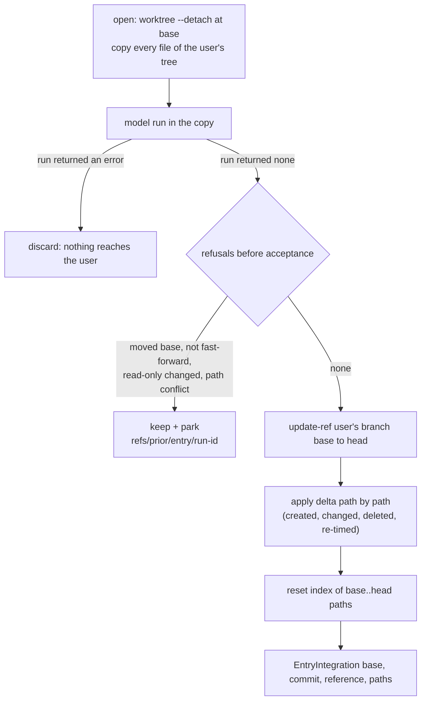

# Analysis: entry delivery model statement map (13.4.1 plan step 1)

**Date:** 2026-10-27 21:45
**Type:** Document Study (statement map), with an impact table for the three repair-role profiles
**Status:** Complete
**Requested by:** orchestrator, for plan `261027-1612-plan-fusion-13-4-1-entry-delivery-on-the-step-17-model.md` step 1

## Question

Which sentences in the shipped `prior` text are false under `fusion.entry.v2`, describe a repair run, or name a withdrawn asset? What replaces each one? What do the three repair-role profiles take as entry values? What does Prior hold of repair that request 77 must name? Is every "request 76, question N" citation correct?

Step 1's parts (a) to (e) are answered in that order below. Steps 6 and 7 edit from this map. The reviewer pass in `## Where this work stops` reads the edits against it.

## Scope

**Trees read, read only:**

| Tree | HEAD | Commit date | Branch | Tracking |
|---|---|---|---|---|
| fusion | `e9138b59` (moved from `026c5af1` during this analysis: the step-2 commit, which touches only `catalog/src/__tests__/`) | 2026-10-27 21:37 | `main` | `main...origin/main [ahead 33]`, workbench files modified |
| Prior `/Users/kai/Projects/productive/F09-Prior` | `187df6f1bf89591c8a9aecdb77ba6862cefd7960`, the commit the plan names, and Prior's current head | 2026-10-27 15:21 | `main` | `main...backup/main [ahead 1]`; `.gitattributes`, `.gitignore` modified. Every Prior read below is `git show 187df6f:` or `git grep … 187df6f`. The two ruling files read from Prior's workbench are byte-equal to `187df6f` (`git diff --quiet 187df6f --` on their directory exits 0). |

`git diff --stat cd4970b5 e9138b59 -- catalog/profiles catalog/catalog.json codec/fixtures/prior/REQUESTS.md` prints nothing. Every fusion line number below therefore holds at `cd4970b5`, `026c5af1` and `e9138b59` alike.

**Enumeration command** (one line; it prints `356`, and without `| wc -l` it prints the list):

```
cd /Users/kai/Projects/productive/F04-FUSION/fusion && git show HEAD:catalog/catalog.json | jq -r '.entries[] | select(.support.prior=="supported") | .profile' | while read p; do git ls-tree --name-only HEAD "catalog/profiles/$p/parts/" | grep -- '-prior\.md$'; done | wc -l
```

It selects 25 profiles: the 14 supported skills and the 11 agents. `skill-commit` and `skill-cleanup` are `prior: unsupported` and drop out; they are listed separately under `### Held`.

**Search terms used to find candidates** (case-insensitive, over the 356 files): `integrat`, `accepted`, `base revision`, `captur`, `snapshot`, `repair`, `run kinds`, `entry\.v1`, `entry-result\.v1`, the six repair schema stems, `one commit`, `fresh checkout`, `checked out`, then `uncommitted`, `git status`, `HEAD`, `push`, `pull`, `fresh workspace`, `does not carry`, `outside the capture`, `never travels`, `host keeps`, `base_revision`. Every hit was read in its sentence. Hits on these words in another sense (memo "capture", migrate "repair --list", analyst "snapshot", fusion-paths "repair anything") are recorded as "no statement".

**Classes**, as step 1 defines them: (i) false under `entry.v2`, replaced; (r) repair-only, deleted, the surviving entry branch made unconditional; (ii) depends on a question request 77 asks, kept and cited; (iii) still true, kept.

**Request-77 numbering used here.** Request 77 is not written yet. Step 10 lists its questions without numbers. This map cites them by the numbering below, and step 10 must keep it, or step 6 must re-cite. The order follows step 10's list.

| 77 Q | Topic |
|---|---|
| 1 | service name, request, slot and answer of `host.entry.integrate.v1` |
| 2 | refusal codes: moved base, non-fast-forward, path conflict, codec refusal |
| 3 | is a run that ended `stop` integrable |
| 4 | do re-timed-only paths appear in `delta` |
| 5 | fusion's reading of request 76 questions 1, 2, 3 and 8 under step 17 |
| 6 | question 17 restated |
| 7 to 11 | repair: revisit `261024-0900`; the 13.1.0 bundle; the request-69 services kept; the request-70 qualification record; `reviewer`'s aliases on an unsupported role |

## Findings

### (a) The step-17 facts, at Prior `187df6f`

All paths are under Prior. `EW` stands for `internal/fusionhost/entry_workspace.go`.

| Fact | What the code does | Evidence |
|---|---|---|
| Workspace basis | `git worktree add --detach <dir> <base>`, then every file of the user's tree outside `.git` is copied in with its bytes, mode and mtime. That covers tracked files with their uncommitted changes, untracked files, ignored files and the class-L workbench files (`.guard-state/`, `orchestrator-events.jsonl`, the `.session-marker` mtime). Open refuses if the copy does not reproduce the tree. `base` is the user's HEAD revision, and `reference` is the branch that HEAD named (`""` when detached). | `EW:29-36` (header), `EW:360-371` (base, reference, before-snapshot), `EW:387-436` (build), `internal/sourcecontrol/git.go:270-275` (`--detach`), `EW:1282-1317` (snapshot skips `.git` only) |
| `.checkout-id` read-only | `fusion-workbench/.checkout-id` is carried with mode `0444`. A run that changes it makes the integration refuse. | `EW:82-85`, `EW:420-427`, `EW:1127-1135` |
| What the delta holds | Every path whose presence, kind, bytes, executable bit or mtime differs between the before-snapshot and the workspace: created, changed, deleted, and re-timed only. Committed changes are in it as well, because the workspace's working tree carries them. Kept for the user's checkout: deletions first, then placements. | `EW:38-44`, `EW:1356-1373` (`entryDelta`), `EW:1217-1247` (`applyDelta`) |
| Re-timed-only paths | They carry equal `before` and `after` hashes in the frozen intent, and are applied by setting the mtime alone. `.session-marker` is the case the code names. | `EW:215-222`, `EW:1235-1240`, `EW:770-772` |
| Commits | When the workspace HEAD differs from base and descends from it, the user's branch is moved from `base` to `head` with `update-ref <reference> <head> <base>` (a compare-and-swap; `HEAD` itself when detached). The index entries of the committed paths are then reset to `head`. | `EW:1159-1189` |
| Index-only change | Neither direction carries one. The workspace has its own index at base (`worktree add`), and the snapshot excludes `.git`. Integration resets the user's index only for paths in `base..head`. A `git rm --cached` or `git add` the run makes without committing never reaches the user's index. The user's own staged-only state is not in the workspace index either. Its working-tree bytes are in the workspace. This is read from the code; no Prior text states it. | `git.go:272`, `EW:1298-1303`, `EW:1177-1188` |
| When a run is integrable | `prior fusion run` discards the workspace when the model run returned an error. It integrates only when the run returned none. A refused integration keeps the workspace with `EntryKept{Integrable: true}`. `Integrable` is true only when the model run ended successfully. `prior fusion kept apply` refuses a run that is not integrable. | `cmd/prior/fusion_run.go:337-350`, `EW:244-250`, `cmd/prior/fusion_kept.go:226-227` |
| Refusals before acceptance | All of these come before the journal accepts the operation, so nothing is written: workspace file changed (`EW:1094`); user's branch or HEAD revision moved (`ErrEntryBaseMoved`, `EW:1110-1111`); run's HEAD not a descendant of base (`ErrEntryNotFastForward`, `EW:1117-1120`); read-only file changed (`EntryPathConflict`, `EW:1133-1135`); a delta path changed in the user's tree during the run (`EntryPathConflict` "the repository changed during the run", `EW:1136-1148`); state errors (`EW:1080-1088`). A compare-and-swap refused after acceptance is a terminal refusal with nothing written (`EW:1165-1169`, `EW:1199-1200`). | as cited; error values `EW:87-95`, `EW:130-138` |
| Parking reference | The commits of a run whose integration did not complete are parked on `refs/prior/entry/<run-id>`. The reference is created once and never moved. It lies beside `refs/prior/accepted/`, never below it. A run that made no commits parks nothing. | `EW:97-128`, `EW:899-996`, `cmd/prior/fusion_run.go:351` |
| Push | `EntryWorkspace.Push` exists as a separate operation after integration. `prior fusion run` sets no `Remote` and never calls `Push`. | `EW:208-213`, `EW:1262-1280`, `cmd/prior/fusion_run.go:308` |
| Result | `EntryIntegration {base, commit, reference, paths}`. `paths` is the whole delta, committed and re-timed paths included. | `EW:193-199`, `EW:1158` |



Diagram check: every node is reached, and every edge comes from a cited line in the table above. The `stop` ending has no node, because Prior has no distinct stop at the pin (see Implications 3).

### (b) The statement map

#### Shared texts, defined once

Five sentences recur byte for byte. Each gets one replacement, applied to every copy. They come to 86 copies, all class (i).

| Id | Current text (abridged where marked) | Class | Copies at |
|---|---|---|---|
| SH1 | "On Prior it is run [agents: this profile is run] as an entry of `workflows/entry.v1.json`: … validates the result against `schemas/entry-result.v1.json`, the two entry schemas fusion proposes in request 76." | (i) | `01-prior.md:1` of the 14 skills and of the 8 agents `orchestrator`, `requirements-designer`, `implementation-planner`, `data-implementer`, `analyst`, `document-editor`, `policy-curator`, `consultant` (22) |
| SH2 | "…and it put you in one isolated workspace: the project checked out at the run's base revision." | (i) | `01-prior.md:3` of the 14 skills; `03-prior.md:3` of `requirements-designer`, `implementation-planner`, `data-implementer`, `analyst`, `document-editor`, `consultant`; `orchestrator/07-prior.md:3`; `policy-curator/05-prior.md:3`; `code-implementer/03-prior.md:15`; `reviewer/03-prior.md:17`; `state-auditor/03-prior.md:17` (25) |
| SH3 | "- **The entry run is the unit.** No session spans entry runs, and nothing carries over from one run to the next except what the workspace holds. A per-checkout file the project does not track (`.check-stamps`, `.cadence-anchors`, `.session-marker`) is not in a fresh workspace unless the host carries it (request 76, question 3)." | (i) | `01-prior.md` of the 14 skills: line 10 in `wp`, `wp-order`, `news`, `cadence`, `migrate`, `help`; line 11 in `setup`, `check`, `reconcile`, `archive`, `memo`, `post`; line 12 in `curate`, `discuss` (14) |
| SH4 | "- **The run integrates once, at its end.** This text stages, commits, pushes and pulls nothing: the host captures the workspace when the run ends and integrates it as the run's one commit. Where the text says it commits nothing, that holds here as well." | (i) | the line after SH3 in each of the 14 (14) |
| SH5 | "- **An entry run writes the workbench.** The records and files this text writes go into the workbench in your workspace, and the host captures them with the run." | (i) | the line after SH4 in `setup`, `check`, `wp`, `reconcile`, `discuss`, `archive`, `memo`, `post`, `news`, `cadence`, `migrate` (11) |

**Replacements:**

- **SH1:** keep each profile's own sentence and change only the clause: "…an entry of `workflows/entry.v2.json`: … validates the result against `schemas/entry-result.v2.json`, the entry schemas fusion proposes in requests 76 and 77."
- **SH2:** "…and it put you in one isolated workspace: a copy of the user's checkout as it stood when the run started, `HEAD` detached at the commit the user's `HEAD` named and every file of the working tree carried byte for byte. That includes the user's uncommitted changes, the untracked and ignored files and the workbench's per-checkout files; `fusion-workbench/.checkout-id` is read-only."
- **SH3 / SH4 / SH5, the shared `01-prior.md` paragraph** (one text for all fourteen copies; SH5 only where it stands today):

  > - **The entry run is the unit.** No session spans entry runs. The workspace is a copy of the user's checkout, so a per-checkout file the project does not track (`.check-stamps`, `.cadence-anchors`, `.session-marker`) is in it as the checkout holds it, and a change the run makes to it reaches the checkout with the run's integration (request 77, question 5).
  > - **The run integrates once, at its end.** This text stages, commits, pushes and pulls nothing. When the run ends, the host carries every file the run changed into the user's checkout, where the changes stay uncommitted for the user to commit, as a Claude Code session leaves them. The host refuses the whole integration, and changes nothing, when the user's branch moved during the run or a path the run changed was also changed in the checkout. Where the text says it commits nothing, that holds here as well.
  > - **An entry run writes the workbench.** The records and files this text writes go into the workbench in your workspace, and the host carries them into the user's checkout with the run's integration.

  None of the three names a host service. The question-3 citation is replaced, not kept: the code at `187df6f` answers it (fact table, rows 1 and 3), and request 77 question 5 asks Prior to confirm that reading.

#### Skills, profile-specific rows

| # | Site | Statement | Class | Replacement |
|---|---|---|---|---|
| K1 | `skill-archive/parts/01-prior.md:14` | "outside the workspace and so outside the capture" | (i) | "outside the workspace and so outside what the host integrates" (the question-5 citation stays) |
| K2 | `skill-archive/parts/35-prior.md:1` | "The host integrates the moves as this run's commit when the run ends, so there is nothing for the user to `git add`." | (i) | "The moves reach the user's checkout uncommitted when the host integrates this run, so the user stages and commits them." |
| K3 | `skill-archive/parts/41-prior.md:2` | "# ${TMPDIR:-/tmp} is the container's scratch, outside the capture: …" | (i) | "# ${TMPDIR:-/tmp} is the container's scratch, outside what the host integrates: it persists between this run's calls and is gone at its end (Prior 08c57fb; request 76, question 5)" |
| K4 | `skill-archive/parts/51-prior.md:1` | "The host integrates the archive with the run." | (iii) | kept |
| K5 | `skill-cadence/parts/15-prior.md:2` | "the host integrates both files as this run's commit." | (i) | "- It commits nothing itself — the host carries both files into the user's checkout when the run ends, uncommitted." |
| K6 | `skill-check/parts/03-prior.md:1` | "A fresh workspace does not carry that file, so on Prior every selector reads as due until the host keeps it between runs (request 76, question 3)." | (i) | "The workspace carries that file from the user's checkout, and the stamps a run writes reach the checkout with its integration, so on Prior a selector falls due by the same rule as on Claude Code (request 77, question 5)." |
| K7 | `skill-check/parts/07-prior.md:1` | "A fresh workspace carries no `.session-marker` unless the host keeps it (request 76, question 3), so on Prior the ordinary answer is `none`." | (i) | "The workspace carries the checkout's `.session-marker`, so on Prior the check reads the marker a live session on this checkout left, as it does on Claude Code (request 77, question 5)." |
| K8 | `skill-check/parts/35-prior.md:1` | echo "…where an index-only change is not known to survive the run's integration (request 76, question 8)…" | (i) | `echo "gitignore: .checkout-id is tracked — left tracked on this host, where an index-only change does not reach the user's checkout through the run's integration (request 77, question 5); report it"`. The behaviour is unchanged. |
| K9 | `skill-curate/parts/03-prior.md:3` | "the host integrates the apply pass's edits as this run's commit when the run ends." | (i) | "…and the host carries the apply pass's edits into the user's checkout when the run ends, uncommitted." |
| K10 | `skill-curate/parts/25-prior.md:1` | "The apply pass's edits are integrated as this run's commit, so … the revert is that commit's parent for the path, `git checkout <integration commit>^ -- <path>`, not a discard of working-tree edits" | (i) | "The apply pass's edits reach the user's checkout uncommitted. For a git-tracked surface the revert is therefore, until the user commits them, a discard of that path's working-tree edits (`git restore -- <path>`, after `git diff -- <path>` where the file held uncommitted edits before the run), and after the user's commit that commit's parent for the path. An entry whose file is not under version control says in those words that no revert path exists." |
| K11 | `skill-curate/parts/27-prior.md:2` | "The host integrates the run's edits once, at its end." | (iii) | kept |
| K12 | `skill-discuss/parts/27-prior.md:1` | "Tell the user in one line that the record is committed with this run, when the host integrates it at the run's end." | (i) | "Commit nothing. Tell the user in one line that the record reaches their checkout uncommitted when the host integrates this run at its end, for them to commit." |
| K13 | `skill-help/parts/17-prior.md:1` | "On Prior the host integrates every run as its commit and pushes only when the entry declares a remote, so the cleanup entry finds nothing to commit." | (i) | "On Prior the host leaves every run's changes uncommitted in your checkout and pushes nothing, and the commit and cleanup entries are not offered there: you commit and push yourself." |
| K14 | `skill-migrate/parts/15-prior.md:1` | "the host integrates the renames as this run's commit and pushes it only when the entry declares a remote; tell the other checkouts to pull…" | (i) | "Then what to do next, in this order: the renames reach the user's checkout uncommitted when the host integrates this run, and the index this run's `git mv` wrote stays in the workspace, so the user stages them (`git add -A` over the renamed directories) and commits them as one commit of renames, then pushes it; tell the other checkouts to pull that commit rather than migrate again, so the project has one revert point (…unchanged to the end of the sentence…); run the setup entry." |
| K15 | `skill-migrate/parts/15-prior.md:3` | "the run's integration is the one commit of renames" | (i) | "**In `MODE=git`, a run that moved anything ends here**: the user's commit of the renames is the one commit, and the citation repairs and Step 7 come in a later migrate entry run, which offers them." |
| K16 | `skill-migrate/parts/19-prior.md:1` | "say the record content it wrote is integrated with this run" | (iii) | kept |
| K17 | `skill-migrate/parts/31-prior.md:7` | "name what the host's integration of this run carries" | (iii) | kept |
| K18 | `skill-migrate/parts/33-prior.md:1` | "The host integrates the renames as this run's commit." | (i) | "- **Never touch git beyond `git mv`.** No `git add`, no `git commit`. The renames reach the user's checkout uncommitted when the host integrates this run; the index `git mv` wrote stays in the workspace." |
| K19 | `skill-news/parts/01-prior.md:14` | "a per-checkout file a fresh workspace does not carry: without it the whole store reads as new on every run, and the mark … outlives the run only if the host keeps it (request 76, question 3)." | (i) | "- **The seen mark lives in `.cadence-anchors`**, a per-checkout file the workspace carries from the user's checkout: the mark Step 5 writes reaches the checkout with the run's integration (request 77, question 5)." |
| K20 | `skill-news/parts/01-prior.md:13` | "A remote is mounted only when the entry declares a fetch or a push…" | (iii) | kept (request 76, question 4 still open; step 17 does not touch it) |
| K21 | `skill-news/parts/05-prior.md:1` | "the workspace revision is the host's" | (iii) | kept |
| K22 | `skill-news/parts/23-prior.md:2` | "# the mark lives in .cadence-anchors, which a fresh workspace does not carry (request 76, question 3)" | (i) | "# the mark lives in .cadence-anchors, which the workspace carries from the user's checkout (request 77, question 5)" |
| K23 | `skill-news/parts/25-prior.md:3` | "the workspace is the host's checkout at the run's base revision, and a pull inside it would change what the host integrates." | (i) | "Fetching changed no file, and this run pulls nothing: the workspace is the host's copy of the user's checkout at the run's base revision, and a pull inside it would put the fetched commits on the user's branch with this run's integration. So there is no pull offer here and no `git pull`." |
| K24 | `skill-post/parts/15-prior.md:1` | "The host's capture takes every file the workspace holds when the run ends" | (i) | "The host's integration carries every file the run created or changed in the workspace into the user's checkout when the run ends, so a draft that is not moved into the store is removed (`rm -f`) before the run ends." |
| K25 | `skill-post/parts/21-prior.md:1` | "Add one sentence saying the host integrates the entry with this run and pushes it only when the entry declares a remote…" | (i) | "Add one sentence saying the entry reaches the user's checkout uncommitted when the host integrates this run, and that the user commits and pushes it, because an entry nobody pushed reaches nobody." |
| K26 | `skill-post/parts/23-prior.md:1` | "The host integrates the entry with the run." | (iii) | kept |
| K27 | `skill-reconcile/parts/03-prior.md:3` | "Every change is integrated with this run by the host, once, when the run ends." | (iii) | kept |
| K28 | `skill-reconcile/parts/15-prior.md:1` | "A fresh workspace carries no reconcile mark … whether the mark this step writes outlives the run is the host's (request 76, question 3)." | (i) | "The workspace carries this checkout's reconcile mark in `.cadence-anchors` from the user's checkout, so on Prior Step 2 reads it as on Claude Code, and the mark this step writes reaches the checkout with the run's integration (request 77, question 5)." |
| K29 | `skill-reconcile/parts/19-prior.md:1` | "Close with the one line that says the edits are integrated as this run's commit." | (i) | "Close with the one line that says the edits reach the user's checkout uncommitted when the host integrates this run." |
| K30 | `skill-setup/parts/19-prior.md:4` | "A fresh workspace does not carry that file, so on Prior every check reads as due until the host keeps it between runs (request 76, question 3)." | (i) | "…it reads `.check-stamps`, which never travels. The workspace carries that file from the user's checkout, and the stamps a run writes reach the checkout with its integration (request 77, question 5)." |

Several skill openings describe their topic as "who commits" (`reconcile`, `curate`, `archive`, `cadence`, `migrate`) or "who commits and pushes the entry" (`post`). These are labels for a difference between the hosts. They stay true, because on Prior the user commits, so they are (iii) and not rowed.

#### `data-implementer`

| # | Site | Statement | Class | Replacement |
|---|---|---|---|---|
| D1 | `data-implementer/parts/07-prior.md:1` | "the host captures the workspace when this run ends (`host.capture.v1`) and integrates it as the run's commit (`host.integrate.v1`) … A commit of your own would put a change in front of the integration the host runs." | (i) | "**Never run `git add` or `git commit`.** On Prior you do not stage, commit or take a lock, and no task makes an exception: when this run ends, the host carries what it changed into the user's checkout, where the data you edit and the records you write arrive as uncommitted changes for the user to commit. Where a task asks you to commit, say in your report that on Prior the user commits the run's changes, and make none." |

The two service names leave the text. Neither is in the entry's `requires` (`host.exec.v1`). The reason sentence is dropped: under step 17 a commit of the run would land on the user's branch as made, so it no longer stands "in front of" anything. The rule stays, pending request 77 question 5.

#### `orchestrator`

| # | Site | Statement | Class | Replacement |
|---|---|---|---|---|
| O1 | `19-prior.md:1` | "on Prior the host captures the workspace when the run ends and integrates it as the run's commit" | (i) | "- Never stage or commit: on Prior the host carries the run's changes into the user's checkout when the run ends, uncommitted, for the user to commit" |
| O2 | `33-prior.md:1` | "No dispatch tells the executor to commit on Prior … the host integrates the whole workspace once, when this run ends" | (ii) | kept. The description is true under v2. The rule rests on request 76 questions 1 and 19, which request 77 question 5 restates. Append "(request 77, question 5)". The plan's `## Current State` lists part 33 among the v1 statements, but its sentence names no commit and no capture. |
| O3 | `35-prior.md:1` | "On Prior `HEAD` is the run's base revision, not the last task's commit, so reverting a file an earlier task of this run also changed discards that task's work too" | (i) | "…On Prior `HEAD` is the run's base revision, not the last task's commit, and the workspace also holds the user's uncommitted changes from before the run. So reverting a file an earlier task of this run also changed, or a file Setup's `git status --porcelain` listed before the first task, discards that work too: name each such file to the user instead, with what this task changed in it, and leave it as it stands." (needs Setup step 5 to record that listing; see Implications 1) |
| O4 | `36a-prior.md:1` | "no commit exists inside the run, because the host's integration at its end is the run's one commit … once that integration commit exists" | (i) | "…`--implementation-ref` names a commit, and no commit exists inside the run: the run's changes reach the user's checkout uncommitted, and the commit that carries them is the user's. Keep the executor's `Implemented:` line, send no transition, and name the decision in the session summary as owed `--to implemented` once the user's commit of this run's changes exists; a later reconciliation finds it implemented on disk and lists it for the transition." |
| O5 | `36c-prior.md:1` | as O3 | (i) | O3's sentence, in item d's wording |
| O6 | `37-prior.md:1` | "The host captures the workspace when this run ends (`host.capture.v1`) and integrates it as the run's commit (`host.integrate.v1`), so one entry run integrates once…" | (i) | "3. **No commit message file on Prior.** You do not commit, so you write no message file and run no `git commit` (request 77, question 5). When this run ends, the host integrates it once, however many tasks it carried: the run's changes reach the user's checkout uncommitted, and the user commits them. What a per-task commit message records is still owed: …(unchanged)" |
| O7 | `37-prior.md:10` | "The capture takes the whole workspace…" | (i) | "4. **No staging list.** The integration carries every file the run changed in the workspace, so no path is named for staging and none can be left out of a list. …(unchanged)" |
| O8 | `37-prior.md:11` | "the host is the only committer of this run" | (i) | "5. **No index write, no lock.** Never run `git add`, `git reset` or `git commit`, and never take the commit lock: nobody commits inside this run, and the user commits its changes after it ends." |
| O9 | `37-prior.md:13` | "when the whole workspace is captured" | (i) | "7. **No staging check.** A record cannot be left unstaged when every changed file of the workspace is integrated; Step 4 ends here." |
| O10 | `38a-prior.md:3` | "the host's integration at the run's end is the one commit the run makes" | (i) | "…No hash: the task is not committed, and the run makes no commit; the user commits the run's changes after it ends." |
| O11 | `48a-prior.md:1` | "read back against `git status --porcelain` … this run's files are uncommitted in the workspace on the run's base revision" | (i) | "…route by **the files this run changed**, the ones the per-task reports name (Step 4 item 4), each confirmed against `git status --porcelain` run from the project root. That listing also shows the user's uncommitted changes from before this run, and adds no file to the scope. **plus** …(unchanged)… Say in the dispatch that this run's files are uncommitted in the workspace on the run's base revision, beside the user's own uncommitted changes from before the run, and give that revision's short hash (`git rev-parse --short HEAD`):" |
| O12 | `48c-prior.md:1` | "that the host's integration of the run is the commit that carries them" | (i) | "…citing this run (its session id, the tasks it carried, and that the host's integration of the run leaves them uncommitted in the user's checkout for the user's commit) and the closing value…" |
| O13 | `48e-prior.md:1` | "the host's integration of this run [is] the record of the work" | (iii) | kept |
| O14 | `48e-prior.md:3` | "the run's one commit is the host's integration, made after this summary" | (i) | "…No hash: the run makes no commit, and its changes reach the user's checkout uncommitted after this summary." |
| O15 | `48e-prior.md:5` | "Decisions left at `answered` for the integration commit" | (i) | "Decisions left at `answered` for the user's commit of this run's changes are named here too." |
| O16 | `49-prior.md:3` | "The host captures the whole workspace when the run ends, so every record this run wrote reaches the integration" | (i) | "- **No staging check on Prior.** The host integrates every file the run changed when the run ends, so every record this run wrote reaches the user's checkout; name them in the summary instead." |
| O17 | `51-prior.md:1` | "the host integrates it with the rest of the run when the run ends" | (iii) | kept |
| O18 | `53-prior.md:1` | "which the host's integration of this run carries" | (iii) | kept |
| O19 | `54a-prior.md:2` | "the host's integration carries it with the run" | (iii) | kept |
| O20 | `54a-prior.md:5` | "the run makes no commit, and the host reports its own integration failure" | (iii) | kept |
| O21 | `54a-prior.md:7` | revert strategy, as O3 | (i) | "…On Prior `HEAD` is the run's base revision, not the last task's commit, and the workspace also holds the user's uncommitted changes from before the run. So a file an earlier task of this run changed, or one Setup's `git status --porcelain` listed, is never reverted: that would discard that work too. Name it to the user instead, with what the failing task changed in it, and leave it as it stands." |
| O22 | `55-prior.md:3` | "the host captures the whole workspace when the run ends (`host.capture.v1`) and integrates it as the run's commit (`host.integrate.v1`)" | (i) | "…On Prior that check has nothing to measure: the host integrates every file the run changed in the workspace when the run ends, so no record can be left out of a staging list, because there is none. …(unchanged)" |
| O23 | `57-prior.md:1` | "`commit` is never yours, because the host's integration is this run's commit" | (i) | "…`commit` is never yours, because this run makes no commit; …(unchanged)" |
| O24 | `59-prior.md:1` | "on Prior the host's integration of the run is its commit" | (i) | "\| `commit` \| **Never yours**: on Prior this run makes no commit, and the user commits its changes \| Short hash, message summary \|" |

`host.capture.v1` and `host.integrate.v1` leave the orchestrator's parts (O6, O22). Neither is in its `requires` (`host.exec.v1`, `host.dispatch.v1`).

#### The three repair roles

Every row is (r): the repair branch is deleted and the surviving entry sentence becomes unconditional. Where a surviving sentence also names `entry-result.v1.json` or a captured workspace, the (i) correction is folded into the same replacement. The shared SH2 sentence in their entry Setup is counted under SH2.

**`code-implementer`**

| # | Site | Replacement |
|---|---|---|
| C1 | `01-prior.md:1` | "Role profile `code-implementer`, rendered by fusion for the Prior host from the same source as the Claude Code prompt. On Prior this profile is run as an entry of `workflows/entry.v2.json`: the user starts it, or another role dispatches it, the host composes the role input against `schemas/entry-request.v1.json` and validates the result against `schemas/entry-result.v2.json`, the entry schemas fusion proposes in requests 76 and 77. What differs from the Claude Code prompt is the host mechanics: the setup, the workspace, the tools, where a record goes; the role's task, standards and report content are the neutral text both hosts share, byte for byte." |
| C2 | `03-prior.md:3` | "On Prior the host provisions the run, resolves this text from the installed bundle and hands you one role input. The numbers below are the ones the neutral text cites." |
| C3 | `03-prior.md:5-13` | delete `### Setup of a repair run` with its three items, and the heading `### Setup of an entry run` |
| C4 | `03-prior.md:15` | starts "The host has provisioned the run before your first turn." (SH2 applies). Its last three sentences become: "**This run writes the workbench** (`writes_workbench.prior` is `true` in the profile). The records this text writes go into the workbench in your workspace, and the host carries them into the user's checkout with the run's integration." |
| C5 | `03-prior.md:19` | "3. **Tools.** You hold the host's file tools within the profile's ceiling (`read`, `list`, `search`, `create`, `write`, `rename`, `delete`), for the files the task names and the records you write inside `fusion-workbench/`, and `host.exec.v1` for every command. The build, test and type-check commands the neutral text runs are `host.exec.v1` calls, spelled as the project context states them. …(unchanged from "A command the project context does not state")" |
| C6 | `03-prior.md:23` | keep the first sentence ("The rule below is inlined … (Prior answer 67.2).") and delete the rest of the paragraph |
| C7 | `03-prior.md:25` | "The rule binds your report as it binds Claude Code's, beside the rules Setup item 2 emits, with one reading: …(unchanged)" |
| C8 | `05-prior.md:1` | `` in `$OUT_ISSUE` `` (leading space kept; the bytes of `05-claude.md`) |
| C9 | `07-prior.md:1` | `` `$OUT_DECISION`. `` (the bytes of `07-claude.md`) |
| C10 | `09-prior.md:1` | " On Prior you do not stage, commit or take a lock, and no task makes an exception: when the run ends, the host carries what it changed into the user's checkout, where the code you edit and the records you write arrive as uncommitted changes for the user to commit. Where a task asks you to commit, say in your report that on Prior the user commits the run's changes, and make none." |
| C11 | `11-prior.md:1` | `` under `$SCAN_PLANS`, every directory it names `` |
| C12 | `13-prior.md:1` | "3. Append, through the host's file tools, the source's note, an issue's `Resolved:` or, on a decision at `answered` (under `$SCAN_DECISIONS`, every directory it names) whose answer your task realises, its `Implemented:` line, and send no transition: the state of an issue, a plan step or a decision is moved by whoever dispatched you once it has read your `Verification:` line (`fusion-workbench-conventions.md` `## Inline State Tracking`)." |
| C13 | `15-prior.md:1` | " The report is the three fields below, each as this section defines it, written as the text of your final answer; the envelope `schemas/entry-result.v2.json` describes is the host's, copied from its own receipts, and nothing in it is yours to compose." |
| C14 | `17-prior.md:1` | `` under `$SCAN_PLANS` `` |
| C15 | `19-prior.md:1` | "**Every command is one `host.exec.v1` call with its own `directory`.** …(unchanged)" |
| C16 | `19-prior.md:5` | delete the paragraph |
| C17 | `19-prior.md:7` | "You hold the host's file tools within the profile's ceiling and `host.exec.v1`, as `## Setup` item 3 says: …(unchanged)" |
| C18 | `19-prior.md:9` | "Library documentation comes from the repository and the project context: …(unchanged)" |
| C19 | `21-prior.md:1` | "the text of your report," |

**`reviewer`**

| # | Site | Replacement |
|---|---|---|
| R1 | `01-prior.md:1` | as C1 with `reviewer`, the entry name `reviewer`, and "What differs from the Claude Code prompt is the host mechanics: the setup, the tools, where a finding goes; the role's task, standards and verdict vocabulary are the neutral text both hosts share, byte for byte." The alias sentence goes. The catalog keeps the aliases (plan step 7), and request 77 question 11 asks about them. |
| R2 | `03-prior.md:3` | as C2 |
| R3 | `03-prior.md:5-15` | delete `### Setup of a repair run` with its five items, and the heading `### Setup of an entry run` |
| R4 | `03-prior.md:17` | starts "The host has provisioned the run before your first turn." (SH2 applies). Its last three sentences become: "**This run writes the workbench** (`writes_workbench.prior` is `true` in the profile). The review files, the issues and the evidence this text writes go into the workbench in your workspace, and the host carries them into the user's checkout with the run's integration." |
| R5 | `03-prior.md:32` | as C6 |
| R6 | `03-prior.md:34` | "The rule binds your review and your report as it binds Claude Code's, …(unchanged)" |
| R7 | `05-prior.md:1` | "If you find defects, **report them** in your review and file each one as a separate file in `$OUT_ISSUE` per `fusion-workbench-conventions.md`; …(unchanged to the end of the paragraph)" |
| R8 | `05-prior.md:3` | delete the paragraph |
| R9 | `06a-prior.md:1` | " A drifted `CLAUDE.md` fact (the project context's file) on one file or function is a **placement** finding: …(unchanged)" |
| R10 | `07-prior.md:1` | `` under `$SCAN_PLANS` and `$SCAN_DECISIONS` `` |
| R11 | `09-prior.md:1` | `` under `$SCAN_ISSUES` `` |
| R12 | `11-prior.md:1` | `` loaded in Setup step 2 (the `*ontology*`, `*normative*` or `*verb*` rule files `fusion-rules` emits from the project's `./rules/`) `` |
| R13 | `13-prior.md:1` | "The review is a file. …(unchanged)" |
| R14 | `13-prior.md:3` | the paragraph becomes only "**Your verdict is one of three:** " (trailing space kept, as the neutral list follows) |
| R15 | `15-prior.md:1` | " One verdict per review." |
| R16 | `15-prior.md:3` | "What the review-file contract leaves to this profile is what analysing a topic means here:" |
| R17 | `17-prior.md:3` | delete the paragraph. The "independent principal" sentence goes with it, because it is 69.4's repair guarantee. |
| R18 | `17-prior.md:5` | "The host grants the read-only file classes of the profile's ceiling (`read`, `list`, `search`), and `host.exec.v1` for every command and for every file this text has you write: …(unchanged)… and only ever inside `fusion-workbench/`: `## Scope` forbids every edit of code, data and ontology." |
| R19 | `17-prior.md:7` | "Library documentation comes from the repository and the project context: …(unchanged)" |

**`state-auditor`**

| # | Site | Replacement |
|---|---|---|
| A1 | `01-prior.md:1` | as C1 with `state-auditor`, and "What differs from the Claude Code prompt is the host mechanics: the setup and the tools; the tracking changes are written as the Claude Code prompt writes them, and the role's verification protocols, the three-edge audit and the report content are the neutral text both hosts share, byte for byte." |
| A2 | `03-prior.md:3` | "On Prior the host provisions the run, resolves this text from the installed bundle and hands you one role input. The numbers below are the ones the neutral text cites, and item 6 continues the list." |
| A3 | `03-prior.md:5-15` | delete `### Setup of a repair run` with its five items, and the heading `### Setup of an entry run` |
| A4 | `03-prior.md:17` | starts "The host has provisioned the run before your first turn." (SH2 applies). The workbench sentences become: "**This run writes the workbench** (`writes_workbench.prior` is `true` in the profile). The transitions, logs, notes and issues this text writes go into the workbench in your workspace, and the host carries them into the user's checkout with the run's integration. You hold the host's read-only tool classes within the profile's ceiling (`read`, `list`, `search`, `git-inspect`) and `host.exec.v1`. …(unchanged)" |
| A5 | `05-prior.md:3` | "The domain is the `**Domain:**` argument of the role input, its value one of `code \| data`. If the argument is absent or its value is unrecognised, default to `domain = code` per the rule above. …(unchanged)" |
| A6 | `05-prior.md:7` | as C6 |
| A7 | `05-prior.md:9` | "The rule binds your report as it binds Claude Code's, …(unchanged)" |
| A8 | `06-prior.md:3` | "**You may edit tracking files in `fusion-workbench/`**, each through `host.exec.v1` as `## Setup` says:" |
| A9 | `06-prior.md:9` | delete the paragraph |
| A10 | `08-prior.md:1` | "- Any file outside the bullets above. You write no log of your own: …(unchanged)" |
| A11 | `08-prior.md:2` | delete the bullet |
| A12 | `08-prior.md:4` | "If reconciliation reveals work that needs to change (code, data, or a decision awaiting an answer), **file an issue** in `$OUT_ISSUE` (or a decision record in `$OUT_DECISION`) for the appropriate executor, and don't fix it yourself. Reconciliation is a tracking pass, not an implementation session." |
| A13 | `10-prior.md:1` | "Read the **live** records under each of these …(unchanged)" |
| A14 | `10-prior.md:3` | delete the paragraph |
| A15 | `12-prior.md:1` | "**Cadence note:** on Prior there is no automatic trigger and no schedule either. The user starts the state-auditor entry, or a role dispatches it when the user asks for a reconciliation, so the result's cadence is the user's; what the result is *about* is the item this checkout claimed when there is one, and the commit range of the session that asked when there is not." |
| A16 | `14-prior.md:1` | " If the aggregate result is anything but `coherent`, or `coherent` with recommendation `state brief`, the Rebalance choice is put to the user after this result is consumed, by the role that dispatched you or, on a run the user started, by the user reading your report; never by the state-auditor. The state-auditor asks the user nothing and has no surface to ask on." |
| A17 | `16-prior.md:1` | `` directory in `$SCAN_DECISIONS`, the decisions at `open` or `answered` from the Step 1 `list` `` |
| A18 | `18-prior.md:1` | "### Step 3: Update every tracking file" |
| A19 | `18-prior.md:3` | "You update every tracking file. … as `## Setup` says." |
| A20 | `18-prior.md:28-47` | delete |
| A21 | `20-prior.md:1` | "For each review file under `$SCAN_REVIEWS`:" |
| A22 | `20-prior.md:4-5` | delete |
| A23 | `20-prior.md:7` | "The report of Step 4 is the text of your final answer, in the format below; the envelope `schemas/entry-result.v2.json` describes is the host's, copied from its own receipts, and nothing in it is yours to compose." |
| A24 | `22-prior.md:1` | `` in `$OUT_ISSUE` `` |
| A25 | `24-prior.md:1` | `` `$OUT_ISSUE`, per `rules/fusion-workbench-conventions.md` `## Record filing`**, one entry per defect `` |

A heading removal moves three cross-references: `code-implementer/19:7`, `state-auditor/06:3` and `state-auditor/18:3` named `### Setup of an entry run`. C17, A8 and A19 point them to `## Setup`. `git grep 'Setup of an'` finds no other reference. No replacement empties a part file, so every `parts` list in `profile.json` stays.

#### Files with no statement

| Profile | Prior parts | With a row | No statement |
|---|---|---|---|
| skill-setup | 20 | 01, 19 | 03 05 07 09 11 13 15 17 21 23 25 27 29 31 33 35 37 39 |
| skill-check | 22 | 01, 03, 07, 35 | 05 09 11 13 15 17 19 21 23 25 27 29 31 33 37 39 41 43 |
| skill-wp | 8 | 01 | 03 05 07 09 11 13 15 |
| skill-wp-order | 6 | 01 | 03 05 07 09 11 |
| skill-reconcile | 11 | 01, 03, 15, 19 | 05 07 09 11 13 17 21 |
| skill-curate | 14 | 01, 03, 25, 27 | 05 07 09 11 13 15 17 19 21 23 |
| skill-discuss | 15 | 01, 27 | 03 05 07 09 11 13 15 17 19 21 23 25 29 |
| skill-archive | 26 | 01, 35, 41, 51 | 03 05 07 09 11 13 15 17 19 21 23 25 27 29 31 33 37 39 43 45 47 49 |
| skill-memo | 11 | 01 | 03 05 07 09 11 13 15 17 19 21 |
| skill-post | 12 | 01, 15, 21, 23 | 03 05 07 09 11 13 17 19 |
| skill-news | 13 | 01, 05, 23, 25 | 03 07 09 11 13 15 17 19 21 |
| skill-cadence | 8 | 01, 15 | 03 05 07 09 11 13 |
| skill-migrate | 17 | 01, 15, 19, 31, 33 | 03 05 07 09 11 13 17 21 23 25 27 29 |
| skill-help | 13 | 01, 17 | 03 05 07 09 11 13 15 19 21 23 25 |
| orchestrator | 39 | 01, 07, 19, 33, 35, 36a, 36c, 37, 38a, 48a, 48c, 48e, 49, 51, 53, 54a, 55, 57, 59 | 03 05 09 11 13 15 17 21 23 25 27 29 31 39 41 43 45 47 61 63 |
| requirements-designer | 11 | 01, 03 | 05 07 09 11 13 15 17 19 21 |
| implementation-planner | 13 | 01, 03 | 05 07 09 11 13 15 17 19 21 23 25 |
| code-implementer | 11 | all 11 | none |
| data-implementer | 9 | 01, 03, 07 | 05 09 11 13 15 17 |
| reviewer | 10 | all 10 | none |
| state-auditor | 13 | all 13 | none |
| analyst | 13 | 01, 03 | 05 07 09 11 13 15 17 19 21 23 25 |
| document-editor | 5 | 01, 03 | 05 07 09 |
| policy-curator | 28 | 01, 05 | 03 07 09 11 13 15 17 19 21 23 25 27 29 31 33 35 37 39 41 43 45 47 49 51 53 55 |
| consultant | 8 | 01, 03 | 05 07 09 11 13 15 |
| **Total** | **356** | **108** | **248** |

`explorer` is not an entry. Its parts name no repair step, as the plan's `## Current State` says, so it is outside this map.

#### Held: `commit` and `cleanup`

Both are not rendered (`prior: unsupported`) and not changed in 13.4.1. Their prior parts are `skill-commit` 01 03 05 07 09 and `skill-cleanup` 01 03 05 07 09 11 13 15 17. They state the v1 model in `skill-commit/01-prior.md:1` ("a fresh checkout at the run's base revision, so it holds no uncommitted work … the host … makes the run's one commit"), in `skill-commit/03`, `07`, in `skill-cleanup/01-prior.md:1`, `03`, `05`, `09`, `11-prior.md:1` ("integrates it as the run's one commit"), `13-prior.md:3` ("The push is the host's step after its integration"), `15`, `17`, and in their copies of SH1 to SH5. Under step 17 their opening premise inverts: the workspace now carries the user's uncommitted work, so "nothing to commit" no longer holds. Rewriting them belongs with the later release that makes them entries, after the answer to request 77 question 5.

### (c) The three repair-role profiles' keys

The plan's rule: a value that exists for repair takes the value that the role's neutral text and its closest entry precedent support. The precedents are `data-implementer` for `code-implementer` and `analyst` for the read-and-file roles.

| Profile | Key | Value at `e9138b59` | Origin | Entry value | Evidence |
|---|---|---|---|---|---|
| all three | `id` | own id | role | unchanged | `catalog.json` `roles` |
| all three | `parts` | 33 / 30 / 41 entries | role | unchanged (step 6 empties no part) | above |
| code-implementer | `input_schema` | `schemas/implementer-request.v1.json` | repair (frozen at step 15 on answer 69) | `schemas/entry-request.v1.json` | `REQUESTS.md:4573`; plan step 7 |
| code-implementer | `result_schema` | `schemas/implementer-result.v1.json` | repair (69.6 (4) shaped it) | `schemas/entry-result.v2.json` | `REQUESTS.md:4554`, `:4573` |
| code-implementer | `tools_ceiling` | `read list search create write rename delete process` | `process`: repair. 69.6 (4) narrowed it to `process.check` for frozen checks, and Prior's `repairTools` maps it (`internal/fusionhost/repair_catalog.go:58-60`). The seven file classes: role. | `["read","list","search","create","write","rename","delete"]` | `REQUESTS.md:4554`, `:5046`; the entry text names exactly these seven (`code-implementer/03-prior.md:19`) and runs builds through `host.exec.v1`. `data-implementer` adds `git-inspect`. That would add a class nothing in the role's text uses, so it is not taken; it is the alternative if the reviewer prefers precedent symmetry. |
| code-implementer | `may_delegate` | `true` | role ("because the Claude role may dispatch sub-agents") | `true` | `REQUESTS.md:5047`, accepted at `:5079` as granting nothing. The entry's `requires` has no `host.dispatch.v1`, so the value grants nothing on Prior either. |
| code-implementer | `writes_workbench` | `{claude-code: true, prior: false}` | `prior`: repair. Prior's repair loader refuses `true` (`repair_catalog.go:33`), and decision `261024-2111` kept `false` for that reason. | `{claude-code: true, prior: true}` | `261024-2111` `## Question`; precedent `data-implementer` `prior: true` |
| code-implementer | `execution_policy` | `{claude-guided, prior-enforced}` | host-neutral; identical in all 12 profiles | unchanged | all `profile.json` |
| reviewer | `input_schema` | `schemas/review-request.v1.json` | repair | `schemas/entry-request.v1.json` | as above |
| reviewer | `result_schema` | `schemas/review-response.v1.json` | repair | `schemas/entry-result.v2.json` | as above |
| reviewer | `tools_ceiling` | `read list search` | role, and kept under decision `261025-1117` (option 2: the write goes through a path-scoped grant Prior is asked for, not a wider ceiling) | unchanged | `261025-1117` `Answered:` line; `REQUESTS.md:6284` (request 76 decision 6) |
| reviewer | `may_delegate` | `false` | role | unchanged | every non-dispatching role is `false` |
| reviewer | `writes_workbench` | `{true, false}` | `prior`: repair (69.4 "`writes_workbench.prior` stays false for both"; `repair_catalog.go:33`; `261024-2111`) | `{true, true}` | `REQUESTS.md:4550`; precedent `analyst` `prior: true`; the entry text writes reviews, issues and evidence |
| reviewer | `execution_policy` | `{claude-guided, prior-enforced}` | host-neutral | unchanged | |
| state-auditor | `input_schema` | `schemas/audit-request.v1.json` | repair | `schemas/entry-request.v1.json` | as above |
| state-auditor | `result_schema` | `schemas/audit-result.v1.json` | repair | `schemas/entry-result.v2.json` | as above |
| state-auditor | `tools_ceiling` | `read list search runtime-inspect git-inspect` | `runtime-inspect`: repair (69.4: the auditor's scoped runtime inspection "covering the accepted reference and every used attempt"). `git-inspect`: role, and shared with the entry precedent. `read list search`: role, kept read-only under `261025-1117`. | `["read","list","search","git-inspect"]` | `REQUESTS.md:4487` (ceilings are the embedded classes), `:4550`; precedent `analyst` carries `git-inspect`; A4's tool sentence follows this value |
| state-auditor | `may_delegate` | `false` | role | unchanged | |
| state-auditor | `writes_workbench` | `{true, false}` | `prior`: repair, as for `reviewer` | `{true, true}` | as for `reviewer`; the entry text writes transitions, logs and issues |
| state-auditor | `execution_policy` | `{claude-guided, prior-enforced}` | host-neutral | unchanged | |

Step 7's acceptance ("differ from `ca9eb60d` only in the keys table (c) lists") then admits diffs in `input_schema`, `result_schema`, `writes_workbench` (all three), and `tools_ceiling` (`code-implementer`, `state-auditor`).

### (d) Prior's repair holdings at `187df6f`, for request 77

| Item | Where | Note |
|---|---|---|
| Request-69 service implementations | Effects table `internal/fusionhost/repair_assembly.go:141` (`workspace`, `capture`, `integrate`, `snapshot`, `workbench`). Workspace at `repair_source.go:183`, capture at `repair_source.go:280`, integrate at `repair_integration.go:32`, snapshot at `repair_snapshot.go:54`, workbench read/page/close at `repair_records.go:169`. Compose handler at `repair_role_runtime.go:118`, admission at `frozen_compose.go:139`. Preparation list at `workflow_preparation.go:81-85`. Capability names at `moduleapi/v1/repair_wire.go:16-21`. | |
| Which of them entry runs at the pin use | **None.** `prior fusion run` opens and integrates the step-17 workspace directly (`cmd/prior/fusion_run.go:308`, `:347`). A `git grep` for `Capability` or `host.*.v1` in `fusion_run.go` and `fusion_kept.go` prints nothing, and no Go file names `fusion.entry.v1`. Under `entry.v2`, fusion would call `host.role.compose.v1`, `host.workspace.v1` and `host.workbench.v1` read/page, which Prior serves today only inside repair. That is what request 77 question 9 asks about. | |
| Request-70 qualification record | `docs/design/fusion-repair-request70-prior-response.md:3` ("Accepted on macOS arm64. P69-1 through P69-6 are qualified", 2026-10-13), with evidence under `docs/qualification/fusion-request70-2026-10-13/` (`summary.json:1-5`: bundle `sha256:56ac4c57…`, host `f36ac323`). The rerun is `docs/qualification/fusion-request70-rerun-2026-10-24/comparison.md:1-9` (same 13.1.0 archive, host `2fb38621`). No code-level qualification row exists: `internal/fusionhost/qualified.json` is `[]`, embedded at `admission.go:235`. | |
| Ruling `261024-0900` and its state | Prior workbench `261024-0900-does-repair-move-onto-the-general-entry-model.md:29` (option 1: generalise first, repair unchanged, decide repair's move once `entry.v1` runs); `.record.json:20` `"state": "answered"`. Ruling `261024-0807` is likewise `answered` (`.record.json:20`). | |
| Repair-contract copy | `internal/fusionhost/testdata/repair-contract/`: 14 assets plus `FROZEN`, copied from fusion `e44821bf` on 2026-10-12 (`README.md:3-6`), checked by `TestFrozenRepairContractAndSnapshot` (`README.md:10-12`). It holds the nine repair assets and the explorer's five. | |
| Decoders that name the repair roles | `moduleapi/v1/repair_wire.go:88`: compose admits `explorer`, `code-implementer`, `reviewer`, `state-auditor` only. `internal/fusionhost/repair_catalog.go:20-24` binds the repair steps to those roles, and `:33` refuses a role with `writes_workbench.prior` true. `repair_catalog.go:45-49` requires the nine services. | Once step 7 sets `writes_workbench.prior` true on the three, a 13.4.1 catalog can no longer pass Prior's repair loader. That is intended under E4, and request 77 should say so. |
| What answer 69.5 binds for old runs | `docs/design/fusion-repair-contract-prior-response.md:411-418`: old runs stay readable "under their original formats and pins", with no alias migration, re-key or revalidation under another contract. Fusion's record is at `codec/fixtures/prior/REQUESTS.md:4552`. 70.6 accepted it (`fusion-repair-request70-prior-response.md:172-180`). | Fusion's reading for request 77: old repair runs are read from the 13.1.0 install and the contract copy above, and nothing from a 13.4.1 tree is needed. |

### (e) Citation check

The check covers every "request 76, question N" under `catalog/profiles/` and compares each against the topic of `codec/fixtures/prior/REQUESTS.md` `### Questions for Prior` (question N is at line 6289 + N). The command, which prints 38 hits:

```
git -C /Users/kai/Projects/productive/F04-FUSION/fusion grep -n -o -E 'request 76, question[s]? [0-9]+' HEAD -- catalog/profiles
```

| Site | Cites | Topic of the sentence | Match | Replacement number |
|---|---|---|---|---|
| SH3 in the 14 skills, plus `skill-commit/01:13`, `skill-cleanup/01:12` (16 sites) | 3 | per-checkout files between runs | yes | none (SH3 is replaced in the 14) |
| `skill-archive/01:14` | 5 | `/tmp` scratch | yes | |
| `skill-archive/41:2` | 5 | `/tmp` scratch | yes | |
| `skill-cadence/01:13` | 6 | command set | yes | |
| `skill-check/03:1` | 3 | `.check-stamps` | yes | (K6 replaces) |
| `skill-check/07:1` | 3 | `.session-marker` | yes | (K7 replaces) |
| `skill-check/29:1` | 7 | `FUSION_SESSION_ID` | yes | |
| `skill-check/35:1` | 8 | index-only change | yes | (K8 replaces) |
| `skill-cleanup/01:1` | 1 | commits inside a run | yes | held |
| `skill-cleanup/11:1` | 1 | splits as commits | yes | held |
| `skill-cleanup/13:3` | 4 | push remote | yes | held |
| `skill-commit/01:1` | 1 | commits inside a run | yes | held |
| `skill-commit/05:1` | 9 | attribution line | yes | held |
| `skill-commit/07:11` | 1 | the integration's message | yes | held |
| `skill-discuss/09:3` | 2 | a discussion carried through one run's turns | **no** | **11** |
| `skill-discuss/17:5` | 9 | `--actor` token | yes | |
| `skill-news/01:13` | 4 | network and remote | yes | |
| `skill-news/01:14` | 3 | `.cadence-anchors` | yes | (K19 replaces) |
| `skill-news/13:2` | 4 | network | yes | |
| `skill-news/23:2` | 3 | `.cadence-anchors` | yes | (K22 replaces) |
| `skill-reconcile/15:1` | 3 | reconcile mark | yes | (K28 replaces) |
| `skill-setup/19:4` | 3 | `.check-stamps` | yes | (K30 replaces) |
| `skill-setup/27:3` | 10 | rendered profiles in the mount | yes | |

There is one mismatch: `skill-discuss/parts/09-prior.md:3`, question 2 for question 11. This agrees with Prior's reading `261027-1519-fusion-request76-reading.md` `### Citation check over every shipped prior part`. The sentence in 09 is otherwise unchanged ("no statement" in the map).

## Implications

1. **The orchestrator's revert rule gains a hazard under step 17.** `git checkout HEAD -- <file>` in the workspace reverts to base, which discards the user's uncommitted changes in that file. The integration then writes that discard into the user's checkout. O3, O5 and O21 name such files to the user instead. That needs one read the text does not make today: `git status --porcelain` at Setup step 5. The plan says entry behaviour does not change in 13.4.1. This is a protective change to behaviour, so it needs the planner's or the user's nod in step 6. Without it, the safe fallback is to name every file the user had uncommitted, read with `git diff --name-only HEAD` at Setup.
2. **`migrate` in `MODE=git` arrives unstaged.** The index `git mv` writes never leaves the workspace (fact table, "Index-only change"). The renames reach the user as working-tree deletions and new files, which the user must stage. K14, K15 and K18 say so. The skill's behaviour is untouched.
3. **The module and Prior disagree on two edges.** `entry.v2` integrates on `stop`, and Prior integrates only a run that returned no error (`fusion_run.go:337-347`). Prior's `paths` includes committed and re-timed paths, while `entry-result.v2`'s `delta` is the uncommitted changes. A host that answers `host.entry.integrate.v1` must subtract the committed paths. Re-timed-only paths are request 77 question 4. These belong in step 3's description and in request 77, not in the parts.
4. **Service names.** No replacement names a host service outside its entry's `requires`. The current text names services outside `requires` in `code-implementer/09`, `data-implementer/07`, `orchestrator/37` and `orchestrator/55` (`host.capture.v1`, `host.integrate.v1`), and in the three repair setups (`host.role.compose.v1`, `host.workspace.v1`, `host.capture.v1`, `host.snapshot.v1`, `host.workbench.v1`). All of them leave with this map. That should make the step-6 invariant ("`requires` equals the service names the parts mention") easier to hold, not harder.
5. **Shipped falsehoods stay in two held texts.** `commit` and `cleanup` are not rendered, so no Prior model reads them, but their sources now contradict the model. Any later step that makes them entries must start from this map's `### Held`.

## Recommendations

- **Step 6 (code-implementer):** edit 100 files. That is the 108 files in the "With a row" column, less the nine whose only rows are (iii) (`skill-archive/51`, `skill-curate/27`, `skill-migrate/19`, `skill-migrate/31`, `skill-news/05`, `skill-post/23`, `skill-reconcile/03`, `orchestrator/51`, `orchestrator/53`), plus `skill-discuss/09` for the citation. `orchestrator/33` is in the list for O2's added citation. Settle Implications 1 before O3, O5 and O21.
- **Step 7 (data-implementer):** take table (c)'s entry values as stated. Use the alternative `git-inspect` on `code-implementer` only if the reviewer pass asks for it.
- **Step 10 (data-implementer):** keep the request-77 numbering in `## Scope`, or have step 6 re-cite K6 to K8, K19, K22, K28, K30, SH3, O2 and O6. Carry (d)'s `path:line` items, including the note that a 13.4.1 catalog cannot pass Prior's repair loader.
- **Reviewer pass:** re-run the enumeration command (expect `356`) and the citation command (expect 38 hits), then read each edited part against its row.

## Filed Issues

None. The brief limits this run to one file. Implications 1 and 3 are inputs for the orchestrator to route: to step 6, and to steps 3 and 10.

## Sources

- fusion `e9138b59` (profile, catalog and request bytes equal to `cd4970b5`): `catalog/catalog.json`; `catalog/profiles/*/parts/*-prior.md` of the 25 supported entries, plus `skill-commit` and `skill-cleanup`; the claude counterparts of the inline fragments (`code-implementer` 05, 07, 11, 17, 21; `reviewer` 07, 09, 11; `state-auditor` 16, 22, 24); the 12 `profile.json`; `codec/fixtures/prior/REQUESTS.md:4483-4573`, `:5046-5079`, `:6275-6318`.
- fusion workbench: the plan named above; decisions `261024-2111-does-an-entry-run-of-a-repair-role-write-the-workbench-on-prior.md` (`superseded` in the working tree), `261025-1117-how-does-a-read-only-role-write-the-workbench-on-a-prior-entry-run.md` (`answered`), E1 to E5 in this package (all `answered`). Earlier span maps, not duplicated: `261024-2111-agent-span-map-for-entry-profiles.md`, `261025-2218-skill-span-map-for-entry-profiles.md`.
- Prior `187df6f`: `internal/fusionhost/entry_workspace.go`; `internal/sourcecontrol/git.go:262-294`; `cmd/prior/fusion_run.go:300-368`; `cmd/prior/fusion_kept.go:27-29`, `:226-227`; `moduleapi/v1/repair_wire.go`; `internal/fusionhost/repair_catalog.go:20-60`, `repair_assembly.go`, `repair_source.go`, `repair_integration.go`, `repair_snapshot.go`, `repair_records.go`, `repair_role_runtime.go`, `frozen_compose.go`, `workflow_preparation.go`, `admission.go`, `qualified.json`, `workbench.go:21-22`; `internal/fusionhost/testdata/repair-contract/README.md`; `docs/design/fusion-repair-contract-prior-response.md:411-418`; `docs/design/fusion-repair-request70-prior-response.md`; `docs/qualification/fusion-request70-2026-10-13/summary.json`; `docs/qualification/fusion-request70-rerun-2026-10-24/comparison.md`; the Prior workbench records `261024-0807-…`, `261024-0900-…` and `261027-1519-fusion-request76-reading.md`.

## Open Questions

- [ ] Implications 1: may step 6 add the Setup `git status --porcelain` read that O3, O5 and O21 rely on, or should the orchestrator's revert rule wait for a later release?
- [ ] Table (c): `code-implementer` without `git-inspect` (as recommended) or with it (data-implementer symmetry)?
- [ ] Does step 10 adopt the request-77 question numbering this map cites?
