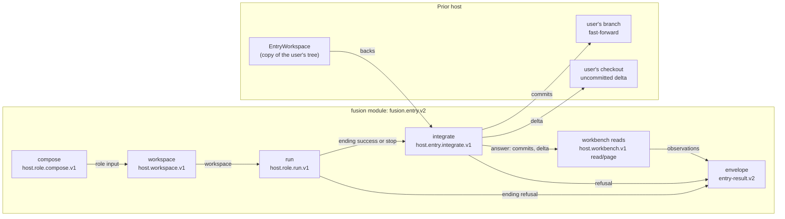
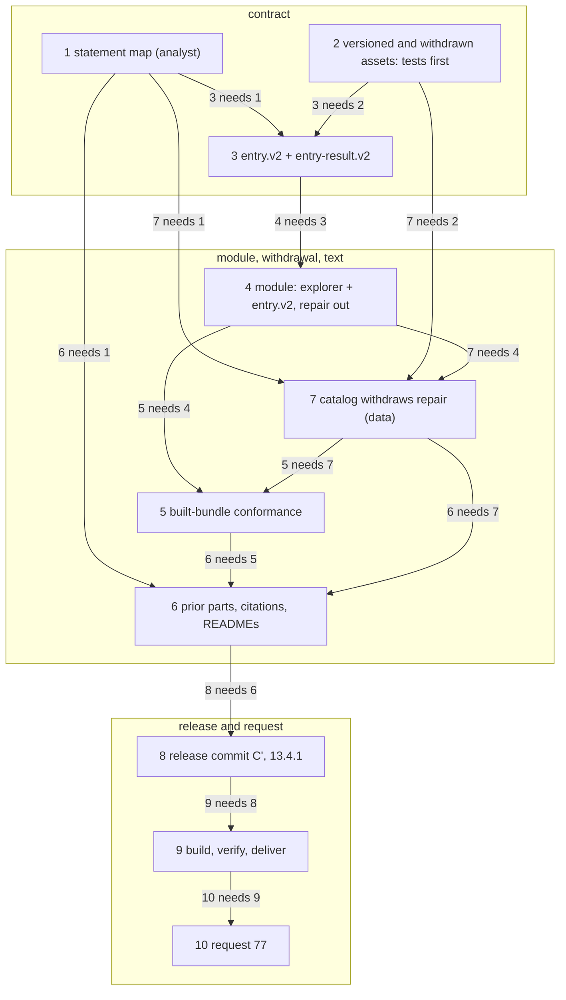

# Implementation Plan: fusion 13.4.1, one delivery model on Prior (step 17), repair withdrawn, the citation fix, and request 77

**Date:** 2026-10-27 (revised the same day at plan review, before adoption; see `## Revision of 2026-10-27`)
**Spec:** none. Planned from the user's approval of 2026-10-27 and the user's ruling at its review ("Ziel ist aber nicht, beide Modelle zu fahren, sondern das neue. Der Repair Weg wird auch in Prior abgeschafft."; asked what becomes of repair: remove it entirely), filed as E4. Also from Prior's ruling `foreign:F09-Prior:261024-0807-how-does-an-entry-run-deliver-its-result-into-the-users-repository.md` (answered, option 1, conditions (a) to (c)), Prior's ruling `foreign:F09-Prior:261024-0900-does-repair-move-onto-the-general-entry-model.md` (answered, option 1, which E4 overrides on fusion's side and request 77 asks Prior to revisit), Prior's reading `foreign:F09-Prior:261027-1519-fusion-request76-reading.md`, and `Prior: docs/design/fusion-entry-v1-prior-preview-for-request76.md` (`### 1.4`, `## 4.`, `## Addendum 2026-10-24`), all read only at Prior `187df6f`.
**Decidability:** The load-bearing question is whether an entry run under Prior delivers its result as Claude Code does: the run's commits on the user's branch, its uncommitted changes uncommitted in the user's checkout, a conflict refused. Fusion cannot decide that from its own inputs, because only Prior's host performs the integration. The change of mechanism is the one request 76 already uses: fusion states the form as a proposal in request 77, and Prior's run of the delivered 13.4.1 bundle answers it. Whether Prior can let go of repair, and what it needs from fusion to do so, is likewise Prior's to answer in 77. Fusion's own mechanisms decide four narrower questions from inputs they hold. (1) Does the module accept every integration answer of the proposed form, a run with no commit included, and refuse every malformed one? Unit tests and built-bundle conformance against a fake host decide it. (2) Is the Claude Code distribution unchanged except the help paragraph and the README pin example? A byte diff against `ca9eb60d` decides it. (3) Does the bundle still serve, carry or name repair? The module's capability list, the payload's file list, `FROZEN` against `WITHDRAWN`, and a token grep decide it. (4) Does any shipped `prior` text still describe the refused delivery model or a repair run? That is a question about meaning, which no lint decides. The analyst's statement map in step 1 and the reviewer pass in the stopping section carry it, and the plan claims no mechanical check for it.

## Revision of 2026-10-27

The first version kept repair beside the entry model, as Prior's ruling `261024-0900` had it. The user ruled at plan review that only the step-17 model exists and that repair goes entirely. The plan changes as follows.

- **Repair is withdrawn** (E4, new): the module, the capability, the catalog workflow and schemas, the conformance cases, the fake host's repair services, and every `prior` text that describes a repair run.
- **The three repair-role profiles become ordinary entry profiles** (step 7): `code-implementer`, `reviewer` and `state-auditor` name the entry schemas, as the other eight agents do. `writes_workbench.prior` and the tool ceiling follow the role, since their repair values existed for Prior's repair loader. D5's carve-out ("the three repair roles keep theirs") and decision `261024-2111` dissolve. The roles' own `support.prior` becomes `unsupported`, because only a workflow role needs it and only `explorer` remains one.
- **Frozen assets that served the withdrawn contract leave the tree** with their `FROZEN` lines, recorded in a new `catalog/schemas/WITHDRAWN` (E5, new). That covers the nine repair assets and the two accepted-reference entry assets, `entry.v1.json` and `entry-result.v1.json`. E2 is revised to match.
- **E1 is corrected**: `entry.v2` requires ten services, not eleven. The list E1 gave already held ten.
- **E3 is widened**: request 77 also announces repair's withdrawal and asks Prior what it needs.
- **Step numbers.** The plan's ten step anchors are filed, and the codec adds none to a filed plan (`fusion-workbench-conventions.md` `### Planning files`), so the revision keeps all ten. Steps 1 to 6 and 8 to 10 keep their subjects, widened where repair touches them. **Step 7 changes subject**: the README work it held moves into step 6, and step 7 is now the catalog's withdrawal of repair, a data step. The order changes accordingly (`### Order of the steps`).

## Directive

On 2026-10-24 Prior's user ruled that an entry run delivers its result by Prior's step-17 model (`Prior: internal/fusionhost/entry_workspace.go`). Condition (b) of that ruling asks fusion for a distinct entry integrate form, with the proposed workflow and result schema changed to describe a branch fast-forward and an uncommitted delta. Request 76 (fusion `cd4970b5`) cites neither ruling, keeps repair's accepted-reference integration in `entry.v1`, and ships a wrong citation in `catalog/profiles/skill-discuss/parts/09-prior.md` ("request 76, question 2" where question 11 is meant). On 2026-10-27 the user approved carrying condition (b) and the citation fix in one 13.4.1 rebuild, delivering it, and putting it to Prior as request 77. At the plan's review the user added that the step-17 model is the only one: repair is removed from fusion's Prior surface for good. This plan does all of that under the stopping rules of `261023-1854-plan-prior-full-surface-handover-h1-to-h9.md` `## Where this work stops`: a correction to a frozen asset is a new version beside it; the candidate C, the build and the request are redone under 13.4.1; no codec byte moves; the tag and the marketplace bump wait for Prior's answer.

## Current State

Verified in fusion at `cd4970b5` and in Prior at `187df6f`, read only:

- **Workflows.** `catalog/workflows/` holds `explorer.v1.json` (`fusion.explorer.v1`, one step, three role services), `repair.v1.json` (`fusion.repair.v1`, ten steps, nine services) and `entry.v1.json` (`fusion.entry.v1`). `entry.v1` runs seven steps: `compose`, `workspace`, `run`, `capture` (`host.capture.v1`), `integrate` (`host.integrate.v1`, a compare-and-swap of the accepted reference), `snapshot` (`host.snapshot.v1`) and `workbench` (reads under `record:<path>`). Its `requires` names twelve services. It states that its request-69 calls follow "the common contract stated once in `workflows/repair.v1.json`", so `entry.v2` must state that contract itself.
- **Result schema.** `catalog/schemas/entry-result.v1.json` describes `commits` as "the commits the integrate step put on the accepted reference" and `changes` as name-status "from the snapshot's changed_paths". It has no member for an uncommitted delta.
- **Freeze.** `catalog/schemas/FROZEN` lists 17 assets. They are the explorer's five (`explorer-envelope`, `explorer-request`, `explorer-result`, `explorer-role-input`, `workflows/explorer.v1.json`), the nine repair assets (`workflows/repair.v1.json`, `repair-request`, `repair-result`, `implementer-request`, `implementer-result`, `review-request`, `review-response`, `audit-request`, `audit-result`) and the three entry assets of request 76. `catalog/src/__tests__/frozen.test.ts` `publishedAssets` treats only `*.v1.json` under `schemas/` and `workflows/` as published. The bundle assembler selects data files with the same suffix (`adapters/prior/fusionmodule/cmd/fusion-bundle/main.go` `isV1JSON`). Neither admits a second version yet. The rule is stated in `catalog/README.md` `## The frozen assets`, in `frozen.test.ts`, and in request 76 `### What fusion does with the answer`. All three govern a correction, and none governs a withdrawal (E5). The repair assets' bytes stand at tag `v13.1.0`, and the entry v1 assets' bytes at `ca9eb60d`. Hashes were checked against `FROZEN`. Prior keeps its own copy of the repair contract under `internal/fusionhost/testdata/repair-contract/` at `187df6f`.
- **Catalog roles and profiles.** `catalog.json` `roles` gives `support.prior` `supported` to `explorer`, `code-implementer`, `reviewer` and `state-auditor`. Every other role is `unsupported` on Prior, and their agents reach Prior through `entries`. The role-level state of the three is repair's: the module checks an entry's support (`internal/entry/entry.go`, the entry's `Support["prior"]`), never its role's. `reviewer`'s aliases `code-reviewer` and `data-reviewer` with their domains stay: `README-agents.md` states them, and it is shipped. The three profiles name the repair schemas (`implementer-*`, `review-*`, `audit-*`) and `writes_workbench.prior` `false`. That is D5's carve-out, and `261024-2111` kept `false` because Prior's repair loader refuses `true` (`Prior: internal/fusionhost/repair_catalog.go:33`, as that record cites it). `code-implementer`'s ceiling carries `process`, repair's 69.6 (4) reading, and `state-auditor`'s carries `runtime-inspect`. Their `prior` parts branch on two run kinds: `git grep -n 'repair run' -- catalog/profiles` hits only those three profiles.
- **Module.** `cmd/fusion-module/main.go` serves `fusion.explorer.v1`, `fusion.repair.v1` and `fusion.entry.v1`. Import graph, read from the sources: `internal/explorer` imports `internal/steps` only; `internal/entry` and `internal/repair` import `internal/hostsvc` and `internal/steps`; nothing imports `internal/repair` but `cmd/fusion-module`. `internal/hostsvc` serves both. Of its methods, entry v1 uses `Compose`, `Workspace`, `Capture`/`UnboundCapture`, `Integrate`/`UnreviewedIntegration`, `Snapshot` and `ReadRecordAt` (with paging). Only repair uses `Close`/`Closure` and the reviewed `Integration`. The calls go through Prior's SDK wire type `api.RepairCall` and `api.RepairOperationID`, which is Prior's name for the request-69 common contract at the pin and stays. `entry.go` `run` refuses any integration receipt with `integrated.Tree != captured.Tree`.
- **Fake host.** `internal/fixture/fixture.go` holds the payload builder and the role-service `Host` that explorer's tests use. Its `Profiles`, `Workflows` and `Schemas` are hard-coded lists that repeat `FROZEN`. `internal/fixture/repair.go` holds `RepairHost`, and also helpers `entry.go` reuses: the call-journal type `RepairCall`, `Receipt`, `capture` and `integration`, `BaseRevision`, `refusal`, `marshal`, `pageDescriptor` and `Host.settled`. `internal/fixture/entry.go` models an accepted reference (`EntryReference = "refs/prior/accepted/fusion-entry"`) and widens Prior's decoder in `decodeProposedRepairCall`.
- **Conformance.** `conformance/` holds `explorer_test.go` (11 tests), `repair_test.go` (6 tests, over `adapters/prior/testdata/repair-fixture/`), `entry_test.go`, `hooks_test.go` and the shared harness `host_test.go`. Tests run against a built bundle only when `FUSION_BUNDLE_DIR` is set.
- **Four open issues on the entry module**, in package `261023-1846-prior-full-surface-handover-h1-to-h9`: M1 `261023-2154-entry-module-passes-a-settled-answer-of-status-recovery-required-through-as-recovery-required.md`; L1 `261023-2154-entry-envelope-oversize-replacement-drops-the-commit-of-an-integration-that-stands.md`; the coverage issue `261023-2154-entry-load-and-the-receipt-cross-checks-have-no-test-that-would-turn-red.md`; and the schema-description issue `261023-2154-frozen-entry-result-schema-describes-changes-and-questions-differently-from-what-the-module-and-prior-produce.md`. All four are `open`. Prior's preview `## 4.` point 9 asks whether they are carried.
- **Prior's step-17 model** (`entry_workspace.go` header and `Integrate`, at `187df6f`). The workspace copies the repository's tracked files, its uncommitted changes, its ignored files and the class-L workbench files. Integration fast-forwards the reference the user's HEAD named and applies the working-tree delta path by path, each path only where the user's tree still holds the before-snapshot bytes. Before acceptance it refuses on a moved base (`ErrEntryBaseMoved`), a non-fast-forward (`ErrEntryNotFastForward`) or a path conflict (`EntryPathConflict`). A kept run's commits are parked on `refs/prior/entry/<run-id>`. Only a run whose model run ended successfully is integrable (`EntryKept.Integrable`). The result type is `EntryIntegration {base, commit, reference, paths}`.
- **Prior's wire.** `git diff --stat 08c57fb 187df6f -- moduleapi go.mod go.sum schemas/module-api` prints nothing, so `PRIOR_PIN` (`08c57fb`) needs no move. Removing repair only drops SDK uses. `moduleapi/v1` has no entry integrate type, so the module decodes the proposed answer with its own closed type, as it already does for the forms of request 76 question 17.
- **Shipped `prior` text that states the refused model or a repair run.** `git grep` over `catalog/profiles/*/parts/*-prior.md` finds "The run integrates once, at its end. … integrates it as the run's one commit" in the `01-prior.md` of fourteen rendered skill profiles. It finds the same model in `orchestrator` parts `33`, `37`, `38a` and `48e`, `skill-curate/parts/27` and `skill-migrate/parts/15`, and "the project checked out at the run's base revision" in the shared opening. It finds a repair-run branch in most `prior` parts of `code-implementer`, `reviewer` and `state-auditor`. The `commit` and `cleanup` parts state the v1 model, but those two profiles are `prior: unsupported` and not rendered. `explorer`'s parts name no repair step.
- **Citations.** Prior's reading checked every "request 76, question N" under `catalog/profiles` and found one mismatch, `skill-discuss/parts/09-prior.md:3` (question 2 for question 11). Step 1 re-runs that check in fusion's tree.
- **Shipped docs.** `README-agents.md` names the reviewer aliases (line 29) and the conformance suite driving "both workflows" (`### The Prior module bundle`). Both stay true after the withdrawal, since the aliases remain and the two workflows are now explorer and entry. The file is not touched. Its citation of plan `261010-1235-plan-fusion-prior-module-bundle-explorer-then-four-role-repair.md` is history.
- **Release.** `.claude-plugin/plugin.json` is `13.4.0` at C = `ca9eb60d`, which is untagged. The newest tag is `v13.3.9`. The 13.4.0 bundle is delivered at `~/.local/share/prior/incoming/fusion/13.4.0/90961e04…/`, and nothing in this plan touches it.

## Approach

**One delivery model, one integration fact, one service.** The step-17 model integrates once and knows everything it did: the base, the reference, the commits it fast-forwarded and the paths it applied. Prior's own result type is one object for exactly that. So `entry.v2` replaces capture, integrate and snapshot with one service, `host.entry.integrate.v1`. Its answer is the envelope's source for `commits` and the new `delta`, with real subjects and the name-status form assembled by the host. A run that changes nothing is an answer with two empty arrays rather than a branch. Repair goes (E4), so the bundle serves `fusion.explorer.v1` and `fusion.entry.v2` and nothing else. Of the request-69 services fusion then calls `host.role.compose.v1`, `host.workspace.v1` and the `read`/`page` actions of `host.workbench.v1`, all through the common contract that `entry.v2` now states itself (E1).

**Every agent profile has one shape.** With repair gone, nothing needs a profile that names a workflow role's schemas, so all eleven agent profiles and the fourteen skill profiles name `schemas/entry-request.v1.json` and `schemas/entry-result.v2.json`. `explorer` stays the one workflow role and keeps its own schemas. That is D5's rule (the workflow's schemas bind a run) without its carve-out.

**Frozen means frozen bytes, and a withdrawn name stays withdrawn.** The v2 assets are new versions beside v1 under the freeze rule. The eleven assets that served the withdrawn contracts leave the tree together with their `FROZEN` lines. `catalog/schemas/WITHDRAWN` records each with its last hash and the commit that holds it, and a test keeps a withdrawn name from returning (E5). `entry-request.v1.json` is not withdrawn: nothing about the request moved.

**The shipped `prior` text follows the model.** A profile that tells the model "the host integrates the run as its one commit", or that describes a repair run, misleads it about what reaches the user. The behaviour each entry text asks for does not change in 13.4.1: an entry that commits nothing on Prior still commits nothing. Only the description of workspace and delivery is corrected, and the repair branches are deleted. Whether runs may commit (`commit`, `cleanup`, the orchestrator's per-task commit; request 76 questions 1 and 19) waits on Prior's confirmation. The analyst maps every affected statement before any part is edited (step 1), because the byte-equality test cannot see a `prior` text that says something false.

**Explorer keeps working.** Explorer depends on `internal/steps`, `internal/explorer`, the role-service `Host` and payload builder in `internal/fixture/fixture.go`, its five frozen assets, its profile and the conformance harness. Nothing of that is repair's. The repair helpers entry reuses move out of `fixture/repair.go` before it goes (step 4).

**What fusion builds, and what Prior must.**

| Item | Fusion, in this plan | Prior, asked in request 77 |
|---|---|---|
| The integrate form | proposes `host.entry.integrate.v1`, its request, slot, answer and refusals, in `entry.v2.json` | hosts it, backed by `EntryWorkspace`, journalled; confirms or corrects the form |
| Pre-integration codec check | states it as part of the service's contract | performs it with its qualified codec (preview point 7) |
| The decoder | the fake host admits the new capability and an entry compose beside the two forms of question 17 | a decoder for `fusion.entry.v2` calls that admits them (question 17's sibling decoder) |
| `commits` and `delta` | the module copies them from the answer and checks them | assembles them from git and the delta |
| Stop ending | `entry.v2` integrates on `success` and on `stop`, as Claude Code keeps a stopped session's files | `EntryKept.Integrable` is success-only today; a question in 77 |
| Push | none; condition (c) stays a later definition version | as ruled |
| Parking on refusal | none in the envelope; a refusal leaves nothing integrated | condition (a), built at `e554f06`; the user reaches a kept run with `prior fusion kept` |
| Repair | withdrawn: no capability, no assets, no services called, no text | revisits `261024-0900`; decides the 13.1.0 bundle's fate, the request-69 services fusion no longer calls, and the request-70 qualification's standing |
| M1, L1, coverage | fixed for the v2 path in step 4 | none |

**Release.** fusion 13.4.1 is a patch: Claude Code under fusion behaves as in 13.4.0, and only the Prior-hosted surface changes. It follows `README-agents.md` `## Releasing` and the step 23 to 25 forms of the H1-H9 plan.

Five choice points are decisions filed in this package. The plan is written against each recommended option.

| Id | Decision record | Recommended | Steps it gates |
|---|---|---|---|
| E1 | `261027-1612-which-host-service-integrates-an-entry-run-under-the-step-17-model-and-what-does-it-replace.md` (revised) | option 1, `host.entry.integrate.v1` in place of capture, integrate and snapshot; ten services | 2, 3, 4, 5, 10 |
| E2 | `261027-1612-does-the-module-keep-serving-fusion-entry-v1-beside-fusion-entry-v2.md` (revised) | option 1, serve v2 only, v1 workflow and result schema withdrawn | 3, 4, 7, 10 |
| E3 | `261027-1612-does-request-77-supersede-request-76-or-amend-it.md` (revised) | option 1, 77 amends 76 and announces repair's withdrawal | 10 |
| E4 | `261027-1833-does-fusion-keep-the-repair-route-on-prior-beside-the-step-17-entry-model.md` (new) | option 3, remove repair entirely, as the user stated | 1 to 10 |
| E5 | `261027-1833-how-does-a-frozen-catalog-asset-leave-the-tree-when-the-contract-it-serves-is-withdrawn.md` (new) | option 1, withdraw with `WITHDRAWN` and a never-reused name | 2, 7, 10 |

## Implementation Steps

The check commands are cited by name. Each is one line and runs from anywhere.

- `FUSION-CATALOG`: `cd /Users/kai/Projects/productive/F04-FUSION/fusion/catalog && npm ci && npm test`
- `FUSION-MODULE`: `PRIOR_REPO=/Users/kai/Projects/productive/F09-Prior /Users/kai/Projects/productive/F04-FUSION/fusion/adapters/prior/stage.sh test`
- `CHECK-IMPORTS`: `/Users/kai/Projects/productive/F04-FUSION/fusion/adapters/prior/check-imports.sh`
- `HOOKS-WT` (runs against the committed `HEAD`, so after the step's commit): `git -C /Users/kai/Projects/productive/F04-FUSION/fusion worktree add /private/tmp/fusion-hooks-check HEAD && cd /private/tmp/fusion-hooks-check/hooks && npm ci && npm test; git -C /Users/kai/Projects/productive/F04-FUSION/fusion worktree remove --force /private/tmp/fusion-hooks-check`
- `CODEC-PIN`: `shasum -a 256 /Users/kai/Projects/productive/F04-FUSION/fusion/codec/dist/fusion-record.js` prints `b404745831dd921bfbae78f52df49604d22f4f78b7c07bce067cc9078e262e2d`
- `CLAUDE-DIST`: `git -C /Users/kai/Projects/productive/F04-FUSION/fusion diff --stat ca9eb60d HEAD -- agents skills rules hooks bin templates stilwerk docs README.md README-agents.md README-hooks.md`
- `CLAUDE-RENDER` (byte equality of the Claude render, after the step's commit): `cd /Users/kai/Projects/productive/F04-FUSION/fusion/catalog && npm run render -- claude && git -C /Users/kai/Projects/productive/F04-FUSION/fusion diff --exit-code -- agents skills`
- `BUNDLE-CONFORM` (after the step's commit, clean tree): `O="$(mktemp -d)/b" && PRIOR_REPO=/Users/kai/Projects/productive/F09-Prior /Users/kai/Projects/productive/F04-FUSION/fusion/adapters/prior/build.sh build "$O" && FUSION_BUNDLE_DIR="$O" PRIOR_REPO=/Users/kai/Projects/productive/F09-Prior /Users/kai/Projects/productive/F04-FUSION/fusion/adapters/prior/stage.sh test`
- `REPAIR-TOKENS`: `git -C /Users/kai/Projects/productive/F04-FUSION/fusion grep -n -i -e 'fusion\.repair' -e 'repair\.v1' -e 'host\.capture\.v1' -e 'host\.integrate\.v1' -e 'host\.snapshot\.v1' -e 'refs/prior/accepted' -e 'repair run' -e 'RepairHost' -- adapters/prior catalog ':!catalog/schemas/WITHDRAWN'`

1. **Statement map of the delivery model and of repair in the shipped `prior` text, the three repair-role profiles' keys, Prior's repair holdings, and the citation check**
   - Executor: analyst
   - Files: `$OUT_ANALYSIS/<stamp>-entry-delivery-model-statement-map.md` (the analyst's own store)
   - Changes: (a) From Prior at a named commit, read only, state the step-17 facts the `prior` text and `entry.v2` depend on, each with `path:line`: the workspace basis (tracked, uncommitted, ignored and class-L files; `.checkout-id` read-only), what the delta holds (created, changed and deleted paths; re-timed-only paths with equal hashes), when a run is integrable (`EntryKept.Integrable`), the refusals before acceptance, the parking reference, and what happens to an index-only change. (b) For every `prior` part of the 25 entries supported on Prior, every statement that rests on the v1 model ("integrates … as the run's one commit", "accepted reference", "fresh checkout at the run's base revision", "captures the workspace"), describes a repair run or "two run kinds", or names `workflows/entry.v1.json`, `schemas/entry-result.v1.json` or a repair schema. Class each statement: (i) false under `entry.v2`, with the replacement sentence; (r) repair-only, deleted, with the sentence the surviving entry-run branch becomes once it is unconditional; (ii) dependent on a question request 77 asks, kept and cited to it; (iii) still true. Name a replacement for the shared `01-prior.md` paragraph once, so the fourteen copies stay one text. List the `commit` and `cleanup` parts separately as held: not rendered, and not changed in 13.4.1. (c) For each key of `code-implementer`, `reviewer` and `state-auditor` `profile.json` (`input_schema`, `result_schema`, `tools_ceiling`, `may_delegate`, `writes_workbench`, `execution_policy`), state whether its value exists for repair (cite answer 69, 69.6, `261024-2111` or Prior's repair loader) or for the role, and give the entry value. A repair value takes the value the role's neutral text and its closest entry precedent support (`data-implementer` for `code-implementer`; `analyst` for the read-and-file roles), with the evidence. `reviewer`'s read-only ceiling stays, under decision `261025-1117-how-does-a-read-only-role-write-the-workbench-on-a-prior-entry-run.md`. (d) Prior's repair holdings at `187df6f`, each with `path:line`, for request 77: where the request-69 services are implemented and which of them entry runs at the pin would still use; the request-70 qualification record; ruling `261024-0900` and its state; the repair-contract copy under `internal/fusionhost/testdata/repair-contract/`; the decoders that name the repair roles (`api.DecodeRepairCall`'s compose); and what answer 69.5 binds for reading old runs. (e) Check every "request 76, question N" under `catalog/profiles/` against the topics in request 76 `### Questions for Prior`, and list each mismatch with its replacement number.
   - Acceptance: every part file under `catalog/profiles/*/parts/*-prior.md` of a supported entry appears in the map as "no statement" or with its statements classed, and the analyst states the command that enumerated them. Every class-(i) and class-(r) row carries its sentence, with no host-service name outside that entry's `requires`. Every key of the three profiles appears in table (c) with its origin and its entry value. Every item of (d) carries a Prior `path:line` or the statement that it was not found. The citation table lists every hit with match yes or no, and `skill-discuss/parts/09-prior.md` is among the mismatches.
   - Verification: the analyst's enumeration command, re-run by the reviewer of the stopping section's review pass
   - Dependencies: none (E4 answered)

2. **The catalog suite and the bundle assembler admit a second version and a withdrawal, with the post-withdrawal tests written first**
   - Executor: code-implementer
   - Files: `catalog/src/__tests__/frozen.test.ts`, `catalog/src/__tests__/render.test.ts`, `catalog/src/__tests__/schema-cases.test.ts`, `adapters/prior/fusionmodule/cmd/fusion-bundle/main.go` and its `main_test.go`
   - Changes: `publishedAssets` and the assembler's data selection (`isV1JSON`, renamed for what it selects) take `*.v<n>.json` for any positive `n`. The meta-schemas `*.schema.json` stay excluded, and the frozen test still requires `FROZEN` to name exactly the published set. `frozen.test.ts` gains the withdrawal checks of E5 option 1: `schemas/WITHDRAWN` parses in `FROZEN`'s line form; its paths and `FROZEN`'s are disjoint; no withdrawn path exists on disk; and each withdrawn hash equals `git show <commit>:catalog/<path>`, with the commit read from the comment line that heads the path's group. The explorer group stays as it is. `render.test.ts`: the request-69 comparison tests (`repair.v1` as the base of `entry.v1`) are removed. The live entry-workflow tests move to `workflows/entry.v2.json`. They check that it validates and serves `fusion.entry.v2` with `revise_bound` 0, and that its `requires` is exactly the ten services of E1's recommendation. They check that every step's `host_service` appears in `requires`, and that the run step's completion names `schemas/entry-result.v2.json`. The fixture-catalog tests of the run step's role resolution apply to v2 unchanged. The tests that only hold once step 7 has run go into one `describe` block per file, titled `after the repair withdrawal (plan step 7)`. They check that `workflows/` holds exactly `explorer.v1.json` and `entry.v2.json`; that no definition names `host.capture.v1`, `host.integrate.v1` or `host.snapshot.v1`; that every profile a supported entry names declares `schemas/entry-request.v1.json` and `schemas/entry-result.v2.json`; and that the only role with `support.prior` `supported` is one that a workflow step names as its `role` (today `explorer`). `schema-cases.test.ts` runs the explorer rows it runs today and a table `entry-schema-cases.v2.json` against `entry-request.v1.json` and `entry-result.v2.json`. The repair and entry v1 tables are no longer run. An assembler test proves that a `*.v2.json` under `schemas/` and `workflows/` lands in `data`.
   - Acceptance: `FUSION-CATALOG` is red in `render.test.ts`, `schema-cases.test.ts` and `frozen.test.ts` only. Steps 3 and 7 clear the red, and a red in any other test file is a stop. The commit message lists each red test with the step that clears it. `FUSION-MODULE` exits 0.
   - Verification: `FUSION-CATALOG`, then `FUSION-MODULE`
   - Dependencies: none (E1, E2, E4, E5 answered)

3. **The `entry.v2` workflow, the `entry-result.v2` schema, their case table, and the entry profiles' result schema**
   - Executor: data-implementer
   - Files: `catalog/workflows/entry.v2.json`, `catalog/schemas/entry-result.v2.json`, `catalog/schemas/FROZEN`, `catalog/testdata/entry-schema-cases.v2.json`, `catalog/profiles/<id>/profile.json` for the 24 profiles that name `schemas/entry-result.v1.json` today, `catalog/schemas/workflow.schema.json` (description only). The 24 are every profile with `entry-result.v1.json` as its `result_schema`, which is the 25 supported entries less the three repair roles, plus `skill-commit` and `skill-cleanup`. The data-implementer lists them by `grep -l` in the commit message.
   - Changes: `entry.v2.json`: capability `fusion.entry.v2`, `revise_bound` 0. It states the request-69 common contract itself (identity and `workflow_id` first in every request, the operation id derived under capability `fusion.entry.v2`, the closed `{state, result, code}` answer), citing answer 69 and no workflow file. Its steps are `compose`, `workspace` and `run` as in v1, with the run's result schema `schemas/entry-result.v2.json` and the `on_ending` targets `success` → `integrate`, `stop` → `integrate` (Claude Code parity, a question in 77) and `refusal` → end refused. Then `integrate`, with `host_service: host.entry.integrate.v1`, request `{run_id}` and slot `integration`. It carries the answer's members as E1 option 1 states them and the refusals of the common contract with nothing written. It names the pre-integration codec check of changed control records as Prior's duty, and a `push` note says a push step comes with a later definition version (condition (c)). Then `workbench`: one `host.workbench.v1` `read` (with `page`) under `record:<path>` per workbench control record among the paths of `commits[].changes` and `delta` whose status is not `D`, as an observation. A read refused by the codec ends the envelope refused, and the integration stands. `requires` holds the ten services of E1. A top-level description cites ruling `261024-0807`, E1 and E4, and says the step-17 model is fusion's one delivery model on Prior. `entry-result.v2.json` keeps v1's shape and conditionals. `commits` is re-described as the run's own commits fast-forwarded onto the user's branch as made, oldest first, each `{commit, reference, subject, changes}`: `reference` is the user's branch reference, `subject` the commit's own, and `changes` name-status assembled by the host. It gains a required `delta`, the uncommitted changes applied to the user's checkout in name-status form, empty when there were none or no integration happened. `questions` keeps v1's members and text, since question 15(b) is still open. The `$id` and `title` read `fusion.entry-result/v2`. `FROZEN` gains the two v2 lines under a comment naming this plan, E1 and "fusion's proposal in request 77". No existing line changes in this step. The case table holds at least these rows: a run with commits and a delta; a run with a delta and no commit; a refused integration (violations, empty `commits` and `delta`); a completed run with nothing to integrate; a missing `delta` (invalid); and a `changes` item outside name-status form (invalid only if the schema adds a pattern; the data-implementer states which). Each listed `profile.json` changes `result_schema` to `schemas/entry-result.v2.json` and nothing else.
   - Acceptance: `jq -r '.requires[]' catalog/workflows/entry.v2.json | sort` prints the ten services of E1. `git diff --exit-code -- catalog/workflows/explorer.v1.json catalog/schemas/entry-request.v1.json` exits 0, and so does `git diff -U0 -- catalog/schemas/FROZEN | grep -c '^-[^-]'` printing 0. `FUSION-CATALOG` is red only in the `after the repair withdrawal (plan step 7)` blocks, which step 7 clears; any other red is a stop. `FUSION-MODULE` exits 0, or is red only in `internal/entry` or `cmd/fusion-module` where a test reads a profile's `result_schema`; step 4 clears that, and any other red is a stop. `CLAUDE-RENDER` exits 0.
   - Verification: `FUSION-CATALOG`, then `FUSION-MODULE`, then `CLAUDE-RENDER`
   - Dependencies: 1, 2 (E1, E2 answered)

4. **The module serves `fusion.explorer.v1` and `fusion.entry.v2`, and nothing of repair remains in its code**
   - Executor: code-implementer
   - Files: deleted: `adapters/prior/fusionmodule/internal/repair/` (both files), `adapters/prior/fusionmodule/internal/fixture/repair.go`, `adapters/prior/fusionmodule/conformance/repair_test.go`. Changed: `internal/entry/entry.go` and `entry_test.go`, `internal/hostsvc/hostsvc.go`, `hostsvc_test.go` and `entry_test.go`, `internal/fixture/entry.go` and `fixture.go`, one new host-neutral file in `internal/fixture/` for the helpers that `repair.go` held and `entry.go` uses, `internal/steps/schema_cases_test.go` and `bundle_test.go`, the comments of `internal/steps` and `internal/explorer` that name repair, `cmd/fusion-module/main.go` and `main_test.go`.
   - Changes: **Repair out.** `main.go` loads explorer and entry and serves `fusion.explorer.v1` and `fusion.entry.v2`; its header says so. `hostsvc` keeps `call`, `Compose`, `Workspace`, `ReadRecord`/`ReadRecordAt` with paging, and drops `Capture`, `UnboundCapture`, `Integrate`, `Integration`, `UnreviewedIntegration`, `Snapshot`, `Close` and `Closure` with their tests. Its header describes it as the client of the request-69 common contract services the entry workflow calls. `api.RepairCall` and `api.RepairOperationID` stay, as Prior's SDK names at the pin. The helpers of `fixture/repair.go` that `entry.go` uses move to the new file under names that say what they are (the call journal, `Receipt`, `BaseRevision`, `refusal`, `marshal`, the page descriptor, `Host.settled`), and the compiler is the check that none is missed. `fixture.go` derives its schema and workflow lists from `catalog/schemas/FROZEN` and `workflows/*.v<n>.json` instead of repeating them, so step 7's data withdrawal needs no code change. The repair-only `Profiles` list goes. `bundle_test.go` checks that each payload profile's `input_schema` and `result_schema` resolve inside the payload, and names no schema. `schema_cases_test.go` runs the explorer rows and the v2 table. **Entry v2 in.** `entry.Load` reads `workflows/entry.v2.json` and refuses any other shape with `ErrDefinition`, the ten `requires` included. `run` performs compose, workspace and run as today, then `host.entry.integrate.v1` after an ending of `success` or `stop`. `hostsvc` gains `EntryIntegrate(ctx, runID)` and a closed decoder of the answer (`run_id`, `base`, `reference`, `head`, `commits`, `delta`). The module checks the receipt: `run_id` is the run's; `base` equals the workspace's `base_revision`; `reference` is non-empty; `commits` is empty exactly when `head` equals `base`, and otherwise the last commit is `head`; and every `changes` and `delta` item is in name-status form with a valid relative path. A receipt that fails any check ends refused `integration.invalid`. A host refusal ends refused `integration.refused`, with the host's code in the detail. The envelope copies `commits` (with `reference`) and `delta`, then the workbench reads observe the control records named there. The v1 interpreter and the capture, snapshot and accepted-reference paths are removed (E2). M1: a settled answer with status `recovery-required` or a null `ending` is refused `result.invalid`, and no integration is called. L1: the oversize replacement keeps `commits` and `delta` and empties `questions`, and falls back to the empty workflow only if that still does not fit. The fake host serves `host.entry.integrate.v1` from the scripted run: `ScriptCall` gains the commits a command makes (subject and paths), the fake answers with the run's commits and its uncommitted paths, and a knob refuses with a conflict code. `EntryReference` and the capture, integrate and snapshot handlers go. The decoder widening is renamed `decodeProposedEntryCall` and admits the new capability under its slot beside the two forms of question 17.
   - Acceptance: `FUSION-MODULE` exits 0. The unit suite drives `help` (`plain`), `reconcile` (`dispatches`) and `memo` (`asks`) to `completed`, and three delivery cases: (i) a run whose script commits twice and leaves an uncommitted path, where `commits` holds both in order with their subjects and `delta` holds the path; (ii) `memo` with no commit and one uncommitted path, which ends `completed` with empty `commits` and one `delta` item (the case `entry.go:404` refused); (iii) a conflict refusal, which ends `refused` `integration.refused` with empty `commits` and `delta` and no workbench read. A kill after each persisted boundary and a resume reproduce the envelope with zero further role runs. One test exists for each receipt check, and each turns red when its check is removed. One test row exists for each `Load` refusal. M1's and L1's acceptance tests from their issues hold, read against v2. The explorer unit tests pass unchanged. `main_test.go` asserts exactly `fusion.explorer.v1` and `fusion.entry.v2`. `git -C /Users/kai/Projects/productive/F04-FUSION/fusion grep -n -i -e 'fusion\.repair' -e 'RepairHost' -e 'host\.capture' -e 'host\.snapshot' -e 'refs/prior/accepted' -- adapters/prior/fusionmodule` prints nothing; `RepairCall`, `RepairOperationID` and `DecodeRepairCall` as Prior SDK names are not in that pattern. The commit message states the coverage of `internal/entry`. `CHECK-IMPORTS` exits 0. `CODEC-PIN` holds.
   - Verification: `FUSION-MODULE`, then `CHECK-IMPORTS`, then `CODEC-PIN`
   - Dependencies: 3

5. **Conformance of `fusion.entry.v2` and of the explorer against a built bundle that carries no repair**
   - Executor: code-implementer
   - Files: `adapters/prior/fusionmodule/conformance/entry_test.go`, `adapters/prior/fusionmodule/conformance/host_test.go` (only where it names repair)
   - Changes: `EntryCapability` becomes `fusion.entry.v2`, and the envelope decoder takes v2's shape. `TestOneEntryPerClassRunsAgainstTheBuiltBundle` validates against `schemas/entry-result.v2.json` from the installed payload. A new case runs the three delivery cases of step 4 from the launcher started as Prior's host starts it. A check confirms three things. The installed payload's `workflows/` holds exactly `explorer.v1.json` and `entry.v2.json`, and its schemas are exactly `FROZEN`'s at the build commit. No path of `WITHDRAWN` is in the payload. The module refuses `fusion.repair.v1` and `fusion.entry.v1` as unknown capabilities. `RepairCapability` and every reference to the deleted repair test go.
   - Acceptance: `BUNDLE-CONFORM`, from the step-5 commit, which follows step 7, exits 0 with the 11 explorer tests unchanged, the per-class case, the delivery cases, the payload check and `TestHookLayoutBundleEqualsPluginTree`. No repair test is run, and none exists. `CHECK-IMPORTS` exits 0.
   - Verification: `BUNDLE-CONFORM`, then `CHECK-IMPORTS`
   - Dependencies: 4, 7

6. **The `prior` parts describe the step-17 model and no repair run, the citations are corrected, and the adapter and catalog READMEs describe 13.4.1**
   - Executor: code-implementer
   - Files: `catalog/profiles/<id>/parts/*-prior.md`, exactly the files step 1's map classes (i) or (r), or lists as a citation mismatch, with `skill-discuss/parts/09-prior.md` among them; `catalog/profiles/skill-commit` and `catalog/profiles/skill-cleanup` are not touched. `adapters/prior/README.md` (`## What the executable does`, `### The entry workflow`, `### Conformance against a built bundle`, `## Testing`, the layout table rows of `internal/repair/` and `testdata/repair-fixture/`, and every passage on the repair workflow). `catalog/README.md` (`## Layout`, `## The frozen assets`).
   - Changes: each class-(i) statement is replaced by the map's sentence, and the shared `01-prior.md` paragraph by its one replacement in every copy. Each class-(r) statement is deleted, and the surviving entry branch takes the map's unconditional sentence; "serves two run kinds" in the three roles' `01-prior.md` becomes the entry run alone. Each `workflows/entry.v1.json` or `schemas/entry-result.v1.json` name becomes its v2 counterpart. Class-(ii) statements keep their text and gain the request-77 question number the map gives. "(request 76, question 2)" in `skill-discuss/parts/09-prior.md` becomes "(request 76, question 11)", and every other mismatch the map lists is corrected the same way. No `neutral` or `claude` part changes. `adapters/prior/README.md` describes the module as serving explorer v1 and entry v2. Its entry section describes `entry.v2`: the step-17 model, `host.entry.integrate.v1` and its answer, the receipt checks, the stop rule, the workbench observations, and the wire points the fake host widens. It says once that repair was withdrawn in 13.4.1 under E4, that its sources stand at `v13.1.0`, and that `README.md` there describes them. Every other repair passage goes. `catalog/README.md` lists the two workflows and the v2 assets, and its frozen-asset section states E5's withdrawal rule and `WITHDRAWN`. `README-agents.md` is not touched (`## Current State`, shipped docs).
   - Acceptance: `FUSION-CATALOG` exits 0, including the host-token lint and the invariant that a supported entry's `requires` equals the service names its `prior` parts mention. `CLAUDE-RENDER` exits 0. `npm run render -- prior "$(mktemp -d)"` writes the profiles step 9 will report, reports nothing missing, and the written `profiles/*.md` contain no line matching `REPAIR-TOKENS`' patterns. `git grep -n -e 'one commit' -e 'accepted reference' -e 'entry\.v1' -e 'entry-result\.v1' -- 'catalog/profiles/*/parts/*-prior.md' ':!catalog/profiles/skill-commit' ':!catalog/profiles/skill-cleanup'` prints only lines the map classes (iii), each named in the commit message. `REPAIR-TOKENS` prints only lines of `adapters/prior/README.md` and `catalog/README.md` that state the withdrawal, each named in the commit message. `HOOKS-WT` passes (the reference-resolution lint reads the READMEs).
   - Verification: `FUSION-CATALOG`, then `CLAUDE-RENDER`, then the Prior render, then `REPAIR-TOKENS`, then `HOOKS-WT`
   - Dependencies: 1, 5, 7

7. **The catalog withdraws repair and the accepted-reference entry assets, and the three repair roles become entry profiles**
   - Executor: data-implementer
   - Files: deleted: `catalog/workflows/repair.v1.json`, `catalog/workflows/entry.v1.json`; `catalog/schemas/repair-request.v1.json`, `repair-result.v1.json`, `implementer-request.v1.json`, `implementer-result.v1.json`, `review-request.v1.json`, `review-response.v1.json`, `audit-request.v1.json`, `audit-result.v1.json`, `entry-result.v1.json`; `catalog/testdata/repair-schema-cases.v1.json`, `catalog/testdata/entry-schema-cases.v1.json`; `adapters/prior/testdata/repair-fixture/`. Changed: `catalog/schemas/FROZEN`, new `catalog/schemas/WITHDRAWN`, `catalog/catalog.json` (`roles` only), `catalog/profiles/{code-implementer,reviewer,state-auditor}/profile.json`.
   - Changes: the eleven assets and their `FROZEN` lines leave together (E5 option 1). The comment that headed the three entry v1 lines goes with them, and the other comments stay. `WITHDRAWN` lists the eleven, each with the sha256 its `FROZEN` line carried. They come in two groups, each under a comment line that names E4 and E5 and the commit holding the bytes: `v13.1.0` for the nine repair assets and `ca9eb60d` for `workflows/entry.v1.json` and `schemas/entry-result.v1.json`. `FROZEN` then names exactly the explorer's five, `schemas/entry-request.v1.json`, `workflows/entry.v2.json` and `schemas/entry-result.v2.json`. In `catalog.json` `roles`, `code-implementer`, `reviewer` and `state-auditor` take `support.prior` `unsupported`; nothing else in `roles` changes, aliases and `prior_ids` included, and `entries` does not change. Each of the three `profile.json` takes `input_schema` `schemas/entry-request.v1.json`, `result_schema` `schemas/entry-result.v2.json`, and for every other key the entry value step 1's table (c) gives, and nothing else.
   - Acceptance: `FUSION-CATALOG` exits 0, the `after the repair withdrawal (plan step 7)` blocks included. `FUSION-MODULE` exits 0. A red here means step 4 left a code dependency on withdrawn data, and is a stop. `git diff --exit-code ca9eb60d -- catalog/workflows/explorer.v1.json catalog/schemas/entry-request.v1.json 'catalog/schemas/explorer-*.v1.json'` exits 0. `git diff -U0 ca9eb60d -- catalog/catalog.json` shows only the three `support.prior` values. The three `profile.json` differ from `ca9eb60d` only in the keys table (c) lists. `CLAUDE-RENDER` exits 0. `CODEC-PIN` holds.
   - Verification: `FUSION-CATALOG`, then `FUSION-MODULE`, then `CLAUDE-RENDER`, then `CODEC-PIN`
   - Dependencies: 1, 2, 4 (E4, E5 answered)

8. **Release commit for 13.4.1, the candidate C′**
   - Executor: code-implementer
   - Files: `.claude-plugin/plugin.json` (`version` 13.4.1), the `install.sh` header pin example, the `README.md` pin example, `catalog/profiles/skill-help/parts/21-claude.md` and `21-prior.md` (the `### 4. Update` paragraph), `skills/help/SKILL.md` (rendered), the surface-growth golden the hooks suite regenerates
   - Changes: `README-agents.md` `## Releasing` steps 0 and 1 on the fusion side. Under decision `261015-1559-does-the-help-update-topic-at-13-1-3-drop-the-v13-migration-paragraph-or-fold-the-patch-into-the-13-1-2-paragraph.md` (option 2), 13.4.1 joins the 13.4.0 paragraph, relabelled to cover it. The joined paragraph says in one sentence that a Prior entry run now leaves its changes in the user's checkout as Claude Code does, that the Prior bundle no longer serves the repair workflow, and that a Claude Code session behaves as in 13.4.0. `bin/fusion-review-coverage --since v13.3.9` is run, and the commit message states its result together with the reviewer pass that is the stopping section's precondition. The marketplace bump and the tag wait.
   - Acceptance: `claude plugin validate .` reports passed. `claude --plugin-dir . --agent fusion:orchestrator -p "reply SMOKE-OK"` replies. `FUSION-CATALOG` and `HOOKS-WT` pass, the growth bound included. If the `skills/` bound turns red, the repair clause is cut first, then the rest of the paragraph, and no bound moves. `CLAUDE-DIST` lists only `skills/help/SKILL.md` and `README.md`, and in each the diff is the help paragraph or the pin example. `CODEC-PIN` holds.
   - Verification: `cd /Users/kai/Projects/productive/F04-FUSION/fusion && claude plugin validate .`, then `FUSION-CATALOG`, then `HOOKS-WT`, then `CLAUDE-DIST`, then `CODEC-PIN`
   - Dependencies: 6

9. **Build, verify, conform and deliver the 13.4.1 bundle at C′**
   - Executor: code-implementer
   - Files: none in either repository; outputs under `TMPDIR` and `~/.local/share/prior/incoming/fusion/13.4.1/<digest-hex>/`
   - Changes: `build.sh build` twice into fresh directories, `diff -r` of the two, `build.sh verify`, the conformance suite with `FUSION_BUNDLE_DIR`, then `build.sh deliver`. The executor reports for step 10: the bundle digest, the tarball sha256, the tar entry count, the data file count and the data files by directory (`catalog.json`, `profiles/`, `schemas/`, `workflows/`), the delivered path, `PRIOR_PIN`, `fusion_revision` (C′ or a later commit touching only `fusion-workbench/`, never `+dirty`), the conformance counts, the codec digest read from the tarball, and `tar -xOf <tar> catalog.json | shasum -a 256`.
   - Acceptance: both builds print one digest, which differs from `90961e04…`. `diff -r` exits 0. `build.sh verify` exits 0. The conformance suite passes. `tar -tf <tar> | grep -E '^(workflows|schemas)/'` lists exactly the eight assets `FROZEN` names at C′. `build.sh deliver` prints the incoming path under `13.4.1/`. The 13.4.0 directory is unchanged. `tar -xOf <tar> codec/dist/fusion-record.js | shasum -a 256` prints `b4047458…`.
   - Verification: `PRIOR_REPO=/Users/kai/Projects/productive/F09-Prior /Users/kai/Projects/productive/F04-FUSION/fusion/adapters/prior/build.sh deliver`
   - Dependencies: 8

10. **Request 77, amending request 76 and withdrawing repair**
    - Executor: data-implementer
    - Files: `codec/fixtures/prior/REQUESTS.md` (append only)
    - Changes: a section `## Entry delivery on the step-17 model, repair withdrawn (request 77)` in the form of request 76. It holds the following parts, each under its own heading.
      - **Written against:** C′ and the request commit's parent, Prior's head as read, both pins.
      - **What 77 replaces in 76, and what stands** (E3 option 1, the exact list that record names): 76's headings and rows by name. It states that an answer naming `sha256:90961e04…` closes neither request.
      - **The rulings this carries:** `261024-0807` with conditions (a) to (c), cited by basename with the preview and its addendum at their Prior commits.
      - **Repair withdrawn:** fusion's user's ruling (E4, cited by basename) and what leaves: the capability, the eleven withdrawn assets with `WITHDRAWN`'s hashes and the commits that hold them, the conformance cases, and the request-69 services fusion no longer calls (`host.capture.v1`, `host.integrate.v1`, `host.snapshot.v1`, the `close` action of `host.workbench.v1`). It names what fusion still calls: `host.role.compose.v1`, `host.workspace.v1`, `host.workbench.v1` `read`/`page`. It gives the three repair-role profiles' new keys, the roles' `support.prior` `unsupported` with the aliases kept, and fusion's reading of answer 69.5 (old repair runs stay readable from the 13.1.0 install and Prior's own contract copy, with nothing from fusion's later trees), with Prior `path:line` from step 1 (d).
      - **The bundle:** step 9's report, in the form of 76's `### The bundle`.
      - **The codec:** `b4047458…`, `QualifiedCodecDigest`, no re-pin.
      - **The delta from 13.4.0:** `git diff --stat <13.4.0 build commit> C′ -- . ':!fusion-workbench'` and its meaning, item by item (the v2 assets, the withdrawal, the module, the profiles, the `prior` parts, the citation fix, the help paragraph).
      - **`fusion.entry.v2` and `host.entry.integrate.v1`:** the steps, the ten services, the common contract as `entry.v2` states it, the integrate request, slot, answer, receipt checks and refusals, and the `entry-result.v2` members.
      - **What Prior is asked to run:** 77.1 to 77.4 in the form of 76.1 to 76.4 against the 13.4.1 digest. 77.2 compares the eight `FROZEN` files at C′ with the installed ones and finds no withdrawn path. 77.3 covers the three delivery cases.
      - **Questions for Prior**, numbered within 77. They include at least: confirm or correct the service name, request, slot and answer; the refusal codes for a moved base, a non-fast-forward, a path conflict and a codec refusal; whether a run ended `stop` is integrable; whether re-timed-only paths appear in `delta`; fusion's reading of questions 1, 2, 3 and 8 of request 76 under step 17, stated with Prior `path:line` from step 1, for Prior to confirm; and question 17 restated with its third point resolved, the entry compose admitted for every entry profile, and the new capability added. On repair: will Prior's user revisit `261024-0900` now that fusion has withdrawn repair; does Prior keep the 13.1.0 bundle installed for reading old runs, or deactivate or revoke it, and does it need anything from fusion either way; which of the request-69 services Prior keeps once no fusion workflow calls capture, integrate, snapshot or close; how Prior records the request-70 qualification of a capability no later bundle serves; and whether Prior's loader accepts `reviewer`'s aliases on a role `unsupported` on Prior.
      - **Closing-review fixes:** M1 and L1 fixed in the v2 module (preview point 9), and point 7 carried as the integrate service's codec check.
      - **What fusion does with the answer:** as at 76, now naming 13.4.1, and a v3 for a correction of a v2 asset.
      - **The requests as they stand:** 76 "asked, its bundle, entry assets and repair statements replaced by 77", and 77 "asked". No line above is edited.
    - Acceptance: every heading above is present. The digest, the path and the counts equal step 9's report. Ruling `261024-0807` and E4 are cited by basename, and `261024-0900` by basename in the repair questions. The list of what 77 replaces names everything E3 option 1 lists. `CODEC-PIN` holds. The file is appended to and never edited above.
    - Verification: `git -C /Users/kai/Projects/productive/F04-FUSION/fusion diff --numstat -- codec/fixtures/prior/REQUESTS.md` prints `<n> 0`, then `CODEC-PIN`, then `git -C /Users/kai/Projects/productive/F04-FUSION/fusion diff -- codec/fixtures/prior/REQUESTS.md | grep -c -e 'foreign:F09-Prior:261024-0807-how-does-an-entry-run-deliver-its-result-into-the-users-repository' -e 'foreign:F09-Prior:261024-0900-does-repair-move-onto-the-general-entry-model' -e '261027-1833-does-fusion-keep-the-repair-route-on-prior-beside-the-step-17-entry-model'` prints at least 3
    - Dependencies: 9 (E3, E4, E5 answered)

### Order of the steps

The step list is the full dependency definition, and every edge below is one it declares. The numbers are anchors, not the order: step 7 runs before steps 5 and 6.

Steps 1 and 2 run in parallel. The path from step 3 on is sequential: 3, 4, 7, 5, 6, 8, 9, 10.

## Where this work stops

- The work is finished when request 77 is appended to `codec/fixtures/prior/REQUESTS.md` at a committed fusion commit. It carries the 13.4.1 bundle identity, `fusion.entry.v2` with `host.entry.integrate.v1`, repair's withdrawal with its questions, ruling `261024-0807` and E4 cited by basename, the list of what it replaces in 76, and its questions. The user has been told which commit to report to Prior.
- No step starts while a decision gating it (E1 to E5, the table in `## Approach`) is `open`. A ruling other than the recommended one re-files this plan before its gated steps start.
- No codec byte moves: `CODEC-PIN` prints `b4047458…` at C′, in the 13.4.1 tarball and at the request commit. A step that needs a codec change stops the work there.
- No frozen file changes its bytes. At C′, `FROZEN` names exactly the explorer's five, `entry-request.v1.json`, `entry.v2.json` and `entry-result.v2.json`, and each of the first six lines is byte-equal to its line at `ca9eb60d`. `WITHDRAWN` names exactly the eleven assets step 7 lists, each at the hash `FROZEN` carried.
- The bundle serves and carries no repair: at C′ the module's capabilities are exactly `fusion.explorer.v1` and `fusion.entry.v2`. The 13.4.1 tarball holds no path `WITHDRAWN` names. `REPAIR-TOKENS` prints only README lines that state the withdrawal.
- `PRIOR_PIN` stays `08c57fb`. If `git diff --stat 08c57fb <Prior head> -- moduleapi go.mod go.sum schemas/module-api` is non-empty when step 4 starts, step 4 does not start, and the plan is re-filed with a pin step.
- The Claude distribution is unchanged except the help paragraph and the pin example: at C′, `CLAUDE-DIST` lists only `skills/help/SKILL.md` and `README.md`, with only those two edits. Any other difference is a stop.
- The release commit C′ has a precondition: a reviewer pass over the diff of steps 2 to 7 has run, and each of its findings is fixed or filed. The pass reads the `prior` parts against step 1's map and checks that the explorer surface is byte-unchanged. The release commit's message names that review.
- The bundle is delivered only from a clean tree whose `plugin.json` names 13.4.1. A `+dirty` identity is never handed over.
- **The tag `v13.4.1` and the marketplace bump are not part of this work.** They wait for Prior's answer to requests 76 and 77. `v13.4.0` is not tagged at all, because its candidate is replaced. Until the tag, main takes no commit to a shipped file other than `REQUESTS.md`. A commit that must land first moves the candidate to 13.4.2, and steps 8 to 10 are redone.
- A Prior correction to a v2 asset is answered with a v3 beside it and a new request, never an edit of the frozen file. A withdrawn name is never published again.
- Fusion records nothing on Prior's behalf. Revising `261024-0900` is Prior's user's act, and fusion reads the outcome from Prior's answer.

## Data Structures

- `workflows/entry.v2.json`: the existing `fusion.workflow/v1` shape. Its steps are `compose`, `workspace`, `run`, `integrate` (`host.entry.integrate.v1`) and `workbench`. `requires` holds ten services: `host.role.read.v1`, `host.role.run.v1`, `host.role.complete.v1`, `host.role.compose.v1`, `host.workspace.v1`, `host.entry.integrate.v1`, `host.workbench.v1`, `host.question.v1`, `host.exec.v1`, `host.dispatch.v1`.
- `host.entry.integrate.v1`, proposed: request `{run_id}` with the common pair; slot `integration`; completed answer `{run_id, base, reference, head, commits: [{commit, subject, changes: ["<status>\t<path>"]}], delta: ["<status>\t<path>"]}`; refusals under the request-69 common contract.
- `schemas/entry-result.v2.json`: v1's members, with `commits[]` `{commit, reference, subject, changes}` re-described, plus the required `delta: string[]`.
- `schemas/WITHDRAWN`: `FROZEN`'s line form `<sha256>  <path>`, grouped under comment lines that name the ruling and the commit holding the bytes. Fusion-only; the assembler never copies it.
- Changed: `catalog.json` `roles` (three `support.prior` values) and the three repair-role profiles (step 7). Unchanged: `schemas/entry-request.v1.json`, the explorer assets, and `catalog.json` `entries`. The 27 entries, their classes, their `requires` and their support stay as in 13.4.0.

## API Changes

- Module capabilities: `fusion.explorer.v1` (unchanged) and `fusion.entry.v2`. `fusion.entry.v1` and `fusion.repair.v1` are no longer served.
- One proposed host service, `host.entry.integrate.v1`. Fusion stops calling `host.capture.v1`, `host.integrate.v1`, `host.snapshot.v1` and the `close` action of `host.workbench.v1`.
- Published assets: two added (`workflows/entry.v2.json`, `schemas/entry-result.v2.json`, frozen as fusion's proposal in request 77) and eleven withdrawn (step 7).
- No Claude Code surface changes beyond the help paragraph.

## Testing Strategy

The catalog suite holds the v2 workflow's shape and its ten services, the uniform profile schema pointers, the role-support rule and a shared case table, which the Go side runs as well. It also holds the freeze with its withdrawal checks: `WITHDRAWN` is disjoint from `FROZEN`, absent from disk, and byte-true to its commits. The module's unit suite proves the three delivery cases, the stop ending, the empty integration, every receipt check and every `Load` refusal with a test that turns red when the check goes, and resume after each persisted boundary. The explorer's tests run unchanged, and nothing of repair is left to test. The built-bundle conformance suite repeats the delivery cases from the launcher, keeps the 11 explorer cases, and proves the payload carries no withdrawn asset and the module refuses the two retired capabilities. Byte equality of the Claude render and `CLAUDE-DIST` prove that Claude Code did not change. No suite proves whether a `prior` text tells the truth about delivery. That is step 1's map and the reviewer pass. Nor does any suite prove that Prior's host answers in the proposed form or can let go of repair, which only Prior's answer to 77 can show.

## Risks & Mitigations

| Risk | Mitigation |
|---|---|
| Prior corrects the service name or answer shape, costing a v3 | The form follows Prior's own `EntryIntegration` and its stated preferences (preview `### 2.2` (i)); request 77 asks before Prior builds step 60 |
| Prior keeps "integrable only on success", so a stopped `memo` loses its file | 77 asks the question; the change is one `on_ending` line in a v3 workflow, and the module's stop path is already tested |
| Prior needs repair longer than fusion offers it (old runs, a qualified workflow it depends on) | Old runs stay readable from the 13.1.0 install and Prior's own contract copy, which no later fusion bundle touches; 77 asks what Prior needs, and the bytes stand at `v13.1.0` and in `WITHDRAWN` |
| Prior's loader refuses an alias on a role `unsupported` on Prior | 77 asks it; reverting is one value per role in a 13.4.2, with no text change |
| A repair value in the three profiles is replaced by a wrong entry value | Step 1 table (c) cites each key's origin and precedent before step 7 writes it; the reviewer pass reads the three profiles against the table |
| A replaced `prior` sentence says something the map did not intend | The map states each replacement before any edit; the reviewer pass reads parts against the map |
| The `requires`-equals-parts invariant breaks because a part names `host.entry.integrate.v1` | Step 1's sentences name no service outside the entry's `requires`, and step 6's acceptance runs the invariant |
| Removing repair code drops a helper the entry fixture or the explorer needs | The helpers move before `repair.go` is deleted, the compiler and the explorer tests check it in step 4, and step 7's `FUSION-MODULE` stops on any dependency left on withdrawn data |
| The help paragraph turns the `skills/` growth bound red | Cut the repair clause, then the paragraph; no bound moves without a ruling under `260927-2319_*_does-the-growth-bound-on-shipped-text-yield-to-the-dual-host-prompt-set.md` |
| A commit to a shipped file lands between C′ and the tag | The stopping section forbids it; if one is unavoidable, the candidate moves to 13.4.2 |

## Open Questions

- [ ] E1 to E5, as filed (table in `## Approach`). E4 records the user's ruling and waits for the user to record the answer.
- [ ] Once E4 is answered, decision `261024-2111-does-an-entry-run-of-a-repair-role-write-the-workbench-on-prior.md` (answered) is overridden by it, and the orchestrator transitions it to `superseded`. D5 (`261023-1854-which-schemas-bind-an-entry-run-of-an-agent-that-is-also-a-workflow-role.md`) stays answered: its rule still holds, and only its consequence for the three repair roles is gone. Decision `261025-1117-how-does-a-read-only-role-write-the-workbench-on-a-prior-entry-run.md` is untouched, and request 76's decision 6 stands.
- [ ] Do M1, L1 and the coverage issue ride step 4? The plan assumes yes, because the code they name is the code step 4 rewrites, and Prior's preview point 9 asks for them. After step 4's commit the orchestrator closes the three as fixed. The schema-description issue names `entry-result.v1.json`, which step 7 withdraws. Its `changes` half is answered by `entry-result.v2`, and its `questions` half stays with request 76 question 15(b). Its disposition is the orchestrator's to record.
- [ ] Do `commit` and `cleanup` stay `prior: unsupported` in 13.4.1? The plan assumes yes. The step-17 model integrates a run's commits as made, which answers request 76 question 1 on fusion's reading, but Prior has not confirmed it, and `cleanup` also needs the deferred push. Making them entries is a later release, after the answer to 77.
