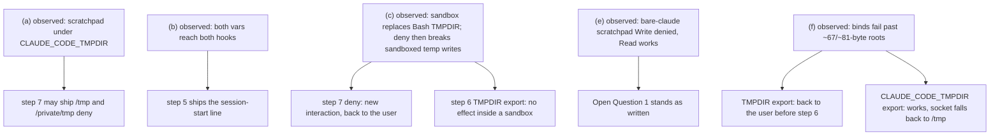

# Analysis: step 1 measurements — scratchpad, hook environment, sandbox TMPDIR, deny spelling, scratchpad under deny, socket path length

**Date:** 2026-10-27 23:20
**Type:** Feasibility (live measurement, plan step 1)
**Status:** Complete
**Requested by:** orchestrator (work package `261027-2242-intermediate-files-in-project-tmp`, plan `261027-2252-plan-intermediate-files-in-project-tmp.md` step 1)

## Question

Do the six facts the plan rests on hold on this machine: (a) the scratchpad of an interactive session lands under `CLAUDE_CODE_TMPDIR`; (b) both temp variables reach SessionStart and PostToolUse hook processes; (c) `TMPDIR` reaches the Bash tool with the sandbox on as well as off; (d) how `Edit(//var/folders/**)` and its `/private` spelling match; (e) what the four deny entries do to the scratchpad and to `Read` of task output under a bare `claude`; (f) whether `AF_UNIX` sockets bind under a realistic `<root>/tmp/`?

## Scope

- **Claude Code version, for every result below:** `claude --version` prints `2.1.312 (Claude Code)`. Every probe ran that binary (`/Users/k1/.local/bin/claude`). The dispatching session itself runs 2.1.311 (`CLAUDE_CODE_EXECPATH=/Users/k1/.local/share/claude/versions/2.1.311`); no probe ran 2.1.311.
- Machine: macOS (Darwin 24.6.0), user uid 502, login `TMPDIR=/var/folders/1d/bw8x0jnd1pq2nsk1mw1vgl1w0000gp/T/`. Model for every probe: `--model haiku`.
- Probe base: `/Users/k1/fusion-tmp-probe-261027230255` (`$B` below) and `/Users/k1/fpz-261027` (long roots for (f)). Neither is inside a git tree (`git -C $HOME rev-parse` fails). Both removed at the end.
- The probes were started from inside a Claude Code session, so they inherited its markers (`CLAUDECODE`, `CLAUDE_CODE_CHILD_SESSION`, `CLAUDE_CODE_MESSAGING_SOCKET`, …). From (a) onward every probe ran through a wrapper `$B/scripts/clean-env.sh` that `env -u`s those markers and `FUSION_*`. The two first probes, (b) and the first (c), ran with the markers inherited; (b) was re-run clean with the same result. (d) ran with the markers inherited.
- Repository tree read for context only: `/Users/k1/Projects/productive/fusion`, HEAD `a43c0829c718db332bb0b698fe48730586f08179` (2026-10-27T23:02:00+01:00), branch `main`, `## main...origin/main [voraus 1]` (one commit ahead of the remote), two modified workbench files not mine. Nothing in it was written except this report.
- The narrative's measurements were taken as established and not repeated, except where a sub-item names a control the narrative did not run.

## Findings

### (a) Scratchpad under `CLAUDE_CODE_TMPDIR` — **observed**

An interactive session was driven with `expect` (`$B/scripts/drive.exp`, a hard 200 s bound, `/exit` at the end), with a PTY of 50x200. The driver accepts the trust dialog, waits for the input prompt, sends the prompt, and stops on an end marker the model emits.

Command:

```
cd $B/proja && CLAUDE_CODE_TMPDIR=$B/cct-a $B/scripts/clean-env.sh $B/scripts/drive.exp $B/proja \
  "Use the Write tool to write the text pad-a into a file named probe-a.txt inside your scratchpad directory. ..." \
  $B/out/a.log --dangerously-skip-permissions
find $B/cct-a -maxdepth 5; ls -la $B/cct-a/claude-*/*/*/scratchpad/; cat $B/cct-a/claude-*/*/*/scratchpad/probe-a.txt
```

Output, from outside the session:

```
/Users/k1/fusion-tmp-probe-261027230255/cct-a/cc-socks
/Users/k1/fusion-tmp-probe-261027230255/cct-a/claude-502/-Users-k1-fusion-tmp-probe-261027230255-proja/3ceb96e0-441f-40b1-ab3c-a608e4e2c90c/scratchpad
/Users/k1/fusion-tmp-probe-261027230255/cct-a/claude-502/-Users-k1-fusion-tmp-probe-261027230255-proja/3ceb96e0-441f-40b1-ab3c-a608e4e2c90c/scratchpad/probe-a.txt
-rw-r--r--@ 1 k1  staff   5 27 Okt 23:13 probe-a.txt
pad-a
```

The session's own transcript (ANSI stripped) shows the Write tool targeting `~/fusion-tmp-probe-261027230255/cct-a/claude-502/…/scratchpad/probe-a.txt`. So the scratchpad sits at `$CLAUDE_CODE_TMPDIR/claude-<uid>/<project-slug>/<session>/scratchpad`, and the model is told that path. An earlier attempt, stopped at the trust dialog, had already created `…/scratchpad` under `cct-a` before any prompt was sent. The interactive session also bound its messaging socket at `$CLAUDE_CODE_TMPDIR/cc-socks/<pid>.sock` (`cct-a/cc-socks/40544.sock` while running, removed at exit).

The three-command manual procedure was not needed.

### (b) Hook environment — **observed** for both variables, both events

A throwaway plugin `$B/plug` (`hooks/hooks.json`: `SessionStart`, and `PostToolUse` with matcher `Bash`) runs `dump.sh`, which writes `env | grep -E '^(TMPDIR|CLAUDE_CODE_TMPDIR)='` to a file per event.

Command (clean-env run):

```
cd $B/projb2 && CLAUDE_CODE_TMPDIR=$B/cct-b2 TMPDIR=$B/tmpdir-b2/ $B/scripts/clean-env.sh \
  claude -p --dangerously-skip-permissions --model haiku --plugin-dir $B/plug \
  "Run the Bash command: echo BASH TMPDIR=\$TMPDIR . Reply with its output verbatim." < /dev/null
```

Output:

```
BASH TMPDIR=/Users/k1/fusion-tmp-probe-261027230255/tmpdir-b2/
== posttooluse.env
TMPDIR=/Users/k1/fusion-tmp-probe-261027230255/tmpdir-b2/
CLAUDE_CODE_TMPDIR=/Users/k1/fusion-tmp-probe-261027230255/cct-b2
== sessionstart.env
TMPDIR=/Users/k1/fusion-tmp-probe-261027230255/tmpdir-b2/
CLAUDE_CODE_TMPDIR=/Users/k1/fusion-tmp-probe-261027230255/cct-b2
```

The run with inherited markers (`$B/projb`, `cct-b`, `tmpdir-b`) gave the same four lines. Both runs used `-p`; the hooks were not dumped from an interactive session. Both variables arrive unchanged, with `TMPDIR`'s trailing slash kept.

### (c) Bash `TMPDIR`, sandbox off and on — **observed**: off it is passed through, on it is replaced

- **Sandbox off.** The Bash output of the (b) runs is the control: `BASH TMPDIR=/Users/k1/fusion-tmp-probe-261027230255/tmpdir-b2/`. That agrees with the narrative.
- **Sandbox on.** The project `.claude/settings.json` was `{"sandbox":{"enabled":true,"allowUnsandboxedCommands":false}}`. The sandbox is active: a `touch` outside the project was refused.

```
cd $B/projc && CLAUDE_CODE_TMPDIR=$B/cct-c TMPDIR=$B/tmpdir-c/ claude -p --dangerously-skip-permissions --model haiku \
  "Run exactly this one Bash command ...: echo TMPDIR=\$TMPDIR; echo CCT=\$CLAUDE_CODE_TMPDIR; python3 -c 'import tempfile;print(tempfile.gettempdir())'; touch $B/sbx-outside-probe && echo OUTSIDE_WRITE_OK || echo OUTSIDE_WRITE_DENIED" < /dev/null
```

```
TMPDIR=/tmp/claude-502
CCT=/Users/k1/fusion-tmp-probe-261027230255/cct-c/claude-502
/tmp/claude-502
touch: /Users/k1/fusion-tmp-probe-261027230255/sbx-outside-probe: Operation not permitted
OUTSIDE_WRITE_DENIED
```

  Under the sandbox, the Bash tool's `TMPDIR` is `/tmp/claude-502`, whatever was exported, and `CLAUDE_CODE_TMPDIR` inside Bash is rewritten to `<exported>/claude-502`. Python `tempfile` follows the replaced value. The exported `TMPDIR` still reached the Claude Code process itself: `$B/tmpdir-c/node-compile-cache/…` appeared there.

- **Sandbox on, with the four deny entries of step 7.** This combination was not asked for. It was run because the result changes step 7. Settings: the sandbox block above plus `"permissions":{"deny":["Edit(//tmp/**)","Edit(//private/tmp/**)","Edit(//var/folders/**)","Edit(//private/var/folders/**)"]}`.

```
cd $B/projc2 && $B/scripts/clean-env.sh claude -p --dangerously-skip-permissions --model haiku \
  "... echo TMPDIR=\$TMPDIR; echo x > \"\$TMPDIR/sbx-deny-probe.txt\" && echo TMPDIR_WRITE_OK || echo TMPDIR_WRITE_FAILED; python3 -c 'import tempfile;f=tempfile.NamedTemporaryFile(delete=False);print(\"PY_TEMP_OK\",f.name)' || echo PY_TEMP_FAILED" < /dev/null
```

```
TMPDIR=/tmp/claude-502
(eval):1: operation not permitted: /tmp/claude-502/sbx-deny-probe.txt
TMPDIR_WRITE_FAILED
PY_TEMP_OK /Users/k1/fusion-tmp-probe-261027230255/projc2/tmpt1vuyo1g
zsh:1: operation not permitted: /tmp/claude-502/cwd-c225
```

  The same command without the deny block (`$B/projc3`):

```
TMPDIR=/tmp/claude-502
TMPDIR_WRITE_OK
PY_TEMP_OK /tmp/claude-502/tmpqtq0grd5
```

  So under the sandbox the `Edit` deny entries do reach Bash: the sandbox's write allowance loses `/tmp/claude-502`. The shell cannot write its own `TMPDIR`. Claude Code's own `cwd-*` tracking write fails. Python `tempfile` falls back to the current directory, the project root, and leaves its file there. Without the sandbox, the narrative measured that an `Edit` deny does not stop a Bash redirect. The two results differ only in the sandbox setting.

### (d) Deny spelling for `/var/folders` — **observed**: either spelling alone blocks both

Each run: project `.claude/settings.json` with one deny entry, `--disallowedTools=Bash` so the model cannot fall back, two `Write` calls, then an `ls` from outside.

| Run | `permissions.deny` | Write to `/private/var/folders/…/T/fusion-probe-*-private.txt` | Write to `/var/folders/…/T/fusion-probe-*-plain.txt` | Files on disk |
|---|---|---|---|---|
| d0 (control) | `[]` | `File created successfully` | `File created successfully` | both present |
| d1 | `["Edit(//var/folders/**)"]` | `File is in a directory that is denied by your permission settings.` | `File is in a directory that is denied by your permission settings.` | none |
| d2 | `["Edit(//private/var/folders/**)"]` | `File is in a directory that is denied by your permission settings.` | `Permission to edit /var/folders/1d/bw8x0jnd1pq2nsk1mw1vgl1w0000gp/T/fusion-probe-d2-plain.txt has been denied.` | none |

Command form (d1):

```
cd $B/projd-d1 && claude -p --dangerously-skip-permissions --model haiku "--disallowedTools=Bash" \
  "Use the Write tool (not any other tool) twice. First write the text 'x' to the file /private/var/folders/1d/bw8x0jnd1pq2nsk1mw1vgl1w0000gp/T/fusion-probe-d1-private.txt . Then ... /var/folders/1d/bw8x0jnd1pq2nsk1mw1vgl1w0000gp/T/fusion-probe-d1-plain.txt ..." < /dev/null
ls -la /private/var/folders/1d/bw8x0jnd1pq2nsk1mw1vgl1w0000gp/T/ | grep fusion-probe-d1   # -> no fusion-probe-d1 files
```

The two different d2 messages show two different matching paths. Both deny. This **contradicts** the narrative's finding that `/tmp` and `/private/tmp` need one entry each. `/tmp` was not re-measured here, because the dispatch said not to repeat the narrative's measurements. Four entries are harmless if one of each pair is redundant.

### (e) Scratchpad under the four deny entries, bare `claude` — **observed**: Write into the scratchpad fails, Read of task output works

Project `$B/proje/.claude/settings.local.json`: `{"permissions":{"deny":["Edit(//tmp/**)","Edit(//private/tmp/**)","Edit(//var/folders/**)","Edit(//private/var/folders/**)"]}}`. Session started interactive through the `expect` driver, `env -u CLAUDE_CODE_TMPDIR` plus the clean-env wrapper, `--dangerously-skip-permissions`.

- **Write.** The session created its scratchpad at `/private/tmp/claude-502/-Users-k1-fusion-tmp-probe-261027230255-proje/637a2a8e-89d3-434b-8b4f-2d838430a626/scratchpad` itself; the deny does not stop Claude Code creating it. The Write tool on `…/scratchpad/probe-e.txt` returned, per the transcript, `denied by your permission settings`, and the model said "the Write tool was denied access to the scratchpad directory". From outside, `find` listed the empty `scratchpad` directory and no `probe-e.txt`.
- **Background task output.** The background Bash task wrote `…/637a2a8e-…/tasks/btkd14iql.output` (`cat` from outside: `bg-e-output-line`). The first run's transcript shows `Read 1 file` on that path with no error, but the model did not quote the content. A second run in the same project quoted it. Prompt: `echo bg-e2-line-$((40+2))` in the background, then Read the reported output file. Transcript: `The Read returned this verbatim: 1 bg-e2-line-42 … [exited with code 0]`. The `42` can only come from the executed command, so the Read returned the file.

### (f) `AF_UNIX` socket path length under `<root>/tmp/` — **observed**: binds fail past a root length of about 81 bytes, Python `multiprocessing` past about 66

Script `$B/scripts/sock2.py`: `tempfile.mkdtemp()`, then `bind` at `<mkdtemp>/s.sock`, then start a `multiprocessing.managers.SyncManager`, which binds its own socket under `TMPDIR`. It ran under `python3 -I` (Xcode Python 3.9) with `TMPDIR=<root>/tmp/`, at root lengths swept through padded directories under `/Users/k1/fpz-261027`.

```
this repo root: /Users/k1/Projects/productive/fusion len=36
control (no TMPDIR override): sock_len=67 BIND-OK | multiprocessing MP-OK len=80
root_len=35 : sock_len=58  BIND-OK | multiprocessing MP-OK len=71
root_len=45 : sock_len=68  BIND-OK | multiprocessing MP-OK len=81
root_len=55 : sock_len=78  BIND-OK | multiprocessing MP-OK len=91
root_len=60 : sock_len=83  BIND-OK | multiprocessing MP-OK len=96
root_len=65 : sock_len=88  BIND-OK | multiprocessing MP-OK len=101
root_len=70 : sock_len=93  BIND-OK | multiprocessing MP-FAIL(EOFError)
root_len=75 : sock_len=98  BIND-OK | multiprocessing MP-FAIL(EOFError)
root_len=85 : sock_len=108 BIND-FAIL(AF_UNIX path too long) | multiprocessing MP-FAIL(EOFError)
```

A first run without a `__main__` guard printed the underlying `multiprocessing` error in full: `OSError: AF_UNIX path too long` from `SocketListener` → `self._socket.bind(address)`, at a 68-byte root. The `EOFError` above is how the parent sees that child failure.

The margin follows from the output. The bare socket costs root + 23 bytes, so it breaks past a root of 81. The `multiprocessing` manager address costs root + 36, so it breaks past 67. This repository's root (36 bytes) passes both. A root such as `/Users/k1/Projects/clients/digital-leadership/2026-q4-ontology-migration-workstream` (84 bytes) fails both.

**Claude Code's own socket under a long `CLAUDE_CODE_TMPDIR`.** An interactive session with an 87-byte root, `CLAUDE_CODE_TMPDIR=<root>/tmp` and `TMPDIR=<root>/tmp/`, started, ran Bash and exited normally. Its Bash output, from the transcript:

```
SOCK=/tmp/cc-socks-502/43645.sock
ls: /Users/k1/fpz-261027/rrrr…rrrr/tmp/cc-socks: No such file or directory
```

When `<CLAUDE_CODE_TMPDIR>/cc-socks/<pid>.sock` would be too long, Claude Code creates no `cc-socks` there. It falls back silently to `/tmp/cc-socks-<uid>/`, a new system-temp directory this probe created (`ls -ldT`: 23:18:37). With a 44-byte value (`cct-a`) the socket was under `CLAUDE_CODE_TMPDIR/cc-socks/`, as (a) shows. `-p` sessions bound no socket in either case: `cc-socks` was created empty or not at all.

## Implications



Against the plan's `## Where this work stops`:

1. **Clause (a), the `/tmp` deny.** Not triggered. The scratchpad was observed under `CLAUDE_CODE_TMPDIR`, so a launcher-started session's scratchpad leaves `/private/tmp`, and step 7 may ship the `/tmp` and `/private/tmp` entries. Under a bare `claude` the scratchpad stays in `/private/tmp` and its Write is denied, per (e). That is the accepted risk row "Denied scratchpad" and `## Open Questions` 1, now observed rather than predicted.
2. **Clause (b), the session-start line.** Not triggered. Both variables reach SessionStart and PostToolUse unchanged, so step 5 ships the line, reading both variables. Caveat: observed under `-p` only.
3. **Clause (f), the `TMPDIR` export.** Triggered, conditionally. A bind failed under `<root>/tmp/` once the root passed about 81 bytes for a bare socket and about 67 for Python `multiprocessing`. This repository's root is well inside both. Whether an 84-byte root is "realistic" is the user's call, so the `TMPDIR` export goes back to the user before step 6 lands. The plan's claim "the `CLAUDE_CODE_TMPDIR` export is unaffected" holds functionally: Claude Code started and worked at an 87-byte root. But its messaging socket then lands in a new `/tmp/cc-socks-<uid>/`. A socket holds no intermediate result, so nothing the brief protects is lost there. The tracker's job 0d will not see it, since no command names it.
4. **No clause covers (c).** Two findings change steps 6 and 7 and go to the user before step 7 starts:
   - With Claude Code's sandbox on, the Bash tool's `TMPDIR` is `/tmp/claude-<uid>` regardless of the export. The launcher's `TMPDIR` export (step 6) has no effect on sandboxed Bash, and the session-start line (step 5) would read the outer, exported value and report nothing.
   - With the sandbox on, the step 7 deny entries make the sandbox's own `TMPDIR` unwritable. Claude Code's `cwd-*` write fails, and Python `tempfile` drops its files into the project root. Step 7 would degrade every sandboxed session in a project where the `permissions` selector wrote the deny. That is a new risk row, not the "denied scratchpad" one.
5. **(d) for step 7.** One `Edit(//var/folders/**)` entry blocked both spellings, and so did the `/private` one alone. Shipping both is harmless. The disagreement with the narrative's `/tmp` result is noted for the step 7 implementer and not resolved here.

## Recommendations

- **orchestrator → user, before step 6:** put the (f) margin to the user: the `TMPDIR` export with roots up to about 67 bytes safe for `multiprocessing`, about 81 for a bare socket. Options: (i) export as planned and name the limit in the step 8 docs; (ii) have the launcher skip the `TMPDIR` export, keeping `CLAUDE_CODE_TMPDIR`, when `<root>/tmp/` is longer than a stated bound. Option (ii) is one length test in the launcher, and it keeps the mechanism a single one.
- **orchestrator → user, before step 7:** put the sandbox interaction to the user. The smallest coherent fix is to keep the deny entries unchanged and skip writing them when the project's settings enable `sandbox`. That is one condition beside the existing `pwd -P` exception, not a second mechanism. The other option is to accept the degradation and name it.
- **implementation-planner (plan amendment):** add the sandbox row to `## Risks & Mitigations`. Correct "The `CLAUDE_CODE_TMPDIR` export is unaffected" to name the `/tmp/cc-socks-<uid>` fallback. Note that the session-start line cannot see the sandbox's replaced `TMPDIR`.
- No issue filed: each finding feeds a decision the plan already routes to the user, and filing would duplicate the plan's own stop clauses.

## Filed Issues

None.

## Sources

- `261027-2242-intermediate-files-in-project-tmp.md` (`## Measured before filing`)
- `261027-2252-plan-intermediate-files-in-project-tmp.md` (step 1, `## Where this work stops`, `## Risks & Mitigations`, `## Open Questions`)
- Probe artefacts, all removed after this report: `$B/scripts/drive.exp`, `$B/scripts/clean-env.sh`, `$B/scripts/sock2.py`, `$B/plug/hooks/{hooks.json,dump.sh}`, the session logs `$B/out/{a,e,e2,f,f2}.log` (ANSI-stripped for the quotes above).

## Open Questions

- [ ] Is a project root longer than about 67 bytes realistic enough to change the `TMPDIR` export (clause (f))? User.
- [ ] Should the `permissions` selector skip the deny entries in a project with the sandbox enabled, or ship them and name the degradation? User.
- [ ] Do `Edit(//tmp/**)` alone and `Edit(//private/tmp/**)` alone each cover both spellings, as the `/var/folders` pair did in (d)? This was not measured here; the step 7 implementer can settle it with a d0/d1/d2 triple on `/tmp`.
