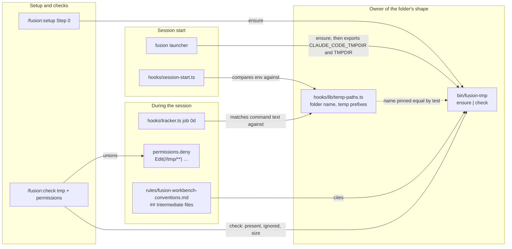
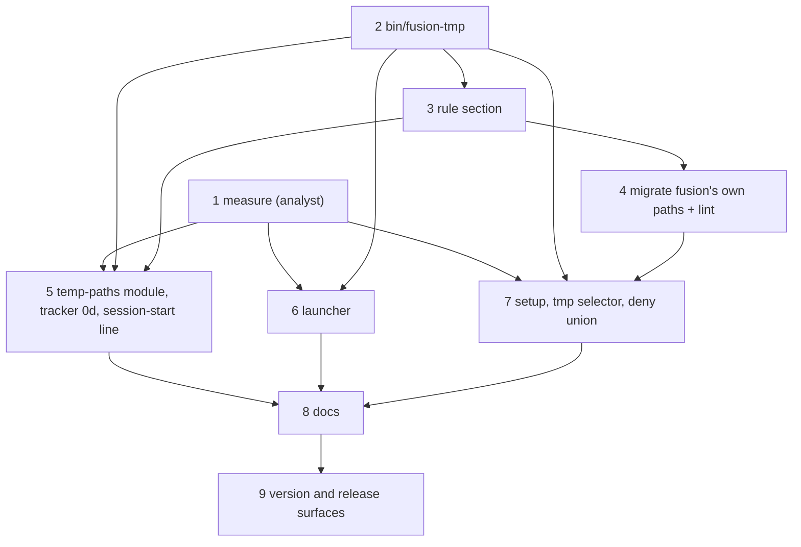

# Implementation Plan: intermediate files go to a self-ignoring `<root>/tmp/`, never to the system temp directory

**Date:** 2026-10-27
**Spec:** none: planned from the package narrative `261027-2242-intermediate-files-in-project-tmp.md`, whose measurements are taken as established.
**Decidability:** The brief asks a question no mechanism can decide: "does a tool under Claude still escape to the system temp directory?" A program may build a temp path at run time, inherit one from a library default, or hard-code `/tmp` inside a binary, and none of that is visible in a command's text or in a tool payload. We therefore change the mechanism and answer four narrower questions, each decidable from inputs the mechanism holds. (1) Does this Claude Code process carry `CLAUDE_CODE_TMPDIR` and `TMPDIR` under `<root>/tmp`? The SessionStart hook reads its own environment. That decides the question provided the hook inherits the variables, which step 1 measures. (2) Does a `Write`/`Edit` target lie under a system temp directory? Claude Code's own `permissions.deny` matcher decides it; the narrative measured that it matches in the `Edit(//path/**)` form. (3) Does the text of a Bash command name a literal system temp path, or a bare `mktemp`? That is a string test on the payload, and the report claims nothing beyond it. (4) Does a shipped fusion file prescribe a system temp path? A lint over `agents/`, `skills/`, `rules/` and `bin/` decides it with an exact allow-list. The undecidable remainder is named in `## Risks & Mitigations` and is not approximated.

## Directive

The package narrative carries the brief and its acceptance shape ("Reached when …"); this plan does not restate them. In one sentence: under fusion, every file a session writes to keep goes to a gitignored `<root>/tmp/`. The session's own temp root and `TMPDIR` point there when it is started through the launcher. `Write`/`Edit` are denied the system temp directories, and fusion's own text names none of them as a target. A shell command naming one is reported and never blocked.

## Current State

Everything below was read or run in this session, and the citations are what was checked.

- **Workbench root.** `bin/fusion-workbench-root` prints the directory holding `fusion-workbench/.fusion-setup`, walking up from `pwd -P`. `hooks/lib/workbench-root.ts` does the same with a logical `resolve`. `<root>` in this plan is that directory. The two walks can disagree on a symlinked path, so every comparison this plan adds goes through `realpath` on both sides.
- **Self-ignoring directories already exist.** The codec writes `*` into `fusion-workbench/.json-state/.gitignore` (`.gitignore`, the comment above `fusion-workbench/.json-state/*`). That is the mechanism this plan reuses for `<root>/tmp/`.
- **Launcher.** `install.sh` `# --- 4. Launcher` writes `~/.local/bin/fusion`. It exports `FUSION_PLUGIN_ROOT` and `exec`s `claude --plugin-dir … --agent …`. It exports no temp variable. Its `--update` branch downloads to the fixed path `/tmp/fusion-install.sh`. The marketplace install path has no launcher at all (`README.md` `### The \`fusion\` launcher` context).
- **SessionStart.** `hooks/session-start.ts` emits one `systemMessage` envelope, which reaches the user and not the model, built from three nullable lines: the subdirectory warning, the due-checks line and the CLAUDE.md weight line. A fourth line fits the same shape.
- **PostToolUse.** `hooks/tracker.ts` sees Bash and has a measured model channel, `hookSpecificOutput.additionalContext` (header, `## What a PostToolUse hook can and cannot do`). It runs three measurements, each on a narrow trigger. `hooks/guard.ts` (PreToolUse) reads nothing from a Bash command, and its header records why.
- **Checks.** `skills/check/SKILL.md` has eleven selectors. `hooks/lib/checks-due.ts` `CHECK_SELECTORS` duplicates the roster, and `hooks/lib/__tests__/derivable-enumerations-lint.test.ts` (block 1b) holds the two in set equality. The `permissions` selector unions an `allow` list into `.claude/settings.local.json` on a yes, or when `bypassPermissions` is already set. It writes no `deny`.
- **Setup.** `skills/setup/SKILL.md` Step 0 creates the stores with one `mkdir -p` and writes the marker. Nothing creates a `tmp/`. This repository does not ignore `tmp/` today (narrative), and `.gitignore` has `*.tmp` only.
- **System temp paths in fusion's source.** We confirmed the narrative's 9 with `git grep -lF -- '/tmp/' -- agents skills hooks/lib bin rules ':!**/dist/**'`: `agents/orchestrator.md`; `skills/cleanup/SKILL.md`, `skills/commit/SKILL.md`; `hooks/lib/staging-drift.ts`, `hooks/lib/__tests__/commit-message-path.test.ts`, `…/guard-bash-integration.test.ts`, `…/sentence-identifier-containment.test.ts`, `…/staging-drift.test.ts`; `bin/fusion-claude-md-weight`. The narrative's pattern misses three more. `skills/archive/SKILL.md` names `${TMPDIR:-/tmp}` twice, with no trailing slash. `hooks/lib/__tests__/helpers/guard-harness.ts` names `/var/folders` in a comment. `install.sh` names `/tmp/fusion-install.sh`. Five helpers call a bare `mktemp`, which needs no literal path to reach `/var/folders`: `bin/fusion-checkout-name`, `bin/fusion-forum`, `bin/fusion-paths`, `bin/fusion-rules`, `bin/monitor`. `install.sh` calls `mktemp -d` as well. The codec's protocol fixtures carry `"workbench": "/tmp/fusion-scratch-workbench"`, a string never written to. `docs/upgrading-to-v10-24.md` names the old commit path historically.
- **`rules/commit-lock.md` names no temp path.** The brief expected the commit-message path there. `grep -n 'tmp' rules/commit-lock.md` finds none: `### The commit message goes to a file` gives the reason for a file and names no location. That file needs no edit.
- **`hooks/lib/staging-drift.ts` cannot see `<root>/tmp/`.** Its `git status` is scoped `-- <workbench abs>` (the `status --porcelain --untracked-files=all` call). A file outside `fusion-workbench/` is never classified, so moving the commit message out of `/tmp` into `<root>/tmp/` produces no `commit-message` or `unclassified` row. What changes there is the constant `PRESCRIBED_MESSAGE_PATH` and the sentence that quotes it.
- **Growth bounds, measured at `22d16e6a`.** `agents/` is 324 684 bytes against 310 567 + 18 000, a margin of 3 883 bytes. `skills/` is 227 773 bytes against 188 768 + 39 260, **a margin of 255 bytes**. The hook tests are 25 976 lines against 24 037 + 4 835, a margin of 2 896 lines. Rule text counts against the dispatch-path bound at zero head-room. Our reconstruction (`bin/fusion-rules <agent>` + prompt + `CLAUDE.md`, against `fixtures/dispatch-path.baseline`) puts the tightest path at `reviewer`, with about 3 080 bytes. That figure is `inference:`, since the test's own method may count differently. `rules-emission-golden.test.ts` is the authority.

## Approach

**One folder, one owner of its shape, and the rest as consumers.** A new helper `bin/fusion-tmp` is the single place that knows what the folder is: `<root>/tmp/`, ignored by its own `.gitignore` holding `*`. It `ensure`s the folder and `check`s it. The launcher, Setup and the new `/fusion:check` selector call it. The TypeScript side gets one module, `hooks/lib/temp-paths.ts`, which owns the folder name (pinned equal to the helper's by a test) and the system temp prefixes. The tracker and the SessionStart hook both import it. One rule section states the convention for agents.

Three choices carry the design.

1. **The folder ignores itself rather than editing the project's `.gitignore`.** The codec does the same for `.json-state/`. Self-ignoring needs no anchored pattern and cannot match a nested `tmp/` elsewhere in the project. It also holds when the launcher creates the folder in a project whose `.gitignore` nobody touched. Fusion's own `.gitignore` therefore needs no `tmp/` line: once `bin/fusion-tmp ensure` has run here, `git check-ignore` answers yes. Step 2 verifies that in this repository.
2. **The convention's scope is a disjoint split.** A file anything reads after its writing process has exited goes to `<root>/tmp/`. That covers a computed result, an archive survey and a commit message. A helper's own scratch file, removed by the helper before it exits, may stay where `mktemp` puts it. Nothing outlives it, so nothing is lost at a restart. This keeps the five `bin/` helpers and the installer unchanged, and states why.
3. **The observation lives in the tracker, not the guard.** The tracker already reads Bash on PostToolUse and has a measured channel to the model. The guard's zero-side-effect Bash branch stays as it is. The new job reads the command's text for a literal path, which is a string fact rather than a prediction of effect. It is the decidable question (3) above, not the classifier the guard retired.

The step order follows two hard dependencies. The deny rules must not reach a project before fusion's own commit path leaves `/tmp`, or the orchestrator's `Write` of its commit message is denied. And step 1's measurement decides whether the deny on `/tmp` and `/private/tmp` ships at all.

## Implementation Steps

1. **Re-measure what the design rests on, starting with the one inference the narrative marks unobserved**
   - Executor: analyst
   - Files: one analysis report, written to the package's own analysis store (`$OUT_ANALYSIS` resolved with this package as the second argument). No source file.
   - Changes: Run each measurement in a throwaway project outside every git tree and record the command and the observed output, not the model's account of it.
     - **(a) Scratchpad.** In an *interactive* session started with `CLAUDE_CODE_TMPDIR=<dir>` exported, ask Claude to write one file into its scratchpad. Then `ls <dir>/claude-*/*/*/scratchpad/` from outside. `claude -p` creates no scratchpad (narrative), so `-p` does not count. If the harness cannot drive an interactive session, through `script`, `expect` or similar, the report gives the user the three-command manual procedure and stops this sub-item. It says "not observed" rather than inferring.
     - **(b) Hook environment.** Do `CLAUDE_CODE_TMPDIR` and `TMPDIR`, exported before `claude` starts, reach a SessionStart hook process, and a PostToolUse one? Use a throwaway `--plugin-dir` whose hook dumps `env`.
     - **(c) Bash `TMPDIR`.** Does `TMPDIR` reach the Bash tool when Claude Code's sandbox is on, if this machine has it, as well as off?
     - **(d) Deny spelling.** Does `Edit(//var/folders/**)` stop a `Write` to `/private/var/folders/…`, or does that spelling need its own entry, as `/tmp` and `/private/tmp` did?
     - **(e) Scratchpad under deny.** With the four deny entries in `.claude/settings.local.json` and a bare `claude`, so the scratchpad sits in `/private/tmp`: does a `Write` into the scratchpad fail? Does `Read` of a background task's output under `…/tasks/` still work?
     - **(f) Socket path length.** Under `TMPDIR=<a realistic deep project>/tmp/`, does binding an `AF_UNIX` socket at `tempfile.mkdtemp()` succeed? macOS caps `sun_path` at 104 bytes.
     - The Claude Code version is stated beside every result.
   - Acceptance: the report states each of (a) to (f) as `observed: …`, `not observed: …` or `not run: <reason>`, never as an inference. `bin/fusion-write create` is not used, because an analysis carries no control file.
   - Dependencies: none

2. **`bin/fusion-tmp`: the one owner of the folder's shape**
   - Executor: code-implementer
   - Files: `bin/fusion-tmp` (new), `.gitignore` (`!bin/fusion-tmp`), `hooks/lib/__tests__/fusion-tmp.test.ts` (new)
   - Changes: A bash helper. `ensure`: resolve `<root>` through the sibling `fusion-workbench-root`. Create `<root>/tmp/`. Write `<root>/tmp/.gitignore` containing `*` only when no such file exists. Print `tmp=<abs>` and `created=yes|no`. Exit 1 with no workbench above `pwd`. `check`: print `tmp=`, `present=yes|no`, `ignored=yes|no|no-work-tree` (`git check-ignore -q <root>/tmp/fusion-probe`, never a text read), `tracked=<n>` (`git ls-files -- tmp | wc -l`) and `size_kb=` (`du -sk`). It writes nothing. The header carries the why: the self-ignore and its precedent in `.json-state/`, and the scope split from `## Approach` item 2. It also states that nothing in fusion deletes the folder's contents.
   - Acceptance: the new test file passes in a scratch git project: `ensure` twice is idempotent, a hand-edited `tmp/.gitignore` is left alone, `check` reports `ignored=yes` after `ensure` and `no-work-tree` outside git, and a no-workbench run exits 1. `cd hooks && npm test` is green otherwise. In this repository, after `bin/fusion-tmp ensure`, `git check-ignore -q tmp/x` exits 0 and `git status --porcelain` names nothing under `tmp/`. That answers the brief's question about fusion's own `.gitignore`: no line is added.
   - Dependencies: none

3. **The rule: one section in the conventions file every agent loads**
   - Executor: code-implementer
   - Files: `rules/fusion-workbench-conventions.md` (new section `## Intermediate files`, plus one row-free mention in the intro sentence listing what the file is the source of truth for), `hooks/lib/__tests__/fixtures/rules-emission.golden` (regenerated)
   - Changes: The conventions file already authors "where artefacts go" and is emitted to all eleven agents. A topic about where *every* agent puts a file it means to keep belongs in it rather than in a new rule file, which would add a header, a `fusion-rules` emit line and a provenance header for one paragraph. The section says, in at most about 700 bytes:
     - intermediate files go to `<root>/tmp/`, with `<root>` defined as what `bin/fusion-workbench-root` prints;
     - the scope criterion, read after the writer exits, and the helper-scratch exception;
     - never `/tmp`, `/private/tmp` or `/var/folders`, because a restart empties them;
     - `mktemp` only with a template under it, since with no argument macOS `mktemp` ignores `TMPDIR`;
     - the folder ignores itself and nothing deletes it automatically;
     - the rule holds when the scratchpad Claude Code names lies elsewhere.
   - Acceptance: `rules-emission-golden.test.ts` is green with the golden regenerated (`UPDATE_RULES_GOLDEN=1`, then a plain run). No line of `fixtures/dispatch-path.baseline` and no `DISPATCH_HEAD_ROOM` is edited. If the bound goes red, the section is cut until it is green. Neither the baseline nor the head-room is the way out.
   - Dependencies: 2

4. **Move fusion's own temp paths, and gate the move**
   - Executor: code-implementer
   - Files: `agents/orchestrator.md`, `skills/commit/SKILL.md`, `skills/cleanup/SKILL.md`, `skills/archive/SKILL.md`, `hooks/lib/staging-drift.ts`, `hooks/dist/` (rebuilt), `hooks/lib/__tests__/commit-message-path.test.ts`, `hooks/lib/__tests__/staging-drift.test.ts`, `bin/fusion-claude-md-weight` (header example only), `codec/src/__tests__/install.test.ts` (only if the archive block's new location needs it), `hooks/lib/__tests__/temp-path-lint.test.ts` (new), `hooks/lib/__tests__/fixtures/surface-growth.golden` (regenerated)
   - Changes:
     - The commit-message path becomes `<root>/tmp/fusion-commit-msg-<session-id>-<task-id>.txt` in `agents/orchestrator.md`. That covers `### Step 4 — commit` items 3 and 5, the session-end commit and the staging-check table's `commit-message` row. It also becomes `<root>/tmp/fusion-commit-msg-<session-id>-<n>.txt` in `skills/cleanup/SKILL.md` and `<root>/tmp/fusion-commit-msg-<something-unique>.txt` in `skills/commit/SKILL.md`.
     - **The per-session discriminator stays, and its reason is restated.** `<root>/tmp/` is per project, so the cross-project collision is gone. Two sessions in one project still share the folder, though, and task ids are short and conventional. The two reasons for the location are rewritten the same way: the folder ignores itself, and the workbench is still the tree `git status` reports on. `held command` keeps the absolute path: `git commit -F <root>/tmp/…`, where `fusion-commit-lock with` has already `cd`ed to `<root>`.
     - The orchestrator's paragraph is shortened where the old reason is now false. It no longer needs to argue against a machine-global path.
     - `PRESCRIBED_MESSAGE_PATH` and the `commit-message` sentence in `staging-drift.ts` change with it. The sentence no longer says "/tmp is swept".
     - `commit-message-path.test.ts` keeps its four pins (location, `-F` read, discriminator, stated reasons) with the regexes moved to `<root>/tmp/`. Its header gains one paragraph saying why the location moved. The negative control keeps the pre-`260905-2213` string.
     - `skills/archive/SKILL.md`: `C="${WORKBENCH%/*}/tmp/fusion-archive-$STAMP-$SLUG"`, preceded by `mkdir -p "${WORKBENCH%/*}/tmp"`. The candidates and survey files persist from Step 4 to Step 7, so they are the convention's own case.
     - The `bin/fusion-claude-md-weight` header example `root=/tmp/scratch` becomes a neutral path.
     - **Untouched, each for its stated reason:** the four test files' comments and fixture strings that name a temp path without writing it (`guard-bash-integration.test.ts`, `guard-harness.ts`, `sentence-identifier-containment.test.ts`, the codec protocol fixtures); `docs/upgrading-to-v10-24.md`, which is historical; the bare `mktemp` scratch in the five helpers and the installer, per `## Approach` item 2.
     - The new lint scans `agents/*.md`, `skills/*/SKILL.md`, `rules/*.md` and `bin/*` for a literal system temp path (`/tmp`, `/private/tmp`, `/var/folders`, `/private/var/folders`), with a path-start boundary so `<root>/tmp/` does not match. Its allow-list is exact file-and-token pairs: the rule section of step 3 and nothing else at this step. It carries a negative control: a fixture line naming `/tmp/x` fails the same predicate.
   - Acceptance: `git grep -nE '(^|[^A-Za-z0-9_.~/])(/private)?/(tmp|var/folders)(/|[^A-Za-z0-9_]|$)' -- agents skills rules bin` lists only the allow-listed rule lines. `cd hooks && npm test` is green with `surface-growth.golden` regenerated and no baseline or head-room constant edited. `committed-dist.test.ts` is green after `npm run build`. `cd codec && npm test` is green. If the `skills/` bound is red, the step cuts inside `skills/` (see `## Open Questions` 2). If a cut cannot reach green, it stops and returns.
   - Dependencies: 3

5. **`hooks/lib/temp-paths.ts`: the tracker's observation and the session-start line**
   - Executor: code-implementer
   - Files: `hooks/lib/temp-paths.ts` (new), `hooks/tracker.ts`, `hooks/session-start.ts`, `hooks/dist/` (rebuilt), `hooks/lib/__tests__/temp-paths.test.ts` (new), any existing test asserting the session-start envelope or a tracker reply byte for byte (`session-start-event.test.ts` and the tracker integration tests, as the run shows)
   - Changes:
     - **Module.** It exports `TMP_DIR_NAME = "tmp"`, which a test pins equal to what `bin/fusion-tmp ensure` creates. It exports the four prefixes `/tmp`, `/private/tmp`, `/var/folders` and `/private/var/folders`. It exports `systemTempMentions(command, root)`, which returns each literal temp path at a path-start boundary, plus a bare `mktemp` (no template operand), and drops every path under `realpath(<root>)`. Without that drop, a project or a test root that itself lies under `/var/folders` would report its own files. It exports `tempSentence(mentions, root)` and `tempRootLine(env, root)`.
     - **Tracker job 0d.** It runs on Bash only, inside a workbench only. On a non-empty `systemTempMentions` it adds one sentence to the `additionalContext` reply. The sentence names the paths, says files there are lost at a restart, names `<root>/tmp/` and the rule section, and says nothing was blocked. There is no event row and no throttle. The header gains 0d and says why reading the text is not the retired classifier.
     - **Session-start line.** It is computed only when a workbench is found. It names whichever of `CLAUDE_CODE_TMPDIR` and `TMPDIR` is unset or does not `realpath` under `<root>/tmp`, and tells the user to start sessions with `fusion`. Both under means no line, so the split is disjoint and complete. It goes into the existing `systemMessage` envelope as a fourth nullable line. Which variables it reads is exactly what step 1 (b) observed reaching the hook.
   - Acceptance: `temp-paths.test.ts` covers the positive cases `echo hi > /tmp/x`, `cd /private/tmp`, `"${TMPDIR:-/tmp}/a"`, `/var/folders/ab/T/x` and a bare `mktemp`. It covers the negative cases `/Users/me/p/tmp/x`, `./tmp/x`, `tmp/x`, `/tmpfoo`, `mktemp "$ROOT/tmp/x.XXXXXX"` and a path under a root that itself lies in `/var/folders`. It covers both session-start branches and the folder-name pin. `cd hooks && npm test` is green after `npm run build`, with the envelope tests this step's line changes updated in the same step. The hook-test surface stays inside its head-room with no constant edited.
   - Dependencies: 1, 2, 3

6. **The launcher exports the two variables inside a fusion project**
   - Executor: code-implementer
   - Files: `install.sh`, `codec/src/__tests__/install.test.ts`
   - Changes: Before `exec claude`, the launcher runs `"$FUSION_DIR/bin/fusion-tmp" ensure`, quietly and with `|| true`. On a `tmp=` line naming an existing directory it exports `CLAUDE_CODE_TMPDIR=<that>` and `TMPDIR=<that>/`, overriding any inherited value. Outside a fusion project it exports neither and the environment passes through unchanged. `--update` stops writing `/tmp/fusion-install.sh` and pipes `curl -fsSL … | bash`, which is the documented install command.
   - Acceptance: a new case in `install.test.ts` runs the installed launcher with a stub `claude` that prints its environment. Inside a set-up project both variables name `<root>/tmp` and `tmp/.gitignore` exists. Outside one neither is set by the launcher. `grep -n '/tmp' install.sh` finds no fixed temp path. `cd codec && npm test` is green.
   - Dependencies: 1, 2

7. **Setup creates the folder, a new `tmp` selector verifies it, and `permissions` unions the deny rules**
   - Executor: code-implementer
   - Files: `skills/setup/SKILL.md`, `skills/check/SKILL.md`, `hooks/lib/checks-due.ts`, `hooks/dist/` (rebuilt), `hooks/lib/__tests__/fixtures/surface-growth.golden` (regenerated)
   - Changes:
     - **Setup Step 0.** After the stores `mkdir`, it runs `"$FUSION_PLUGIN_ROOT/bin/fusion-tmp" ensure` behind an `[ -x ]` guard. A missing helper is named in the Done report and blocks nothing.
     - **New selector `tmp`.** It is one table row plus one short section that runs `check`. It reports `present=no` and `ignored=no`, and repairs both with `ensure`. It reports a non-zero `tracked=` without repairing it: the project keeps tracked files there, and the self-ignore would hide new ones. It names `size_kb=` and offers nothing. `tmp` joins `CHECK_SELECTORS` in the same step.
     - **Counts.** The count in the check skill's description and opening sentence is dropped rather than bumped (`rules/critical-stance.md` §5). So is the one in the `checks-due.ts` comment.
     - **`permissions` deny union.** The desired JSON gains `"deny": ["Edit(//tmp/**)", "Edit(//private/tmp/**)", "Edit(//var/folders/**)", "Edit(//private/var/folders/**)"]`, always in the `Edit(…)` form and never `Write(…)`. They are unioned like `allow`: only added, on the same two paths, a yes or an existing `bypassPermissions`. The question gains one clause saying Claude is also stopped from writing into the system temp directories. When `pwd -P` itself lies under one of those directories, no deny is written and the Done report says why, since the deny would cover the project. If step 1 (e) found the scratchpad still in `/private/tmp` under the launcher, see `## Where this work stops`.
   - Acceptance: `derivable-enumerations-lint.test.ts` block 1b is green with `tmp` in both rosters. `cd hooks && npm test` is green after `npm run build`, with `surface-growth.golden` regenerated and no baseline or head-room constant edited. `codec/src/__tests__/install.test.ts`, which executes shipped skill blocks, is green. The `skills/` bound is held by cuts inside `skills/` (`## Open Questions` 2), or the step stops and returns.
   - Dependencies: 1, 2, 4

8. **Docs: where each change is authored for its readers**
   - Executor: code-implementer
   - Files: `README-hooks.md` (`## Architecture` tracker and session-start entries, `## Files` the `hooks/lib` table row for `temp-paths.ts` that the enumeration lint requires, `### The bin/ helper roster` row for `bin/fusion-tmp`, the `lib/checks-due.ts` row's count), `README-agents.md` (`## Releasing` installer invariants: a bullet saying the launcher exports the two variables inside a fusion project, and why project settings cannot; the `/fusion:check` row's count), `README.md` (`### The \`fusion\` launcher`: one paragraph on `<root>/tmp/`, and the two `export`s a marketplace-path user sets by hand), `docs/upgrading-to-v13.md` (a 13.4.0 section: run `/fusion:check --only permissions` and `--only tmp` once, start sessions with `fusion`, what stays unenforced)
   - CLAUDE.md: not touched. Nothing here binds every session in this repository, and the file is charged to all eleven dispatch paths at zero head-room.
   - Changes: State each fact once, at its home, and point at it from elsewhere. Copy no growth-bound figure.
   - Acceptance: `reference-resolution-lint.test.ts` and `derivable-enumerations-lint.test.ts` are green. `cd hooks && npm test` is green.
   - Dependencies: 5, 6, 7

9. **Version 13.4.0 and the release surfaces in this repository**
   - Executor: code-implementer
   - Files: `.claude-plugin/plugin.json`, `install.sh` (the `FUSION_REF=tags/v…` header example), `README.md` (the same pin example), `skills/help/SKILL.md` (`### 4. Update`), `hooks/lib/__tests__/fixtures/surface-growth.golden` (regenerated)
   - Changes: Bump `version` to `13.4.0`, a minor release because it is a new behaviour. Point both pin examples at `tags/v13.4.0`. In the help topic, add the 13.4.0 paragraph, relabel the ones below it and drop the oldest of the three, per `README-agents.md` `## Releasing` step 0. The manifest `description` is left unchanged, so its marketplace twin needs no paired rewrite.
   - Acceptance: `claude plugin validate .` reports passed. `claude --plugin-dir . --agent fusion:orchestrator -p "reply SMOKE-OK"` replies. `cd hooks && npm test` and `cd codec && npm test` are green with no baseline or head-room constant edited. The marketplace bump, the push and the tag are not this step's (`## Where this work stops`).
   - Dependencies: 8

## Where this work stops

- Steps 1 to 9 are each `done` with their acceptance met, or the plan was closed with the user's word on what was not.
- `cd hooks && npm test` and `cd codec && npm test` are green at the last step's commit, and no growth-bound baseline, head-room constant or `dispatch-path.baseline` row moved in this package's commits.
- If step 1 (a) does not observe the scratchpad under `CLAUDE_CODE_TMPDIR`, step 7 ships no deny entry for `/tmp` or `/private/tmp`. The finding goes back to the user before step 7 starts, because those entries would then deny the scratchpad of every session, the launcher's included.
- If step 1 (b) observes that neither variable reaches a SessionStart hook process, step 5 ships the tracker job without the session-start line. The bare-`claude` residual is then stated as undetected in the docs of step 8.
- If step 1 (f) observes a socket bind failing under a realistic `<root>/tmp/`, the launcher's `TMPDIR` export goes back to the user before step 6 lands. The `CLAUDE_CODE_TMPDIR` export is unaffected.
- If the `skills/` bound cannot be held by cuts at step 4, 7 or 9, that step stops and the user rules on a head-room raise before it continues.
- Before the 13.4.0 tag is pushed: a closing review pass of this package's commit range has run, `bin/fusion-review-coverage --since v13.3.9` has been read and its result stated, and the user has approved the release at closure. The marketplace bump and the tag are the release acts of `README-agents.md` `## Releasing` steps 2 to 5.

## Data Structures

- `<root>/tmp/.gitignore`: one line, `*`.
- `bin/fusion-tmp` output: `key=value` lines, `tmp`, `created` (ensure), `present`, `ignored`, `tracked`, `size_kb` (check).
- `.claude/settings.local.json` `permissions.deny`: the four `Edit(//…/**)` strings of step 7, unioned.

## API Changes

- New helper `bin/fusion-tmp ensure|check`. Exit 0, or 1 with no workbench above `pwd`, or 2 on usage.
- New module `hooks/lib/temp-paths.ts`, imported by `tracker.ts` and `session-start.ts`.
- `PRESCRIBED_MESSAGE_PATH` changes value. No caller outside `staging-drift.ts` and its two tests reads it.
- `CHECK_SELECTORS` gains `tmp`.

## Testing Strategy

- **Unit.** `temp-paths.test.ts` holds the boundary matrix of step 5 and both session-start branches. `fusion-tmp.test.ts` covers idempotence, the hand-edited ignore file, `check` in and outside git, and the no-workbench exit.
- **Pins.** `commit-message-path.test.ts` keeps its location, discriminator and reason pins at the new location. The folder name is pinned equal between the helper and the module. `derivable-enumerations-lint` holds the selector roster.
- **Regression gate.** `temp-path-lint.test.ts` keeps shipped text from naming a system temp path again, with a negative control.
- **Launcher.** The stub-`claude` case in `codec/src/__tests__/install.test.ts`, inside and outside a set-up project.
- **Live.** Step 1 is the live measurement. After step 9, one `fusion` session in a scratch project confirms the session-start line is absent. One bare `claude` session there confirms it is present and that a `Write` to `/tmp/x` is denied.

## Risks & Mitigations

| Risk | Mitigation |
|------|------------|
| **A program that hard-codes `/tmp`**, or builds the path at run time, writes there anyway. Neither the deny rules (`Write`/`Edit` only) nor the text observation sees it. | Unenforceable, stated in the rule and in the 13.4.0 note. Exported `TMPDIR` covers every program that honours it: Python `tempfile` and Node `os.tmpdir()` were measured to. |
| **A session started with bare `claude`**, or on the marketplace path, which has no launcher, keeps its scratchpad and `TMPDIR` in the system directories. | Observed, not prevented: the session-start line names it at every start. The rule still sends agents to `<root>/tmp/`. A marketplace user can export the two variables by hand (README, step 8). |
| **Denied scratchpad.** Under bare `claude` the deny rules cover the scratchpad in `/private/tmp`, so a `Write` there fails and Claude may retry or fall back to the project tree. | Accepted as consistent with the brief: the scratchpad there is exactly what a restart loses. The session-start line tells the user to restart via `fusion`. Step 1 (e) measures it. `## Open Questions` 1 offers the one exemption that would avoid it, and what it costs. |
| **`/var/folders` deny** blocking something Claude Code or fusion needs. | `inference:` none. Claude Code's own temp, task and image writes do not go through the `Write`/`Edit` tools, and `Read` stays allowed. Fusion's hooks and helpers write through node and the shell, which the deny does not reach; the narrative measured that an `Edit` deny did not stop a Bash redirect. Step 1 (e) checks `Read` of task output. |
| **Old install, new settings.** A session on an older fusion install whose orchestrator still writes `/tmp/fusion-commit-msg-…`, in a project where a 13.4.0 check wrote the deny rules. | The `Write` fails visibly at the commit step. Step 4 precedes step 7, so no single release ships the deny without the moved path. The 13.4.0 note says to update before running the check. |
| **Socket paths.** A long `TMPDIR` pushes `AF_UNIX` socket paths past macOS's 104-byte limit for tools that put sockets there. | Step 1 (f) measures it. A failure stops the `TMPDIR` export (`## Where this work stops`). |
| **Growth.** `<root>/tmp/` grows without bound, Claude Code's own temp root included. | The `tmp` selector names its size at each periodic run. Nothing deletes automatically, by the user's brief. |
| **A project that already tracks files under `tmp/`.** The self-ignore would hide new files there. | The `tmp` selector reports `tracked=` and repairs nothing. The user decides. |
| **`/var/tmp` is not covered.** | Out of the brief's scope: it survives a macOS restart. Named in the 13.4.0 note. |
| **Skills byte margin is 255 bytes.** | Each skill step regenerates the golden and holds the bound by cuts. Step 9's help rotation frees the oldest paragraph. `## Open Questions` 2 covers the case where cuts do not suffice. |

## Open Questions

- [ ] **1. Scratchpad exemption in the deny rules.** One option is a narrower deny that leaves `/private/tmp/claude-<uid>/` writable. We found no negation form for `permissions.deny`, so it would have to enumerate siblings, which is not decidable ahead of time. The other option is the full deny planned in step 7. We recommend the full deny: an exemption keeps exactly the files a restart loses, which is the defect the brief names. The user may rule otherwise at plan approval.
- [ ] **2. The `skills/` bound.** At 255 bytes of margin, steps 4, 7 and 9 together likely exceed it before cuts (`inference:`, from the estimated sizes of the deny clause, the new selector and the help paragraph). We recommend cuts inside `skills/`. The candidates are the help topic's oldest paragraph, dropped by the release rotation anyway; the shortened commit and cleanup reasons in step 4; and the past-tense paragraph in the check skill's `identity` selector on the condition that went with the old container. A head-room raise is the fallback, and only on the user's ruling.
- [ ] **3. Does the `tmp` selector offer to empty the folder?** We recommend not. It names the size and says how to delete by hand, which keeps the question budget of `/fusion:check` where it is and never puts intermediate results one keystroke from loss. `/fusion:cleanup` stays commit-only, as its description says.

No decision record is filed with this plan. Its two conventions, the self-ignoring folder and the scope split, are authored where a later reader meets them: in `bin/fusion-tmp`'s header and in the rule section of step 3. The three questions above bind only this plan.
