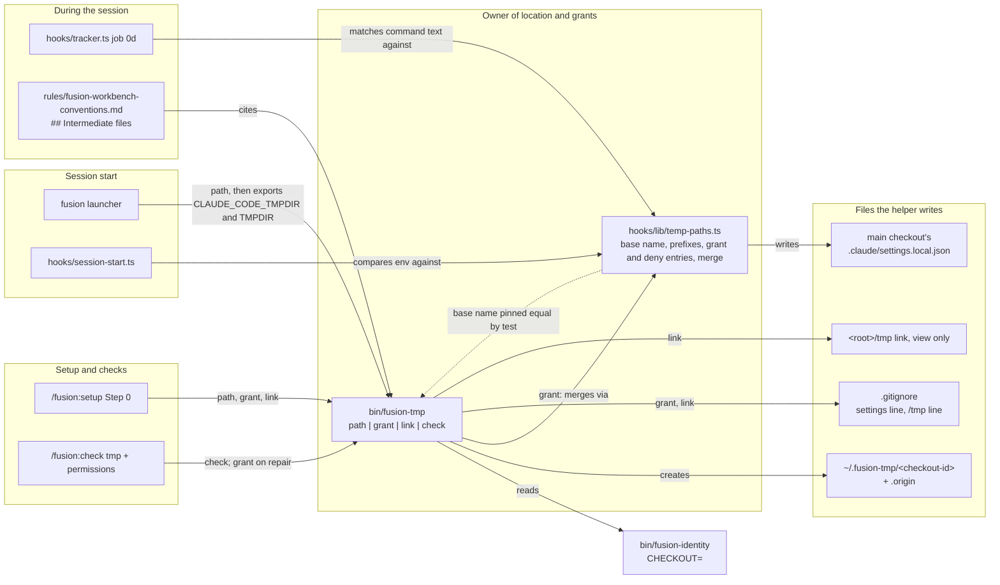
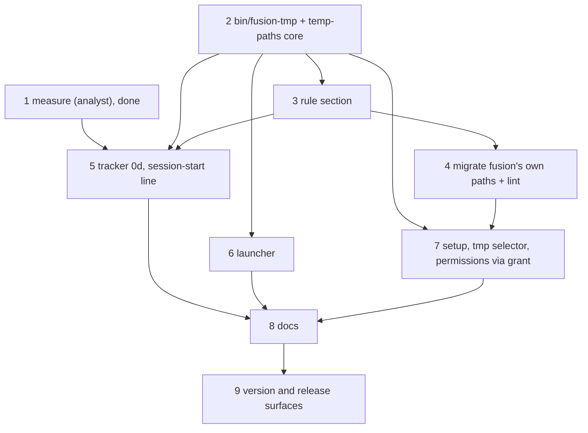

# Implementation Plan: intermediate files go to `~/.fusion-tmp/<checkout-id>`, granted without prompts, never to the system temp directory

**Date:** 2026-10-27, revised 2026-10-28 to the brief of the package narrative's `## Brief revised (2026-10-28)`. An adoption of the earlier directory after a re-minted id, added at approval the same day, was withdrawn by the user and is not part of this plan.
**Spec:** none: planned from the package narrative `261027-2242-intermediate-files-in-project-tmp.md`, the step-1 report `261027-2320-step-1-measurements-temp-root-hooks-sandbox-deny-sockets.md` and the closed discussion `261028-0708-perfect-location-for-fusion-intermediate-files.md`. The discussion's C1 to C16 and its recommendation are taken as measured and not re-derived. They are cited here by their claim number.
**Decidability:** The brief asks a question no mechanism can decide: "does a tool under Claude still escape to the system temp directory?" A program may build a temp path at run time, inherit one from a library default, or hard-code `/tmp` inside a binary. None of that is visible in a command's text or in a tool payload. Under Claude Code's sandbox the Bash tool's `TMPDIR` is also replaced with `/tmp/claude-<uid>`, whatever was exported (step 1 (c)). We therefore change the mechanism and answer five narrower questions, each decidable from inputs the mechanism holds. (1) Does this Claude Code process carry `CLAUDE_CODE_TMPDIR` and `TMPDIR` equal to `~/.fusion-tmp/<checkout-id>`? The SessionStart hook reads its own environment and the checkout file; step 1 (b) observed that both variables reach it. (2) Does a `Write`/`Edit` target lie under a system temp directory? In a project without a sandbox, Claude Code's own `permissions.deny` matcher decides it in the `Edit(//path/**)` form. (3) Does the text of a Bash command name a literal system temp path, or a bare `mktemp`? That is a string test on the payload, and the report claims nothing beyond it. (4) Does a shipped fusion file prescribe a system temp path? A lint over `agents/`, `skills/`, `rules/` and `bin/` decides it with an exact allow-list. (5) Do the two grants exist in the settings file Claude Code reads for this checkout, and is that file ignored? `bin/fusion-tmp check` reads the file and asks `git check-ignore`. The undecidable remainder, sandboxed `$TMPDIR` included, is named in `## Risks & Mitigations` and is not approximated.

## Directive

The package narrative carries the brief and its acceptance shape. Its `## Brief revised (2026-10-28)` supersedes the location of the original "Reached when" clause. This plan does not restate either. In one sentence: under fusion, every file a session writes to keep goes to the real directory `~/.fusion-tmp/<checkout-id>`. Setup grants it through `.claude/settings.local.json` so that no write there prompts. A session started through the launcher has its temp root and `TMPDIR` there. `<root>/tmp` may be a view-only link to it. In a project without a sandbox, `Write`/`Edit` are denied the system temp directories. Fusion's own text names none of them as a target. A shell command naming one is reported and never blocked.

## Current State

Everything below was read or run, and the citations are what was checked. The source tree has not moved under `agents skills rules hooks bin` since `22d16e6a` (`git log 22d16e6a..HEAD` over those paths is empty), so the growth figures below still hold.

- **Step 1 is done.** Its report observed: (a) the scratchpad sits at `$CLAUDE_CODE_TMPDIR/claude-<uid>/<slug>/<session>/scratchpad`; (b) both variables reach SessionStart and PostToolUse hooks, under `-p`; (c) with the sandbox on, Bash's `TMPDIR` is `/tmp/claude-<uid>`, and the four deny entries then break sandboxed temp writes; (d) one `/var/folders` spelling denies both; (e) under bare `claude` with the deny, a scratchpad `Write` fails and `Read` of task output works; (f) `AF_UNIX` binds fail once the temp directory is longer than about 71 bytes for Python `multiprocessing` and about 85 for a bare socket, and Claude Code then moves its messaging socket to `/tmp/cc-socks-<uid>/` without saying so.
- **The location (discussion).** `~/.fusion-tmp/<checkout-id>` meets every requirement R1 to R7 once both grants exist (C13). It is about 30 bytes on this machine (`/Users/k1/.fusion-tmp/5e8248d7`). `$HOME` survives a reboot, and macOS's `tmp_cleaner` and `dirhelper` do not target it (C6, C6a). The grants are `permissions.allow` `Edit(~/.fusion-tmp/<id>/**)` for default mode and `permissions.additionalDirectories` `~/.fusion-tmp/<id>` for `acceptEdits` and the sandbox (C10, C11, C15). A write through a `<root>/tmp` symlink still prompts, because Claude Code resolves the link (C5). The link's ignore line must be `/tmp` with no trailing slash (C8). `git clean -xdf` removes the link but not its target (C1).
- **The checkout identifier.** `bin/fusion-identity` prints `CHECKOUT=<8 hex>`. It reads or mints `fusion-workbench/.checkout-id`, which is untracked, so `git clean -xdf` sweeps it and the next call mints a new one, with a stderr notice. `hooks/lib/orchestrator-events.ts` `readCheckoutId(root)` is the TypeScript reader and never mints. The tracked registry is `fusion-workbench/shared/checkouts/<id>.md`. It is tracked, so it survives the sweep, and an old id usually keeps its registry entry.
- **The settings file.** In a git worktree Claude Code reads `.claude/settings.local.json` at the main checkout's root, not the worktree's (C16, settings.md:85). The exceptions at settings.md:88 keep it beside `.claude/settings.json`: outside a git repository, a repository rooted at `$HOME`, Windows, or a file not owned by the user. Claude Code saves "don't ask again" approvals to the same file (C15), so it is merged, never overwritten. In this repository `.claude/` is ignored (`.gitignore:2`).
- **Launcher.** `install.sh` `# --- 4. Launcher` writes `~/.local/bin/fusion`. It exports `FUSION_PLUGIN_ROOT` and `exec`s `claude --plugin-dir … --agent …`. It exports no temp variable. Its `--update` branch downloads to the fixed path `/tmp/fusion-install.sh`. The marketplace install path has no launcher.
- **SessionStart.** `hooks/session-start.ts` emits one `systemMessage` envelope, which reaches the user and not the model. It is built from three nullable lines. A fourth fits the same shape.
- **PostToolUse.** `hooks/tracker.ts` sees Bash and has a measured model channel, `hookSpecificOutput.additionalContext`. `hooks/guard.ts` reads nothing from a Bash command, and its header records why.
- **Checks.** `skills/check/SKILL.md` has eleven selectors. `hooks/lib/checks-due.ts` `CHECK_SELECTORS` duplicates the roster, and `derivable-enumerations-lint.test.ts` block 1b holds the two in set equality. The `permissions` selector unions an `allow` list into `.claude/settings.local.json` in skill prose, on a yes or when `bypassPermissions` is already set. It writes no `deny`, no `additionalDirectories`, and always writes the file at `pwd`.
- **Setup.** `skills/setup/SKILL.md` Step 0 creates the stores and writes the marker. Nothing creates an intermediate-file directory.
- **System temp paths in fusion's source.** These are unchanged from the first revision. Nine files are found by `git grep -lF -- '/tmp/' -- agents skills hooks/lib bin rules ':!**/dist/**'`. Three more are found by other spellings: `skills/archive/SKILL.md` (`${TMPDIR:-/tmp}`), `hooks/lib/__tests__/helpers/guard-harness.ts` (a comment) and `install.sh`. Five helpers and the installer call a bare `mktemp` for scratch they remove themselves. `rules/commit-lock.md` names no temp path. `hooks/lib/staging-drift.ts` scopes `git status` to the workbench, so a file outside the project is never classified. What changes there is `PRESCRIBED_MESSAGE_PATH` and the sentence that quotes it.
- **Growth bounds, measured at `22d16e6a`.** `agents/` has a 3 883-byte margin. `skills/` has **a 255-byte margin**. The hook tests have 2 896 lines. Rule text counts against the dispatch-path bound at zero head-room. The tightest path is `reviewer`, at about 3 080 bytes (`inference:`; `rules-emission-golden.test.ts` is the authority).

## Approach

**One location, one owner, the rest as consumers.** A new helper `bin/fusion-tmp` is the single place that knows the location and its grants. It resolves `~/.fusion-tmp/<checkout-id>`, creates it, writes the grants, makes the optional link and checks all of it. A new module `hooks/lib/temp-paths.ts` owns the strings both sides share: the base name `.fusion-tmp`, the four system temp prefixes, the two grant entries and the four deny entries. It also owns the JSON merge. The helper calls the merge through the compiled module, as `bin/fusion-write` calls `hooks/dist/write.js`. The launcher, Setup and two `/fusion:check` selectors call the helper. The tracker and the SessionStart hook import the module. One rule section states the convention for agents.

Moving the settings merge out of the `permissions` selector's prose and into the helper is what keeps the design to one mechanism. Setup and the selector then make one call each, and the `skills/` margin of 255 bytes is spent on a call line, not on a merge algorithm written twice.

Five choices carry the design.

1. **The real directory is outside the project, so nothing in git sees it.** It needs no ignore line of its own. `git clean -xdf` cannot reach it (C1, C13). It never enters a commit. The per-checkout name keeps worktrees and second clones apart (R7).
2. **The grants go where Claude Code reads them.** The helper writes into the main checkout's `.claude/settings.local.json`, found through `git rev-parse --path-format=absolute --git-common-dir`, except in the four cases of settings.md:88. There the file stays at `<root>/.claude/`. It merges entry by entry. It writes nothing when the file does not parse. It never removes an entry. Before writing, it asks `git check-ignore` about that file and adds `.claude/settings.local.json` to the same checkout's `.gitignore` when the answer is no. A file git already tracks is reported and left alone (C15).
3. **The link is for viewing.** `<root>/tmp` → the real directory is created only where the path is free, after its `/tmp` line is in `.gitignore` (C8). The rule says agents write through the real path only (C5).
4. **The deny exists only without a sandbox.** That is the user's ruling ("sandbox ohne deny"). The helper writes the four `Edit(//…/**)` entries only when no settings layer it reads sets `sandbox.enabled: true`, and only when `pwd -P` is not itself under a system temp directory. With a sandbox, the deny would make the sandbox's own `TMPDIR` unwritable (step 1 (c)).
5. **The scope split and the observation are unchanged.** A file anything reads after its writing process has exited goes to the real directory. A helper's own scratch file, removed before it exits, may stay where `mktemp` puts it. The tracker reads the command's text for a literal path, which is the decidable question (3). The guard stays as it is.

The step order follows two hard dependencies. First, the deny entries must not reach a project before fusion's own commit path leaves `/tmp`, or the orchestrator's `Write` of its commit message is denied. Step 4 therefore precedes step 7. Second, every consumer resolves the location through the helper of step 2.

## Implementation Steps

1. **Re-measure what the design rests on, starting with the one inference the narrative marks unobserved**
   - Executor: analyst
   - Files: one analysis report, written to the package's own analysis store (`$OUT_ANALYSIS` resolved with this package as the second argument). No source file.
   - Changes: Run each measurement in a throwaway project outside every git tree and record the command and the observed output, not the model's account of it.
     - **(a) Scratchpad.** In an *interactive* session started with `CLAUDE_CODE_TMPDIR=<dir>` exported, ask Claude to write one file into its scratchpad. Then `ls <dir>/claude-*/*/*/scratchpad/` from outside. `claude -p` creates no scratchpad (narrative), so `-p` does not count. If the harness cannot drive an interactive session, through `script`, `expect` or similar, the report gives the user the three-command manual procedure and stops this sub-item. It says "not observed" rather than inferring.
     - **(b) Hook environment.** Do `CLAUDE_CODE_TMPDIR` and `TMPDIR`, exported before `claude` starts, reach a SessionStart hook process, and a PostToolUse one? Use a throwaway `--plugin-dir` whose hook dumps `env`.
     - **(c) Bash `TMPDIR`.** Does `TMPDIR` reach the Bash tool when Claude Code's sandbox is on, if this machine has it, as well as off?
     - **(d) Deny spelling.** Does `Edit(//var/folders/**)` stop a `Write` to `/private/var/folders/…`, or does that spelling need its own entry, as `/tmp` and `/private/tmp` did?
     - **(e) Scratchpad under deny.** With the four deny entries in `.claude/settings.local.json` and a bare `claude`, so the scratchpad sits in `/private/tmp`: does a `Write` into the scratchpad fail? Does `Read` of a background task's output under `…/tasks/` still work?
     - **(f) Socket path length.** Under `TMPDIR=<a realistic deep project>/tmp/`, does binding an `AF_UNIX` socket at `tempfile.mkdtemp()` succeed? macOS caps `sun_path` at 104 bytes.
     - The Claude Code version is stated beside every result.
   - Acceptance: the report states each of (a) to (f) as `observed: …`, `not observed: …` or `not run: <reason>`, never as an inference. `bin/fusion-write create` is not used, because an analysis carries no control file.
   - Dependencies: none
   - Result (2026-10-27): done. The report is `261027-2320-step-1-measurements-temp-root-hooks-sandbox-deny-sockets.md`, and its findings are summarised under `## Current State`. Findings (c) and (f) led to the revised brief.

2. **`bin/fusion-tmp` and the core of `hooks/lib/temp-paths.ts`: the one owner of the location and its grants**
   - Executor: code-implementer
   - Files: `bin/fusion-tmp` (new), `hooks/lib/temp-paths.ts` (new), `hooks/dist/` (rebuilt), `.gitignore` (`!bin/fusion-tmp`), `hooks/lib/__tests__/fusion-tmp.test.ts` (new)
   - Changes:
     - **Module core.** `temp-paths.ts` exports `FUSION_TMP_BASE = ".fusion-tmp"`, the four prefixes `/tmp`, `/private/tmp`, `/var/folders` and `/private/var/folders`, `grantEntries(id)` (returns `Edit(~/.fusion-tmp/<id>/**)` and `~/.fusion-tmp/<id>`), the four `DENY_ENTRIES` in `Edit(//…/**)` form, and `mergeSettings(json, {grant, deny})`. The merge adds only missing strings to `permissions.allow`, `permissions.additionalDirectories` and `permissions.deny`, and touches no other key. It is exposed to the helper as one compiled entry with arguments `<settings path> <id> <deny yes|no>`. That entry prints `added=<n>` and exits non-zero without writing when the file does not parse.
     - **Helper, four subcommands.** All of them exit 1 with no workbench above `pwd`, or when `bin/fusion-identity` prints no `CHECKOUT=`, or when `$HOME` is unset. They exit 2 on usage.
       - `path`: create `~/.fusion-tmp/<id>` with mode 700, and write `.origin` holding `realpath(<root>)` when absent. Print the absolute path, one line. When the path is longer than 71 bytes, print one stderr line naming the length and the `AF_UNIX` limit of step 1 (f). It never blocks. Every consumer in steps 4, 6 and 7 calls this subcommand.
       - `grant`: resolve the settings file per `## Approach` item 2, with the four exceptions of settings.md:88 coded as named branches. Decide `deny` per item 4: no `sandbox.enabled: true` in `~/.claude/settings.json`, `<root>/.claude/settings.json`, the target file, or the managed settings file at its documented macOS and Linux paths, and `pwd -P` not under a prefix. Ensure the file is ignored. Then run the merge. Print `settings=`, `added=`, `deny=written|present|skipped-sandbox|skipped-under-temp`, and `ignored=yes|added|tracked`. When the deny entries are present and a sandbox is enabled, print `deny=present-under-sandbox` and remove nothing.
       - `link`: when `<root>/tmp` does not exist, first ensure `/tmp` is ignored. If `git check-ignore -q tmp` fails, append the line `/tmp` to `<root>/.gitignore`. Then create the symlink. When `<root>/tmp` exists, print `link=occupied` and change nothing. Outside a work tree, create no link.
       - `check`: read-only. Print `tmp=`, `present=`, `path_len=`, `long=yes|no`, `size_kb=` (`du -sk`), the `grant` outcome as it would be (`grants=present|missing`, `deny=…`, `ignored=…`), `link=absent|ours|occupied`, and one `other=<dir> earlier-identity registered|unregistered` line for each `~/.fusion-tmp/*` directory whose `.origin` names this root and whose name is not this checkout's id. Every such directory is an earlier identity of this root, since two checkouts cannot share a root at one time, so the `earlier-identity` tag is set on each line and is what lets the user find old files by hand. `registered` or `unregistered` says only whether `shared/checkouts/<id>.md` exists; the registry is tracked and survives the sweep, so it cannot by itself mark a re-mint. `check` never moves, renames or deletes a listed directory. Directories of other projects are never listed.
     - **Header.** It says why the location is outside the project, and cites the discussion record and C1, C5, C8, C10, C15 and C16. It gives the scope split. It says nothing in fusion deletes the directory or its siblings.
   - Acceptance: `fusion-tmp.test.ts` passes with `HOME` set to a scratch directory in every case, so the real `~/.fusion-tmp` is never written. It covers:
     - `path` is idempotent, and `.origin` is written once.
     - The long-path stderr line appears at 72 bytes and not at 71.
     - `grant` into an empty, an existing and an unparseable file. The existing case keeps a pre-set `allow` entry and `defaultMode`. The unparseable case is left byte for byte.
     - `grant` from a linked worktree writes the main checkout's file. Outside git it writes `<root>/.claude/`.
     - `deny=skipped-sandbox` with `sandbox.enabled` in the project file, and `deny=present-under-sandbox` after a sandbox is enabled later.
     - `ignored=added` appends one line, and a tracked settings file gives `ignored=tracked` and is not edited.
     - `link` on a free and on an occupied `tmp`, with `git status --porcelain` naming no `tmp` afterwards.
     - `check` lists a sibling whose `.origin` names this root, tagged `earlier-identity`, and omits one whose `.origin` names another root. A recorded `find ~/.fusion-tmp -exec stat …` listing is byte-identical before and after.
     - The no-workbench exit.
     `cd hooks && npm test` is otherwise green after `npm run build`, with the hook-test bound held and no constant edited.
   - Dependencies: none

3. **The rule: one section in the conventions file every agent loads**
   - Executor: code-implementer
   - Files: `rules/fusion-workbench-conventions.md` (new section `## Intermediate files`, plus one row-free mention in the intro sentence listing what the file is the source of truth for), `hooks/lib/__tests__/fixtures/rules-emission.golden` (regenerated)
   - Changes: The conventions file is emitted to all eleven agents, so the topic belongs there rather than in a new rule file. The section says, in at most about 700 bytes:
     - intermediate files go to the directory `"$FUSION_PLUGIN_ROOT/bin/fusion-tmp" path` prints, `~/.fusion-tmp/<checkout-id>`, and are written through that real path only, never through a `<root>/tmp` link, because Claude Code resolves the link and prompts;
     - the scope criterion, read after the writer exits, and the helper-scratch exception;
     - never `/tmp`, `/private/tmp` or `/var/folders`, and never `$TMPDIR` as a stand-in for the real path, because a reboot or the sandbox's replaced `TMPDIR` loses them;
     - `mktemp` only with a template under the real path, since with no argument macOS `mktemp` ignores `TMPDIR`;
     - nothing deletes the directory automatically.
   - Acceptance: `rules-emission-golden.test.ts` is green with the golden regenerated (`UPDATE_RULES_GOLDEN=1`, then a plain run). No line of `fixtures/dispatch-path.baseline` and no `DISPATCH_HEAD_ROOM` is edited. If the bound goes red, the section is cut until it is green, per the ruling on open question 2.
   - Dependencies: 2

4. **Move fusion's own temp paths, and gate the move**
   - Executor: code-implementer
   - Files: `agents/orchestrator.md`, `skills/commit/SKILL.md`, `skills/cleanup/SKILL.md`, `skills/archive/SKILL.md`, `hooks/lib/staging-drift.ts`, `hooks/dist/` (rebuilt), `hooks/lib/__tests__/commit-message-path.test.ts`, `hooks/lib/__tests__/staging-drift.test.ts`, `bin/fusion-claude-md-weight` (header example only), `codec/src/__tests__/install.test.ts` (only if the archive block's new location needs it), `hooks/lib/__tests__/temp-path-lint.test.ts` (new), `hooks/lib/__tests__/fixtures/surface-growth.golden` (regenerated)
   - Changes:
     - The commit-message file moves under `~/.fusion-tmp/<checkout-id>/`. It is named `fusion-commit-msg-<session-id>-<task-id>.txt` in `agents/orchestrator.md`, covering `### Step 4 — commit` items 3 and 5, the session-end commit and the staging-check table's `commit-message` row. It is `fusion-commit-msg-<session-id>-<n>.txt` in `skills/cleanup/SKILL.md` and `fusion-commit-msg-<something-unique>.txt` in `skills/commit/SKILL.md`. Each text resolves the directory once with `fusion-tmp path` and then names the absolute path to the `Write` tool and to `git commit -F`.
     - **The per-session discriminator stays, and its reason is restated.** The directory is per checkout, so the cross-project and cross-checkout collisions are gone. Two sessions in one checkout still share it, though, and task ids are short and conventional. The reasons for the location are rewritten: the directory survives a reboot and `git clean -xdf`, and is outside every tree `git status` reports on.
     - The orchestrator's paragraph is shortened where the old reason is now false.
     - `PRESCRIBED_MESSAGE_PATH` and the `commit-message` sentence in `staging-drift.ts` change with it. The sentence no longer says "/tmp is swept".
     - `commit-message-path.test.ts` keeps its four pins (location, `-F` read, discriminator, stated reasons) with the regexes moved to `~/.fusion-tmp/<checkout-id>/`. Its header gains one paragraph saying why the location moved, citing the discussion record. The negative control keeps the pre-`260905-2213` string.
     - `skills/archive/SKILL.md`: `C="$("$FUSION_PLUGIN_ROOT/bin/fusion-tmp" path)/fusion-archive-$STAMP-$SLUG"`. The candidates and survey files persist from Step 4 to Step 7, so they are the convention's own case.
     - The `bin/fusion-claude-md-weight` header example `root=/tmp/scratch` becomes a neutral path.
     - **Untouched, each for its stated reason:** the test comments and fixture strings that name a temp path without writing it (`guard-bash-integration.test.ts`, `guard-harness.ts`, `sentence-identifier-containment.test.ts`, the codec protocol fixtures); `docs/upgrading-to-v10-24.md`, which is historical; the bare `mktemp` scratch in the five helpers and the installer, per `## Approach` item 5.
     - The new lint scans `agents/*.md`, `skills/*/SKILL.md`, `rules/*.md` and `bin/*` for a literal system temp path (`/tmp`, `/private/tmp`, `/var/folders`, `/private/var/folders`). It uses a path-start boundary that excludes letters, digits, `_`, `.`, `~`, `/`, `>`, `}` and `)`. That keeps `<root>/tmp`, `${…}/tmp`, `$(…)/tmp` and `.fusion-tmp` from matching. Its allow-list is exact file-and-token pairs: the rule section of step 3, and the `/tmp` ignore line and the prefix list in `bin/fusion-tmp`. It carries a negative control: a fixture line naming `/tmp/x` fails the same predicate.
   - Acceptance: the lint's predicate, run over `agents skills rules bin`, lists only the allow-listed pairs. `cd hooks && npm test` is green with `surface-growth.golden` regenerated and no baseline or head-room constant edited. `committed-dist.test.ts` is green after `npm run build`. `cd codec && npm test` is green. If the `skills/` bound is red, the step cuts inside `skills/` (open question 2). If a cut cannot reach green, it stops and returns.
   - Dependencies: 2, 3

5. **The tracker's observation and the session-start line**
   - Executor: code-implementer
   - Files: `hooks/lib/temp-paths.ts`, `hooks/tracker.ts`, `hooks/session-start.ts`, `hooks/dist/` (rebuilt), `hooks/lib/__tests__/temp-paths.test.ts` (new), any existing test asserting the session-start envelope or a tracker reply byte for byte (`session-start-event.test.ts` and the tracker integration tests, as the run shows)
   - Changes:
     - **Module.** Add `systemTempMentions(command, root)`. It returns each literal temp path at the step-4 boundary, plus a bare `mktemp` with no template operand. It drops every path under `realpath(<root>)` and under `realpath(~/.fusion-tmp)`. Without that drop, a project or test root that itself lies under `/var/folders` would report its own files. Add `tempSentence(mentions)` and `tempRootLine(env, home, id)`.
     - **Tracker job 0d.** It runs on Bash only, inside a workbench only. On a non-empty `systemTempMentions` it adds one sentence to the `additionalContext` reply. The sentence names the paths, says files there are lost at a reboot, names `fusion-tmp path` and the rule section, and says nothing was blocked. There is no event row and no throttle. The header gains 0d and says why reading the text is not the retired classifier.
     - **Session-start line.** It is computed only when a workbench is found and `readCheckoutId(root)` returns an id. It names whichever of `CLAUDE_CODE_TMPDIR` and `TMPDIR` is unset or does not `realpath` to `~/.fusion-tmp/<id>`, and tells the user to start sessions with `fusion`. Both equal means no line. With no readable id there is no line, because the question is then undecidable. It goes into the existing `systemMessage` envelope as a fourth nullable line. The line reads the outer environment and cannot see a sandbox's replaced Bash `TMPDIR`. The header says so.
   - Acceptance: `temp-paths.test.ts` covers the positive cases `echo hi > /tmp/x`, `cd /private/tmp`, `"${TMPDIR:-/tmp}/a"`, `/var/folders/ab/T/x` and a bare `mktemp`. It covers the negative cases `~/.fusion-tmp/ab12cd34/x`, `/Users/me/.fusion-tmp/ab12cd34/x`, `/Users/me/p/tmp/x`, `./tmp/x`, `tmp/x`, `/tmpfoo`, `mktemp "$D/x.XXXXXX"` and a path under a root that itself lies in `/var/folders`. It covers the three session-start branches (both equal, one mismatched, no id) and the base-name pin against `bin/fusion-tmp`. `cd hooks && npm test` is green after `npm run build`, with the envelope tests this step's line changes updated in the same step. The hook-test surface stays inside its head-room with no constant edited.
   - Dependencies: 1, 2, 3

6. **The launcher exports the two variables inside a fusion project**
   - Executor: code-implementer
   - Files: `install.sh`, `codec/src/__tests__/install.test.ts`
   - Changes: Before `exec claude`, the launcher runs `"$FUSION_DIR/bin/fusion-tmp" path 2>/dev/null || true`. On an output naming an existing directory it exports `CLAUDE_CODE_TMPDIR=<that>` and `TMPDIR=<that>/`, overriding any inherited value. Outside a fusion project it exports neither, and the environment passes through unchanged. It makes no length test of its own: a long `$HOME` is reported by Setup and the `tmp` check and blocks nothing. `--update` stops writing `/tmp/fusion-install.sh` and pipes `curl -fsSL … | bash`, which is the documented install command.
   - Acceptance: a new case in `install.test.ts` runs the installed launcher with a stub `claude` that prints its environment, with `HOME` set to a scratch directory. Inside a set-up project both variables name `$HOME/.fusion-tmp/<id>`. Outside one, neither is set by the launcher. `grep -n '/tmp' install.sh` finds no fixed temp path. `cd codec && npm test` is green.
   - Dependencies: 2

7. **Setup creates and grants the directory, a new `tmp` selector verifies it, and `permissions` grants through the helper**
   - Executor: code-implementer
   - Files: `skills/setup/SKILL.md`, `skills/check/SKILL.md`, `hooks/lib/checks-due.ts`, `hooks/dist/` (rebuilt), `hooks/lib/__tests__/fixtures/surface-growth.golden` (regenerated)
   - Changes:
     - **Setup Step 0.** After the marker is written, setup runs `fusion-tmp path`, then `grant`, then `link`, behind an `[ -x ]` guard. Their output lines go into the Done report, along with the long-path warning when `path` printed one. A missing helper is named and blocks nothing.
     - **New selector `tmp`.** It is one table row plus one short section that runs `check`. It repairs `present=no`, `grants=missing` and `ignored=no` by running `path` and `grant`, both of which only add. It reports `ignored=tracked`, `link=occupied`, `long=yes` and `deny=present-under-sandbox` without repairing them, each with one sentence on what the user does by hand. It names `size_kb=` and each `other=` line and offers nothing, per the ruling on open question 3. `tmp` joins `CHECK_SELECTORS` in the same step.
     - **`permissions`.** Its question and `defaultMode` handling are unchanged. Its union step additionally runs `fusion-tmp grant`, so the grants, the deny entries and the ignore line come from the helper and are not written in skill prose. The question gains one clause saying Claude is also granted its intermediate-file directory and, without a sandbox, stopped from writing into the system temp directories. The Done report names `grant`'s `deny=` value. The step 1 open question on `/tmp` spellings is settled here by a d0/d1/d2 triple on `/tmp`, whose result goes into the helper's header. All four entries ship either way, since a redundant one is harmless (step 1 (d)).
     - **Counts.** The count in the check skill's description and opening sentence is dropped rather than bumped (`rules/critical-stance.md` §5). So is the one in the `checks-due.ts` comment.
   - Acceptance: `derivable-enumerations-lint.test.ts` block 1b is green with `tmp` in both rosters. `cd hooks && npm test` is green after `npm run build`, with `surface-growth.golden` regenerated and no baseline or head-room constant edited. `codec/src/__tests__/install.test.ts`, which executes shipped skill blocks, is green. The `skills/` bound is held by cuts inside `skills/` (open question 2), or the step stops and returns.
   - Dependencies: 2, 4

8. **Docs: where each change is authored for its readers**
   - Executor: code-implementer
   - Files: `README-hooks.md` (`## Architecture` tracker and session-start entries; in `## Files`, the `hooks/lib` table row for `temp-paths.ts` that the enumeration lint requires; the `### The bin/ helper roster` row for `bin/fusion-tmp`; the `lib/checks-due.ts` row's count), `README-agents.md` (`## Releasing` installer invariants: a bullet saying the launcher exports the two variables inside a fusion project, and why project settings cannot; the `/fusion:check` row's count), `README.md` (`### The \`fusion\` launcher`: one paragraph on `~/.fusion-tmp/<checkout-id>`, the view-only link, and the two `export`s a marketplace-path user sets by hand), `docs/upgrading-to-v13.md` (a 13.4.0 section: update fusion before running the checks, run `/fusion:check --only tmp` and `--only permissions` once, start sessions with `fusion`, and what stays unenforced, sandboxed `$TMPDIR` included)
   - CLAUDE.md: not touched. Nothing here binds every session in this repository, and the file is charged to all eleven dispatch paths at zero head-room.
   - Changes: State each fact once, at its home, and point at it from elsewhere. Copy no growth-bound figure.
   - Acceptance: `reference-resolution-lint.test.ts` and `derivable-enumerations-lint.test.ts` are green. `cd hooks && npm test` is green.
   - Dependencies: 5, 6, 7

9. **Version 13.4.0 and the release surfaces in this repository**
   - Executor: code-implementer
   - Files: `.claude-plugin/plugin.json`, `install.sh` (the `FUSION_REF=tags/v…` header example), `README.md` (the same pin example), `skills/help/SKILL.md` (`### 4. Update`), `hooks/lib/__tests__/fixtures/surface-growth.golden` (regenerated)
   - Changes: Bump `version` to `13.4.0`, a minor release because it is a new behaviour. Point both pin examples at `tags/v13.4.0`. In the help topic, add the 13.4.0 paragraph, relabel the ones below it and drop the oldest of the three, per `README-agents.md` `## Releasing` step 0. The manifest `description` is left unchanged, so its marketplace twin needs no paired rewrite.
   - Acceptance: `claude plugin validate .` reports passed. `claude --plugin-dir . --agent fusion:orchestrator -p "reply SMOKE-OK"` replies. `cd hooks && npm test` and `cd codec && npm test` are green with no baseline or head-room constant edited. The marketplace bump, the push and the tag are not this step's (`## Where this work stops`).
   - Dependencies: 8

## Where this work stops

- Steps 1 to 9 are each `done` with their acceptance met, or the plan was closed with the user's word on what was not.
- `cd hooks && npm test` and `cd codec && npm test` are green at the last step's commit, and no growth-bound baseline, head-room constant or `dispatch-path.baseline` row moved in this package's commits.
- No shipped helper or test in this package's commits writes into the real `~/.fusion-tmp` of the machine it runs on. Every test that exercises `bin/fusion-tmp` or the launcher sets `HOME` to a scratch directory.
- No path this package ships writes, overwrites or removes an existing entry of a user's `.claude/settings.local.json`. `grant` removes nothing: it only adds, and it writes nothing to a file that does not parse.
- If the `skills/` bound cannot be held by cuts at step 4, 7 or 9, that step stops and returns. Per the ruling on open question 2, there is no head-room raise.
- If the step 7 triple on `/tmp` shows that an `Edit(//tmp/**)` entry denies something Claude Code itself writes through the `Write` tool in a launcher-started session, step 7 stops and returns before shipping the deny. (Condition did not arise for `/var/folders` in step 1 (d) and (e).)
- Before the 13.4.0 tag is pushed: a closing review pass of this package's commit range has run, `bin/fusion-review-coverage --since v13.3.9` has been read and its result stated, and the user has approved the release at closure. The marketplace bump and the tag are the release acts of `README-agents.md` `## Releasing` steps 2 to 5.

## Data Structures

- `~/.fusion-tmp/<checkout-id>/`, mode 700. It holds `.origin`, one line with `realpath(<root>)`, written once.
- `bin/fusion-tmp` output: `path` prints one bare path. `grant` and `check` print `key=value` lines: `settings`, `added`, `deny`, `ignored`, `tmp`, `present`, `path_len`, `long`, `size_kb`, `grants`, `link` and repeated `other`.
- `.claude/settings.local.json` in the checkout Claude Code reads, merged, never overwritten:
  - `permissions.allow` gains `Edit(~/.fusion-tmp/<id>/**)`;
  - `permissions.additionalDirectories` gains `~/.fusion-tmp/<id>`;
  - without a sandbox only, `permissions.deny` gains `Edit(//tmp/**)`, `Edit(//private/tmp/**)`, `Edit(//var/folders/**)` and `Edit(//private/var/folders/**)`.
- `.gitignore` lines the helper may add: `.claude/settings.local.json` (when not already ignored) and `/tmp` (before creating the link, no trailing slash).

## API Changes

- New helper `bin/fusion-tmp path|grant|link|check`. Exit 0, or 1 with no workbench, no checkout id or no `$HOME`, or 2 on usage. `grant` exits 4 on an unparseable settings file, having written nothing.
- New module `hooks/lib/temp-paths.ts`, with a compiled merge entry called by the helper, imported by `tracker.ts` and `session-start.ts`.
- `PRESCRIBED_MESSAGE_PATH` changes value. No caller outside `staging-drift.ts` and its two tests reads it.
- `CHECK_SELECTORS` gains `tmp`.

## Testing Strategy

- **Unit.** `fusion-tmp.test.ts` holds the matrix of step 2: idempotence, the length warning, the merge cases, the worktree and no-git resolution, the sandbox branches, the ignore cases, the link cases, the sibling listing and the exits. `temp-paths.test.ts` holds the boundary matrix and the session-start branches of step 5.
- **Pins.** `commit-message-path.test.ts` keeps its location, discriminator and reason pins at the new location. The base name is pinned equal between the helper and the module. `derivable-enumerations-lint` holds the selector roster.
- **Regression gate.** `temp-path-lint.test.ts` keeps shipped text from naming a system temp path again, with a negative control.
- **Launcher.** The stub-`claude` case in `codec/src/__tests__/install.test.ts`, inside and outside a set-up project, under a scratch `HOME`.
- **Live.** Step 1 was the live measurement. After step 9, in a scratch project, one `fusion` session in default mode confirms four things: the session-start line is absent, a `Write` to `~/.fusion-tmp/<id>/x` does not prompt, a write through `<root>/tmp/x` prompts as C5 predicts, and a `Write` to `/tmp/x` is denied. One bare `claude` session there confirms the line is present. The same project with `sandbox.enabled` and a fresh `grant` confirms `deny=skipped-sandbox` and a sandboxed write into the real directory.

## Risks & Mitigations

| Risk | Mitigation |
|------|------------|
| **A program that hard-codes `/tmp`**, or builds the path at run time, writes there anyway. Neither the deny entries (`Write`/`Edit` only) nor the text observation sees it. | Unenforceable, and stated in the rule and in the 13.4.0 note. Exported `TMPDIR` covers every unsandboxed program that honours it: Python `tempfile` and Node `os.tmpdir()` were measured to. |
| **Sandboxed Bash ignores the export.** With the sandbox on, Bash's `TMPDIR` is `/tmp/claude-<uid>` (step 1 (c)), so `tempfile` and friends write there. By the user's ruling no deny is written there either. The session-start line reads the outer environment and reports nothing. | The rule tells agents to name the real path rather than `$TMPDIR`. `additionalDirectories` makes that path writable for sandboxed Bash (C11). Job 0d reports a literal `/tmp/claude-…` in a command. Whatever a tool writes to `$TMPDIR` by itself stays unprotected, and the 13.4.0 note says so. |
| **Deny entries outlive a later sandbox.** A project granted without a sandbox gains the deny, and a sandbox enabled afterwards then degrades sandboxed temp writes (step 1 (c)). | `grant` and the `tmp` check report `deny=present-under-sandbox` and say which four entries to remove by hand. Nothing removes a settings entry automatically. |
| **A session started with bare `claude`**, or on the marketplace path, which has no launcher, keeps its scratchpad and `TMPDIR` in the system directories. | Observed, not prevented: the session-start line names it at every start. The grants still let agents write the real path without prompts. A marketplace user can export the two variables by hand (README, step 8). |
| **Denied scratchpad.** Under bare `claude` without a sandbox, the deny covers the scratchpad in `/private/tmp`, so a `Write` there fails (step 1 (e)). | Accepted per the ruling on open question 1: that scratchpad is what a reboot loses. `Read` of task output still works (step 1 (e)). The session-start line tells the user to restart through `fusion`. |
| **Writing through the link prompts.** Claude Code resolves `<root>/tmp` and treats the target as outside the project (C5). | The rule and the helper header say to write through the real path only. The link is for the user's viewing. The live check after step 9 confirms the prompt, so the rule's reason is observed, not assumed. |
| **Grants in the wrong file.** Claude Code reads `.claude/settings.local.json` at the main checkout in a worktree (C16), so a grant beside the worktree's own `.claude/` is ignored from its subdirectories. | `grant` resolves the main checkout through `--git-common-dir` and codes the four settings.md:88 exceptions as named branches, each with a test. Several checkouts' entries share that one file, and `grant` only adds to it. |
| **The settings file is tracked**, which brings back Claude Code's trust step (C15), or it is overwritten and loses the user's "don't ask again" approvals. | `grant` asks `git check-ignore` and adds the line only when the file is not tracked. A tracked file is reported as `ignored=tracked` and not edited. The merge only adds keys' entries and writes nothing to an unparseable file. |
| **A re-minted checkout id strands earlier files.** `git clean -xdf` sweeps `.checkout-id`. The next call mints a new id, and the old directory stays under its old name. | Reported, not adopted. The old directory and every file under it stay intact under the old name, since nothing in fusion renames or deletes it and it is outside the project. `.origin` lets the `tmp` check list it, tagged `earlier-identity`, beside this checkout's directory, so the user can find the old files by hand. `bin/fusion-identity` already announces the re-mint on stderr. |
| **Long `$HOME`.** A temp directory longer than about 71 bytes breaks Python `multiprocessing` sockets, and longer than about 85 bytes breaks a bare `AF_UNIX` bind. Claude Code then moves its messaging socket to `/tmp/cc-socks-<uid>/` without saying so (step 1 (f)). At about 30 bytes on this machine that needs a `$HOME` past about 50 bytes. | `path` warns on stderr past 71 bytes. Setup's Done report and the `tmp` check name it, and nothing blocks. A socket holds no intermediate result, so the `/tmp` fallback loses nothing the brief protects. |
| **Old install, new settings.** A session on an older fusion install whose orchestrator still writes `/tmp/fusion-commit-msg-…`, in a project where a 13.4.0 `grant` wrote the deny. | The `Write` fails visibly at the commit step. Step 4 precedes step 7, so no single release ships the deny without the moved path. The 13.4.0 note says to update before running the checks. |
| **Prompts before the grant.** Between step 4's commit and a project's first `grant`, the orchestrator's commit-message `Write` outside the project prompts in default mode. | The same as `/tmp` does today, so this is no regression. Setup and the `permissions` and `tmp` selectors grant it. |
| **Growth.** `~/.fusion-tmp/<id>` grows without bound, Claude Code's own temp root included, and siblings accumulate. | The `tmp` check names the size and lists siblings of this project. Nothing deletes automatically, per the brief. |
| **`/var/tmp` is not covered.** | Out of the brief's scope: it survives a macOS reboot. Named in the 13.4.0 note. |
| **Skills byte margin is 255 bytes.** | The merge moved into the helper, so each skill gains a call line, not an algorithm. Each skill step regenerates the golden and holds the bound by cuts. Step 9's help rotation frees the oldest paragraph. |

## Open Questions

- [x] **1. Scratchpad exemption in the deny entries.** Ruled at plan approval: no exemption. The full deny ships, and only in a project without a sandbox, per the 2026-10-28 ruling "sandbox ohne deny".
- [x] **2. The `skills/` bound.** Ruled: cut, do not raise head-room. The cut candidates are the help topic's oldest paragraph, which the release rotation drops anyway; the shortened commit and cleanup reasons in step 4; and the past-tense paragraph in the check skill's `identity` selector.
- [x] **3. Does the `tmp` selector offer to empty the directory?** Ruled: no. It names the size only, and lists siblings without offering anything.
- [ ] **4. Which `.gitignore` takes the settings line in a worktree.** The brief says `.gitignore`, and the file in question sits at the main checkout. Appending there edits a tracked file in another checkout's working tree. The alternative is `$(git rev-parse --git-common-dir)/info/exclude`, which is shared by all checkouts and never committed. We recommend `.gitignore` of the checkout that holds the file, as briefed, with `grant` naming the edited path so the user sees which tree changed. The user may rule for `info/exclude` at plan approval, which changes one branch of step 2 and nothing else.

No decision record is filed with this revision. The reasoning behind the location is in the closed discussion record. The user's ruling is in the package narrative's `## Brief revised (2026-10-28)`. The convention is authored where a later reader meets it: in `bin/fusion-tmp`'s header, which cites the discussion, and in the rule section of step 3. Open question 4 binds only this plan.
