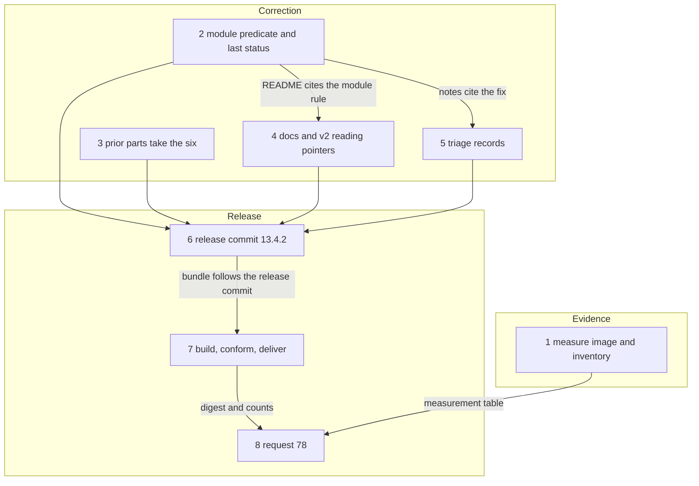

# Implementation Plan: fusion 13.4.2, the corrected candidate Prior's answer to requests 76 and 77 calls for

**Date:** 2026-11-05
**Spec:** none. Planned from the package narrative `261105-1009-prior-answer-76-77-and-corrected-candidate.md`, the orchestrator's dispatch, `Prior: docs/design/fusion-entry-v2-request76-77-prior-response.md` at `52a2703`, and the recording `### Prior's answer to 76 and 77 at 52a2703` in `codec/fixtures/prior/REQUESTS.md`. The package's `mode` is `autonomous`.
**Decidability:** The load-bearing question is whether the corrected module runs on Prior's host without the D-F1 refusal. Fusion cannot decide that from its own inputs, because only Prior's host performs the read admission and the integration. The mechanism therefore stays the one requests 76 and 77 use: fusion delivers a bundle under a new digest, and Prior's run answers. Fusion's own mechanisms decide four narrower questions from inputs they hold. (1) Does the module's selection equal the predicate read in Prior's `entryControlRecord`? A table test against a fake host that applies that predicate decides it, for the rows the table holds. (2) Do the `prior` parts name only the six commands? That is a question about shell text, which no scan decides in general. A command built at run time cannot be seen in the text, so the plan claims a watch-list lint and no more, and a command outside the list passes it. (3) Does the pinned image carry what the neutral blocks and helpers use? Only a run of that image decides it, and this machine's Docker daemon answers (`docker info` prints server 29.8.0), so step 1 measures it; the guarantee stays Prior's to give. (4) Whether the plan's `## Where this work stops` clauses are the right ones is read by the human at closure, and under this package's `mode` they are carried unjudged.

## Directive

Prior answered **corrected**. One defect in the delivery stands: the 13.4.1 module reads every `.json` under `fusion-workbench/` as a control record (D-F1), which ends an ordinary run refused after its integration stood. Request 77 `### What fusion does with the answer` routes that to a new patch version, a rebuild, a new digest and a new request. This plan delivers those, and it fixes what Prior's answer requires of the `prior` parts (76 question 6). It triages the 18 older open Prior issues against the answer. Nothing here tags, pushes or touches the marketplace or the Prior repository.

## Current State

Each statement below was read at fusion `6f9607b0` and Prior `52a2703`.

- **Version.** `.claude-plugin/plugin.json` says `13.4.1`, and `git tag -l 'v13.4*'` prints nothing, so **13.4.2** is the next patch. `grep -n 'request 78' codec/fixtures/prior/REQUESTS.md` prints nothing, and the last section is request 77, so the new request is **78**.
- **No drift since C′.** `git diff --stat 67cece9a HEAD -- agents skills rules hooks bin templates stilwerk docs README.md README-agents.md README-hooks.md install.sh catalog adapters codec/dist codec/src codec/contract codec/schemas .claude-plugin` prints nothing, so the base of this work is the 13.4.1 candidate.
- **D-F1.** `controlRecords` (`adapters/prior/fusionmodule/internal/entry/entry.go:513`) tests the workbench prefix, the `.json` suffix, path validity and forbidden characters. Prior's predicate is `entryControlRecord` (`internal/fusionhost/entry_workspace.go`): `package.json`, `*.record.json`, `*.evidence.json`, no segment starting with a dot, and a first segment that is not `archive`. It rests on the codec's `isControlFile` and `controlFiles` (`codec/src/store.ts:446`, `:454`).
- **The same bug class in the module's other half.** Prior's read admission selects by last status (S60-4), and the module reads any path with a non-`D` line. A record changed in a commit and deleted in the delta is read by the module, refused by Prior, and the envelope ends refused after the integration stood. So the last-status rule is a **binary** correction in this candidate, whatever happens to the v2 text.
- **The pin.** `adapters/prior/PRIOR_PIN` is `08c57fb`. `moduleapi` moved since (`entry_service_wire.go`, new), but the module defines its own decoders and Prior ran 13.4.1 at this pin, so the pin does not move.

### The other readers of the control-record rule

The dispatch names "three other readers" without naming them. Enumerated by `grep -rnE 'isControlFile|\.record\.json|HasSuffix\([^)]*\.json' codec/src hooks/lib hooks/*.ts adapters catalog/workflows bin` with test files read separately, the candidates and their verdicts are:

| Reader | What it tests | Must it change? | Why |
|---|---|---|---|
| `internal/fixture/entry.go:490` (fake host's read decoder) | `.json` suffix | **Yes** | It admits what Prior refuses, which is why 315 conformance tests stayed green on D-F1. It must apply Prior's predicate and answer `permission-denied`, as Prior does |
| `adapters/prior/README.md:292` | prose: "a path under `fusion-workbench/` ending in `.json`" | **Yes** | It states the defect as the rule |
| `internal/entry/entry_test.go:988` `TestControlRecordsAreTheWorkbenchJSONPathsNotDeleted` | names and asserts the defect | **Yes** | Its name and rows state the old rule |
| `catalog/workflows/entry.v2.json` workbench step | "each workbench control path", term undefined | No | It never says `.json`, so D-F1 contradicts nothing here. Its `status is not D` clause is the last-status erratum, handled in the reading table below |
| `hooks/lib/stores.ts:129` `isControlFile` (read by `staging-drift.ts`, `citation-scan.ts`, `citation-sweep.ts`) | the three names | No | It is already the codec's rule, by name. It classifies paths in a checkout and decides no host read |
| `bin/fusion-staging-drift` | prose in its header only | No | It describes the same names and selects nothing itself |

*Inference:* the dispatch's three are the fake host, the README and the workflow sentence. If it meant others, none other turned up under this grep. The orchestrator should say so if it knew of one.

### Does a v3 belong in this candidate?

**No, and the plan proceeds without one.** The decision is filed as `261105-1023-does-the-13-4-2-candidate-carry-the-v3-of-the-entry-assets.md`, which holds the four options. It stays `open` because only the user or Prior's answer moves it, and this plan's default is its recommendation.

**What breaks if a v3 ships bound.** Prior's host refuses every run at three sites at `52a2703`: `entryV2Workflow` is the constant `workflows/entry.v2.json` (`entry_catalog.go:19`); `api.EntryWorkflowCapability` is the constant `fusion.entry.v2` (`moduleapi/v1/entry_service_wire.go:15`); `resolveEntryV2` refuses a profile naming any result schema but `schemas/entry-result.v2.json` (`entry_policy.go:81`, `entry_catalog.go:113` onward). D-F1 could then not be shown until Prior changes host code and an SDK constant, which its "can" does not promise.

**What breaks if the v2 stays.** Nothing at run time, read item by item:

| Item | Frozen text | Does it differ from Prior's host? | Run-time effect if v2 stays | In this candidate |
|---|---|---|---|---|
| D-F2 / S59-1 operation id | `entry.v2.json` compose `operation_id`: "with capability fusion.entry.v2" | Yes | None. The module derives per service (`hostsvc.go`), as Prior checks | Reading in request 78 |
| D-F3 / S60-4 last status | `entry.v2.json` workbench `record`: "whose status is not D" | Yes | **Yes, unless the module changes.** A refused read after the integration stood | **Module fix (step 2)** and reading |
| D-F4 / S59-3 dot segments | `entry-result.v2.json` `name_status` admits `a/../b` | Yes | None on Prior, whose `EntryIntegrateAnswer.Validate` refuses them first | **Module receipt check (step 2)**, which v2's own receipt text "a valid relative path" already asks for, and reading |
| S59-2 `C`/`R` | `name_status` defines them | Superset | None. Prior never emits them | Open decision; v2 stands |
| S60-1 admission codes | `common codes` omits three that `admission` in the same step names | Yes, internally inconsistent | None: the module reports `host.<code>` for any code, and `violations[].code` is `minLength: 1` (*inference* that Prior's envelope check admits them) | Reading |
| S60-2 committed paths in `delta` | `delta`: "the run's uncommitted changes" | No text in the assets says otherwise. The contrary sentence is request 77 question 4 | None. `controlRecords`' last-status rule handles `D` after `A` | Reading on request 77's text |
| S60-3 detached `HEAD` | `reference`: "the reference the user's HEAD named"; schema `minLength: 1` | Silent, not contradicting. The `""` is request 77 question 5 point 2 | None. `HEAD` passes the receipt check and the schema | Reading on request 77's text |
| S63-1 what counts as a stop | `entry-result.v2.json` description: "or by the stop the entry offers" | Yes | None | Reading |
| S63-2 violations | `violations`: "empty on completed", and `allOf` agrees | No. Prior's quoted phrase "violations from the host's own refusals" was not found by `grep` in the assets or in `REQUESTS.md` | None | Reading; the request says the phrase was not located |
| S63-3 `reference` on each commit | `entry.v2.json` envelope and schema both state it | No | None | Stated as agreed |

The cost of this choice is real and stays visible. The frozen v2 text stays wrong in S59-1, S60-1, S60-4, S63-1 and, on segments, S59-3 until a v3 exists, and three issues keep an asset half open. Request 78 asks Prior whether that stands, so the choice is checked by the party it binds.

## Approach

**One predicate, in one place, on both sides of the fake boundary.** A leaf package `internal/controlrecord` holds the codec's rule. The module and the fake host both call it. The package exists because `internal/hostsvc` and `internal/steps` have in-package tests that import `internal/fixture`, so a predicate there would make `fixture` an import cycle. The module's selection then differs from Prior's only if the two Go copies differ, and the table test's rows name Prior's cases. This reuses the 13.4.1 route (`261027-1612-plan-fusion-13-4-1-entry-delivery-on-the-step-17-model.md`, steps 8 to 10) for release, build, delivery and request.

**The `prior` parts take the six; the rest is measured and asked.** Prior's verdict is scoped to a `prior` part, and the plan fixes every `prior` part of a supported entry. Measured, that does not make a run six-only: 15 neutral files carry fenced commands outside the set, and all shell helpers in `bin/` use others (`261105-1023-neutral-shell-blocks-and-carried-helpers-rely-on-commands-outside-priors-guaranteed-six.md`). Rewriting them would change the Claude distribution for a guarantee that one probe of a pinned image can settle. So step 1 measures the image, and request 78 hands Prior the measurement and the list. This is a change of mechanism: a measurement and a question instead of a rewrite.

**The triage folds only what shares the candidate's bytes or files.** A correction candidate that changes behaviour Prior did not ask about would make Prior's next run answer more than it was asked. The table below sorts all 18 by that rule.

### The 18 older open issues, triaged

Enumerated from the six packages' `*.record.json` with `control.state` `open`: five, one, two, five, four and one, in the order of the dispatch's list.

| # | Issue | Verdict | Reason and evidence |
|---|---|---|---|
| 1 | `261027-2337-entry-v2-receipt-check-and-name-status-pattern-admit-dot-dot-path-segments` | **Half here, stays open** | Receipt check in step 2. The schema half waits for the v3 |
| 2 | `261027-2337-entry-v2-workbench-step-reads-a-control-record-the-integration-deleted` | **Half here, stays open** | Last-status rule in step 2. The definition's sentence waits for the v3 |
| 3 | `261028-0645-citation-sweep-rewrites-a-review-report-whose-evidence-binds-its-bytes` | **Stays open** | Still so: `hooks/citation-sweep.ts` refuses nothing on that ground. Unrelated to Prior; a `hooks/` change moves Claude distribution bytes for nothing Prior asked |
| 4 | `261028-0810-entry-v2-and-request-77-derive-the-operation-id-...` | **Stays open, narrowed** | Request half done by `ebd16cdb`, and Prior confirmed it (77 question 14). Its remaining acceptance is v3 text |
| 5 | `261028-0810-readme-agents-catalog-row-still-names-repair-v1-...` | **In this candidate, step 4** | Its own timing clause names "the 13.4.2 candidate". `README-agents.md:23` still says so |
| 6 | `261023-2154-frozen-entry-result-schema-describes-changes-and-questions-differently-...` | **Resolved, close, step 5** | The file is withdrawn. `entry-result.v2.json` says name-status and host receipts. Prior's 76 question 15 accepts both as host-assembled. Its condition on `controlRecords` is met by the comment there |
| 7 | `261026-1006-request-76-has-no-record-of-four-payload-choices-step-19-made-beyond-the-plan` | **Resolved, close, step 5** | Request 76 carries all four (`### The bundle`, H8 row, decision 2). Prior accepts H8 and "the shared `bin/` as it is" |
| 8 | `261026-1006-the-hook-payload-readme-gives-an-order-that-never-reaches-the-staging-drift-...` | **In this candidate, step 2** | Still so (`hook-payloads/README.md:34`, `hooks_test.go:266`). A paragraph beside the test step 2 extends, and the same staging-drift file is D-F1's trigger |
| 9 | `261025-2352-a-reviewer-entry-run-over-uncommitted-files-has-no-reviewed-range-to-write` | **Stays open, direction changed** | Prior's 76 questions 1 and 19 allow a commit per task, and the issue says that re-cuts these parts instead. Choosing that is a change of orchestrator behaviour on Prior and needs its own plan |
| 10 | `261025-2352-orchestrator-neutral-parts-still-frame-the-loop-as-a-commit-per-task-...` | **Stays open** | The same fork as 9. If per-task commits come, the sentences become true |
| 11 | `261025-2352-skill-profile-tools-ceilings-follow-no-stated-rule-...` | **Stays open** | The decision is answered and Prior accepts the grant (decision 6), but changing `tools_ceiling` changes what Prior's policy grants, and no Prior answer asks for it here. `catalog/README.md` still states no rule |
| 12 | `261025-2352-the-release-help-paragraph-now-lives-in-two-parts-...` | **In this candidate, step 3** | Step 6 edits both parts anyway. A test holds their version tokens equal. The two parts already differ in wording by the host's slash-command tokens, so byte parity is not available |
| 13 | `261025-2352-thirty-eight-prior-part-citations-name-request-76-questions-...` | **Resolved, close, step 5** | Request 76 is committed with the numbers. Read one by one, every remaining citation names its question, and `skill-discuss/parts/09-prior.md` cites 11. Step 3 re-reads those it edits |
| 14 | `261025-1117-every-fusion-write-in-a-prior-exec-container-stops-...` | **Resolved, close, step 5** | Prior's 76 question 16 accepted, `exec.go:165-166`. Prior's limit G7 stays on it: the Docker variant did not run |
| 15 | `261025-1117-fusion-write-evidence-on-prior-stamps-host-claude-code-...` (D-F5) | **Stays open** | Prior accepted H3's difference and says "fixed in a later fusion release". `hooks/lib/record-write.ts` moves `hooks/dist`, so the Claude distribution, for something Prior does not ask for now |
| 16 | `261025-1117-prior-parts-read-and-write-through-exec-past-its-64-kib-output-and-32-kib-argument-bounds` | **In this candidate, step 3** | The same spans as question 6: `["cat", "<path>"]` is replaced anyway. `rules/fusion-workbench-conventions.md` is still 67 996 bytes |
| 17 | `261025-1117-the-eight-new-prior-parts-pass-no-lint-and-no-service-check-until-step-15` | **In this candidate, step 3** | Those eight are supported now, so the live render lints them. The all-parts test that step 3 needs for the six closes the rest |
| 18 | `261023-1023-migrate-run-exit-9-branch-for-an-unverified-backup-has-no-test` | **Stays open** | Still so (`migrate.test.ts` drives `repair` for exit 9). Unrelated to Prior; it spends the hook-test growth bound for no part of this answer |

Prior's answers also touch `catalog/src/__tests__/prior-held-unsupported.test.ts`, which holds `commit` and `cleanup` on 76 question 1. That question is now accepted, so the hold's stated condition has moved. Lifting it adds entries to Prior's surface, so it is out of this candidate; step 5 records this as a new issue so that it is not lost.

### What the v3 does until ruled

Nothing exists to do anything. No v3 file is written. v2's `C`/`R` branch stands frozen, and the module keeps parsing v2's pattern (`261105-1023-does-entry-v3-keep-or-drop-the-c-and-r-name-status-branch.md`). The fetch item changes no byte, and the default is request 77's rule of no tag on a deferred item (`261105-1023-does-the-deferred-fetch-item-hold-a-later-tag.md`). Both rulings stay fully open, and neither gates a step here.

## Implementation Steps

The check commands are cited by name. Each is one line.

- `FUSION-CATALOG`: `cd /Users/kai/Downloads/Projects/productive/F04-FUSION/fusion/catalog && npm ci && npm test`
- `FUSION-MODULE`: `PRIOR_REPO=/Users/kai/Downloads/Projects/productive/F09-Prior /Users/kai/Downloads/Projects/productive/F04-FUSION/fusion/adapters/prior/stage.sh test`
- `CHECK-IMPORTS`: `/Users/kai/Downloads/Projects/productive/F04-FUSION/fusion/adapters/prior/check-imports.sh`
- `HOOKS-WT` (runs against the committed `HEAD`, so after the step's commit): `git -C /Users/kai/Downloads/Projects/productive/F04-FUSION/fusion worktree add /private/tmp/fusion-hooks-check HEAD && cd /private/tmp/fusion-hooks-check/hooks && npm ci && npm test; git -C /Users/kai/Downloads/Projects/productive/F04-FUSION/fusion worktree remove --force /private/tmp/fusion-hooks-check`
- `CODEC-PIN`: `shasum -a 256 /Users/kai/Downloads/Projects/productive/F04-FUSION/fusion/codec/dist/fusion-record.js` prints `b404745831dd921bfbae78f52df49604d22f4f78b7c07bce067cc9078e262e2d`
- `FROZEN-PIN`: `git -C /Users/kai/Downloads/Projects/productive/F04-FUSION/fusion diff --exit-code 67cece9a HEAD -- catalog/schemas/FROZEN catalog/schemas/WITHDRAWN catalog/workflows catalog/schemas/entry-result.v2.json catalog/schemas/entry-request.v1.json`
- `CLAUDE-DIST`: `git -C /Users/kai/Downloads/Projects/productive/F04-FUSION/fusion diff --stat 67cece9a HEAD -- agents skills rules hooks bin templates stilwerk docs README.md README-agents.md README-hooks.md install.sh`
- `CLAUDE-RENDER` (after the step's commit): `cd /Users/kai/Downloads/Projects/productive/F04-FUSION/fusion/catalog && npm run render -- claude && git -C /Users/kai/Downloads/Projects/productive/F04-FUSION/fusion diff --exit-code -- agents skills`
- `BUNDLE-CONFORM` (after the step's commit, clean tree outside the workbench): `O="$(mktemp -d)/b" && PRIOR_REPO=/Users/kai/Downloads/Projects/productive/F09-Prior /Users/kai/Downloads/Projects/productive/F04-FUSION/fusion/adapters/prior/build.sh build "$O" && FUSION_BUNDLE_DIR="$O" PRIOR_REPO=/Users/kai/Downloads/Projects/productive/F09-Prior /Users/kai/Downloads/Projects/productive/F04-FUSION/fusion/adapters/prior/stage.sh test`

No step runs a whole-tree `git add`, `git diff` or `git status`. Every git command names its paths.

1. **Measure Prior's pinned image, and inventory what neutral blocks and helpers run**
   - Executor: analyst
   - Files: `$OUT_ANALYSIS/YYMMDD-HHMM-prior-image-command-measurement.md`, one report. Nothing else.
   - Changes: Run `docker run --rm --network none node@sha256:6449e19d8184d84062525b6a7524def03146c2cb04a7f08b076680d0e8e4240a bash -c 'for c in python3 shasum awk find sort mktemp date ls cat tail wc grep cut tr xargs stat mv cp rm mkdir tee uniq basename dirname touch chmod readlink realpath sleep; do printf "%s=%s\n" "$c" "$(command -v "$c")"; done; date --version | head -n 1; ls --version | head -n 1'`, the digest being `HelperImage` at `Prior: internal/supervisor/exec.go:60` at `52a2703`, read from there again. Record the printed lines verbatim. Then record, per command, the neutral parts of supported entries and the `bin/` shell helpers that use it, stating the scan command and that a text scan is a floor. `issue 261105-1023-neutral-shell-blocks-...` holds the first count; re-derive it. State explicitly that this measures one image on one machine and gives no guarantee.
   - Acceptance: the report holds the verbatim output, or the exact error and the sentence "not measured". It holds the two inventories with the commands that produced them. A failed pull or a stopped daemon is a stated result and not a stop: step 8 then reports "not measured".
   - Verification: the report's commands re-run from the report.
   - Dependencies: none

2. **The module selects by the codec's names and the last status, the fake host applies Prior's predicate, and the conformance suite would have caught D-F1**
   - Executor: code-implementer
   - Files: `adapters/prior/fusionmodule/internal/controlrecord/controlrecord.go` and its `_test.go` (new); `internal/entry/entry.go`, `internal/entry/entry_test.go`; `internal/fixture/entry.go`; `conformance/entry_test.go`, `conformance/hooks_test.go`; `adapters/prior/README.md`; `adapters/prior/testdata/hook-payloads/README.md`
   - Changes:
     - `controlrecord.Select(changedPath string) (record string, ok bool)` with the workbench prefix `fusion-workbench/`. `ok` holds when the record is a valid relative path without `\`, `:`, NUL, CR or LF, no segment starts with `.`, the first segment is not `archive`, and the last segment is `package.json` or ends `.record.json` or `.evidence.json`. Its comment names `codec/src/store.ts` `isControlFile`/`controlFiles` and Prior's `entryControlRecord` as the same rule. It imports the standard library only.
     - `controlRecords` uses it and selects by **last status** in commit order and then the delta, in first-appearance order, as Prior's `entryControlRecords`. The path of a line is its last field. An `R` line also records its old path as `D`, so a renamed-away record is not read; a `C` line does not.
     - `checkReceipt` also refuses a `changes` or `delta` path with an empty, `.` or `..` segment, `integration.invalid`, in a separate check. `nameStatus` stays equal to the frozen pattern, so `TestTheNameStatusCheckIsTheSchemasPattern` stands; its doc comment says the receipt check is this pattern plus v2's own "valid relative path".
     - `fixture/entry.go`: the read decoder drops the `.json` test, and the `workbench` handler answers `permission-denied` for a path `controlrecord.Select` refuses, before its `integrated` test.
     - Rename and rewrite `TestControlRecordsAreTheWorkbenchJSONPathsNotDeleted` as `TestControlRecordsAreTheCodecsNamesByLastStatus`. Rows must cover: `.guard-state/staging-drift.json`, `.guard-state/citation-form.json` and `.guard-state/dispatch-map.json`, none read; `workbench.json`, `shared/x.json`, `.json-state/x.json`, `shared/.x/y.record.json`, `archive/a/package.json`, `a:b.record.json`, none read; `package.json`, `work-packages/a/package.json`, `shared/issues/x.record.json`, `shared/reviews/x.evidence.json`, `shared/reviews/x.2.evidence.json`, `x/archive/package.json`, each read; `M` in a commit then `D` in the delta, none; `A` then `D` across commits, none; `D` then `A`, read once; `R100` old to new, new read and old not.
     - New `internal/entry` tests: a receipt with `M\ta/../b`, `M\t../a` and `R100\ta\t./b` is `integration.invalid`.
     - `conformance/entry_test.go`: a case in `TestTheThreeDeliveryCasesRunAgainstTheBuiltBundle`, "a class-L file in the delta is not read": a script whose `Writes` hold `fusion-workbench/.guard-state/staging-drift.json` and one record ends `completed`, with both in `delta` and one read.
     - `conformance/hooks_test.go`: after `hookSession`, walk the fixture's `fusion-workbench/`; assert that at least `.guard-state/staging-drift.json` exists and that `Select` refuses every `.json` the session wrote outside the fixture's own records. This turns Prior's *inference* under limit G4 into a measurement on fusion's side.
     - `adapters/prior/README.md`: line 292's parenthesis states the codec's names; `### The entry workflow` gains the last-status sentence; the layout table gains `internal/controlrecord/`. `hook-payloads/README.md` `## Order` gives `hookSession`'s real order: the Bash pair after `tracker/06` and one commit, with the reason; `hooks_test.go`'s comments say the same.
     - Append `Resolved:` to `261105-1012-the-13-4-1-module-reads-every-workbench-json-as-a-control-record.md` and to `261026-1006-the-hook-payload-readme-gives-an-order-...md`, and `Also seen: <stamp> by code-implementer — module half fixed; the asset half waits for the v3` to the two `261027-2337` issues, before the verification run below.
   - Acceptance: `FUSION-MODULE` exits 0. `CHECK-IMPORTS` exits 0. `BUNDLE-CONFORM` exits 0, its counts reported. The executor states that deleting the `Select` call from `controlRecords` turned the new unit rows and the conformance case red, and that reverting the last-status rule turned its rows red; neither edit is committed. `FUSION-CATALOG` is unaffected, and any red there is a stop.
   - Verification: `FUSION-MODULE`, then `CHECK-IMPORTS`, then `BUNDLE-CONFORM`
   - Dependencies: none

3. **Every `prior` part of a supported entry relies on the six alone, stays inside exec's bounds, and carries Prior's answers; a test holds it**
   - Executor: code-implementer
   - Files: `catalog/profiles/<id>/parts/*-prior.md` as enumerated below, excluding `skill-commit` and `skill-cleanup`, which stay `prior: unsupported` and unchanged; `catalog/src/__tests__/prior-commands.test.ts` (new); `catalog/src/__tests__/render.test.ts`
   - Changes: Exact replacements, each inside one `host.exec.v1` call:

     | Measured use | Where | Replacement |
     |---|---|---|
     | `["pwd"]` | `grep -l '\["pwd"\]' catalog/profiles/*/parts/*-prior.md`, less the two held skills | `["bash", "-c", "pwd"]`, a builtin |
     | `["cat", "<path>"]` | `grep -l '\["cat"'`: the nine `03-prior.md`, `orchestrator/07`, `policy-curator/05` | `["sed", "-n", "<from>,<to>p", "<path>"]`, each piece under the 64 KiB output bound, a truncation notice meaning "read the rest"; the sentence the sixteen skill bindings already carry |
     | `date +%y%m%d-%H%M`, and `date` in a service list | `analyst/21`, `analyst/25`, `consultant/13`, `implementation-planner/21`, `policy-curator/41`, `skill-wp/09` | `["bash", "-c", "printf '%(%y%m%d-%H%M)T\\n' -1"]`, bash's builtin clock; the list items name it |
     | `mkdir -p <d>` | `skill-cadence/13`, `skill-discuss/13`, `skill-memo/19`, `skill-post/19`, `skill-setup/13` | `node -e 'require("fs").mkdirSync(process.argv[1],{recursive:true})' <d>` |
     | `mv`, `rm -f`, `cp`, `chmod +x` | `skill-check/05`, `skill-post/15`, `skill-post/19`, `skill-archive/41`, `skill-setup/23` | `node -e` with `renameSync`, `rmSync(p,{force:true})`, `copyFileSync`, `chmodSync` |
     | `shasum -a 256 <f> \| cut -c1-64` | `skill-check/05` | `node -e` with `crypto.createHash("sha256")` |
     | `grep -o` over a helper's JSON | `skill-archive/05`, `/39`, `skill-check/15`, `skill-discuss/05`, `skill-wp/05` | `node -e` reading stdin and printing the field |
     | `grep '"version"'`, `grep -q`, `grep -E '^(...)='` | `skill-check/05`, `/43`, `skill-migrate/09`, `skill-setup/17`, `skill-archive/43` | `sed -n '/.../p'`, `sed -nE`; a `-q` test becomes `[ -n "$(sed -n ...)" ]` |
     | `grep -n '^#' <path>` | `skill-help/01` | `sed -n '/^#/{=;p;}' <path>` |
     | `cut -d'"' -f6`, `find`, `awk -F=`, `dirname` | `skill-check/15` (two), `skill-migrate/23`, `skill-discuss/17` | `node -e`; bash `read`; bash `${var%/*}` |
     | `tail -n 1` | `orchestrator/48a` | `sed -n '$p'` |
     | Advice naming `date -d`, `ls -l --full-time`, `python3` | `skill-cadence/01` | Rewritten: what a neutral block runs is not guaranteed (request 76 question 6, `261105-1023-neutral-shell-blocks-...`); an exit 127 is a host gap to report, never to repair; the week count uses `node -e` |

     Not commands, so exempt in the test with the reason beside each path: `skill-archive/37` (a `mv` named as what not to do), `state-auditor/18` (same), `skill-setup/25` (the shape `shasum` prints), `skill-setup/07` (reword to "before the directory is created"), `skill-help/19` (the user's own machine, `curl` to install).

     Add to the binding paragraph of every Setup `prior` part (the same `["pwd"]` file list) one sentence: "Prior guarantees `bash`, `node`, `git`, `sed`, `head` and `od` in this container (request 76, question 6); this text's own commands use those alone. Where a rule says `date +%y%m%d-%H%M`, use the form above." `reviewer/parts/17-prior.md` and the `state-auditor/03` append form state the 32 KiB argument bound and the chunked write: a first `>` call and further `>>` calls.

     Carry Prior's answers where a `prior` part still says the question is open: `skill-discuss/17` (Prior takes the entry id after `--actor`, question 9), `skill-setup/27` (`/opt/fusion/profiles`, question 10), `skill-archive/01` and `/41` (the `/tmp` rule holds, question 5). `skill-news/01` and `/13` keep exit 6, question 4 being deferred.

     `prior-commands.test.ts` holds three things. (a) Over every `*-prior.md` of a profile not in `HELD`, no watch-listed command at a command position (line start, after `&&`, `||`, `|`, `;`, `$(`, a backtick, or as a `["` first element) outside the exemption list; a `["<cmd>"` first element must be one of the six or a `$FUSION_PLUGIN_ROOT` helper. (b) `priorTokenHits`, moved to run over **every** `prior` part of every profile, include lines removed, whatever the support state. (c) `skill-help/parts/21-claude.md` and `21-prior.md` carry the same ordered list of version tokens matching `\d+\.\d+\.\d+`, so a release that edits one part turns it red. Each has a row showing the check turns red on an inserted violation. The test's header says it reads a watch list and proves nothing about a command outside it.

     Append `Resolved:` to `261025-1117-prior-parts-read-and-write-...`, `261025-1117-the-eight-new-prior-parts-...` and `261025-2352-the-release-help-paragraph-...`, before the verification run below.
   - Acceptance: `FUSION-CATALOG` exits 0. `CLAUDE-RENDER` exits 0: no `claude` or `neutral` part changed. `git -C /Users/kai/Downloads/Projects/productive/F04-FUSION/fusion diff --name-only HEAD~1 HEAD -- catalog/profiles` lists only `*-prior.md` files and none under `skill-commit` or `skill-cleanup`. `FUSION-MODULE` exits 0. A `node -e` form the table names has been run once by the executor against a scratch path, and each form's output is stated in the report. `CODEC-PIN` holds.
   - Verification: `FUSION-CATALOG`, then `CLAUDE-RENDER`, then `FUSION-MODULE`
   - Dependencies: none

4. **The shipped and adapter docs state the frozen set as it stands and point at the v2 reading**
   - Executor: code-implementer
   - Files: `README-agents.md` (the `catalog/` row, line 23), `catalog/README.md` (`## The frozen assets`), `adapters/prior/README.md` (`### The entry workflow`)
   - Changes: The `README-agents.md` row names the workflow set without a count, names no withdrawn asset as live, and points at `catalog/README.md` `## The frozen assets` for `FROZEN` and `WITHDRAWN` rather than restating them. `catalog/README.md` and the adapter README each gain one short paragraph: the v2 assets stay byte-frozen under the 13.4.2 candidate, Prior's readings in request 78 state where their text and the host differ, and the v3 is pending `261105-1023-does-the-13-4-2-candidate-carry-the-v3-of-the-entry-assets.md`. `README-agents.md` gets no such paragraph. Append `Resolved:` to `261028-0810-readme-agents-catalog-row-...`, before the run below.
   - Acceptance: `FUSION-CATALOG` exits 0. `HOOKS-WT` exits 0. `CLAUDE-DIST` lists `README-agents.md` alone among its pathspec at this step's commit.
   - Verification: `FUSION-CATALOG`, then `HOOKS-WT`, then `CLAUDE-DIST`
   - Dependencies: 2

5. **The triage is recorded in the issues it concerns**
   - Executor: data-implementer
   - Files: the narratives of issues 3, 4, 6, 7, 9, 10, 11, 13, 14, 15 and 18 of the triage table, in their own packages; one new issue under `$OUT_ISSUE`, filed with `bin/fusion-write create --kind issue`
   - Changes: Append `Resolved: <one clause>` naming the evidence in the table to issues 6, 7, 13 and 14; the dispatcher then sends `transition --to closed --disposition '{"kind":"fixed","reason_ref":null}'` for each once it has read the `Verification:` line. Append `Also seen: <stamp> by data-implementer — <one clause>` to 3, 9, 10, 11, 15 and 18, which stay open, giving the table's reason and citing this plan by basename. Move no state on those. File one new issue, "`commit` and `cleanup` stay held on Prior though request 76 question 1 is answered", naming `prior-held-unsupported.test.ts` and Prior's answer. Issue 4 gets its `Also seen` line here too: the request half is done, the rest is v3 text. Each issue's owning package is `done`; these are record edits in place, citing and moving nothing.
   - Acceptance: `bin/fusion-record` `show` on each closed issue reports `closed`, and on each other `open`. `HOOKS-WT` exits 0 after this step's commit: the citation lint reads the workbench. Issue citations are basenames.
   - Verification: `HOOKS-WT`
   - Dependencies: 2

6. **Release commit for 13.4.2, the candidate C″**
   - Executor: code-implementer
   - Files: `.claude-plugin/plugin.json` (`version` 13.4.2), the `install.sh` header pin example, the `README.md` pin example, `catalog/profiles/skill-help/parts/21-claude.md` and `21-prior.md`, `skills/help/SKILL.md` (rendered), `hooks/lib/__tests__/fixtures/surface-growth.golden` (regenerated)
   - Changes: `README-agents.md` `## Releasing` steps 0 and 1 on the fusion side only. Under decision `261015-1559-does-the-help-update-topic-at-13-1-3-drop-the-v13-migration-paragraph-or-fold-the-patch-into-the-13-1-2-paragraph.md` (option 2), 13.4.2 joins the 13.4.0 paragraph, relabelled to cover it: one clause says a Prior entry run no longer ends refused over a workbench file that is not a record, and that a Claude Code session behaves as in 13.4.1. Both 21 parts take the same version tokens. Run `bin/fusion-review-coverage --since v13.3.9`; the commit message states its result and names the reviewer pass that is the precondition below. The marketplace bump and the tag wait.
   - Acceptance: `claude plugin validate .` reports passed. `claude --plugin-dir . --agent fusion:orchestrator -p "reply SMOKE-OK"` replies. `FUSION-CATALOG` and `HOOKS-WT` pass, the growth bound included. If the `skills/` bound turns red, cut the new clause first, then older text in the paragraph; no bound moves and no baseline is edited. `CLAUDE-DIST` lists only `skills/help/SKILL.md`, `README.md`, `README-agents.md`, `install.sh` and the golden, each diff being the help paragraph, the pin example or step 4's row. `FROZEN-PIN` exits 0. `CODEC-PIN` holds.
   - Verification: `cd /Users/kai/Downloads/Projects/productive/F04-FUSION/fusion && claude plugin validate .`, then `FUSION-CATALOG`, then `HOOKS-WT`, then `CLAUDE-DIST`, then `FROZEN-PIN`, then `CODEC-PIN`
   - Dependencies: 2, 3, 4, 5

7. **Build, verify, conform and deliver the 13.4.2 bundle at C″**
   - Executor: code-implementer
   - Files: none in either repository; outputs under `TMPDIR` and `~/.local/share/prior/incoming/fusion/13.4.2/<digest-hex>/`
   - Changes: `build.sh build` twice into fresh directories, `diff -r` of the two, `build.sh verify`, the conformance suite with `FUSION_BUNDLE_DIR`, then `build.sh deliver`. Report for step 8, in the form of request 77's `### The bundle`: bundle digest, tarball sha256, sidecar and `handover.json` sha256, file sizes, the tar entry count with modes, the data file count and files by directory, the delivered path, `PRIOR_PIN`, `fusion_revision` (C″ or a later commit touching only `fusion-workbench/`, never `+dirty`), `install_tree_omitted`, the three target binaries' sha256, the conformance counts by package, the codec digest read from the tarball, `tar -xOf <tar> catalog.json | shasum -a 256`, and `git -C <fusion> diff --stat 67cece9a <C″> -- <the paths of CLAUDE-DIST> catalog adapters .claude-plugin`.
   - Acceptance: both builds print one digest, differing from `c61f9033…`. `diff -r` exits 0. `build.sh verify` exits 0. The conformance suite passes. `tar -tf <tar> | grep -E '^(workflows|schemas)/'` lists exactly the eight assets `FROZEN` names. `build.sh deliver` prints the path under `13.4.2/`. The 13.4.1 hand-over directory is unchanged. `tar -xOf <tar> codec/dist/fusion-record.js | shasum -a 256` prints `b4047458…`.
   - Verification: `PRIOR_REPO=/Users/kai/Downloads/Projects/productive/F09-Prior /Users/kai/Downloads/Projects/productive/F04-FUSION/fusion/adapters/prior/build.sh deliver`
   - Dependencies: 6

8. **Request 78, appended to `REQUESTS.md`**
   - Executor: data-implementer
   - Files: `codec/fixtures/prior/REQUESTS.md` (append only)
   - Changes: A section `## The corrected candidate 13.4.2 (request 78)`, in the form of request 77, each part under its own heading:
     - **Written against:** C″ and the request commit's parent, Prior's head as read, both pins.
     - **What 78 does:** it answers the **corrected** on 77.3 and on 76 question 6, and it replaces 77's bundle. An answer naming `sha256:c61f9033…` closes nothing new. It leaves standing every item Prior accepted at `52a2703`, by name, without re-asking.
     - **The bundle:** step 7's report.
     - **The codec:** unchanged, `b4047458…`; no re-pin request precedes this one.
     - **The delta from 13.4.1:** the path-limited `diff --stat` and its meaning item by item, stating that `FROZEN` and every frozen asset are byte-unchanged.
     - **D-F1 and the last status:** what the module now selects, the predicate stated as Prior's, the tests that turn red, and that the `hookSession` measurement replaces limit G4's inference on fusion's side.
     - **The readings, as fusion takes them:** the reading table of `## Current State` in Prior's ids, each with its frozen line, what fusion accepts, and whether the module or text carries it. It says S63-2's quoted phrase was not located in the assets or this file.
     - **The `prior` parts and 76 question 6:** what changed, the lint and its stated limit, then step 1's measurement verbatim and the neutral and helper inventory.
     - **`REQUESTS.md`'s digest moved:** Prior pins this file in its test data, `tests/testdata/fusion-codec/UPSTREAM.json:291` and `tests/testdata/fusion-fj01/UPSTREAM.json:48` at `52a2703`, at `36947f8e…b3f9`. At this request's parent the file is the `shasum -a 256` of that commit (`ae7021e6…` at `6f9607b0`, restated with the actual parent), and this section moves it again. The bundle's codec is unaffected.
     - **What Prior is asked to run:** 78.1 inspect, install under trust, activate; 78.2 entries, workflows, hook declaration, the eight `FROZEN` files; 78.3 the class cases and three deliveries as at 77.3, plus `probe-issue-c-guard-state` ending `completed` and a last-status case; 78.4 the identity. It asks for the same evidence form.
     - **Questions, only what remains open:** (1) Does Prior accept 13.4.2 with the v2 bytes unchanged and the readings table as the contract until a v3, or does it need the v3 before fusion's tag? If a v3: must the capability move, given `entry_catalog.go:19`, `entry_service_wire.go:15` and `entry_policy.go:81`, and what does Prior need in order to bind it? (2) Given the measurement, does Prior's guarantee extend to the commands the neutral blocks and helpers use, by widening `helperProbe` or otherwise? Its comment says the six are what helpers start, which the inventory contradicts. Otherwise which fail?
     - **Stated and not asked:** S59-2 and the fetch item await fusion's user (the two decisions, by basename); 76 question 4 stays deferred on Prior's issue; D-F5 is carried for a later release; questions 7 to 11 of 77 ask nothing.
     - **What fusion does with the answer:** as request 77's section, with 13.4.2's digest and the rule that a further correction changing the bundle is a new patch version. The tag `v13.4.2` and the marketplace bump follow only on an accepted answer and the user's rulings. `v13.4.1` is never tagged.
     - **Requests 64 and 67 to 78, as they stand:** the table, superseding the row table above it.
   - Acceptance: `git -C /Users/kai/Downloads/Projects/productive/F04-FUSION/fusion diff --numstat -- codec/fixtures/prior/REQUESTS.md` shows additions only. Every digest in the section equals step 7's report. `git -C /Users/kai/Downloads/Projects/productive/F04-FUSION/fusion diff --stat <C″> HEAD -- <the paths of CLAUDE-DIST> catalog adapters .claude-plugin` prints nothing, so no shipped file moved after the build. `CODEC-PIN` holds. The dispatcher reports to the user the request's commit hash and `shasum -a 256` of the file at it.
   - Verification: the two `diff` commands, then `CODEC-PIN`
   - Dependencies: 1, 7

## Where this work stops

- The work is finished when request 78 is appended at a committed fusion commit naming the 13.4.2 digest, D-F1's issue is closed, and the user has been told which commit to report to Prior.
- **Nothing in this work tags, pushes, or bumps the marketplace.** The tag waits for Prior's answer to request 78, and for the user's rulings on the two decisions it states. `v13.4.1` is not tagged at all.
- No codec byte moves: `CODEC-PIN` prints `b4047458…` at C″, in the tarball and at the request commit. A step that needs a codec change stops the work there.
- No frozen file changes its bytes and none is added: `FROZEN-PIN` exits 0 at C″. A step that needs otherwise stops and re-files this plan, because `261105-1023-does-the-13-4-2-candidate-carry-the-v3-of-the-entry-assets.md` would have changed.
- `PRIOR_PIN` stays `08c57fb`. A build or test failure that needs a pin move stops the work.
- The Claude distribution is unchanged except the help paragraph, the two pin examples, the `README-agents.md` row and the golden: `CLAUDE-DIST` at C″ lists only those. Any other difference is a stop.
- The release commit C″ has a precondition: a reviewer pass over the diff of steps 2 to 4 has run, and each finding is fixed or filed. The pass reads the rewritten `prior` part commands against the substitution table, and `Select` against Prior's `entryControlRecord`. The release commit's message names that review. The orchestrator dispatches it after step 5 and before step 6.
- The bundle is delivered only from a clean tree outside the workbench whose `plugin.json` names 13.4.2. A `+dirty` identity is never handed over.
- Until a tag, main takes no commit to a shipped file after C″ other than `REQUESTS.md`. A commit that must land first moves the candidate to 13.4.3 and steps 6 to 8 are redone.
- Fusion records nothing on Prior's behalf and changes nothing in the Prior repository. Prior's production-run gap (limit G8) gets no step here (condition did not arise: no clause of this plan needs a production run).
- Step 1 failing to measure does not stop the work: step 8 then says "not measured" and question 2 stands on the inventory alone.
- The neutral parts and `bin/` helpers are not rewritten here. If Prior's answer refuses the wider guarantee, that is a later candidate under `261105-1023-neutral-shell-blocks-...`.

## Data Structures

None persisted. `internal/controlrecord` is one pure function over a string.

## API Changes

None on the wire. `host.entry.integrate.v1`, `host.workbench.v1` and the entry envelope are unchanged. What changes is which records the module asks for, and that a receipt with a dot segment is now `integration.invalid`, a refusal Prior's host cannot trigger, since its validator refuses the same paths first.

## Testing Strategy

The table in `controlrecord_test.go` and the rewritten `controlRecords` rows state the rule. The fake host applying the predicate makes `conformance` capable of failing on D-F1, which it was not; the executor shows that by removing the call. The `hookSession` assertion replaces a stated inference with a measurement on fusion's side. It runs real hooks against a fixture repository, and it is still not Prior's container (limits G3 and G4 stand). `prior-commands.test.ts` guards the six by watch list, with a row per check showing it turns red. Conformance is against a fake host and is not acceptance; Prior's run is.

## Risks & Mitigations

| Risk | Mitigation |
|---|---|
| Module and Prior's predicate drift, being two Go copies of a TypeScript rule | The comment names both, and the table cites Prior's cases. A later change on either side reaches the other only through a request; that is the existing process, and no shared test across repositories is possible |
| A `node -e` or `sed` replacement is wrong inside nested quoting, in a command only a model runs | Step 3's acceptance runs each form once; the reviewer pass reads them against the table. No container run exists on fusion's side, so a wrong quoting that survives surfaces on Prior (limit G3) |
| The watch-list lint reads as proof | Its header and the request both state the limit |
| Prior refuses option 1 and wants the v3 before a tag | That is a 13.4.3 with Prior's host step named, and no 13.4.2 byte needs undoing. Question 1 of request 78 finds out cheaply |
| The frozen v2 text misleads a later reader | Pointers in `catalog/README.md` and the adapter README, the readings in request 78, and three open issues |
| Step 3 touches many `prior` parts, and the bundle Prior re-reads changes more than D-F1 | It is what Prior's question 6 verdict asks, and the request lists it. Every Claude render stays byte-equal |
| The growth bound turns red at the help paragraph | Cut per step 6; never a baseline edit |
| Docker's pull of the pinned image is unavailable | A stated result, not a stop |

## Open Questions

- [ ] `261105-1023-does-the-13-4-2-candidate-carry-the-v3-of-the-entry-assets.md`: `open`. The plan proceeds on its recommendation, and Prior answers it in request 78.
- [ ] `261105-1023-does-entry-v3-keep-or-drop-the-c-and-r-name-status-branch.md`: `open`, the user's ruling. Nothing here depends on it.
- [ ] `261105-1023-does-the-deferred-fetch-item-hold-a-later-tag.md`: `open`, the user's ruling. Nothing here depends on it; it matters when Prior answers.
- [ ] Which "three other readers" the dispatch meant: enumerated in `## Current State`. If another was meant, step 2 takes it.
