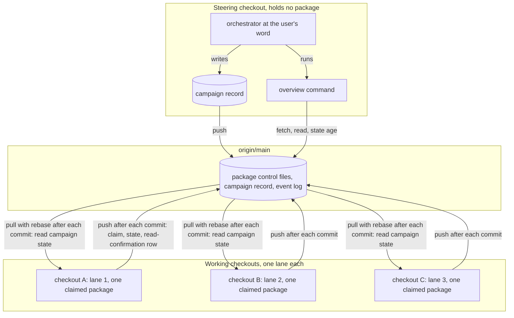

# Spec: the campaign as the Claude-side frame for work spread over several checkouts

**Date:** 2026-11-08
**Source:** the user's brief of 2026-11-08, quoted verbatim in `261108-1924-campaign-the-frame-for-work-spread-over-several-checkouts.md` `## Directive`: four to seven checkouts work a set of work packages in parallel, and fusion lacks planning (groups over the whole store and the order inside each checkout), an overview above the checkouts with messages a user understands, and steering when the user sees a discrepancy between the working sessions. The frame is the campaign, `fusion.campaign/v1`, already typed in `codec/schemas/campaign.schema.json` and used by no Claude-side code.
**Cross-references:** `261105-1156-campaign-as-the-frame-for-work-spread-over-several-checkouts.md` (the consultation this spec rests on), `261108-1927-does-the-claude-side-adopt-the-campaign-as-its-one-frame-for-work-spread-over-several-checkouts.md` (the adopting decision, `answered`), `foreign:ax-k2-3:261101-1006-three-checkouts-work-the-pipeline-lanes-in-parallel.md` and `foreign:ax-k2-3:261031-1733-pipeline-work-dissected-into-parallel-checkout-lanes.md` (the measured case), `260909-1808_*_may-a-helper-compute-an-order-over-work-items-after-the-portfolio-layer-goes.md`, `260822-1136_*_spec-fusion-becomes-a-multi-user-tool.md`, `260904-1058_*_does-a-registry-entry-carry-hostname-account-name-and-folder-path.md`, `260927-2319_*_does-the-growth-bound-on-shipped-text-yield-to-the-dual-host-prompt-set.md`, `261009-0644-host-parity-claude-and-prior.md`, `261108-2212-review-of-the-campaign-spec.md` (the review whose eight findings this revision answers).
**Revised:** 2026-11-08, after the spec review's **Modify**; the design is unchanged, the text answers the review's findings 1 to 8.

## Directive

After this work, a user who runs several checkouts against one project can have fusion cut the live work packages into one ordered lane per checkout, see in any checkout how every lane stands and what each one waits for, and intervene from a checkout of their own when two lanes drift apart. All three rest on one record, the campaign, which travels with git like every other record; no second frame is built beside it. The three capabilities land in this order: the overview first, read-only; then the planning; then the steering.

## The shape

Coherence check. The nodes are the steering orchestrator, the campaign record, the overview command, `origin/main` and the three working checkouts; the three `subgraph` blocks group them and are not nodes. The edges are the two inside the steering checkout, the two from it to `origin/main`, and one pull and one push per working checkout. No cycle stands apart from the intended round trip through `origin/main`, which is the design: git is the only channel. The one node with high fan-out is `origin/main`, and that is the point: every checkout meets every other there and nowhere else. The three working checkouts are drawn alike because the design treats them alike; four to seven of them changes nothing in the picture.

## Terms

These names are used throughout this spec and are to be used unchanged in the record format, the helper, the skills and the overview's output. Each was ruled by the user on 2026-11-08 (`## Clarification round` below) or is bound by the adopting decision.

| Term | Meaning |
|---|---|
| **Campaign** | One record, `fusion.campaign/v1`, holding a charter, a lifecycle state and the lanes. It is the frame for one stretch of work that several checkouts carry in parallel. Several campaigns may exist in one workbench. |
| **Charter** | The campaign's statement of objective, policies and limits, as the schema types it. On the Claude side it also carries the working rule "commit, then pull with rebase, then push", so that no checkout ever holds more than the commit it is about to push. |
| **Lane** | The ordered sequence of work packages one checkout works front to back. A lane names its checkout and its members in order. A checkout works at most one lane at a time. Prior's "package" is the fusion work package, so the lane is the second level of grouping and never called a package. |
| **Declared areas** | The paths or path prefixes a work package says it will touch, held on the package under Prior's field name `resources`, proposed by an analysis and confirmed by the user before any helper reads them. |
| **Steering session** | The orchestrator running in a checkout that holds no claimed package. It alone writes the campaign record, at the user's word. |
| **Working session** | The orchestrator running in a checkout that holds one claimed package out of its lane. It reads the campaign record at the pull with rebase that follows each of its commits and precedes the push, and never writes it. The read sits after the commit because a rebase pull on a tree with uncommitted edits is refused by git, and the way out git offers, a stash, is a whole-tree command the orchestrator forbids. |
| **Read confirmation** | One row in the shared event log `orchestrator-events.jsonl`, written by a working session when it has read a campaign revision: checkout, campaign, revision read, timestamp. |
| **Overview window** | The span of time within which a lane's checkout must have pushed for the overview not to report it as standing still. It is a parameter of the overview command with a default of 24 hours, named in the output; it is no field of the campaign and no shared-format change (`## Clarification round`, decision 8). |

## Clarification round

The spec rests on ten answers the user gave on 2026-11-08, none of which is recorded anywhere but here. The body cites them as "ruling A", "ruling B", "ruling C" and "question 1" to "question 7"; this section is what those labels resolve to.

**Three rulings ahead of the round**, given in the user's message "Schranken anheben, so das das Vorhaben umsetzbar ist. A:2 B:1 C:1", where each letter is a question the orchestrator had put with numbered options and each number the option chosen:

| Ruling | Question | The option chosen |
|---|---|---|
| A | At which level does a Claude-side campaign group? | Option 2: also candidates into work packages, as Prior's formation does, not only work packages into per-checkout sequences |
| B | At which point does a working session read campaign state? | Option 1: at the pull in its commit cycle (the mechanics, commit, then pull with rebase, then read, then push, are this revision's correction; the substance, one read per commit cycle, is the ruling) |
| C | Does Prior's two-writer bound stay? | Option 1: yes; more than two checkouts is a Claude-side capability only, and the spec records the deviation |

The same message released the growth bounds on the shipped text: "Schranken anheben, so das das Vorhaben umsetzbar ist" (raise the bounds so that the undertaking can be carried out). C5 rests on those words.

**Seven questions in the round**, each put with two or three options and a recommendation, answered "alle wie empfohlen" (all as recommended):

| # | Question | The answer |
|---|---|---|
| 1 | What is a checkout's ordered package sequence called? | **Lane**; not "queue" (generic, no checkout bound), not "agent group" (names the agents, and already the user's word for the working sessions) |
| 2 | Where do declared areas live, and does a size estimate enter the format? | On the package, under Prior's field name `resources`, proposed by analysis and confirmed by the user like `depends_on`; no size estimate in the first version, the cut balances by package count and dependency depth |
| 3 | Does the charter replace `mode` `autonomous` per package? | Both hold; `mode` stays the user's standing word per package; at lane formation the steering session offers to set `autonomous` on all members in one confirmed act, source the charter; no approval rule changes |
| 4 | How does a checkout confirm it has read a ruling? | One row in the shared event log: checkout, campaign, revision read, timestamp |
| 5 | What does a working session do when it reads `paused`? | It pushes the commit it has just made, dispatches nothing more, reports the state to its user; the package stays claimed |
| 6 | Where does the overview appear in build 1? | A slash command reporting in chat; a monitor panel is out of scope |
| 7 | Does the overview read only the fetched remote, and does the charter bind the push? | Only `origin/main` after a fetch, never a neighbour clone; the charter carries the commit, pull, push rule; the overview states its age |

**One decision added in this revision**, taken by the requirements-designer on the review's finding 4 and open for the user to turn at the spec review (`## User Decisions Pending`):

| # | Question | The decision |
|---|---|---|
| 8 | What carries the window after which a silent lane is reported? | A parameter of the overview command, default 24 hours, named in every output that uses it. Not a campaign field: the window changes no state and no execution decision, so it earns no shared-format field and no fourth question to Prior; a charter string would hide a number inside prose nothing parses. |

## Capabilities

### C1: The overview above the checkouts (build 1, read-only)

**Description:** From any checkout, the user runs one command and sees how every lane of the running campaign stands: which checkout works it, which package it holds, when that checkout last pushed, what its next package waits for, and which of the campaign's rules are currently broken. The command reads `origin/main` after a fetch, touches no file in the working tree, and states how old its picture is. Every sentence it prints names the thing in the user's project and what the user can do about it; it names no agent, no pass and no fusion-internal token.

The overview has two tiers, so that it is useful before Prior has answered the lane question. **Without a campaign record** it reports per checkout: the package held, when that checkout last pushed, and what that package waits for (a dependency edge, a decision record, nothing). **With a campaign record** it adds the lane view and the rule checks below.

**Acceptance criteria:**
- [ ] Running the command in a checkout whose working tree has uncommitted changes leaves those changes untouched and merges nothing; it fetches and reads the fetched ref only.
- [ ] The first lines of the output name the ref read (`origin/main`), the commit it stood at, and the age of that commit in words a reader understands ("last push by any checkout: 3 hours ago").
- [ ] With no campaign record in the fetched tree, the output lists every checkout that holds a claimed package, with the package, the time of that checkout's last push, and what the package waits for; it says plainly that no campaign is running.
- [ ] With a campaign record, the output lists every lane with its checkout, the package currently held, the next package in the lane and what that next package waits for, in the lane's order.
- [ ] Each of the following conditions, when true in the fetched state, appears as one sentence in the user's terms, and when false appears nowhere: a lane with no held package and no push within the overview window, the window named in the sentence ("no push in 24 hours"); a package held by a checkout outside the lane the package belongs to; a held package that belongs to no lane of the running campaign; a lane whose next package waits on a user decision, naming the decision; a hand-off that has become possible because the package it waited on is terminal, naming both ends; a commit by one lane in an area another lane declared, naming the path and both lanes; a campaign revision a lane's checkout has not confirmed reading, with the time of its last confirmation.
- [ ] The two conditions the consultation measured as true and invisible in `ax-k2-3` on 2026-11-05 (four held packages in no lane; two hand-offs out of lane 1 possible while both receiving packages stood open and unheld) are each produced by the command when the same state is reconstructed in a test fixture.
- [ ] The output is in the project's chat language and passes the readability check of `rules/user-facing-output.md`: no agent name as subject, no marker, no process narration.
- [ ] The command runs in the steering checkout and in a working checkout alike, and in a checkout that holds a claimed package it reads the same state as in one that holds none.
- [ ] The overview window defaults to 24 hours, can be set on the command line, and is named in every sentence that depends on it; the campaign record holds no window.
- [ ] `bin/monitor` is unchanged by this build (the monitor panel is out of scope, question 6).

**Decisions made:**
- Surface: a slash command reporting in chat (question 6); a panel in the HTML monitor is out of scope.
- Source: `origin/main` after a fetch, never a neighbour clone on the same disk (question 7; keeps `260904-1058_*_does-a-registry-entry-carry-hostname-account-name-and-folder-path.md`).
- Age: the output states it, and the charter's commit, pull, push rule (C3) is what bounds it to about one commit per checkout.
- Window: a command parameter with a 24-hour default, no format field (decision 8, taken in this revision; the user may turn it).
- Two tiers, so that the reduced overview ships before Prior answers the lane question (consultation, Recommendation 6).

### C2: Planning, the cut into lanes (build 2)

**Description:** The user says how many checkouts are available. A helper reads the live work packages, their confirmed dependency edges and their confirmed declared areas, and proposes one lane per checkout: which packages each lane holds and in what order, which edges cross lanes (the hand-offs), and what a cut with one checkout more or one fewer would change. The user confirms the cut, or changes it, and the steering session writes the result into the campaign record. Nothing is ranked by judgement: the order inside a lane is the existing computed order of `bin/fusion-work-order` restricted to the lane's members, and the grouping follows the declared areas and the edges.

Declared areas are made the way dependency edges are made today. An analysis reads the narratives and the code and proposes, per package, the paths it will touch; the user confirms them; only then does the helper read them. A package whose areas nobody declared is grouped by its edges alone, and the cut says so for each such package. After the fact, the overview (C1) compares the paths each lane actually committed against the areas the lane's members declared, which turns the undecidable question "which packages will collide" into the decidable pair "what did each package declare" and "what fell outside it".

**Acceptance criteria:**
- [ ] The cut takes the number of checkouts as its input and refuses to run without one; it never derives that number itself.
- [ ] For the input N it prints N lanes, each an ordered list of package names, plus the list of hand-offs (edges whose two ends lie in different lanes), plus one paragraph each for N+1 and N-1 saying which packages would move and which hand-offs would appear or disappear.
- [ ] Two packages whose confirmed declared areas overlap always land in one lane. A dependency edge between them orders them inside that lane and never separates them. When keeping such pairs together makes one lane longer than the others by more than the cut's stated tolerance, the cut reports the imbalance and the packages that cause it rather than splitting a pair; the user decides whether to accept the imbalance, redeclare an area or change N.
- [ ] A package with no declared areas appears in the cut with the words "no areas declared", and the cut's summary counts those packages.
- [ ] The order inside a lane is the order `bin/fusion-work-order` prints when restricted to that lane's members; a reader can verify this by running that helper and striking every package outside the lane.
- [ ] Balancing uses package count and dependency depth only; no size figure enters the computation (question 2).
- [ ] The cut is a proposal until the user confirms it; nothing is written to the campaign record before that confirmation, and the confirmation names the cut it confirms.
- [ ] Declared areas on a package are written only after the user confirmed them, with the same source discipline a `depends_on` entry carries today; no agent writes one from its own judgement.
- [ ] Re-running the cut after the store changed (a package done, a new one filed) is an ordinary run that proposes a new cut; the previous lanes stay in the campaign record until the user confirms the new one.
- [ ] When the confirmed cut is written, the steering session offers, as one question, to set `mode` `autonomous` on every lane member in one act, with the charter as the recorded source; declining leaves every package's `mode` as it was (question 3).
- [ ] The measured case reproduces: fed the 23 pipeline packages, their written edges and the areas the lane analysis lists per package, with N=3, the cut puts `pkg/process` work, `pkg/strategy` with `pkg/catalog` work and `pkg/ai` work into three different lanes and names the project-header edge and the route edge as hand-offs (`foreign:ax-k2-3:261031-1733-pipeline-work-dissected-into-parallel-checkout-lanes.md` §4 and §5).

**Decisions made:**
- Grouping level: the campaign also groups candidates into work packages as Prior's formation does (ruling A); this build adds the second level, packages into lanes, and touches the first level only by leaving `register` and `formation` as the schema types them.
- Where declared areas live: on the package, field name `resources` as Prior names it (question 2).
- Size: no size estimate in the first version (question 2); the balancing is by count and depth.
- Overlap is never split: a pair with overlapping areas stays in one lane, and an imbalance is reported, not resolved by separating the pair (this revision, on the review's finding 6; a dependency edge orders a pair inside a lane and cannot force it apart).
- Number of checkouts: an input, never computed (consultation Recommendation 4; the lane analysis's finding that more lanes meant more questions per day, not more throughput).
- Who proposes areas: an analysis dispatch, as in the measured case; who confirms: the user; who computes: one helper.

### C3: Steering from a checkout that holds no package (build 3)

**Description:** The user, in a checkout of their own, runs the orchestrator as the steering session. It performs the campaign's lifecycle at the user's word: open a campaign with a charter, write the confirmed lanes, pause the campaign, amend the lanes (move a package, reassign a lane to another checkout), and end it with a stated outcome. Every such act is a write to the campaign record, committed and pushed by the steering checkout alone. A working session's commit cycle is: commit, then pull with rebase, then read the campaign record from the pulled tree, then push. When the read finds the campaign `paused`, the session pushes the commit it has just made, dispatches nothing more, tells its user where it stands, and leaves its package claimed. After every read it appends one read-confirmation row to the shared event log, so the overview can show whether an intervention has arrived. The read sits after the commit and not before it because a rebase pull is refused on a tree with uncommitted edits, and the stash git offers as the way out is a whole-tree command `agents/orchestrator.md` `### Step 2 — dispatch` forbids; the charter rule is the one the consuming project wrote as "pull before each commit" (`foreign:ax-k2-3:261101-1006-three-checkouts-work-the-pipeline-lanes-in-parallel.md`, rule 6), carried into a procedure whose commits are made by a session rather than by hand.

A discrepancy the user resolves is a ruling, and a ruling already has a home: a decision record in the container of the package it concerns, or in `shared/`. The campaign record carries what a session must obey mechanically (paused or running, which lane this checkout works, which package comes next); the decision record carries the reasoning; the message store stays what it is, a note a person reads, with no addressing and no reply.

**Acceptance criteria:**
- [ ] The steering session refuses to write the campaign record when its own checkout holds a claimed package, and says why.
- [ ] A working session never writes the campaign record: no skill or helper a working session runs has a write path to it, and the plan names the mechanism that makes that so.
- [ ] Opening a campaign writes a charter whose text includes, in the user's words or the spec's, the working rule "commit, then pull with rebase, then push" (question 7, with the mechanics corrected in this revision).
- [ ] A working session's commit step runs, in this order and with no stash and no other whole-tree git command: commit under the lock, pull with rebase, read the campaign record from the pulled tree, push. The read happens once per commit cycle and at no other point.
- [ ] At that read, the session appends one row to `orchestrator-events.jsonl` naming its checkout, the campaign and the revision it read; the row merges without conflict when two checkouts append at once (the log's existing `merge=union`).
- [ ] A working session that reads `paused` pushes the commit it has just made, starts no further dispatch, reports the campaign's `reason` to its user in the chat language, and leaves its package `claimed` (question 5).
- [ ] With read-confirmation rows present in the log, `bin/monitor` serves its dashboard as before; a row kind it does not know is skipped, never an error. (The log's module documents four machine-written row kinds; the read confirmation is a fifth row kind, and the plan says whether a helper or the session writes it.)
- [ ] A working session that reads `running` again after a pause continues with no further question than the one it would have asked anyway.
- [ ] Moving a package from one lane to another, and reassigning a lane to another checkout, are each one confirmed act at the user's word; after the push the overview (C1) shows the new assignment and names any checkout whose held package now sits outside its lane.
- [ ] The intervention delay is stated to the user as "at the holding session's next commit" wherever a steering act is confirmed; the plan carries a measurement step for the commit cadence of autonomous sessions, and the measured figure replaces the phrase once it exists.
- [ ] The single-claim rule, release and transition by the holder only, and takeover on the user's word per package are unchanged: the steering session cannot release, pause or transition a package another checkout holds, and the plan adds no path that does.
- [ ] Ending a campaign records one of the schema's terminal outcomes and the overview thereafter reports the campaign as ended, not as running.

**Decisions made:**
- Who steers: the orchestrator in a package-less checkout (brief; consultation Analysis 5; adopting decision `## Constraints`).
- Read point: once per commit cycle, at the pull with rebase that follows the commit and precedes the push (ruling B in substance; the mechanics corrected in this revision on the review's finding 1).
- Effect of `paused`: push the commit just made, stop dispatching, report, keep the claim (question 5).
- Read confirmation: one row in the shared event log (question 4).
- Autonomy: `mode` stays per package; the bulk offer at lane formation is the convenience (question 3); no approval rule changes.
- Single writer of the campaign record: the steering session (default stated in the clarification round; the user may turn it at review).
- State and prose do not share a carrier: campaign record for what a session obeys, decision records for rulings, the message store untouched (consultation Analysis 4; adopting decision `## Rulings this adoption supersedes` §3).

### C4: The format questions to Prior, asked before the plan

**Description:** The record format is a contract with Prior, changed only through a numbered request in `codec/fixtures/prior/REQUESTS.md`, whose latest entry at HEAD is request 79. The brief's step c) puts the format questions before the plan. This capability is that act: one request, three questions, each tied to the build that depends on it.

| # | Question to Prior | Build that depends on it | What fusion does if the answer is no |
|---|---|---|---|
| 1 | A lane structure in `fusion.campaign/v1`: an array of lanes, each with an id, the checkout that works it, its members as an ordered list of package ids, and its revision; the schema's `register` and `formation` stay as typed | C1 full tier, C2, C3 | C1 ships its reduced tier; C2 and C3 stop until a location for the lanes is agreed (see `## Stops when`) |
| 2 | A `resources` field on `fusion.package/v1`, a set of path strings, Prior's own name for the declared areas of a formation candidate, written only from confirmed input | C2 | C2 groups by edges alone and says so on every package; the user is asked whether to proceed on that basis |
| 3 | Whether Prior's `Pause` semantics admit the Claude-side reading that a working session halts at the pull after its next commit and keeps its claim; the stop field is the existing `state`, no new field is asked for | C3 | the reading is recorded as a Claude-side deviation beside the two-writer one, and C3 proceeds |

No `estimated_size` is requested (question 2), and no field for the overview window (decision 8). Two matters may add a question to the request, and the planner settles both while drafting it: which charter string field carries the working rule, or whether a question is owed for it; and the hashes a Claude-side writer must supply (`## Open for Planner`), if the codec alone cannot answer whether Prior accepts, on a campaign fusion wrote, a `charter_hash` or revision it cannot verify, a null where the schema admits one, or publishes the canonical bytes. The request also states that the read-confirmation row lives in `orchestrator-events.jsonl`, which is Claude-local and no part of the shared format, and that the row names Prior's revision field, so Prior knows the value is read and nothing else.

**Acceptance criteria:**
- [ ] The request appears in `codec/fixtures/prior/REQUESTS.md` as the next numbered entry after 79, before any plan step changes a schema file.
- [ ] Each of the three questions names the build it gates and the fallback above, so Prior reads the cost of a no.
- [ ] The request records that more than two parallel writers is a Claude-side capability only and that Prior keeps its two-writer bound (ruling C; `## Deviation from Prior's two-writer bound` below).
- [ ] No field that a session must obey is placed in `extensions`: `codec/schemas/common.schema.json`'s rule that ignorance of an extension may change neither state nor an execution decision is quoted in the request as the reason.

**Decisions made:**
- Three questions before the plan (brief step c; consultation Recommendation 5), and at most two more only where the planner cannot answer the charter-rule field or the hashes from the codec.
- The stop field is the existing `state`, not a new one.
- The overview window is no format question (decision 8).

### C5: Room for the text, and the one sentence the conventions restate

**Description:** The procedures ship as skills over one helper, with no twelfth agent (consultation Recommendation 4). Skill bodies and agent prompts are bounded in how much they may grow, and the bound on skills stands at 25 bytes of head-room against 39 260, the bound on agents at 3 921 against 18 000, as the dispatch of this spec measured them at HEAD by `hooks/lib/__tests__/surface-growth-bound.test.ts` (reported by the dispatcher; this spec's own run of that test passed and did not re-extract the figures). The user ruled on 2026-11-08 that the bounds may be raised as this work needs: "Schranken anheben, so das das Vorhaben umsetzbar ist" (`## Clarification round`). That word is the authority for the raise, and this spec is where it is recorded. The method is the one `260927-2319_*_does-the-growth-bound-on-shipped-text-yield-to-the-dual-host-prompt-set.md` established for the dual-host work, which that record alone covers: raise the head-room by the measured remainder, log it where `README-hooks.md` `### Growth bounds on the shipped text` logs raises, move no baseline. The plan therefore carries the raise as a step and asks nobody again.

The adopting decision narrows one sentence of `rules/fusion-workbench-conventions.md` `## Work packages`, the paragraph on `depends_on`, which closes "No agent asserts a ranking, and no field holds one." The plan restates it. The reading to carry: a helper writing from inputs the user confirmed is admitted; an agent writing from its own judgement is not. A wording that carries it: "No agent asserts a ranking. A helper may compute a lane assignment and an order from inputs the user has confirmed, and the campaign record holds that result; no field holds a priority an agent set by judgement." The planner may tighten the words; the two halves must survive.

**Acceptance criteria:**
- [ ] `npm test` is green after every step that adds shipped text, with the raise logged as the README section prescribes and no baseline edited.
- [ ] The restated sentence in `## Work packages` admits the helper-written lane assignment and still excludes an agent-asserted priority, and `260909-1808_*_may-a-helper-compute-an-order-over-work-items-after-the-portfolio-layer-goes.md` is not transitioned.
- [ ] No new file appears under `agents/`.

## Stops when

- If Prior's answer to question 1 of C4 is that no lane structure may enter `fusion.campaign/v1`, the work stops after C1's reduced tier and the question of where the lanes live goes back to the user; no Claude-local file and no `extensions` entry is built in the meantime.
- If the commit-cadence measurement in C3 shows that an autonomous session goes longer between commits than the user accepts as an intervention delay, the work stops before C3 ships and the read point (ruling B) is put back to the user with the figure.
- If a step needs a growth-bound raise it cannot state as a measured remainder, or would move a baseline, the step stops and the user is asked, rather than a baseline being edited.

## Constraints

- One claimed package per checkout, release and transition by the holder only, takeover on the user's word per package: all unchanged (`rules/fusion-workbench-conventions.md` `## Work packages`, `## Path Resolution (Pfadauflösung)`).
- A `depends_on` entry and, by the same route, a declared area stand on the user's confirmation; no agent writes either from its own judgement.
- The registry carries no host name and no folder path, so no sibling clone is ever read (`260904-1058_*_does-a-registry-entry-carry-hostname-account-name-and-folder-path.md`).
- `extensions` carries nothing a session must obey (`codec/schemas/common.schema.json`, the `extensions` definition).
- Every format change is a numbered request in `codec/fixtures/prior/REQUESTS.md`; the campaign's shape is `fusion.campaign/v1` as typed, filled rather than forked.
- Approvals are asked in the orchestrator's own loop and nowhere else (`rules/fusion-workbench-conventions.md` `## Dispatching another agent`), which is why the steering role is the orchestrator's.
- Procedures are skills over one helper; no twelfth agent; no store path literal in a skill body (`hooks/lib/__tests__/path-literal-lint.test.ts`).
- The orchestrator's prohibition of whole-tree git commands stands (`agents/orchestrator.md` `### Step 2 — dispatch`): no stash, no `--autostash`; which is why the campaign read sits after the commit, where the tree is clean.
- Everything the user reads follows `rules/user-facing-output.md`; everything persisted is in the artefact language.
- The load-bearing question "which packages will collide" is not decidable in advance; the design replaces it with declaration and detection, and the plan's `**Decidability:**` line says so (`rules/critical-stance.md` §4).

## Rulings superseded, narrowed and kept

Recorded in `261108-1927-does-the-claude-side-adopt-the-campaign-as-its-one-frame-for-work-spread-over-several-checkouts.md`; this spec inherits the distinctions and adds none.

| Ruling | Where it stands | What this work does with it |
|---|---|---|
| Visibility of another checkout's work is presence only | `260822-1136_*_spec-fusion-becomes-a-multi-user-tool.md`, answers 4 and 5, `## Out of scope`, the Directive's last clause | Superseded in the parts naming the queue and the held package as private and the event log as the only thing that travels. Kept: live state never travels; the campaign enters as a record |
| "No agent asserts a ranking, and no field holds one" | `rules/fusion-workbench-conventions.md` `## Work packages`, from `260909-1808_*_may-a-helper-compute-an-order-over-work-items-after-the-portfolio-layer-goes.md` | Narrowed, not withdrawn: the second clause yields to a helper-written lane assignment from confirmed inputs; agent judgement stays excluded; the source record does not move; the sentence is restated by the plan (C5) |
| Concurrent sessions exchange work through the user | `README-agents.md` `## Migration note`, the bus-protocol bullet | Superseded for campaign state and rulings, which travel as records; no bus returns and the message store is unchanged |
| One claimed package per checkout; holder-only release | `## Work packages`, `## Path Resolution (Pfadauflösung)` | Kept |
| Edges on the user's confirmation | `## Work packages` | Kept, and extended by analogy to declared areas |
| No host name, no folder path in the registry | `260904-1058_*_…` | Kept; the overview reads a fetched ref |
| One `issues/` store, state as classification | `260922-1059_*_is-a-record-in-issues-a-candidate-or-an-admitted-work-item.md` | Kept; `register` stays as typed and is not filled by this work |

## Deviation from Prior's two-writer bound (ruling C)

Prior's collaboration coordinator refuses any plan that does not have exactly two workers (consultation Analysis 1, `collaboration.go` `Open`, read at Prior `374a322`). This work runs four to seven checkouts. The deviation is deliberate and one-sided: the Claude side admits N lanes for N checkouts; Prior keeps its two-writer bound and is asked to change nothing about it. The two hosts therefore differ in how many parallel writers a campaign may have, and the difference is recorded in three places so that nobody later reads it as a parity defect: in the Prior request (C4), in this spec, and in the plan's `**Decidability:**` head. The host-parity analysis `261009-0644-host-parity-claude-and-prior.md` already classes campaign workflows as a scope decision rather than a parity matter; the deviation is that decision's consequence.

## Out of Scope

- The Prior integration itself: no Go code, no import of a Prior campaign into a fusion workbench, no filling of `register` or `formation`, no mapping run of `prior-mapping.json`'s state rows. The request to Prior (C4) is asked; acting on Prior's side is Prior's.
- A panel in the HTML monitor (`bin/monitor`) for the overview (user, question 6).
- A size estimate on packages (user, question 2).
- A reply, addressing or thread in the message store; its documented limits stand.
- Any path by which a session other than the holder releases, pauses or transitions a package.
- A twelfth agent, or a steering role other than the orchestrator.
- Changing the rule that a `depends_on` entry stands on the user's confirmation; the policy-curator's edge survey stays the one proposing route.
- Several lanes for one checkout at once, or one lane shared by two checkouts.

## Open for Planner

- Where the campaign record sits in the workbench: the schema names `campaigns/<id>/campaign.json`; whether that is a root-anchored surface or a store under `shared/`, its class in `rules/workbench-tracking.md`, and its row in `## fusion-workbench Layout` are the planner's, settled in the same step as the Prior request.
- The helper's name and its interface, and whether the overview, the cut and the steering acts are three skills or one with sub-commands; the single-writer property of C3 is the acceptance, the mechanism is the planner's.
- How the lane's `resources` union and the "commit in another lane's area" detection are computed from `git log` over the fetched ref, and over which window.
- The shape of the read-confirmation event row inside the existing event vocabulary of `hooks/lib/orchestrator-events.ts`.
- Which charter string field carries the working rule, and the Claude-side values for the Prior-shaped required charter fields (`budget_account`, `backend_policy`, `limits` and the rest).
- Where the commit cycle's pull with rebase, the campaign read and the push land, given that `agents/orchestrator.md` `### Step 4 — commit` today commits under the lock and mentions neither a fetch, a pull nor a push: in the prompt, or in a skill or helper the orchestrator runs after the lock releases, and how a rebase conflict at that pull is put to the user.
- The hashes a Claude-side writer of the campaign record must supply, and whether the codec can produce them: `state.charter_hash` is required and typed `prior_revision`, a hex SHA-256 over Go's `encoding/json` marshalling of the charter, which the schema says equals Prior's `charterHash`; `state.revision`, `register.revision` and `formation.revision` are the same type, nullable; `charter.revision`, `state.baseline_hash` and the formation's `accepted_revision` and `base_revision` are `prior_opaque_revision`, author-assigned labels. A writer that cannot reproduce Go's marshalling cannot produce a value Prior would verify, so the plan decides between a hash fusion computes and Prior does not verify, a null where the schema admits one, or canonical bytes Prior publishes; if the codec alone cannot settle it, the question goes into the Prior request (C4).
- How "when that checkout last pushed" is derived: commits carry no checkout, so the join runs through the event log's `checkout` field and the fetched ref's commit times, not through `git log --author`.
- The overview window's command-line flag and the wording that names the window in each sentence that uses it.
- The imbalance tolerance C2 reports against, and how it is stated in the cut's output.
- The test fixture that reconstructs the `ax-k2-3` state for C1's measured-case criterion.
- The measurement step for autonomous commit cadence (C3) and its acceptance figure.
- The exact raise of the two growth bounds, by the measured remainder, and its log entry.

## User Decisions Pending

- [ ] **The overview window** (decision 8, `## Clarification round`): a parameter of the overview command, default 24 hours, no campaign field, no question to Prior. Taken by the requirements-designer in this revision on the review's finding 4; the user turns it at the spec review if a charter field or a Prior question is preferred.
- [ ] **The corrected read mechanics** (ruling B): commit, then pull with rebase, then read, then push. The substance of the ruling is unchanged; the user confirms the corrected order at the spec review.

None else from the clarification round; all seven questions were answered on 2026-11-08 with the recommended option. The defaults stated in that round and carried above stand until the user turns them at the spec review: single writer of the campaign record, checkout count as input, one lane per checkout at a time, several campaigns allowed, the intervention delay stated as one commit cycle until measured, `campaigns/<id>/campaign.json` as the record's own path.
