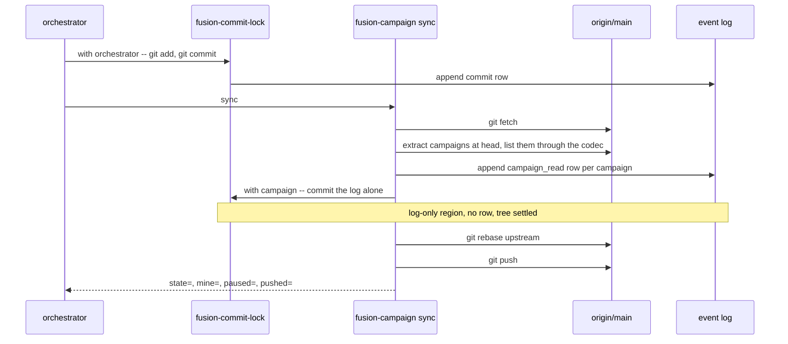
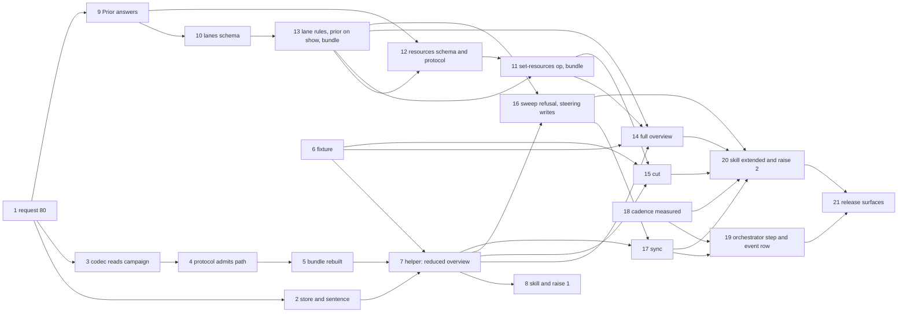

# Implementation Plan: the campaign as the Claude-side frame for work spread over several checkouts

**Date:** 2026-11-08
**Spec:** `261108-2135-spec-campaign-the-frame-for-work-spread-over-several-checkouts.md`, approved at its second review on 2026-11-08 and bound to the package in role `spec`
**Decidability:** The load-bearing question is "which packages will collide when several checkouts work them in parallel", and it is not decidable from anything the mechanism can obtain: a package without a plan has no enumerable file set, and five of the measured case's queued packages had none. The plan therefore builds no predictor. It replaces the question with two that are decidable from inputs the helper reads: *what did each package declare* (the `resources` field, written only from the user's confirmation, step 12) and *which committed path at the fetched ref falls inside another lane's declared area* (a comparison over `git log --name-only`, step 14), and the overview reports the second as a finding after the fact. A third decided question joins them: whether a session has read the current campaign record is read off the file's own `sha256:` revision, which moves with every change, `lanes` included, where `state.revision` does not. A fourth is decided only in part, and the output says where it is not: which commit on the fetched head a `commit` row names. A rebase replaces the hash the row carries, so the join falls back on the subject and the author time, which a rebase keeps, and a row that then names nothing is counted and never guessed (step 7). The one-sided deviations from Prior are stated rather than approximated, with `docs/campaign.md` as their home (step 20): N lanes for N checkouts against Prior's two-writer bound (the spec's ruling C; also in request 80 and its `## Deviation from Prior's two-writer bound`), the pause that waits for a commit cycle, and the first stored state of `running`. A fifth is decided by one test: a commit hash is final once the upstream holds the commit, which `sync` prints per commit (steps 17 and 19). The two `prior_revision` fields hold Prior's own `charterHash` and `stateRevision`, computed by the codec and answered on `show` of a campaign (the build-route decision, ruled option 1: `261109-1238-by-which-build-route-does-the-claude-side-writer-produce-priors-charter-hash-and-state-revision.md`).
**Cross-references:** `261108-1924-campaign-the-frame-for-work-spread-over-several-checkouts.md`, `261108-1927-does-the-claude-side-adopt-the-campaign-as-its-one-frame-for-work-spread-over-several-checkouts.md`, `261105-1156-campaign-as-the-frame-for-work-spread-over-several-checkouts.md`, `261108-2212-review-of-the-campaign-spec.md`, `261108-2301-where-does-the-campaign-record-live-in-the-workbench-layout.md`, `261108-2301-which-value-does-a-claude-side-writer-put-in-a-prior-revision-field.md`, `261109-1238-by-which-build-route-does-the-claude-side-writer-produce-priors-charter-hash-and-state-revision.md`, `261108-2301-how-does-a-working-session-rebase-pull-over-the-log-row-the-lock-just-appended.md`, `foreign:ax-k2-3:261101-1006-three-checkouts-work-the-pipeline-lanes-in-parallel.md`, `foreign:ax-k2-3:261031-1733-pipeline-work-dissected-into-parallel-checkout-lanes.md`, `260927-2319_*_does-the-growth-bound-on-shipped-text-yield-to-the-dual-host-prompt-set.md`, `260909-1808_*_may-a-helper-compute-an-order-over-work-items-after-the-portfolio-layer-goes.md`, `261109-1515-commit-cadence-of-autonomous-sessions.md`

## Directive

The spec's `## Directive` is the directive and is not restated. This plan says how its five capabilities are built in the spec's order: the request to Prior (C4) first, the read-only overview (C1) in its reduced tier before Prior answers and in its full tier after, the cut into lanes (C2), the steering acts and the commit-cycle read (C3), with the growth-bound raise and the restated conventions sentence (C5) placed where the steps that need them sit.

## Current State

Measured at `f1996755` plus the uncommitted `set-mode` on the package, 2026-11-08 23:00.

- **At `f1996755` the campaign was a type and nothing else.** `codec/schemas/campaign.schema.json` types `fusion.campaign/v1` with `additionalProperties: false` on the root and the charter. Since steps 3 to 5 the codec reads one, as kind `campaign` and read-only; nothing writes one yet.
- **Every prompt and skill body is render output.** `agents/*.md` and `skills/*/SKILL.md` are concatenations of `catalog/profiles/<id>/parts/NN-{neutral,claude,prior}.md`; a hand edit is overwritten by `cd catalog && npm run render -- claude` and fails `cd catalog && npm test`. A `neutral` part may carry no host token (`bin/`, `$FUSION_PLUGIN_ROOT`, `$OUT_*`, a slash command), so every helper call sits in a `claude` part.
- **The growth bounds.** `surface-growth-bound.test.ts` at `f1996755`: `agents/` at 14 079 of 18 000 bytes (3 921 left), unchanged since. `skills/` stands at its bound since step 8's raise, 234 787 bytes against 234 787. The dispatch-path bound (`rules-emission-golden.test.ts`, zero head-room) gave the orchestrator's row 3 416 bytes of slack and **the reviewer's 0**. `rules/fusion-workbench-conventions.md` is emitted to all eleven paths, so a byte added there puts the reviewer over unless a byte leaves the same file; `rules/commit-lock.md` reaches the orchestrator alone.
- **The commit cycle has no read point and leaves the tree dirty.** `agents/orchestrator.md` `### Step 4 — commit` commits under the lock and mentions neither fetch, pull nor push. `bin/fusion-commit-lock with` appends the `commit` row to the tracked event log after every landed commit, so the tree is dirty by that file after every commit, and a held region whose only path is the log emits no row, which is how `/fusion:cleanup` settles it ("Then commit the event log alone"). Seven of the last forty commits here are such settling commits.
- **What already computes the order and builds a test workbench.** `hooks/lib/work-graph.ts` `readWorkGraph(workbench)` gates through the codec and returns nodes, edges, readiness and unmet rows; `orderOf` is pure. `hooks/lib/__tests__/helpers/json-workbench.ts` builds a JSON-controlled workbench through the kernel, with `claim(project, pkg, checkout)` taking any checkout identifier.
- **The event log carries what the join needs.** A `commit` row carries `checkout`, `session_id` and `detail` = `<short hash> <subject>`; `.gitattributes` gives the log `merge=union`; `bin/monitor` renders an event kind it does not know through its default branch (`formatEvent`: `<agent or orchestrator>: <detail>`).
- **The measured case is reproducible from one clone.** `/System/Volumes/Data/Projects/productive/F03_digital-leadership/ax-k2-3` stands at `56c19983a`, the HEAD the consultation read. What the suite reads of it is the fixture of step 6: five holders, one of them inside a lane, and `261031-1718` `done` while `260814-1228` and `261101-1002`, the two lane-3 packages with an edge on it, stand `open` and unheld.
- **Commit cadence.** Over the `commit` rows of that clone's event log, grouped by `session_id`, gaps under 24 hours (3 259 gaps in 152 sessions): median 16.7 minutes, p75 51.5, p90 139.9, p95 309.7. Step 18 restricted the measurement to autonomous sessions (`261109-1515-commit-cadence-of-autonomous-sessions.md`): the exact marker `answered by **Mode:** autonomous` names 45 sessions in that log, with a p90 of 137.8 minutes. The 49 sessions this bullet gave before are what a search for the letters `autonom` anywhere in a `gate_response` row returns (that report's recommendation 3).
- **A `commit` row's hash does not survive a rebase; its subject and author time do.** Measured read-only at `56c19983a` on 2026-11-09: 301 of 3 825 `commit` rows name no ancestor of the head, and for 260 of the 265 among them that carry a checkout exactly one commit on the head has the row's subject and an author time within 60 seconds of its `ts`. The ancestor test alone dated the last push of `cb430046` almost eight hours early. Step 7 built its join on this; the measurement stands in full in `261109-1313-a-commit-row-names-a-hash-a-later-rebase-removes-so-last-push-by-ancestor-test-under-reports.md`. That a pull with rebase made those rows is inference, since no reflog was read.
- **Where the work stands at `379f4bf4`, 2026-11-09.** Steps 1 to 9 and 18 are done; the text each was dispatched with stands in this file at `9d347c8d`. This package is on branch `campaign` alone, which tracks no upstream. The bundle stands at `sha256:bc0de764…`, Prior's pin at `sha256:b4047458…`. `codec/src/prior` holds `computeCharterHash`, `computePriorRevision` and `exportCampaignState`, and nothing shipped runs them.
- **No schema types an answer of the codec, and no recorded answer is a campaign's.** `codec/schemas/protocol.schema.json` describes "one request to fusion-record", and `ls codec/schemas` holds no second protocol file. `grep -rl '"kind": *"campaign"'` over `codec/fixtures/protocol-session*/` and `codec/fixtures/prior*` prints nothing. Two tests hold a campaign's `show` answer by `toEqual`, in `ops.test.ts` and `round-trip-cli.test.ts`. A recorded `inspect` answer lists the implemented operations and the schema ids, so a new operation name moves each one a replay compares and a changed schema moves none.
- **Three couplings tie a schema file to a file the other executor owns**, measured in scratch copies of `379f4bf4` with the schema change simulated and the bundle as committed. (1) The bundle embeds the schemas: with `lanes` required and `"lanes": null` in the fixtures, `round-trip-cli.test.ts` fails its campaign `validate` case and `record-index.test.ts` in `hooks` its two valid-campaign cases, the old bundle refusing the key `campaignFile` spreads in from `minimal.json`; `committed-bundle.test.ts` reads HEAD and is red at any commit whose bundle is not the build of its source. (2) `prior-mapping.test.ts` composes a campaign in its own `campaignRecord` and validates it against the source schema: 17 cases fail until that function writes `lanes`. (3) `protocol.test.ts` holds the protocol schema's `op` enum and branch list equal to `OPERATIONS` in `codec/src/cli/protocol.ts`: two cases fail while one side alone has `set-resources`. The whole `codec` suite ran in each copy and, of `hooks`, the files that read a campaign file or a schema. The `codec` files that need a repository (`committed-bundle`, `install`, `round-trip-cli-takeover`) fail there for that reason; that `install.test.ts` stays green in the tree is inference.

## Approach

One helper, one skill over it, one new root store, one codec read extension, and the orchestrator's commit step gaining one guarded call. Nothing else is new: the order comes from `work-graph.ts`, the fetched-ref read from `fusion-forum`'s pattern, the settling commit from the lock rule, the registry names from `fusion-checkout-name`, the fixture workbenches from `json-workbench.ts`.


Coherence check. The four subgraphs group and are not nodes. The skill is the one node with high fan-out, which is its role: a dispatcher over sub-commands. There is no cycle: the user surface calls the helper, the helper calls what exists, and nothing calls back. Every edge is a call or a read the steps build or already have.

**The commit cycle, as the helper runs it** (`261108-2301-how-does-a-working-session-rebase-pull-over-the-log-row-the-lock-just-appended.md`):



The read sits after the commit (the spec's correction) and reads the fetched ref, not the working tree, so no pull precedes it; the pull with rebase follows the settling commit and precedes the push. Step 17 says what a dirty tree and a conflict do.

**Order of the work, and where the gates sit.** Steps 1 to 9 and 18 are done. The four codec steps run in the order **10, 13, 12, 11**, as two pairs: the campaign's lanes (10, then 13) and the declared areas (12, then 11). Each pair is a schema step by the `data-implementer`, flagged for the user's approval, followed at once by the code step that rebuilds the bundle. The order moved in this revision on the couplings `## Current State` measures. No order of four single-executor commits is green throughout. This one is red after step 10's commit and after step 12's, in the test files each acceptance names, and green after 13's and after 11's; the earlier order was red at three commits in a row, in files it did not all name. A pair committed as one commit would be green throughout; the plan keeps one commit per step, so that each approved schema change is one diff. Steps 10 and 12 stay flagged: request 80 says a schema change that follows from Prior's answer is put to fusion's user before it lands, so under `mode` `autonomous` the orchestrator asks rather than files and skips. After step 11, the last rebuild, the orchestrator reports the bundle digest and asks the user whether a re-pin request goes to Prior. Step 16a can be dispatched at once; 16b, 17 and 19 follow step 13 and need neither 12 nor 11.



Coherence check. One node per step; every edge is one entry of a `Dependencies:` line below and every entry is an edge. There is no cycle. Three edges run against the numbers, 13 to 12, 13 to 11 and 12 to 11: a number is an anchor, and the order of the four codec steps moved in this revision. The edge from 13 to 12 orders and nothing more: step 12 touches no file of step 13 and waits so that one schema commit at a time stands without its rebuild. Steps 6 and 18 are roots on purpose: the fixture and the measurement depend on nothing in the tree.

## Implementation Steps

1. **Request 80 to Prior: the lane structure, the declared areas, the pause reading and the hashes** (done, `bcb7133d`)
   - Executor: `data-implementer`
   - Files: `codec/fixtures/prior/REQUESTS.md`
   - Built: `## The campaign on the Claude side (request 80)` with four questions, each naming the build it gates and what fusion does on a no: `lanes` on `fusion.campaign/v1`, `resources` on `fusion.package/v1`, the pause reading with `open` writing `running` directly, and the values of the `prior_revision` fields. Its `### Stated and not asked` holds what later steps take from it, the Claude-side values of the other required charter fields among them (step 16 writes them).
   - Dependencies: none

2. **The campaign store in the layout, the resolver, the classifier and the tracking rule, with the restated ranking sentence, byte-neutral on the conventions file** (done, `4a81e482`)
   - Executor: `code-implementer`
   - Files: `rules/fusion-workbench-conventions.md`, `rules/workbench-tracking.md`, `rules/workbench-path-resolution.md`, `hooks/lib/stores.ts`, `hooks/lib/staging-drift.ts`, `bin/fusion-stores`, `bin/fusion-paths`, with their tests and goldens (`git show --stat 4a81e482` is the set)
   - Built: `campaigns/<campaign_id>/campaign.json` as the second root entry of the layout tree, with its paragraph; the restated ranking sentence in `## Work packages` (spec C5); `CAMPAIGN_STORE`; the keys `OUT_CAMPAIGN` and `SCAN_CAMPAIGNS`; the classifier's `record` class for a campaign file and the R1 row. Every byte added to the conventions file was paid in the same file, by moving the frozen-stores paragraph to `rules/workbench-tracking.md`.
   - Dependencies: 1

3. **The codec reads a campaign file: kind `campaign` in the store, read-only** (done, `063d33e2`)
   - Executor: `code-implementer`
   - Files: `codec/src/store.ts`, `codec/src/cli/ops.ts`, `codec/src/cli/protocol.ts`, their tests, `codec/README.md`
   - Built: kind `campaign`, read by `list` (`status` is the campaign's `state.state`), `show` and `validate`; a pair whose `narrative` and `report` are null; every mutation on a campaign path refused `unsupported-format/not-a-pair-kind`, the detail naming `bin/fusion-campaign` as the Claude-side writer; `reconcile` reports schema findings only. The two defects it left are closed in step 7a.
   - Dependencies: 1

4. **The protocol admits the campaign path; fixtures for it** (done, `01892937`; was flagged, a schema file changed)
   - Executor: `data-implementer`
   - Files: `codec/schemas/protocol.schema.json`, `codec/fixtures/manifest.json`, and under `codec/fixtures/valid/protocol/` the files `show-campaign.json`, `validate-campaign.json` and `transition-campaign-path.json`
   - Built: the `record_selector` pattern `(^|/)(package|campaign|[^/]+\.record|[^/]+\.evidence)\.json$`, a campaign path being a read-only selector. The transition fixture is listed `valid` at the schema level, its note naming the refusal the operation gives, which is the shape step 10's rule fixtures follow.
   - Dependencies: 3

5. **Rebuild the bundle and round-trip the campaign read through the CLI** (done, `2f4228d1`)
   - Executor: `code-implementer`
   - Files: `codec/dist/fusion-record.js`, `codec/src/__tests__/round-trip-cli.test.ts`
   - Built: the bundle rebuilt; `show`, `validate` and `list` on a campaign file and a refused `transition`, each through `node codec/dist/fusion-record.js`. The rebuild moved the bundle's digest away from Prior's pin; whether a re-pin request follows is asked after step 11.
   - Dependencies: 4

6. **The measured-case fixture: the `ax-k2-3` pipeline store at `56c19983a`** (done, `257e50dd`)
   - Executor: `data-implementer`
   - Files: `hooks/lib/__tests__/fixtures/campaign/ax-k2-3-261105.json`
   - Built: one JSON document, every source read through `git show 56c19983a:<path>` in the clone and named in a sibling `_source` key, which a consumer drops. `packages` has 28 entries told apart by `group`: 23 `pipeline-analysis` (the rows of §3 of `foreign:ax-k2-3:261031-1733-pipeline-work-dissected-into-parallel-checkout-lanes.md`), one `lane-amendment` and four `held-outside-lanes`. An entry carries its `package.json` state at the commit (`status`, `holder`, `claim_kept`, `outcome_class`) and says in `_source.disagreement` where a foreign record's prose reads otherwise; eight of the 23 are terminal there, `foreign:ax-k2-3:261031-1718-…` among the `done`. `depends_on` is closed over the file, its condition `terminal`; the written edges that leave it stand in `depends_on_outside_fixture`. §4's paths are two lists: `areas`, the rows inside the package's own lane, and `shared_areas`, the rows §4 marks cross-lane. `lanes` holds the three lanes of `foreign:ax-k2-3:261101-1006-three-checkouts-work-the-pipeline-lanes-in-parallel.md` as amended on 2026-11-01, with the checkouts `d44c592f`, `f85f8da1` and `95433365`; `checkouts` the ten registry entries; `log` one `commit` row per holder, the newest whose hash stands on the head.
   - Acceptance: `f.packages.length`, `f.lanes.length` and the key count of `f.checkouts` read `28 3 10`; every `depends_on` target names a package in the file.
   - Dependencies: none

7. **The helper, read side: `bin/fusion-campaign overview`, reduced tier** (done in two dispatches: 7a `81bf45cf`, 7b `71b0e914`)
   - Executor: `code-implementer`
   - Files: `git show --stat 81bf45cf 71b0e914` is the set
   - Built: 7a closed the two defects step 3 left and gave `json-workbench.ts` `campaignFile(project, id, overrides)`, which spreads `codec/fixtures/valid/campaign/minimal.json`. 7b built `overview [--window <hours>] [--ref <upstream>]` over the tracked workbench extracted at the fetched head, with `last_push` resting on the exported join `commitNamedBy` (the hash first, else the one commit with the row's subject and an author time within 60 seconds, else none), which step 14 reuses. The helper's header governs where it departs from this plan's earlier wording, its exit codes included (`## API Changes`). The issues its executors filed, on the citation sweep and on the exit codes, are placed in steps 16 and 17.
   - Dependencies: 2, 5, 6

8. **The skill `/fusion:campaign` with the overview, and the first head-room raise** (done, `9d9cc841`)
   - Executor: `code-implementer`
   - Files: `git show --stat 9d9cc841` is the set
   - Built: the catalog entry (`class: "asks"`, `prior: unsupported`, the arguments `subcommand` and `--window`) and a body of 6 784 bytes that renders the overview in the user's terms and refuses the other sub-commands in one sentence. It passes no `--ref`, so on a branch that tracks nothing it ends at the no-upstream sentence. **The raise**: `SKILL_HEAD_ROOM` 39 260 to 46 019, by 6 759 bytes, the fifth raise of that constant and the thirty-second overall (not the thirty-first, as this plan had it from a count `README-hooks.md` has since corrected). After it `skills/` stands at 234 787 bytes against a bound of 234 787.
   - Dependencies: 7

9. **Prior's answer to request 80, recorded** (done, `04d6e051`)
   - Executor: `data-implementer`
   - Files: `codec/fixtures/prior/REQUESTS.md`
   - Built: `### Prior's answer to 80 at 557011a`, one verdict per question, all five points corrected; steps 10 to 13 and 16 carry the corrections.
   - Dependencies: 1

10. **`lanes` on `fusion.campaign/v1`, in the form Prior's answer to question 1 corrected** (first of the four codec steps; step 13 follows it at once)
    - Executor: `data-implementer`
    - Files: `codec/schemas/campaign.schema.json`, `codec/fixtures/manifest.json`; new under `codec/fixtures/valid/campaign/`: `with-lanes.json`, `lanes-rule-package-in-two-lanes.json`, `lanes-rule-duplicate-lane-id.json`, `lanes-rule-checkout-in-two-lanes.json`; new under `codec/fixtures/invalid/campaign/`: `lanes-missing.json`, `lanes-empty.json`, `lanes-duplicate-member.json`, `lanes-member-not-record-ref.json`, `lanes-lane-with-revision.json`; every existing file in those two directories (`ls` is the set)
    - Changes: `lanes` becomes a required root key, `null` or an array of at least one lane. A lane is `{id, checkout_id, members}`, `additionalProperties: false`: `id` a non-empty string, `checkout_id` the common `checkout_id` or null, `members` a `uniqueItems` array of `record_ref` in the order the lane is worked. **Decided here, each left to fusion by Prior:** a lane has no `revision` member (nothing reads one: the read confirmation names the file's revision, step 17), and `[]` is refused by `minItems: 1`, so "no lanes" has the one spelling `null`; a lane's `members` may be empty. The description gains, as the package schema's does for `depends_on`: the three rules JSON Schema cannot check and that the codec's `validate` reports each (a package is named once in a lane and in one lane only, by `record_id`; a lane's `id` is distinct within the campaign; a non-null `checkout_id` stands in one lane only); that `[]` is not admitted beside `null`; that a lane's `checkout_id` is an assignment and never a host lease; that `lanes` has no Prior aggregate and no row in `codec/contract/prior-mapping.json`. The literal `campaigns/<id>/campaign.json` stays in the description (`hooks/lib/__tests__/fusion-stores.test.ts` reads it). **Fixtures.** Every existing campaign fixture gains `"lanes": null`, the invalid ones included, so each stays invalid for its own cause; none is restamped (the build-route decision, `## The four valid fixtures`). `with-lanes.json` is the specimen of a Claude-written campaign: `running`, `reason` null, empty `sessions` and `runs`, `register` and `formation` null, two lanes, one with `checkout_id` null, and the two hash values computed by `computeCharterHash` and `computePriorRevision` over its own export, the revision over the export whose `CharterHash` is the computed hash, which is the value step 13's `show` answers. They come from a scratch bundle outside the tree, as that decision's `## Measured at 04d6e051` describes; the executor reports the command and both values. The three `lanes-rule-*` files pass the schema and break one rule each, listed as step 4 listed `transition-campaign-path.json`: `valid` at the schema level, the note naming the finding. Each invalid file breaks the schema as its name says. The mapping table, the recorded sessions and every existing manifest row stay as they are.
    - **Flagged: requires approval** (a schema definition changes; request 80 says a schema change that follows from Prior's answer is put to fusion's user before it lands).
    - Acceptance: `cd codec && npx vitest run src/__tests__/fixtures.test.ts` exits 0 with the new rows validated as named, which also answers by a run whether `running` with empty `sessions` and `runs` passes the schema; `grep -L '"lanes"' codec/fixtures/valid/campaign/*.json codec/fixtures/invalid/campaign/*.json` prints `lanes-missing.json` alone; `grep -c 'never a host lease' codec/schemas/campaign.schema.json` is 1. **Expected red from this step's commit until step 13's**, as `## Current State` measured it: in `codec`, `committed-bundle.test.ts`, `round-trip-cli.test.ts` (its campaign `validate` case) and `prior-mapping.test.ts` (the cases that compose a campaign through `campaignRecord`); in `hooks`, `record-index.test.ts` (its two valid-campaign cases). A red in any other file is a stop.
    - Verification: `cd codec && npx vitest run src/__tests__/fixtures.test.ts` (exit 0; not `npm test`, which rebuilds the bundle step 13 owns).
    - Dependencies: 9

11. **The `set-resources` operation in the codec and in `bin/fusion-write`; the bundle rebuilt after step 12; its round trips** (last of the four codec steps)
    - Executor: `code-implementer`
    - Files: `codec/src/cli/ops.ts`, `codec/src/cli/protocol.ts`, `codec/src/__tests__/ops.test.ts`, `codec/src/__tests__/protocol.test.ts`, `codec/src/__tests__/round-trip-cli.test.ts`, `codec/dist/fusion-record.js`, `codec/README.md`, the recorded sessions under `codec/fixtures/protocol-session*/` whose replay turns red on the `inspect` answer (regenerated with each session's own `UPDATE_PROTOCOL_SESSION*` variable), `hooks/lib/record-write.ts`, `hooks/write.ts`, `bin/fusion-write`, `hooks/lib/__tests__/record-write.test.ts`, `hooks/lib/__tests__/fixtures/surface-growth.golden` (regenerated), `hooks/lib/__tests__/reference-resolution-lint.test.ts` (`BASELINE` re-approved where the counts move), the regenerated `hooks/dist/` outputs (`write.js`, `lib/record-write.js`)
    - Changes: `setResourcesPlan` beside `setDependenciesPlan`: replaces the package's `resources` list whole (as `set-dependencies` replaces `depends_on`); `--clear` writes `[]`, declared and empty, and no call removes the key. The plan function refuses a non-package record and a repeated entry (`schema-invalid/duplicate-entry`). **The path grammar has one home, the schema's pattern of step 12:** the kernel validates every record it writes against its schema (`codec/src/kernel.ts`), so `set-resources` refuses exactly what the pattern refuses, and `bin/fusion-write` passes an entry verbatim, a trailing slash refused and never stripped. `OPERATIONS` and `IMPLEMENTED_OPERATIONS` gain the name, in the position step 12 gave it in the schema's enum, and `protocol.test.ts`'s literal list with them; the recorded sessions whose `inspect` answer moves are regenerated. `fusion-write set-resources --path <path> (repeatable) | --clear`, `--actor`, its `record_change` row carrying `change: {resources: <count>}`; the header and the `PAYLOAD_FIELDS` table updated. The header carries Prior's two notes as consequences: the operation is absent from Prior's host, and a codec older than this one refuses a package carrying `resources` as an unknown key, Prior's host at its current pin included, so areas are declared only once every reader of the workbench runs this codec. Step 12's schemas stand when this step runs, so its tests drive `dispatch` and the CLI. `cd codec && npm run build`; round trips through the bundle: `set-resources` on a kernel-written package with `show` reading the list back, and `set-resources` refused as `schema-invalid` for each of `/abs/x`, `../x`, `a\b`, `./a`, `a//b` and `a/b/`. The executor appends `Resolved:` to `261109-1100-request-80s-resources-form-admits-any-non-empty-string-so-one-area-has-several-spellings.md` and reports `shasum -a 256 codec/dist/fusion-record.js`. **The orchestrator then asks the user whether a re-pin request goes to Prior**, with that digest and the list under `## API Changes`; writing the request is a dispatch of its own and no step here.
    - Acceptance: the `codec` suite green on the rebuilt bundle, `protocol.test.ts` again among it, with one exception: `committed-bundle.test.ts` reads HEAD and turns green with this step's commit, so the orchestrator runs that one file again after committing and reads exit 0. `cd hooks && npm test` green; `echo '{"op":"set-resources",…}' | bin/fusion-record` lands and `show` returns the list.
    - Verification: `cd codec && npm run build && npx vitest run --exclude '**/committed-bundle.test.ts' && cd ../hooks && npm test` (exit 0), run after the `Resolved:` line is written.
    - Dependencies: 12, 13

12. **`resources` on `fusion.package/v1` and the `set-resources` protocol branch, in the form Prior's answer to question 2 corrected** (third of the four codec steps; step 11 follows it at once)
    - Executor: `data-implementer`
    - Files: `codec/schemas/package.schema.json`, `codec/schemas/protocol.schema.json`, `codec/fixtures/manifest.json`; new: `codec/fixtures/valid/package/with-resources.json` and `resources-empty.json`; under `codec/fixtures/invalid/package/`, `resources-duplicate.json`, `resources-absolute.json`, `resources-parent-segment.json`, `resources-dot-segment.json`, `resources-backslash.json`, `resources-empty-segment.json`, `resources-trailing-slash.json`; `codec/fixtures/valid/protocol/set-resources.json`, `codec/fixtures/invalid/protocol/set-resources-trailing-slash.json`
    - Changes: `resources` is the schema's one optional key: absent means undeclared, `[]` declared and empty. It is a `uniqueItems` array of `$defs/resource_path`, a path relative to the project root with **one spelling per file or directory, decided here: no trailing slash.** The pattern, as regular-expression source: `^(?![A-Za-z]:)(?!\.{1,2}(/|$))(?!.*/\.{1,2}(/|$))[^/\\]+(/[^/\\]+)*$` (measured with `node`: it refuses `/abs/x`, `../x`, `a\b`, `./a`, `a//b` and `a/b/`, and admits `a/b`). Request 80's example wrote a trailing slash; it is not taken, because an entry may name a file (`codebase/go/pkg/api/plan_handlers.go` in the measured case), and a slash-terminated directory beside a slash-free file gives one area two spellings again. An entry covers the path itself and everything under it. The description says: the user's confirmation is the only source and `set-resources` the only writer; the Claude-side cut reads two areas as overlapping when they are equal or one is a prefix of the other at a `/` boundary, while Prior's `overlap` is true only for an equal string in both lists; no row of `codec/contract/prior-mapping.json` maps the member onto `packages.Candidate.Resources`. "Every key is required" becomes "Every key but `resources` is required". The protocol gains the `set-resources` branch (`op`, `workbench`, `operation_id`, `record`, `expected_revision`, `actor`, `resources`, its items a `$ref` to `resource_path`) and the name in the `op` enum, after `set-dependencies`. No `required_features` entry accompanies the key (`## Open Questions`). Existing package fixtures and the package records of the recorded sessions hold no `resources` and stay as they are.
    - **Flagged: requires approval** (two schema files change; the reason of step 10).
    - Acceptance: every existing valid package fixture still validates and each new invalid one is refused. **Expected red from this step's commit until step 11's:** in `codec`, `committed-bundle.test.ts` and `protocol.test.ts`, which holds the schema's `op` enum and branch list equal to `OPERATIONS` in `codec/src/cli/protocol.ts`; in `hooks`, none. A red in any other file is a stop.
    - Verification: `cd codec && npx vitest run src/__tests__/fixtures.test.ts` (exit 0; not `npm test`, which rebuilds the bundle step 11 owns).
    - Dependencies: 9, 13

13. **The codec's three lane rules and the `prior` member on a campaign's `show`; the bundle rebuilt after step 10** (second of the four codec steps)
    - Executor: `code-implementer`
    - Files: `codec/src/cli/ops.ts`, `codec/src/__tests__/ops.test.ts`, `codec/src/__tests__/prior-mapping.test.ts`, `codec/src/__tests__/round-trip-cli.test.ts`, `codec/dist/fusion-record.js`, `codec/README.md`, `hooks/lib/__tests__/helpers/json-workbench.ts` (a comment), `hooks/lib/__tests__/reference-resolution-lint.test.ts` (`BASELINE` re-approved where the README moves its counts)
    - **Not flagged.** The build-route decision is ruled, option 1 in its `show` form, and no schema file changes with it: no schema types an answer, and no recorded session and no pinned fixture of Prior's holds a campaign's `show` answer, so none moves and none is regenerated (`## Current State`).
    - Changes: (a) **The lane rules.** `findingsOf` gains, for a campaign whose schema passed, one function over `lanes` reporting `schema-invalid/duplicate-lane-member` (a `record_id` named twice, within a lane or across lanes), `duplicate-lane-id` and `duplicate-lane-checkout` (a non-null `checkout_id` in two lanes). `validate`, `list` and `reconcile` carry the findings, so both hosts get one check. (b) **The member.** `show` answers a campaign with one member more, `prior`, and no other kind with it, as `report` is answered for an evidence record alone; the recorded `show` answers hold every other kind's bytes. One function in `ops.ts` builds it from `exportCampaignState` (`codec/src/prior/campaign.ts`) and the two hash functions (`codec/src/prior/gojson.ts`), in one of two shapes. `{"charter_hash": "prior-json-sha256:<64 hex>", "revision": "prior-json-sha256:<64 hex>"}` holds Prior's `charterHash` over the exported charter (its label in the hashed bytes without the `prior-opaque:` prefix) and Prior's `stateRevision` over the exported state **with `CharterHash` set to that computed hash**, both under the label the schema's `prior_revision` type admits, so a writer copies them verbatim. Neither value depends on the stored `state.charter_hash` or `state.revision`, which is what lets a writer ask with a placeholder in both (step 16). `{"problem": {"class", "reason", "detail"}}` is the other shape: `schema-invalid/schema` where the campaign fails its schema, the exporter not being run over fields the schema refused, and `<the refusal's class>/prior-export` with the Go path in the detail where the schema passes and the exporter refuses, a `GoMarshalError` included. `show` stays `ok: true` with the control as stored and throws in no case. `validate` compares no stored hash with the values, the four older valid fixtures holding other ones by design. (c) **Tests.** `ops.test.ts`: `validate` over the three `lanes-rule-*` fixtures of step 10 (one finding each) and over `with-lanes.json` (none); `show` of `with-lanes.json` answers a `prior` equal to its two stored values, and the same document with step 16's placeholders in their place answers the same `prior`; `show` of a campaign failing its schema answers `prior.problem`; one schema-valid campaign the exporter refuses (the candidate: a `provenance.legacy_fields.empty_collections` that is no list of strings), or the executor's statement that the schema admits none; the existing `show` case gains the member. `prior-mapping.test.ts` holds `with-lanes.json`'s two stored values equal to the tree's own functions over its export, and its `campaignRecord` composes `lanes: null`. (d) `cd codec && npm run build`; round trips through the bundle: `validate` on `with-lanes.json` placed under `campaigns/` and on one rule fixture, and `show` on the placed file answering `prior`; the existing campaign `show` round trip gains the member. (e) `campaignFile` in `json-workbench.ts` changes in its comment alone: it spreads `minimal.json`, which carries `"lanes": null` since step 10. (f) The executor appends `Resolved:` to `261109-1100-request-80s-lanes-form-types-a-lane-revision-as-a-prior-hash-and-states-no-uniqueness-rule.md` and reports `shasum -a 256 codec/dist/fusion-record.js`.
    - Acceptance: the `codec` suite green on the rebuilt bundle, `round-trip-cli.test.ts` and `prior-mapping.test.ts` again among it, with one exception: `committed-bundle.test.ts` reads HEAD and turns green with this step's commit, so the orchestrator runs that one file again after committing and reads exit 0. `cd hooks && npm test` green, `record-index.test.ts` included; `echo '{"op":"show","record":{"path":"campaigns/<id>/campaign.json"}}' | bin/fusion-record` over a scratch workbench holding `with-lanes.json` answers a `prior` whose two values are the file's stored ones.
    - Verification: `cd codec && npm run build && npx vitest run --exclude '**/committed-bundle.test.ts' && cd ../hooks && npm test` (exit 0), run after the `Resolved:` line is written.
    - Dependencies: 10

14. **The overview's full tier: lanes, the seven conditions, cross-lane detection, read confirmations; the measured case as a test**
    - Executor: `code-implementer`
    - Files: `hooks/lib/campaign.ts`, `hooks/lib/__tests__/campaign-overview.test.ts`, `bin/fusion-campaign` (header), `hooks/lib/__tests__/fixtures/surface-growth.golden` (regenerated), `hooks/lib/__tests__/reference-resolution-lint.test.ts` (`BASELINE` re-approved where the counts move), the regenerated `hooks/dist/` outputs
    - Changes: with a campaign at the ref (`campaigns/*/campaign.json` in the extract, read through the codec's `list`), `campaigns=<n>` and one `campaign=<id>\t<state>\t<reason|->\t<lanes>` row each, or `campaign-unreadable=<id>\t<class>/<reason>` for a row carrying a finding, which is evaluated no further; per lane `lane=<campaign>\t<lane id>\t<checkout>\t<alias|->\t<held|none>\t<next|none>\t<next waits>`, `next` the first member in lane order that is live and unheld; the seven condition rows, each printed only when true: `silent=<campaign>\t<lane>\t<checkout>\t<last push|none>` (no held package and no push within `window_hours`), `out-of-lane=<checkout>\t<package>\t<package's lane>\t<holder's lane>`, `in-no-lane=<checkout>\t<package>`, `waits-decision=<campaign>\t<lane>\t<next>\t<decision basename>`, `handoff-possible=<from>\t<to>\t<from lane>\t<to lane>` (an edge whose source is terminal, whose target is live and unheld, and whose ends sit in different lanes), `cross-lane=<hash>\t<path>\t<committer lane>\t<declaring lane>` (over `git log --format=%h --name-only <first commit adding the campaign file>..<head>`, each commit attributed to a checkout by step 7's join over the extracted log's `commit` rows, by hash or, where a rebase replaced the hash, by subject and author time, each path matched against every lane's union of its members' `resources` by path-prefix at a `/` boundary; a path inside another lane's union and outside the committer lane's own is a row; an unattributed commit is a `note=`), `unconfirmed=<campaign>\t<lane>\t<checkout>\t<revision>\t<last confirmation|none>` (no `campaign_read` row by that checkout naming the `sha256:` revision `list` returns for the campaign file at `head`). The test builds the fixture of step 6 into a JSON workbench through `json-workbench.ts` (all 28 packages created, the `depends_on` edges set, each entry brought to its `status` by its `holder` or `claim_kept` checkout, `areas` written as `resources` and `shared_areas` nowhere, the campaign file written with the three lanes, the log rows appended with hashes of commits the test makes), pushes it to a bare origin and runs `overview` from a reading clone.
    - Acceptance: over the fixture at the states of `56c19983a` the output carries exactly four `in-no-lane=` rows (`0838bf45`, `cb430046`, `d44c592f`, `f85f8da1`, each with the `held-outside-lanes` package it holds) and exactly two `handoff-possible=` rows (`foreign:ax-k2-3:261031-1718-…` to `foreign:ax-k2-3:260814-1228-…`, lane 1 to lane 3; `foreign:ax-k2-3:261031-1718-…` to `foreign:ax-k2-3:261101-1002-…`, lane 1 to lane 3). The row is per edge: the second target still waits on its edge to the held `foreign:ax-k2-3:260916-1447-be-ein-qualitaetsmass-fuer-die-befuellung`. No `out-of-lane=` row for `95433365`, which holds a member of its own lane. A commit by lane 2's checkout under `codebase/go/pkg/ai`, rebased before the push, prints one `cross-lane=` row naming lane 3, and one touching `api/openapi.yaml`, a shared area no package declares, prints none. In a workbench of its own, whose one lane's checkout holds nothing and last pushed two hours before the run, `--window 1` prints a `silent=` row and the default prints none. `cd hooks && npm test` green.
    - Verification: `cd hooks && npx vitest run lib/__tests__/campaign-overview.test.ts` (exit 0) and `cd hooks && npm test` (exit 0).
    - Dependencies: 6, 7, 11, 13

15. **The cut: `bin/fusion-campaign cut --checkouts N`**
    - Executor: `code-implementer`
    - Files: `hooks/lib/campaign-cut.ts`, `hooks/lib/campaign.ts`, `hooks/lib/__tests__/campaign-cut.test.ts`, `bin/fusion-campaign` (header), `README-hooks.md` (the `lib/campaign-cut.ts` row), `hooks/lib/__tests__/fixtures/surface-growth.golden` (regenerated), `hooks/lib/__tests__/reference-resolution-lint.test.ts` (`BASELINE` re-approved), the regenerated `hooks/dist/` outputs
    - Changes: `cut --checkouts <N> [--tolerance <k>]` refuses to run without `--checkouts` (exit 2, a usage error in the table under `## API Changes`); reads the local workbench through `readWorkGraph` (the steering checkout plans on its own pulled tree) and each live package's `resources` through `list`, the one list the cut reads; a terminal package is no node, so an edge on one is no hand-off. `campaign-cut.ts` is pure: (a) union-find over packages whose declared areas overlap (equal, or one a prefix of the other at a `/` boundary) into groups; (b) groups ordered by dependency depth descending, then size descending, then name; (c) each group placed on the lane with the fewest members, preferring a lane that already holds an edge neighbour when that lane stays within tolerance; tolerance `k` = the largest admitted difference between a lane's size and `ceil(members / N)`, default 1; a group that fits nowhere within tolerance is placed on the smallest lane anyway and reported `imbalance=<lane>\t<size>\t<group members>`; (d) lane order = `orderOf`'s global order filtered to the lane's members; (e) `handoff=<from>\t<to>\t<from lane>\t<to lane>` for every edge across lanes; (f) `no-areas=<package>` per package with no declared areas and `no-areas-count=`; (g) the same computation at N+1 and N−1, printed as `delta-plus=` and `delta-minus=` rows naming the packages that move and the hand-offs that appear or disappear; (h) `lane=<n>\t<package>` rows in order, and `proposal=<path>` naming a JSON file the helper writes under `"$FUSION_PLUGIN_ROOT/bin/fusion-tmp" path` holding the whole proposal for step 16's `lanes --from`, which obeys the three lane rules of step 10 by construction. No size figure enters anywhere. Deterministic: two runs over one store print the same bytes. **A file several lanes touch.** A `package.json` has the one list, which corresponds to the fixture's `areas`; the fixture's `shared_areas` have no counterpart in the record format and are written nowhere. Declared all the same, such a file joins every group that names it, because overlap is never split (spec C2): the cut prints `imbalance=` with the members, and the user accepts it, takes the file out of `resources` or changes N. Left out, it is seen by neither the cut nor the overview's `cross-lane=` row, the limit ruling B of 2026-11-09 leaves standing (`## Open Questions`).
    - Acceptance: three cases over step 6's fixture, each a workbench of its 23 `pipeline-analysis` entries with their `depends_on` edges; the figures come from a simulation of rules (a) to (e) run on 2026-11-09, no cut existing yet, so a helper that follows the rules and misses one is reported and the figure is not bent. (1) Every entry live and none transitioned, `areas` as `resources`. That is how the lane analysis read them on 2026-10-31: each of the eight entries terminal at `56c19983a` says so in its `_source.disagreement`. `cut --checkouts 3` puts every package with an area under `codebase/go/pkg/process` in one lane, those under `codebase/go/pkg/strategy` or `codebase/go/pkg/catalog` in a second and those under `codebase/go/pkg/ai` in a third; the `handoff=` rows include the route edge, `foreign:ax-k2-3:261031-1718-…` to `foreign:ax-k2-3:261101-1002-…`; `foreign:ax-k2-3:260814-1228-…`, which has no `areas`, is printed `no-areas=` and stands in the lane of `foreign:ax-k2-3:261031-1718-…`, its one edge, so the project-header edge is no `handoff=` row. (2) The states of `56c19983a`, 15 entries live: no `handoff=` row names `foreign:ax-k2-3:261031-1718-…`, which is `done`; the strategy and catalog group shares its lane with no package under `codebase/go/pkg/ai`; one `imbalance=` row names that group, seven members against a bound of six. (3) Case 1 with `shared_areas` added to `resources`: 21 of the 23 form one group and one `imbalance=` row names it. Two packages with overlapping areas never land in different lanes in any case of the test; `cut` without `--checkouts` exits 2 with nothing on stdout; `cd hooks && npm test` green.
    - Verification: `cd hooks && npx vitest run lib/__tests__/campaign-cut.test.ts` (exit 0) and `cd hooks && npm test` (exit 0).
    - Dependencies: 6, 7, 11

16. **The steering writes: `open`, `lanes`, `pause`, `resume`, `move`, `reassign`, `end`, with Prior's two hash values; before them, the citation sweep's refusal of a campaign file**
    - Executor: `code-implementer`, for both parts. As with step 7 the number is one anchor: `in_progress` when 16a is dispatched, `done` when 16b's verification has passed. 16a touches no file 16b writes and waits on step 7 alone, so it can run at once; 16b waits on step 13.
    - Dependencies: 7, 13

    **16a. The citation sweep refuses a campaign file, before one can be written** (`261109-1359-the-citation-sweep-would-admit-a-campaign-file-named-to-it-and-could-stale-its-charter-hash.md`)
    - Files: `hooks/citation-sweep.ts`, `hooks/lib/__tests__/citation-sweep.test.ts`, `hooks/lib/__tests__/fixtures/surface-growth.golden` (regenerated), the regenerated `hooks/dist/citation-sweep.*`
    - Changes: beside `isCodecFile`, one predicate for a campaign record: a file named `CAMPAIGN_RECORD` inside `CAMPAIGN_STORE` of the workbench, both names from `hooks/lib/stores.ts`. A path given with `--file` is a usage error whose message says the file is a campaign record, written by `bin/fusion-campaign` alone, and that the sweep never rewrites one; a path declared in `citations.extraPaths` is left out of the corpus with a line on stderr saying the same. `isControlFile` and `isCodecFile` stay as they are: a campaign is not the codec's file, and the message does not call it one. The executor appends `Resolved:` to the issue before its verifying run.
    - Acceptance: over a JSON workbench holding `campaignFile`'s document, the sweep given that file by `--file` exits as it does for a control file, its message names `bin/fusion-campaign`, and the file's bytes are as before; declared as an extra path, the run completes, stderr names the file as left out, and its bytes are as before; `cd hooks && npm test` green.
    - Verification: `cd hooks && npx vitest run lib/__tests__/citation-sweep.test.ts` (exit 0) and `cd hooks && npm test` (exit 0), run after the `Resolved:` line is written.

    **16b. The writes**
    - Files: `hooks/lib/campaign-write.ts`, `hooks/lib/campaign.ts`, `hooks/lib/__tests__/campaign-write.test.ts`, `bin/fusion-campaign` (header), `README-hooks.md` (the `lib/campaign-write.ts` row), `hooks/lib/__tests__/fixtures/surface-growth.golden` (regenerated), `hooks/lib/__tests__/reference-resolution-lint.test.ts` (`BASELINE` re-approved), the regenerated `hooks/dist/` outputs
    - Changes: **One sequence serves every write.** (1) The sub-command builds its candidate, the stored file with its change applied or, for `open`, the new document, with `state.charter_hash` set to the placeholder `prior-json-sha256:` followed by 64 zeros and `state.revision` to null. The schema requires `charter_hash` under that pattern and admits null for `revision`, so the candidate validates; the codec's validation compares no hash. (2) `priorRevisions(candidate)`, the one function that knows where the two values come from, places the candidate in a scratch workbench under `"$FUSION_PLUGIN_ROOT/bin/fusion-tmp" path` (a copy of `workbench.json` and the candidate at its own relative path, by which the codec selects a campaign), asks `show` through `hooks/lib/record-client.ts`, the read path `hooks/lib/campaign.ts` already uses, and returns `prior.charter_hash` and `prior.revision`; a `prior.problem` comes back as a refusal. (3) The two values replace the placeholders. (4) The filled candidate replaces the first in the scratch workbench, and `validate` must answer no finding, the three lane rules of step 13 included. (5) It is written beside the target and renamed into place; the scratch directory is removed on every way out. A refusal at (2) or (4) is exit 9, `state=refused` with `refused=<class>/<reason>`, and nothing is written. No sub-command branches off this sequence: a write that changes `lanes` alone gets back the two values it had, `lanes` being no part of the export, and the file's own revision moves. **The claim test.** Every write first runs `bin/fusion-claimed-package`; a `PACKAGE=` line, or that helper's refusal over two claimed packages, is exit 8, `state=holds-package`, with the sentence that a steering act runs only from a checkout holding no claimed package (spec C3, first criterion). **The sub-commands.** `open --id <YYMMDD-HHMM-slug> --objective <text> --authorisation <citation> [--stop <text>]...` writes `campaigns/<id>/campaign.json` with the charter values step 1 states, `delivery_policy` the working rule, `charter.revision` `prior-opaque:r1`, `state.state: "running"` with `reason` null and empty `sessions` and `runs` (the first stored state Prior's lifecycle cannot produce, a stated deviation), counters and settlement at zero, and `register`, `formation`, `lanes`, `baseline_hash`, `completion_evidence` null; `lanes --from <proposal file>` writes the lanes from a `cut` proposal (members as `record_ref`, each lane's `checkout_id` from `--assign <lane>=<hex>` or null); `pause --reason <text>` writes `paused` and the reason; `resume` writes `running` and `state.reason` null (Prior's correction to 3(a)); `move <package> --to <lane>` and `reassign <lane> --checkout <hex>` edit the lanes; `end --outcome completed|bounded|failed|cancelled [--reason]` writes the terminal state (and `completion_evidence`, `completed` alone: its four booleans `objective_met`, `intake_closed`, `all_attempts_terminal`, `final_audit_passed` as the user states them, `watermark` and `audit_ref` null unless given). Each prints `path=` and `revision=` (the file's `sha256:`) and is committed by the steering session through the ordinary commit step, never by the helper. The header gains each sub-command's usage and rows 8 and 9 of the exit table under `## API Changes`. Tests build a workbench, run each write and read it back through `show`: the stored `state.charter_hash` and `state.revision` equal the answer's `prior` after every write; `pause` moves `state.revision`, and `move` moves neither value while the file's revision moves; the refusal with a claim held; a package placed in two lanes refused with exit 9 and nothing written; `resume` leaving `reason` null; every written file validates. The executor appends `Resolved:` to `261109-1100-request-80-says-fusion-cannot-reproduce-priors-hashes-and-its-own-source-tree-does.md` and `Implemented:` to the build-route decision, citing files and headings and no hash.
    - Acceptance: in a scratch workbench with no claim, `open` then `validate` through `bin/fusion-record` answers `"valid":true`, and `show` answers a `prior` whose two values are the stored ones; with a claim held by the running checkout every write exits 8 and writes nothing; `cd hooks && npm test` green.
    - Verification: `cd hooks && npx vitest run lib/__tests__/campaign-write.test.ts` (exit 0) and `cd hooks && npm test` (exit 0), run after the `Resolved:` and `Implemented:` lines are written.

17. **The commit-cycle read: `bin/fusion-campaign sync`**
    - Executor: `code-implementer`
    - Files: `hooks/lib/campaign-sync.ts`, `hooks/lib/campaign.ts`, `hooks/lib/__tests__/campaign-sync.test.ts`, `hooks/lib/__tests__/monitor-warnings-panel.test.ts`, `bin/fusion-campaign` (header), `README-hooks.md` (the `lib/campaign-sync.ts` row), `hooks/lib/__tests__/fixtures/surface-growth.golden` (regenerated), `hooks/lib/__tests__/reference-resolution-lint.test.ts` (`BASELINE` re-approved), the regenerated `hooks/dist/` outputs
    - Changes: `sync` runs, in this order and with no `stash`, `--autostash`, `checkout .`, `reset --hard` or `clean`: (1) resolve branch and upstream as `overview` does; (2) `git fetch`; (3) extract `workbench.json` and `campaigns/` at the fetched head with step 7's function and read them through the codec's `list`, so a campaign arrives with the codec's findings and no second parser reads one; print `campaign=<id>\t<state>\t<revision>\t<reason|->` per campaign, `revision` the file's `sha256:` as `list` returns it, and `campaign-unreadable=<id>\t<class>/<reason>` for a row carrying a finding, which is never `mine` and gets no row in (5); (4) determine `mine=<id>|none`: the campaign one of whose lanes names this checkout's identifier (`bin/fusion-identity`); else the one `running` or `paused` campaign at the ref whose `lanes` is null (two such: none, and a `note=`); else none; (5) append one `campaign_read` row per campaign read: `{"ts","event":"campaign_read","person","checkout","session_id","campaign":<id>,"state":<state>,"revision":"<the file's sha256: revision>","detail":"<id> <state> <first 12 hex of it>"}`, identity env-first then `bin/fusion-identity`, `session_id` from `FUSION_SESSION_ID`, an unresolved value an absent key, written only while `FUSION_SESSION_ID` is set (the `commit` row's own rule); (6) if `git diff --name-only` plus `git diff --cached --name-only` name the event log alone, commit it under `"$FUSION_PLUGIN_ROOT/bin/fusion-commit-lock" with campaign -- bash -c 'git add <abs log> && git commit -F <message file under fusion-tmp path>'` with the message `chore(events): the commit and campaign-read rows of checkout <hex>` (it names no hash, since (7) may replace any) and print `settled=yes`; if other tracked paths are dirty, print `deferred=<path>` per path, skip the rebase, and still attempt the push; (7) `git rebase <upstream>`; on a stop, `git rebase --abort`, print `conflict=<path>` per conflicting path, `state=conflict`, exit 10; (8) `git push`; on rejection print `state=rejected` with git's stderr passed through, exit 11; after a push that landed, print one `pushed=<full hash>\t<subject>` line per commit it landed, oldest first (`git log --reverse --format=%H%x09%s <fetched head>..HEAD`, read after the rebase), the lines step 19's rule on hashes reads; (9) `paused=<id>\t<reason>` when `mine` is `paused`, which the orchestrator reads as: dispatch nothing more, report the reason, keep the claim (the cycle's push has happened by then, the deviation step 20 states). Exit 0 covers pushed and nothing-to-push; `state=` names every other case, under the codes of the table in `## API Changes`, whose rows 10 and 11 the header gains here, the states `sync` shares with `overview` keeping 5, 6 and 7. **What the lock's `commit` row is worth after (7).** Where the upstream had moved, the rebase replaces the hash the row carries, and (6) has already committed the row; the remote then holds the row's `checkout`, `ts` and subject beside a hash no other clone can resolve, and those three are what step 7's join reads. `sync` writes no row after the push, which would reach the remote one cycle late, and none before it, which would cost a second settling commit per cycle (`261108-2301-how-does-a-working-session-rebase-pull-over-the-log-row-the-lock-just-appended.md`) and go stale again on a rejected push. One monitor case: a log carrying a `campaign_read` row is served and the row is rendered through the default branch (`orchestrator: <detail>`), the panel not failing. Tests drive the real script over a bare origin and two clones: a cycle with a second clone's push in between (rebase succeeds, union merge on the log, push lands, the `campaign_read` row is on origin; the pushing checkout holds a package, and `overview` from the second clone then reads its `last_push` off the rebased commit; the `pushed=` lines name commits the second clone resolves after a fetch, the hash the commit had before the rebase is not among them, and a decision moved to `implemented` through `bin/fusion-write` with a `pushed=` hash carries a ref that clone resolves), a conflict (aborted, exit 10, tree as before, no `pushed=` line), a dirty tracked file (deferred, push as fast-forward), `paused` read and reported, and a campaign with a lane rule broken at the ref printed unreadable and pausing nobody. The executor appends `Resolved:` to `261109-1440-the-plans-exit-codes-for-steps-16-and-17-collide-with-the-ones-overview-already-uses.md` before its verifying run.
    - Acceptance: after `sync` in the test's pushing clone, `git status --porcelain` names no tracked path and `git log origin/main -1 --format=%s` is the settling message; `grep -c campaign_read fusion-workbench/orchestrator-events.jsonl` on origin is 1 per campaign; after the cycle with a push in between, `overview` gives the pushing checkout a `last_push` equal to the committer time of its rebased commit and prints no `commit-rows-unmatched` line; the conflict case exits 10 and leaves the clone at its pre-sync HEAD with no rebase in progress; `bin/monitor` serves the panel with the row present; `cd hooks && npm test` green.
    - Verification: `cd hooks && npx vitest run lib/__tests__/campaign-sync.test.ts lib/__tests__/monitor-warnings-panel.test.ts` (exit 0) and `cd hooks && npm test` (exit 0), run after the `Resolved:` line is written.
    - Dependencies: 7, 16

18. **The commit cadence of autonomous sessions, measured** (done, `9d347c8d`)
    - Executor: `analyst`
    - Files: `261109-1515-commit-cadence-of-autonomous-sessions.md`, in this package's analysis store
    - Built: over the consuming project's event log and fusion's own, the gaps under 24 hours between consecutive `commit` rows inside the sessions that carry the marker `answered by **Mode:** autonomous`. The p90 is 137.8 minutes in the consuming project's log (45 sessions, 1 369 gaps), 146.1 in fusion's (11 sessions, 470 gaps) and 139.8 pooled. Each p90 lies above the 60 minutes this step had set, so the phrase "at the holding session's next commit" stands with no time given, and the user accepted the measured figure as the intervention delay (ruling C of 2026-11-09).
    - Dependencies: none

19. **The orchestrator's commit step gains the sync call and the rule on hashes; the fifth machine-written row kind**
    - Executor: `code-implementer`
    - Files: `catalog/profiles/orchestrator/parts/37-claude.md`, `catalog/profiles/orchestrator/parts/48c-claude.md`, `catalog/profiles/orchestrator/parts/57-claude.md`, `catalog/profiles/orchestrator/parts/56-neutral.md`, `agents/orchestrator.md` (render output), `hooks/lib/orchestrator-events.ts`, `rules/commit-lock.md`, `README-hooks.md`, `hooks/lib/__tests__/rules-emission-golden.test.ts` or its golden, `hooks/lib/__tests__/fixtures/surface-growth.golden` (regenerated), `hooks/lib/__tests__/reference-resolution-lint.test.ts` (`BASELINE` re-approved), the regenerated `hooks/dist/lib/orchestrator-events.*` where the build changes them
    - Changes: in `37-claude.md`, after sub-step 5 and before "The `commit` event is machine-written", one sub-step of at most 1 500 bytes, named "5a" so that the part's list is not renumbered: **"Pull with rebase, read the campaign, push"**, the guarded call `[ -x "$FUSION_PLUGIN_ROOT/bin/fusion-campaign" ] && "$FUSION_PLUGIN_ROOT/bin/fusion-campaign" sync`, what `paused=` means (dispatch nothing more, report the campaign's reason to the user, leave the package claimed), what `state=conflict` and `state=rejected` mean (report git's words, the user resolves, nothing is forced), and that an older install without the helper skips the sub-step and says so. The sub-step reads lines and names no exit code. **Where a hash may be written into a record** (`261109-1341-a-commit-hash-written-into-a-record-before-the-rebase-goes-stale-when-the-rebase-rewrites-the-commit.md`): after the push, and as `sync` printed it, because a commit is final only once the upstream holds it. The sub-step says so in at most 300 of its bytes: a commit hash written into a record, a closure note or an event row is the one a `pushed=` line names for that commit, found by its subject, never the one `git commit` printed; with no line yet the write waits for the cycle that prints it; where the helper is absent or the branch has no upstream nothing rebases, and git's hash is written as before. `48c-claude.md` gains at most 40 bytes in step 4 of **Closing a work package**: the closure note cites its commit range in pushed hashes. `36a-claude.md` (Step 3's "once Step 4 has committed") and `rules/fusion-workbench-conventions.md` stay byte for byte: Step 4 now ends with the sub-step, and the rule file's "commits and sends" names the same order. A record that already carries a hash no clone resolves is left as it stands, a terminal record never being rewritten; its commit is found by subject and author time, which a rebase keeps (`docs/campaign.md`, step 20). In `57-claude.md` "Four types are machine-written" becomes five, naming `campaign_read` from `bin/fusion-campaign sync`; in `56-neutral.md` the event table gains the `campaign_read` row (**Machine-written** by the sync helper, once per campaign read at the fetch after each commit, naming the campaign, its state and the `sha256:` revision of the file read). `hooks/lib/orchestrator-events.ts` header: "Four row kinds are machine-written now, and only four" becomes five, with the new kind's emitter named as bash sharing the schema by convention, as the `commit` row's is. `rules/commit-lock.md` `### The lock writes the commit event` gains one sentence after "one further commit settles it": that the campaign sync performs that settling commit per cycle under the tag `campaign`. `README-hooks.md`: the monitor row and the `lib/orchestrator-events.ts` row say five. Render; regenerate the rules golden. The executor appends `Resolved:` to the issue named above before its verifying run. **Budget**: the rule on hashes costs the orchestrator's prompt at most 340 bytes. The additions stay under the slack the bound's own test reports for the orchestrator's dispatch path at this step (3 416 bytes at `f1996755`); `AGENT_HEAD_ROOM` is raised only where the measured remainder is positive, and then logged as step 8's raise was.
    - Acceptance: `cd catalog && npm test` green; `cd hooks && npm test` green, the dispatch-path bound and the agents bound included; `grep -c 'fusion-campaign" sync' agents/orchestrator.md` is 1; `grep -c 'pushed=' agents/orchestrator.md` is at least 1; `grep -c campaign_read agents/orchestrator.md hooks/lib/orchestrator-events.ts` is at least 2; `git diff --exit-code HEAD -- rules/fusion-workbench-conventions.md catalog/profiles/orchestrator/parts/36a-claude.md` is 0. Step 17's rebased-cycle test holds the mechanical half of the rule.
    - Verification: `cd catalog && npm run render -- claude && npm test && cd ../hooks && npm test` (exit 0), run after the `Resolved:` line is written.
    - Dependencies: 17, 18

20. **The skill's remaining sub-commands, the bulk `autonomous` offer, the documentation page, and the second head-room raise**
    - Executor: `code-implementer`
    - Files: `catalog/profiles/skill-campaign/parts/*.md`, `skills/campaign/SKILL.md` (render output), `docs/campaign.md`, `README-agents.md`, `hooks/lib/__tests__/surface-growth-bound.test.ts`, `hooks/lib/__tests__/fixtures/surface-growth.golden`, `README-hooks.md`, `hooks/lib/__tests__/reference-resolution-lint.test.ts` (`BASELINE` re-approved)
    - Changes: the body gains the sub-commands: `cut --checkouts N` rendering the `lane=`, `handoff=`, `imbalance=`, `no-areas=` and `delta-*=` rows in the user's terms (the `no-areas=` sentence says how areas are declared and carries, once, the rule on older readers below) and ending with the proposal path and the sentence that nothing is written until the user confirms; `lanes` taking the confirmed proposal and the lane-to-checkout assignment the user gives, then **one question** (`AskUserQuestion`, at most three options): set `mode` `autonomous` on every lane member in one act with the charter as the recorded source (`bin/fusion-write set-mode --value autonomous --source '{"kind":"user-word","ref":{"kind":"other","path":"<campaign path>","sha256":"<sha256 of its bytes>"}}'` per member), leave every package's mode as it is, or stop; `open`, `pause`, `resume`, `move`, `reassign`, `end`, each one confirmed act, each report ending with the sentence that the act reaches a working session at the holding session's next commit, with no time given (ruling C of 2026-11-09), and the reminder that the record travels with the next commit and push; the full-tier `overview` sentences for the seven conditions, each naming the thing in the user's project and what the user can do (a package outside its lane: "move it, or reassign the lane"). The body renders `state=holds-package` and `state=refused` with its `refused=` reason in the user's terms and defines no exit code. **No added sub-command takes `--ref`**: `cut` and the writes read and write the steering checkout's own tree, and `sync` is the orchestrator's; the skill goes on passing none to `overview`. `docs/campaign.md` in the shape of `docs/messages-between-checkouts.md`: what a campaign is, the three commands, what travels, what the overview can and cannot see (as old as the slowest checkout's last push; a last-push time that is a lower bound; a file several lanes share by design, which is declared on none of them and then reported by neither the cut nor the overview, the limit ruling B of 2026-11-09 leaves standing). **What "next commit" has meant in practice** is stated there with its source, fusion's own record `261109-1515-commit-cadence-of-autonomous-sessions.md`: the 90th percentile of the gaps between consecutive commits of an autonomous session was 137.8 minutes in the consuming project's log (45 sessions), 146.1 in fusion's (11 sessions) and 139.8 pooled, with medians of 21.2, 14.0 and 18.6. The page says what the figures are, gaps between commits and no bound on a pause, and that most of the long ones follow a finished commit or task, which reads as a session waiting for its user and is inference. It says that a commit hash in a record is a pushed one, and that a record carrying an older hash no clone resolves is left as it stands, its commit found by subject and author time. Under `## Where the Claude side deviates from Prior`, the one home of the deviations: N lanes against Prior's two-writer bound; a pause that takes effect at once on Prior and here after the commit cycle it interrupted, push included; a first stored state of `running` with empty `sessions` and `runs`, which Prior's lifecycle cannot produce, which grants nothing on Prior and which holds only while no import of a Claude-written campaign into Prior is planned. The two hash values are no deviation: they are Prior's own, computed by the codec. The page also says that the cut groups nested areas where Prior's `overlap` reads equal strings only, and that areas are declared and a campaign is opened only once every checkout runs this version, in a workbench a Prior host also reads only after Prior has re-pinned the codec. `README-agents.md`'s table row updated to the full surface. **The second raise**: `skills/` stands at its bound since step 8, 234 787 bytes against 234 787, so the remainder is the body's whole growth. Set `SKILL_HEAD_ROOM` to `46 019 + (<the surface after this step> − 234 787)`, measured with the bound's own test, and log it in the shape of step 8's entry as the sixth raise of that constant, overall the thirty-third unless step 19 took a raise first. Regenerate the golden, move no baseline. Where `agents/` or the hook-test lines are over at this step, the same measured raise and the same log entry, each by its own remainder.
    - Acceptance: `cd catalog && npm test` green; `cd hooks && npm test` green; `grep -c -- '--checkouts' skills/campaign/SKILL.md` is at least 1; the raise entry names before and after figures differing by the measured remainder; `docs/campaign.md` exists, names `/fusion:campaign` and `bin/fusion-campaign`, and `grep -c '137.8' docs/campaign.md` is at least 1.
    - Verification: `cd catalog && npm run render -- claude && npm test && cd ../hooks && npm test` (exit 0).
    - Dependencies: 14, 15, 16, 17, 18

21. **Release surfaces: the version, the update topic, the upgrade note**
    - Executor: `code-implementer`
    - Files: `.claude-plugin/plugin.json`, `catalog/profiles/skill-help/parts/*.md` (the `### 4. Update` topic), `skills/help/SKILL.md` (render output), `docs/upgrading-to-v13.md`, `hooks/lib/__tests__/fixtures/surface-growth.golden` (regenerated), `hooks/lib/__tests__/reference-resolution-lint.test.ts` (`BASELINE` re-approved)
    - Changes: version `13.5.0` (a new command, a new store, a new row kind, a codec read extension: a minor); the help update topic gains its paragraph and drops the oldest per the rule of three (`261015-1559-…`, option 2); `docs/upgrading-to-v13.md` gains a section on the campaign store, the one-time `fusion --update` on every checkout before areas are declared or a campaign is opened, and that a workbench gains `campaigns/` on the first `open`. The tag and the marketplace bump stay the release process's (`README-agents.md` `## Releasing`) and are not this plan's.
    - Acceptance: `grep '"version"' .claude-plugin/plugin.json` prints `13.5.0`; `cd catalog && npm test` and `cd hooks && npm test` green; `claude plugin validate .` reports passed.
    - Verification: `cd catalog && npm run render -- claude && npm test && cd ../hooks && npm test && cd .. && claude plugin validate .` (exit 0).
    - Dependencies: 19, 20

(Every step declares one executor from the active set `code-implementer, data-implementer, analyst`. A step's number is its anchor and is never renumbered; the four codec steps run in the order 10, 13, 12, 11. Steps 4, 10 and 12 are flagged as requiring approval because each changes a schema file; under `mode` `autonomous` that row asks as written rather than filing and skipping. Step 13 changes no schema file and is not flagged. Steps 7 and 16 each run as two dispatches under one anchor. No step names `CLAUDE.md`.)

## Where this work stops

- Prior's answer to question 1 of request 80 admits a lane structure in `fusion.campaign/v1`; where it does not, the work stopped after step 8 with the reduced overview shipped, no Claude-local lane file and no `extensions` entry built, and the question of where the lanes live was put back to the user (condition did not arise: Prior admitted `lanes` on 2026-11-09, corrected in form).
- Prior's corrections stand in the tree: `lanes` required with null admitted and no `revision` member, each of the three lane rules reported by the codec's `validate` with its fixture, `resources` optional under the one-spelling pattern, `resume` writing `state.reason` null, `docs/campaign.md` stating the deviations; the issues of 2026-11-09 in this package's store are closed.
- The build-route decision was ruled by the user before steps 13 and 16 were dispatched, the answer to Prior's condition was given to the user to relay, and the orchestrator moved that record and `261108-2301-which-value-does-a-claude-side-writer-put-in-a-prior-revision-field.md` as the ruling says (met on 2026-11-09 at `379f4bf4`: option 1 in its `show` form, the earlier record superseded).
- After step 11, the last rebuild of the bundle in the order of this revision, the user was asked whether a re-pin request goes to Prior, and the answer is on record in the package narrative; this work wrote `resources` or a campaign file into no workbench but the suite's scratch ones.
- The commit-cadence measurement of step 18 reports an autonomous-session p90 at or under 60 minutes, or the user accepted the measured figure as the intervention delay before step 19 was dispatched; where neither holds, the work stopped before step 19 and the spec's ruling B was put back to the user with the figure (met by the second alternative on 2026-11-09: the p90 is 137.8, 146.1 and 139.8 minutes, and the user accepted it as the delay, ruling C of the package narrative's `## Rulings after Prior's answer to request 80`).
- Every growth-bound raise taken (steps 8 and 20, and step 19 where its remainder was positive) is logged in `README-hooks.md` `### Growth bounds on the shipped text` with the figure before and after and the user's words of 2026-11-08 as its authority, and no baseline map and no dispatch-path row moved; where a step would have moved one, it stopped and the user was asked.
- `npm test` in `hooks/`, `codec/` and `catalog/` is green at the last commit of this work, and a fresh `cd catalog && npm run render -- claude` leaves `git diff --exit-code agents/ skills/` at 0.
- The measured case reproduces in the suite at the states of `56c19983a`: over the fixture of step 6, `overview` prints the four held packages in no lane and the two possible hand-offs out of lane 1, and dates the last push of `cb430046` by its rebased commits.
- Over the fixture's 23 pipeline packages, every one live as the lane analysis read them, `cut --checkouts 3` keeps the three heavy code areas in three different lanes and names the route edge as a hand-off. It does not name the project-header edge as one; that part of the spec's C2 criterion was put to the user, and the user's answer is on record in the package narrative (met on 2026-11-09, ruling B of the same section: both deviations of the test from the criterion stand, and the spec is not revised).
- Request 80 carries the deviation from Prior's two-writer bound and this plan's head carries it too; `260909-1808_*_may-a-helper-compute-an-order-over-work-items-after-the-portfolio-layer-goes.md` has not been transitioned; no new file stands under `agents/`.
- The tag `v13.5.0` and the marketplace bump have not been made by this work: both follow the release process after the user has read this section back.

## Data Structures

**The campaign file** (`campaigns/<id>/campaign.json`), as `fusion.campaign/v1` types it plus `lanes` as Prior's answer corrected it (`null` or at least one lane; a lane has no `revision`):

```json
{
  "schema": "fusion.campaign/v1",
  "id": "<uuid>", "workbench_id": "<uuid>",
  "charter": { "campaign_id": "261110-0900-pipeline", "revision": "prior-opaque:r1", "authorisation_ref": "<citation>", "objective": "<user's words>", "delivery_policy": "commit, then pull with rebase, then read the campaign, then push", "...": "the other required fields as step 1 states them" },
  "state": { "campaign_id": "261110-0900-pipeline", "state": "running", "reason": null, "revision": "prior-json-sha256:<stateRevision>", "charter_hash": "prior-json-sha256:<charterHash>", "sessions": [], "runs": [], "...": "counters and settlement at zero, every other member null" },
  "lanes": [ { "id": "lane-1", "checkout_id": "d44c592f", "members": [ {"workbench_id":"<uuid>","record_id":"<uuid>"} ] } ],
  "register": null, "formation": null,
  "provenance": { "source": "created", "legacy_fields": {} },
  "extensions": {}
}
```

**The cut's proposal file** (step 15 writes, step 16 reads): `{ "checkouts": 3, "tolerance": 1, "lanes": [ { "id": "lane-1", "members": ["<container>", "…"] } ], "handoffs": [ {"from":"…","to":"…","from_lane":"lane-1","to_lane":"lane-3"} ], "no_areas": ["…"], "imbalance": [] }`.

## API Changes

- `bin/fusion-campaign overview|cut|open|lanes|pause|resume|move|reassign|end|sync`, `KEY=value` on stdout, the header authoritative (steps 7, 14 to 17).
- **The helper's one exit table, across all sub-commands** (`261109-1440-the-plans-exit-codes-for-steps-16-and-17-collide-with-the-ones-overview-already-uses.md`). Codes 0 to 7 are the header's at `379f4bf4`, meanings unchanged; 8 to 11 are new, each written into the header by the step that builds its sub-command. A caller reads `state=` and defines no code.

  | Code | Meaning | Sub-commands |
  |---|---|---|
  | 0 | the printed answer is the answer | every one |
  | 1 | the helper could not run; the reason is on stderr and nothing is on stdout | every one |
  | 2 | usage error, `cut` without `--checkouts` and a write without a required flag included | every one |
  | 3 | no fusion workbench above pwd | every one |
  | 4 | the codec did not read the workbench the sub-command reads | every one |
  | 5 | nothing to read against: `state=` is `no-work-tree`, `no-branch`, `no-upstream`, `upstream-unresolved` or `workbench-untracked` | `overview`, `sync` |
  | 6 | `state=fetch-failed` | `overview`, `sync` |
  | 7 | `state=workbench-outside-repo` | `overview`, `sync` |
  | 8 | `state=holds-package`: a steering act from a checkout that holds a claimed package | `open`, `lanes`, `pause`, `resume`, `move`, `reassign`, `end` |
  | 9 | `state=refused`: the write did not validate or the act does not apply, `refused=<class>/<reason>` says which, and nothing was written | the same |
  | 10 | `state=conflict`: the rebase stopped and was aborted | `sync` |
  | 11 | `state=rejected`: the push was rejected | `sync` |

  An interrupt ends the helper with the shell's signal code (129, 130 or 143), as at `379f4bf4`; the table assigns none of them.
- `bin/fusion-paths`: keys `OUT_CAMPAIGN`, `SCAN_CAMPAIGNS` (step 2). `bin/fusion-stores`: `CAMPAIGN_STORE` (step 2).
- The codec: kind `campaign` on `list`, `show`, `validate` (steps 3 to 5); the three lane findings on `validate` and the member `prior` on a campaign's `show`, `{charter_hash, revision}` or `{problem}` (step 13); operation `set-resources` (steps 12 and 11). `bin/fusion-write set-resources` (step 11).
- `fusion.campaign/v1`: `lanes` (step 10). `fusion.package/v1`: `resources` (step 12). `fusion.protocol/v1`: the selector pattern (step 4) and the `set-resources` branch (step 12). No schema types an answer, so the member `prior` changes none.
- The event log: row kind `campaign_read` (step 17). `sync` also prints `pushed=<hash>\t<subject>` per commit a push landed, the one source of a commit hash a record takes (steps 17 and 19).
- `/fusion:campaign` (steps 8 and 20).
- **What a re-pin request to Prior would carry** (the user is asked after step 11; no request number is reserved): the bundle digest at step 11's commit against Prior's pin `sha256:b4047458…`; the changed schemas with their digests (`protocol.schema.json` since steps 4 and 12, `campaign.schema.json`, `package.schema.json`); the new and changed fixtures, the regenerated recorded sessions and the manifest's digest; the fourth control-file name `campaign.json` for Prior's `entryControlRecord` and `codecShaped` (without it a hosted run integrates a changed campaign file unchecked; fusion's Go copy `Select` under `adapters/prior/` follows Prior's rule by request and does not change here); `set-resources` as an operation Prior's host does not expose, and that a workbench both hosts read gains no declared areas before the re-pin; the three choices Prior left to fusion (no `lanes[].revision`, `[]` refused, no trailing slash); that no campaign record was stored before the schema landed; that the read confirmation names the file's revision; the answer to Prior's condition on question 4, confirmed, the helper reaching `codec/src/prior` through the shipped bundle; the member `prior` on a campaign's `show` with its two shapes; and **the one point only Prior can determine: whether its host tolerates the added member on that answer**.

## Testing Strategy

- `cd hooks && npm test` after every step, `cd codec && npm test` after every codec step that rebuilds the bundle, `cd catalog && npm test` after every render. A step whose acceptance names an expected red names each red test file, and a red in any other file stops the step.
- The helper is tested as `fusion-forum` is: the real script over a bare origin and clones, every fixture path physical, no network. The workbenches are built through `json-workbench.ts` and the kernel, so no test serialises a package by hand; the campaign file is the one record the tests write directly, because the codec has no write operation for it and the helper under test is its writer.
- The measured case is one fixture (step 6) read by the tests of steps 7, 14 and 15; the two conditions the consultation found true and invisible are each an asserted row, and so is the last push of the checkout whose newest rows name rebased commits.
- The growth bounds are read by the suite; a raise is logged where the suite is made green by it, and never silently.
- Nothing runs on a Prior host; request 80 says so.

## Risks & Mitigations

| Risk | Mitigation |
|------|------------|
| Prior's host does not tolerate the member `prior` on a campaign's `show` answer | Undetermined, and Prior's to determine; it is named in what a re-pin request carries. Nothing on the Claude side needs Prior to read the member; a refusal moves the two values to an operation of their own, which the build-route decision costed |
| The suite is red at two commits of branch `campaign`, after steps 10 and 12 | Each is one approved schema commit whose red test files its acceptance names, cleared by the commit that follows; the branch reaches `main` only after step 21, at a green head |
| The settling commit per cycle doubles the commit count of a working session | The settling commit is the lock rule's own device and the project's existing practice; the alternative, a stash, is forbidden and the path-limited form unmeasured (`261108-2301-how-does-a-working-session-rebase-pull-over-the-log-row-the-lock-just-appended.md`) |
| A rebase inside `sync` stops on a conflict in a sibling executor's file | `sync` aborts the rebase, restores the pre-sync HEAD, names the paths and exits 10; nothing is forced and the user resolves |
| A reader with an older codec meets a package carrying `resources` (another checkout's install, Prior's host at its pin) | The refusal is per record and named (`schema-invalid`, unknown key), never silent; `bin/fusion-write`'s header, the skill, `docs/campaign.md` and the upgrade note say to update every reader first; a working checkout that never syncs shows in the overview as `unconfirmed=` |
| A hand edit or a merge leaves a campaign that breaks a lane rule | The codec's `validate` reports it; the overview and `sync` print the campaign as unreadable and act on nothing in it |
| Two steering checkouts write one campaign | The single-writer rule is the spec's; the conflict surfaces on `campaign.json` at the next pull, like a double claim does on `package.json` |
| A rebase replaces the hash a `commit` row carries: 301 of 3 825 rows in the consuming project, and under step 17 every cycle that meets a moved upstream | Step 7's join reads the subject and the author time where the hash is gone, and a row that names nothing is counted in `note=commit-rows-unmatched`; a record takes a hash from a `pushed=` line alone (step 19); step 17's test holds both across a rebased cycle |

## Open Questions

- [ ] **Whether a re-pin request goes to Prior** is put to the user after step 11, with the list under `## API Changes`. One point in that list only Prior can determine: whether its host tolerates the member `prior` on a campaign's `show` answer.
- [ ] **No `required_features` entry for `resources` or the campaign** is decided here and open to the user at the approval of step 12. An older codec refuses the one record by name; an entry would lock every older reader out of the whole workbench at the first declared area, and it needs a write to an existing manifest, which no operation performs. The cost: an un-updated checkout fails on single packages instead of being told once to update.
- [ ] **A gap in C2, named and not closed: a file several lanes touch by design has no declared form.** Step 15 says what the cut does with one, and `docs/campaign.md` states the limit (ruling B of 2026-11-09). Whether the campaign gets a field for such files is a later spec round's.
- [ ] Whether the imbalance tolerance of the cut (default 1 above `ceil(members / N)`) is the figure the user wants, or a stricter one; the flag exists either way.
- Answered on 2026-11-09 and no longer open, each in `261108-1924-campaign-the-frame-for-work-spread-over-several-checkouts.md` `## Rulings after Prior's answer to request 80`: the build route to Prior's two hash values (ruling A), the measured case against the spec's C2 criterion (ruling B), the intervention delay (ruling C).
