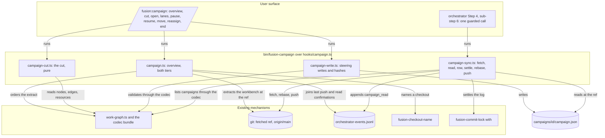
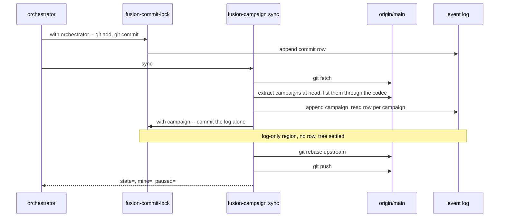
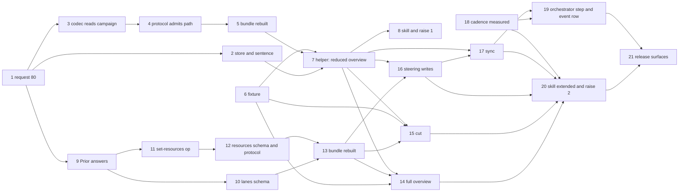

# Implementation Plan: the campaign as the Claude-side frame for work spread over several checkouts

**Date:** 2026-11-08
**Spec:** `261108-2135-spec-campaign-the-frame-for-work-spread-over-several-checkouts.md`, approved at its second review on 2026-11-08 and bound to the package in role `spec`
**Decidability:** The load-bearing question is "which packages will collide when several checkouts work them in parallel", and it is not decidable from anything the mechanism can obtain: a package without a plan has no enumerable file set, and five of the measured case's queued packages had none. The plan therefore builds no predictor. It replaces the question with two that are decidable from inputs the helper reads: *what did each package declare* (the `resources` field, written only from the user's confirmation, step 12) and *which committed path at the fetched ref falls inside another lane's declared area* (a comparison over `git log --name-only`, step 14), and the overview reports the second as a finding after the fact. A third decided question joins them: whether a session has read the current campaign record is read off the file's own `sha256:` revision, which moves with every change, `lanes` included, where `state.revision` does not. A fourth is decided only in part, and the output says where it is not: which commit on the fetched head a `commit` row names. A rebase replaces the hash the row carries, so the join falls back on the subject and the author time, which a rebase keeps, and a row that then names nothing is counted and never guessed (step 7). Three one-sided deviations from Prior are stated rather than approximated, with `docs/campaign.md` as their home (step 20): N lanes for N checkouts against Prior's two-writer bound (ruling C; also in request 80 and the spec's `## Deviation from Prior's two-writer bound`), a pause that reaches a working session only after the commit cycle it interrupted, and a first stored state of `running` with empty `sessions` and `runs`. Which values stand in the two `prior_revision` fields is a build route the user rules, called the build-route decision below: `261109-1238-by-which-build-route-does-the-claude-side-writer-produce-priors-charter-hash-and-state-revision.md`.
**Cross-references:** `261108-1924-campaign-the-frame-for-work-spread-over-several-checkouts.md`, `261108-1927-does-the-claude-side-adopt-the-campaign-as-its-one-frame-for-work-spread-over-several-checkouts.md`, `261105-1156-campaign-as-the-frame-for-work-spread-over-several-checkouts.md`, `261108-2212-review-of-the-campaign-spec.md`, `261108-2301-where-does-the-campaign-record-live-in-the-workbench-layout.md`, `261108-2301-which-value-does-a-claude-side-writer-put-in-a-prior-revision-field.md`, `261109-1238-by-which-build-route-does-the-claude-side-writer-produce-priors-charter-hash-and-state-revision.md`, `261108-2301-how-does-a-working-session-rebase-pull-over-the-log-row-the-lock-just-appended.md`, `foreign:ax-k2-3:261101-1006-three-checkouts-work-the-pipeline-lanes-in-parallel.md`, `foreign:ax-k2-3:261031-1733-pipeline-work-dissected-into-parallel-checkout-lanes.md`, `260927-2319_*_does-the-growth-bound-on-shipped-text-yield-to-the-dual-host-prompt-set.md`, `260909-1808_*_may-a-helper-compute-an-order-over-work-items-after-the-portfolio-layer-goes.md`

## Directive

The spec's `## Directive` is the directive and is not restated. This plan says how its five capabilities are built in the spec's order: the request to Prior (C4) first, the read-only overview (C1) in its reduced tier before Prior answers and in its full tier after, the cut into lanes (C2), the steering acts and the commit-cycle read (C3), with the growth-bound raise and the restated conventions sentence (C5) placed where the steps that need them sit.

## Current State

Measured at `f1996755` plus the uncommitted `set-mode` on the package, 2026-11-08 23:00.

- **At `f1996755` the campaign was a type and nothing else.** `codec/schemas/campaign.schema.json` types `fusion.campaign/v1` with `register` and `formation` nullable and `additionalProperties: false` on the root and the charter. Since steps 3 to 5 the codec reads one, as kind `campaign` and read-only; nothing writes one yet.
- **Every prompt and skill body is render output.** `agents/*.md` and `skills/*/SKILL.md` are concatenations of `catalog/profiles/<id>/parts/NN-{neutral,claude,prior}.md`; a hand edit is overwritten by `cd catalog && npm run render -- claude` and fails `cd catalog && npm test`. A `neutral` part may carry no host token (`bin/`, `$FUSION_PLUGIN_ROOT`, `$OUT_*`, a slash command), so every helper call sits in a `claude` part. A skill's `catalog.json` entry has exactly the keys `id, kind, profile, class, arguments, requires, support`, its `class` one of `asks | dispatches | plain`; an entry `unsupported` on `prior` needs no `prior` parts, and the orchestrator role already stands at `prior: unsupported`.
- **Two surfaces are already at their bounds.** `surface-growth-bound.test.ts`: `agents/` at 14 079 of 18 000 bytes (3 921 left), `skills/` at 39 235 of 39 260 (25 left), the hook tests at 2 650 of 4 835 lines (2 185 left). The dispatch-path bound (`rules-emission-golden.test.ts`, zero head-room) has, per row: orchestrator 3 416 bytes of slack, policy-curator 366, analyst 516, implementation-planner 498, **reviewer 0**. `rules/fusion-workbench-conventions.md` is emitted to all eleven paths, so a byte added there puts the reviewer over unless a byte leaves the same file; `rules/commit-lock.md` reaches the orchestrator alone.
- **The commit cycle has no read point and leaves the tree dirty.** `agents/orchestrator.md` `### Step 4 — commit` commits under the lock and mentions neither fetch, pull nor push (a grep for the three returns nothing). `bin/fusion-commit-lock with` appends the `commit` row to the tracked event log after every landed commit, so the tree is dirty by that file after every commit, and a held region whose only path is the log emits no row, which is how `/fusion:cleanup` settles it ("Then commit the event log alone"). Seven of the last forty commits here are such settling commits.
- **What already reads a fetched ref, and what already computes the order.** `bin/fusion-forum new` fetches, resolves the upstream, lists a store at the fetched ref and reads blobs out of it without touching the working tree; its test drives it over a bare origin and two clones. `hooks/lib/work-graph.ts` `readWorkGraph(workbench)` gates through the codec and returns nodes, edges, readiness and unmet rows; `orderOf` is pure. `hooks/lib/__tests__/helpers/json-workbench.ts` builds a JSON-controlled workbench through the kernel, with `claim(project, pkg, checkout)` taking any checkout identifier. `bin/fusion-checkout-name resolve <hex> --at <commit>` names a checkout out of the registry at a commit.
- **The event log carries what the join needs.** A `commit` row carries `checkout`, `session_id` and `detail` = `<short hash> <subject>`; a `task_start` row carries `work_item`; `.gitattributes` gives the log `merge=union`; `bin/monitor` renders an event kind it does not know through its default branch (`bin/monitor`, `formatEvent`: `<agent or orchestrator>: <detail>`).
- **The measured case is reproducible from one clone.** `/System/Volumes/Data/Projects/productive/F03_digital-leadership/ax-k2-3` stands at `56c19983a`, the HEAD the consultation read. Its live store holds 55 open, 15 paused and 5 claimed packages. What the suite reads of it is the fixture of step 6: five holders, one of them inside a lane, and `261031-1718` `done` while `260814-1228` and `261101-1002`, the two lane-3 packages with an edge on it, stand `open` and unheld.
- **Commit cadence, read once here as a baseline for step 18.** Over the `commit` rows of that clone's event log, grouped by `session_id`, gaps under 24 hours (3 259 gaps in 152 sessions): median 16.7 minutes, p75 51.5, p90 139.9, p95 309.7. Since 2026-11-01 (351 gaps): median 15.6, p90 136.2. The measurement is not yet restricted to autonomous sessions; 49 sessions carry a `gate_response` answered by `mode` autonomous.
- **A `commit` row's hash does not survive a rebase; its subject and author time do.** Measured 2026-11-09, read-only, at `56c19983a`: 301 of 3 825 `commit` rows name no ancestor of the head (83 of the 369 since 2026-11-01, from four checkouts), and 298 of the 301 name no object in the clone. Of the 265 that carry a checkout, 260 have exactly one commit on the head with the row's subject and an author time within 60 seconds of its `ts`, and none has two; applied to the 3 524 rows whose hash is an ancestor, the same test names that commit for 3 135 and another for none, the rest staying unmatched or with two candidates, which is why the hash is read first. The five newest rows of `cb430046` are of this kind: each has one commit on the head under another hash with its subject and its author time to the second, committed again at 16:51 and at 18:42 UTC on 2026-11-03, the second time nine seconds after that session's end row. The ancestor test alone dates that checkout's last push at 10:45 UTC, almost eight hours early; for the other nine checkouts both readings agree. That a pull with rebase made the five is inference, from this signature and from one of their subjects, which speaks of "the rebased hash"; that checkout's reflog was not read. Since 2026-11-01 two pairs of author and committer address stand on the head for eight checkouts with rows, so an identity names no checkout.
- **Where the work stands at `257e50dd`, 2026-11-09.** Steps 1 to 6 and 9 are done; the text each was dispatched with stands in this file at `de34396c`. At `origin/main` of this repository (`eab05b13`) no package reads `claimed`, this package being on branch `campaign` alone. The bundle stands at `sha256:bc0de764…`, Prior's pin at `sha256:b4047458…`. `codec/src/prior` holds `computeCharterHash` and `computePriorRevision`, and nothing shipped runs them. A recorded `inspect` answer lists the implemented operations, so a new operation name moves each one a replay compares.

## Approach

One helper, one skill over it, one new root store, one codec read extension, and the orchestrator's commit step gaining one guarded call. Nothing else is new: the order comes from `work-graph.ts`, the fetched-ref read from `fusion-forum`'s pattern, the settling commit from the lock rule, the registry names from `fusion-checkout-name`, the fixture workbenches from `json-workbench.ts`.



Coherence check. The four subgraphs group and are not nodes. The one node with high fan-out is the skill, which is its role: a dispatcher over sub-commands with no mechanism of its own. There is no cycle: the user surface calls the helper, the helper calls what exists, and nothing calls back. Every edge is a call or a read the steps below build or already have; the prose names each.

**The commit cycle, as the helper runs it** (`261108-2301-how-does-a-working-session-rebase-pull-over-the-log-row-the-lock-just-appended.md`):



The read sits after the commit (the spec's correction) and reads the fetched ref, not the working tree, so no pull precedes it; the pull with rebase follows the settling commit and precedes the push. A tracked path dirty for any reason but the log defers the rebase, the push is still attempted as a fast-forward, and the deferral is reported. A rebase that stops on a conflict is aborted and reported with its paths.

**Order of the work, and where the gates sit.** Steps 1 to 6 and 9 are done. Steps 7, 8, 11 and 18 need no ruling and no approval. Steps 10 and 12 change schema files and stay flagged: request 80 says a schema change that follows from Prior's answer is put to fusion's user before it lands, so under `mode` `autonomous` the orchestrator asks rather than files and skips. Steps 13 and 16 wait on the build-route decision, because each is written per outcome. After step 13 the orchestrator reports the new bundle digest and asks the user whether a re-pin request goes to Prior. Step 18 is the measurement the spec's second stop clause reads, and steps 19 and 20 depend on it.



Coherence check. One node per step; every edge is one entry of a `Dependencies:` line below and every entry is an edge; no cycle, since every edge runs from a lower to a higher number. One edge is new in this revision, from 6 to 7: step 7b's test reads the fixture. Steps 6 and 18 are roots on purpose: the fixture and the measurement depend on nothing in the tree.

## Implementation Steps

1. **Request 80 to Prior: the lane structure, the declared areas, the pause reading and the hashes** (done, `bcb7133d`)
   - Executor: `data-implementer`
   - Files: `codec/fixtures/prior/REQUESTS.md`
   - Built: `## The campaign on the Claude side (request 80)` with four questions, each naming the build it gates and what fusion does on a no: `lanes` on `fusion.campaign/v1`, `resources` on `fusion.package/v1`, the pause reading with `open` writing `running` directly, and the values of the `prior_revision` fields. Its `### Stated and not asked` holds what later steps take from it: the record's path and class, the working rule in `delivery_policy`, the Claude-side values of the other required charter fields (step 16 writes them), the read-only kind `campaign`, the `campaign_read` row, the two-writer deviation, and that nothing a session must obey enters `extensions`.
   - Dependencies: none

2. **The campaign store in the layout, the resolver, the classifier and the tracking rule, with the restated ranking sentence, byte-neutral on the conventions file** (done, `4a81e482`)
   - Executor: `code-implementer`
   - Files: `rules/fusion-workbench-conventions.md`, `rules/workbench-tracking.md`, `rules/workbench-path-resolution.md`, `hooks/lib/stores.ts`, `hooks/lib/staging-drift.ts`, `bin/fusion-stores`, `bin/fusion-paths`, with their tests and goldens (`git show --stat 4a81e482` is the set)
   - Built: `campaigns/<campaign_id>/campaign.json` as the second root entry of the layout tree, with its paragraph; the restated ranking sentence in `## Work packages` (spec C5); `CAMPAIGN_STORE`; the keys `OUT_CAMPAIGN` and `SCAN_CAMPAIGNS`; the classifier's `record` class for a campaign file and the R1 row. Every byte added to the conventions file was paid in the same file, by moving the frozen-stores paragraph to `rules/workbench-tracking.md`.
   - Dependencies: 1

3. **The codec reads a campaign file: kind `campaign` in the store, read-only** (done, `063d33e2`)
   - Executor: `code-implementer`
   - Files: `codec/src/store.ts`, `codec/src/cli/ops.ts`, `codec/src/cli/protocol.ts`, their tests, `codec/README.md`
   - Built: kind `campaign`, read by `list` (`status` is the campaign's `state.state`), `show` and `validate`; a pair whose `narrative` and `report` are null; every mutation on a campaign path refused `unsupported-format/not-a-pair-kind`, the detail naming `bin/fusion-campaign` as the Claude-side writer; `reconcile` reports schema findings only. The two defects it left are closed in step 7a.
   - Dependencies: 1

4. **The protocol admits the campaign path; fixtures for it** (done, `01892937`; was flagged, a schema file changed)
   - Executor: `data-implementer`
   - Files: `codec/schemas/protocol.schema.json`, `codec/fixtures/manifest.json`, and under `codec/fixtures/valid/protocol/` the files `show-campaign.json`, `validate-campaign.json` and `transition-campaign-path.json`
   - Built: the `record_selector` pattern `(^|/)(package|campaign|[^/]+\.record|[^/]+\.evidence)\.json$`, a campaign path being a read-only selector. The transition fixture is listed `valid` at the schema level, its note naming the refusal the operation gives, which is the shape step 10's rule fixtures follow.
   - Dependencies: 3

5. **Rebuild the bundle and round-trip the campaign read through the CLI** (done, `2f4228d1`)
   - Executor: `code-implementer`
   - Files: `codec/dist/fusion-record.js`, `codec/src/__tests__/round-trip-cli.test.ts`
   - Built: the bundle rebuilt; `show`, `validate` and `list` on a campaign file and a refused `transition`, each through `node codec/dist/fusion-record.js`. The rebuild moved the bundle's digest away from Prior's pin; whether a re-pin request follows is asked after step 13.
   - Dependencies: 4

6. **The measured-case fixture: the `ax-k2-3` pipeline store at `56c19983a`** (done, `257e50dd`)
   - Executor: `data-implementer`
   - Files: `hooks/lib/__tests__/fixtures/campaign/ax-k2-3-261105.json`
   - Built: one JSON document, every source read through `git show 56c19983a:<path>` in the clone and named in a sibling `_source` key, which a consumer drops. `packages` has 28 entries told apart by `group`: 23 `pipeline-analysis` (the rows of §3 of `foreign:ax-k2-3:261031-1733-pipeline-work-dissected-into-parallel-checkout-lanes.md`, the held quality measure `foreign:ax-k2-3:260916-1447-be-ein-qualitaetsmass-fuer-die-befuellung` among them), one `lane-amendment` (`foreign:ax-k2-3:261101-1057-s1-runs-as-a-comparison-path-on-the-security-routes-r1-to-r4`, which the amended lane 2 names and §3 does not) and four `held-outside-lanes`. An entry carries its `package.json` state at the commit (`status`, `holder`, `claim_kept`, `outcome_class`), and says in `_source.disagreement` where a foreign record's prose reads otherwise. By the entries' `status`, eight of the 23 are terminal there, seven `done` and one `dropped`, `foreign:ax-k2-3:261031-1718-…` among the `done`. `depends_on` is closed over the file, its condition `terminal`; the seven written edges that leave the file stand in `depends_on_outside_fixture`, so in a workbench built from it `foreign:ax-k2-3:261026-2024-…` waits on nothing. §4's paths are two lists: `areas`, the rows inside the package's own lane, and `shared_areas`, the rows §4 marks cross-lane. `lanes` holds the three lanes of `foreign:ax-k2-3:261101-1006-three-checkouts-work-the-pipeline-lanes-in-parallel.md` as amended on 2026-11-01, with the checkouts `d44c592f`, `f85f8da1` and `95433365`; `checkouts` the ten registry entries; `log` one `commit` row per holder, the newest whose hash stands on the head, which for `95433365` and `cb430046` is a row of 2026-11-03.
   - Acceptance: `f.packages.length`, `f.lanes.length` and the key count of `f.checkouts` read `28 3 10`; every `depends_on` target names a package in the file.
   - Dependencies: none

7. **The helper, read side: `bin/fusion-campaign overview`, reduced tier, in two dispatches**
   - Executor: `code-implementer`, for both parts. The number stays one anchor: it moves to `in_progress` when 7a is dispatched and to `done` when 7b's verification has passed. 7a is small and touches no file 7b writes; 7b is the helper and its test.
   - Dependencies: 2, 5, 6

   **7a. The two defects step 3 left, closed before a campaign file can exist** (step 16 depends on this step)
   - Files: `hooks/lib/record-index.ts`, `hooks/lib/stores.ts` (a comment), `hooks/lib/__tests__/fusion-stores.test.ts`, `hooks/lib/__tests__/helpers/json-workbench.ts`, `hooks/lib/__tests__/record-index.test.ts` (new), `hooks/lib/__tests__/fixtures/surface-growth.golden` (regenerated), the regenerated `hooks/dist/` outputs
   - Changes: (a) `261109-0814-the-hooks-record-index-will-class-a-campaign-row-as-status-unreadable.md`: `readRecordIndex` leaves a `list` row of kind `campaign` out by a stated rule, so it enters no map and no `unreadable` entry; its state is judged by its schema's enum inside the codec, and `codec/contract/transitions.json` gains no entry. `json-workbench.ts` gains `campaignFile(project, id, overrides)`, the one place a hooks test takes a campaign document from, and the new test reads the index over a workbench holding one. (b) `261109-0814-the-control-file-predicate-test-no-longer-sees-what-the-codec-admits.md`: the difference is intended and is now held. The hooks' `isControlFile` names the control half of a pair and a campaign has no narrative, so the test resolves each constant on the codec's predicate line, holds the codec's names equal to the hooks' names plus `CAMPAIGN_RECORD`, and has a sensitivity case with one further name. The executor appends `Resolved:` to both issues before its verifying run.
   - Acceptance: `cd hooks && npm test` green, the sensitivity case included; the index of a workbench holding a valid campaign file carries no `status-unreadable` row.
   - Verification: `cd hooks && npm test` (exit 0), run after both `Resolved:` lines are written.

   **7b. The helper and the reduced overview**
   - Files: `hooks/lib/campaign.ts`, `hooks/campaign.ts`, `bin/fusion-campaign`, `hooks/lib/__tests__/campaign-overview.test.ts`, `README-hooks.md`, `hooks/lib/__tests__/fixtures/surface-growth.golden` (regenerated), `hooks/lib/__tests__/reference-resolution-lint.test.ts` (`BASELINE` re-approved), the regenerated `hooks/dist/` outputs
   - Changes: `bin/fusion-campaign` is a bash wrapper over `hooks/dist/campaign.js` in the shape of `bin/fusion-work-order`, its header the authoritative documentation of every sub-command, the `KEY=value` output, the exit table and the state vocabulary; it reads store names from `bin/fusion-stores` and never names one. `overview [--window <hours>] [--ref <upstream>]`: resolve the workbench (`fusion-workbench-root`), require a work tree, resolve the branch's upstream (as `fusion-forum` does; `--ref` overrides it), `GIT_TERMINAL_PROMPT=0 git fetch <remote>`, resolve `head=`; **extract the tracked workbench at `head` into a scratch directory** under `"$FUSION_PLUGIN_ROOT/bin/fusion-tmp" path` (`git archive <head> -- <workbench rel>/workbench.json <rel>/.fusion-setup <rel>/work-packages <rel>/campaigns <rel>/shared/checkouts <rel>/orchestrator-events.jsonl | tar -x -C <scratch>`, paths that do not exist at the ref omitted from the list first by `git ls-tree`), run `readWorkGraph(<scratch workbench>)` on it, read `list` for the open decisions in each held package's container, read the extracted event log, and remove the scratch directory on every exit path. Output: `state=ok|no-work-tree|no-branch|no-upstream|upstream-unresolved|workbench-untracked|fetch-failed|workbench-outside-repo` with `fusion-forum`'s exit codes; `ref=`, `head=`, `head_time=<RFC 3339>`, `age_minutes=`, `window_hours=` (default 24), `campaigns=0` at this step; one `held=<checkout>\t<alias|->\t<package>\t<last_push RFC 3339|none>\t<waits>` per claimed package, `waits` one of `edge:<target container>` (per unmet or resolved edge the graph reports as blocking), `decision:<basename>` (an `open` decision under the package's `decisions/`) or `none`; `note=` lines for every degradation (no `commit` row carries a checkout, a registry entry unreadable at `head`). The alias comes from `bin/fusion-checkout-name resolve <hex> --at <head>`, `-` on exit 3. **`last_push`, and the join it rests on.** One exported function says which commit on `head` a `commit` row names, from one listing `git log --format=%H%x09%at%x09%ct%x09%s <head>`, and step 14 reuses it to attribute commits. Three cases, in this order: (1) the commit whose hash the row's short hash abbreviates, when the listing holds it; (2) else the one commit in the listing that carries the row's subject (its `detail` after the hash) and an author time within 60 seconds of the row's `ts`, which is what a rebase made of the row's commit, since a rebase keeps subject and author time and replaces the hash; (3) else none, two candidates under (2) included. `last_push` is the newest committer time among the commits a checkout's rows name, `none` where they name none. For each checkout with a `held=` row, its rows that name no commit and are newer than the row `last_push` came from are counted in `note=commit-rows-unmatched\t<checkout>\t<count>\t<newest such ts>`, so an under-report is never silent. The header says what the figure is: a lower bound on the push, and, because a row reaches the ref only with the commit that carries the log, one that can trail by a commit outside the cycle of step 17. Not taken, on the measurement in `## Current State`: the ancestor test alone with a note (it shows a working checkout as idle and merely says so); the committer or author identity (one person's checkouts share it); the workbench paths a commit touches (each commit's diff would be read, and a commit touching none stays unattributed). `README-hooks.md` gains the bin-roster row, the `hooks/lib` table row for `lib/campaign.ts` and a `## Files` row for `campaign.ts` (the lint in `derivable-enumerations-lint.test.ts` holds both tables closed). Tests in the `fusion-forum.test.ts` shape: a bare origin, a pushing clone whose workbench is built through `json-workbench.ts` with claims by two checkouts, a reading clone; cases for `state=ok` with two `held=` rows, `workbench-untracked`, `no-upstream`, and a dirty reading tree left untouched (`git status --porcelain` before and after equal). **The measured case, reduced tier.** One test reads step 6's fixture, creates its five claimed packages, each claimed by its `holder`, and makes for each of the five `log` rows one commit with the row's subject and the row's `ts` as author and committer date, appending the row with that commit's short hash in place of the foreign one. For `cb430046` it then makes three later commits and appends their rows, and before the push rewrites all three with a later committer date (a forced rebase), the third under another subject, so that the origin holds none of the three hashes: the state the fixture's `_source.note` records for that checkout's five newest rows, plus one row no rule can match. The executor appends `Resolved:` to `261109-1313-a-commit-row-names-a-hash-a-later-rebase-removes-so-last-push-by-ancestor-test-under-reports.md` before its verifying run.
   - Acceptance: `cd hooks && npm test` green. In the measured-case test the output carries five `held=` rows, one per holder; for `0838bf45`, `95433365`, `d44c592f` and `f85f8da1` `last_push` is the time of the commit made for the fixture row; for `cb430046` it is the committer time of the second rewritten commit, later than that of its fixture row's commit; one line `note=commit-rows-unmatched\tcb430046\t1\t<the third row's ts>` stands in the output and no such line names another checkout. In this repository `bin/fusion-campaign overview --ref origin/main` (the work tree's copy; the installed one has none before the release) prints `state=ok`, `ref=origin/main`, `campaigns=0` and one `held=` row per package that reads `claimed` at the `head=` it prints, which is none at `eab05b13`, where `origin/main` stood on 2026-11-09 (this package was filed on branch `campaign` and is not on that ref); `git status --porcelain` is identical before and after the run. A bare `overview` on branch `campaign`, which has no upstream, answers `state=no-upstream`, exit 5, and that case stays in the tests.
   - Verification: `cd hooks && npm test` (exit 0), run after the `Resolved:` line is written, and `bin/fusion-campaign overview --ref origin/main; echo exit=$?` (exit 0 and `state=ok`; where the executor's shell cannot reach the remote, `state=fetch-failed` with its exit code is reported as such and is no stop, the suite holding `state=ok` over a local origin).

8. **The skill `/fusion:campaign` with the overview, and the first head-room raise**
   - Executor: `code-implementer`
   - Files: `catalog/catalog.json`, `catalog/profiles/skill-campaign/profile.json`, `catalog/profiles/skill-campaign/parts/*.md`, `skills/campaign/SKILL.md` (render output), `README-agents.md`, `catalog/README.md`, `hooks/lib/__tests__/surface-growth-bound.test.ts`, `hooks/lib/__tests__/fixtures/surface-growth.golden`, `README-hooks.md`, `hooks/lib/__tests__/reference-resolution-lint.test.ts` (`BASELINE` re-approved)
   - Changes: a `catalog.json` entry `{id:"campaign", kind:"skill", profile:"skill-campaign", class:"asks", arguments:{items:[{name:"subcommand", kind:"positional", required:false, values:["overview","cut","open","lanes","pause","resume","move","reassign","end"], note:"overview when absent"}, {name:"--window", kind:"option", required:false, note:"<hours>, overview only, default 24"}]}, requires:["host.exec.v1","host.question.v1"], support:{"claude-code":"supported","prior":"unsupported"}}`; a profile with `claude` and `neutral` parts (frontmatter `allowed-tools: [Bash, Read, AskUserQuestion]`, `argument-hint`), in the shape of `skills/news/SKILL.md`: Step 0 resolves `"$FUSION_PLUGIN_ROOT/bin/fusion-workbench-root"` and `"$FUSION_PLUGIN_ROOT/bin/fusion-paths" campaign` and holds `$SCAN_CAMPAIGNS` and `$OUT_CAMPAIGN`; Step 1 the `[ -x ]` guard on `bin/fusion-campaign` with the `fusion --update` sentence; Step 2 runs `overview` with the user's `--window` passed through; Step 3 renders each `KEY=value` row in the user's terms and the chat language, per `rules/user-facing-output.md`: the first lines name the ref, the commit and its age in words, then one sentence per `held=` row, then `campaigns=0` as "no campaign is running", the window named in every sentence that depends on it; the other sub-commands are listed in the body as arriving with step 20 and refused with one sentence until then. Render with `cd catalog && npm run render -- claude`. `README-agents.md`: the table row and `/fusion:campaign` in the roster sentence that "asserts the match in the other direction too"; `catalog/README.md` `## Editing a converted prompt`: the file in the list. **The raise**: measure `skills/campaign/SKILL.md` with `wc -c`; set `SKILL_HEAD_ROOM` to `39 260 + (<that size> − 25)`; log it under `README-hooks.md` `#### The head-room raises, and the reduction read on 2026-10-10` as the thirty-first raise with the date, the constant, the figure before and after, the authority (the user's words of 2026-11-08 as the spec's `### C5` records them) and the reduction read dated at this package's closure; regenerate `surface-growth.golden` and re-run without the flag; move no baseline.
   - Acceptance: `cd catalog && npm test` green; `cd hooks && npm test` green; `git diff --exit-code agents/ skills/` is 0 after a fresh render; `grep -c '/fusion:campaign' README-agents.md` is at least 2; the raise entry names before and after figures that differ by exactly the measured remainder.
   - Verification: `cd catalog && npm run render -- claude && npm test && cd ../hooks && npm test` (exit 0).
   - Dependencies: 7

9. **Prior's answer to request 80, recorded** (done, `04d6e051`)
   - Executor: `data-implementer`
   - Files: `codec/fixtures/prior/REQUESTS.md`
   - Built: `### Prior's answer to 80 at 557011a`, one verdict per question, all five points corrected; steps 10 to 13 and 16 carry the corrections.
   - Dependencies: 1

10. **`lanes` on `fusion.campaign/v1`, in the form Prior's answer to question 1 corrected**
    - Executor: `data-implementer`
    - Files: `codec/schemas/campaign.schema.json`, `codec/fixtures/manifest.json`; new under `codec/fixtures/valid/campaign/`: `with-lanes.json`, `lanes-rule-package-in-two-lanes.json`, `lanes-rule-duplicate-lane-id.json`, `lanes-rule-checkout-in-two-lanes.json`; new under `codec/fixtures/invalid/campaign/`: `lanes-missing.json`, `lanes-empty.json`, `lanes-duplicate-member.json`, `lanes-member-not-record-ref.json`, `lanes-lane-with-revision.json`; every existing file in those two directories (`ls` is the set)
    - Changes: `lanes` becomes a required root key, `null` or an array of at least one lane. A lane is `{id, checkout_id, members}`, `additionalProperties: false`: `id` a non-empty string, `checkout_id` the common `checkout_id` or null, `members` a `uniqueItems` array of `record_ref` in the order the lane is worked. **Decided here, each left to fusion by Prior:** a lane has no `revision` member (nothing reads one: the read confirmation names the file's revision, step 17), and `[]` is refused by `minItems: 1`, so "no lanes" has the one spelling `null`; a lane's `members` may be empty. The description gains, as the package schema's does for `depends_on`: the three rules JSON Schema cannot check and that the codec's `validate` reports each (a package is named once in a lane and in one lane only, by `record_id`; a lane's `id` is distinct within the campaign; a non-null `checkout_id` stands in one lane only); that `[]` is not admitted beside `null`; that a lane's `checkout_id` is an assignment and never a host lease; that `lanes` has no Prior aggregate and no row in `codec/contract/prior-mapping.json`. The literal `campaigns/<id>/campaign.json` stays in the description (`hooks/lib/__tests__/fusion-stores.test.ts` reads it). **Fixtures.** Every existing campaign fixture gains `"lanes": null`, the invalid ones included, so each stays invalid for its own cause; none is restamped (the build-route decision, `## The four valid fixtures`). `with-lanes.json` is the specimen of a Claude-written campaign: `running`, `reason` null, empty `sessions` and `runs`, `register` and `formation` null, two lanes, one with `checkout_id` null, and the two hash values computed by `computeCharterHash` and `computePriorRevision` over its own export, from a scratch bundle outside the tree as that decision's `## Measured at 04d6e051` describes; the executor reports the command and both values. The three `lanes-rule-*` files pass the schema and break one rule each, listed as step 4 listed `transition-campaign-path.json`: `valid` at the schema level, the note naming the finding. Each invalid file breaks the schema as its name says. The mapping table, the recorded sessions and every existing manifest row stay as they are.
    - **Flagged: requires approval** (a schema definition changes; request 80 says a schema change that follows from Prior's answer is put to fusion's user before it lands).
    - Acceptance: `cd codec && npx vitest run src/__tests__/fixtures.test.ts` exits 0 with the new rows validated as named, which also answers by a run whether `running` with empty `sessions` and `runs` passes the schema; `grep -L '"lanes"' codec/fixtures/valid/campaign/*.json codec/fixtures/invalid/campaign/*.json` prints `lanes-missing.json` alone; `grep -c 'never a host lease' codec/schemas/campaign.schema.json` is 1. `committed-bundle.test.ts` is the expected red from this step's commit until step 13; any other red is a stop.
    - Verification: `cd codec && npx vitest run src/__tests__/fixtures.test.ts` (exit 0; not `npm test`, which rebuilds the bundle step 13 owns).
    - Dependencies: 9

11. **The `set-resources` operation in the codec and in `bin/fusion-write`**
    - Executor: `code-implementer`
    - Files: `codec/src/cli/ops.ts`, `codec/src/cli/protocol.ts`, `codec/src/__tests__/ops.test.ts`, `hooks/lib/record-write.ts`, `hooks/write.ts`, `bin/fusion-write`, `hooks/lib/__tests__/record-write.test.ts`, `hooks/lib/__tests__/fixtures/surface-growth.golden` (regenerated), `hooks/lib/__tests__/reference-resolution-lint.test.ts` (`BASELINE` re-approved where the counts move), the regenerated `hooks/dist/` outputs (`write.js`, `lib/record-write.js`)
    - Changes: `setResourcesPlan` beside `setDependenciesPlan`: replaces the package's `resources` list whole (as `set-dependencies` replaces `depends_on`); `--clear` writes `[]`, declared and empty, and no call removes the key. The plan function refuses a non-package record and a repeated entry (`schema-invalid/duplicate-entry`). **The path grammar has one home, the schema's pattern of step 12:** the kernel validates every record it writes against its schema (`codec/src/kernel.ts`), so `set-resources` refuses exactly what the pattern refuses, and `bin/fusion-write` passes an entry verbatim, a trailing slash refused and never stripped. `fusion-write set-resources --path <path> (repeatable) | --clear`, `--actor`, its `record_change` row carrying `change: {resources: <count>}`; the header and the `PAYLOAD_FIELDS` table updated. The header carries Prior's two notes as consequences: the operation is absent from Prior's host, and a codec older than this one refuses a package carrying `resources` as an unknown key, Prior's host at its current pin included, so areas are declared only once every reader of the workbench runs this codec. `IMPLEMENTED_OPERATIONS` gains the name, which moves the `inspect` answer; step 13 regenerates the recorded sessions a replay compares. Tests drive the plan function directly, since the protocol schema refuses the request until step 12 and the package schema the result; the pattern's cases run in step 13.
    - Acceptance: `cd codec && npx vitest run` green except the protocol fixtures and a recorded session's `inspect` comparison (expected red until steps 12 and 13), and `committed-bundle.test.ts` from this step's commit; `cd hooks && npm test` green except `record-write.test.ts`'s protocol-shape case where it reads the schema (expected red until step 12). The executor names each red file, and a red outside these is a stop.
    - Verification: `cd codec && npx vitest run src/__tests__/ops.test.ts` (exit 0).
    - Dependencies: 9

12. **`resources` on `fusion.package/v1` and the `set-resources` protocol branch, in the form Prior's answer to question 2 corrected**
    - Executor: `data-implementer`
    - Files: `codec/schemas/package.schema.json`, `codec/schemas/protocol.schema.json`, `codec/fixtures/manifest.json`; new: `codec/fixtures/valid/package/with-resources.json` and `resources-empty.json`; under `codec/fixtures/invalid/package/`, `resources-duplicate.json`, `resources-absolute.json`, `resources-parent-segment.json`, `resources-dot-segment.json`, `resources-backslash.json`, `resources-empty-segment.json`, `resources-trailing-slash.json`; `codec/fixtures/valid/protocol/set-resources.json`, `codec/fixtures/invalid/protocol/set-resources-trailing-slash.json`
    - Changes: `resources` is the schema's one optional key: absent means undeclared, `[]` declared and empty. It is a `uniqueItems` array of `$defs/resource_path`, a path relative to the project root with **one spelling per file or directory, decided here: no trailing slash.** The pattern, as regular-expression source: `^(?![A-Za-z]:)(?!\.{1,2}(/|$))(?!.*/\.{1,2}(/|$))[^/\\]+(/[^/\\]+)*$` (measured with `node`: it refuses `/abs/x`, `../x`, `a\b`, `./a`, `a//b` and `a/b/`, and admits `a/b`). Request 80's example wrote a trailing slash; it is not taken, because an entry may name a file (`codebase/go/pkg/api/plan_handlers.go` in the measured case), and a slash-terminated directory beside a slash-free file gives one area two spellings again. An entry covers the path itself and everything under it. The description says: the user's confirmation is the only source and `set-resources` the only writer; the Claude-side cut reads two areas as overlapping when they are equal or one is a prefix of the other at a `/` boundary, while Prior's `overlap` is true only for an equal string in both lists; no row of `codec/contract/prior-mapping.json` maps the member onto `packages.Candidate.Resources`. "Every key is required" becomes "Every key but `resources` is required". The protocol gains the `set-resources` branch (`op`, `workbench`, `operation_id`, `record`, `expected_revision`, `actor`, `resources`, its items a `$ref` to `resource_path`) and the name in the `op` enum. No `required_features` entry accompanies the key (`## Open Questions`). Existing package fixtures and the package records of the recorded sessions hold no `resources` and stay as they are.
    - **Flagged: requires approval** (two schema files change; the reason of step 10).
    - Acceptance: `cd codec && npx vitest run` green except a recorded session's `inspect` comparison and, from this step's commit, `committed-bundle.test.ts` (both until step 13); every existing valid package fixture still validates and each new invalid one is refused.
    - Verification: `cd codec && npx vitest run src/__tests__/fixtures.test.ts src/__tests__/protocol.test.ts` (exit 0).
    - Dependencies: 11

13. **The codec's three lane rules; the bundle rebuilt after the schema steps; round trips for `lanes` and `set-resources`**
    - Executor: `code-implementer`
    - Files: `codec/src/cli/ops.ts`, `codec/src/__tests__/ops.test.ts`, `codec/src/__tests__/prior-mapping.test.ts`, `codec/src/__tests__/round-trip-cli.test.ts`, `codec/dist/fusion-record.js`, `codec/README.md`, `hooks/lib/__tests__/helpers/json-workbench.ts`, the recorded sessions under `codec/fixtures/protocol-session*/` whose replay turns red on the `inspect` answer (regenerated with each session's own `UPDATE_PROTOCOL_SESSION*` variable), `hooks/lib/__tests__/reference-resolution-lint.test.ts` (`BASELINE` re-approved where the README moves its counts)
    - **Waits on the build-route decision**, for (e) alone.
    - Changes: (a) `findingsOf` gains, for a campaign whose schema passed, one function over `lanes` reporting `schema-invalid/duplicate-lane-member` (a `record_id` named twice, within a lane or across lanes), `duplicate-lane-id` and `duplicate-lane-checkout` (a non-null `checkout_id` in two lanes). `validate`, `list` and `reconcile` carry the findings, so both hosts get one check. `ops.test.ts` drives `validate` over the three `lanes-rule-*` fixtures of step 10 (one finding each) and over `with-lanes.json` (none). (b) `prior-mapping.test.ts` holds `with-lanes.json`'s two hash values equal to the tree's own functions over its export. (c) `campaignFile` in `json-workbench.ts` writes `lanes`, null by default, in the commit that carries the bundle requiring it. (d) `cd codec && npm run build`; round trips through the CLI: `validate` on `with-lanes.json` placed under `campaigns/` and on one rule fixture, `set-resources` on a kernel-written package with `show` reading the list back, and `set-resources` refused as `schema-invalid` for each of `/abs/x`, `../x`, `a\b`, `./a`, `a//b` and `a/b/`. (e) Per the ruling: under option 1, `show` returns for kind `campaign` a member `prior` holding `charter_hash` and `revision` computed from the stored charter and state (`ops.ts` imports `codec/src/prior/campaign.ts`), with a case in `ops.test.ts` and a round trip; under option 2, a second entry in `codec/scripts/build.mjs`, `committed-bundle.test.ts` comparing both files and `install.sh` checking both, those three files joining this step; under option 4, nothing; under option 3 this plan is revised before the step runs. (f) The executor appends `Resolved:` to `261109-1100-request-80s-lanes-form-types-a-lane-revision-as-a-prior-hash-and-states-no-uniqueness-rule.md` and `261109-1100-request-80s-resources-form-admits-any-non-empty-string-so-one-area-has-several-spellings.md` and reports `shasum -a 256 codec/dist/fusion-record.js`. **The orchestrator then asks the user whether a re-pin request goes to Prior**, with that digest and the list under `## API Changes`; writing the request is a dispatch of its own and no step here.
    - Acceptance: `cd codec && npm test` green, `committed-bundle.test.ts` included; `cd hooks && npm test` green; `echo '{"op":"set-resources",…}' | bin/fusion-record` lands and `show` returns the list.
    - Verification: `cd codec && npm test && cd ../hooks && npm test` (exit 0), run after the two `Resolved:` lines are written.
    - Dependencies: 10, 12

14. **The overview's full tier: lanes, the seven conditions, cross-lane detection, read confirmations; the measured case as a test**
    - Executor: `code-implementer`
    - Files: `hooks/lib/campaign.ts`, `hooks/lib/__tests__/campaign-overview.test.ts`, `bin/fusion-campaign` (header), `hooks/lib/__tests__/fixtures/surface-growth.golden` (regenerated), `hooks/lib/__tests__/reference-resolution-lint.test.ts` (`BASELINE` re-approved where the counts move), the regenerated `hooks/dist/` outputs
    - Changes: with a campaign at the ref (`campaigns/*/campaign.json` in the extract, read through the codec's `list`), `campaigns=<n>` and one `campaign=<id>\t<state>\t<reason|->\t<lanes>` row each, or `campaign-unreadable=<id>\t<class>/<reason>` for a row carrying a finding, which is evaluated no further; per lane `lane=<campaign>\t<lane id>\t<checkout>\t<alias|->\t<held|none>\t<next|none>\t<next waits>`, `next` the first member in lane order that is live and unheld; the seven condition rows, each printed only when true: `silent=<campaign>\t<lane>\t<checkout>\t<last push|none>` (no held package and no push within `window_hours`), `out-of-lane=<checkout>\t<package>\t<package's lane>\t<holder's lane>`, `in-no-lane=<checkout>\t<package>`, `waits-decision=<campaign>\t<lane>\t<next>\t<decision basename>`, `handoff-possible=<from>\t<to>\t<from lane>\t<to lane>` (an edge whose source is terminal, whose target is live and unheld, and whose ends sit in different lanes), `cross-lane=<hash>\t<path>\t<committer lane>\t<declaring lane>` (over `git log --format=%h --name-only <first commit adding the campaign file>..<head>`, each commit attributed to a checkout by step 7's join over the extracted log's `commit` rows, by hash or, where a rebase replaced the hash, by subject and author time, each path matched against every lane's union of its members' `resources` by path-prefix at a `/` boundary; a path inside another lane's union and outside the committer lane's own is a row; an unattributed commit is a `note=`), `unconfirmed=<campaign>\t<lane>\t<checkout>\t<revision>\t<last confirmation|none>` (no `campaign_read` row by that checkout naming the `sha256:` revision `list` returns for the campaign file at `head`). The test builds the fixture of step 6 into a JSON workbench through `json-workbench.ts` (all 28 packages created, the `depends_on` edges set, each entry brought to its `status` by its `holder` or `claim_kept` checkout, `areas` written as `resources` and `shared_areas` nowhere, the campaign file written with the three lanes, the log rows appended with hashes of commits the test makes), pushes it to a bare origin and runs `overview` from a reading clone.
    - Acceptance: over the fixture at the states of `56c19983a` the output carries exactly four `in-no-lane=` rows (`0838bf45`, `cb430046`, `d44c592f`, `f85f8da1`, each with the `held-outside-lanes` package it holds) and exactly two `handoff-possible=` rows (`foreign:ax-k2-3:261031-1718-…` to `foreign:ax-k2-3:260814-1228-…`, lane 1 to lane 3; `foreign:ax-k2-3:261031-1718-…` to `foreign:ax-k2-3:261101-1002-…`, lane 1 to lane 3). The row is per edge: the second target still waits on its edge to the held `foreign:ax-k2-3:260916-1447-be-ein-qualitaetsmass-fuer-die-befuellung`. No `out-of-lane=` row for `95433365`, which holds a member of its own lane. A commit by lane 2's checkout under `codebase/go/pkg/ai`, rebased before the push, prints one `cross-lane=` row naming lane 3, and one touching `api/openapi.yaml`, a shared area no package declares, prints none. In a workbench of its own, whose one lane's checkout holds nothing and last pushed two hours before the run, `--window 1` prints a `silent=` row and the default prints none. `cd hooks && npm test` green.
    - Verification: `cd hooks && npx vitest run lib/__tests__/campaign-overview.test.ts` (exit 0) and `cd hooks && npm test` (exit 0).
    - Dependencies: 6, 7, 13

15. **The cut: `bin/fusion-campaign cut --checkouts N`**
    - Executor: `code-implementer`
    - Files: `hooks/lib/campaign-cut.ts`, `hooks/lib/campaign.ts`, `hooks/lib/__tests__/campaign-cut.test.ts`, `bin/fusion-campaign` (header), `README-hooks.md` (the `lib/campaign-cut.ts` row), `hooks/lib/__tests__/fixtures/surface-growth.golden` (regenerated), `hooks/lib/__tests__/reference-resolution-lint.test.ts` (`BASELINE` re-approved), the regenerated `hooks/dist/` outputs
    - Changes: `cut --checkouts <N> [--tolerance <k>]` refuses to run without `--checkouts` (exit 1); reads the local workbench through `readWorkGraph` (the steering checkout plans on its own pulled tree) and each live package's `resources` through `list`, the one list the cut reads; a terminal package is no node, so an edge on one is no hand-off. `campaign-cut.ts` is pure: (a) union-find over packages whose declared areas overlap (equal, or one a prefix of the other at a `/` boundary) into groups; (b) groups ordered by dependency depth descending, then size descending, then name; (c) each group placed on the lane with the fewest members, preferring a lane that already holds an edge neighbour when that lane stays within tolerance; tolerance `k` = the largest admitted difference between a lane's size and `ceil(members / N)`, default 1; a group that fits nowhere within tolerance is placed on the smallest lane anyway and reported `imbalance=<lane>\t<size>\t<group members>`; (d) lane order = `orderOf`'s global order filtered to the lane's members; (e) `handoff=<from>\t<to>\t<from lane>\t<to lane>` for every edge across lanes; (f) `no-areas=<package>` per package with no declared areas and `no-areas-count=`; (g) the same computation at N+1 and N−1, printed as `delta-plus=` and `delta-minus=` rows naming the packages that move and the hand-offs that appear or disappear; (h) `lane=<n>\t<package>` rows in order, and `proposal=<path>` naming a JSON file the helper writes under `"$FUSION_PLUGIN_ROOT/bin/fusion-tmp" path` holding the whole proposal for step 16's `lanes --from`, which obeys the three lane rules of step 10 by construction. No size figure enters anywhere. Deterministic: two runs over one store print the same bytes. **A file several lanes touch.** A real `package.json` has the one list, and it corresponds to the fixture's `areas`: the paths a package's work keeps to itself. The fixture's `shared_areas` have no counterpart in the record format and are written nowhere. Declared all the same, such a file joins every group that names it, because overlap is never split (spec C2); the cut then prints `imbalance=` with the members, and the user accepts it, takes the file out of `resources` or changes N. Left out, the file is seen by neither the cut nor the overview's `cross-lane=` row. `## Open Questions` names this as a gap in C2; nothing here closes it.
    - Acceptance: three cases over step 6's fixture, each a workbench of its 23 `pipeline-analysis` entries with their `depends_on` edges; the figures come from a simulation of rules (a) to (e) run on 2026-11-09, no cut existing yet, so a helper that follows the rules and misses one is reported and the figure is not bent. (1) Every entry live and none transitioned, `areas` as `resources`. That is how the lane analysis read them on 2026-10-31: each of the eight entries terminal at `56c19983a` says so in its `_source.disagreement`. `cut --checkouts 3` puts every package with an area under `codebase/go/pkg/process` in one lane, those under `codebase/go/pkg/strategy` or `codebase/go/pkg/catalog` in a second and those under `codebase/go/pkg/ai` in a third; the `handoff=` rows include the route edge, `foreign:ax-k2-3:261031-1718-…` to `foreign:ax-k2-3:261101-1002-…`; `foreign:ax-k2-3:260814-1228-…`, which has no `areas`, is printed `no-areas=` and stands in the lane of `foreign:ax-k2-3:261031-1718-…`, its one edge, so the project-header edge is no `handoff=` row. (2) The states of `56c19983a`, 15 entries live: no `handoff=` row names `foreign:ax-k2-3:261031-1718-…`, which is `done`; the strategy and catalog group shares its lane with no package under `codebase/go/pkg/ai`; one `imbalance=` row names that group, seven members against a bound of six. (3) Case 1 with `shared_areas` added to `resources`: 21 of the 23 form one group and one `imbalance=` row names it. Two packages with overlapping areas never land in different lanes in any case of the test; `cut` without `--checkouts` exits 1 with nothing on stdout; `cd hooks && npm test` green.
    - Verification: `cd hooks && npx vitest run lib/__tests__/campaign-cut.test.ts` (exit 0) and `cd hooks && npm test` (exit 0).
    - Dependencies: 6, 7, 13

16. **The steering writes: `open`, `lanes`, `pause`, `resume`, `move`, `reassign`, `end`, and the two Prior hash values**
    - Executor: `code-implementer`
    - Files: `hooks/lib/campaign-write.ts`, `hooks/lib/campaign.ts`, `hooks/lib/__tests__/campaign-write.test.ts`, `bin/fusion-campaign` (header), `README-hooks.md` (the `lib/campaign-write.ts` row), `hooks/lib/__tests__/fixtures/surface-growth.golden` (regenerated), `hooks/lib/__tests__/reference-resolution-lint.test.ts` (`BASELINE` re-approved), the regenerated `hooks/dist/` outputs
    - **Waits on the build-route decision.** One function, `priorRevisions(candidate)`, returns `state.charter_hash` and `state.revision` and is the only place that knows their source; every caller below is the same under each outcome. Option 1: it places the candidate in a scratch workbench and reads the `prior` member of the codec's `show` (step 13). Option 2: it calls the second bundle. Option 4: it implements the interim rule of `261108-2301-which-value-does-a-claude-side-writer-put-in-a-prior-revision-field.md`, and `docs/campaign.md` states the deviation (step 20). Option 3: this step is planned again. Under options 1 and 2 the values are Prior's `charterHash` and `stateRevision`, the charter's label in the hashed bytes without its `prior-opaque:` prefix.
    - Changes: every write first runs `bin/fusion-claimed-package`; a `PACKAGE=` line is exit 5 with the sentence that a steering act runs only from a checkout holding no claimed package (spec C3, first criterion). `open --id <YYMMDD-HHMM-slug> --objective <text> --authorisation <citation> [--stop <text>]...` writes `campaigns/<id>/campaign.json` with the charter values step 1 states, `delivery_policy` the working rule, `charter.revision` `prior-opaque:r1`, `state.state: "running"` with `reason` null and empty `sessions` and `runs` (the first stored state Prior's lifecycle cannot produce, a stated deviation), counters and settlement at zero, and `register`, `formation`, `lanes`, `baseline_hash`, `completion_evidence` null; `lanes --from <proposal file>` writes the lanes from a `cut` proposal (members as `record_ref`, each lane's `checkout_id` from `--assign <lane>=<hex>` or null); `pause --reason <text>` writes `paused` and the reason; `resume` writes `running` and `state.reason` null (Prior's correction to 3(a)); `move <package> --to <lane>` and `reassign <lane> --checkout <hex>` edit the lanes; `end --outcome completed|bounded|failed|cancelled [--reason]` writes the terminal state (and `completion_evidence`, `completed` alone: its four booleans `objective_met`, `intake_closed`, `all_attempts_terminal`, `final_audit_passed` as the user states them, `watermark` and `audit_ref` null unless given). `state.revision` is recomputed on every write that changes `state`; a write that changes `lanes` alone leaves both hash values as they are, and the file's own revision moves. A lane write that would break one of the three rules of step 10 is refused with the codec's finding and writes nothing. Every write validates its candidate through the codec's `validate` in a scratch workbench under `"$FUSION_PLUGIN_ROOT/bin/fusion-tmp" path` (a copy of `workbench.json` and the candidate at its own relative path, since the codec selects a campaign by that path), then writes it beside the target and renames it into place, prints `path=` and `revision=` (the file's `sha256:`), and is committed by the steering session through the ordinary commit step, never by the helper. Tests build a workbench, run each write and read it back through `show`, and assert the no-claim refusal, the refusal of a package placed in two lanes, `resume` leaving `reason` null, and that every written file validates. The executor appends `Resolved:` to `261109-1100-request-80-says-fusion-cannot-reproduce-priors-hashes-and-its-own-source-tree-does.md`.
    - Acceptance: in a scratch workbench with no claim, `open` then `validate` through `bin/fusion-record` answers `"valid":true`; with a claim held by the running checkout every write exits 5 and writes nothing; `cd hooks && npm test` green.
    - Verification: `cd hooks && npx vitest run lib/__tests__/campaign-write.test.ts` (exit 0) and `cd hooks && npm test` (exit 0), run after the `Resolved:` line is written.
    - Dependencies: 7, 13

17. **The commit-cycle read: `bin/fusion-campaign sync`**
    - Executor: `code-implementer`
    - Files: `hooks/lib/campaign-sync.ts`, `hooks/lib/campaign.ts`, `hooks/lib/__tests__/campaign-sync.test.ts`, `hooks/lib/__tests__/monitor-warnings-panel.test.ts`, `bin/fusion-campaign` (header), `README-hooks.md` (the `lib/campaign-sync.ts` row), `hooks/lib/__tests__/fixtures/surface-growth.golden` (regenerated), `hooks/lib/__tests__/reference-resolution-lint.test.ts` (`BASELINE` re-approved), the regenerated `hooks/dist/` outputs
    - Changes: `sync` runs, in this order and with no `stash`, `--autostash`, `checkout .`, `reset --hard` or `clean`: (1) resolve branch and upstream as `overview` does; (2) `git fetch`; (3) extract `workbench.json` and `campaigns/` at the fetched head with step 7's function and read them through the codec's `list`, so a campaign arrives with the codec's findings and no second parser reads one; print `campaign=<id>\t<state>\t<revision>\t<reason|->` per campaign, `revision` the file's `sha256:` as `list` returns it, and `campaign-unreadable=<id>\t<class>/<reason>` for a row carrying a finding, which is never `mine` and gets no row in (5); (4) determine `mine=<id>|none`: the campaign one of whose lanes names this checkout's identifier (`bin/fusion-identity`); else the one `running` or `paused` campaign at the ref whose `lanes` is null (two such: none, and a `note=`); else none; (5) append one `campaign_read` row per campaign read: `{"ts","event":"campaign_read","person","checkout","session_id","campaign":<id>,"state":<state>,"revision":"<the file's sha256: revision>","detail":"<id> <state> <first 12 hex of it>"}`, identity env-first then `bin/fusion-identity`, `session_id` from `FUSION_SESSION_ID`, an unresolved value an absent key, written only while `FUSION_SESSION_ID` is set (the `commit` row's own rule); (6) if `git diff --name-only` plus `git diff --cached --name-only` name the event log alone, commit it under `"$FUSION_PLUGIN_ROOT/bin/fusion-commit-lock" with campaign -- bash -c 'git add <abs log> && git commit -F <message file under fusion-tmp path>'` with the message `chore(events): the commit and campaign-read rows of checkout <hex>` (it names no hash, since (7) may replace any) and print `settled=yes`; if other tracked paths are dirty, print `deferred=<path>` per path, skip the rebase, and still attempt the push; (7) `git rebase <upstream>`; on a stop, `git rebase --abort`, print `conflict=<path>` per conflicting path, `state=conflict`, exit 7; (8) `git push`; on rejection print `state=rejected` with git's stderr passed through, exit 8; (9) `paused=<id>\t<reason>` when `mine` is `paused`, which the orchestrator reads as: dispatch nothing more, report the reason, keep the claim (the cycle's push has happened by then, the deviation step 20 states). Exit 0 covers pushed and nothing-to-push; `state=` names every other case. **What the lock's `commit` row is worth after (7).** Where the upstream had moved, the rebase replaces the hash the row carries, and (6) has already committed the row. The remote then holds the row's `checkout`, `ts` and subject beside a hash no other clone can resolve, and those three are what step 7's join reads. `sync` writes no row after the push: it would reach the remote one cycle late, with the next push. A row naming the rebased hash before the push would cost a second settling commit per cycle, because `261108-2301-how-does-a-working-session-rebase-pull-over-the-log-row-the-lock-just-appended.md` settles the log before the rebase so that the rebase finds it clean, and a rejected push followed by a second rebase would leave that row stale again. One monitor case: a log carrying a `campaign_read` row is served and the row is rendered through the default branch (`orchestrator: <detail>`), the panel not failing. Tests drive the real script over a bare origin and two clones: a cycle with a second clone's push in between (rebase succeeds, union merge on the log, push lands, the `campaign_read` row is on origin; the pushing checkout holds a package, and `overview` from the second clone then reads its `last_push` off the rebased commit), a conflict (aborted, exit 7, tree as before), a dirty tracked file (deferred, push as fast-forward), `paused` read and reported, and a campaign with a lane rule broken at the ref printed unreadable and pausing nobody.
    - Acceptance: after `sync` in the test's pushing clone, `git status --porcelain` names no tracked path and `git log origin/main -1 --format=%s` is the settling message; `grep -c campaign_read fusion-workbench/orchestrator-events.jsonl` on origin is 1 per campaign; after the cycle with a push in between, `overview` gives the pushing checkout a `last_push` equal to the committer time of its rebased commit and prints no `commit-rows-unmatched` line; the conflict case leaves the clone at its pre-sync HEAD with no rebase in progress; `bin/monitor` serves the panel with the row present; `cd hooks && npm test` green.
    - Verification: `cd hooks && npx vitest run lib/__tests__/campaign-sync.test.ts lib/__tests__/monitor-warnings-panel.test.ts` (exit 0) and `cd hooks && npm test` (exit 0).
    - Dependencies: 7, 16

18. **The commit cadence of autonomous sessions, measured**
    - Executor: `analyst`
    - Files: `$OUT_ANALYSIS/<YYMMDD-HHMM>-commit-cadence-of-autonomous-sessions.md` (this package's container)
    - Changes: over `/System/Volumes/Data/Projects/productive/F03_digital-leadership/ax-k2-3/fusion-workbench/orchestrator-events.jsonl` (read only) and this repository's own log: the sessions whose `gate_response` rows carry `answered by **Mode:** autonomous`; within each, the gaps between consecutive `commit` rows under 24 hours, read from the rows' `ts` and from no hash, so that a row whose commit a rebase later replaced counts as it stands and the settling commits of step 17, which write no row, shorten no gap; median, p75, p90, p95 and the count, stated per log and with the one-line `node -e` command that produced them, beside the all-sessions figures `## Current State` records as the baseline. **The acceptance figure**: the p90 of the autonomous-session gaps. At or under 60 minutes the user-facing phrase "at the holding session's next commit" is replaced in step 20's skill text by "within about an hour, at the holding session's next commit"; above 60 minutes the report says so, the phrase stands, and the spec's second stop clause is put to the user with the figure before step 19 is dispatched.
    - Acceptance: the report carries the five figures for each of the two logs and the command; `grep -c 'p90' <report>` is at least 2; the report states which side of 60 minutes the autonomous p90 falls.
    - Verification: `ls "$WORKBENCH"/work-packages/261108-1924-*/analyses/*commit-cadence*` (one file) and `cd hooks && npm test` (exit 0, nothing in the tree changed).
    - Dependencies: none

19. **The orchestrator's commit step gains the sync call; the fifth machine-written row kind**
    - Executor: `code-implementer`
    - Files: `catalog/profiles/orchestrator/parts/37-claude.md`, `catalog/profiles/orchestrator/parts/57-claude.md`, `catalog/profiles/orchestrator/parts/56-neutral.md`, `agents/orchestrator.md` (render output), `hooks/lib/orchestrator-events.ts`, `rules/commit-lock.md`, `README-hooks.md`, `hooks/lib/__tests__/rules-emission-golden.test.ts` or its golden, `hooks/lib/__tests__/fixtures/surface-growth.golden` (regenerated), `hooks/lib/__tests__/reference-resolution-lint.test.ts` (`BASELINE` re-approved), the regenerated `hooks/dist/lib/orchestrator-events.*` where the build changes them
    - Changes: in `37-claude.md`, after sub-step 5 and before "The `commit` event is machine-written", one sub-step of at most 1 200 bytes: **"Pull with rebase, read the campaign, push"**, the guarded call `[ -x "$FUSION_PLUGIN_ROOT/bin/fusion-campaign" ] && "$FUSION_PLUGIN_ROOT/bin/fusion-campaign" sync`, what `paused=` means (dispatch nothing more, report the campaign's reason to the user, leave the package claimed), what `conflict=` and `rejected=` mean (report git's words, the user resolves, nothing is forced), and that an older install without the helper skips the sub-step and says so; renumber nothing: the existing 6 and 7 become 7 and 8 only if the part's own list is renumbered, and the part names the sub-step "5a" to avoid that. In `57-claude.md` "Four types are machine-written" becomes five, naming `campaign_read` from `bin/fusion-campaign sync`; in `56-neutral.md` the event table gains the `campaign_read` row (**Machine-written** by the sync helper, once per campaign read at the fetch after each commit, naming the campaign, its state and the `sha256:` revision of the file read). `hooks/lib/orchestrator-events.ts` header: "Four row kinds are machine-written now, and only four" becomes five, with the new kind's emitter named as bash sharing the schema by convention, as the `commit` row's is. `rules/commit-lock.md` `### The lock writes the commit event` gains one sentence after "one further commit settles it": that the campaign sync performs that settling commit per cycle under the tag `campaign`. `README-hooks.md`: the monitor row and the `lib/orchestrator-events.ts` row say five. Render; regenerate the rules golden. **Budget**: the orchestrator's dispatch path has 3 416 bytes of slack at HEAD and `rules/commit-lock.md` reaches that path alone; the prompt and rule additions together stay under it, measured with the bound's own test; `agents/` has 3 921 bytes of head-room and no raise is taken unless the measured remainder is positive, in which case it is taken and logged as step 8's was.
    - Acceptance: `cd catalog && npm test` green; `cd hooks && npm test` green, the dispatch-path bound and the agents bound included; `grep -c 'fusion-campaign" sync' agents/orchestrator.md` is 1; `grep -c campaign_read agents/orchestrator.md hooks/lib/orchestrator-events.ts` is at least 2.
    - Verification: `cd catalog && npm run render -- claude && npm test && cd ../hooks && npm test` (exit 0).
    - Dependencies: 17, 18

20. **The skill's remaining sub-commands, the bulk `autonomous` offer, the documentation page, and the second head-room raise**
    - Executor: `code-implementer`
    - Files: `catalog/profiles/skill-campaign/parts/*.md`, `skills/campaign/SKILL.md` (render output), `docs/campaign.md`, `README-agents.md`, `hooks/lib/__tests__/surface-growth-bound.test.ts`, `hooks/lib/__tests__/fixtures/surface-growth.golden`, `README-hooks.md`, `hooks/lib/__tests__/reference-resolution-lint.test.ts` (`BASELINE` re-approved)
    - Changes: the body gains the sub-commands: `cut --checkouts N` rendering the `lane=`, `handoff=`, `imbalance=`, `no-areas=` and `delta-*=` rows in the user's terms (the `no-areas=` sentence says how areas are declared and carries, once, the rule on older readers below) and ending with the proposal path and the sentence that nothing is written until the user confirms; `lanes` taking the confirmed proposal and the lane-to-checkout assignment the user gives, then **one question** (`AskUserQuestion`, at most three options): set `mode` `autonomous` on every lane member in one act with the charter as the recorded source (`bin/fusion-write set-mode --value autonomous --source '{"kind":"user-word","ref":{"kind":"other","path":"<campaign path>","sha256":"<sha256 of its bytes>"}}'` per member), leave every package's mode as it is, or stop; `open`, `pause`, `resume`, `move`, `reassign`, `end`, each one confirmed act, each report ending with the intervention-delay sentence step 18 fixed and the reminder that the record travels with the next commit and push; the full-tier `overview` sentences for the seven conditions, each naming the thing in the user's project and what the user can do (a package outside its lane: "move it, or reassign the lane"); `docs/campaign.md` in the shape of `docs/messages-between-checkouts.md`: what a campaign is, the three commands, what travels, what the overview can and cannot see (as old as the slowest checkout's last push; a last-push time that is a lower bound; a file several lanes share by design, which is declared on none of them and then reported by neither the cut nor the overview), and, under `## Where the Claude side deviates from Prior`, the one home of the deviations: N lanes against Prior's two-writer bound; a pause that takes effect at once on Prior and here after the commit cycle it interrupted, push included; a first stored state of `running` with empty `sessions` and `runs`, which Prior's lifecycle cannot produce, which grants nothing on Prior and which holds only while no import of a Claude-written campaign into Prior is planned; under option 4 of the build-route decision, the hash values as a fourth. The page also says that the cut groups nested areas where Prior's `overlap` reads equal strings only, and that areas are declared and a campaign is opened only once every checkout runs this version, in a workbench a Prior host also reads only after Prior has re-pinned the codec. `README-agents.md`'s table row updated to the full surface. **The second raise**: measure the body again, set `SKILL_HEAD_ROOM` to `<current> + (<new size> − <size at step 8>)`, log it as the thirty-second raise in the same shape as step 8's, regenerate the golden, move no baseline. Where `agents/` or the hook-test lines are over at this step, the same measured raise and the same log entry, each by its own remainder.
    - Acceptance: `cd catalog && npm test` green; `cd hooks && npm test` green; `grep -c -- '--checkouts' skills/campaign/SKILL.md` is at least 1; the raise entries name before and after figures differing by the measured remainders; `docs/campaign.md` exists and names `/fusion:campaign` and `bin/fusion-campaign`.
    - Verification: `cd catalog && npm run render -- claude && npm test && cd ../hooks && npm test` (exit 0).
    - Dependencies: 14, 15, 16, 17, 18

21. **Release surfaces: the version, the update topic, the upgrade note**
    - Executor: `code-implementer`
    - Files: `.claude-plugin/plugin.json`, `catalog/profiles/skill-help/parts/*.md` (the `### 4. Update` topic), `skills/help/SKILL.md` (render output), `docs/upgrading-to-v13.md`, `hooks/lib/__tests__/fixtures/surface-growth.golden` (regenerated), `hooks/lib/__tests__/reference-resolution-lint.test.ts` (`BASELINE` re-approved)
    - Changes: version `13.5.0` (a new command, a new store, a new row kind, a codec read extension: a minor); the help update topic gains its paragraph and drops the oldest per the rule of three (`261015-1559-…`, option 2); `docs/upgrading-to-v13.md` gains a section on the campaign store, the one-time `fusion --update` on every checkout before areas are declared or a campaign is opened, and that a workbench gains `campaigns/` on the first `open`. The tag and the marketplace bump stay the release process's (`README-agents.md` `## Releasing`) and are not this plan's.
    - Acceptance: `grep '"version"' .claude-plugin/plugin.json` prints `13.5.0`; `cd catalog && npm test` and `cd hooks && npm test` green; `claude plugin validate .` reports passed.
    - Verification: `cd catalog && npm run render -- claude && npm test && cd ../hooks && npm test && cd .. && claude plugin validate .` (exit 0).
    - Dependencies: 19, 20

(Every step declares one executor from the active set `code-implementer, data-implementer, analyst`. A step's number is its anchor and is never renumbered. Steps 4, 10 and 12 are flagged as requiring approval because each changes a schema file; under `mode` `autonomous` that row asks as written rather than filing and skipping. Step 9 waited on Prior's answer and is done. Step 7 runs as two dispatches, 7a and 7b, under its one anchor. Steps 13 and 16 wait on the build-route decision. Steps 6 and 18 read a clone outside the project tree and write nothing outside it. No step names `CLAUDE.md`.)

## Where this work stops

- Prior's answer to question 1 of request 80 admits a lane structure in `fusion.campaign/v1`; where it does not, the work stopped after step 8 with the reduced overview shipped, no Claude-local lane file and no `extensions` entry built, and the question of where the lanes live was put back to the user (condition did not arise: Prior admitted `lanes` on 2026-11-09, corrected in form).
- Prior's corrections stand in the tree: `lanes` required with null admitted and no `revision` member, each of the three lane rules reported by the codec's `validate` with its fixture, `resources` optional under the one-spelling pattern, `resume` writing `state.reason` null, `docs/campaign.md` stating the deviations; the issues of 2026-11-09 in this package's store are closed.
- The build-route decision was ruled by the user before steps 13 and 16 were dispatched, the answer to Prior's condition was given to the user to relay, and the orchestrator moved that record and `261108-2301-which-value-does-a-claude-side-writer-put-in-a-prior-revision-field.md` as the ruling says.
- After step 13 the user was asked whether a re-pin request goes to Prior, and the answer is on record in the package narrative; this work wrote `resources` or a campaign file into no workbench but the suite's scratch ones.
- The commit-cadence measurement of step 18 reports an autonomous-session p90 at or under 60 minutes, or the user accepted the measured figure as the intervention delay before step 19 was dispatched; where neither holds, the work stopped before step 19 and ruling B was put back to the user with the figure.
- Every growth-bound raise taken (steps 8 and 20, and step 19 where its remainder was positive) is logged in `README-hooks.md` `### Growth bounds on the shipped text` with the figure before and after and the user's words of 2026-11-08 as its authority, and no baseline map and no dispatch-path row moved; where a step would have moved one, it stopped and the user was asked.
- `npm test` in `hooks/`, `codec/` and `catalog/` is green at the last commit of this work, and a fresh `cd catalog && npm run render -- claude` leaves `git diff --exit-code agents/ skills/` at 0.
- The measured case reproduces in the suite at the states of `56c19983a`: over the fixture of step 6, `overview` prints the four held packages in no lane and the two possible hand-offs out of lane 1, and dates the last push of `cb430046` by its rebased commits.
- Over the fixture's 23 pipeline packages, every one live as the lane analysis read them, `cut --checkouts 3` keeps the three heavy code areas in three different lanes and names the route edge as a hand-off. It does not name the project-header edge as one; that part of the spec's C2 criterion was put to the user as `## Open Questions` states it, and the user's answer is on record in the package narrative.
- Request 80 carries the deviation from Prior's two-writer bound and this plan's head carries it too; `260909-1808_*_may-a-helper-compute-an-order-over-work-items-after-the-portfolio-layer-goes.md` has not been transitioned; no new file stands under `agents/`.
- The tag `v13.5.0` and the marketplace bump have not been made by this work: both follow the release process after the user has read this section back.

## Data Structures

**The campaign file** (`campaigns/<id>/campaign.json`), as `fusion.campaign/v1` types it plus `lanes` as Prior's answer corrected it (`null` or at least one lane; a lane has no `revision`):

```json
{
  "schema": "fusion.campaign/v1",
  "id": "<uuid>", "workbench_id": "<uuid>",
  "charter": { "campaign_id": "261110-0900-pipeline", "revision": "prior-opaque:r1", "authorisation_ref": "<citation>", "objective": "<user's words>", "delivery_policy": "commit, then pull with rebase, then read the campaign, then push", "...": "the other required fields as step 1 states them" },
  "state": { "campaign_id": "261110-0900-pipeline", "state": "running", "reason": null, "revision": "prior-json-sha256:<stateRevision>", "charter_hash": "prior-json-sha256:<charterHash>", "counters": {"attempts":0,"failures":0,"consecutive_failures":0,"reviews":0,"resource_units":0}, "settlement": {"owned_runs":0,"open_intents":0,"unknown_effects":0,"quarantined":0}, "requested_outcome": null, "sessions": [], "runs": [], "baseline_hash": null, "previous_terminal": null, "completion_evidence": null },
  "lanes": [ { "id": "lane-1", "checkout_id": "d44c592f", "members": [ {"workbench_id":"<uuid>","record_id":"<uuid>"} ] } ],
  "register": null, "formation": null,
  "provenance": { "source": "created", "legacy_fields": {} },
  "extensions": {}
}
```

**The read-confirmation row**, in `orchestrator-events.jsonl`; its `revision` is the campaign file's own, not `state.revision`:

```json
{"ts":"2026-11-10T09:14:02","event":"campaign_read","person":"…","checkout":"f85f8da1","session_id":"…","campaign":"261110-0900-pipeline","state":"running","revision":"sha256:3f9a1c0b2e7d…","detail":"261110-0900-pipeline running 3f9a1c0b2e7d"}
```

**`resources` on a package** (question 2): `"resources": ["codebase/go/pkg/strategy", "codebase/go/pkg/api/plan_handlers.go"]`, files or directories relative to the project root in the one spelling of step 12, written by `set-resources` alone.

**The cut's proposal file** (step 15 writes, step 16 reads): `{ "checkouts": 3, "tolerance": 1, "lanes": [ { "id": "lane-1", "members": ["<container>", "…"] } ], "handoffs": [ {"from":"…","to":"…","from_lane":"lane-1","to_lane":"lane-3"} ], "no_areas": ["…"], "imbalance": [] }`.

## API Changes

- `bin/fusion-campaign overview|cut|open|lanes|pause|resume|move|reassign|end|sync`, `KEY=value` on stdout, the header authoritative (steps 7, 14 to 17).
- `bin/fusion-paths`: keys `OUT_CAMPAIGN`, `SCAN_CAMPAIGNS` (step 2). `bin/fusion-stores`: `CAMPAIGN_STORE` (step 2).
- The codec: kind `campaign` on `list`, `show`, `validate` (steps 3 to 5); operation `set-resources` (steps 11 to 13); the three lane findings on `validate` (step 13). `bin/fusion-write set-resources` (step 11).
- `fusion.campaign/v1`: `lanes` (step 10). `fusion.package/v1`: `resources` (step 12). `fusion.protocol/v1`: the selector pattern (step 4) and the `set-resources` branch (step 12).
- The event log: row kind `campaign_read` (step 17).
- `/fusion:campaign` (steps 8 and 20).
- **What a re-pin request to Prior would carry** (the user is asked after step 13; no request number is reserved): the bundle digest at step 13's commit against Prior's pin `sha256:b4047458…`; the changed schemas with their digests (`protocol.schema.json` since steps 4 and 12, `campaign.schema.json`, `package.schema.json`); the new and changed fixtures and the manifest's digest; the fourth control-file name `campaign.json` for Prior's `entryControlRecord` and `codecShaped` (without it a hosted run integrates a changed campaign file unchecked; fusion's Go copy `Select` under `adapters/prior/` follows Prior's rule by request and does not change here); `set-resources` as an operation Prior's host does not expose, and that a workbench both hosts read gains no declared areas before the re-pin; the three choices Prior left to fusion (no `lanes[].revision`, `[]` refused, no trailing slash); that no campaign record was stored before the schema landed; that the read confirmation names the file's revision; the answer to Prior's condition on question 4 and, under option 1, the `prior` member on a campaign's `show`.

## Testing Strategy

- `cd hooks && npm test` after every step, `cd codec && npm test` after every codec step, `cd catalog && npm test` after every render. A step whose acceptance names an expected red names the one test file, and any other red stops the step.
- The helper is tested as `fusion-forum` is: the real script over a bare origin and clones, every fixture path physical, no network. The workbenches are built through `json-workbench.ts` and the kernel, so no test serialises a package by hand; the campaign file is the one record the tests write directly, because the codec has no write operation for it and the helper under test is its writer.
- The measured case is one fixture (step 6) read by the tests of steps 7, 14 and 15; the two conditions the consultation found true and invisible are each an asserted row, and so is the last push of the checkout whose newest rows name rebased commits.
- The growth bounds are read by the suite; a raise is logged where the suite is made green by it, and never silently.
- Nothing runs on a Prior host; request 80 says so.

## Risks & Mitigations

| Risk | Mitigation |
|------|------------|
| The ruling on the build-route decision arrives late | Steps 6, 7, 8, 10, 11, 12 and 18 do not wait on it; steps 13 and 16 do, and say so |
| The settling commit per cycle doubles the commit count of a working session | The settling commit is the lock rule's own device and the project's existing practice; the alternative, a stash, is forbidden and the path-limited form unmeasured (`261108-2301-how-does-a-working-session-rebase-pull-over-the-log-row-the-lock-just-appended.md`) |
| A rebase inside `sync` stops on a conflict in a sibling executor's file | `sync` aborts the rebase, restores the pre-sync HEAD, names the paths and exits 7; nothing is forced and the user resolves |
| A reader with an older codec meets a package carrying `resources` (another checkout's install, Prior's host at its pin) | The refusal is per record and named (`schema-invalid`, unknown key), never silent; `bin/fusion-write`'s header, the skill, `docs/campaign.md` and the upgrade note say to update every reader first; a working checkout that never syncs shows in the overview as `unconfirmed=` |
| A hand edit or a merge leaves a campaign that breaks a lane rule | The codec's `validate` reports it; the overview and `sync` print the campaign as unreadable and act on nothing in it |
| Two steering checkouts write one campaign | The single-writer rule is the spec's; the conflict surfaces on `campaign.json` at the next pull, like a double claim does on `package.json` |
| The skill body grows past what the two raises measured | Each raise is taken at the step that needs it, by the measured remainder, and the reduction read is dated at this package's closure |
| The overview reads a ref whose event log carries no `commit` row for a checkout | `last_push=none` and a `note=`, never a guessed time; the reduced tier says what it could not derive |
| A rebase replaces the hash a `commit` row carries: 301 of 3 825 rows in the consuming project, and under step 17 every cycle that meets a moved upstream | Step 7's join reads the subject and the author time where the hash is gone; a row that names nothing is counted in `note=commit-rows-unmatched`; step 17's test holds the figure across a rebased cycle |

## Open Questions

- [ ] **By which build route the two Prior hash values are produced** is `261109-1238-by-which-build-route-does-the-claude-side-writer-produce-priors-charter-hash-and-state-revision.md` (option 1 recommended: the codec computes them on `show` of a campaign). Its ruling would supersede `261108-2301-which-value-does-a-claude-side-writer-put-in-a-prior-revision-field.md`, whose interim rule Prior does not admit under the label. Steps 13 and 16 wait on it.
- [ ] **Whether a re-pin request goes to Prior** is put to the user after step 13, with the list under `## API Changes`.
- [ ] **No `required_features` entry for `resources` or the campaign** is decided here and open to the user at the approval of step 12. An older codec is not ignorant of the key, it refuses the one record by name; an entry would lock every older reader out of the whole workbench at the first declared area, and it needs a write to an existing manifest, which no operation performs (read: `initialize` and the migration create one). The cost: an un-updated checkout fails on single packages instead of being told once to update.
- [ ] **The spec's C2 criterion on the measured case is met in part, and the rest cannot be met from its stated input.** It expects the three heavy areas in three lanes and two hand-offs out of `261031-1718`, "fed … the areas the lane analysis lists per package". Computed over step 6's fixture by a simulation of step 15's rules: fed every path §4 lists, 21 of the 23 packages form one group, because §4's cross-lane rows join the heavy areas; fed the own-lane rows alone, the three areas separate and the route edge is a hand-off, while `foreign:ax-k2-3:260814-1228-…` has no area of its own and follows its one edge into lane 1, so the project-header edge is none. The lane analysis put that package into lane 3 from knowledge its §4 does not carry. Step 15 holds what is reachable (`261109-1313-the-plans-measured-case-figures-and-its-cut-acceptance-do-not-match-the-store-at-the-commit-it-names.md`); whether the spec's sentence is restated is the user's, at the latest when `## Where this work stops` is read back.
- [ ] **A gap in C2, named and not closed: a file several lanes touch by design has no declared form.** Step 15 says what the cut does with one. The measured analysis ruled such files by sync rules of its own, for which the campaign has no field; whether it gets one is a later spec round's.
- [ ] Whether the imbalance tolerance of the cut (default 1 above `ceil(members / N)`) is the figure the user wants, or a stricter one; the flag exists either way.
- [ ] Whether the cadence figure's threshold of 60 minutes is the delay the user accepts; step 18 reports against it and the stop clause puts the figure to the user where it is exceeded.
