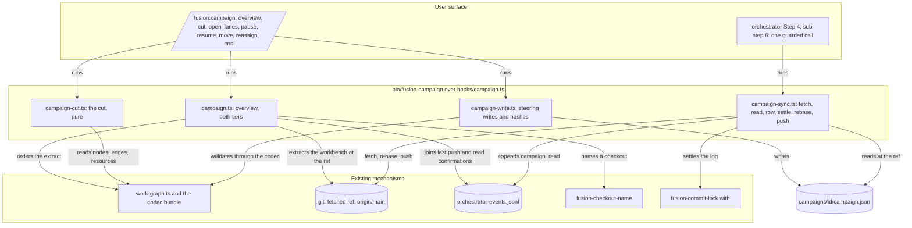
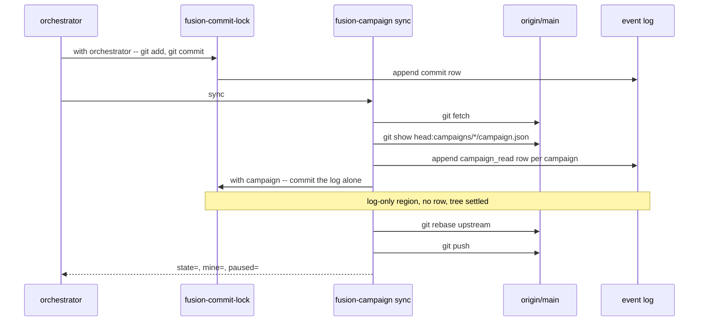
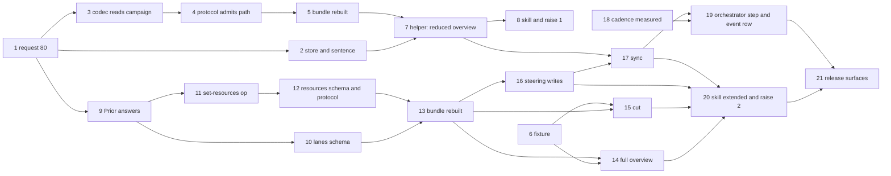

# Implementation Plan: the campaign as the Claude-side frame for work spread over several checkouts

**Date:** 2026-11-08
**Spec:** `261108-2135-spec-campaign-the-frame-for-work-spread-over-several-checkouts.md`, approved at its second review on 2026-11-08 and bound to the package in role `spec`
**Decidability:** The load-bearing question is "which packages will collide when several checkouts work them in parallel", and it is not decidable from anything the mechanism can obtain: a package without a plan has no enumerable file set, and five of the measured case's queued packages had none. The plan therefore builds no predictor. It replaces the question with two that are decidable from inputs the helper reads: *what did each package declare* (the `resources` field, written only from the user's confirmation, step 12) and *which committed path at the fetched ref falls inside another lane's declared area* (a comparison over `git log --name-only`, step 14), and the overview reports the second as a finding after the fact. Two deviations are stated rather than approximated: the Claude side admits N lanes for N checkouts while Prior keeps its two-writer bound (ruling C; one-sided; recorded in request 80, in the spec's `## Deviation from Prior's two-writer bound` and here), and the `prior_revision` values a Claude-side writer fills are fusion-computed and Prior-unverifiable until Prior answers question 4 of the request (`261108-2301-which-value-does-a-claude-side-writer-put-in-a-prior-revision-field.md`).
**Cross-references:** `261108-1924-campaign-the-frame-for-work-spread-over-several-checkouts.md`, `261108-1927-does-the-claude-side-adopt-the-campaign-as-its-one-frame-for-work-spread-over-several-checkouts.md`, `261105-1156-campaign-as-the-frame-for-work-spread-over-several-checkouts.md`, `261108-2212-review-of-the-campaign-spec.md`, `261108-2301-where-does-the-campaign-record-live-in-the-workbench-layout.md`, `261108-2301-which-value-does-a-claude-side-writer-put-in-a-prior-revision-field.md`, `261108-2301-how-does-a-working-session-rebase-pull-over-the-log-row-the-lock-just-appended.md`, `foreign:ax-k2-3:261101-1006-three-checkouts-work-the-pipeline-lanes-in-parallel.md`, `foreign:ax-k2-3:261031-1733-pipeline-work-dissected-into-parallel-checkout-lanes.md`, `260927-2319_*_does-the-growth-bound-on-shipped-text-yield-to-the-dual-host-prompt-set.md`, `260909-1808_*_may-a-helper-compute-an-order-over-work-items-after-the-portfolio-layer-goes.md`

## Directive

The spec's `## Directive` is the directive and is not restated. This plan says how its five capabilities are built in the spec's order: the request to Prior (C4) first, the read-only overview (C1) in its reduced tier before Prior answers and in its full tier after, the cut into lanes (C2), the steering acts and the commit-cycle read (C3), with the growth-bound raise and the restated conventions sentence (C5) placed where the steps that need them sit.

## Current State

Measured at `f1996755` plus the uncommitted `set-mode` on the package, 2026-11-08 23:00.

- **The campaign exists as a type and nothing else.** `codec/schemas/campaign.schema.json` types `fusion.campaign/v1` with `register` and `formation` nullable and `additionalProperties: false` on the root and the charter. The codec cannot read one: `codec/src/store.ts` `kindOf` knows the package, the record kinds and evidence, and `codec/schemas/protocol.schema.json` `record_selector` admits only `package.json`, `*.record.json` and `*.evidence.json`; `codec/src/cli/ops.ts` says in its own comment that "campaign records are not addressable in FJ02". Outside `codec/` and the workbench the only tracked file naming a campaign is one hook test.
- **Every prompt and skill body is render output.** `agents/*.md` and `skills/*/SKILL.md` are concatenations of `catalog/profiles/<id>/parts/NN-{neutral,claude,prior}.md`; a hand edit is overwritten by `cd catalog && npm run render -- claude` and fails `cd catalog && npm test`. A `neutral` part may carry no host token (`bin/`, `$FUSION_PLUGIN_ROOT`, `$OUT_*`, a slash command), so every helper call sits in a `claude` part. A skill's `catalog.json` entry has exactly the keys `id, kind, profile, class, arguments, requires, support`, its `class` one of `asks | dispatches | plain`; an entry `unsupported` on `prior` needs no `prior` parts, and the orchestrator role already stands at `prior: unsupported`.
- **Two surfaces are already at their bounds.** `surface-growth-bound.test.ts`: `agents/` at 14 079 of 18 000 bytes (3 921 left), `skills/` at 39 235 of 39 260 (25 left), the hook tests at 2 650 of 4 835 lines (2 185 left). The dispatch-path bound (`rules-emission-golden.test.ts`, zero head-room) has, per row: orchestrator 3 416 bytes of slack, policy-curator 366, analyst 516, implementation-planner 498, **reviewer 0**. `rules/fusion-workbench-conventions.md` is emitted to all eleven paths, so a byte added there puts the reviewer over unless a byte leaves the same file; `rules/commit-lock.md` reaches the orchestrator alone.
- **The commit cycle has no read point and leaves the tree dirty.** `agents/orchestrator.md` `### Step 4 — commit` commits under the lock and mentions neither fetch, pull nor push (a grep for the three returns nothing). `bin/fusion-commit-lock with` appends the `commit` row to the tracked event log after every landed commit, so the tree is dirty by that file after every commit, and a held region whose only path is the log emits no row, which is how `/fusion:cleanup` settles it ("Then commit the event log alone"). Seven of the last forty commits here are such settling commits.
- **What already reads a fetched ref, and what already computes the order.** `bin/fusion-forum new` fetches, resolves the upstream, lists a store at the fetched ref and reads blobs out of it without touching the working tree; its test drives it over a bare origin and two clones. `hooks/lib/work-graph.ts` `readWorkGraph(workbench)` gates through the codec and returns nodes, edges, readiness and unmet rows; `orderOf` is pure. `hooks/lib/__tests__/helpers/json-workbench.ts` builds a JSON-controlled workbench through the kernel, with `claim(project, pkg, checkout)` taking any checkout identifier. `bin/fusion-checkout-name resolve <hex> --at <commit>` names a checkout out of the registry at a commit.
- **The event log carries what the join needs.** A `commit` row carries `checkout`, `session_id` and `detail` = `<short hash> <subject>`; a `task_start` row carries `work_item`; `.gitattributes` gives the log `merge=union`; `bin/monitor` renders an event kind it does not know through its default branch (`bin/monitor`, `formatEvent`: `<agent or orchestrator>: <detail>`).
- **The measured case is reproducible from one clone.** `/System/Volumes/Data/Projects/productive/F03_digital-leadership/ax-k2-3` stands at `56c19983a`, the HEAD the consultation read. Its live store holds 55 open, 15 paused and 5 claimed packages; the five holders are `0838bf45`, `95433365`, `cb430046`, `d44c592f` and `f85f8da1`; of the five held packages only `foreign:ax-k2-3:260916-1447-be-ein-qualitaetsmass-fuer-die-befuellung` (held by `95433365`, mild-forge) sits in a lane of `261101-1006`; `261031-1718` is `done` while `260814-1228` and `261101-1002`, the two lane-3 packages its edges released, stand `open` and unheld.
- **Commit cadence, read once here as a baseline for step 18.** Over the `commit` rows of that clone's event log, grouped by `session_id`, gaps under 24 hours (3 259 gaps in 152 sessions): median 16.7 minutes, p75 51.5, p90 139.9, p95 309.7. Since 2026-11-01 (351 gaps): median 15.6, p90 136.2. The measurement is not yet restricted to autonomous sessions; 49 sessions carry a `gate_response` answered by `mode` autonomous.

## Approach

One helper, one skill over it, one new root store, one codec read extension, and the orchestrator's commit step gaining one guarded call. Nothing else is new: the order comes from `work-graph.ts`, the fetched-ref read from `fusion-forum`'s pattern, the settling commit from the lock rule, the registry names from `fusion-checkout-name`, the fixture workbenches from `json-workbench.ts`.



Coherence check. Thirteen nodes and sixteen edges; the four subgraphs group and are not nodes. The one node with high fan-out is the skill, which is its role: a dispatcher over sub-commands with no mechanism of its own. There is no cycle: the user surface calls the helper, the helper calls what exists, and nothing calls back. Every edge is a call or a read the steps below build or already have; the prose names each.

**The commit cycle, as the helper runs it** (`261108-2301-how-does-a-working-session-rebase-pull-over-the-log-row-the-lock-just-appended.md`):



The read sits after the commit (the spec's correction) and reads the fetched ref, not the working tree, so no pull precedes it; the pull with rebase follows the settling commit and precedes the push. A tracked path dirty for any reason but the log defers the rebase, the push is still attempted as a fast-forward, and the deferral is reported. A rebase that stops on a conflict is aborted and reported with its paths.

**Order of the work, and where the gates sit.** Steps 1 to 8 need nothing from Prior: the request, the store, the codec's read side, the fixture, the helper's reduced tier and the skill with its first raise. Step 9 records Prior's answer and is the one step that waits on something outside this repository. Steps 10 to 13 change the two schemas and the protocol and are flagged, so under `mode` `autonomous` the orchestrator asks rather than files and skips. Steps 14 to 20 build the full tier, the cut, the steering writes, the commit-cycle read and the prompt; step 18 is the measurement the spec's second stop clause reads, and step 19 depends on it.



Coherence check. Twenty-one nodes, one per step, and twenty-three edges, each a `Dependencies:` line below; no cycle, since every edge runs from a lower to a higher number. Steps 6 and 18 are roots on purpose: the fixture and the measurement depend on nothing in the tree.

## Implementation Steps

1. **Request 80 to Prior: the lane structure, the declared areas, the pause reading and the hashes**
   - Executor: `data-implementer`
   - Files: `codec/fixtures/prior/REQUESTS.md`
   - Changes: append `## The campaign on the Claude side (request 80)` after request 79, in the file's own shape (`### Written against` naming HEAD and the Prior commit read, the questions, `### Stated and not asked`, `### What fusion does with the answer`, `### Requests 64 and 67 to 80, as they stand` superseding 79's digest rows). **Four questions**, each naming the build it gates and what fusion does on a no: (1) a `lanes` member on `fusion.campaign/v1`, nullable, an array of `{id, checkout_id (nullable checkout_id), members (uniqueItems array of record_ref, ordered), revision (optional_prior_revision)}`, `register` and `formation` untouched; gates C1 full tier, C2, C3; on a no the work stops after C1's reduced tier (spec `## Stops when`); (2) a `resources` member on `fusion.package/v1`, a `string_set` of path prefixes relative to the project root, Prior's own name for a candidate's declared areas, written only from confirmed input through a new `set-resources` operation, with fusion's recommendation that it be the schema's one optional key (absent means undeclared, `[]` means declared nothing) because a required key would need a fill pass over every existing `package.json`; gates C2's overlap rule; on a no the cut groups by edges alone and says so on every package; (3) whether Prior's `Pause` semantics admit the Claude-side reading in which a working session halts at the fetch after its next commit and keeps its claim, the stop field being `state`, and whether `open` writing `running` directly (no `draft`, no `authorised`) with `authorisation_ref` citing the user's word is admitted; gates C3; on a no the reading is recorded as a Claude-side deviation and C3 proceeds; (4) which value a Claude-side writer puts in `state.charter_hash`, `state.revision` and `lanes[].revision`, with fusion's interim rule (`261108-2301-which-value-does-a-claude-side-writer-put-in-a-prior-revision-field.md`, option 1: hex SHA-256 over fusion's canonical JSON, sorted keys, no whitespace, the aggregate's own `revision` null, labelled `prior-json-sha256:`) and the three options Prior may choose between. **Stated and not asked**: the record lives at `fusion-workbench/campaigns/<campaign_id>/campaign.json`, class R1, one writer (`261108-2301-where-does-the-campaign-record-live-in-the-workbench-layout.md`); the working rule lives in the charter's `delivery_policy` string as "commit, then pull with rebase, then read the campaign, then push"; the Claude-side values of the other required charter fields (`item_kinds: ["work-package"]`, `candidate_sources: ["work-packages"]`, `workflow_templates: ["fusion-claude-code"]`, `intake_policy: "user-filed"`, `selection_policy: "user-confirmed-lanes"`, `package_policy: "one-claim-per-checkout"`, `acceptance_policy: "closing-review-per-package"`, `autonomy_policy: "per-package-mode"`, `backend_policy: "claude-code"`, `budget_account: "none"`, `data_boundary: []`, `capabilities: []`, `limits` at the minimum Charter.Validate admits, `1, 0, 1, 1, 1`, enforced by nothing on the Claude side); the codec's `list`, `show` and `validate` become able to read `campaigns/<id>/campaign.json` (read only, kind `campaign`), which changes the protocol's `record_selector` pattern and the bundle digest and no stored byte; the read confirmation is a fifth row kind, `campaign_read`, in `orchestrator-events.jsonl`, Claude-local and no part of the shared format, naming `campaign_id`, `state` and the `state.revision` read; more than two parallel writers is a Claude-side capability only and Prior keeps its two-writer bound (ruling C); no field a session must obey enters `extensions`, with `codec/schemas/common.schema.json`'s sentence on ignorance of an extension quoted as the reason. No `estimated_size` and no overview-window field are asked for.
   - Acceptance: `grep -n '^## .*request 80' codec/fixtures/prior/REQUESTS.md` prints one line after line 7112; `grep -c 'two-writer' codec/fixtures/prior/REQUESTS.md` is at least one more than at HEAD; the four numbered questions each name a build and a fallback; no step below this one in `git log` touches `codec/schemas/` before this commit (`git log --format=%h -- codec/schemas/` shows nothing newer than `aa4277d8` at this step's commit; corrected 2026-11-09, the plan first named `f1996755`, which is HEAD and not the newest schema commit).
   - Verification: `tail -n 400 codec/fixtures/prior/REQUESTS.md | grep -c '^### '` (at least 5), and `cd codec && npm test` green (the file is read by no test, so the run proves nothing broke).
   - Dependencies: none

2. **The campaign store in the layout, the resolver, the classifier and the tracking rule, with the restated ranking sentence, byte-neutral on the conventions file**
   - Executor: `code-implementer`
   - Files: `rules/fusion-workbench-conventions.md`, `rules/workbench-tracking.md`, `hooks/lib/stores.ts`, `bin/fusion-stores`, `bin/fusion-paths`, `hooks/lib/staging-drift.ts`, `hooks/lib/__tests__/path-literal-lint.test.ts`, `hooks/lib/__tests__/fusion-stores.test.ts`, `hooks/lib/__tests__/fusion-paths.test.ts`, `hooks/lib/__tests__/staging-drift.test.ts`, `hooks/lib/__tests__/fixtures/rules-emission.golden`, `rules/workbench-path-resolution.md`, `hooks/lib/__tests__/fixtures/surface-growth.golden` (regenerated with `UPDATE_SURFACE_GOLDEN=1`), `hooks/lib/__tests__/reference-resolution-lint.test.ts` (`BASELINE` re-approved to the measured counts), `README-hooks.md` (the `bin/fusion-stores` and `lib/stores.ts` rows), `hooks/lib/citation-corpus.ts` (a comment), the regenerated `hooks/dist/lib/*` outputs
   - Changes: in the layout tree add `├── campaigns/` with `└── <campaign_id>/campaign.json` as the second root entry, after the `work-packages/` block and before `shared/` (the lint requires `work-packages` to stay the first root and reads `RECORD_STORES` off the `shared/` subtree alone), plus one paragraph: a campaign is a frame over work packages, belongs to no item, has one writer (the steering session) and travels; its id is `YYMMDD-HHMM-<slug>`, the directory's own name. In `## Work packages` replace the sentence "No agent asserts a ranking, and no field holds one." with "No agent asserts a ranking. A helper may compute a lane assignment and an order from inputs the user has confirmed, and the campaign record holds that result; no field holds a priority an agent set by judgement." (spec C5; `260909-1808_*` is not transitioned). **Pay for every added byte in the same file**: move the paragraph "Three legacy stores are absent from this tree on purpose …" (about 1 000 bytes) out of `## fusion-workbench Layout` into `rules/workbench-tracking.md` under a new `## Frozen stores the tree no longer names` heading, leaving one pointer sentence; the net change of `rules/fusion-workbench-conventions.md` in bytes is zero or negative, measured with `git show HEAD:rules/fusion-workbench-conventions.md | wc -c` against `wc -c` of the edit. In `rules/workbench-tracking.md` add `campaigns/` to the R1 row with the one-writer reason. `hooks/lib/stores.ts`: `export const CAMPAIGN_STORE = "campaigns"`; `bin/fusion-stores`: `CAMPAIGN_STORE=campaigns` as a fourth line, header updated; `bin/fusion-paths`: keys `OUT_CAMPAIGN` and `SCAN_CAMPAIGNS`, both literal `$CAMPAIGN_STORE` (a campaign belongs to no item, so the Origin Rule has nothing to decide), added to `ORDER` and to the value table, header's key table updated and `rules/workbench-path-resolution.md` `## The key table` gaining the row (that file is emitted to no agent); `hooks/lib/staging-drift.ts` `classify`: `campaigns/<id>/campaign.json` is `record` ("a campaign record, one writer, travels (class R1)"); `path-literal-lint.test.ts` `TYPE_FOLDERS` gains `CAMPAIGN_STORE`; the three tests gain the cases (`fusion-stores.test.ts` holds the bash copy equal, `fusion-paths.test.ts` the two keys and the `ORDER` regex at its line 553, `staging-drift.test.ts` the classification). Regenerate the rules golden (`cd hooks && UPDATE_RULES_GOLDEN=1 npx vitest run lib/__tests__/rules-emission-golden.test.ts`, then re-run without the flag).
   - Acceptance: `cd hooks && npm test` green, the dispatch-path bound included (`reviewer` has 0 bytes of slack, so a green run proves the conventions file did not grow); `"$FUSION_PLUGIN_ROOT/bin/fusion-paths" memo` unchanged; a scratch skill body naming `$OUT_CAMPAIGN` resolves to `campaigns` (the `fusion-paths.test.ts` case); `grep -c 'No agent asserts a ranking\. A helper may compute' rules/fusion-workbench-conventions.md` is 1.
   - Verification: `cd hooks && npm test` (exit 0) and `node -e 'const fs=require("fs");console.log(fs.statSync("rules/fusion-workbench-conventions.md").size)'` not above 68 247 (its size at HEAD by `wc -c`; corrected 2026-11-09 from 36 700).
   - Dependencies: 1

3. **The codec reads a campaign file: kind `campaign` in the store, read-only**
   - Executor: `code-implementer`
   - Files: `codec/src/store.ts`, `codec/src/cli/ops.ts`, `codec/src/cli/protocol.ts`, `codec/src/__tests__/store.test.ts`, `codec/src/__tests__/ops.test.ts`, `codec/README.md`, and `hooks/lib/__tests__/reference-resolution-lint.test.ts` (`BASELINE` re-approved) where the README's new citations move its counts
   - Changes: `Kind` gains `"campaign"`; `kindOf` returns it for `urn:fusion:schema:fusion.campaign/v1`; `isControlFile` admits the name `campaign.json`; `controlFiles` walks `campaigns/<id>/`; a campaign pair has `narrative: null` and `report: null`; `list` rows carry `kind: "campaign"` and `status: control.state.state`; `show` returns the control and the stored-bytes revision; `validate` validates against the campaign schema; every mutation (`transition`, `claim`, `release`, `set-mode`, `set-dependencies`, `adopt-plan`, `attach-evidence`) on a campaign path is refused `unsupported-format/not-a-pair-kind` with a detail saying the Claude-side writer is `bin/fusion-campaign`; `reconcile` reports a campaign only for schema findings and evaluates no edge over it. `codec/README.md` gains one paragraph under `## The CLI`. The protocol's path pattern still refuses the path at this step, so the tests drive `readPair`/`controlFiles` through the store API and the refusal through `ops` with a hand-built request.
   - Acceptance: `cd codec && npm test` green; a test reads `codec/fixtures/valid/campaign/minimal.json` placed at `campaigns/camp-2026-09-parser/campaign.json` in a scratch workbench and gets `kind: "campaign"`, `status: "draft"`; a `transition` on it is refused with the stated class and reason.
   - Verification: `cd codec && npm test` (exit 0; `committed-dist.test.ts` will fail until step 5 rebuilds, so this step's run names that one file as the expected red and any other red as a stop).
   - Dependencies: 1

4. **The protocol admits the campaign path; fixtures for it**
   - Executor: `data-implementer`
   - Files: `codec/schemas/protocol.schema.json`, `codec/fixtures/valid/protocol/show-campaign.json`, `codec/fixtures/valid/protocol/validate-campaign.json`, `codec/fixtures/invalid/protocol/transition-campaign-path.json`, `codec/fixtures/manifest.json`
   - Changes: the `record_selector` pattern becomes `(^|/)(package|campaign|[^/]+\.record|[^/]+\.evidence)\.json$`, its description naming `campaigns/<id>/campaign.json` as a read-only selector; three protocol fixtures with manifest rows (the two valid requests, and the transition request as `valid` at the schema level with a note that the operation refuses it, or as `invalid` where the schema can express the refusal; the executor reads `manifest.json`'s existing protocol rows for the shape).
   - **Flagged: requires approval** (a schema file changes; under `mode` `autonomous` the orchestrator asks rather than files and skips).
   - Acceptance: `cd codec && npm test` green except `committed-dist.test.ts` (expected red until step 5); `node -e 'JSON.parse(require("fs").readFileSync("codec/schemas/protocol.schema.json"))'` exits 0.
   - Verification: `cd codec && npx vitest run src/__tests__/fixtures.test.ts` (exit 0).
   - Dependencies: 3

5. **Rebuild the bundle and round-trip the campaign read through the CLI**
   - Executor: `code-implementer`
   - Files: `codec/dist/fusion-record.js`, `codec/src/__tests__/round-trip-cli.test.ts`
   - Changes: `cd codec && npm run build`; a round-trip case places the minimal campaign fixture under `campaigns/` and runs `show`, `validate` and `list` through `node codec/dist/fusion-record.js`, and a `transition` that is refused. **The rebuild moves the bundle's digest** (`sha256:b4047458…` at HEAD), and request 80 asks for no re-pin: the executor reports the new digest (`shasum -a 256 codec/dist/fusion-record.js`), the orchestrator reports it to the user, and whether a re-pin request to Prior follows is the user's.
   - Acceptance: `cd codec && npm test` green (`committed-dist.test.ts` included); `echo '{"op":"show","workbench":"<scratch>","record":{"path":"campaigns/camp-2026-09-parser/campaign.json"}}' | bin/fusion-record` answers `"ok":true` with `"kind":"campaign"`.
   - Verification: `cd codec && npm test` (exit 0) and `cd hooks && npm test` (exit 0; `committed-dist` reads the bundle).
   - Dependencies: 4

6. **The measured-case fixture: the `ax-k2-3` pipeline store at `56c19983a`**
   - Executor: `data-implementer`
   - Files: `hooks/lib/__tests__/fixtures/campaign/ax-k2-3-261105.json`
   - Changes: one JSON document, hand-derived and cited, with: `source` (the clone path `/System/Volumes/Data/Projects/productive/F03_digital-leadership/ax-k2-3`, HEAD `56c19983a`, the two foreign records by storeless basename); `packages`: the 23 pipeline packages `foreign:ax-k2-3:261031-1733-pipeline-work-dissected-into-parallel-checkout-lanes.md` §3 names, each with its container name, its `status` at that HEAD, its holder's checkout where claimed, its written `depends_on` targets by container name (read from each `package.json`), and its `areas` as path prefixes taken from §4's contention map (`codebase/go/pkg/process/`, `codebase/go/pkg/api/plan_handlers.go`, `codebase/go/pkg/strategy/`, `codebase/go/pkg/catalog/`, `codebase/go/pkg/ai/`, …, one list per package, empty where §4 names none); the five further packages held at that HEAD that are outside the lanes (`foreign:ax-k2-3:261103-1957-…`, `foreign:ax-k2-3:261102-1042-…`, `foreign:ax-k2-3:261104-0833-…`, `foreign:ax-k2-3:261104-1932-…`, and `foreign:ax-k2-3:260916-1447-be-ein-qualitaetsmass-fuer-die-befuellung` which is inside lane 3), each with holder; `lanes`: the three lanes of `foreign:ax-k2-3:261101-1006-three-checkouts-work-the-pipeline-lanes-in-parallel.md` as amended on 2026-11-01 (its packages `260929-1302` dropped and `261101-1057` at lane 2's tail, both `ax-k2-3`'s), each with its checkout (`d44c592f`, `f85f8da1`, `95433365`) and ordered members; `checkouts`: the ten registry entries' hex and alias; `log`: for each of the five holders, one `commit` row with `checkout`, `session_id` and a `detail` whose short hash the test maps onto a commit it makes, and `ts` at 2026-11-04 or later. Every figure carries its source in a sibling `_source` key. Reading the clone is a read outside the project tree and writes nothing there.
   - Acceptance: `node -e 'const f=JSON.parse(require("fs").readFileSync("hooks/lib/__tests__/fixtures/campaign/ax-k2-3-261105.json"));console.log(f.packages.length, f.lanes.length, Object.keys(f.checkouts).length)'` prints `28 3 10` (23 lane-analysis packages plus the five further ones, three lanes, ten checkouts); every `depends_on` target names a package in the file.
   - Verification: the `node -e` line above (exit 0, the three figures) and `cd hooks && npm test` (exit 0; the fixtures directory is outside the line-counted surface, which counts `.ts` alone).
   - Dependencies: none

7. **The helper, read side: `bin/fusion-campaign overview`, reduced tier**
   - Executor: `code-implementer`
   - Files: `hooks/lib/campaign.ts`, `hooks/campaign.ts`, `bin/fusion-campaign`, `hooks/lib/__tests__/campaign-overview.test.ts`, `README-hooks.md`, `hooks/lib/__tests__/fixtures/surface-growth.golden` (regenerated), `hooks/lib/__tests__/reference-resolution-lint.test.ts` (`BASELINE` re-approved), the regenerated `hooks/dist/` outputs (`campaign.js`, `lib/campaign.js`)
   - Changes: `bin/fusion-campaign` is a bash wrapper over `hooks/dist/campaign.js` in the shape of `bin/fusion-work-order`, its header the authoritative documentation of every sub-command, the `KEY=value` output, the exit table and the state vocabulary; it reads store names from `bin/fusion-stores` and never names one. `overview [--window <hours>] [--ref <upstream>]`: resolve the workbench (`fusion-workbench-root`), require a work tree, resolve the branch's upstream (as `fusion-forum` does; `--ref` overrides it), `GIT_TERMINAL_PROMPT=0 git fetch <remote>`, resolve `head=`; **extract the tracked workbench at `head` into a scratch directory** under `"$FUSION_PLUGIN_ROOT/bin/fusion-tmp" path` (`git archive <head> -- <workbench rel>/workbench.json <rel>/.fusion-setup <rel>/work-packages <rel>/campaigns <rel>/shared/checkouts <rel>/orchestrator-events.jsonl | tar -x -C <scratch>`, paths that do not exist at the ref omitted from the list first by `git ls-tree`), run `readWorkGraph(<scratch workbench>)` on it, read `list` for the open decisions in each held package's container, read the extracted event log, and remove the scratch directory on every exit path. Output: `state=ok|no-work-tree|no-branch|no-upstream|upstream-unresolved|workbench-untracked|fetch-failed|workbench-outside-repo` with `fusion-forum`'s exit codes; `ref=`, `head=`, `head_time=<RFC 3339>`, `age_minutes=`, `window_hours=` (default 24), `campaigns=0` at this step; one `held=<checkout>\t<alias|->\t<package>\t<last_push RFC 3339|none>\t<waits>` per claimed package, `last_push` the committer time of the newest commit among that checkout's `commit` rows whose short hash is an ancestor of `head` (`git merge-base --is-ancestor`), `waits` one of `edge:<target container>` (per unmet or resolved edge the graph reports as blocking), `decision:<basename>` (an `open` decision under the package's `decisions/`) or `none`; `note=` lines for every degradation (no `commit` row carries a checkout, a registry entry unreadable at `head`). The alias comes from `bin/fusion-checkout-name resolve <hex> --at <head>`, `-` on exit 3. `README-hooks.md` gains the bin-roster row, the `hooks/lib` table row for `lib/campaign.ts` and a `## Files` row for `campaign.ts` (the lint in `derivable-enumerations-lint.test.ts` holds both tables closed). Tests in the `fusion-forum.test.ts` shape: a bare origin, a pushing clone whose workbench is built through `json-workbench.ts` with claims by two checkouts, a reading clone; cases for `state=ok` with two `held=` rows, `workbench-untracked`, `no-upstream`, and a dirty reading tree left untouched (`git status --porcelain` before and after equal).
   - Acceptance: `cd hooks && npm test` green; in this repository `"$FUSION_PLUGIN_ROOT/bin/fusion-campaign" overview --ref origin/main` exits 0 and prints `state=ok`, `ref=origin/main`, `campaigns=0` and one `held=114caf11…` row for this package with `waits=none` (the work lands on branch `campaign`, which has no upstream, so a bare `overview` there answers `state=no-upstream`, exit 5, and that case stays in the tests); `git status --porcelain` is identical before and after the run.
   - Verification: `cd hooks && npm test` (exit 0) and `bin/fusion-campaign overview --ref origin/main; echo exit=$?` (exit 0, `state=ok`).
   - Dependencies: 2, 5

8. **The skill `/fusion:campaign` with the overview, and the first head-room raise**
   - Executor: `code-implementer`
   - Files: `catalog/catalog.json`, `catalog/profiles/skill-campaign/profile.json`, `catalog/profiles/skill-campaign/parts/*.md`, `skills/campaign/SKILL.md` (render output), `README-agents.md`, `catalog/README.md`, `hooks/lib/__tests__/surface-growth-bound.test.ts`, `hooks/lib/__tests__/fixtures/surface-growth.golden`, `README-hooks.md`, `hooks/lib/__tests__/reference-resolution-lint.test.ts` (`BASELINE` re-approved)
   - Changes: a `catalog.json` entry `{id:"campaign", kind:"skill", profile:"skill-campaign", class:"asks", arguments:{items:[{name:"subcommand", kind:"positional", required:false, values:["overview","cut","open","lanes","pause","resume","move","reassign","end"], note:"overview when absent"}, {name:"--window", kind:"option", required:false, note:"<hours>, overview only, default 24"}]}, requires:["host.exec.v1","host.question.v1"], support:{"claude-code":"supported","prior":"unsupported"}}`; a profile with `claude` and `neutral` parts (frontmatter `allowed-tools: [Bash, Read, AskUserQuestion]`, `argument-hint`), in the shape of `skills/news/SKILL.md`: Step 0 resolves `"$FUSION_PLUGIN_ROOT/bin/fusion-workbench-root"` and `"$FUSION_PLUGIN_ROOT/bin/fusion-paths" campaign` and holds `$SCAN_CAMPAIGNS` and `$OUT_CAMPAIGN`; Step 1 the `[ -x ]` guard on `bin/fusion-campaign` with the `fusion --update` sentence; Step 2 runs `overview` with the user's `--window` passed through; Step 3 renders each `KEY=value` row in the user's terms and the chat language, per `rules/user-facing-output.md`: the first lines name the ref, the commit and its age in words, then one sentence per `held=` row, then `campaigns=0` as "no campaign is running", the window named in every sentence that depends on it; the other sub-commands are listed in the body as arriving with step 20 and refused with one sentence until then. Render with `cd catalog && npm run render -- claude`. `README-agents.md`: the table row and `/fusion:campaign` in the roster sentence that "asserts the match in the other direction too"; `catalog/README.md` `## Editing a converted prompt`: the file in the list. **The raise**: measure `skills/campaign/SKILL.md` with `wc -c`; set `SKILL_HEAD_ROOM` to `39 260 + (<that size> − 25)`; log it under `README-hooks.md` `#### The head-room raises, and the reduction read on 2026-10-10` as the thirty-first raise with the date, the constant, the figure before and after, the authority (the user's words of 2026-11-08 as the spec's `### C5` records them) and the reduction read dated at this package's closure; regenerate `surface-growth.golden` and re-run without the flag; move no baseline.
   - Acceptance: `cd catalog && npm test` green; `cd hooks && npm test` green; `git diff --exit-code agents/ skills/` is 0 after a fresh render; `grep -c '/fusion:campaign' README-agents.md` is at least 2; the raise entry names before and after figures that differ by exactly the measured remainder.
   - Verification: `cd catalog && npm run render -- claude && npm test && cd ../hooks && npm test` (exit 0).
   - Dependencies: 7

9. **Prior's answer to request 80, recorded**
   - Executor: `data-implementer`
   - Files: `codec/fixtures/prior/REQUESTS.md`
   - Changes: append `### Prior's answer to 80 at <Prior commit>` under request 80, in the shape of `### Prior's answer to 76 and 77 at 52a2703`: one verdict per question (accepted, corrected, refused, deferred) with Prior's wording relayed by the user, the response document's path and digest where Prior gives one, and the digest table's row for 80 updated. **This step waits on the user relaying Prior's answer and cannot be dispatched before**; the orchestrator holds the plan here and names the wait in its report.
   - Acceptance: `grep -n "^### Prior's answer to 80" codec/fixtures/prior/REQUESTS.md` prints one line; each of the four questions has a verdict line.
   - Verification: the `grep` above (one line) and `cd codec && npm test` (exit 0).
   - Dependencies: 1

10. **`lanes` on `fusion.campaign/v1`, as Prior answered question 1**
    - Executor: `data-implementer`
    - Files: `codec/schemas/campaign.schema.json`, `codec/fixtures/valid/campaign/with-lanes.json`, `codec/fixtures/valid/campaign/lanes-null.json`, `codec/fixtures/invalid/campaign/lanes-duplicate-member.json`, `codec/fixtures/invalid/campaign/lanes-member-not-record-ref.json`, `codec/fixtures/manifest.json`, `codec/fixtures/valid/campaign/minimal.json`, `codec/fixtures/valid/campaign/archived.json`, `codec/fixtures/valid/campaign/with-register-and-formation.json`, `codec/fixtures/valid/campaign/formation-signed-metrics-stale-reason-and-charter-duplicates.json`
    - Changes: the `lanes` member in the shape question 1 proposed, corrected to Prior's answer; added to the root's `required` (every key required, null admitted) and the four existing valid fixtures gain `"lanes": null`; the schema's `description` gains one sentence on the lane as the Claude side's second level of grouping. **If Prior refused question 1, this step is not performed, the plan stops after step 8 (spec `## Stops when`, first clause) and the question of where the lanes live goes back to the user.**
    - **Flagged: requires approval** (a schema definition changes).
    - Acceptance: `cd codec && npm test` green except `committed-dist.test.ts` (expected red until step 13); the manifest rows validate the four new fixtures as named.
    - Verification: `cd codec && npx vitest run src/__tests__/fixtures.test.ts` (exit 0).
    - Dependencies: 9

11. **The `set-resources` operation in the codec and in `bin/fusion-write`**
    - Executor: `code-implementer`
    - Files: `codec/src/cli/ops.ts`, `codec/src/cli/protocol.ts`, `codec/src/__tests__/ops.test.ts`, `hooks/lib/record-write.ts`, `hooks/write.ts`, `bin/fusion-write`, `hooks/lib/__tests__/record-write.test.ts`, `hooks/lib/__tests__/fixtures/surface-growth.golden` (regenerated), `hooks/lib/__tests__/reference-resolution-lint.test.ts` (`BASELINE` re-approved where the counts move), the regenerated `hooks/dist/` outputs (`write.js`, `lib/record-write.js`)
    - Changes: `setResourcesPlan` beside `setDependenciesPlan`: replaces the package's `resources` list whole (as `set-dependencies` replaces `depends_on`), refuses a non-package record, a path with `..` or an absolute path, and a duplicate; `fusion-write set-resources --path <prefix> (repeatable) | --clear`, `--actor`, its `record_change` row carrying `change: {resources: <count>}`; the header and the `PAYLOAD_FIELDS` table updated. If Prior answered that the key is required, the step also adds a one-time fill: `set-resources` on a package lacking the key writes `[]` when called with `--clear`, and `bin/fusion-write`'s header says a workbench's packages are filled one by one at the user's word, never by a sweep. Tests drive the plan function through `ops` with a hand-built request; the protocol branch arrives in step 12, so the CLI path stays red until step 13 and is named as such.
    - Acceptance: `cd codec && npm test` green except `committed-dist.test.ts` and the protocol fixtures (expected red until steps 12 and 13); `cd hooks && npm test` green except `record-write.test.ts`'s protocol-shape case where it reads the schema (expected red until step 12).
    - Verification: `cd codec && npx vitest run src/__tests__/ops.test.ts` (exit 0).
    - Dependencies: 9

12. **`resources` on `fusion.package/v1` and the `set-resources` protocol branch, as Prior answered question 2**
    - Executor: `data-implementer`
    - Files: `codec/schemas/package.schema.json`, `codec/schemas/protocol.schema.json`, `codec/fixtures/valid/package/with-resources.json`, `codec/fixtures/invalid/package/resources-duplicate.json`, `codec/fixtures/valid/protocol/set-resources.json`, `codec/fixtures/manifest.json`, and, where Prior ruled the key required, every `codec/fixtures/valid/package/*.json` and the package fixtures under `codec/fixtures/protocol-session*/`
    - Changes: `resources` as a `uniqueItems` array of non-empty strings, optional or required as Prior ruled, its description naming the user's confirmation as the only source and `set-resources` as the only writer; the protocol gains the `set-resources` branch (`op`, `workbench`, `operation_id`, `record`, `expected_revision`, `actor`, `resources`); `codec/contract/prior-mapping.json` gains no row (the field is fusion's; a note in the schema description says so). **If Prior refused question 2, this step and step 11 are dropped, the cut groups by edges alone and says so (step 15), and the user is asked whether to proceed on that basis.**
    - **Flagged: requires approval** (two schema files change).
    - Acceptance: `cd codec && npm test` green except `committed-dist.test.ts`; every existing valid package fixture still validates.
    - Verification: `cd codec && npx vitest run src/__tests__/fixtures.test.ts src/__tests__/protocol.test.ts` (exit 0).
    - Dependencies: 11

13. **Rebuild the bundle after the schema steps; round trips for `lanes` and `set-resources`**
    - Executor: `code-implementer`
    - Files: `codec/dist/fusion-record.js`, `codec/src/__tests__/round-trip-cli.test.ts`
    - Changes: `cd codec && npm run build`; round-trip cases: `validate` on `with-lanes.json` placed under `campaigns/`, `set-resources` on a kernel-written package through the CLI, `show` reading the list back.
    - Acceptance: `cd codec && npm test` green, `committed-dist.test.ts` included; `cd hooks && npm test` green; `echo '{"op":"set-resources",…}' | bin/fusion-record` lands and `show` returns the list.
    - Verification: `cd codec && npm test && cd ../hooks && npm test` (exit 0).
    - Dependencies: 10, 12

14. **The overview's full tier: lanes, the seven conditions, cross-lane detection, read confirmations; the measured case as a test**
    - Executor: `code-implementer`
    - Files: `hooks/lib/campaign.ts`, `hooks/lib/__tests__/campaign-overview.test.ts`, `bin/fusion-campaign` (header), `hooks/lib/__tests__/fixtures/surface-growth.golden` (regenerated), `hooks/lib/__tests__/reference-resolution-lint.test.ts` (`BASELINE` re-approved where the counts move), the regenerated `hooks/dist/` outputs
    - Changes: with a campaign at the ref (`campaigns/*/campaign.json` in the extract, read through the codec's `list`), `campaigns=<n>` and one `campaign=<id>\t<state>\t<reason|->\t<lanes>` row each; per lane `lane=<campaign>\t<lane id>\t<checkout>\t<alias|->\t<held|none>\t<next|none>\t<next waits>`, `next` the first member in lane order that is live and unheld; the seven condition rows, each printed only when true: `silent=<campaign>\t<lane>\t<checkout>\t<last push|none>` (no held package and no push within `window_hours`), `out-of-lane=<checkout>\t<package>\t<package's lane>\t<holder's lane>`, `in-no-lane=<checkout>\t<package>`, `waits-decision=<campaign>\t<lane>\t<next>\t<decision basename>`, `handoff-possible=<from>\t<to>\t<from lane>\t<to lane>` (an edge whose source is terminal, whose target is live and unheld, and whose ends sit in different lanes), `cross-lane=<hash>\t<path>\t<committer lane>\t<declaring lane>` (over `git log --format=%h --name-only <first commit adding the campaign file>..<head>`, each commit attributed to a checkout through the extracted log's `commit` rows, each path matched against every lane's union of its members' `resources` by path-prefix at a `/` boundary; a path inside another lane's union and outside the committer lane's own is a row; an unattributed commit is a `note=`), `unconfirmed=<campaign>\t<lane>\t<checkout>\t<revision>\t<last confirmation|none>` (no `campaign_read` row by that checkout naming the campaign's current `state.revision`). The test builds the fixture of step 6 into a JSON workbench through `json-workbench.ts` (packages created and claimed by the fixture's checkouts, edges set, statuses transitioned, the campaign file written with the three lanes, the log rows appended with hashes of commits the test makes), pushes it to a bare origin and runs `overview` from a reading clone.
    - Acceptance: over the fixture the output carries exactly four `in-no-lane=` rows (`0838bf45`, `cb430046`, `d44c592f`, `f85f8da1` with their held packages) and exactly two `handoff-possible=` rows (`foreign:ax-k2-3:261031-1718-…` to `foreign:ax-k2-3:260814-1228-…`, lane 1 to lane 3; `foreign:ax-k2-3:261031-1718-…` to `foreign:ax-k2-3:261101-1002-…`, lane 1 to lane 3); no `out-of-lane=` row for `95433365`; `--window 1` over a fixture whose last push is older than an hour prints a `silent=` row and the default prints none; `cd hooks && npm test` green.
    - Verification: `cd hooks && npx vitest run lib/__tests__/campaign-overview.test.ts` (exit 0) and `cd hooks && npm test` (exit 0).
    - Dependencies: 6, 13

15. **The cut: `bin/fusion-campaign cut --checkouts N`**
    - Executor: `code-implementer`
    - Files: `hooks/lib/campaign-cut.ts`, `hooks/lib/campaign.ts`, `hooks/lib/__tests__/campaign-cut.test.ts`, `bin/fusion-campaign` (header), `README-hooks.md` (the `lib/campaign-cut.ts` row), `hooks/lib/__tests__/fixtures/surface-growth.golden` (regenerated), `hooks/lib/__tests__/reference-resolution-lint.test.ts` (`BASELINE` re-approved), the regenerated `hooks/dist/` outputs
    - Changes: `cut --checkouts <N> [--tolerance <k>]` refuses to run without `--checkouts` (exit 1); reads the local workbench through `readWorkGraph` (the steering checkout plans on its own pulled tree) and each live package's `resources` through `list`; `campaign-cut.ts` is pure: (a) union-find over packages whose declared areas overlap (equal, or one a prefix of the other at a `/` boundary) into groups; (b) groups ordered by dependency depth descending, then size descending, then name; (c) each group placed on the lane with the fewest members, preferring a lane that already holds an edge neighbour when that lane stays within tolerance; tolerance `k` = the largest admitted difference between a lane's size and `ceil(members / N)`, default 1; a group that fits nowhere within tolerance is placed on the smallest lane anyway and reported `imbalance=<lane>\t<size>\t<group members>`; (d) lane order = `orderOf`'s global order filtered to the lane's members; (e) `handoff=<from>\t<to>\t<from lane>\t<to lane>` for every edge across lanes; (f) `no-areas=<package>` per package with no declared areas and `no-areas-count=`; (g) the same computation at N+1 and N−1, printed as `delta-plus=` and `delta-minus=` rows naming the packages that move and the hand-offs that appear or disappear; (h) `lane=<n>\t<package>` rows in order, and `proposal=<path>` naming a JSON file the helper writes under `"$FUSION_PLUGIN_ROOT/bin/fusion-tmp" path` holding the whole proposal for step 16's `lanes --from`. No size figure enters anywhere. Deterministic: two runs over one store print the same bytes.
    - Acceptance: over the fixture of step 6 with its areas, `cut --checkouts 3` puts every package whose areas lie under `codebase/go/pkg/process/` in one lane, those under `codebase/go/pkg/strategy/` and `codebase/go/pkg/catalog/` in a second and those under `codebase/go/pkg/ai/` in a third, and the `handoff=` rows include `foreign:ax-k2-3:261031-1718-…` to `foreign:ax-k2-3:260814-1228-…` and `foreign:ax-k2-3:261031-1718-…` to `foreign:ax-k2-3:261101-1002-…` (`foreign:ax-k2-3:261031-1733-…` §4 and §5); two packages with overlapping areas never land in different lanes in any case of the test; `cut` without `--checkouts` exits 1 with nothing on stdout; `cd hooks && npm test` green.
    - Verification: `cd hooks && npx vitest run lib/__tests__/campaign-cut.test.ts` (exit 0) and `cd hooks && npm test` (exit 0).
    - Dependencies: 6, 13

16. **The steering writes: `open`, `lanes`, `pause`, `resume`, `move`, `reassign`, `end`, and the hash rule**
    - Executor: `code-implementer`
    - Files: `hooks/lib/campaign-write.ts`, `hooks/lib/campaign.ts`, `hooks/lib/__tests__/campaign-write.test.ts`, `bin/fusion-campaign` (header), `README-hooks.md` (the `lib/campaign-write.ts` row), `hooks/lib/__tests__/fixtures/surface-growth.golden` (regenerated), `hooks/lib/__tests__/reference-resolution-lint.test.ts` (`BASELINE` re-approved), the regenerated `hooks/dist/` outputs
    - Changes: every write first runs `bin/fusion-claimed-package`; a `PACKAGE=` line is exit 5 with the sentence that a steering act runs only from a checkout holding no claimed package (spec C3, first criterion). `open --id <YYMMDD-HHMM-slug> --objective <text> --authorisation <citation> [--stop <text>]...` writes `campaigns/<id>/campaign.json` with the charter values step 1 states, `delivery_policy` the working rule, `state.state: "running"`, counters and settlement at zero, `register`, `formation`, `lanes`, `baseline_hash`, `completion_evidence` null; `lanes --from <proposal file>` writes the lanes from a `cut` proposal (members as `record_ref`, each lane's `checkout_id` from `--assign <lane>=<hex>` or null); `pause --reason <text>` and `resume` move `state.state` and `state.reason`; `move <package> --to <lane>` and `reassign <lane> --checkout <hex>` edit the lanes; `end --outcome completed|bounded|failed|cancelled [--reason]` writes the terminal state (and `completion_evidence`, `completed` alone: its four booleans `objective_met`, `intake_closed`, `all_attempts_terminal`, `final_audit_passed` as the user states them, `watermark` and `audit_ref` null unless given). One function `revisionOf(aggregate)` implements the hash rule of `261108-2301-which-value-does-a-claude-side-writer-put-in-a-prior-revision-field.md` (option 1, or as Prior's answer to question 4 corrected it) for `charter_hash`, `state.revision` and `lanes[].revision`; `charter.revision` is `prior-opaque:r<n>`. **A gap in that rule, found at step 1 and carried to Prior in question 4:** the ruled rule hashes every aggregate with its own `revision` null, while Prior's `charterHash` keeps the charter's `Revision` label and only `stateRevision` clears the state's. Until Prior answers, the function implements the rule as ruled, the charter's label cleared too, with keep-or-clear one argument per aggregate, so Prior's answer changes that one place and no caller. Every write validates the result through the codec's `validate` before it lands (temp file beside the target, atomic rename), prints `path=` and `revision=`, and is committed by the steering session through the ordinary commit step, never by the helper. Tests build a workbench, run each write and read it back through `show`, assert the no-claim refusal, and assert every written file validates.
    - Acceptance: in a scratch workbench with no claim, `open` then `validate` through `bin/fusion-record` answers `"valid":true`; with a claim held by the running checkout every write exits 5 and writes nothing; `cd hooks && npm test` green.
    - Verification: `cd hooks && npx vitest run lib/__tests__/campaign-write.test.ts` (exit 0) and `cd hooks && npm test` (exit 0).
    - Dependencies: 13

17. **The commit-cycle read: `bin/fusion-campaign sync`**
    - Executor: `code-implementer`
    - Files: `hooks/lib/campaign-sync.ts`, `hooks/lib/campaign.ts`, `hooks/lib/__tests__/campaign-sync.test.ts`, `hooks/lib/__tests__/monitor-warnings-panel.test.ts`, `bin/fusion-campaign` (header), `README-hooks.md` (the `lib/campaign-sync.ts` row), `hooks/lib/__tests__/fixtures/surface-growth.golden` (regenerated), `hooks/lib/__tests__/reference-resolution-lint.test.ts` (`BASELINE` re-approved), the regenerated `hooks/dist/` outputs
    - Changes: `sync` runs, in this order and with no `stash`, `--autostash`, `checkout .`, `reset --hard` or `clean`: (1) resolve branch and upstream as `overview` does; (2) `git fetch`; (3) for every `campaigns/*/campaign.json` at the fetched head, `git show <head>:<path>`, parse, and print `campaign=<id>\t<state>\t<revision>\t<reason|->`; (4) determine `mine=<id>|none`: the campaign whose lanes name this checkout's identifier (`bin/fusion-identity`), else, with lanes absent, the one `running` or `paused` campaign at the ref, else none; (5) append one `campaign_read` row per campaign read: `{"ts","event":"campaign_read","person","checkout","session_id","campaign":<id>,"state":<state>,"revision":<state.revision or null>,"detail":"<id> <state> <first 12 hex of revision or null>"}`, identity env-first then `bin/fusion-identity`, `session_id` from `FUSION_SESSION_ID`, an unresolved value an absent key, written only while `FUSION_SESSION_ID` is set (the `commit` row's own rule); (6) if `git diff --name-only` plus `git diff --cached --name-only` name the event log alone, commit it under `"$FUSION_PLUGIN_ROOT/bin/fusion-commit-lock" with campaign -- bash -c 'git add <abs log> && git commit -F <message file under fusion-tmp path>'` with the message `chore(events): the commit and campaign-read rows of <short hash>` and print `settled=<hash>`; if other tracked paths are dirty, print `deferred=<path>` per path, skip the rebase, and still attempt the push; (7) `git rebase <upstream>`; on a stop, `git rebase --abort`, print `conflict=<path>` per conflicting path, `state=conflict`, exit 7; (8) `git push`; on rejection print `state=rejected` with git's stderr passed through, exit 8; (9) `paused=<id>\t<reason>` when `mine` is `paused`, which the orchestrator reads as: dispatch nothing more, report the reason, keep the claim. Exit 0 covers pushed and nothing-to-push; `state=` names every other case. One monitor case: a log carrying a `campaign_read` row is served and the row is rendered through the default branch (`orchestrator: <detail>`), the panel not failing. Tests drive the real script over a bare origin and two clones: a cycle with a second clone's push in between (rebase succeeds, union merge on the log, push lands, the `campaign_read` row is on origin), a conflict (aborted, exit 7, tree as before), a dirty tracked file (deferred, push as fast-forward), and `paused` read and reported.
    - Acceptance: after `sync` in the test's pushing clone, `git status --porcelain` names no tracked path and `git log origin/main -1 --format=%s` is the settling message; `grep -c campaign_read fusion-workbench/orchestrator-events.jsonl` on origin is 1 per campaign; the conflict case leaves the clone at its pre-sync HEAD with no rebase in progress; `bin/monitor` serves the panel with the row present; `cd hooks && npm test` green.
    - Verification: `cd hooks && npx vitest run lib/__tests__/campaign-sync.test.ts lib/__tests__/monitor-warnings-panel.test.ts` (exit 0) and `cd hooks && npm test` (exit 0).
    - Dependencies: 7, 16

18. **The commit cadence of autonomous sessions, measured**
    - Executor: `analyst`
    - Files: `$OUT_ANALYSIS/<YYMMDD-HHMM>-commit-cadence-of-autonomous-sessions.md` (this package's container)
    - Changes: over `/System/Volumes/Data/Projects/productive/F03_digital-leadership/ax-k2-3/fusion-workbench/orchestrator-events.jsonl` (read only) and this repository's own log: the sessions whose `gate_response` rows carry `answered by **Mode:** autonomous`; within each, the gaps between consecutive `commit` rows under 24 hours; median, p75, p90, p95 and the count, stated per log and with the one-line `node -e` command that produced them, beside the all-sessions figures `## Current State` records as the baseline. **The acceptance figure**: the p90 of the autonomous-session gaps. At or under 60 minutes the user-facing phrase "at the holding session's next commit" is replaced in step 20's skill text by "within about an hour, at the holding session's next commit"; above 60 minutes the report says so, the phrase stands, and the spec's second stop clause is put to the user with the figure before step 19 is dispatched.
    - Acceptance: the report carries the five figures for each of the two logs and the command; `grep -c 'p90' <report>` is at least 2; the report states which side of 60 minutes the autonomous p90 falls.
    - Verification: `ls "$WORKBENCH"/work-packages/261108-1924-*/analyses/*commit-cadence*` (one file) and `cd hooks && npm test` (exit 0, nothing in the tree changed).
    - Dependencies: none

19. **The orchestrator's commit step gains the sync call; the fifth machine-written row kind**
    - Executor: `code-implementer`
    - Files: `catalog/profiles/orchestrator/parts/37-claude.md`, `catalog/profiles/orchestrator/parts/57-claude.md`, `catalog/profiles/orchestrator/parts/56-neutral.md`, `agents/orchestrator.md` (render output), `hooks/lib/orchestrator-events.ts`, `rules/commit-lock.md`, `README-hooks.md`, `hooks/lib/__tests__/rules-emission-golden.test.ts` or its golden, `hooks/lib/__tests__/fixtures/surface-growth.golden` (regenerated), `hooks/lib/__tests__/reference-resolution-lint.test.ts` (`BASELINE` re-approved), the regenerated `hooks/dist/lib/orchestrator-events.*` where the build changes them
    - Changes: in `37-claude.md`, after sub-step 5 and before "The `commit` event is machine-written", one sub-step of at most 1 200 bytes: **"Pull with rebase, read the campaign, push"**, the guarded call `[ -x "$FUSION_PLUGIN_ROOT/bin/fusion-campaign" ] && "$FUSION_PLUGIN_ROOT/bin/fusion-campaign" sync`, what `paused=` means (dispatch nothing more, report the campaign's reason to the user, leave the package claimed), what `conflict=` and `rejected=` mean (report git's words, the user resolves, nothing is forced), and that an older install without the helper skips the sub-step and says so; renumber nothing: the existing 6 and 7 become 7 and 8 only if the part's own list is renumbered, and the part names the sub-step "5a" to avoid that. In `57-claude.md` "Four types are machine-written" becomes five, naming `campaign_read` from `bin/fusion-campaign sync`; in `56-neutral.md` the event table gains the `campaign_read` row (**Machine-written** by the sync helper, once per campaign read at the fetch after each commit). `hooks/lib/orchestrator-events.ts` header: "Four row kinds are machine-written now, and only four" becomes five, with the new kind's emitter named as bash sharing the schema by convention, as the `commit` row's is. `rules/commit-lock.md` `### The lock writes the commit event` gains one sentence after "one further commit settles it": that the campaign sync performs that settling commit per cycle under the tag `campaign`. `README-hooks.md`: the monitor row and the `lib/orchestrator-events.ts` row say five. Render; regenerate the rules golden. **Budget**: the orchestrator's dispatch path has 3 416 bytes of slack at HEAD and `rules/commit-lock.md` reaches that path alone; the prompt and rule additions together stay under it, measured with the bound's own test; `agents/` has 3 921 bytes of head-room and no raise is taken unless the measured remainder is positive, in which case it is taken and logged as step 8's was.
    - Acceptance: `cd catalog && npm test` green; `cd hooks && npm test` green, the dispatch-path bound and the agents bound included; `grep -c 'fusion-campaign" sync' agents/orchestrator.md` is 1; `grep -c campaign_read agents/orchestrator.md hooks/lib/orchestrator-events.ts` is at least 2.
    - Verification: `cd catalog && npm run render -- claude && npm test && cd ../hooks && npm test` (exit 0).
    - Dependencies: 17, 18

20. **The skill's remaining sub-commands, the bulk `autonomous` offer, the documentation page, and the second head-room raise**
    - Executor: `code-implementer`
    - Files: `catalog/profiles/skill-campaign/parts/*.md`, `skills/campaign/SKILL.md` (render output), `docs/campaign.md`, `README-agents.md`, `hooks/lib/__tests__/surface-growth-bound.test.ts`, `hooks/lib/__tests__/fixtures/surface-growth.golden`, `README-hooks.md`, `hooks/lib/__tests__/reference-resolution-lint.test.ts` (`BASELINE` re-approved)
    - Changes: the body gains the sub-commands: `cut --checkouts N` rendering the `lane=`, `handoff=`, `imbalance=`, `no-areas=` and `delta-*=` rows in the user's terms and ending with the proposal path and the sentence that nothing is written until the user confirms; `lanes` taking the confirmed proposal and the lane-to-checkout assignment the user gives, then **one question** (`AskUserQuestion`, at most three options): set `mode` `autonomous` on every lane member in one act with the charter as the recorded source (`bin/fusion-write set-mode --value autonomous --source '{"kind":"user-word","ref":{"kind":"other","path":"<campaign path>","sha256":"<sha256 of its bytes>"}}'` per member), leave every package's mode as it is, or stop; `open`, `pause`, `resume`, `move`, `reassign`, `end`, each one confirmed act, each report ending with the intervention-delay sentence step 18 fixed and the reminder that the record travels with the next commit and push; the full-tier `overview` sentences for the seven conditions, each naming the thing in the user's project and what the user can do (a package outside its lane: "move it, or reassign the lane"); `docs/campaign.md` in the shape of `docs/messages-between-checkouts.md`: what a campaign is, the three commands, what travels, what the overview can and cannot see (as old as the slowest checkout's last push), the one-sided deviation from Prior. `README-agents.md`'s table row updated to the full surface. **The second raise**: measure the body again, set `SKILL_HEAD_ROOM` to `<current> + (<new size> − <size at step 8>)`, log it as the thirty-second raise in the same shape as step 8's, regenerate the golden, move no baseline. Where `agents/` or the hook-test lines are over at this step, the same measured raise and the same log entry, each by its own remainder.
    - Acceptance: `cd catalog && npm test` green; `cd hooks && npm test` green; `grep -c -- '--checkouts' skills/campaign/SKILL.md` is at least 1; the raise entries name before and after figures differing by the measured remainders; `docs/campaign.md` exists and names `/fusion:campaign` and `bin/fusion-campaign`.
    - Verification: `cd catalog && npm run render -- claude && npm test && cd ../hooks && npm test` (exit 0).
    - Dependencies: 14, 15, 16, 17

21. **Release surfaces: the version, the update topic, the upgrade note**
    - Executor: `code-implementer`
    - Files: `.claude-plugin/plugin.json`, `catalog/profiles/skill-help/parts/*.md` (the `### 4. Update` topic), `skills/help/SKILL.md` (render output), `docs/upgrading-to-v13.md`, `hooks/lib/__tests__/fixtures/surface-growth.golden` (regenerated), `hooks/lib/__tests__/reference-resolution-lint.test.ts` (`BASELINE` re-approved)
    - Changes: version `13.5.0` (a new command, a new store, a new row kind, a codec read extension: a minor); the help update topic gains its paragraph and drops the oldest per the rule of three (`261015-1559-…`, option 2); `docs/upgrading-to-v13.md` gains a section on the campaign store, the one-time `fusion --update` and that a workbench gains `campaigns/` on the first `open`. The tag and the marketplace bump stay the release process's (`README-agents.md` `## Releasing`) and are not this plan's.
    - Acceptance: `grep '"version"' .claude-plugin/plugin.json` prints `13.5.0`; `cd catalog && npm test` and `cd hooks && npm test` green; `claude plugin validate .` reports passed.
    - Verification: `cd catalog && npm run render -- claude && npm test && cd ../hooks && npm test && cd .. && claude plugin validate .` (exit 0).
    - Dependencies: 19, 20

(Every step declares one executor from the active set `code-implementer, data-implementer, analyst`. A step's number is its anchor and is never renumbered. Steps 4, 10 and 12 are flagged as requiring approval because each changes a schema file; under `mode` `autonomous` that row asks as written rather than filing and skipping. Step 9 waits on input from outside the repository and says so. Steps 6 and 18 read a clone outside the project tree and write nothing outside it. No step names `CLAUDE.md`.)

## Where this work stops

- Prior's answer to question 1 of request 80 admits a lane structure in `fusion.campaign/v1`; where it does not, the work stopped after step 8 with the reduced overview shipped, no Claude-local lane file and no `extensions` entry built, and the question of where the lanes live was put back to the user.
- The commit-cadence measurement of step 18 reports an autonomous-session p90 at or under 60 minutes, or the user accepted the measured figure as the intervention delay before step 19 was dispatched; where neither holds, the work stopped before step 19 and ruling B was put back to the user with the figure.
- Every growth-bound raise taken (steps 8 and 20, and step 19 where its remainder was positive) is logged in `README-hooks.md` `### Growth bounds on the shipped text` with the figure before and after and the user's words of 2026-11-08 as its authority, and no baseline map and no dispatch-path row moved; where a step would have moved one, it stopped and the user was asked.
- `npm test` in `hooks/`, `codec/` and `catalog/` is green at the last commit of this work, and a fresh `cd catalog && npm run render -- claude` leaves `git diff --exit-code agents/ skills/` at 0.
- The measured case reproduces in the suite: the four held packages in no lane and the two possible hand-offs out of lane 1 are printed by `overview` over the fixture of step 6, and `cut --checkouts 3` over the same fixture keeps the three heavy code areas in three different lanes.
- Request 80 carries the deviation from Prior's two-writer bound and this plan's head carries it too; `260909-1808_*_may-a-helper-compute-an-order-over-work-items-after-the-portfolio-layer-goes.md` has not been transitioned; no new file stands under `agents/`.
- The tag `v13.5.0` and the marketplace bump have not been made by this work: both follow the release process after the user has read this section back.

## Data Structures

**The campaign file** (`campaigns/<id>/campaign.json`), as `fusion.campaign/v1` types it plus the `lanes` member of question 1:

```json
{
  "schema": "fusion.campaign/v1",
  "id": "<uuid>", "workbench_id": "<uuid>",
  "charter": { "campaign_id": "261110-0900-pipeline", "revision": "prior-opaque:r1", "authorisation_ref": "<citation>", "objective": "<user's words>", "delivery_policy": "commit, then pull with rebase, then read the campaign, then push", "...": "the other required fields as step 1 states them" },
  "state": { "campaign_id": "261110-0900-pipeline", "state": "running", "reason": null, "revision": "prior-json-sha256:<hex>", "charter_hash": "prior-json-sha256:<hex>", "counters": {"attempts":0,"failures":0,"consecutive_failures":0,"reviews":0,"resource_units":0}, "settlement": {"owned_runs":0,"open_intents":0,"unknown_effects":0,"quarantined":0}, "requested_outcome": null, "sessions": [], "runs": [], "baseline_hash": null, "previous_terminal": null, "completion_evidence": null },
  "lanes": [ { "id": "lane-1", "checkout_id": "d44c592f", "members": [ {"workbench_id":"<uuid>","record_id":"<uuid>"} ], "revision": "prior-json-sha256:<hex>" } ],
  "register": null, "formation": null,
  "provenance": { "source": "created", "legacy_fields": {} },
  "extensions": {}
}
```

**The read-confirmation row**, in `orchestrator-events.jsonl`:

```json
{"ts":"2026-11-10T09:14:02","event":"campaign_read","person":"…","checkout":"f85f8da1","session_id":"…","campaign":"261110-0900-pipeline","state":"running","revision":"prior-json-sha256:…","detail":"261110-0900-pipeline running 3f9a1c0b2e7d"}
```

**`resources` on a package** (question 2): `"resources": ["codebase/go/pkg/strategy/", "codebase/go/pkg/catalog/"]`, path prefixes relative to the project root, written by `set-resources` alone.

**The cut's proposal file** (step 15 writes, step 16 reads): `{ "checkouts": 3, "tolerance": 1, "lanes": [ { "id": "lane-1", "members": ["<container>", "…"] } ], "handoffs": [ {"from":"…","to":"…","from_lane":"lane-1","to_lane":"lane-3"} ], "no_areas": ["…"], "imbalance": [] }`.

## API Changes

- `bin/fusion-campaign overview|cut|open|lanes|pause|resume|move|reassign|end|sync`, `KEY=value` on stdout, the header authoritative (steps 7, 14 to 17).
- `bin/fusion-paths`: keys `OUT_CAMPAIGN`, `SCAN_CAMPAIGNS` (step 2). `bin/fusion-stores`: `CAMPAIGN_STORE` (step 2).
- The codec: kind `campaign` on `list`, `show`, `validate` (steps 3 to 5); operation `set-resources` (steps 11 to 13). `bin/fusion-write set-resources` (step 11).
- `fusion.campaign/v1`: `lanes` (step 10). `fusion.package/v1`: `resources` (step 12). `fusion.protocol/v1`: the selector pattern (step 4) and the `set-resources` branch (step 12).
- The event log: row kind `campaign_read` (step 17).
- `/fusion:campaign` (steps 8 and 20).

## Testing Strategy

- `cd hooks && npm test` after every step (about five minutes; 1 252 tests at HEAD), `cd codec && npm test` after every codec step, `cd catalog && npm test` after every render. A step whose acceptance names an expected red names the one test file, and any other red stops the step.
- The helper is tested as `fusion-forum` is: the real script over a bare origin and clones, every fixture path physical, no network. The workbenches are built through `json-workbench.ts` and the kernel, so no test serialises a package by hand; the campaign file is the one record the tests write directly, because the codec has no write operation for it and the helper under test is its writer.
- The measured case is one fixture (step 6) and two tests (steps 14 and 15); the two conditions the consultation found true and invisible are each an asserted row.
- The growth bounds are read by the suite; a raise is logged where the suite is made green by it, and never silently.
- Nothing runs on a Prior host; request 80 says so.

## Risks & Mitigations

| Risk | Mitigation |
|------|------------|
| Prior refuses the lane structure, and the work is half built | Steps 1 to 8 build nothing that depends on it; the stop clause names where the work ends; the reduced tier is useful on its own |
| A byte added to `rules/fusion-workbench-conventions.md` turns the reviewer's dispatch path red | Step 2 pays every added byte with a cut in the same file and measures the file before and after; the bound's own test is the acceptance |
| The settling commit per cycle doubles the commit count of a working session | The settling commit is the lock rule's own device and the project's existing practice; the alternative, a stash, is forbidden and the path-limited form unmeasured (`261108-2301-how-does-a-working-session-rebase-pull-over-the-log-row-the-lock-just-appended.md`) |
| A rebase inside `sync` stops on a conflict in a sibling executor's file | `sync` aborts the rebase, restores the pre-sync HEAD, names the paths and exits 7; nothing is forced and the user resolves |
| The campaign hashes a Claude writer produces are invalid under a later Prior check | One function produces them (step 16); Prior's answer to question 4 changes one place; the request states the rule before any campaign is written |
| `resources` becomes a required key and every existing `package.json` is invalid | Question 2 recommends the optional key and asks; where Prior rules it required, step 11 adds the one-by-one fill at the user's word and no sweep |
| Two steering checkouts write one campaign | The single-writer rule is the spec's; the conflict surfaces on `campaign.json` at the next pull, like a double claim does on `package.json` |
| The skill body grows past what the two raises measured | Each raise is taken at the step that needs it, by the measured remainder, and the reduction read is dated at this package's closure |
| The overview reads a ref whose event log carries no `commit` row for a checkout | `last_push=none` and a `note=`, never a guessed time; the reduced tier says what it could not derive |

## Open Questions

- [ ] **The campaign store's class and location** are recorded as `261108-2301-where-does-the-campaign-record-live-in-the-workbench-layout.md` (option 1 recommended); the user rules at plan approval or leaves it to the field.
- [ ] **The hash rule** for a Claude-written `prior_revision` is `261108-2301-which-value-does-a-claude-side-writer-put-in-a-prior-revision-field.md` (option 1 as the interim, question 4 to Prior).
- [ ] **The settling commit inside `sync`** is `261108-2301-how-does-a-working-session-rebase-pull-over-the-log-row-the-lock-just-appended.md` (option 1).
- [ ] Whether the imbalance tolerance of the cut (default 1 above `ceil(members / N)`) is the figure the user wants, or a stricter one; the flag exists either way.
- [ ] Whether the cadence figure's threshold of 60 minutes is the delay the user accepts; step 18 reports against it and the stop clause puts the figure to the user where it is exceeded.
