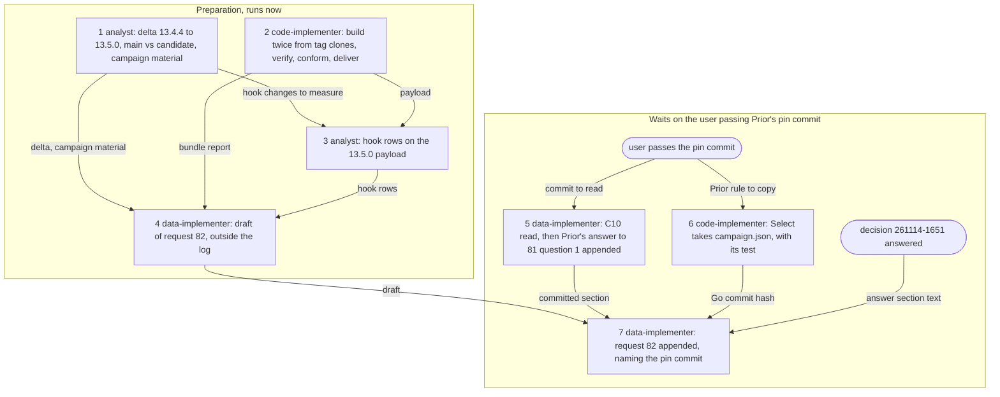

# Implementation Plan: request 82, the candidate 13.5.0 built from the tag and filed after Prior's pin commit

**Date:** 2026-11-14
**Spec:** none — planned from the package narrative `261114-1550-request-82-the-candidate-13-5-0-prepared-for-prior.md` (the user's rulings, verbatim) and the answered decision `261114-1554-which-commit-is-the-candidate-of-request-82-built-from-now-that-main-differs-from-the-tag-in-install-tree-files.md` (option 1)
**Decidability:** The load-bearing question is whether a bundle built in two clean clones of the tag `v13.5.0` is the candidate the request names, byte for byte. It is decidable from the inputs: `build.sh` writes `fusion_revision` from the clone's `HEAD`, the clone is detached at `60639346`, Prior is cloned at `PRIOR_PIN`, and two builds compared with `cmp` and `diff -r` decide it (discussion C8, C9). The second question, whether Prior's post-pin host accepts any 13.5.0 candidate (C10), is not decidable before the user passes the pin commit; it becomes decidable by one read of `QualifiedCodecDigest` at that commit, and the plan reads it at that point (step 5) rather than predicting it. Whether a three-name module is acceptable on a four-name host is not decidable on fusion's side at all, so the request asks Prior (C4) instead of asserting it.

## Directive

Prepare request 82 to Prior for the candidate 13.5.0 and file it in `codec/fixtures/prior/REQUESTS.md` once the user has passed Prior's pin commit, naming that commit. The package narrative holds the user's rulings and the scope; the answered decision fixes the build commit and three statements the request must carry. This plan does not restate either.

## Current State

**The candidate.** The tag `v13.5.0` is annotated (`48fe207c…`), names `6063934602b39d7445219006757bf415e3bef144`, and is on the remote (`REQUESTS.md`, ``### The tag `v13.4.4`, ruled to stand on the answer to 79``). `git show v13.5.0:.claude-plugin/plugin.json` reads `13.5.0`, and `git show v13.5.0:adapters/prior/PRIOR_PIN` reads `08c57fb4ec91df6b1e1e311fa2d063eb5ff08076` (both read for this plan). No 13.5.0 bundle has been built or delivered: `ls ~/.local/share/prior/incoming/fusion/` lists `13.0.0`, `13.1.0`, `13.4.0`, `13.4.1`, `13.4.2` and `13.4.4` (read for this plan).

**Measured facts this plan builds on**, from the closed discussion `261114-1608-which-commit-request-82-candidate-built-from.md`, each to be re-measured by the step that writes it:

- C1: the five files in which `main` differs from the tag outside the workbench are all under `codec/`, which the copy loop copies whole, so they are inside any bundle's install tree.
- C2: none of them is read by anything a Prior run starts (by reading, not by a run).
- C3: the module binaries compile a three-name `Select` (`adapters/prior/fusionmodule/internal/controlrecord/controlrecord.go`), called from `internal/entry/entry.go` and from the fake host `internal/fixture/entry.go` and `conformance/hooks_test.go` (the last two found for this plan with `grep`).
- C4: a three-name module on a four-name host asks for a strict subset of what the host admits; it rests on a Prior commit that did not exist when the discussion ran.
- C5: request 79's rule on later commits ended with the tag and does not carry to 82.
- C6: only building from the tag is consistent with both of the user's rulings.
- C8: any two build commits give different digests, because `build-identity.json` carries `fusion_revision`.
- C9: a build from the tag now is byte-identical to one after the pin commit, because `stage.sh` clones Prior at `PRIOR_PIN`.
- C7 (open): the first half holds, `campaign` is `prior: unsupported` at the tag; whether the campaign part of the user's goal needs a later candidate is open.
- C10 (open): whether the post-pin host accepts any 13.5.0 candidate is decided by `QualifiedCodecDigest` at the pin commit.

**The 13.4.4 → 13.5.0 delta, its size only.** `git rev-list --count v13.4.4..v13.5.0` prints 39, and the path-limited `git diff --stat` over the shipped entries, `catalog`, `adapters` and `.claude-plugin` ends `189 files changed, 14363 insertions(+), 513 deletions(-)` (measured for this plan). The campaign commits run from `4a81e482` to `4d8bec3e`; the codec moved from `b4047458…` to `36570a7c…` at `d3ad786d` (request 81). At the tag `catalog/catalog.json` lists 28 entries, 24 of them `support.prior` `supported` (measured for this plan with a script over `git show`), and `catalog/profiles/orchestrator/parts/59-prior.md` says `bin/fusion-campaign sync` does not run on Prior.

**How 13.4.2's and 13.4.4's bundles were produced.** Plan `261105-1023-plan-fusion-13-4-2-corrected-candidate.md` steps 7 and 8: build twice, `diff -r`, `build.sh verify`, conformance with `FUSION_BUNDLE_DIR`, `build.sh deliver`, then the request appended by the data-implementer. Request 79 `### The bundle` built in two fresh clones detached at D with `npm ci` in `catalog/`, and named the clean-clone `deliver` route unexercised. `README-agents.md` `### The Prior module bundle` is the build's documentation.

**Prior's side, read from committed objects only.** Prior's response to 79 at `10e07d2`, `## What Prior said confirmation needs, item by item`, lists five items, four met and the hook replay not met; `## The hook replay on this digest` says the replay can be repeated on 13.4.4 only while the pin has not moved. Prior's response to 81 at `bd3c1bf`, `### Question 3`, adds `campaign.json` to `entryControlRecord` as the bare name and to `codecShaped` as `campaigns/<id>/campaign.json`, in the commit that moves the digest. **Read for this plan, not passed by the user:** Prior's `main` holds `bf6bb42` (2026-11-14 15:13, "feat(fusionhost): move the codec pin to fusion d3ad786d and read campaign.json"), at which `internal/fusionhost/workbench.go:22` reads `QualifiedCodecDigest = "sha256:36570a7c…8844"`, and `7dbcf57` (16:04, "docs(design): report the moved codec pin on question 1 of fusion request 81"), which adds 279 lines to the response to 81. `bf6bb42`'s message says the hand-overs 13.4.1, 13.4.2 and 13.4.4 are refused from that commit on, and that the hook replay moves to the 13.5.0 package by Prior's user's ruling of 2026-11-14. `559a548` (15:35) adds an analysis "how a reference task for fusion's campaign command would be built" in Prior's workbench (subject and file list read, the analysis not read). **None of this is the user passing the pin commit.** The waiting steps start only on the user's word, and step 5 reads whatever commit the user names.

**The tests that read the log.** `catalog/src/__tests__/prior-commands.test.ts` reads `REQUESTS.md` by the first occurrence of "**The inventory, a text scan and so a floor.**"; an appended section must not repeat that phrase. `grep -rl REQUESTS` also lists codec sources and tests (`codec/src/__tests__/migration.test.ts`, `round-trip-cli-*.test.ts`, `ops.test.ts`), so the codec suite runs on every append.

**The open decision this plan filed.** `261114-1651-what-does-request-82-say-an-accepted-answer-releases-given-that-the-tag-v13-5-0-already-exists.md`: request 82's `### What fusion does with the answer` cannot tie the tag to the answer, because the tag precedes the request. Step 7 waits on its answer.

## Approach

One integral route, the one request 79 took, with the two differences the decision forces: the build runs in clones of a pushed tag instead of the release commit, and the filing waits on an input from Prior. Every digest-bearing figure is produced now, because the tag build does not move (C9). The request text is drafted now as an intermediate file under `bin/fusion-tmp path`, outside the append-only log, with every value that depends on the pin commit, on the Go commit or on the open decision held as a marked placeholder. When the user passes the pin commit, three commits follow in order: the record of Prior's answer to question 1 of 81, the Go copy's fourth name, and request 82 itself, which names both.

The measurement is split by kind rather than by section of the request. An analyst measures what can be read from git and from the catalog (step 1) and what the built payload's hooks do (step 3). A code-implementer builds (step 2). The data-implementer writes the draft (step 4) and the two log sections (steps 5 and 7). Each step that writes a figure into the draft or the log measures it there and cites the command.

**Delivery comes before the request is filed, the reverse of request 79's order.** 79 put the three files in the incoming directory after its section's commit because its section existed first. Here the section waits on Prior, and the build is reproducible from the tag at any time (C9). Delivering now lets the request state a delivered, sidecar-checked path instead of a promise. The request says so.

## Implementation Steps

1. **Measure the delta 13.4.4 → 13.5.0 for a Prior run, where `main` differs from the candidate, and what fusion's campaign material offers Prior**
   - Executor: analyst
   - Files: one analysis in `$OUT_ANALYSIS`, `YYMMDD-HHMM-request-82-delta-for-a-prior-run-and-campaign-material.md`; nothing else
   - Changes: read-only measurement in the live tree with path-limited or ref-only git commands (no `git status`, `git add`, `git checkout` or `git stash` without a pathspec; no checkout of the tag). The analysis answers, each figure with its command, at a named fusion commit:
     - (a) The commits `v13.4.4..v13.5.0` outside `fusion-workbench/`, one row each on what it does for a Prior run, in the form of request 79's `### The commits since 13.4.2`, the campaign commits first.
     - (b) The campaign as it reaches a Prior run: `campaign`'s `support.prior` at the tag; whether `skill-campaign` is rendered for Prior; every `prior` and neutral part that names `bin/fusion-campaign`, `campaign.json`, `lanes` or `set-resources` (`git grep` at the tag over `catalog/profiles`); what `59-prior.md` says of `sync`; what the codec at `36570a7c…` does for a campaign, cited from request 81's `### What the codec does for a campaign at this digest`. It states that `/fusion:campaign` cannot start in a Prior-hosted run of 13.5.0 and what a Claude Code recording can use (C7, first half).
     - (c) `main` against the candidate: `git diff --name-status v13.5.0 HEAD` and `--numstat` over the copy loop's entries (`install.sh`, the loop's own lines, read at the tag), `catalog` and `adapters`; `build.sh`'s line that writes `fusion_revision` (C8); `Select`'s three names at the tag (C3).
     - (d) The catalog and profile delta: `git diff v13.4.4 v13.5.0 -- catalog/catalog.json`, the entry count and the Prior support count at both tags, which `prior` parts changed, `FROZEN` and `WITHDRAWN` unchanged or not (`git diff --exit-code v13.4.4 v13.5.0 -- catalog/schemas catalog/workflows`).
     - (e) The hooks between the tags: `hooks/hooks.json` at both tags (sha256), which hook sources changed, and which change can reach a run with both roots at `/opt/fusion` (`runsOnPrior` branches, new `systemMessage` or `additionalContext` paths), read. This list is step 3's input.
     - (f) Fusion's campaign material for Prior's multi-checkout task, read at the tag: `hooks/lib/__tests__/fixtures/campaign/ax-k2-3-261105.json`, `hooks/lib/__tests__/helpers/campaign-fixture.ts`, `hooks/lib/__tests__/campaign-cut.test.ts`, `campaign-overview.test.ts`, `campaign-sync.test.ts`, `campaign-write.test.ts`, and `codec/fixtures/valid/campaign/with-lanes.json`. For each: what it contains, how many checkouts and whether a remote or fetched ref is set up, which test consumes it and what that test asserts, and what it would and would not give a reference task. Also `docs/campaign.md` as the model's description, and any sentence there that is stale at the tag (its request 81 sentence reads "asked and unanswered").
     - (g) Prior's own list for a confirmation, quoted from its response to 79 at `10e07d2` (`## What Prior said confirmation needs, item by item` and `## The hook replay on this digest`), and from its response to 81 at `bd3c1bf` (`### Question 3`), as read from committed objects.
   - Acceptance: every figure carries its command and is labelled measured, read or *inference*; the analysis names the fusion commit it measured at; `git status --porcelain -- codec adapters catalog` prints nothing after the step; nothing is read from Prior's working tree and nothing is written there.
   - Dependencies: none

2. **Build, verify, conform and deliver the 13.5.0 bundle from two clean clones of the tag**
   - Executor: code-implementer
   - Files: none in either repository. Scratch under `$(bin/fusion-tmp path)/request-82/` (`/Users/kai/.fusion-tmp/114caf11/request-82/` at planning time), and the delivery under `~/.local/share/prior/incoming/fusion/13.5.0/<digest-hex>/`
   - Changes: set `TMPDIR` to the scratch directory for every command, so `build.sh`'s and `stage.sh`'s `mktemp` land there. Two clones `a` and `b` of the live repository with `git clone --no-checkout`, each detached inside the clone at `6063934602b39d7445219006757bf415e3bef144`; `git -C <clone> rev-parse HEAD` and `plugin.json` checked; `npm ci` in each clone's `catalog/`. In each, `PRIOR_REPO=/projects/productive/F09-Prior <clone>/adapters/prior/build.sh build <scratch>/out-<clone>`. `cmp` of the two tarballs, sidecars and `handover.json`, and `diff -r` of the two outputs. `build.sh verify <scratch>/out-a`. Conformance from clone `a`: `FUSION_BUNDLE_DIR=<scratch>/out-a PRIOR_REPO=/projects/productive/F09-Prior <clone a>/adapters/prior/stage.sh test`, and the counts by package through `stage.sh run -- go test -count=1 -json ./integrationbuild/fusionmodule/...`. Then `build.sh deliver` from clone `a`, and `shasum -a 256 -c` on the delivered sidecar. Write the report to `<scratch>/build-report.md` and return it, in the form of request 79's `### The bundle` and `### The codec and the frozen assets`: digest, tarball sha256, sidecar and `handover.json` sha256 and bytes, the tar entry count with modes, files by first path segment, `module.json` (version, `data` count, `lifecycle_hooks` sha256), `build-identity.json` (`fusion_revision`, `prior_revision`, `go_version`, `install_tree_omitted`), the three target binaries' sha256 against 13.4.4's table, the conformance counts by package, `codec/dist/fusion-record.js` and `codec/fixtures/prior/REQUESTS.md` hashed from the tarball, `catalog.json`'s sha256, the eight `FROZEN` assets and the eleven `WITHDRAWN` paths, the profiles present, and `diff -rq` against the extracted 13.4.4 tarball from its delivered path (new, gone and differing counts, and the differing paths). Nothing in the live tree is touched: the only git commands there are `git clone` reading it and `git rev-parse v13.5.0^{commit}`.
   - Acceptance: both builds print one digest. `cmp` and `diff -r` exit 0. `build.sh verify` exits 0. The conformance suite passes; a failure is a stop, reported with its output. `fusion_revision` is `6063934602b39d7445219006757bf415e3bef144` with no `+dirty`, and `prior_revision` is `08c57fb4…`. The tarball's codec hashes to `36570a7cafb3083a70b0386b337ac471357782b0d164b97fd28f2f7d740d8844`. `deliver` prints a path under `13.5.0/` whose digest equals the builds', and the sidecar check prints OK. The three files under the 13.4.4 delivery path have the sha256 they had before the step. `git -C /projects/productive/F09-Prior rev-parse HEAD` prints the same value before and after the step, and no command writes into Prior's repository.
   - Dependencies: none

3. **Measure the hook rows on the 13.5.0 payload, as request 79 measured them on 13.4.4**
   - Executor: analyst
   - Files: one analysis in `$OUT_ANALYSIS`, `YYMMDD-HHMM-request-82-hook-rows-on-the-13-5-0-payload.md`; scratch under `$(bin/fusion-tmp path)/request-82/hooks/`
   - Changes: the method of request 79's `#### The hooks`, on the payload of `<scratch>/out-a`: the extracted payload over one fresh scratch git repository holding `fusion-workbench/.fusion-setup` and `.checkout-id`, no stamps, `TMPDIR` and `CLAUDE_CODE_TMPDIR` unset. The rows: the tracker's reply to a `PostToolUse` `Bash` payload on `cat /tmp/x`; the session-start `systemMessage`; the commit-message sentence. Each under three settings: both roots at `/opt/fusion` in the pinned image (`docker run --rm --network none node@sha256:6449e19d…`, the full digest read from request 79), both roots at the payload's own path on macOS, and `FUSION_PLUGIN_ROOT` alone at `/opt/fusion`. Then every hook change step 1 (e) names as reachable on Prior, measured or stated not measured with the reason. The analysis compares each row with request 79's table and Prior's measured rows in its response to 79 (`## The bundle's hook changes on Prior's executor`).
   - Acceptance: each row is measured or stated "not measured" with its cause (Docker unavailable is a cause, not a stop); no row is presented as a run on Prior's host or as a Claude Code baseline comparison; the analysis names the payload's digest.
   - Dependencies: 1, 2

4. **Write request 82 as a draft outside the log**
   - Executor: data-implementer
   - Files: `$(bin/fusion-tmp path)/request-82/request-82-draft.md`; nothing in the repository
   - Changes: the section `## The candidate 13.5.0 (request 82)`, in request 79's form and language register, each figure measured by this step against the delivered files, the repository or Prior's committed objects, with step 2's report and the two analyses as cross-checks. Headings, in this order:
     - `### Written against`: the tag, its commit and object, built in clones and never from `main`; `main` at the request's parent; Prior at the pin commit; `PRIOR_PIN`; the codec. The measured, read and *inference* legend.
     - `### What 82 does`: a run on this digest, the digest and tarball sha256, the delivery path and that it was delivered before the section (`## Approach`); 79 is answered and nothing of it is replaced; 82 is no re-pin request.
     - `### Where main differs from the candidate`: the three statements the decision's answer requires, in its words: the files in which `main` differs and that a digest differs per build commit by construction (C1, C8); the three-name module against four names on `main` and on Prior's host from the pin commit on, naming the fusion commit that carries the Go change (C3); `/fusion:campaign` cannot start in a Prior-hosted run of 13.5.0, while Prior's Claude Code recordings can use it (C7, first half).
     - `### The changes from 13.4.4, the campaign first`: `/fusion:campaign`, `campaign.json`, lanes and `set-resources`, then the remaining commits, from step 1 (a), (b) and (d).
     - `### The bundle` and `### The codec and the frozen assets`: from step 2's report.
     - `### What differs from 13.4.4 for a Prior run`: profiles, catalog, the hook rows from step 3, the install tree.
     - `### What Prior is asked to run`: 82.1 to 82.4 as 79.1 to 79.4 with 82's values, in a table like 79's; and the hook replay on this digest against the Claude Code baselines, which Prior's own list names and which stayed unmet at 79, with Prior's five items restated as what a confirmation needs.
     - `### Questions for Prior`, each with what a no means for fusion: (1) whether Prior accepts a 13.5.0 module that selects three control-file names on a host that selects four, on fusion's reading C4, or needs the fourth name in the module, which is the **Corrected** route to 13.5.1. A further question only where step 1 or 3 finds one Prior alone can answer.
     - `### A note for Prior: the test base moves to 13.5.0`: the user's statement that Prior moves its test base to 13.5.0 and re-records under Claude Code, campaign tasks included, and that Prior is working out how a campaign task across several checkouts is set up; fusion's material from step 1 (f), each item with what it offers and what it does not.
     - `### Stated and not asked`: nothing has run on a Prior host at this digest; the stale sentence of `docs/campaign.md` if step 1 confirms it; whether the campaign entry gets Prior support stays with fusion's user (C7, second half); the open issues on the `tmp` stamp and the help topic if they still read open.
     - ``### `REQUESTS.md`'s digest moved``: Prior's pins of this file at the pin commit, the file as the tarball carries it (the tag's), and that the section cannot state its own digest.
     - `### What fusion does with the answer`: the answer of decision `261114-1651-…`; a correction that changes the bundle is a new patch version, a rebuild, a new digest and a new request; a defect Prior names is filed as an issue before the answer is recorded.
     - `### Requests 64 and 67 to 82, as they stand`: the table, superseding the last one.
     Every value that depends on the pin commit, on the Go commit, on the request's parent or on the decision is written as `[[PENDING: <what>; step <n>]]`.
   - Acceptance: every heading above is present; each figure equals the delivered files or the cited command's output; the draft does not contain the phrase "The inventory, a text scan and so a floor."; the draft lists its pending markers at its foot; `git status --porcelain -- codec` prints nothing.
   - Dependencies: 1, 2, 3

5. **Read `QualifiedCodecDigest` at Prior's pin commit, then record Prior's answer to question 1 of request 81** (**waits on the user passing Prior's pin commit**)
   - Executor: data-implementer
   - Files: `codec/fixtures/prior/REQUESTS.md` (append only)
   - Changes: first, from Prior's committed objects, `git -C /projects/productive/F09-Prior show <pin commit>:internal/fusionhost/workbench.go` and the `QualifiedCodecDigest` line. **If it does not name `sha256:36570a7cafb3083a70b0386b337ac471357782b0d164b97fd28f2f7d740d8844`, stop, append nothing, and return the read value to the orchestrator for the user** (C10). Otherwise append a section `### Prior's answer to question 1 of 81 at <short hash>`, in the form of `### Prior's answer to 81 at bd3c1bf`: the commit, its parent and branches; the response document's path, lines, bytes and sha256 at that commit where Prior gives one; the verdict quoted; the moved pins measured with `git show` (both `UPSTREAM.json` files: commit, file counts, the pin of this file; `QualifiedCodecDigest`; `codecPin` and `codecBundleDigest`); `entryControlRecord` and `codecShaped` with the fourth name, read; what Prior says of the earlier hand-overs; question 1 of 81 closed; what is open on fusion's side (the Go copy, request 82); `REQUESTS.md` against Prior's pins; a row table superseding the last one. Before the append, record the file's byte count and sha256 at `HEAD`.
   - Acceptance: `git diff --numstat -- codec/fixtures/prior/REQUESTS.md` prints `<n> 0`; the file's first `<old bytes>` bytes hash to the recorded sha256; `cd catalog && npx vitest run src/__tests__/prior-commands.test.ts` passes; `cd codec && npx vitest run` shows no failure that it did not show at the step's parent (run there first); nothing is written in Prior's repository. The orchestrator commits the one file and reports the commit and the file's `shasum -a 256` at it.
   - Dependencies: none (waits on the user's input)

6. **The Go copy `Select` takes `campaign.json` as its fourth control-file name, with its test** (**waits on the user passing Prior's pin commit**)
   - Executor: code-implementer
   - Files: `adapters/prior/fusionmodule/internal/controlrecord/controlrecord.go`, `adapters/prior/fusionmodule/internal/controlrecord/controlrecord_test.go`; `adapters/prior/README.md` only if it states the three names
   - Changes: read Prior's `entryControlRecord` in `internal/fusionhost/entry_workspace.go` at the pin commit from committed objects and copy its rule for the fourth name exactly; Prior's answer to 81 says it takes the bare name `campaign.json`, as it takes `package.json`. The header names the Prior commit it copies and request 81's question 3. Test rows: a campaign file under `campaigns/<id>/` selected; the same under `archive/` and under a dot segment refused; a near name such as `campaign.json.bak` refused. `PRIOR_PIN` stays `08c57fb`. This change lands on `main` and not in the candidate.
   - Acceptance: `PRIOR_REPO=/projects/productive/F09-Prior adapters/prior/stage.sh test` exits 0, the fake host and `conformance/hooks_test.go` included; `git diff --stat -- adapters` names only the files above; `git diff --stat v13.5.0 -- adapters/prior/PRIOR_PIN` prints nothing; nothing is written in Prior's repository. The orchestrator commits and reports the commit hash for step 7.
   - Dependencies: none (waits on the user's input)

7. **File request 82, naming Prior's pin commit** (**waits on steps 5 and 6 committed and on decision `261114-1651-…` answered**)
   - Executor: data-implementer
   - Files: `codec/fixtures/prior/REQUESTS.md` (append only)
   - Changes: resolve every `[[PENDING …]]` marker of the draft: the pin commit, the Go commit from step 6, the decision's answer, and the values at the request's parent. Re-measure every figure the section states that can be read off the delivered files, the repository or Prior's committed objects: the delivered sidecar check and digest; `git diff --name-status v13.5.0 HEAD` over the copy loop's entries, `catalog` and `adapters`, so the list now holds step 6's Go files beside the codec files; `REQUESTS.md`'s lines, bytes and sha256 at `HEAD`; the codec at `HEAD`; Prior's two pins of this file at the pin commit. A run result (the two builds, `verify`, conformance, the hook rows) is stated with the date and commit it ran at. A draft value that differs from the re-measurement is corrected in the section and named in the step's report. Then append.
   - Acceptance: the appended section holds no `[[PENDING`; `git diff --numstat -- codec/fixtures/prior/REQUESTS.md` prints `<n> 0` and the prefix hash holds as in step 5; the section names the pin commit and step 6's commit; `git diff --name-only v13.5.0 HEAD` over the copy loop's entries lists only files the section names; `prior-commands.test.ts` passes; the codec suite shows no failure absent at the parent. The orchestrator commits the one file, pushes `main`, and reports to the user the commit hash and the file's `shasum -a 256` at it.
   - Dependencies: 4, 5, 6

## Where this work stops

- The work is finished when request 82 is committed on `main` and pushed, names Prior's pin commit, and the user has been told its commit hash and the file's sha256 at that commit.
- Request 82 is filed only after the user has passed Prior's pin commit; a commit read from Prior's history and not passed by the user is no such input.
- Request 82 is filed only if `QualifiedCodecDigest` at the pin commit names `36570a7c…`; otherwise the work stops at step 5 and the value goes to the user.
- Request 82 is filed only after Prior's answer to question 1 of 81 is committed in its own section and the Go change is committed on `main`.
- Request 82 is filed only after decision `261114-1651-…` is answered.
- The bundle the request names is the tree of `v13.5.0`: `fusion_revision` `60639346…` without `+dirty`, built in clones, two builds byte-equal, conformance passed, delivered under `13.5.0/`. A difference between the builds or a conformance failure stops the work.
- `REQUESTS.md` takes insertions only, and its prefix hash holds at each of the two appends.
- No git command without a pathspec or a ref runs in the live tree, and the tag is never checked out there.
- Nothing is written in Prior's repository by any step.
- No hook comparison runs on 13.4.4, and the ruling on `v13.4.4` (`1f92185c`) is untouched.
- No tag is made or moved and the marketplace is not bumped in this work.
- `PRIOR_PIN` stays `08c57fb`; a build or test that needs it moved stops the work.
- No file under `agents/`, `skills/`, `rules/` or the hook tests is edited; a step that needs one stops and reports, and a red growth bound is answered by a cut and never a baseline edit (condition did not arise: no step plans such an edit).

## Data Structures

None new. The draft's placeholder form is `[[PENDING: <what>; step <n>]]`, chosen because the log contains no `[[`.

## API Changes

`Select` in the Go copy accepts `campaign.json` as a fourth name (step 6). Nothing in the shipped Claude Code tree changes its behaviour.

## Testing Strategy

- The build: two clones, `cmp` and `diff -r`, `build.sh verify`, the conformance suite against the built bundle, the delivered sidecar check (step 2).
- The log: `catalog/src/__tests__/prior-commands.test.ts`, the codec suite (`cd codec && npx vitest run`, compared with its result at the parent), the additions-only `numstat` and the prefix hash (steps 5 and 7).
- The Go change: `stage.sh test` with `PRIOR_REPO` (step 6).
- The hooks: the three-setting rows of step 3. Not a test of Prior's host, and stated so.

## Risks & Mitigations

| Risk | Mitigation |
|---|---|
| Prior's host at the pin commit qualifies another codec (C10) | step 5 reads it first and stops before writing |
| Prior's rule for the fourth name at the pin commit differs from the bare name its answer to 81 announced | step 6 copies the rule as read at the pin commit, and request 82 states the rule it copied |
| Prior's update to its response to 81 corrects something the draft relies on | the draft is revised at step 7 against step 5's section before the append |
| The clean-clone `deliver` route differs from `build`, as request 79 left unexercised | step 2 compares the delivered digest with both builds and stops on a difference |
| The append repeats the anchor phrase `prior-commands.test.ts` searches for | step 4's acceptance excludes it, and the test runs at each append |
| The codec suite carries reds unrelated to the log (issue `261028-1225-two-codec-tests-on-a-dangling-link-in-a-removal-entry-fail-at-head.md` reads open, though `cd codec && npx vitest run` exited 0 at `f78d350f`, measured for this plan) | each append compares with the suite at its parent; only a new red is a stop |
| `npm ci` in a clone fetches packages from the network | it reads `catalog/package-lock.json` at the tag, as at request 79; a failure is reported, not worked around |

## Open Questions

- [ ] What request 82 says an accepted answer releases, given that the tag `v13.5.0` already exists: decision `261114-1651-what-does-request-82-say-an-accepted-answer-releases-given-that-the-tag-v13-5-0-already-exists.md` (open; step 7 waits on it).
- [ ] Whether the campaign entry gets Prior support in a later candidate stays open with the user (discussion C7, second half). Request 82 states it and asks nothing; no record is filed here, because the inputs it needs, Prior's analysis of a multi-checkout task among them, are not in hand.
- [ ] Whether a reviewer reads the draft against the analyses and the build report before step 7. Not required by the user's rulings; recommended, since passages correcting requests 79 and 81 followed both.
