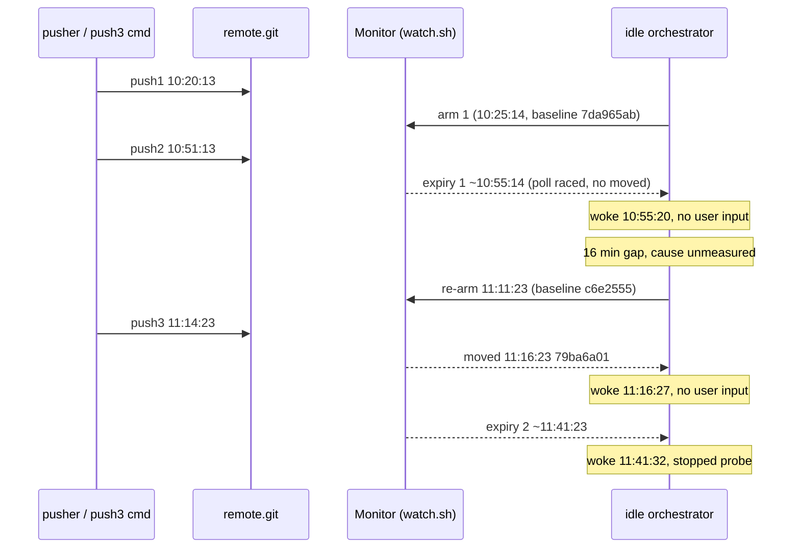

# Analysis: can an idle session poll the remote

**Date:** 2026-11-20 12:42
**Type:** Feasibility
**Status:** Complete
**Requested by:** orchestrator (plan `261119-1248-plan-campaign-peers-follow-the-steering-session-and-report-back.md`, step 1)

## Question

Can an open main-loop session that is idle be woken at a fixed interval by a `Monitor`-armed poll of the remote, and keep that poll going across the monitor's 30-minute expiry without the user? The plan's step 1 asks six questions, (a) to (f). The verdict reads `poll-possible: yes` only if (a), (b) and (c) are all yes.

## Scope

- Tree: `/System/Volumes/Data/Projects/productive/F04-FUSION/fusion`. HEAD `0c5056cf65a49c8d9ad81802f31685685f5e6cbb` (2026-11-20 11:09:29 +0100), branch `main`. `git status -sb` reads `## main...origin/main` (local tracking ref, not re-fetched for this report). Work-tree changes are confined to `fusion-workbench/`. The only plugin file read is `hooks/hooks.json`, for (f).
- Probe directory: `/Users/kai/.fusion-tmp/114caf11/idle-poll-probe/`. It holds `README.txt`, `watch.sh`, `pusher.sh`, `pusher.log`, `orchestrator-start.txt`, the bare remote `remote.git` and its clone `work`. The probe is scratch and is not committed. No probe process is running (`pgrep -fl idle-poll-probe` returns nothing).
- Instrument: `watch.sh` prints `armed <UTC> <hash>` once, then polls `git ls-remote <bare> HEAD` every 300 s and prints `moved <UTC> <hash>` only when the hash changes. It ran under `Monitor` with `timeout_ms` 1 800 000 and the description `idle-poll probe: on expiry re-arm this monitor with the same command; stop after the second expiry; this is plan 261119-1248 step 1` (`README.txt`).
- Evidence sources: the two log files, copied verbatim below; the orchestrator's notification record, as relayed in the dispatch; the bare remote's `git log`; the orchestrator's own reading of its tool list.

## Findings

### Evidence inventory

| Artefact | What it is |
|---|---|
| `orchestrator-start.txt` | Wall-clock marks the orchestrator wrote at each step of the run. |
| `pusher.log` | The pusher's start line, each push with its hash and exit code, and its exit line. `push3` came from a separate one-off command the orchestrator scheduled, not from `pusher.sh`. |
| `watch.sh`, `pusher.sh`, `README.txt` | The poll loop, the pusher (pushes at +420 s and +2 280 s), and the run instructions. |
| `remote.git` | The bare remote. Its log confirms all three push hashes. |
| Orchestrator notifications (relayed) | Each `Monitor` event, each expiry notice, and the wake time that followed. |
| Tool-list reading (relayed) | What the `fusion`-launched main session offers for timed wakes, for (e). |

`orchestrator-start.txt`, verbatim:

```
2026-11-20T10:13:13Z
2026-11-20T10:25:17Z
expiry1-woke 2026-11-20T10:55:20Z
rearm1 2026-11-20T11:11:23Z
armed2-notified 2026-11-20T11:11:37Z
moved-woke 2026-11-20T11:16:27Z
expiry2-woke 2026-11-20T11:41:32Z
```

`pusher.log`, verbatim:

```
start 2026-11-20T10:13:13Z pid=39965
push1 2026-11-20T10:20:13Z 7da965abab041284317b41f8e412bdd3b2de7ab2 rc=0
push2 2026-11-20T10:51:13Z c6e2555093af45a83f15b7d5ff5b097c26440fa6 rc=0
exit 2026-11-20T10:51:13Z
push3 2026-11-20T11:14:23Z 79ba6a01be28182ada0fd61aeb1d18aba991c5f4 rc=0
```

`git log` of `remote.git` confirms the same three hashes after `probe: initial` (`cb7dd17b`).

### Timeline (UTC, 2026-11-20)

| Time | Event | Source |
|---|---|---|
| 10:13:13 | Pusher started. A stray user message then delayed the arm. | `pusher.log`, `orchestrator-start.txt` line 1 |
| 10:20:13 | push1 (`7da965ab`). Lands before the watch exists. | `pusher.log` |
| 10:25:14 | Monitor 1 event: `armed 10:25:14Z 7da965ab`. Its baseline is already push1, so push1 is never a `moved`. | notification |
| 10:25:17 | Arm recorded by the orchestrator. | `orchestrator-start.txt` line 2 |
| 10:30–10:50 | Polls at :30:14, :35:14, :40:14, :45:14, :50:14, no change. | derived from `watch.sh` interval |
| 10:51:13 | push2 (`c6e2555`). | `pusher.log` |
| ~10:55:14 | The next poll and the 30-minute expiry fall on the same second. **No `moved` for push2.** **Derail point 1.** | notification record |
| — | Expiry notice 1: "Monitor expired after 30m with 1 event delivered" (the one event is the `armed` line). | notification |
| 10:55:20 | Idle orchestrator woke and ran a command, no user input. Wake latency about 6 s. | `orchestrator-start.txt` `expiry1-woke` |
| 10:55:20–11:11:23 | 16-minute gap before the re-arm. Cause unmeasured. **Derail point 2.** | see (b) |
| 11:11:23 | Re-arm. Same turn scheduled push3 at +180 s. Monitor 2 event: `armed 11:11:23Z c6e2555`. Its baseline is already push2, so push2 is never a `moved` either. | `orchestrator-start.txt` `rearm1`, notification |
| 11:11:37 | Armed event delivered and noted. | `orchestrator-start.txt` `armed2-notified` |
| 11:14:23 | push3 (`79ba6a01`). | `pusher.log` |
| 11:16:23 | Monitor 2 event: `moved 11:16:23Z 79ba6a01`. | notification |
| 11:16:27 | Idle orchestrator woke, no user input. Wake latency about 4 s. | `orchestrator-start.txt` `moved-woke` |
| ~11:41:23 | Expiry notice 2: "... 2 events delivered" (`armed` and `moved`). | notification |
| 11:41:32 | Idle orchestrator woke and stopped the probe, as the description said. Wake latency about 9 s. | `orchestrator-start.txt` `expiry2-woke` |

From arm (10:25:14) to the final wake (11:41:32) is about 76 minutes, spanning two expiries.



Coherence check: three actors and the remote. Every write to the remote comes from the pusher side. Every event into the orchestrator comes from the monitor. The orchestrator's only edges to the monitor are the two arms. No edge runs from the orchestrator to the remote, which matches the probe design: the session only reads, through `watch.sh`.

### Answers

| | Question | Answer | Evidence |
|---|---|---|---|
| (a) | A `moved` event wakes the idle session and starts a turn with no user input. | **yes** | `moved 11:16:23Z 79ba6a01` delivered; `moved-woke 2026-11-20T11:16:27Z`, 4 s later, with no user input. Shown once. |
| (b) | The expiry notice wakes the idle session, and the session re-arms from that notice without the user. | **no (not shown)** | The wake half is yes, twice: `expiry1-woke 10:55:20Z` and `expiry2-woke 11:41:32Z`, each within 10 s of expiry and with no user input. The re-arm half is not shown. The only re-arm (`rearm1 11:11:23Z`) came 16 minutes after the wake. Its cause is not measured. See below. |
| (c) | The chain survives at least two expiries, about 65 minutes in all. | **yes, with (b)'s caveat** | Arm 10:25:14 to final wake 11:41:32 is about 76 minutes. Both expiries were followed by a wake, and a `moved` was delivered after the first one. The chain got past expiry 1 only through the re-arm in (b), so it inherits (b)'s doubt about whether a person took part. By the description, the second expiry ended the run and was not followed by a re-arm. |
| (d) | The notification text carries the monitor's `description`, so the re-arm instruction survives context compaction. | **no (not shown)** | The expiry text in the record is "Monitor expired after 30m with 1 event delivered" and "... 2 events delivered". Neither contains the description. The record does not say whether the harness shows the description alongside that text. No compaction happened during the run, so survival across compaction was not tested. The re-arm at 11:11:23 used the same command, but the description was still in the uncompacted context then, so that proves nothing for (d). |
| (e) | `ScheduleWakeup` or `/loop <interval>` available in a `fusion`-launched session; starts a turn when nothing moved. | **yes, both available; yes, a timed wake starts a turn whether or not anything moved** (a reading, not exercised) | The orchestrator's tool list (main session, `fusion` launcher) holds a `ScheduleWakeup` tool. Its description restricts it to `/loop` dynamic mode, with delays clamped to 60–3 600 s. `/loop` and `schedule` are listed as skills. A wake on a timer fires on time, not on a remote change, so every interval costs a turn even when the head is unchanged. That breaks C5's "no turn when nothing moved". `schedule` creates cloud routines, so it cannot wake this session. Neither tool was exercised in the probe. |
| (f) | No hook in `hooks/hooks.json` fires without a tool call of the session. | **yes** (a reading of the file, labelled as one) | `hooks/hooks.json` registers four events. `SessionStart` fires on session start or resume, not while idle. `PreToolUse` (`guard.js`) and `PostToolUse` (`tracker.js`) fire only on a tool call matching `Write\|Edit\|MultiEdit\|NotebookEdit\|Bash\|Task\|Agent`. `SubagentStop` fires when a sub-agent the session dispatched returns, which follows the session's own `Agent` call. None is timed, and none fires on a `Monitor` event. `Monitor` is in neither matcher, so the guard never sees an arm and the tracker never logs one. |

#### What the unmeasured re-arm gap means for (b)

The session woke at 10:55:20 with no user input, but it re-armed only at 11:11:23. Two facts bear on why, and neither settles it:

- Earlier in the session the user had rejected a `Monitor` call. `Monitor` calls in this session therefore go through a permission prompt.
- Around the re-arm, the harness reported a switch into auto mode.

One reading is that the re-arm waited 16 minutes on a permission prompt, which a person then answered or which a mode change cleared. Another is that the delay came from something else in the turn. The session record cannot tell these apart. Answering a permission prompt counts as user input. So the evidence does not show a re-arm "without the user", and (b) cannot be marked yes.

The gap is a property of this session's permission state, not of `Monitor` itself. A session where `Monitor` is pre-allowed, or one run in a fixed permission mode, would measure it directly. If such a run timestamps each permission prompt and shows a re-arm within seconds of the expiry wake, (b) would be yes.

### Hypotheses for the 16-minute gap

| Hypothesis | For | Against |
|---|---|---|
| The `Monitor` call sat at a permission prompt until someone answered it or auto mode cleared it. | `Monitor` was already behind a prompt (an earlier rejection). An auto-mode switch was reported near the re-arm. | No prompt timestamps exist. |
| The turn did other work before re-arming. | The same turn also scheduled push3, so it had more than one task. | Scheduling push3 is one short command. It does not account for 16 minutes. |

### Limits of the probe

- **One `moved` event, not two.** push1 landed before the arm (stray user message), and push2 fell into the expiry race. (a) rests on a single wake, at 11:16:27.
- **The race between a poll and expiry.** push2's poll and the expiry both fell at about 10:55:14, and no `moved` was delivered. The re-armed watch then took `c6e2555` as its baseline (`armed 11:11:23Z c6e2555`), so push2 was never reported. A move that happens between the last delivered poll and the re-arm is lost. The real watch has to handle this. Two ways: re-arm before expiry (`timeout_ms` above the cycle the session re-arms on), or compare at arm time against a remembered last-seen head and print `moved` at once if it differs. The second is the integral fix, because it also covers a move during any re-arm delay, including the 16 minutes seen here.
- **The unmeasured re-arm gap.** See (b). A permission prompt being involved can be neither confirmed nor ruled out.
- (d) was not tested under compaction, and (e) is a reading of the tool list, not a run.

## Implications

The core mechanism works. A `Monitor` event wakes an idle session within seconds and starts a turn with no user input. This held for a `moved` event and for both expiry notices. Three things are not yet proven: whether the session can re-arm without someone at the keyboard, whether it can do so after compaction, and how to avoid losing a move at expiry. The verdict gate needs (b), so the work stops here under the plan's step 1 acceptance. The orchestrator returns these figures to the user.

The alternative (e) offers, `/loop` with `ScheduleWakeup`, needs no re-arm but costs a turn per interval. That changes C5, so the user has to rule on it before step 3.

## Recommendations

- **Orchestrator:** return the figures to the user, as step 1 acceptance requires. Present two options: (1) re-run the probe in a session where `Monitor` is pre-allowed, timestamping each permission prompt, to settle (b), and add a compaction during the run to settle (d); (2) accept `/loop` and rule on C5's "no turn when nothing moved".
- **implementation-planner (if the user continues with `Monitor`):** step 4's `watch` should compare against the last-seen head at arm time and emit `moved` immediately on a difference, so a move during expiry or a re-arm delay is never lost. Step 6/7 prose should not rely on the description surviving compaction until (d) is measured. The re-arm instruction has to be recoverable from something durable.

## Filed Issues

None. The figures go to the user through the orchestrator, per step 1 acceptance. The expiry-race design point belongs to step 4's plan text, if work continues.

## Sources

- `/Users/kai/.fusion-tmp/114caf11/idle-poll-probe/orchestrator-start.txt` (all lines)
- `/Users/kai/.fusion-tmp/114caf11/idle-poll-probe/pusher.log` (all lines)
- `/Users/kai/.fusion-tmp/114caf11/idle-poll-probe/watch.sh`, `pusher.sh`, `README.txt`
- `git -C /Users/kai/.fusion-tmp/114caf11/idle-poll-probe/remote.git log`
- Orchestrator notification record and tool-list reading, as relayed in the step 1 dispatch
- `hooks/hooks.json` (the four registered events and their matchers)
- Plan `261119-1248-plan-campaign-peers-follow-the-steering-session-and-report-back.md`, step 1 (lines 92–105)

## Open Questions

- [ ] Did the re-arm at 11:11:23 wait on a permission prompt? Unmeasured. A re-run with `Monitor` pre-allowed settles it.
- [ ] Does the expiry notice carry the `description` after compaction? Not tested.
- [ ] Continue with `Monitor` (and re-measure (b)), or rule on `/loop` against C5?

## Run 2 (Monitor pre-allowed)

The run-1 verdict line, `poll-possible: no`, was the last line of the report until this section was appended. It is replaced by the verdict line below. Everything above this heading is run 1 and is unchanged, except that run 1's log files have since been renamed. `orchestrator-start.txt` and `pusher.log` above are now `run1-orchestrator.txt` and `run1-pusher.log` in the same directory.

### Setup change and evidence

- The user added `"Monitor"` to `permissions.allow` in `.claude/settings.local.json` (git-ignored). The file's mtime is 2026-11-20T12:39:30Z, 14 s before the run-2 pusher started.
- Same probe as run 1: `watch.sh` and `pusher.sh` unchanged, the same bare remote, the same `timeout_ms` and description. No probe process is running now.
- No user input reached the session from the arm to the stop (orchestrator's record).

`orchestrator-start.txt` (run 2), verbatim:

```
run2-pusher 2026-11-20T12:39:44Z
run2-arm 2026-11-20T12:39:52Z
run2-moved1-woke 2026-11-20T12:49:54Z
run2-expiry1-rearm 2026-11-20T13:09:56Z
run2-moved2-woke 2026-11-20T13:20:02Z
run2-expiry2-woke 2026-11-20T13:40:07Z
```

`pusher.log` (run 2), verbatim:

```
start 2026-11-20T12:39:44Z pid=47577
push1 2026-11-20T12:46:44Z eae22d53c4a44577770bc593524b7eacca8c4c29 rc=0
push2 2026-11-20T13:17:44Z 9eb039ed9299bc631fd996aac62eada911f50942 rc=0
exit 2026-11-20T13:17:44Z
```

`git log` of `remote.git` confirms `eae22d53` and `9eb039ed` on top of run 1's `79ba6a01`.

### Timeline (UTC, 2026-11-20)

| Time | Event | Source |
|---|---|---|
| 12:39:44 | Pusher started. | `pusher.log`, `run2-pusher` |
| 12:39:48 | Monitor 1 event: `armed 12:39:48Z 79ba6a01`. Its baseline is run 1's last head. | notification |
| 12:39:52 | Arm recorded. No permission prompt. | `run2-arm` |
| 12:46:44 | push1 (`eae22d53`). | `pusher.log` |
| 12:49:48 | Monitor 1 event: `moved 12:49:48Z eae22d53`, on the second poll after arm. | notification |
| 12:49:54 | Idle session woke, no user input. Latency 6 s. | `run2-moved1-woke` |
| ~13:09:48 | Expiry notice 1: "2 events delivered" (`armed` and `moved`). | notification |
| 13:09:56 | Re-armed about 8 s after expiry, with no user input and no prompt. Monitor 2 event: `armed 13:09:56Z eae22d53`. The baseline equals the last reported head, so no move was lost across this expiry. | `run2-expiry1-rearm`, notification |
| 13:17:44 | push2 (`9eb039ed`). | `pusher.log` |
| 13:19:56 | Monitor 2 event: `moved 13:19:56Z 9eb039ed`, from the re-armed monitor. | notification |
| 13:20:02 | Idle session woke, no user input. Latency 6 s. | `run2-moved2-woke` |
| ~13:39:56 | Expiry notice 2. | notification |
| 13:40:07 | Idle session woke and stopped the probe, as the description said. Latency about 11 s. | `run2-expiry2-woke` |

From arm (12:39:48) to the final wake (13:40:07) is about 60 minutes, spanning two expiries. That is less than the plan's "about 65 minutes" only because the re-arm took 8 s instead of run 1's 16 minutes. The criterion is two expiries.

### Answers on run 2

| | Question | Answer | Evidence |
|---|---|---|---|
| (a) | A `moved` event wakes the idle session and starts a turn with no user input. | **yes** | Shown twice: `moved 12:49:48Z eae22d53` then woke at 12:49:54, and `moved 13:19:56Z 9eb039ed` then woke at 13:20:02. No user input either time. The second wake came from a monitor the session had re-armed itself. |
| (b) | The expiry notice wakes the idle session, and the session re-arms from that notice without the user. | **yes** | Expiry 1 at about 13:09:48 was followed by the re-arm at 13:09:56 (`armed 13:09:56Z eae22d53`), about 8 s later, with no user input and no permission prompt. Expiry 2 woke the session at 13:40:07, and it stopped the probe as instructed. Run 1's 16-minute gap did not recur once the prompt was out of the way. |
| (c) | The chain survives at least two expiries, about 65 minutes in all. | **yes** | One chain ran from 12:39:48 to 13:40:07 (about 60 minutes), through two expiries, with a self-made re-arm between them that went on to deliver a `moved`. |
| (d) | Description survives context compaction. | **no (not shown)** | No compaction happened in run 2 either. Run 1's finding stands. |
| (e), (f) | | unchanged | Run 1's readings stand. |

### What run 2 settles, and what it leaves open

- **Run 1's re-arm gap.** With `Monitor` pre-allowed, the re-arm took 8 s. This supports, but does not prove, the run-1 hypothesis that the 16 minutes was spent at a permission prompt.
- **Which mechanism cleared the prompt is not isolated.** As read now, `.claude/settings.local.json` does not parse as strict JSON. Line 4 reads `"Monitor",.`, and a strict parser (Python `json`) stops at line 4, column 14. Run 1 also saw a switch into auto mode, and nothing records whether auto mode was still on in run 2. So the evidence cannot say whether the allow entry or the permission mode admitted `Monitor` without a prompt. The verdict holds either way, because it depends on `Monitor` running without a prompt, whatever admits it. The stray `.` is a project-local, git-ignored file and outside this report's write scope. The user should fix it so the pre-allow does not depend on how leniently the harness parses.
- **The expiry race was not exercised.** Both pushes landed about 3 minutes before a poll, and no push fell between the last poll and a re-arm. Run 1's lost push2 still shows the race is real. The step-4 recommendation stands: compare against the last-seen head at arm time.
- **(d) is still untested.** The re-arm instruction must not depend on the description surviving compaction until that is measured.

### Condition

The verdict depends on one condition: `Monitor` must be pre-allowed in the session that watches (in run 2, through `permissions.allow` in `.claude/settings.local.json`), because with a permission prompt in the way, the re-arm waits on a person, as in run 1.

poll-possible: yes
