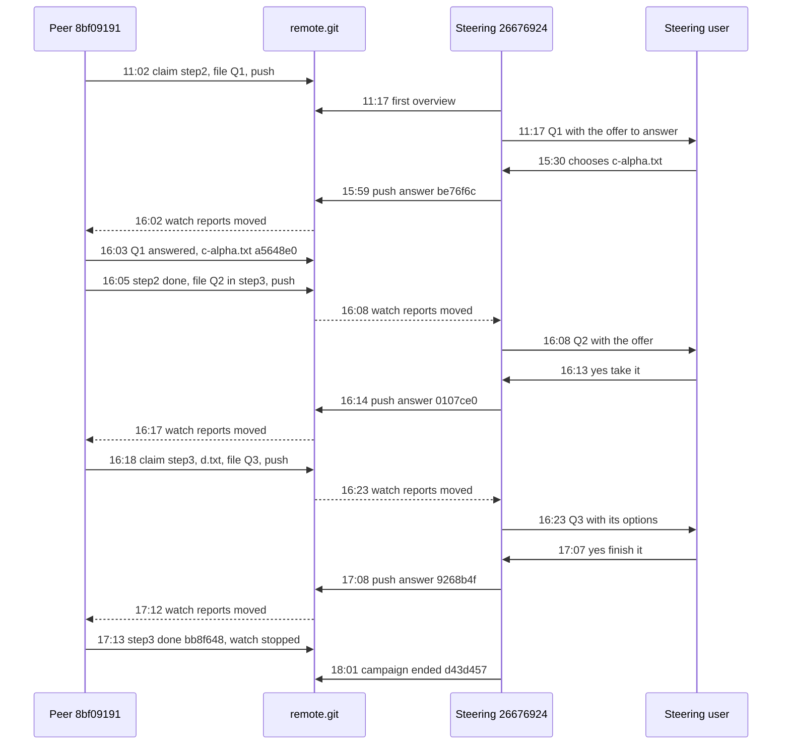

# Analysis: live trial of the campaign handover, question route and watches over two checkouts

**Date:** 2026-11-21 18:26
**Type:** Feasibility (live trial, plan step 10): first half, the protocol; second half, the observations
**Status:** Complete (protocol 2026-11-21; trial run 2026-11-22 11:00 to 18:01; observations filled 2026-11-22 18:47)
**Requested by:** orchestrator (checkout 114caf11), for plan `261119-1248-plan-campaign-peers-follow-the-steering-session-and-report-back.md` step 10

## Question

Do the 13.6.0 changes behave as spec `261119-1102-spec-campaign-peers-follow-the-steering-session-and-report-back.md` C1 to C5 require, when two real interactive sessions run against one remote? Every criterion is recorded below as observed yes or no. Plan step 10's acceptance rule: **any `no` blocks step 11** and goes back to the user with the row or message that shows it.

This half prepares the trial. The user runs the two sessions. A second dispatch fills `## Findings` from what the user copies back (`### 6. What to copy back`).

## Scope

- **Plugin work tree** (read only, nothing changed but this file): `/System/Volumes/Data/Projects/productive/F04-FUSION/fusion`, HEAD `bec4ebd4` (2026-11-21T18:07:23+01:00), branch `main`, `## main...origin/main` (level with its remote). The shipped behaviour sits at `74387375` and below; `bec4ebd4` adds only event-log rows. `.claude-plugin/plugin.json` still reads `13.5.1`, because the version bump belongs to the release step.
- **Read for the setup:** `docs/campaign.md`; the header of `bin/fusion-campaign` (`## Output of sync`, `## probe and watch`, `## The steering writes`); `skills/campaign/SKILL.md` Steps 8 and 9; `agents/orchestrator.md` Setup step 5 (campaign lane), `### Step 4 — commit` sub-step 5a, `## Human approval rules` (the campaign-lane paragraph); `skills/setup/SKILL.md`; `skills/wp/SKILL.md`; `bin/fusion-identity`; `rules/workbench-tracking.md`.
- **Scratch trial tree** (not committed anywhere in the plugin repo): `/Users/kai/.fusion-tmp/114caf11/live-trial/`.

## 1. What was built

| Path | What it is |
|---|---|
| `/Users/kai/.fusion-tmp/114caf11/live-trial/remote.git` | Bare remote, branch `main` |
| `/Users/kai/.fusion-tmp/114caf11/live-trial/steer` | Steering clone, checkout **`26676924`**. Holds no package. |
| `/Users/kai/.fusion-tmp/114caf11/live-trial/peer` | Peer clone, checkout **`8bf09191`**. The lane names it. |
| `<clone>/.claude/settings.local.json` | In both clones: `{"permissions":{"allow":["Monitor"]}}`. Strict JSON, checked with `JSON.parse`. Git ignores it. |

**The workbench** was made the way `/fusion:setup` Step 0 makes one. That means `bin/fusion-write initialize --workbench ./fusion-workbench` (`result=initialized`), the store `mkdir`, the marker `.fusion-setup` (`plugin_version` 13.5.1), the four voice profiles with `.asset-provenance`, and an empty `orchestrator-events.jsonl`. The project's `.gitignore` excludes the class L entries of `rules/workbench-tracking.md`, `.checkout-id` among them, so each clone mints its own identifier. `.gitattributes` carries `orchestrator-events.jsonl merge=union`. `CLAUDE.md` names the trial, with chat language `de`.

**Three work packages, filed with `bin/fusion-write create --kind package --actor user`, in one lane in this order:**

| # | Container | Mode | Brief |
|---|---|---|---|
| 1 | `<stamp>-step1-add-file-a` | autonomous | Add `a.txt` containing `A`. |
| 2 | `<stamp>-step2-add-files-b-and-c` | autonomous | Part 1: `b.txt` containing `B`, which needs no answer. Part 2: a file containing `C` named `c-alpha.txt` or `c-beta.txt`. The brief reserves that choice to the user, and says `autonomous` does not answer it. This is **the peer's undecidable question (Q1)**. Part 1 is the work that does not depend on the answer (C2 criterion 4). |
| 3 | `<stamp>-step3-add-file-d` | ordinary | Add `d.txt` containing `D`. Because it is ordinary, the peer should file **"may I take it?" (Q2)**. |

The two `autonomous` settings were written with `set-mode --source` citing each narrative, which quotes the user's word for this trial. No package has a dependency edge or declared areas. `<stamp>` is 261121-1824 throughout this report, the minute the scratch packages and the campaign were filed.

**The campaign** `<stamp>-live-trial` was set up from `steer/` with the shipped helpers: `fusion-campaign open`, then `cut --checkouts 1`, which proposed the order above, then `lanes --from <proposal> --assign lane-1=8bf09191`. The steering checkout committed it under `fusion-commit-lock with campaign` and pushed it with `fusion-campaign sync`. The remote's log:

```
9a82f37 chore(events): the commit and campaign-read rows of checkout 26676924
d54019a feat(campaign): open 261121-1824-live-trial with one lane on checkout 8bf09191
01cc44b chore: scratch project with a fusion workbench and three work packages
```

**Verification, as run before the trial:**

`steer/`: `fusion-campaign overview`

```
state=ok
ref=origin/main
head=9a82f3760e515637e2706ec2db03d1268b9380bc
campaigns=1
campaign=261121-1824-live-trial	running	-	1
lane=261121-1824-live-trial	lane-1	8bf09191	-	none	261121-1824-step1-add-file-a	none
silent=261121-1824-live-trial	lane-1	8bf09191	none
unconfirmed=261121-1824-live-trial	lane-1	8bf09191	sha256:2cf63619…177b	none
ready=261121-1824-live-trial	lane-1	261121-1824-step1-add-file-a
note=no-commit-rows	8bf09191
```

`peer/`: `fusion-campaign sync --read`, with `git status` clean before and after

```
state=ok
ref=origin/main
head=9a82f3760e515637e2706ec2db03d1268b9380bc
campaign=261121-1824-live-trial	running	sha256:2cf63619…177b	-
mine=261121-1824-live-trial
lane=261121-1824-live-trial	lane-1
next=261121-1824-step1-add-file-a	autonomous	none
```

The `silent=` and `unconfirmed=` rows are expected: the peer has not pushed yet. Two smoke checks also passed in `peer/`. `watch --since 01cc44b --interval 2` printed `moved=01cc44b…	9a82f37…` on its first probe. `probe`, with `remote.git` renamed away, printed `state=fetch-failed` (exit 6), and `state=ok` again once it was renamed back.

**One setup trap, measured.** The first `sync --read` from `peer/` printed `mine=none`. The reason was that the shell had inherited `FUSION_CHECKOUT=114caf11` from the Claude session the preparation ran in, and `sync` takes `FUSION_CHECKOUT` before `bin/fusion-identity` (header, `## sync`, step 3). With the variable unset, the row is `mine=<stamp>-live-trial`. The start commands below therefore unset the three `FUSION_*` identity variables. A terminal that never ran Claude does not have them, so the prefix only costs a few words.

## 2. Start commands (one line each)

Use two plain terminal windows, not a shell inside another Claude session. Do not have a second copy of fusion enabled as a marketplace plugin at the same time.

**Steering** (terminal 1):

```bash
cd /Users/kai/.fusion-tmp/114caf11/live-trial/steer && pwd && env -u FUSION_CHECKOUT -u FUSION_SESSION_ID -u FUSION_PERSON FUSION_PLUGIN_ROOT=/System/Volumes/Data/Projects/productive/F04-FUSION/fusion claude --plugin-dir /System/Volumes/Data/Projects/productive/F04-FUSION/fusion --agent fusion:orchestrator
```

First message: `/fusion:campaign`

**Peer** (terminal 2), started once the steering session has shown its overview:

```bash
cd /Users/kai/.fusion-tmp/114caf11/live-trial/peer && pwd && env -u FUSION_CHECKOUT -u FUSION_SESSION_ID -u FUSION_PERSON FUSION_PLUGIN_ROOT=/System/Volumes/Data/Projects/productive/F04-FUSION/fusion claude --plugin-dir /System/Volumes/Data/Projects/productive/F04-FUSION/fusion --agent fusion:orchestrator
```

First message: `Setup.`

**Why `Setup.` and not a task.** C1 criterion 3 says a peer session that starts holding nothing takes the next autonomous lane package by itself, so the first message names no work. The orchestrator's Setup STEP 1 asks a bare opening "what to work on". That question comes before Setup step 5, the step that reads the campaign. If it appears, answer `nur Setup` and record it in row C1.3 / C2.1 with its exact wording. Whether that question counts as a "what next?" put to the peer's own user is for the report to judge, not this protocol.

Permission prompts: use the permission mode you normally use. Any prompt at the peer while it waits is input at the peer. Record it in row C4.1 with the tool it named.

## 3. Run sheet

The times are a guide, measured from the steering session's first overview (T0). The whole trial is about 70 minutes. Note the wall-clock time of every observation.

| Step | When | Where | Action | Expect |
|---|---|---|---|---|
| S1 | T0 | steer | `/fusion:campaign` | Overview: running, lane-1 on `8bf09191`, `ready=` step1. The watch is armed (a Monitor task appears), and nothing is asked. |
| S2 | T0+1 | peer | Start, `Setup.` | Setup reads the lane. The peer claims step1 with no question, writes `a.txt`, commits and pushes. Then it claims step2 with no question and writes `b.txt`. For part 2 it files Q1 as a decision in step2's container and does not ask you. It pushes, says once that it waits for the steering session, and arms its watch. |
| S3 | ≤ T0+15 | steer | Do nothing. | Within about 5 minutes of the peer's push, the steering session reports Q1 once, with an offer to answer. **Do not answer yet.** |
| S4 | about T0+15 | shell | Block the remote: `mv /Users/kai/.fusion-tmp/114caf11/live-trial/remote.git /Users/kai/.fusion-tmp/114caf11/live-trial/remote.git.blocked` | Within 5 minutes each session says once, in one sentence, that it could not check. |
| S5 | S4 + 11 min | shell | Unblock: `mv /Users/kai/.fusion-tmp/114caf11/live-trial/remote.git.blocked /Users/kai/.fusion-tmp/114caf11/live-trial/remote.git` | Neither session repeated the failure in the 11 minutes, which is at least two more probes. After unblocking, no session reports a question a second time. |
| S6 | wait until T0+35 | both | Do nothing. | Each watch passes its 30-minute expiry. The session re-arms it with no prompt and no input from you (visible as a new Monitor task, or in the transcript). |
| S7 | after S6 | steer | Answer Q1: `beantworte die Frage` (or take up the offer). Choose `c-beta.txt`. | The question and its two options appear in chat as a numbered list. After your choice, the answer is filed in `shared/decisions/` with `**Answers:**` and the step says it reaches the peer with the next commit and push. If the session does not commit and push by itself, say `commit` and record that in C3.3. **Note the push time.** |
| S8 | ≤ push + 5 min | peer | Do nothing. | The peer wakes, marks Q1 `answered` citing the answer, writes `c-beta.txt` (and not `c-alpha.txt`), finishes step2, commits and pushes. It stops the Q1 watch. Then it files Q2 "may I take step3?" in step3's container, does not claim step3, pushes, says once that it waits, and arms a new watch. |
| S9 | ≤ +5 min | steer | Do nothing. | Q2 is reported once, with the offer to answer. |
| S10 | after S9 | peer | Close the peer session (`/exit`) while it waits. | |
| S11 | after S10 | steer | Answer Q2: choose the "yes, take it" option. Commit and push as in S7. | Answer filed and pushed. |
| S12 | after S11 | peer | Restart with the same command, first message `Setup.` | Setup finds Q2 and its answer, marks Q2 answered citing it, claims step3, writes `d.txt`, finishes, pushes. With `next=none` it says once that the lane is finished and stops. **No watch is armed**, since no question is open. |
| S13 | end | steer | Optional: `/fusion:campaign end` (outcome completed) and commit. | The steering watch stops (TaskStop) after the end act. |
| S14 | end | shell | Run the commands in `### 6`. | |

## 4. Checklist: every C1–C5 criterion

Fill the last column with yes or no, the time, and the row or message that shows it. "n/t" means not tested in this run, with the reason. **A no blocks step 11.**

Filled from the evidence on 2026-11-22. Times are local (CET); event-row `ts` values are UTC. Outcome: **20 yes, 6 no, 5 n/t.** The `no` rows are C2.1, C2.4, C5.3, C5.4, C5.5 and C5.6; `## Findings` groups them by cause.

| ID | Criterion (spec) | Step | Observed (yes/no, time, row/message) |
|---|---|---|---|
| C1.1 | After each commit, the peer's campaign read shows its lane and the next package, live and unheld, with what it waits for (`lane=`, `next=` rows) | S2, S8, S12 | **yes.** Every peer `sync` (11:00:05 to 17:13:12) printed `lane=…lane-1` and `next=` with mode and waits, e.g. 11:01:33 `next=…step2… autonomous none` after f5b8630; 11:02:45 `next=…step3… ordinary none` after 014ee0d; 16:07:31 `next=…step3… ordinary decision:261122-1604-…`; 16:18:42 `next=none`. One `campaign_read` row per peer commit (12 rows, 10:01:04Z to 16:13:11Z). `next=` is read at the fetched head before the push, so it lagged one cycle twice (11:02:31 still names step2 after fc33c6c claimed it; 16:18:20 still names step3 after c34b4db), as `### 7` predicted; harmless here. |
| C1.2 | **Handover without a question:** the peer finishes step1, sees step2 autonomous and waiting on nothing, claims it and continues with no question to its own user | S2 | **yes.** f5b8630 (11:01:30) closes step1; `sync` 11:01:33 `next=…step2… autonomous none`; `gate_hit` 10:01:43Z "A work package is to be claimed: …step2…", `gate_response` 10:01:44Z "proceed — answered by **Mode:** autonomous"; claim in fc33c6c (`claimed_at` 10:01:43Z). Session fed50200 has no user message after its opening. |
| C1.3 | A peer session that starts holding nothing takes step1 the same way. Also record whether Setup STEP 1's brief question appeared | S2 | **yes.** Session fed50200 started 10:59:42 holding nothing (`git_head_at_start` 9a82f37), claimed step1 at 11:00:26 (`gate_response` 10:00:26Z, autonomous), a.txt in 8503f27 (11:01:01). **Setup STEP 1's question did not appear**: the opening was `Erste`, not `Setup.`, and the session took it as its brief (`session_start` row: "user opened with 'Erste'"). The bare-opening path ran only at the 15:21 reopen; see C2.1. |
| C1.4 | Lane membership is checked against the record as it stands now. A steering act (move, reassign) does not by itself make the peer refuse a package still in its lane | optional: `move` step3 into lane-1 again is refused (`package-already-in-lane`); a real test needs a second lane, so n/t unless you add one | **n/t.** One lane; no `move` or `reassign` was run. |
| C1.5 | The peer never takes a package from a lane not naming it, nor while the campaign is paused or ended | S12/S13 (nothing claimed after the end); pause optional | **n/t.** No case existed in which a refusal could show: one lane, naming the peer; no pause; after the end (d43d457, 18:01) nothing was left to claim and the peer read nothing (last peer commit 17:13, no watch). Observed only that every claim (8503f27, fc33c6c, c34b4db) is a lane-1 package taken by 8bf09191. |
| C1.6 | A paused campaign still stops the peer | optional: `/fusion:campaign pause` before S11, then resume | **n/t.** Pause not run. |
| C1.7 | Outside a running campaign, or in a checkout no lane names, the peer behaves as before (the "what next?" question) | optional, after S13: start a session in `steer/` (named by no lane) with a small task and see the Step 5 question | **n/t.** No session with a task was run in a checkout no lane names. |
| C2.1 | A lane peer never puts an approval or "what next?" to its own user. Each such question is an open decision in the package's container and reaches the remote at the next push | S2, S8 | **no.** The lane questions themselves went the right way: each became an open decision in the package's container and reached the remote at the next push (Q1 fc33c6c 11:02:28, Q2 32a8d89 16:04:58, Q3 862cca6 16:18:39). But the reopened peer (session 2adac84e, `/fusion:setup` at 15:21:47) asked its own user at 15:23:44 "**1. Was soll diese Sitzung tun?** 1. Auf die Antwort warten … (empfohlen) 2. Etwas anderes … 3. Nur Setup", and armed its watch only after the reply `1, nein, nein` at 15:57:11. **Defect in shipped behaviour**: the brief question has no lane exception, and `Setup.` takes the same branch ("a lone setup request → ask now", `agents/orchestrator.md` STEP 1). The other two questions (bypassPermissions, checkout name) are installation checks, not lane questions. |
| C2.2 | The record states the question and options so the steering user can answer without the peer's session, and names the package and the checkout. **`**Asked by:** checkout 8bf09191, package <container>`** and **`**Set aside:** …`** are both present | S2 (Q1), S8 (Q2) | **yes.** All three records carry `**Asked by:** checkout 8bf09191, package <container>` and `**Set aside:**` (`approval: Ambiguous task instruction`; `claim of 261121-1824-step3-add-file-d`; `approval: A work package is to be claimed, released, paused, finished, …`), the question, and numbered options with `Forecloses:` lines. The steering user answered each without the peer's session. |
| C2.3 | **"May I take" record:** step3 being ordinary, the peer files "may I take <stamp>-step3-add-file-d?" in step3's container and does not claim it (step3 `package.json` still `open`) | S8 | **yes.** 32a8d89 (16:04:58) adds `261122-1604-may-checkout-8bf09191-take-the-third-work-package.md` in step3's container; `gate_hit` 15:04:52Z. step3's `package.json` stays `open` until c34b4db (16:18:15), after the answer. |
| C2.4 | After filing, the peer goes on with work that does not depend on the answer (`b.txt`). With none left, it tells its own user **once** that it waits, and keeps waiting | S2, S8 | **no.** The first half held: after filing Q1 the peer wrote b.txt (014ee0d, 11:02:42) and then said once, at 11:03:07, that it waits. But it repeated the wait message to its own user at every Monitor wake: session e8b5a7bf 11:47:46, 12:17:49, 12:47:58, 13:18:00, 13:48:03, 14:18:07, 14:48:10 ("Weiter nichts zu tun: …"); session 2adac84e 16:05:17, 16:07:33, 16:22:33, 16:27:30, 16:57:33. **Defect in shipped behaviour.** |
| C2.5 | While a question is open the peer neither releases its held package (step2 stays `claimed` during Q1) nor claims a second one | S3 to S7 | **yes.** step2 `claimed` from fc33c6c (11:02:28) to `done` in 32a8d89 (16:04:58), no state change between. No second claim while Q1 was open; step3 was claimed at 16:17:49, after Q2's answer and after step2 was done. |
| C2.6 | **No agent answers a filed question.** The peer never treats its own judgement, a message or its own user's chat as the answer, and does not ask its own user | S2 to S8 | **yes.** Each question moved to `answered` only from its answer record (`gate_response` 15:02:48Z "c-alpha.txt — answered by 261122-1530-answer-…", 15:17:48Z, 16:12:56Z). The `1` of 15:57:11, an answer to setup's question, was not taken as Q1's answer; the 15:23:44 message says the question lies with the steering session. |
| C3.1 | From the steering session the user sees every open peer question and can answer any one | S3, S9 | **yes.** Q1 shown with the offer at 11:17:21 (session 6272ad7c) and 15:18:17 (df631bfb); Q2 at 16:08:23; Q3 with its options at 16:23:31. Each was answered from the steering session. |
| C3.2 | The answer is a new record in `shared/decisions/`, citing the question by basename (`**Answers:**`), quoting the option, recorded as the user's ruling with the date. The peer's question record is not touched by the steering side | S7, S11 | **yes.** be76f6c, 0107ce0 and 9268b4f each add only `shared/decisions/<answer>.md` and `.record.json`: `**Answers:** <question basename>`, the option quoted (`> c-alpha.txt`), "The user chose, at the steering session on 2026-11-22", `filed_by.actor: user`. No steering commit touches a peer question record (`--name-status`). |
| C3.3 | The answer reaches the remote with the steering session's next commit and push, and the step's report says so | S7, S11 | **yes.** Each report says the answer reaches the peer only with the next commit and push (15:30:40: "sieht sie erst nach dem nächsten Commit und Push von hier"). Pushed: be76f6c 15:59:00, 0107ce0 16:14:09, 9268b4f 17:08:16. For Q1 the session asked before committing (15:30:40, again 15:48:10) and pushed after the user's `1` at 15:58:43; for Q2 and Q3 it committed without asking and said so (16:14:13). |
| C3.4 | The answer step refuses to run from a checkout holding a package (exit 8 `state=holds-package`) | optional: run `answer` from `peer/` while it holds step2. Shell command in `### 5` | **n/t.** The optional shell test was not run; neither clone's transcripts nor event rows show it. |
| C3.5 | No answer is filed without the user choosing it in that session | S7, S11 | **yes.** Answers filed at 15:30:30, 16:13:52 and 17:07:56, each right after the user's choice in the steering chat (15:30:24, 16:13:47, 17:07:53). The ambiguous `1` at 15:27:50, sent with the mis-sent notes, was read as "show me the question" and said so at 15:29:27; nothing was filed. |
| C4.1 | **The answer reaches the peer within about 5 minutes with no input at the peer** (push time against the peer's wake time) | S8 | **yes.** Push → peer woken by `moved=`, no input at the peer between: Q1 15:59:00 → 16:02:26 (3 min 26 s); Q2 16:14:09 → 16:17:27 (3 min 18 s); Q3 17:08:16 → 17:12:32 (4 min 16 s). Caveat: Q1's watch existed only because the user had answered setup's question at 15:57 (C2.1). |
| C4.2 | **The question is marked `answered`, citing the answer record**: an `Answered: <answer basename> — <option>; ruled by user, …` line, and `answer_ref` in the record. The answer record is unchanged (one commit in its history) | S8, S12 | **yes.** Q1: a5648e0 (16:03:58) appends `Answered: 261122-1530-answer-to-261122-1101-… — c-alpha.txt; ruled by user, Kai Stalmann …`, `state` `answered`, `answer_ref.record_id` 7995e380… (the answer's `id`). Q2: c34b4db, 7b496b24…. Q3: bb8f648, 4c137236…. Each answer record has one commit in its history. |
| C4.3 | The peer acts on the chosen option and nothing beyond it: `c-beta.txt` only, no `c-alpha.txt` | S8 | **yes.** The tree at `main` holds a.txt, b.txt, c-alpha.txt, d.txt and no c-beta.txt. The user chose c-alpha.txt (run sheet: c-beta.txt); the peer checked `nobeta=0` at 16:03:51. |
| C4.4 | The set-aside step is resumed, so finishing step2 does not ask the same question again | S8 | **yes.** step2 was finished at 15:04:18Z (`gate_hit` and `gate_response` "proceed — answered by **Mode:** autonomous") with no repeat of Q1; the step3 claim resumed at 16:17:49 from Q2's `**Set aside:**` line. |
| C4.5 | **The peer stops its watch once nothing is open** (the Q1 watch stopped at S8; after S12 no watch runs) and goes back to reading only after its commits | S8, S12 | **yes.** `TaskStop` of the last watch at 17:13:15, right after bb8f648 closed step3 with no question open; no peer watch or read after it. The Q1 watch was not stopped when Q1 was answered: it went on serving Q2 and Q3 (the 16:05:06 re-arm returned `state=already-watching`), Q2 being filed 2 minutes after Q1's answer. |
| C4.6 | **Peer closed while waiting and reopened:** nothing is lost. The new session finds Q2 and its answer and continues | S10 to S12 | **yes (one sub-case n/t).** The peer was closed twice while waiting on Q1: fed50200 at 11:04:14 (watch `killed`), e8b5a7bf at 15:15:03 (`killed`). Each next session found Q1 in the record (11:17:22 and 15:23:04, `question=…261122-1101… none`) and resumed with nothing lost. **Not tested:** an answer arriving while the peer is closed (S10 to S12 not run). The 15:21 reopen waited on its own user first (C2.1). |
| C5.1 | Using `/fusion:campaign` while the campaign runs turns the watch on, with no further step | S1 | **yes.** 6272ad7c: overview 11:17:11, `Monitor` armed 11:17:15. df631bfb: `/fusion:campaign` 15:17:23, `Monitor` 15:18:05. No further step either time. |
| C5.2 | The watch stops on pause or end, on "stop watching", and when the session closes, and resumes at the next use of the command | S13 (end); "stop watching" optional | **yes (pause and "stop watching" n/t).** End: `TaskStop` at 18:00:53, right after the end act (d43d457). Session close: watch `killed` at 15:15:01 when 6272ad7c closed; on again at the next use of the command (15:18:05). "Stop watching" was offered at 17:48:32 but never answered. |
| C5.3 | When the remote has not moved, the user sees nothing and no full picture is read | S6 (no output between moves) | **no.** The 5-minute probes printed nothing between moves, and no overview ran without a `moved=` (16:03:11, 16:08:12, 16:18:16, 16:23:16, 17:13:19, plus 17:08:20 after its own push). But at every 30-minute expiry the user was told that nothing had moved: 11:47:21, 12:17:25, 12:47:29, 13:17:35, 13:47:37, 14:17:39, 14:47:42, 15:48:10, 16:18:14, 16:48:19, 17:18:21, 17:48:23. **Defect in shipped behaviour.** |
| C5.4 | When the remote moved, the user hears only of new peer questions (with the offer to answer) and packages that can now start. Nothing else | S3, S9, S12 | **no.** New questions came with the offer, within 5 minutes of the push (Q2 16:05:01 → 16:08:23; Q3 16:18:42 → 16:23:31). But other things were said unprompted: 16:03:22 "Nichts Neues für dich: … mein eigener Push"; 16:03:24 "Die Beobachtung … war bereits aktiv" (Step 9: `already-watching` → say nothing); 16:18:26 "Nichts Neues für dich …"; 17:13:29 step3 closed, with an offer to end the campaign. **Defect in shipped behaviour.** |
| C5.5 | **One report per question:** each question or ready package is reported once, not at every check (including after S5's recovery) | S3 to S11 | **no.** No question was repeated at a 5-minute check or after the recovery (none was open then). But open items were restated at expiries: Q1 at each of the seven expiries from 11:47 to 14:47; Q3 with its options at 16:48:19; the end question at 17:18:21; the commit question at 15:48:10. **Defect in shipped behaviour**, same cause as C5.3. |
| C5.6 | **A failed check is reported once**, in a sentence, and the watch keeps trying (both sessions) | S4, S5 | **no (steering); n/t (peer).** Steering: `failed=fetch-failed` at 17:33:19, one turn of three short sentences at 17:33:21. After the re-arm at 17:48:21 the new watch printed `failed=fetch-failed` again (17:48:23), and the session reported it a second time, ran `git fetch` and `ls`, and asked whether to stop watching (17:48:32). `recovered=2011c62…` at 17:58:22 was reported once and the question withdrawn. **Defect in shipped behaviour**: a watch reports the first failure of its own run, and a re-arm starts a new run (`bin/fusion-campaign` `## probe and watch`), so every outage that spans an expiry is reported again. The trial's 29-minute outage exposed it. Peer: no watch ran at the time (stopped 17:13:15). |
| C5.7 | **The watch outlives one 30-minute expiry** without the user re-arming it (both sessions) | S6 | **yes.** Steering re-armed with no input at 11:47:18, 12:17:22, 12:47:26, 13:17:31, 13:47:35, 14:17:38, 14:47:41, 15:48:08, 16:18:13, 16:48:16, 17:18:19, 17:48:21; the peer at 11:47:44, 12:17:47, 12:47:53, 13:17:58, 13:48:02, 14:18:05, 14:48:08, 16:27:29, 16:57:32. No permission prompt. |

## 5. Shell commands for the optional rows

All are one line, from a third terminal.

- C3.4, while the peer holds step2 (between S2 and S8): `cd /Users/kai/.fusion-tmp/114caf11/live-trial/peer && pwd && env -u FUSION_CHECKOUT FUSION_PLUGIN_ROOT=/System/Volumes/Data/Projects/productive/F04-FUSION/fusion /System/Volumes/Data/Projects/productive/F04-FUSION/fusion/bin/fusion-campaign answer --question x.md --option x; echo "exit=$?"`. Expect `state=holds-package`, exit 8, and nothing written. Check with `git status --short`, which should be unchanged.
- The remote's live head at any moment: `git -C /Users/kai/.fusion-tmp/114caf11/live-trial/remote.git log --format='%h %cI %s' -5`

## 6. What to copy back

After the trial, run these in a third terminal and paste their output, together with the filled table from `### 4`:

1. Remote history with times: `git -C /Users/kai/.fusion-tmp/114caf11/live-trial/remote.git log --format='%h %cI %s'`
2. The final overview: `cd /Users/kai/.fusion-tmp/114caf11/live-trial/steer && pwd && env -u FUSION_CHECKOUT FUSION_PLUGIN_ROOT=/System/Volumes/Data/Projects/productive/F04-FUSION/fusion /System/Volumes/Data/Projects/productive/F04-FUSION/fusion/bin/fusion-campaign overview --since 9a82f3760e515637e2706ec2db03d1268b9380bc`
3. Every decision record and the history of each: `git -C /Users/kai/.fusion-tmp/114caf11/live-trial/remote.git log --format='%h %cI %s' --name-status -- fusion-workbench/shared/decisions fusion-workbench/work-packages`
4. The gate and campaign rows of the event log: `git -C /Users/kai/.fusion-tmp/114caf11/live-trial/remote.git show main:fusion-workbench/orchestrator-events.jsonl | grep -E '"event":"(gate_hit|gate_response|campaign_read|commit|session_start)"'`
5. The files the peer produced: `git -C /Users/kai/.fusion-tmp/114caf11/live-trial/remote.git ls-tree --name-only main`
6. From each session's transcript, verbatim: every message the steering session sent unprompted (the watch reports, with time), every message the peer sent to its own user, any question either asked, and any permission prompt. Times can come from the terminal or your notes.

The working trees are not needed: the report reads the remote. Delete `/Users/kai/.fusion-tmp/114caf11/live-trial/` only after the report is written.

## 7. Two things to watch for, from reading the shipped text

These are reading notes, not findings. The trial decides them.

- **`sync` reads the campaign at the fetched head, before its own push** (header, `## Output of sync`, `head=`). At the moment the peer finishes step1, the remote still shows step1 `claimed`, so step2 is `next` because it is unheld. That works here because no edge links the packages. If step2 had an edge on step1, `next=` would show it waiting on `edge:step1` for one cycle, and 5a would report "waits" and stop. This trial does not cover that case. A second trial with an edge would.
- **Setup STEP 1 comes before the campaign read** (`agents/orchestrator.md`, STEP 1 against step 5). The first message `Setup.` makes this visible (`## 2`).

## 8. Where the run departed from the run sheet

All times are local (CET, UTC+1). Event rows carry UTC in `ts`; push times are the committer times on `remote.git`, which `sync` sets at its rebase just before the push.

| Run sheet | What happened | Evidence |
|---|---|---|
| Steering first (S1), peer after its overview (S2) | The peer started at 10:59:42 and had pushed step1, b.txt and Q1 by 11:02:44. The steering session's first overview came at 11:17:21. Two sessions opened and closed with no message and left no transcript: steering `e03ed4ec` at 10:59:15 and peer `959ce8c7` at 15:16:32. | `session_start` hook rows; transcript directory listings |
| First messages `/fusion:campaign` and `Setup.` | Peer: `Erste` (fed50200), `fusion-campaign sync --read` (e8b5a7bf, 11:17:01), `/fusion:setup` (2adac84e, 15:21:47). Steering: `fusion-campaign overview` (6272ad7c, 11:16:30), `` `/fusion:campaign` `` (df631bfb, 15:17:17). | transcripts |
| About 70 minutes | 11:00 to 18:01. Q1 stood open from 11:02 to 15:30 and was pushed at 15:59. | remote log |
| Close the peer while waiting on Q2 (S10 to S12) | Not run. The peer was closed while waiting on **Q1**, twice: at 11:04:14 and at 15:15:03. The steering session was closed at 15:15:01 too. The evidence does not show why. | `queue-operation` rows with `status killed` |
| Block the remote at about T0+15 for 11 minutes (S4, S5) | Blocked at about 17:29, after all three packages. The user's report says it was put back at 17:45 under the wrong name `remove.git`, and fixed at 17:58: 29 minutes, spanning one steering expiry. The peer ran no watch by then. | steering `failed=` 17:33:19, `recovered=` 17:58:22 |
| Choose `c-beta.txt` (S7) | The user chose `c-alpha.txt` (`1` at 15:30:24). | be76f6c |
| Commit the answer, say `commit` if needed (S7) | The session asked before committing; the user said `1` at 15:58:43. Q2's and Q3's answers were committed without asking. | steering 15:30:40, 16:14:13 |
| Q1 watch stopped at S8, new watch for Q2 | The Q1 watch went on and served Q2 and Q3; the re-arm at 16:05:06 returned `state=already-watching`. | peer 16:05:11 |
| Peer finishes step3 without a further question (S12) | Step3 is `ordinary`, so its finish was a third question, Q3 (862cca6), answered at 17:07:53. This is the shipped approval rule, not a fault. No plan question came, although Q2's own option text said one would. | 862cca6, 9268b4f |
| Nothing else at the steering session | At 15:27:50 the user sent two notes meant for the protocol author to the steering session, then withdrew them at 15:29:23. | steering transcript |
| Optional rows | C1.4, C1.6, C1.7 and C3.4 were not run. | |
| `### 6` commands | Run by this analysis at about 18:46, from the remote and from `steer/` as specified. The overview's only fetch found `steer/` level with the remote (`8b4f2b6`), and no ref moved. | below |

The final overview, `### 6` item 2:

```
state=ok
ref=origin/main
head=8b4f2b6e9b6986d50a99c95b7120f9d0ba71b61e
head_time=2026-11-22T17:01:04Z
age_minutes=45
window_hours=24
campaigns=1
campaign=261121-1824-live-trial	completed	-	1
```

The files produced (`### 6` item 5): `a.txt`, `b.txt`, `c-alpha.txt`, `d.txt`, besides the scaffold and `fusion.json`, which the peer's setup seeded (f4bec98).

## Findings

**Outcome of `### 4`: 20 yes, 6 no, 5 n/t, out of 31 rows.** The six `no` rows have three causes, all in shipped behaviour. None is an artefact of how the trial was run, although the trial's long outage is what exposed the third.

| # | Cause | Rows |
|---|---|---|
| F1 | Both sessions speak at every Monitor wake, including where the shipped text says to say nothing | C2.4, C5.3, C5.4, C5.5 |
| F2 | A reopened lane peer asks its own user what to do before it arms its watch | C2.1 |
| F3 | A failed check is reported again after every re-arm | C5.6 |

### F1. Every wake produces a message

A `Monitor` notification gives the session a turn, and in this run every such turn ended with text to the user. The steering session sent twelve messages at expiries, each saying that nothing had moved, and seven of them restated Q1. The peer sent twelve, each saying that it still waits. The 5-minute probes themselves stayed silent, and no overview ran without a move, so the mechanism underneath works as specified. What fails is what reaches the user.

Two things make it worse:

- **The text tells the session to stay silent only in two places, and the model ignored both.** `skills/campaign/SKILL.md` Step 9 says `already-watching`: say nothing, and on `moved=` with no new rows, say nothing. The steering session said something both times (16:03:24 and 16:03:22, 16:18:26). For expiries neither text says anything beyond "re-arm" (Step 9; `agents/orchestrator.md` `## Human approval rules`, campaign-lane paragraph). A clause alone may therefore not fix it.
- **The watch wakes the session on its own pushes.** The steering watch fired on its own answer push (16:03:09) and the peer's on its own pushes (16:07:27, 16:22:27). Each wake then produced a "that was my own push" message.

The steering session also reported things outside the two kinds C5.4 allows: the closing of step3 at 17:13:29, with an offer to end the campaign. The user's observation 7 says the steering session later reported no movement although the remote moved at 17:12 to 17:13. The transcript shows the close was reported at 17:13:29. The "nichts bewegt" of 17:18:21 refers to the time after that report, and is true for it.

### F2. The reopened peer waited on its own user

At 15:21:47 the peer was reopened with `/fusion:setup`. It read the lane (15:23:04: `question=…261122-1101… none`), knew it held step2 and that Q1 was open, and then asked its own user three questions in one turn (15:23:44). The first was what the session should do, with "wait for the answer" recommended. Its watch was armed only after the reply at 15:57:11, 34 minutes later.

This is a "what next?" question to the peer's own user, which C2 criterion 1 rules out. It also breaks C4 criterion 1 in this path: had the answer been pushed at 15:30, when it was filed, the peer would not have noticed it until its own user replied. The cause is `agents/orchestrator.md` STEP 1, which asks for a brief whenever the first message carries none, with no exception for a checkout a running lane names. The run sheet's own `Setup.` takes the same branch, so this is not an artefact of the `/fusion:setup` start. It answers the protocol's open question: yes, it counts against C2 criterion 1.

The two other questions, about `bypassPermissions` and the checkout's name, come from the periodic installation checks. They concern this installation, which only the local user can rule on, so they are not lane questions. They still rode in the same turn and so delayed the watch as well.

The first peer session (fed50200) avoided the question only because its opening message, `Erste`, was taken as a brief. The second (e8b5a7bf) opened with `fusion-campaign sync --read`, which also counted as one. In both, the lane was picked up with no question.

### F3. One outage, two reports

The watch prints `failed=` once per run of failures and stays silent until a success (`bin/fusion-campaign` `## probe and watch`). A re-arm starts a new watch process with no memory of the old run, so its first probe prints `failed=` again. In this run the outage lasted 29 minutes and spanned the steering session's expiry at 17:48:19. The steering session reported the failure at 17:33:21 and again at 17:48:32, the second time with its own check (`git fetch`, `ls`) and a question whether to stop watching.

Any outage longer than a few minutes has a fair chance of spanning an expiry. The 11 minutes in the run sheet would have crossed one with a probability of about 11 in 30. So the trial's typo exposed the defect rather than caused it.

The 17:48:23 message also drew a wrong conclusion: "auf dem Remote hat sich also nichts bewegt". A watch in a run of failures prints nothing by design, so its silence says nothing about the remote. The new watch contradicted it nine seconds later.

### F4. The route itself works

Every row that tests the route's substance is `yes`:

- **Handover.** step1 to step2 with no question (C1.2), and a session opened holding nothing took step1 by itself (C1.3).
- **Questions.** Three questions, each an open decision in the right container, with `**Asked by:**` and `**Set aside:**`, pushed at the next commit (C2.2, C2.3). step2 stayed claimed while Q1 was open (C2.5).
- **Answers.** Each was filed only on the user's choice, as a new record citing the question, with the peer's record untouched (C3.2, C3.5). The ambiguous `1` at 15:27:50 was not taken as a choice.
- **Pick-up.** The peer woke within 3 min 18 s to 4 min 16 s of each push, with no input (C4.1). It marked each question `answered` with the right `answer_ref` (C4.2), wrote `c-alpha.txt` and nothing else (C4.3), resumed without asking again (C4.4), and stopped its watch once nothing was open (C4.5).
- **Watches.** Each outlived many expiries with no prompt (C5.7), and the `already-watching` guard prevented a second watch twice (16:03:22 steering, 16:05:11 peer).
- **Close and reopen.** The open question survived two closes of the peer (C4.6).



Every participant in the diagram sends and receives; the route closes at both ends, with the peer's last watch stopped and the campaign ended.

### F5. Smaller findings, none a `no`

| # | Finding | Evidence | Weight |
|---|---|---|---|
| a | The steering session asked before committing Q1's answer and not for Q2 or Q3. It said so at 16:14:13. The first answer therefore waited 29 minutes, filed at 15:30, pushed at 15:59. Step 8 says the answer "reaches the peer with this session's next commit and push" but not whether the step commits. Correction to the user's observation 6: Q2's answer, at 16:14:09, was already the first pushed without asking, not Q3's. | steering 15:30:40, 15:48:10, 16:14:13 | medium: delay |
| b | The peer's first attempt to mark Q1 answered was refused at 16:02:48 (`unresolved-reference/record-not-found`): `sync --read` fetches but does not bring the answer record into the working tree. The peer recovered in 30 seconds through a `sync`, and ran `sync` first for Q2 and Q3. The 5a paragraph says "read the answer at the fetched head" but not that the answer must be pulled before the transition. | peer 16:02:48 to 16:03:19, 16:17:43, 17:12:52 | low |
| c | Q2's option 1, written by the peer, said "its plan review and its finish still come back to the steering session as questions". No plan question came: the peer sent the one-line task straight to `code-implementer`. The steering session relayed the forecast twice (16:12:45, 16:14:13). | 32a8d89, steering transcript | low: wording |
| d | The peer told its user that the question "liegt jetzt in `steer/`" (16:05:11, also 15:23:44, 16:18:48). It travelled through git in 32a8d89, and nothing was written into the steering clone. The trial's `CLAUDE.md` names `steer/` as the steering clone, which explains the name but not the claim about where the question lies. | peer transcript; trial `CLAUDE.md` | low: wording |
| e | The steering session told the user each time that when the peer would read the answer "lässt sich von hier nicht sagen" (15:59:05, 16:14:13, 17:08:30). A waiting peer probes every 5 minutes, so "within about 5 minutes, if its session is open" was available. | steering transcript | low: wording |
| f | Q3 was left `answered`, not `implemented`, because the closing commit's hash was known only after the push (peer 17:13:21). Q1 and Q2 reached `implemented`. This is the open case of issue `261110-1323-the-orchestrators-sync-sub-step-names-no-outcome-for-a-cycle-that-pushed-nothing-…`. | bb8f648 | low; issue exists |
| g | The lock's `commit` event rows name the hash before `sync`'s rebase: ff07938, 9f7486b, ef5f3b1, e03f24f and 8d8ec5c do not exist on the remote, which holds be76f6c, 0107ce0, 9268b4f, d43d457 and f4bec98. This is issue `261109-1313-a-commit-row-names-a-hash-a-later-rebase-removes-…`. | event log | low; issue exists |
| h | The steering `campaign_read` row after the end act still says `running` (17:01:04Z), because `sync` reads the fetched head before its own push (`### 7`, first note). | event log | low |
| i | The overview's last-push time is the head's commit time. Here it was right: "vor gut 4 Stunden" at 15:18 for the push at 11:02 (user's observation 2). | steering 15:28:11 | none |
| j | The mis-sent notes (15:27:50) had no visible influence after the user withdrew them at 15:29:23. The session answered them once at 15:28:11. Every later report follows the skill's shape, and none refers to them. The one later change of course, committing without asking from 16:14 on, came with its own stated reason ("weil die Antwort sonst nur lokal läge"). | steering transcript | none |
| k | The user's observation 9 quotes the end answer with a reason. The transcript holds `1 A B C` (18:00:43), and `campaign.json` records `reason: null`. | d43d457 | none |
| l | The peer's 15:57 setup commit (f4bec98) seeded `fusion.json` and changed `.asset-provenance` in a lane checkout. It is harmless here, but a lane peer's setup writes reach the shared remote. | f4bec98 | none |

## Implications

- **Plan step 11 is blocked.** Six rows are `no` and step 10's rule says any `no` blocks. Each `no` is a defect in shipped behaviour. None is an artefact of how the trial was run, so re-running the same build would not clear them.
- **The five n/t rows also stand between step 10 and step 11.** The plan's acceptance asks for every C1 to C5 criterion observed as yes (`## Where this work stops`, "Step 10's report records every C1–C5 criterion as observed yes"). C1.4, C1.5, C1.6, C1.7 and C3.4 each need a test or a waiver from the user. So do the untested sub-cases of C4.6 (answer arrives while the peer is closed) and C5.2 (pause, "stop watching").
- **The substance holds; the noise and one blocking question do not.** F4 shows the route does what the spec wants with the records: questions, answers, pick-up, resume. F1 is about what the user is told. F2 is about a reopened peer that waits on its own user, and that one can stall a lane silently. F3 is a reporting duplicate.
- **F1 may not yield to a text fix alone.** The model spoke where Step 9 explicitly says to say nothing. A fix either removes the wake (no wake on own pushes) or accepts that each wake costs one line. Which way to go changes the criteria, so it is the user's ruling.

## Recommendations

| # | What | For | Who |
|---|---|---|---|
| R1 | **F1, a user ruling first.** Either (a) keep C2.4, C5.3 and C5.5 as written: stop the watch waking on its own session's pushes (after each own push, the next watch starts `--since` the pushed head, or the watch skips a head this checkout pushed), add "say nothing" to every expiry and no-news wake in both texts, then retest whether the model complies; or (b) relax those three criteria to allow one short line per 30-minute expiry, and keep only the own-push fix. | C2.4, C5.3, C5.4, C5.5 | user, then `implementation-planner` to amend the plan, `code-implementer` |
| R2 | **F2.** In `agents/orchestrator.md` STEP 1 and in the `/fusion:setup` path: when the checkout is named by a lane of a running campaign, do not ask for a brief. The lane is the brief. Put the installation-check questions after the lane is read and the watch is armed, so they cannot hold up the watch. | C2.1, C4.1, C4.6 | `implementation-planner`, `code-implementer` |
| R3 | **F3.** Keep the failure state across a re-arm. The watch's pid file under `bin/fusion-tmp path` already exists per session, so a state file beside it can say "failure already reported", and a new watch then stays silent until `recovered=`. | C5.6 | `code-implementer` |
| R4 | **F5 a.** Rule whether the answer step commits and pushes in the same turn, the user's choice of option being the confirmation, and write it into Step 8. Committing at once avoids the 29-minute delay seen here. | C3.3 | user, then `code-implementer` |
| R5 | **F5 b.** In the 5a campaign-lane paragraph, say that the answer is pulled (`sync`) before the `transition --answer-ref`, or let the codec resolve the reference at the fetched head. | C4.2 | `code-implementer` |
| R6 | **Retest, short.** After R1 to R3: one peer, one steering session, about 45 minutes. Cover a bare reopen while a question is open (C2.1); one expiry at each side with no output (C2.4, C5.3, C5.5); a remote blocked across an expiry (C5.6, both sessions); an answer pushed while the peer is closed (C4.6); pause and resume (C1.6, C5.2); and the one-line C3.4 shell test. C1.4, C1.5 and C1.7 need a second lane or a lane-less session: test them or waive them. | all open rows | user runs; `analyst` fills |
| R7 | **File the issues.** This dispatch was scoped to this one file, so none is filed. Proposed: (1) the campaign watch wakes its session on that session's own pushes; (2) the lane sessions narrate every Monitor wake, against Step 9's "say nothing"; (3) a reopened lane peer asks its own user for a brief before arming its watch; (4) a re-armed watch reports a continuing outage again; (5) the answer step does not say whether it commits; (6) the lane's answered transition is refused until the answer is pulled. F5 f and g already have issues. | | orchestrator |

## Filed Issues

None. This dispatch may write only this file; R7 lists the issues to file.

## Sources

- Plan step 10 and spec C1 to C5: `261119-1248-plan-campaign-peers-follow-the-steering-session-and-report-back.md`, `261119-1102-spec-campaign-peers-follow-the-steering-session-and-report-back.md`
- `remote.git` at `main` 8b4f2b6 (2026-11-22T18:01:04+01:00): `git log --format='%h %cI %s' --name-status`, every `package.json` version of the three packages, every decision record and its history, `orchestrator-events.jsonl` (57 rows of the five event kinds), `ls-tree`
- `steer/` at 8b4f2b6, branch `main`, `## main...origin/main` (level); `peer/` at 2011c62 (2026-11-22T17:13:11+01:00), branch `main`, `## main...origin/main`, behind the remote by the steering session's end commits only because the peer fetched nothing after 17:13
- Transcripts, peer: `fed50200-a913-46fb-9281-eb74ae059bb4.jsonl` (10:59 to 11:04), `e8b5a7bf-6f65-4458-bf9c-6624edb72b81.jsonl` (11:05 to 15:15), `2adac84e-8c56-4084-89f0-8c7feb87c476.jsonl` (15:21 to 18:40); steering: `6272ad7c-5806-409a-ae81-06d5db88eef5.jsonl` (11:04 to 15:15), `df631bfb-ab82-46a6-a616-4e03844dbef4.jsonl` (15:16 to 18:40), under `/Users/kai/.claude/projects/-Users-kai--fusion-tmp-114caf11-live-trial-{peer,steer}/`
- Shipped text at plugin `bec4ebd4` (2026-11-21T18:07:23+01:00, `main`, level with `origin/main`): `agents/orchestrator.md` STEP 1, `### Step 4 — commit` 5a, `## Human approval rules` campaign-lane paragraph; `skills/campaign/SKILL.md` Step 8 and `## Step 9: the watch`; `bin/fusion-campaign` `## probe and watch`; `docs/campaign.md` `## The two watches`
- Issues cited: `261109-1313-a-commit-row-names-a-hash-a-later-rebase-removes-so-last-push-by-ancestor-test-under-reports.md`, `261110-1323-the-orchestrators-sync-sub-step-names-no-outcome-for-a-cycle-that-pushed-nothing-so-the-pushed-hash-rule-has-no-terminating-case.md` (both in work package `261108-1924-campaign-the-frame-for-work-spread-over-several-checkouts`)
- The protocol's own sources, listed in the first version of this report: `docs/campaign.md`, `skills/setup/SKILL.md`, `skills/wp/SKILL.md`, `bin/fusion-identity`, `rules/workbench-tracking.md`, analysis `261120-1242-can-an-idle-session-poll-the-remote.md`

## Open Questions

- [x] Does a Setup STEP 1 brief question at a lane peer's first message count against C2 criterion 1? **Yes** (F2, row C2.1).
- [ ] F1: fix the wakes and keep C2.4, C5.3 and C5.5 as written, or relax them to one line per expiry? (R1)
- [ ] Does the answer step commit and push in the same turn? (R4)
- [ ] Which n/t rows are tested in the retest, and which are waived: C1.4, C1.5, C1.7 need a second lane or a lane-less session. (R6)
