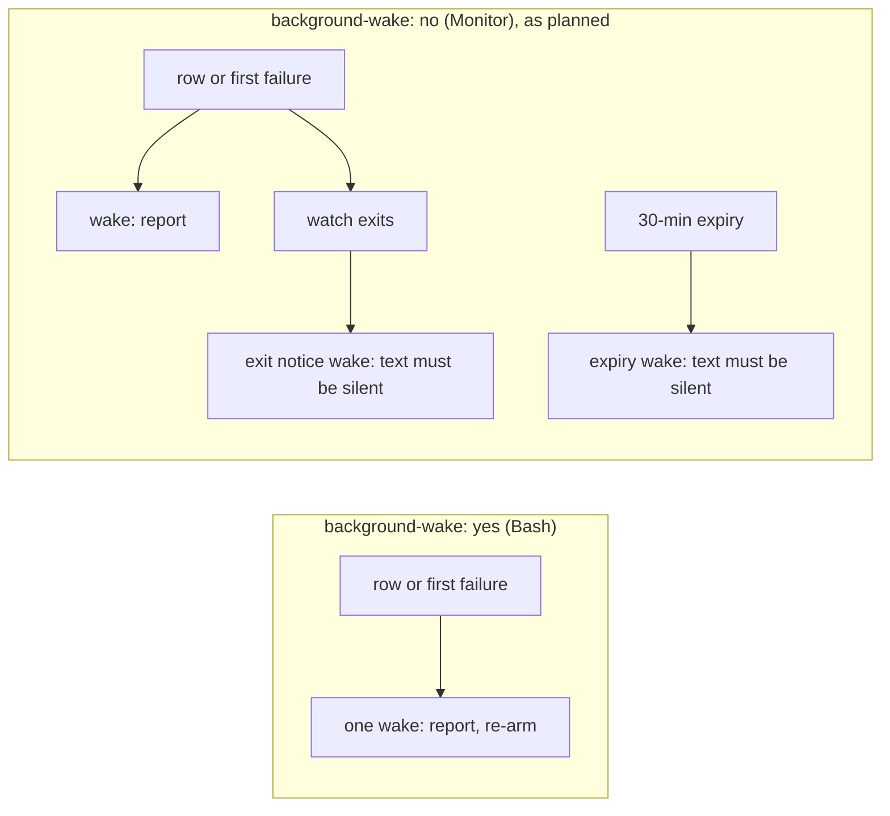

# Analysis: feasibility and risk review of plan 261123-1000 before approval

**Date:** 2026-11-23 12:20
**Type:** Feasibility + Risk (independent plan review)
**Status:** Complete
**Requested by:** orchestrator, on the user's explicit request
**Cross-references:** plan `261123-1000-plan-fix-the-three-trial-causes-and-retest-before-13-6-0.md`; amended plan `261119-1248-plan-campaign-peers-follow-the-steering-session-and-report-back.md` (working-tree diff); spec `261119-1102-spec-campaign-peers-follow-the-steering-session-and-report-back.md`; trial report `261121-1826-live-trial-two-checkouts.md`; the six issues `261123-1000-*.md` and `261120-2050-campaign-watch-sets-no-timeout-on-ls-remote-so-a-hanging-remote-silences-it.md`

## Question

Is plan 261123-1000 sound enough to approve? The review reads the plan against the code it would change, not against its own claims. It covers five things: does each step fix its cause, are the bounds real, is step 1 a decidable measurement, does the retest observe every row it claims, and what gaps and defaults are left for the user.

## Scope

- Plugin tree `/System/Volumes/Data/Projects/productive/F04-FUSION/fusion`: HEAD `41f7bcb5` (2026-11-22 18:51:55 +0100), branch `main`, `## main...origin/main` (level). Dirty only in the workbench: the event log, the in-place edit of `261119-1248-*`, and the plan, issues and consultations not yet committed. No shipped file differs from HEAD.
- Read: `hooks/lib/campaign-watch.ts`, `hooks/lib/campaign.ts` (`fetchRef`, `steeringAt`, `steeringSince`, `withSince`), `hooks/lib/campaign-sync.ts` (`mineOf`, `laneViewOf`, `sync`, `renderSync`), `hooks/campaign.ts` (`watch`, `parseAnswer`), `hooks/lib/campaign-write.ts` (`answer`), `hooks/session-id.ts`, `codec/src/cli/ops.ts` (plan progress, `adopt-plan`), the catalog parts `orchestrator/parts/07-claude.md`, `07-prior.md`, `37-claude.md`, `40a-claude.md` and `skill-campaign/parts/07-claude.md` to `09-claude.md` with both profiles, the rendered `agents/orchestrator.md` and `skills/campaign/SKILL.md`, `docs/campaign.md`, `docs/upgrading-to-v13.md`, `README-hooks.md` `### Growth bounds on the shipped text`, `hooks/lib/__tests__/surface-growth-bound.test.ts`, `rules-emission-golden.test.ts`, `fixtures/dispatch-path.baseline`, and the harness's own `Monitor` tool description.
- Ran: `cd hooks && npx vitest run lib/__tests__/surface-growth-bound.test.ts lib/__tests__/rules-emission-golden.test.ts` (34 passed), plus a scratch replication of both bounds' arithmetic (below). Nothing was edited except this file.

## Verdict

**Approve with the listed changes.** The core design is right. It answers F1 by removing the wake, not by asking the model to stay quiet, and that is the integral fix. Both cuts are feasible. The vehicle's codec claim checks out. Two blocking points remain, and both sit exactly at approval: what the approval act binds, and what the plan does if step 1 says `no`. Seven should-fix points tighten the helper's edge cases and make the retest decidable.

## Findings

### 1. Does each step fix its cause?

| # | Step | Finding | Evidence | Severity |
|---|---|---|---|---|
| 1.1 | 2 | Report mode does suppress the wakes the trial measured. Own pushes: a push carrying no new row becomes silent, because `withSince` keys questions by path and ready lanes by campaign, lane and package (`hooks/lib/campaign.ts` `withSince`). Repeats: the in-process last head moves on silent moves. The re-arm `--since` covers the expiry race, as `watchLoop` already does (`campaign-watch.ts` `## The watch`). The row computations it needs are already exported: `steeringAt`, `steeringSince`, `withSince`, `mineOf`, `laneViewOf`, `extractAt`, `fetchRef`, `identityOf`. So "edit only to export" is credible. | `campaign.ts` `steeringAt` / `steeringSince` / `withSince`; `campaign-sync.ts` `mineOf`, `laneViewOf` | sound |
| 1.2 | 2 | **A delta that cannot be computed is unspecified.** A move needs a `git fetch` plus two extracts and codec reads after `ls-remote` succeeded. The fetch can fail (`fetchRef` returns `fetch-failed`), and the read can fail (`unread`). If the watch then advances its last head, a question is lost for good. | `campaign.ts` `fetchRef` (fetch via `spawnSync`, no timeout); `steeringSince` returns `unknown` on an unread | should-fix (S2) |
| 1.3 | 2 | **The outage state file goes stale in two cases the plan does not name.** (a) Claude Code's `--resume` and `--continue` keep the session id (`hooks/session-id.ts`, header). So a session closed during an outage and resumed later during a new outage finds the old file and stays silent, against C5.6. (b) With `FUSION_SESSION_ID` unset, `pidFileOf` keys on `no-session`, so all such sessions of one checkout share one file. The `Monitor` description says its script "runs in the same shell environment as Bash", so (b) is unlikely under either tool (inference). The plan's sentence "a new session has a new id" holds for a new process only. | `campaign-watch.ts` `pidFileOf`; `session-id.ts` lines on `--resume` | should-fix (S1) |
| 1.4 | 2 | `since-unknown` (since is not an ancestor) counts every row as new (`withSince`). In report mode that re-reports every open question. `sync` never forces, so this is low risk. The header should still say that this is the one duplicate the mode allows. | `campaign.ts` `steeringSince`, `withSince` | note |
| 1.5 | 3 | **The STEP 1 change does reach a bare opening before any question.** STEP 1 sits after STEP 0 (cd to root) and before Setup step 2 (`agents/orchestrator.md`, STEP 1). `sync --read` needs nothing from steps 2 to 4, and its failure modes (exit 3, `fetch-failed`) print no `lane=`, so the old question follows. The guard covers `Setup.` too, the run sheet's own opening, because it is "a lone setup request". | `orchestrator.md` STEP 1; `campaign.ts` `watch`/`probeOnce` exit 3 | sound |
| 1.6 | 3 | **`lane=` is not "a running campaign's lane".** `mineOf` takes live campaigns, `running` **or `paused`** (`campaign-sync.ts` `mineOf`). `renderSync` prints `lane=` for both, and `next=none` for a finished lane. So a bare opening in a paused or finished lane asks nothing. Setup step 5 then reports the pause or "lane finished", and the session stops. That is consistent with C1.6 and C1 "Decisions made", but the plan's decidability clause (3) says "running", which is wrong. | `campaign-sync.ts` `mineOf`, `renderSync` | should-fix (S6, wording) |
| 1.7 | 3 | The 5a "pull first" fix works when the tree is clean. `sync` skips the rebase when any tracked path other than the log is dirty (`deferred=`), so the answer still is not pulled. That case is rare for a waiting peer, but the text should say what to do on a `deferred=` row. | `campaign-sync.ts` `sync`, the deferral branch | note |
| 1.8 | 3 | **The lane text leaves `paused=` and `campaign=` open.** The 40a change says what to do on a row and on `failed=`, but not whether the peer re-arms or stops on `paused=` and `campaign=`. Report mode has no "resumed" row, so a re-armed watch in a paused campaign never wakes for the resume. The plan's retest relies on `weiter` for that. Fine, but the text must say "on `paused=` or `campaign=`: act as 5a does, and stop watching". | plan step 3, "The wait (40a)"; plan `## Approach` table | should-fix (S6) |
| 1.9 | 4 | **Step 8's commit route is not named**, and its precondition no longer holds. (a) "commit and push the answer in the same turn" does not say how. The skill commits nothing itself, and the steering acts of Step 6 still end with "the record travels with your next commit and push" (`skills/campaign/SKILL.md` Step 6 report). Answers would then auto-push, but pause, resume and move would not. (b) Step 8 requires "the decision's `question=` row … from an overview of this use (Step 2)". In report mode the wake brings a `new-question=` row and `head=`, and no overview runs, so the precondition has to accept the watch's row. | `SKILL.md` Step 6 report, Step 8 precondition | should-fix (S5) |
| 1.10 | 4 | The Step 9 rewrite is feasible. A draft of the new Step 9 under `Bash` comes to about 820 bytes against today's 1 257 (part `09-claude.md`), which leaves room for Step 8's sentence and the commit route of S5 (inference: a draft, not the executor's text). | `wc -c` of the parts | note |
| 1.11 | 2+4 | **Under `Bash`, nothing resets a hung probe.** Under `Monitor`, a hung `ls-remote` was killed at expiry and re-armed every 30 minutes. Under `Bash` `run_in_background` nothing expires, so one hanging `ls-remote` (issue `261120-2050-*`) or one hanging delta `git fetch` (finding 1.2) silences the watch for the rest of the session. That breaks C5.6 and C5.7 with no symptom. The plan's choice of tool turns a minor open issue into a real one. | `campaign-watch.ts` `probe` (spawn, no timeout); `campaign.ts` `fetchRef` | should-fix (S3) |

### 2. Are the bounds real?

Measured at `41f7bcb5` by replicating the tests' arithmetic (`growth()` in `hooks/lib/__tests__/helpers/growth-bound.ts`: total against the sum of the baselines plus head-room). Both suites are green.

| Surface | Total | Budget | Room | Plan says |
|---|---|---|---|---|
| `agents/*.md` (`AGENT_HEAD_ROOM` 18 000) | 327 614 | 328 567 | 953 bytes | about 950: matches |
| `skills/*/SKILL.md` (`SKILL_HEAD_ROOM` 60 273) | 249 041 | 249 041 | 0 bytes | 0: matches |
| hook-test lines (`TEST_LINE_HEAD_ROOM` 4 835) | 28 470 | 28 872 | 402 lines | about 400: matches |
| dispatch path, orchestrator (`DISPATCH_HEAD_ROOM` 0) | 98 663 + 115 759 + 7 875 = 222 297 | 222 589 (`dispatch-path.baseline` `[orchestrator]`) | **292 bytes** | 0 |

- **N1 (note).** The orchestrator's dispatch path has 292 bytes of room, not 0. The prompt is 903 over its row, but the rules component is 1 049 under and `CLAUDE.md` 146 under. The plan's 0 is the stricter reading, so it is safe. It also means step 3's "no larger than before" is a choice and not forced. Keep it, because the room comes from shared components that the next rule edit will spend.
- **The cuts are real and safe.** The STEP 1 rationale sentence exists verbatim and is 174 bytes. Its argument survives in the record STEP 1 cites (`260827-1330_*`). The `moved=` / `sync --read` / expiry sentences in 40a (507 bytes from "With nothing left" to the end) and in Step 9 become dead text under report mode. Cutting them removes nothing that is still true.
- **The Prior render is untouched by construction.** Every part the plan edits is tagged `claude` in its `profile.json` (`07-claude`, `37-claude`, `40a-claude`, skill `08-claude`, `09-claude`). `skill-campaign` has no `prior` part at all. The `cmp` check in step 3 is the right proof. **N4 (note):** the Prior STEP 1 (`07-prior.md`) keeps the lane-blind brief question. That is out of scope by the spec ("Prior-side behaviour"), and it should be said once in step 5's docs.

### 3. Step 1's measurement

| # | Finding | Severity |
|---|---|---|
| 3.1 | Questions (a), (b) and (d) are well posed and decidable from timestamps and the transcript. The harness's own tool texts support the premise: `Monitor` says "use Bash with `run_in_background` … You get a single completion notification when it exits", and its `timeout_ms` is capped at 1 800 000. That is documentation, not a measurement, exactly as the plan says. | sound |
| 3.2 | **(c) is outside the verdict, but the design needs it.** The session must see the printed rows. If the completion notice carries no stdout, the session has to read the output file, and the text has to say so. Either put (c) in the verdict or name the fallback sentence (and its bytes). | should-fix (S4) |
| 3.3 | **The permission prompt is not measured, yet the plan drops the permission sentence.** A `Bash` re-arm is a `Bash` call. Under the user's default mode it may wait on a prompt, which is the failure the `Monitor` pre-allow sentence exists for (`docs/campaign.md` `## The two watches`). Step 1 must record whether the re-arm prompted. The docs must then name the allow rule for the chosen tool, not drop it. | should-fix (S4) |
| 3.4 | **A 40-minute life does not show a watch that lasts hours.** In the first trial Q1 stood open for 4 hours. A cap beyond 40 minutes would pass step 1 and fail in use. | should-fix (S4, S7) |
| 3.5 | **The fallback branch does not hold as written.** On `background-wake: no`, step 2 still builds "print, then exit". `Monitor` reports an exit ("Exit ends the watch (exit code is reported)", tool description). So every report becomes two wakes: the row and the exit notice. The second relies on the very text compliance F1 measured failing 24 times out of 24, and every 30-minute expiry stays a wake as well. In that branch step 6 is likely to fail after the user has spent about 80 minutes on it. Step 2's exit-after-report is right only for `Bash`. Under `Monitor` the report mode should print and keep running. | **blocking (B2)** |

Coherence check: in the `Bash` branch every wake has a row behind it, which is the plan's claim. In the `Monitor` branch, two of the three wake kinds have no row, and both rest on text. That is the measured failure. The diagram is the argument for B2.

### 4. The retest (step 6)

| Row | Observed as planned? | Decidable from | Finding |
|---|---|---|---|
| C2.1 | yes, two bare reopens | transcript | sound; add one reopen with `Setup.`, the first trial's run-sheet word (note) |
| C2.4 | yes | transcript | sound |
| C5.3, C5.5 | yes, 35 min with a 30-min mark | transcript | sound for `Monitor`. Under `Bash` there is no 30-minute mark to pass, so the row then proves only the absence of wakes. Correct, but say so. |
| C5.4 | yes | transcript | sound |
| C5.6 both sides | yes, both watches run during the block | transcript, `failed=` in task output | sound. Both sessions are watching then (peer waits on Q1). |
| C5.7 | partly | task list, transcript | under `Bash`, record the age of the longest-lived watch; require more than 60 min (S7) |
| C3.4 | yes, `c34.sh` | script output | sound: `answer` runs the claim test before it reads the question (`campaign-write.ts` `answer`), and `x.md` passes `QUESTION_BASENAME` |
| C1.7 | **at risk** | transcript | the steering's "small task" must not claim a work package. A claim would make every later `answer` refuse with `holds-package` (exit 8) and stall Q1's answer. Name the task: one file, no package (S7). |
| C4.6 (closed peer) | yes | commits, transcript | sound |
| C1.5, C1.6, C5.2 pause | **not decidable as written** | — | Step 6 acts do not commit (`SKILL.md` Step 6 report). The run sheet never pushes the pause, so the peer can never see `paused=`. If the answer commit stages only the answer pair, the peer acts on Q2 at a head that is still `running`, and is right to. The protocol must push the pause before the answer and state which wake the peer gets (S7, with S5). |
| C1.4 | yes | commits | P2 stays in lane 1 across the move and is taken (after Q2's "yes", since P2 is ordinary, not "by itself" as written). P4 is taken by itself. The wording should be fixed (note). |
| C1.5 "never P3" | trivially | commits | `laneViewOf` computes `next` from the peer's own lane only, so P3 can never be offered. Observable, but weak (note). |
| C5.2 "stop watching" | yes | transcript (`TaskStop`) | sound |

Every user-typed command is a script path or a word, so the one-line rule holds as written. The scripts' paths must point `collect.sh` at the retest's transcript directories, which differ from the first trial's (note).

### 5. Gaps, the vehicle, and the defaults

**B1 (blocking): the approval act binds the wrong plan, or none.** The codec claim is verified: `transition --steps` refuses an id the stored plan lacks (`codec/src/cli/ops.ts`, the plan-progress check that builds `unknown-${noun}-id`, "never adds one"). A separate amendment record is therefore the right vehicle. But `agents/orchestrator.md` binds every plan approved at review with `adopt-plan`, and "a plan replaces the plan bound before". The codec does exactly that for role `plan` (`ops.ts` `adopt-plan` header: one plan per package, the replaced one moved to `references` and its `acceptance` cleared). Approving 261123-1000 as the orchestrator's rule reads would unbind 261119-1248, whose steps 11 and 12 and whose `## Where this work stops` carry the release. The closure step then reads only the amendment's stop clauses. Re-adopting 261119-1248 instead (its narrative is now `sha256:729d9af9…`, bound at `7e2e117a…`) leaves the amendment bound nowhere, against the same rule. The plan's open question names only the second half.

**B2 (blocking):** finding 3.5.

**Issues against steps:**

| Issue | Closed by | Holds? |
|---|---|---|
| `…wakes-its-session-on-that-sessions-own-pushes` | 2 | yes |
| `…re-armed-watch-reports-a-continuing-outage-again` | 2 | yes, with S1 |
| `…reopened-lane-peer-asks-its-own-user…` | 3 | yes for a bare opening. `/fusion:setup`'s own questions still delay the watch (report R2's second half). This is named in Open Questions, not fixed. |
| `…lanes-answered-transition-is-refused…` | 3 | yes, with note 1.7 |
| `…answer-step-does-not-say-whether-it-commits` | 4 | only with S5 |
| `…lane-sessions-narrate-every-monitor-wake…` | 6 | only in the `Bash` branch (B2) |
| `261120-2050-*` (ls-remote timeout) | none | must be folded in under `Bash` (S3) |

**Ordering.** Step 2 depends on step 1 through B2, so the diagram lacks an S1 → S2 edge. Everything else is consistent: 3 and 4 depend on 1 and 2, 5 on 3 and 4, 6 on 5, and the in-place edit of 261119-1248 adds `A → S11` and the step 11 dependency line consistently.

**The plan's defaults, for the user:**

- **Answer pushed without asking.** This is a sound default. Rule it together with the Step 6 acts (S5), or answers and pauses keep two different push policies.
- **Silence on recovery.** This is consistent with C5.4 ("nothing else unprompted"). After a long outage in a quiet campaign, the user may believe the remote is still down for hours. That is acceptable, but it is the user's call.
- **ls-remote timeout left out.** Not acceptable under `Bash` (S3).
- **Peer opened with `Hallo`.** Fine, but add one `Setup.` reopen (table 4).
- **N5 (note):** STEP 1 now fetches on every bare opening in every fusion project with a remote, and Setup step 5 fetches again. That costs one round trip, or a credential failure on an offline machine, which then falls through to the old question. Acceptable; it belongs in the risk table's wording.

## Required changes to the plan

| ID | Severity | Change |
|---|---|---|
| B1 | blocking | Add to `## Open Questions` and to step 3 (or a new paragraph under the head): "At approval, re-adopt `261119-1248-*` at its new revision as the package's plan. Do **not** `adopt-plan` this amendment in role `plan`; it is cited from 261119-1248 step 11 and from the package's `references`." Or the reverse: bind the amendment, and copy 261119-1248's remaining stop clauses into it. One of the two, named. |
| B2 | blocking | Add edge S1 → S2. In step 2: the exit-after-report applies only under `background-wake: yes`; under `no`, `--report` prints rows and keeps running, as `watch` does. Under `no`, stop after step 1 and return to the user with the trial report's R1(b) before steps 2 to 5 run. The user's "no criterion relaxed" ruling assumed a mechanism that removes the expiry wake. |
| S1 | should-fix | Step 2: every failed probe refreshes the state file's mtime. A file older than two intervals is stale and counts as absent. Add a test: a stale file and a blocked remote print `failed=` once. Fix the "a new session has a new id" sentence (resume keeps it). |
| S2 | should-fix | Step 2: a move whose fetch or read fails keeps the old last head and counts as a failed probe (state file, `failed=` once). Add a test. |
| S3 | should-fix | Fold `261120-2050-*` into step 2 under `background-wake: yes`: a bound on `ls-remote` and on the delta's fetch (for example 60 s), counted as `failed=fetch-failed`, with one test. Close the issue in step 2's `Source:`. |
| S4 | should-fix | Step 1: put (c) in the verdict, or name the fallback sentence. Add (e): did the `Bash` re-arm prompt under the user's normal permission mode? Step 5's docs keep a permission statement for whichever tool is chosen. |
| S5 | should-fix | Step 4: name the commit route for the answer (under the commit lock, then `sync`, as the orchestrator's Step 4 does) and its bytes. Rule whether Step 6 acts get the same treatment. Let Step 8 accept the watch's `new-question=` row and `head=` in place of "an overview of this use". |
| S6 | should-fix | Step 3, 40a: "on `paused=` or `campaign=`: act as 5a does, and stop watching". Fix decidability clause (3): `lane=` names a live (running or paused) campaign's lane. State the paused and finished cases for STEP 1. |
| S7 | should-fix | Step 6 run sheet: push the pause explicitly before Q2's answer, and state the wake the peer gets. Name C1.7's task as one that claims no package. Record the longest watch life, more than 60 min, for C5.7. Add one reopen with `Setup.`. Correct C1.4's "claims P2 by itself". |

Notes N1 to N5 and findings 1.4, 1.7 and 1.10 need no change, or only a sentence.

## Implications

- Once B1 and B2 are settled, the plan can go to execution. Step 1 then decides whether the plan stands as written (`Bash`) or returns to the user (`Monitor`). Neither case spends the 80-minute retest on a mechanism already known to fail.
- With S1 to S3 folded in, the helper fixes its two own issues and the ls-remote issue in one change, inside the 402 lines of test room (step 2's own ceiling is 300).

## Recommendations

- `implementation-planner`: revise 261123-1000 by the change table above. B1 and B2 need no new measurement.
- User: rule the four defaults at approval, and add Step 6's push policy to the answer-push ruling (S5).
- `analyst` (step 1): include (e) and the permission observation.

## Filed Issues

None. The defects found are in the plan's text, and each is a change to the plan, listed above. No shipped code defect was found that the plan does not already cover or that S3 does not fold in.

## Sources

- `hooks/lib/campaign-watch.ts` (header `## The watch`, `## One watch per session and checkout`; `probe`, `watchLoop`, `pidFileOf`, `claimWatch`)
- `hooks/lib/campaign.ts` (`fetchRef`, `laneStatesOf`, `questionsOf`, `steeringAt`, `steeringSince`, `withSince`)
- `hooks/lib/campaign-sync.ts` (`mineOf`, `laneViewOf`, `sync`, `renderSync`)
- `hooks/campaign.ts` (`watch`, `parseAnswer`); `hooks/lib/campaign-write.ts` (`answer`, `QUESTION_BASENAME`); `hooks/session-id.ts` (header on `--resume`)
- `codec/src/cli/ops.ts`: the plan-progress check (`unknown-${noun}-id`), the `adopt-plan` header and `adoptPlanPlan`
- `agents/orchestrator.md`: STEP 1, Setup step 5 campaign lane, `### Step 4 — commit` 5a lane clause, `## Human approval rules` campaign-lane paragraph, the adopt-on-approval paragraph
- `catalog/profiles/orchestrator/profile.json`, parts `07-claude.md`, `07-prior.md`, `37-claude.md`, `40a-claude.md`; `catalog/profiles/skill-campaign/profile.json`, parts `07-claude.md` to `09-claude.md`; `skills/campaign/SKILL.md` Steps 6, 8, 9
- `hooks/lib/__tests__/surface-growth-bound.test.ts` (baselines, the three head-room constants), `rules-emission-golden.test.ts` (`DISPATCH_HEAD_ROOM`), `fixtures/dispatch-path.baseline` `[orchestrator]`, `helpers/growth-bound.ts` `growth`
- `docs/campaign.md` `## The two watches`; `docs/upgrading-to-v13.md` (13.6.0 item 2); `README-hooks.md` `### Growth bounds on the shipped text`, the lib table and `### The bin/ helper roster`
- The harness's `Monitor` tool description (exit reported, 30-minute cap, `Bash` `run_in_background` for one completion notification)
- Workbench: the plan and records listed in the header; `261120-1242-can-an-idle-session-poll-the-remote.md`

## Open Questions

- [ ] B1: which record the package binds after approval.
- [ ] B2: on `background-wake: no`, does the work return to the user before step 2 (recommended), or go on with text-only silence?
- [ ] S5: do Step 6's steering acts also commit and push in the same turn as the answer?
