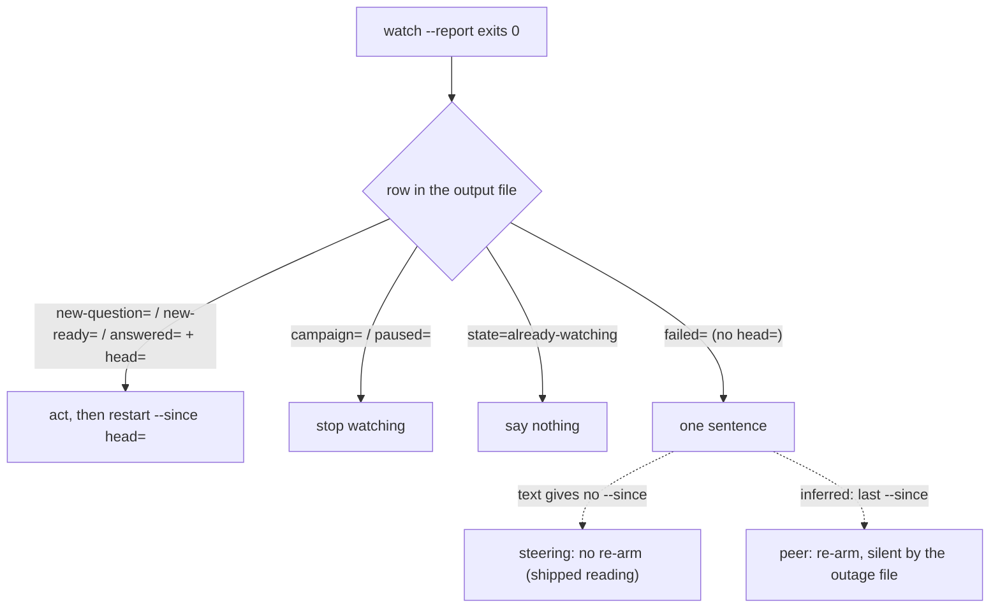

# Analysis: retest of the campaign handover, question route and report-mode watches over two checkouts

**Date:** 2026-11-24 20:15
**Type:** Feasibility (live retest, amendment plan step 6): first half, the protocol; second half, the observations
**Status:** Complete (protocol written 2026-11-24; run 2026-11-25 06:02Z to 23:06Z; observations filled 2026-11-26)
**Requested by:** orchestrator (checkout 114caf11), for amendment plan `261123-1000-plan-fix-the-three-trial-causes-and-retest-before-13-6-0.md` step 6

## Question

Do the fixes of amendment plan `261123-1000-*` steps 2 to 5 clear the six `no` rows of the first trial (`261121-1826-live-trial-two-checkouts.md`), and do the five rows it left untested hold, when two real interactive sessions run against one remote? Every criterion of spec `261119-1102-spec-campaign-peers-follow-the-steering-session-and-report-back.md` C1 to C5 is recorded below as observed yes, no or n/t. Step 6's acceptance rule: **any `no` or `n/t` among the rows of `### 5` part A blocks the release step** (plan `261119-1248-*` step 11) and goes back to the user with the row or message that shows it.

The plan head's two rulings bind this run. Variant (a): the answer and every steering act commit and push in the turn they are confirmed, so the pause in row 18 is pushed by the act itself. The `Bash` route: the watch is a Bash `run_in_background` command whose exit wakes the session, and the woken turn reads the task's output file to learn the row. That ruling adds criterion W1: every wake's row was read from the output file and acted on, with no wake left unread.

This half prepares the retest. The user runs the two sessions. A second dispatch fills `## Findings` from what `collect.sh` gathers (`### 6`).

## Scope

- **Plugin work tree** (read only; nothing in it changed except this file): `/System/Volumes/Data/Projects/productive/F04-FUSION/fusion`, HEAD `9ce0b25f` (2026-11-24T18:46:36+01:00), branch `main`, `## main...origin/main`. Work-tree changes are confined to `fusion-workbench/`. `.claude-plugin/plugin.json` reads `13.5.1`; the bump is the release step's.
- **What the run tests**, all at or below that HEAD: `d6cd7570` (step 2, `watch --report steering|lane`, the per-session outage state file, the 60 s bounds), `1108cbdb` (step 3, the orchestrator: STEP 1 reads the lane before asking, 5a pulls the answer first, the lane wait on `watch --report lane`), `f2dfafd7` (step 4, the campaign skill: Step 9 on `watch --report steering`, Step 8 and Step 6 commit and push at once) and `a6a1c008` (step 5, docs).
- **Read for the setup:** plan `261123-1000-*` (head with both rulings, step 6); the first trial's report, sections 1 to 8; analysis `261123-1414-can-a-background-command-wake-an-idle-session.md`; `bin/fusion-campaign` `## probe and watch`, `## The steering writes`, `## cut`; `skills/campaign/SKILL.md` Steps 2, 3, 5 to 9; `agents/orchestrator.md` STEP 1, Setup step 5, Step 4 sub-step 5a, Step 5, `## How you ask the user anything`, the campaign-lane paragraph of `## Human approval rules`; `skills/setup/SKILL.md`; `skills/check/SKILL.md`; `skills/wp/SKILL.md`; `bin/fusion-write`, `bin/fusion-checkout-name`, `bin/fusion-claimed-package`, `bin/fusion-checks-due` (headers).
- **Scratch retest tree** (not committed anywhere): `/Users/kai/.fusion-tmp/114caf11/live-trial/retest/`. The first trial's tree beside it is untouched.
- **At the second half** (2026-11-26 00:11 local): the plugin work tree unchanged at `9ce0b25f`, `## main...origin/main`. Remote `R/remote.git` `main` at `e692639` (2026-11-26T00:06:10+01:00). `steer/` at `e692639` and `peer/` at `3f997aa`, both `## main...origin/main` as collected. Every observation below is dated by those heads.

## 1. What was built

`R` below is `/Users/kai/.fusion-tmp/114caf11/live-trial/retest`.

| Path | What it is |
|---|---|
| `R/remote.git` | Bare remote, branch `main` |
| `R/steer` | Steering clone, checkout **`aa4241de`**, registered as `retest-steer`. Holds no package. |
| `R/peer` | Peer clone, checkout **`aec54c2d`**, registered as `retest-peer`. Lane 1 names it. |
| `5ca1ab1e` | The checkout lane 2 names. No clone and no session uses it. |
| `R/<clone>/.claude/settings.local.json` | Both clones: `allow` holds the bare tool names `Bash`, `Read`, `Edit`, `Write`, `WebFetch`, `WebSearch`, `Agent`, `Glob`, `Grep`, `NotebookEdit`, plus what `bin/fusion-tmp grant` adds (the clone's intermediate-file grant and the four temp-directory denies). **No `defaultMode`**, so each session keeps the user's global mode (`auto` in `~/.claude/settings.json`). `disabledMcpjsonServers: ["whatsapp"]`, because `~/.mcp.json` declares that server and a session under the home directory would otherwise ask about it (the first trial's clones carried the same key). Git ignores the file. |
| `R/env.sh` | Sourced by every script: the paths, and `CLEAN`, an `env` prefix that drops every inherited `FUSION_*` and `CLAUDE*` variable and sets `FUSION_PLUGIN_ROOT` to the work tree. |
| `R/start-steer.sh`, `R/start-peer.sh` | Start a session: `cd` into the clone, then `claude --plugin-dir <work tree> --agent fusion:orchestrator` under `CLEAN`. `--env` prints the environment instead and starts nothing. |
| `R/block.sh`, `R/unblock.sh` | Rename `remote.git` to `remote.git.blocked` and back. Each refuses a second run and logs the time; `unblock.sh` prints how long the block lasted. No name to type, so the first trial's `remove.git` slip cannot recur. |
| `R/c34.sh` | C3.4: runs `fusion-campaign answer` in the peer clone, prints the package the clone holds, `git status --short` before and after, the exit code and a verdict line. |
| `R/watches.sh` | Read only: every campaign watch running in this tree, with its clone, its age (`ps` `etime`) and its arguments; the pid and state files; the remote's head. |
| `R/collect.sh`, `R/digest.js` | After the run: everything the report needs, into `R/collected-<UTC>/` (`### 6`). `digest.js` turns one transcript into a time-ordered list of user input, session text, arms, wakes, output-file reads and `TaskStop`s. |
| `R/times.log` | Written by the scripts during the run (absent until then). The dry runs are in `R/build.log`. |
| `R/setup-clone.sh`, `R/setup-retest-*.log`, `R/build.log` | How the clones were set up, and what each step printed. |

**Setup, done without a session.** `setup-clone.sh` ran in each clone what `/fusion:setup` Steps 0, 0t, 0d and 3 run (initialize, the stores, the marker, `fusion-tmp path grant link`, the four voice profiles with provenance, the event log), then every `/fusion:check` selector, and stamped all twelve. Both clones then print `checks_due=none`, so the SessionStart hook names no due check and no session meets an installation question. The answers it gave in the user's place:

| Question a session would have asked | Answer given |
|---|---|
| `permissions`: write `bypassPermissions`? | The allow list above, without `defaultMode`. The user declined `bypassPermissions` at the first trial's peer setup. Step 1 (e) left the default permission mode unmeasured; this run does not measure it either. |
| `identity`: name this checkout | `retest-steer` and `retest-peer`, both committed under `fusion-workbench/shared/checkouts/` |
| `concurrency` | `none` in both; the session marker the check writes was cleared again, so neither session finds a stale "running" marker |
| `assets`, `leftovers`, `config` | Nothing to ask on a fresh tree: four `case1-equal`, no leftovers, `fusion.json` seeded from the template |

**The workbench** is one workbench, `workbench_id` `c1b3bf6c-…`, initialized in `steer/` and reused by `peer/` (`result=reused`, `marker=unchanged`, so the peer's setup wrote nothing tracked). `.gitignore` excludes the class L entries, `.checkout-id` among them; `.gitattributes` gives the event log `merge=union`; `CLAUDE.md` names the retest, chat language `de`.

**Four work packages**, filed with `bin/fusion-write create --kind package --actor user`; `set-mode autonomous` with a `user-word` source citing each narrative, which quotes plan step 6 as approved by the user:

| Name | Container | Mode | Lane | Brief |
|---|---|---|---|---|
| P1 | `261124-2010-p1-add-files-b-and-c` | autonomous | lane-1, first | Part 1: `b.txt` containing `B`, which needs no answer. Part 2: a file containing `C` named `c-alpha.txt` or `c-beta.txt`, a choice the brief reserves to the user and `autonomous` does not answer. **Q1.** |
| P2 | `261124-2010-p2-add-file-d` | ordinary | lane-1, second | `d.txt` containing `D`. Ordinary, so the peer files **"may I take it?" (Q2)**. |
| P3 | `261124-2010-p3-add-file-f` | autonomous | lane-2, first | `f.txt` containing `F`. Never taken by the peer (C1.5). |
| P4 | `261124-2010-p4-add-file-g` | autonomous | lane-2, then moved to lane-1 | `g.txt` containing `G`. Moved into lane 1 while paused (row 22); then taken by the peer with no question (C1.4). |

**The campaign** `261124-2010-retest` was opened from `steer/` with `fusion-campaign open`, and its lanes written with `lanes --from <proposal> --assign lane-1=aec54c2d --assign lane-2=5ca1ab1e`. The proposal was written by hand (`~/.fusion-tmp/aa4241de/retest-lanes.json`) rather than by `cut`, so the lane membership is exactly the plan's. Committed under `fusion-commit-lock with campaign` and pushed with `fusion-campaign sync`. The remote's log:

```
744a309 feat(campaign): open 261124-2010-retest, lane-1 on checkout aec54c2d, lane-2 on unused checkout 5ca1ab1e
591005a chore: four retest work packages, P1, P3 and P4 autonomous, P2 ordinary
ae0fdfe chore: register checkout aec54c2d as retest-peer
919c728 chore: scratch project for the campaign retest, with a fusion workbench
```

**Verification, as run before the retest** (2026-11-24, about 19:11Z):

`steer/`: `fusion-campaign overview`

```
state=ok
ref=origin/main
head=744a309cff92c5b358b0972a35786f555eefba46
campaigns=1
campaign=261124-2010-retest	running	-	2
lane=261124-2010-retest	lane-1	aec54c2d	retest-peer	none	261124-2010-p1-add-files-b-and-c	none
lane=261124-2010-retest	lane-2	5ca1ab1e	-	none	261124-2010-p3-add-file-f	none
silent=…	lane-1	aec54c2d	none
silent=…	lane-2	5ca1ab1e	none
unconfirmed=… (both lanes)
ready=261124-2010-retest	lane-1	261124-2010-p1-add-files-b-and-c
ready=261124-2010-retest	lane-2	261124-2010-p3-add-file-f
note=no-commit-rows	aec54c2d
note=no-commit-rows	5ca1ab1e
```

`peer/`: `fusion-campaign sync --read`, `git status --short` empty before and after

```
state=ok
head=744a309cff92c5b358b0972a35786f555eefba46
campaign=261124-2010-retest	running	sha256:9f5ba4e6…	-
mine=261124-2010-retest
lane=261124-2010-retest	lane-1
next=261124-2010-p1-add-files-b-and-c	autonomous	none
```

**Dry runs** (each in `R/build.log`):

| What | Result |
|---|---|
| `start-steer.sh --env`, `start-peer.sh --env`, from a shell that carried 19 `FUSION_*`/`CLAUDE*` variables | Only `FUSION_PLUGIN_ROOT=/System/Volumes/Data/Projects/productive/F04-FUSION/fusion` survives; `PWD` is the clone. No session started. |
| `c34.sh` on `peer/`, which holds nothing yet | `exit=9`, `refused=unknown-scope/question-unknown`, tree unchanged, verdict `no`: correct, since the claim test passes when nothing is held. |
| `c34.sh` on a throwaway third clone that claimed P1 locally (never pushed, deleted after) | `state=holds-package`, `exit=8`, tree unchanged, verdict `yes`. |
| `watch --report steering --since 591005a --interval 2` in `steer/` | `new-ready=` for P1 and P3, `head=744a309…`, exit 0: the report mode prints and exits. |
| `watch --report lane --since 919c728 --interval 2` in `peer/`, 8 s | Nothing printed, killed by `timeout`: a move with no row for the lane is silent. |
| `block.sh`, `block.sh` again, `watch --report lane` while blocked, `unblock.sh`, `unblock.sh` again | Blocked; second block refused; the watch printed `failed=fetch-failed` with git's stderr and exited 0; unblocked with a note that it was under 32 minutes; second unblock refused. The smoke watch's state file was removed afterwards. |
| `collect.sh` | 21 files, no transcripts yet (named in `00-missing.txt`); the dry collection was deleted. |

## 2. What the first trial taught, and what this setup does about it

| First trial (`261121-1826-*`) | Here |
|---|---|
| `sync --read` from a shell inherited `FUSION_CHECKOUT=114caf11` and printed `mine=none` (`### 1`) | Every script runs under `CLEAN`, which drops every inherited `FUSION_*` and `CLAUDE*` variable, not only the three identity ones. |
| The peer was reopened with `/fusion:setup`, which ran the installation questions in the same turn as the brief question (`### 8`, F2) | Setup and every periodic check ran here already and are stamped; the sheet opens the peer with `Hallo` and reopens it with `Setup.`, the two openings plan step 6 names. |
| The peer started before the steering session (`### 8`, first row) | The sheet starts the peer only after the steering overview (row 3). |
| Two notes meant for the protocol author went to the steering session (`### 8`, 15:27:50) | `### 3` rule 1, and a notes file outside every session. |
| The block was undone under the wrong name, `remove.git` (`### 8`) | `unblock.sh` takes no name. |
| Close the peer while waiting on Q2 was not run | Row 13 closes it while Q1 is open, and the answer is pushed while it is closed (row 14). |
| Optional rows C1.4, C1.6, C1.7, C3.4 not run | Each has its own row. |

## 3. Before you start

1. **In the two Claude sessions you type only what the "Type" column says, exactly, and nothing else.** Your observations, questions and notes go into the file `/Users/kai/.fusion-tmp/114caf11/live-trial/retest/notes.txt`, opened in any editor (`collect.sh` picks it up), or to the orchestrator session in the fusion repository. Never into the steering or the peer session.
2. **A row whose Type cell says "nothing" means: do not type in that session at all**, even when it seems to wait for you.
3. **If a session asks you something the sheet does not list:** do not reply in that session. Write the question and the time into `notes.txt`. If the session goes on by itself, continue the sheet; if the run stands still for 15 minutes because of it, stop, run `collect.sh` (row 32) and tell the orchestrator session. A confirmation a row names (rows 7, 18, 22, 23 and 30) is answered `ja`, as that row says; nothing else is.
4. **Three terminal windows**, each a plain terminal, not a shell inside another Claude session: **A** for the steering session, **B** for the peer session, **C** for the scripts. Every command fits on one line.
5. **A dialog asking whether you trust the folder** may appear at the first start in each clone. Choose yes. It is a terminal dialog, not a message to the session.
6. Keep no second copy of fusion enabled as a marketplace plugin.
7. The times are a guide. The whole run takes **about 2½ hours**. About 65 minutes of it (rows 9 to 12) need nothing from you but two script runs at given times.

## 4. Run sheet

`T0` is the steering session's first overview. `Tb` is the time `block.sh` prints. The scripts are run by their full path from terminal C.

| # | Where | Type exactly | Then wait for | Rows |
|---|---|---|---|---|
| 0 | C | `/Users/kai/.fusion-tmp/114caf11/live-trial/retest/watches.sh` | `watch: none running in this retest`, remote at `744a309`. | – |
| 1 | A | `/Users/kai/.fusion-tmp/114caf11/live-trial/retest/start-steer.sh` | The session starts. | – |
| 2 | A | `/fusion:campaign` | The overview: the campaign is running; lane-1 on `retest-peer` with P1 next; lane-2 on `5ca1ab1e`, which has never pushed. The watch is started in the background, and nothing is asked. Note the time: **T0**. | C5.1 |
| 3 | B | `/Users/kai/.fusion-tmp/114caf11/live-trial/retest/start-peer.sh` | The session starts. | – |
| 4 | B | `Hallo` | No question to you. It reads the lane, claims P1, writes `b.txt`, files Q1 (`c-alpha.txt` or `c-beta.txt`) as a decision in P1's container, pushes, says **once** that it waits for the steering session, and starts its watch in the background. About 5 to 10 minutes. | C2.1, C1.3, C2.2, C2.4, C2.5 |
| 5 | A | nothing | Within about 6 minutes of the peer's push: Q1 reported **once**, with an offer to answer. It may also name a package that can now start. **Do not answer.** | C5.4, C5.5, C3.1, W1 |
| 6 | C | `/Users/kai/.fusion-tmp/114caf11/live-trial/retest/c34.sh` | Last line: `C3.4 as expected (exit 8, state=holds-package, tree unchanged): yes`. Run it only after the peer has said it waits. | C3.4 |
| 7 | A | `Lege im Projektwurzelverzeichnis die Datei e.txt mit dem Inhalt E an, ohne Arbeitspaket.` | It writes `e.txt`, commits and pushes, claims no package, and then asks what comes next (its Step 5 question). **Do not answer that question.** If it asks you to confirm the task first, type `ja`. Neither session says anything about this push afterwards. | C1.7, C5.4 |
| 8 | C | `/Users/kai/.fusion-tmp/114caf11/live-trial/retest/watches.sh` | The remote line names the `e.txt` commit, and two watches run (`clone=steer`, `clone=peer`). If the remote line does not show it yet, wait and run again. | – |
| 9 | C | `/Users/kai/.fusion-tmp/114caf11/live-trial/retest/block.sh` | It prints the block time (**Tb**) and the earliest unblock time. Within about 6 minutes, **each** session says **once**, in one sentence, that the remote could not be checked. | C5.6 |
| 10 | C | `/Users/kai/.fusion-tmp/114caf11/live-trial/retest/unblock.sh`, at or after the time `block.sh` printed (Tb + 32 min) | `Unblocked … after 32 minutes` (or more). Neither session says anything at the recovery. | C5.6 |
| 11 | A, B | nothing, until **Tb + 65 minutes** | Neither session writes anything at all in the whole stretch from row 9's one sentence to now. | C2.4, C5.3, C5.5 |
| 12 | C | `/Users/kai/.fusion-tmp/114caf11/live-trial/retest/watches.sh` | Two watch lines, `clone=steer` and `clone=peer`, each with an `age` of at least `01:00:00` (hours:minutes:seconds). If one is younger, wait 5 minutes and run it again. | C5.7 |
| 13 | B | `/exit` | The peer session closes while Q1 is open. | C4.6 |
| 14 | A | `/fusion:campaign answer` | Q1 in one line, its options as a numbered list (if it first lists the open questions, type `1`). Then type the **number of the option `c-beta.txt`**. It files the answer, then commits and pushes it **in that turn, without asking**, and says the peer reads it within about 5 minutes if its session is open. | C3.2, C3.3, C3.5 |
| 15 | C | `/Users/kai/.fusion-tmp/114caf11/live-trial/retest/watches.sh` | The remote line names the answer's commit. | – |
| 16 | B | `/Users/kai/.fusion-tmp/114caf11/live-trial/retest/start-peer.sh`, then in the session: `Setup.` | No question to you. It pulls the answer, marks Q1 answered on the first attempt, writes `c-beta.txt` (and no `c-alpha.txt`), finishes P1, files Q2 "may I take P2?" in P2's container, claims nothing, pushes, says **once** that it waits, and starts its watch. | C2.1, C4.6, C4.2, C4.3, C4.4, C2.3, C1.1 |
| 17 | A | nothing | Within about 6 minutes: Q2 reported **once**, with the offer. **Do not answer yet.** | C5.4, C5.5, W1 |
| 18 | A | `/fusion:campaign pause Grund: Retest der Pause` | It says what it will write and asks once: type `ja`. The campaign is paused, committed and pushed **in that turn**, and its watch is stopped. | C5.2, C1.6 |
| 19 | B | nothing | Within about 6 minutes the peer reports the pause **once** and stops watching. It claims nothing. | C1.6, C1.5, W1 |
| 20 | C | `/Users/kai/.fusion-tmp/114caf11/live-trial/retest/watches.sh` | `watch: none running in this retest`. | C5.2, C1.6 |
| 21 | A | `/fusion:campaign answer` | Q2 and its options; type the **number of the option that lets the peer take P2** ("yes"). Committed and pushed in that turn. No watch is started, since the campaign is paused. The peer says nothing. | C3.3, C5.2 |
| 22 | A | `/fusion:campaign move 261124-2010-p4-add-file-g --to lane-1` | It asks once: type `ja`. Committed and pushed in that turn. | C1.4 |
| 23 | A | `/fusion:campaign resume` | It asks once: type `ja`. Running again, committed and pushed, and its watch is on again. | C5.2 |
| 24 | C | `/Users/kai/.fusion-tmp/114caf11/live-trial/retest/watches.sh` | One watch, `clone=steer`. | C5.2 |
| 25 | B | `weiter` | It reads Q2's answer, claims P2, writes `d.txt`. P2 is ordinary, so finishing it may become one more question (Q3) to the steering session; then it says **once** that it waits and starts its watch. | C1.4, C4.1, C2.4 |
| 26 | A | only if a new question is reported: `/fusion:campaign answer`, then the **number of the option that lets the peer go on** | Committed and pushed in that turn. Repeat this row for each further peer question. | C3.1, C4.1, W1 |
| 27 | B | nothing | The peer finishes P2, then claims **P4 by itself with no question**, writes `g.txt`, finishes it, says once that the lane is finished, and stops. **P3 is never taken.** | C1.4, C1.5, C1.2, C4.5 |
| 28 | A | `/fusion:campaign stop watching` | The watch is stopped, and nothing more is said. | C5.2 |
| 29 | C | `/Users/kai/.fusion-tmp/114caf11/live-trial/retest/watches.sh` | `watch: none running in this retest`. | C5.2 |
| 30 | A | `/fusion:campaign end Ergebnis: cancelled, Grund: Retest beendet` | It asks once: type `ja`. Ended, committed and pushed. | – |
| 31 | A, B | `/exit` in each | Both sessions close. | – |
| 32 | C | `/Users/kai/.fusion-tmp/114caf11/live-trial/retest/collect.sh` | `Collected into …/collected-<time>`. Give that path to the orchestrator session in the fusion repository. Nothing else needs copying. | all |

**First message of each session:** steering `/fusion:campaign` (row 2). Peer `Hallo` (row 4); after the reopen, `Setup.` (row 16).

## 5. Checklist

The last column is filled from the collection, not during the run. "n/t" means not shown by this run, with the reason. Times are UTC unless marked.

### Part A: observed in this run, or the release waits

| ID | Criterion (spec) | Rows | What counts as yes | Observed (yes/no/n/t, time, row or message) |
|---|---|---|---|---|
| C1.4 | Lane membership is checked against the record as it stands now; a steering act does not make the peer refuse a package now in its lane | 22, 25, 27 | P4, moved into lane 1 while paused, is claimed by the peer with no question after P2 | **yes**. P4 moved into lane 1 while paused (`22ccb50`, 14:12:16Z); after P2 closed (`b505c2d`, 15:10:21Z) the peer claimed P4 with no question (`4ce7002`, 15:10:22Z), peer text 15:10:39Z "P4 läuft im selbständigen Modus, deshalb gab es dazu keine Rückfrage". |
| C1.5 | The peer never takes a package from a lane not naming it, nor while the campaign is paused or ended | 19, 27 | No claim between the pause and `weiter`; P3 is never claimed | **yes**. Peer claims on the remote: P1 `0a1963c`, P2 `c6897f1` (14:38:08Z, after resume `1ee9d8b` 14:35:51Z and `weiter` 14:37:28Z), P4 `4ce7002`. None between the pause `67e3f92` (13:37:37Z) and `weiter`. P3 has only its create commit `591005a`; no `f.txt` in `03-remote-ls-tree.txt`. |
| C1.6 | A paused campaign stops the peer | 18 to 20 | The peer, waiting on Q2, wakes on `paused=`, reports the pause once, stops its watch, claims nothing | **yes**. Pause pushed 13:37:37Z; peer watch `bg480b7pd` woke 13:42:14Z with `paused=261124-2010-retest`, output file read 13:42:19Z, one report 13:42:27Z, no re-arm after it, no claim until after resume. |
| C1.7 | In a checkout no lane names, the session behaves as before (the Step 5 "what next?" question) | 7 | The steering session, after `e.txt`, asks its Step 5 question | **yes**. The steering session, holding nothing, wrote `e.txt` (`8038cf5`, 06:20:36Z, only `A e.txt`), claimed no package, then put its Step 5 question at 06:20:41Z: "Wie geht es weiter? 1. … 2. … 3. Wir hören hier auf." It asked no confirmation first. |
| C2.1 | A lane peer never puts an approval or "what next?" to its own user | 4, 16, 25, 27 | No question to the peer's user after `Hallo`, after `Setup.`, or anywhere else | **yes**. No approval or "what next?" question in either peer transcript: `Hallo` (06:03:52Z) led to a claim at 06:05:25Z with no question; `Setup.` (08:08:38Z) led to the answer pickup with no question. Two closing lines invite input without asking: 13:42:27Z "Sobald du in der steuernden Sitzung fortsetzt, sag hier Bescheid" (5a's pause handling, see Findings F5) and 15:11:21Z "Wenn du die Sitzung beenden oder diesem Klon eine andere Aufgabe geben willst, sag es hier". |
| C2.4 | After filing, the peer goes on with work that does not depend on the answer; with none left it tells its user **once** that it waits | 4, 11, 16, 25 | One wait message per question, and no other peer message while it waits (rows 9 to 12 included, apart from row 9's one failure sentence) | **yes**. One wait message per question: Q1 06:06:41Z, Q2 08:12:04Z, Q3 14:39:32Z. While waiting, the only other peer output is the outage turn at 06:41:54–58Z (one narration line and one two-sentence text). Nothing from 06:41:58Z to `/exit` at 07:56:25Z, nothing from 08:12:04Z to the pause wake at 13:42:14Z. |
| C3.3 | The answer reaches the remote with the steering session's next commit and push, and the report says so; under variant (a), in the turn of the choice with no further question | 14, 21, 26 | Each answer pushed in the turn the option was chosen, with no question, and the "within about 5 minutes" sentence | **yes**. Choice "1" 07:57:14Z → `b3ff34d` 07:57:38Z; "1" 14:11:06Z → `b91cd85` 14:11:22Z; "1" 15:08:24Z → `9096c7e` 15:08:45Z. Each pushed in the choosing turn with no further question, each report carrying "liest die Antwort innerhalb von etwa 5 Minuten, sofern dort die Sitzung offen ist" (07:57:46Z, 14:11:29Z, 15:08:49Z). |
| C3.4 | The answer step refuses to run from a checkout holding a package | 6 | `c34.sh`: exit 8, `state=holds-package`, tree unchanged | **yes**. `times.log` 06:13:45Z: `c34 … exit=8 unchanged=yes expected=yes`. |
| C4.2 | The question is marked `answered` citing the answer record; the answer record unchanged | 16, 25 | The transition lands on its **first** attempt (the answer pulled first), `answer_ref` set | **yes**. All three transitions to `answered` landed on the first call with `--answer-ref`: Q1 08:09:58Z `result=landed`; Q2 14:38:08Z `result=landed`; Q3 15:10:07Z `result=landed`. `answer_ref` is set in all three question records at `main` (`07-records-at-main.txt` lines 358, 483, 545); the answer records' only commits are `b3ff34d`, `b91cd85`, `9096c7e` (`09-record-commit-history.txt`). |
| C4.6 | Peer closed while waiting and reopened: nothing is lost, **with the answer arriving while it is closed** | 13 to 16 | Q1 answered and pushed while the peer is closed; the reopened peer finds it and goes on | **yes**. Peer `/exit` 07:56:25Z with Q1 open; answer pushed 07:57:38Z while closed; peer restarted 08:08:15Z, `Setup.` 08:08:38Z, found the answer 08:09:41Z, marked Q1 answered 08:09:58Z, wrote `c-alpha.txt` (`0159515`). |
| C5.2 | The watch stops on pause, on end, on "stop watching" and when the session closes, and resumes at the next use of the command | 18, 20, 23, 24, 28, 29, 31 | Stopped at the pause; not started by the answer while paused; on again at `resume`; stopped by "stop watching" with nothing more said | **yes**. Stopped at the pause (`TaskStop bywa5kevn` 13:37:40Z; `watches.sh` 13:51:20Z: none). Not started by the answer while paused (14:09–14:11Z, no `ARM`; text 14:11:29Z "Solange die Kampagne pausiert ist, beobachte ich `origin/main` nicht"). On again at resume (`bae1ndzd2` armed 14:36:00Z; `watches.sh` 14:36:01Z one watch, `clone=steer`). Stopped by "stop watching" (`TaskStop bnwwdj9wy` 23:05:17Z; `watches.sh` 23:05:33Z none). Session close: the peer's `/exit` at 07:56:25Z ended `b8f4qxx3t` (`watches.sh` 08:07:57Z shows no peer watch). The end found the watch already stopped. Row 31's `/exit` is not in either transcript (Departures). |
| C5.3 | When the remote has not moved, the user sees nothing | 9 to 12 | No steering message in that stretch but row 9's one sentence | **yes**. Steering watch `bywa5kevn` live 08:12:24Z–13:37:40Z with the remote at `96091b0` throughout (`watches.sh` 13:36:26Z): no steering text from 08:12:28Z until the user's own `pause` at 11:59:13Z. The peer's watch was silent through the outage and the recovery. Rows 9–12 do not show it on the steering side, because no steering watch ran from 06:40:00Z to 07:56:59Z (C5.6). |
| C5.4 | When the remote moved, the user hears only of new peer questions (with the offer) and packages that can now start; nothing else | 5, 7, 14, 17, 21 to 27 | No message about its own pushes, the peer's pushes without a question, a claim or a finish | **yes**. Unprompted steering reports went out on exactly three wakes, each a `new-question=` (06:09:59Z, 08:12:28Z, 14:41:26Z), the first and third with the `new-ready=` package beside it. No wake on its own pushes (`8038cf5`, `b3ff34d`, `b91cd85`, `22ccb50`, `1ee9d8b`, `9096c7e`), the peer's claims (`0a1963c`, `c6897f1`, `4ce7002`) or finishes (`faf0537`, `b505c2d`, `f4aeb82`): `bnwwdj9wy` ran 14:41:21Z–23:05:17Z across the P2 close and the whole of P4 and printed nothing. The reports carry the finish as context ("hat P1 abgeschlossen … und fragt jetzt"), never as a message of their own. |
| C5.5 | Each question or ready package is reported once | 5, 11, 17, 26 | No item reported twice, the recovery included | **yes**. Q1, Q2, Q3, P2-ready and P4-ready each reported once by a wake. Later mentions come only in turns the user opened (`answer`, `pause`, `move`, `resume`). Nothing at the recovery on either side. |
| C5.6 | A failed check is reported once, in a sentence, and the watch keeps trying, **both sessions** | 9 to 11 | One sentence per session; nothing after the re-arm in the outage; nothing at the recovery | **no (steering side); yes (peer side)**. Both sessions reported the outage once (steering 06:40:16Z, peer 06:41:54–58Z). The peer re-armed `--since 5e849e7` at 06:41:55Z, and that watch stayed silent through the rest of the outage and the recovery. The steering session read `failed=fetch-failed` (06:40:05Z) and **did not re-arm**: "Ich habe die Beobachtung nicht neu gestartet, solange das Remote fehlt". It then asked its user "Sag mir Bescheid, sobald das Remote wieder da ist, oder ob … wir hier aufhören". No steering watch ran from 06:40:00Z until the user's next `/fusion:campaign` at 07:56:59Z (`watches.sh` 07:53:00Z shows the peer's watch only). **Shipped behaviour**: Step 9 gives `failed=` no re-arm instruction, and the general re-arm rule needs a `head=` that `failed=` never prints (Findings F1). |
| C5.7 | The watch keeps running as long as the session is open, past any time limit of the mechanism, without the user re-arming it; **here: one watch per side older than 60 minutes** | 12 | `watches.sh` shows both ages at or above `01:00:00`; no input to either session in between | **yes**, shown after row 12 rather than at it. `watches.sh` 13:36:26Z: `clone=peer age=05:24:28` and `clone=steer age=05:24:03`. Neither was re-armed by a user: no peer input 08:08:38Z–14:37:28Z, and the only steering input, `pause` at 11:59:13Z, re-arms nothing. The steering watch `bnwwdj9wy` then ran 8 h 24 min (14:41:21Z–23:05:17Z), through an idle compaction at 16:03:43Z. At row 12 (07:53:00Z) only the peer's watch qualified (01:11:05); the steering side was missing because of C5.6. |
| W1 | Every wake's row was read from the output file and acted on, with no wake left unread (the ruling after step 1) | all | In each digest, every `WAKE` of a watch task is followed by a `READ-OUTPUT` of that task's file and by the act its row asks for, or by no text where the row asks for none | **yes**. Seven wakes of watch tasks across the run, each followed by a read of that task's output file before any act: steering `bd843sw21` 06:09:31→06:09:46Z, `bvhgxfchu` 06:40:00→06:40:05Z, `by36wxtk1` 08:12:15→08:12:18Z, `bae1ndzd2` 14:41:12→14:41:17Z; peer `b4w146a36` 06:41:38→06:41:42Z, `bg480b7pd` 13:42:14→13:42:19Z, `bpov6b22r` 15:09:45→15:09:48Z. None was left unread. Six were acted on as their row asks. On `bvhgxfchu` (`failed=`) the session gave the report and did not re-arm, which is C5.6's defect and not a missed read. Three watches ended without a wake, as they should: `bywa5kevn` by `TaskStop` at the pause, `bnwwdj9wy` by `TaskStop` at "stop watching", and `b8f4qxx3t` by the peer's `/exit`. |

### Part B: the rows that were yes in the first trial

Recorded as observed where this run shows them; otherwise cited from `261121-1826-*` `### 4`.

| ID | Criterion (spec) | Rows | Observed (yes/no/n/t, time, row or message) |
|---|---|---|---|
| C1.1 | After each commit, the peer's campaign read shows its lane and the next package | 4, 16, 25, 27 | **yes**. Every peer commit cycle's `sync`/`sync --read` printed `lane=…lane-1` and `next=`: e.g. 06:06:24Z, 14:37:40Z `next=261124-2010-p2-add-file-d`, 15:11:16Z `next=none`. The remote's event log has 21 `campaign_read` rows. |
| C1.2 | Handover without a question: the next autonomous package with waits `none` is claimed with no question | 27 | **yes**. P4, autonomous, waits none, claimed with no question (`4ce7002`, 15:10:22Z). |
| C1.3 | A peer session that starts holding nothing takes the first package the same way | 4 | **yes**. The peer, holding nothing, claimed P1 with no question after `Hallo` (`0a1963c`, 06:05:25Z). |
| C2.2 | The record states question and options, `**Asked by:**` and `**Set aside:**` | 4, 16, 25 | **yes**. All three question records carry question, options, `**Asked by:** checkout aec54c2d, package …` and `**Set aside:**` (`approval: Ambiguous task instruction`, `claim of 261124-2010-p2-add-file-d`, `approval: A work package is to be finished`): `07-records-at-main.txt` lines 310–311, 438–439, 500–501. |
| C2.3 | "May I take" record for an ordinary package; the package stays `open` until the answer | 16 to 25 | **yes**. Q2 "May checkout aec54c2d take P2?" (`fbc2af4`). P2's `package.json` changes only at `591005a` (create), `c6897f1` (claim after the answer) and `b505c2d` (done). |
| C2.5 | While a question is open, the peer neither releases its package nor claims a second | 4 to 16 | **yes**. P1's `package.json`: `0a1963c` claim, `faf0537` done; no release and no second claim while Q1 was open. |
| C2.6 | No agent answers a filed question | all | **yes**. The three answer records were filed only by the steering session, each after the user typed `1`. |
| C3.1 | From the steering session the user sees every open peer question and can answer it | 5, 14, 17, 21, 26 | **yes**. Q1, Q2, Q3 were reported unprompted (06:09:59Z, 08:12:28Z, 14:41:26Z) and answered through `/fusion:campaign answer` (Q1, Q2) or in the report turn's sequel (Q3, answered 15:08:24Z). |
| C3.2 | The answer is a new record in `shared/decisions/` with `**Answers:**`, the option quoted; the question record untouched by the steering side | 14, 21, 26 | **yes**. Three new records in `shared/decisions/`, each with `**Answers:**` and the option quoted (e.g. `07-records-at-main.txt` lines 135–153). Steering commits touched no question record: those records changed only in peer commits (`09-record-commit-history.txt`). |
| C3.5 | No answer is filed without the user choosing it in that session | 14, 21, 26 | **yes**. The user's `1` at 07:57:14Z, 14:11:06Z and 15:08:24Z precedes each `answer` call. |
| C4.1 | The answer reaches the peer within about 5 minutes with no input at the peer (push time against wake time) | 26 | **yes**. Q3's answer pushed at 15:08:45Z; peer wake 15:09:45Z (60 s); P2 closed at 15:10:21Z with no input at the peer. |
| C4.3 | The peer acts on the chosen option only: `c-beta.txt`, no `c-alpha.txt` | 16 | **yes**, against the option the user chose (`c-alpha.txt`, not the sheet's `c-beta.txt`): `c-alpha.txt` holds `C` (`0159515`); no `c-beta.txt` anywhere in `03-remote-ls-tree.txt`. The peer checked `[ ! -e c-beta.txt ]` at 08:10:40Z. |
| C4.4 | The set-aside step is resumed without asking again | 16, 25 | **yes**. Each set-aside step resumed without asking again: `c-alpha.txt` at 08:10:09Z, the P2 claim at 14:38:02Z, the P2 close at 15:10:05Z. |
| C4.5 | The peer stops its watch once nothing is open | 27 | **yes**. After P4 closed: "Ich starte nichts Weiteres und beobachte den Server nicht mehr" (15:11:21Z); no `ARM` after `bpov6b22r`. |

### Watch life (C5.7, plan step 6)

| Side | Longest-lived watch: task id, armed at, ended at (or alive at row 12) | Age | Re-armed by the user? |
|---|---|---|---|
| steering | `bnwwdj9wy`, armed 14:41:21Z, ended by `TaskStop` at "stop watching" 23:05:17Z. Next longest: `bywa5kevn`, 08:12:24Z to 13:37:40Z (`TaskStop` at the pause), age 05:24:03 at 13:36:26Z | 8 h 23 min 56 s | No |
| peer | `bg480b7pd`, armed 08:11:58Z, ended by its own exit on `paused=` at 13:42:14Z. Through the outage: `b8f4qxx3t`, 06:41:55Z to the peer's `/exit` at 07:56:25Z, age 01:11:05 at 07:53:00Z | 5 h 30 min 16 s | No |

## 6. After the run: what `collect.sh` gathers

One directory, `R/collected-<UTC>/`, read only on everything else:

- the remote's log with times, with `--name-status`, and its file list at `main`;
- the event log at `main`, its gate, campaign, commit and session rows apart, and each clone's working copy of the log with `git status`;
- every package, decision, campaign and checkout record at `main`, each record's commit history, and the campaign record's history with its diffs;
- the final overview from `steer/`, `--since 744a309…`;
- both clones' transcript directories under `~/.claude/projects/` (`*live-trial-retest-steer`, `*live-trial-retest-peer`), copied whole, with one digest per transcript (`digests/`);
- every background task output file the transcripts name (`task-outputs/`), so each wake's row can be set beside the turn it started (W1). Those files sit under the system temp directory and are lost at a reboot: run `collect.sh` before restarting the machine;
- the watch pid and state files under `~/.fusion-tmp/aa4241de/` and `~/.fusion-tmp/aec54c2d/`, `times.log`, `notes.txt`, the setup and build logs, and a last `watches.sh`.

Delete `R/` only after the report is written.

## 7. What to watch for, from reading the shipped text

Reading notes, not findings. The run decides them.

- **P2's finish is likely a third question.** P2 is `ordinary`, and in the first trial the ordinary package's finish became Q3 (`261121-1826-*` `### 8`, row "Peer finishes step3"). Row 26 covers it; it is the shipped approval rule, not a fault.
- **`new-ready=` is a permitted report.** When P1 finishes, P2 becomes `ready` and the steering watch may report it beside Q2. C5.4 allows "a package that can now start". A report of the claim or the finish of a package would not be.
- **The steering session's own `/fusion:campaign answer` re-runs Step 9** while its watch runs. The new watch exits at once with `state=already-watching`, which is itself a wake: the text says "say nothing" to it.
- **The steering watch may wake on its own pause** (`campaign=` or nothing, depending on the mode's rows: steering mode prints `campaign=` only for a campaign that left `running`, which a pause does). Step 9 says to stop the watch after a pause in this session either way; a sentence about the pause beyond the act's own report counts against C5.4.
- **Step 6's report sentence** "the act reaches a working session at the holding session's next commit" still ends each steering act. Under report mode the peer actually learns of a pause at its next probe; the sentence understates, it does not mislead.
- **`/exit` at the peer kills its watch** (row 13). The steering side sees no change: a closed peer is not a remote event.
- **Lane 2's checkout never pushes**, so every overview carries a `silent=` line for it. That is an overview line, read on use, and not an unprompted report.

## Findings

### Outcome

**Part A: 16 yes, 1 no, 0 n/t.** The `no` is **C5.6 on the steering side**. It is shipped behaviour, not an artefact of the run. Under step 6's rule it blocks the release. **Part B: 14 of 14 yes.** **W1: yes.** All seven wakes had their output file read before the session acted.

All six `no` rows of the first trial now hold. So do its five untested rows (C1.4, C1.6, C1.7, C3.4 and the answer arriving while the peer is closed, C4.6). The one new `no` comes from step 4's text, at a branch the first trial never reached: a report-mode watch that exits on `failed=`.

### F1: the steering watch is not re-armed after `failed=` (C5.6, blocking)

**What happened.** Both watches exited on the outage with the same output: `failed=fetch-failed`, git's stderr, exit 0, and **no `head=` line** (`task-outputs/steer/bvhgxfchu.output`, `task-outputs/peer/b4w146a36.output`). The two sessions then read near-identical rules differently:

| Session | Rule it follows | What it did |
|---|---|---|
| peer | `agents/orchestrator.md:380` (generated from `catalog/profiles/orchestrator/parts/40a-claude.md:1`): "`failed=`: one sentence. `paused=` or `campaign=`: …; stop watching. Else restart it `--since` the printed `head=` while a `question=` row of this checkout is open." | Re-armed at 06:41:55Z `--since 5e849e7`, the head it had armed with. The helper's outage file kept that watch silent, as designed. |
| steering | `skills/campaign/SKILL.md:160`: "`failed=`: one sentence. `campaign=`: say nothing more; stop watching. Else restart it `--since` the printed `head=`." | Did not re-arm, and said so at 06:40:16Z. Then asked its user whether to continue or stop. No steering watch ran for 77 minutes, until the user's next `/fusion:campaign` (07:56:59Z). |

**Cause.** The helper prints `failed=` and returns with no `head=` (`hooks/lib/campaign-watch.ts:319-323`; documented at `bin/fusion-campaign:728-739` and in the exit-code row at `bin/fusion-campaign:753`). The helper is built for a re-arm with the *unchanged* `--since`: the last head stays, rows are reported after recovery, and "a re-armed watch stays silent in an outage its predecessor reported" (`bin/fusion-campaign:722-739`, `hooks/lib/campaign-watch.ts:55-62`). The skill text never says so. Its `failed=` clause gives only the sentence, and its "Else restart" clause depends on a `head=` this exit never prints. Read literally, the text leaves the `failed=` case with no re-arm. The steering session followed that reading. The peer filled the gap with the obvious value. The user's reading in chat is confirmed: **the defect is `skills/campaign/SKILL.md:160`**. That file is render output; its source is `catalog/profiles/skill-campaign/parts/09-claude.md:4` (`README-agents.md:51`). The same gap is latent at `agents/orchestrator.md:380` / `catalog/profiles/orchestrator/parts/40a-claude.md:1`. The peer handled it correctly here, but the text does not guarantee that.



**Contributing factor.** The steering's failure turn goes beyond "one sentence". It names the cause, explains why it did not re-arm, and asks its user a question. The question is the model filling the hole F1 leaves, not a separate rule.

### F2: the steering session's statements drift from the record when it does not read it first (not blocking)

- 06:09:59Z (row 5): "Der erste Teil (`b.txt`) … läuft bei `retest-peer` weiter". `b.txt` had been pushed in `aa677e4` at 06:06:15Z, before the question was filed. The session read the question record at `5e849e7` and inferred the state of part 1 from the record's wording instead of from the tree.
- 23:05:53Z (row 30, the end confirmation): "`261124-2010-p3-add-file-f` und `261124-2010-p4-add-file-g` bleiben unbearbeitet liegen", repeated in the 23:06:19Z report. P4 had been done since `f4aeb82` (15:11:12Z). The session ran no overview between the user's `end` (23:05:48Z) and its confirmation (23:05:53Z), and its context had been compacted at 16:03:43Z, before P4 closed. Step 6 (`skills/campaign/SKILL.md:124`) asks for a sentence about what will be written and no fresh read. Here the confirmation of an act described as irreversible ("lässt sich nicht wieder aufnehmen") misstated the state of the campaign.

Neither statement is a criterion of the spec. Both are reports a user acts on.

### F3: the report modes stay silent on everything but their rows (C5.3, C5.4, C5.5)

`bnwwdj9wy` ran 8 h 24 min while the peer pushed eight commits: the P2 close, the P4 claim, `g.txt` and the P4 close. It never woke. The steering's own pushes (`8038cf5`, `b3ff34d`) did not wake their watches either. The outage file worked on the peer side: the re-armed `b8f4qxx3t` stayed silent from 06:41:55Z through the unblock at 07:51:54Z. All this is step 2's design, observed for the first time with two live sessions.

### F4: wake-to-act latency

| Event pushed | Push | Wake | Report or act | Lag to wake |
|---|---|---|---|---|
| Q1 (`0245d73`/`5e849e7`) | 06:06:18Z | steer 06:09:31Z | 06:09:59Z | 3 min 13 s |
| Outage (block) | 06:36:56Z | steer 06:40:00Z, peer 06:41:38Z | 06:40:16Z, 06:41:58Z | 3 min 4 s, 4 min 42 s |
| Q2 (`fbc2af4`/`96091b0`) | 08:11:52Z | steer 08:12:15Z | 08:12:28Z | 23 s |
| Pause (`67e3f92`) | 13:37:37Z | peer 13:42:14Z | 13:42:27Z | 4 min 37 s |
| Q3 (`43cb7e4`/`4905f30`) | 14:39:24Z | steer 14:41:12Z | 14:41:26Z | 1 min 48 s |
| Q3 answer (`9096c7e`) | 15:08:45Z | peer 15:09:45Z | P2 closed 15:10:21Z | 60 s |

Every lag is inside the 300 s probe interval, and every wake was acted on within 20 s.

### F5: after a pause the peer stops and stays stopped until its own user speaks (by design)

On `paused=` the peer reported the pause and stopped watching, as `agents/orchestrator.md:301` (5a, "dispatch nothing more, report the campaign's reason") and `:380` ("stop watching") require. It closed with "Sobald du in der steuernden Sitzung fortsetzt, sag hier Bescheid" (13:42:27Z). The resume at 14:35:51Z therefore reached no open peer session by itself. The peer picked it up only when its user typed `weiter` (14:37:28Z), which row 25 had scripted. The behaviour is consistent with the shipped text and with C1.6. Whether a resume should wake a paused peer is a spec question, not a defect found here.

### F6: smaller observations

- **Row 5 wording.** Step 9 says to *offer* to answer a `new-question=`. The session instead put the question with its numbered options straight away (06:09:59Z, 08:12:28Z, 14:41:26Z). The user answered Q3 in the turn that followed, Q1 and Q2 through `answer`. Harmless, and arguably more useful, but not the text's wording.
- **Arm before act.** In the `answer` turn of 07:56:41Z the watch was re-armed at 07:56:59Z, before the user chose (07:57:14Z) and the answer was pushed (07:57:38Z). Step 9 says "after whatever else it did". It made no difference, because the session's own push produces no row.
- **Visible narration.** The peer's outage sentence that names the cause ("Das gemeinsame Remote ist gerade nicht erreichbar, weil `remote.git` an seinem Pfad fehlt …", 06:41:54Z) is a thinking block shown to the user as a narration update, not a text block. `digest.js` does not capture these. The whole run has two of them, both in the first peer session (06:05:49Z, 06:41:54Z), and this report counts both.
- **Retest scaffolding in view.** At 06:41:46Z the peer listed the retest root and saw `remote.git.blocked`, `.blocked-at` and the scripts. Its narration names `remote.git.blocked`. The session acted on nothing it saw there.

## Where the run departed from the run sheet

| Row | Sheet | What happened | Effect on the verdicts |
|---|---|---|---|
| 1–4 | Peer started after the steering overview (row 3) | `start-steer` 06:02:30Z, `start-peer` 06:03:03Z. The peer's `Hallo` (06:03:52Z) came before the steering overview text (06:04:33Z). | None. The campaign was already open on the remote, the steering watch was armed at 06:04:23Z, and the peer's first push came at 06:05:25Z. |
| 2 | Nothing asked | The overview also said lane 2 could be reassigned ("weise die Bahn einem anderen Checkout zu"). This was information with no question attached, and it was not answered. | None. |
| 4 | First `watches.sh` | At 06:05:40Z only the steering watch ran. The push 13 s earlier was the peer's **claim** (`0a1963c`/`88ef68c`), not Q1. The peer filed Q1 at 06:06:15Z and armed its watch at 06:06:31Z. | None. Both ran at 06:11:09Z. |
| 7 | `e.txt` in the steering clone | The user first created `retest/e.txt` by hand in the retest root, outside both clones. That file is gone at collection and appears in no commit. The sentence then went to the steering session, which committed `8038cf5` at 06:20:36Z (07:20 local). | None. |
| 9–10 | Block for at least 32 min | Blocked 06:36:56Z, unblocked 07:51:54Z (74 min). A second `block.sh`/`unblock.sh` pair ran at 07:55:53Z/07:55:55Z (2 s), outside the sheet. | The longer block makes C5.7's peer-side evidence stronger. The 2 s block hit no probe: no wake on either side, and the peer's `b8f4qxx3t` was still alive at 07:56:00Z. |
| 9–12 | Steering silent with its watch running | The steering session asked its user a question at 06:40:16Z and ran no watch from 06:40:00Z to 07:56:59Z. | This is F1, the blocking `no`. |
| 12 | Both watches at least `01:00:00` | 07:53:00Z: peer `01:11:05`, steering none. | C5.7 taken from 13:36:26Z instead (both 05:24). |
| 14 | Choose `c-beta.txt` | The user chose `1`, `c-alpha.txt`. | C4.3 judged against the chosen option. |
| 17–18 | Pause right after Q2's report | Q2 was reported at 08:12:28Z (09:12 local). The user typed `pause` at 11:59:13Z (12:59 local); the session asked at 11:59:20Z; the user confirmed with `1` (not `ja`) at 13:37:19Z (14:37 local). | Gives the 5 h 24 min watch ages of C5.7 and the 3 h 47 min silent stretch of C5.3. |
| 18, 22, 23, 30 | Confirm with `ja` | The sessions offered numbered options. The user typed `1` each time. | None. |
| 20, 24 | `watches.sh` once | Run about 18 times between 14:35:45Z and 14:36:50Z. | None. |
| 28–30 | Right after row 27 | `stop watching` 23:05:15Z, `end` 23:05:48Z: about 7 h 54 min after the peer finished (15:11:21Z). | Gives the 8 h 24 min `bnwwdj9wy` life (C5.7) and exposes F2's stale end confirmation. |
| 28 | Nothing more said | Three sentences confirming the stop (23:05:20Z), then nothing. | Counted as the act's own report. |
| 30 | Ended, committed, pushed | `c1a856f` 23:06:10Z. The report then put a Step 5-style "Wie geht es weiter?" question (23:06:19Z). | None. Allowed in a checkout no lane names (C1.7). |
| 31 | `/exit` in each | No `/exit` in either transcript before `collect.sh` ran at 23:06:23Z. The steering session's last turn ended at 23:06:19Z; the peer's at 15:11:21Z. | C5.2's "session closes" taken from the peer's `/exit` at row 13. Both watches were already gone at 23:05:33Z. |
| – | `notes.txt` | Not present. | None. |

## Implications

- **The release stays blocked** under step 6's rule, by one row. The fix is a sentence in the shipped text, not a change to the mechanism. The helper already does what the fix needs: it keeps the last head on failure and stays silent in a reported outage. Only the instruction to the session is missing.
- **The fix belongs in both texts.** The peer's correct behaviour came from inference over the same gap. Fixing only `skills/campaign/SKILL.md:160` would leave `agents/orchestrator.md:380` resting on the same inference.
- **Is a rerun of the whole sheet owed?** The fix touches only the `failed=` branch. A narrow re-check (block the remote with both watches running, see both re-arm and stay silent, unblock, run `watches.sh` past 60 min) would cover C5.6. That C5.6 alone may be re-run instead of all of step 6 is the user's call, recorded under Open Questions.
- **F2 touches every steering confirmation** that names packages from memory. Until Step 6 reads before it confirms, a long-lived, compacted steering session can confirm an irreversible act on a wrong picture.

## Recommendations

1. **code-implementer** (via implementation-planner, as a step of amendment plan `261123-1000-*`): in the source parts `catalog/profiles/skill-campaign/parts/09-claude.md:4` (rendered to `skills/campaign/SKILL.md:160`) and `catalog/profiles/orchestrator/parts/40a-claude.md:1` (rendered to `agents/orchestrator.md:380`), then `cd catalog && npm run render -- claude`, make the `failed=` clause carry its own re-arm, worded along the lines of "`failed=`: one sentence, then restart it `--since` the head it was started with; the watch stays silent until the remote answers". Optionally also state in the helper header beside `bin/fusion-campaign:728` that `failed=` carries no `head=` and that the re-arm reuses the previous `--since`. A test in the growth-bounded text needs head-room for the added clause. **One rule, no special case**: the same re-arm rule for both modes.
2. **code-implementer**, same plan: Step 6's confirmation (source `catalog/profiles/skill-campaign/parts/07-claude.md:4`, rendered to `skills/campaign/SKILL.md:124`) names packages only from an `overview` read in that turn, or names none (F2).
3. **User decision**: a narrow C5.6 re-check after fix 1, or a full rerun of step 6 (Open Questions).
4. **Retest tooling** (no agent; scratch only): `digest.js` should also emit non-empty thinking blocks as `NARRATE` lines, since they are what the user sees (F6).

## Filed Issues

None. The dispatch asked for this one file only. The defect in F1 and the finding in F2 are written up above with file:line, ready to file as issues or to fold into amendment plan `261123-1000-*`.

## Sources

- Plan `261123-1000-plan-fix-the-three-trial-causes-and-retest-before-13-6-0.md`: head, both "Ruled:" paragraphs, step 6, `## Where this work stops`.
- Spec `261119-1102-spec-campaign-peers-follow-the-steering-session-and-report-back.md`, C1 to C5.
- Analyses `261121-1826-live-trial-two-checkouts.md` (`### 1`, `### 4`, `### 8`, F1 to F5, R6) and `261123-1414-can-a-background-command-wake-an-idle-session.md` (the output-file read, (d), (e)).
- Shipped text at `9ce0b25f`: `bin/fusion-campaign` `## probe and watch`, `## The steering writes`; `skills/campaign/SKILL.md` Steps 5, 6, 8, 9; `agents/orchestrator.md` lines 70 (STEP 1), 92 (Setup step 5), 301 to 303 (5a), 318 (Step 5 in a lane), 380 (the campaign-lane wait).
- Setup and checks: `skills/setup/SKILL.md`, `skills/check/SKILL.md`, `bin/fusion-checks-due`, `bin/fusion-checkout-name`, `bin/fusion-write`, `skills/wp/SKILL.md`.
- The retest tree's own logs: `R/setup-retest-steer.log`, `R/setup-retest-peer.log`, `R/build.log`.
- `~/.claude/settings.json` (`defaultMode: auto`), `~/.mcp.json` (the `whatsapp` server), `~/.claude.json` (no trust entry for the new clones; read only).
- **The run's evidence (second half):** `R/collected-20261125T230623Z/` (all 51 files: `01`–`13`, `digests/`, `task-outputs/steer/*.output`, `task-outputs/peer/*.output`, `transcripts/steer/75ebf666-….jsonl`, `transcripts/peer/d49ae732-….jsonl`, `transcripts/peer/99089d7d-….jsonl`, read raw for tool results and narration blocks), `R/times.log`. `R/notes.txt` was absent. `R/remote.git` was read with `git log` and `git show` only: head `e692639`, 46 commits.
- Shipped text for F1 and F2 at `9ce0b25f`: `skills/campaign/SKILL.md:124, 160` and their sources `catalog/profiles/skill-campaign/parts/07-claude.md:4`, `09-claude.md:4`; `README-agents.md:51`; `agents/orchestrator.md:70, 92, 301, 380`; `catalog/profiles/orchestrator/parts/40a-claude.md:1`; `bin/fusion-campaign:671-753`; `hooks/lib/campaign-watch.ts:55-62, 297-326`.

## Open Questions

- [ ] After fix 1 (F1): is a narrow C5.6 re-check (outage with both report-mode watches running, then recovery) enough to lift the block, or is a full rerun of step 6 owed?
- [ ] F5: should `resume` reach a peer that stopped on `paused=` without its own user's word, or is `weiter` at the peer the intended way back?

- [ ] The default permission mode (step 1 (e)) is not measured here either: the clones allow `Bash` by name, and the user's global mode is `auto`. Whether that is enough for the release, or a default-mode run is owed, is the user's call.
- [ ] The trust dialog of each new clone is a terminal dialog this dispatch could not pre-answer without editing `~/.claude.json`, which it did not touch.
