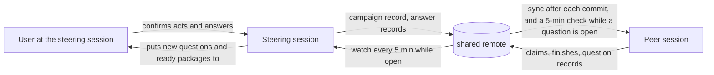

# Spec: campaign peers follow the steering session, and their questions and results come back to it

**Date:** 2026-11-19
**Source:** the user's directive of 2026-11-19, verbatim in the narrative `261119-0905-campaign-peers-follow-the-steering-session-and-report-back.md`. In short: peers in a campaign do not accept the central session's instructions and ask their own user to intervene, and results do not reliably reach the centre. "If a peer is not in automode or has an undecidable question, it should be routed to the centre and answered there. In general a campaign should be steerable from the centre."
**Ground:** analysis `261119-0737-campaign-steering-binding-handover-and-the-route-back.md` (base: options 1A + 2A + 2B); decision `261119-0851-how-does-a-campaign-steer-its-peers-and-get-their-results-and-questions-back.md` (three rulings); two clarification rounds with the user on 2026-11-19, answered "1.1, 2.2, 3.1, 4.1" and "1:1 2:1 3:1 4:1".

## Directive

The campaign record is the instruction. A peer whose checkout a running campaign names works its lane in order and takes the next autonomous package without asking anyone. Any question the peer would otherwise put to its own user goes to the steering session as a decision record instead. The user answers it there, and the peer picks the answer up and carries on. The steering session and a waiting peer each watch the shared remote while their session is open. A message between sessions carries no authority, and this release sends none.

## Context

Coherence check: every path between the two sessions runs through the remote. No arrow carries a message between the sessions. The user acts only at the steering session. The peer's own user is not an approval path while the peer works a lane (C3).

## Capabilities

### C1: The peer works its lane in order

**Description:** In a running campaign whose lane names this checkout, the peer learns which package of its lane comes next. If that package runs autonomously and waits for nothing, the peer takes it on its own, both when it finishes a package and when a session starts with nothing held. The "what next?" question after each commit is not asked in that case. Authority comes from the campaign record the user confirmed at the steering session, and from that package's own `autonomous` setting, never from a message.

**Acceptance criteria:**
- [ ] After each commit, the peer's campaign read shows the peer's lane and the next package of that lane, live and unheld, with what it waits for.
- [ ] A peer that finishes a package, where the next lane package is autonomous and waits for nothing, takes that package and continues without asking its own user anything.
- [ ] A peer session that starts holding nothing, in a running campaign whose lane names its checkout, takes the next autonomous lane package the same way.
- [ ] A peer checks lane membership against the campaign record as it currently stands. A steering act such as moving a package or reassigning a lane does not, by itself, make the peer refuse a package that is still in its lane.
- [ ] A peer never takes a package from a lane that does not name its checkout, nor while the campaign is paused or ended.
- [ ] A paused campaign still stops the peer, exactly as today.
- [ ] Outside a running campaign, or in a checkout no lane names, the peer behaves exactly as today, including the "what next?" question.

**Decisions made:**
- The handover rides on each package's existing `autonomous` setting. Lanes get no new kind of authority and no approval rule changes (ruling in `261119-0851`, analysis recommendation 1A).
- A lane with no next package: the peer tells its own user that its lane is finished and stops. This is a report, not a question, and nothing is filed (default; override at review).

### C2: Peer questions go to the steering session, as decision records

**Description:** While the peer works a lane of a running campaign, every question it would put to its own user goes to the centre instead. That includes the next lane package not being autonomous, an approval its package's setting does not answer, and a question it cannot decide. It files the question as a decision record in its own package's container, as decisions are filed today, and does not ask its own user. It carries on with whatever in its held package does not depend on the answer.

**Acceptance criteria:**
- [ ] A peer working a lane never puts an approval or a "what next?" question to its own user. Each such question appears as an open decision record in the package's container, and reaches the remote at the next push.
- [ ] The record states the question and the options in words the user at the steering session can answer without opening the peer's session, and names the package and the checkout.
- [ ] When the next lane package is not autonomous, the peer files "may I take <package>?" as such a question and does not claim it.
- [ ] After filing, the peer goes on with any work in its held package that does not depend on the answer. With none left, it tells its own user once that it waits for the steering session, and keeps waiting (C4).
- [ ] The peer does not release its held package while one of its questions is open, and does not claim a second package meanwhile (default; override at review).
- [ ] No agent answers a filed question. The peer never treats its own judgement, a message, or its own user's chat as the answer while the question is routed to the centre.

**Decisions made:**
- Routed to the steering session only; the peer does not also ask its own user (round 1, Q1, option 1).
- The question is a decision record in the peer's own container (round 1, Q2, option 2).

### C3: The user answers at the steering session

**Description:** The campaign command at the steering session gains an "answer" step. It puts an open peer question to the user in plain words, with the record's options, and files the user's answer as its own decision record in the shared area, citing the question. The steering session never writes into a package another checkout holds.

**Acceptance criteria:**
- [ ] From the steering session, the user can see every open peer question of a running campaign, and answer any one of them.
- [ ] The answer is filed as a new record in the shared decisions store. It cites the question by its basename, quotes the option chosen, and is recorded as the user's ruling with the date. The peer's question record is not touched.
- [ ] The answer reaches the remote with the steering session's next commit and push, and the step's report says so.
- [ ] The answer step refuses to run from a checkout that holds a package, just as the other steering acts do.
- [ ] No answer is ever filed without the user choosing it in that session.

**Decisions made:**
- The answer lives in the shared area and cites the question (round 1, Q2, option 2).
- The user answers, never the steering session on its own judgement (ruling 1(a) in `261119-0851`).

### C4: The peer picks the answer up and resumes

**Description:** While one of its questions is open, the peer checks the shared remote every 5 minutes even if it has no commit to make. When an answer citing its question arrives, the peer marks its own question answered, citing the answer record. It then acts on the answer: it resumes the step it set aside, or takes the package it asked about. Then it stops the check.

**Acceptance criteria:**
- [ ] A peer waiting on a question notices an answer pushed by the steering session within about 5 minutes, without its own user doing anything, as long as its session is open.
- [ ] On picking the answer up, the peer's question record shows as answered and cites the answer record. The answer record is unchanged.
- [ ] The peer acts on the option the user chose, and on nothing beyond it.
- [ ] A step the peer set aside for that question is resumed once the answer arrives, so finishing the package does not ask the same question again.
- [ ] Once none of its questions is open, the peer stops checking on the interval and goes back to reading only after its commits.
- [ ] If the peer's session closes while waiting, nothing is lost: the next session finds the open question and its answer, if one has arrived, and continues from there.

**Decisions made:**
- The peer polls while a question of its own is open. This extends the polling permission of ruling 2(a) in `261119-0851` to the waiting peer, for this purpose only (round 1, Q3, option 1).
- Interval 5 minutes (round 2, Q1, option 1).

### C5: The steering session watches the remote

**Description:** While a campaign is running, the steering session checks the shared remote every 5 minutes. The check first asks only whether anything new arrived, and reads the full campaign picture only when something did. It tells the user only about things that need them: a new question from a peer, and a package that can now start because the work it waited for is done.

**Acceptance criteria:**
- [ ] Using the campaign command at the steering session while a campaign is running turns the watch on, with no further step.
- [ ] The watch stops when the campaign is paused or ended, when the user says "stop watching", or when the session closes. It resumes the next time the campaign command is used while the campaign runs.
- [ ] Every 5 minutes the watch checks whether the remote moved. When it has not moved, the user sees nothing and no full picture is read.
- [ ] When the remote moved, the user is told, in plain words, about each new peer question (with an offer to answer it, C3) and each package that can now start. Nothing else is reported unprompted.
- [ ] A question or a ready package is reported once, not again at every check.
- [ ] A failed check (offline, credentials) is reported to the user once, in a sentence, and the watch keeps trying.
- [ ] The watch keeps running for as long as the session is open, including past any time limit of the underlying mechanism, without the user re-arming it.

**Decisions made:**
- Interval 5 minutes (round 2, Q1, option 1).
- Report only what needs the user (round 2, Q2, option 1).
- On by itself, with "stop watching" as the off switch (round 2, Q3, option 1).

### C6: The release

**Description:** A minor release, 13.6.0, which documents what campaigns now do and removes the statements this release makes false.

**Acceptance criteria:**
- [ ] The version reads 13.6.0 everywhere a release keeps it coherent (`README-agents.md` `## Releasing`).
- [ ] `docs/campaign.md` describes the lane handover, the question-and-answer route, both watches and their 5-minute interval, and that a message between sessions carries no authority. It no longer says that a pause is the only thing a peer obeys, nor that nothing watches.
- [ ] The `CLAUDE.md` line that says concurrent sessions "exchange work through the user" is corrected, so it no longer contradicts campaigns. The surviving pointer to `README-agents.md` `## Migration note` stays.
- [ ] The campaign helper's own header documents the new read output and the answer step, as it does every other sub-command.
- [ ] The growth bounds pass. Any raise is sized to what this release adds, measured by the planner, and logged with the user's ruling of 2026-11-19 as other raises are (`README-hooks.md` `### Growth bounds on the shipped text`). No baseline is edited.
- [ ] The full test suite passes.

**Decisions made:**
- Minor release, 13.6.0, solving both problems (ruling 3(a) in `261119-0851`).
- A growth-bound raise is allowed for this release, sized to what it adds (round 1, Q4, option 1). Measured on 2026-11-19 at HEAD `9d400cc3`: skill instructions have 16 bytes of room left and agent instructions 1 874, so the raise is expected on both.

## Stops when

- If the planner finds that the harness offers no way for an open session to check the remote on an interval while it otherwise sits idle, then C4 and C5 cannot be built as specified. The work stops and returns to the user before any code is written.
- If the planner measures that the raise would exceed the surface's own worst measured single day (`hooks/lib/__tests__/surface-growth-bound.test.ts`, `## Where each head-room comes from`), it returns the figure to the user before the raise is written.

## Constraints

- No agent answers a peer's question, and no message between sessions is treated as the user's word. Both are binding (`260913-0909_*`, the harness's consent rule, ruling 1(a)).
- The handover authority is the campaign record plus each package's own `autonomous` setting. A field on one package never rules on another package's state (`agents/orchestrator.md` `## Human approval rules`).
- Polling is permitted only for the steering session's watch and a waiting peer's check, and only while the session is open. The adoption decision's "no polling" bullet stays in force for everything else.
- The steering session writes nothing into a package another checkout holds.
- Writes into a peer's own container and the shared area follow the existing record-filing rules (`rules/fusion-workbench-conventions.md` `## Record filing`).
- The watches read the remote, never a sibling clone's working tree (`260904-1058_*`).
- Every checkout of a campaign needs this version. An older peer reads only the pause, as today.

## Out of Scope

- The same-machine wake-up message, either direction (round 2, Q4). It can come later on top of the same records.
- Letting the steering session answer on its own judgement, or any charter-level grant to that effect. That would need its own decision record reversing `260913-0909_*`.
- Making the peer's own user an approval path while it works a lane.
- A watch that runs while no session is open: daemons, servers, scheduled cloud runs.
- The open question on what the consent hash binds (`261111-1200-*`). This spec only requires that lane membership, not the hash, is checked.
- Prior-side behaviour and any codec or schema change.

## Open for Planner

- The mechanism behind both watches, how it outlives any time limit, and what "the remote moved" is measured by.
- How the new read output is spelled, and where in the orchestrator each line is acted on.
- How a peer finds an answer that cites its question, and how the set-aside step is remembered across sessions.
- How the answer step is spelled in the campaign command, and how the watch remembers what it has already reported.
- The exact raise sizes per surface, and any cuts that make them smaller.
- Test coverage for each acceptance criterion.

## User Decisions Pending

- [ ] At spec review: the defaults marked above. A finished lane is reported and nothing is filed (C1). The peer neither releases nor claims while a question is open (C2).
