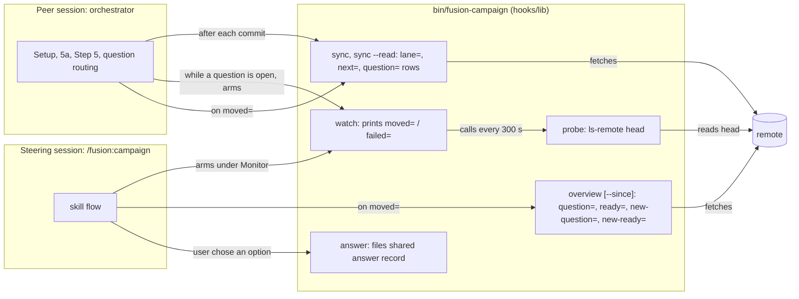
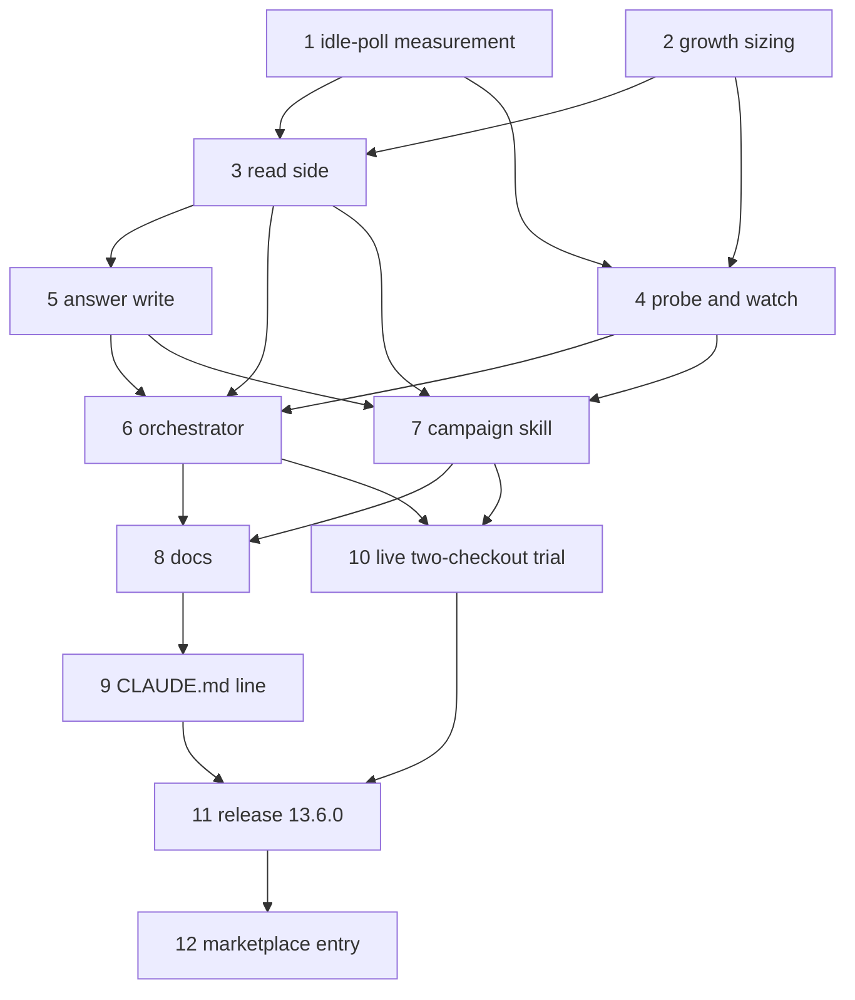
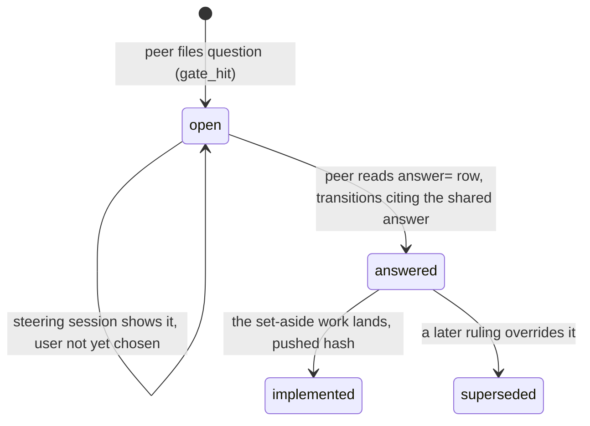

# Implementation Plan: campaign peers follow the steering session, and their questions and results come back to it

**Date:** 2026-11-19
**Spec:** `261119-1102-spec-campaign-peers-follow-the-steering-session-and-report-back.md` (approved by the user 2026-11-19)
**Decidability:** Four questions carry the design. (1) *Has the remote moved since the last check?* Decidable: the head hash `git ls-remote` returns for the upstream branch is compared for equality with the last hash seen. (2) *May this peer take the next package of its lane without asking?* Decidable from the campaign record and the control files at the fetched ref: the campaign is `running`, the lane's `checkout_id` equals this checkout, the next member is live and unheld, waits for nothing and has `mode.value` `autonomous`. Lane membership is checked at the current revision. The `user-word` hash is not compared (spec C1, `261111-1200-*`). (3) *Is this peer question answered?* Decidable by one exact line match: a decision record in the shared decisions store at the fetched ref has the head line `**Answers:** <question basename>` (decision `261119-1248-how-does-an-answer-name-the-peer-question-it-answers-and-how-does-the-peer-remember-what-it-set-aside.md`). (4) *Can an open session that sits idle be woken at a fixed interval?* This cannot be decided from any source in this repository, because it is harness behaviour. Step 1 therefore measures it, and nothing after step 2 starts until it is answered. "What has the watch already reported?" is not kept as model memory, which can be lost. It is turned into a decidable question: what is present at the new head that was not present at the previous head, both fetched refs.

## Directive

Build what the approved spec describes: C1 (lane handover), C2 (questions to the centre as decision records), C3 (the answer step), C4 (the peer picks up the answer), C5 (the steering watch) and C6 (release 13.6.0). The plan realises the three rulings of `261119-0851-how-does-a-campaign-steer-its-peers-and-get-their-results-and-questions-back.md`. It does not restate the spec.

## Current State

Measured at HEAD `9d400cc3`. The file:line evidence is in `261119-0737-campaign-steering-binding-handover-and-the-route-back.md`.

- `bin/fusion-campaign sync` prints `mine=` and `paused=` and nothing about lanes or a next package. Its read extracts only the manifest, the marker and the campaign store (header `## sync`, step 2). `overview` already computes each lane's `next` and its waits, and `decision:<basename>` waits on held packages (header, `lane=` and `held=`).
- The orchestrator reads only `paused=` (`catalog/profiles/orchestrator/parts/37-claude.md`, sub-step 5a). Step 5 always asks the user what is next (`38a-claude.md`, `38b-neutral.md`). The approval rules (`40-neutral.md`) ask the peer's own user.
- Neither side has a watch. `hooks/hooks.json` registers no event that fires without a tool call of the session itself.
- `agents/*.md` and `skills/*/SKILL.md` are rendered from `catalog/profiles/<id>/parts/` (`cd catalog && npm run render -- claude`). Parts are tagged `claude`, `prior` or `neutral`. The orchestrator text this plan changes sits in `claude` parts, except Step 5's tail and the approval rules, which are `neutral`. Prior behaviour is out of scope (spec `## Out of Scope`), so new text goes into `claude` parts only. A `neutral` part with an insertion point inside it is split there, which leaves both renders byte-identical apart from the inserted text.
- Growth bounds, measured at `9d400cc3` with the bound's own arithmetic (`hooks/lib/__tests__/surface-growth-bound.test.ts`):

| Surface | Now | Budget | Room |
|---|---|---|---|
| agents bytes | 326 693 | 328 567 | 1 874 |
| skills bytes | 245 969 | 245 985 | 16 |
| hook-test lines | 28 140 | 28 872 | 732 |

- Package `261119-0905-…` is claimed by checkout `114caf11` with `mode` `ordinary`, so every approval row asks.

## Approach

There are two carriers only: the campaign record and decision records, both travelling by git (C1–C4). There is one watch mechanism, used by both sides (C4, C5): `bin/fusion-campaign watch`, a loop that prints a line when the upstream head moves. It runs under the harness `Monitor` tool if step 1 confirms that tool can wake an idle session, and it is re-armed on each expiry. Every judgement the sessions need is turned into rows the helper prints from the fetched ref, so the prompts act on rows and never on remembered state.

Coherence check. Three layers, left to right: the sessions, the helper, the remote. Every edge into the remote comes from the helper, and no edge runs between the two sessions. `WATCH` has a fan-in of two, because both sessions use it, which is the reuse the design aims for. There is no cycle. `ANS` writes into the working tree and reaches the remote through the steering session's ordinary commit step, so it has no edge to `R` here. Each edge matches a step below: probe and watch in step 4, sync and overview in step 3, answer in step 5, the skill edges in step 7, the orchestrator edges in step 6.

**Step dependencies:**

Every edge is a `Dependencies:` line below, and every `Dependencies:` line is an edge.

## Implementation Steps

1. **Stop condition 1: measure whether an idle open session can be woken at a fixed interval**
   - Executor: `analyst`
   - Files: `fusion-workbench/work-packages/261119-0905-campaign-peers-follow-the-steering-session-and-report-back/analyses/<stamp>-can-an-idle-session-poll-the-remote.md` (new); probe scratch under what `bin/fusion-tmp path` prints, not committed.
   - Changes: A measurement, not a reading of tool descriptions. A dispatched agent's run ends when it returns, so a dispatched agent can never be the idle session. The probe therefore runs in a main-loop session. The analyst prepares it: a scratch bare repository as the remote, so nothing touches `origin`; a loop `while true; do git ls-remote <bare> HEAD; sleep 300; done | <print only when the hash changes>`; and a background pusher that moves the bare head at about minute 7 and minute 38. The orchestrator then arms it itself with `Monitor` (`timeout_ms` 1 800 000, a `description` that names the re-arm instruction), ends its turn and sits idle. The analyst writes the report from the timestamped notifications. The report answers each of these yes or no, with evidence:
     - (a) A `moved` event wakes the idle session and starts a turn with no user input.
     - (b) The 30-minute expiry notice wakes the idle session, and the session re-arms from that notice without the user.
     - (c) The chain survives at least two expiries, about 65 minutes in all.
     - (d) The notification text carries the monitor's `description`, so the re-arm instruction survives context compaction.
     - (e) Whether `ScheduleWakeup` or `/loop <interval>` is available in a session started by the `fusion` launcher, and whether it starts a turn when nothing moved.
     - (f) From `hooks/hooks.json`, that no registered hook fires without a tool call of the session. This is a reading, labelled as one.
   - Acceptance: the report exists, answers (a)–(f), and cites the notification timestamps. **The verdict line reads `poll-possible: yes` only if (a), (b) and (c) are all yes.** Otherwise the work stops here: the orchestrator returns the report's figures to the user, together with any alternative (e) offers. Using `/loop` would change C5's "no turn when nothing moved", so the user rules on it before step 3 starts. No automated test applies; the evidence is the timestamps.
   - Approval: **yes.** It needs the user's session to sit idle for about 65 minutes, and the stop decision is the user's.
   - Dependencies: none
   - Source: spec `## Stops when`, bullet 1.

2. **Stop condition 2: size the growth-bound raise against each surface's worst measured day**
   - Executor: `analyst`
   - Files: `fusion-workbench/work-packages/261119-0905-campaign-peers-follow-the-steering-session-and-report-back/analyses/<stamp>-growth-bound-raise-for-13-6-0.md` (new).
   - Changes: Re-measure the three surfaces at the HEAD the step runs on, with the arithmetic of `hooks/lib/helpers/growth-bound.ts` `growth()` over the baseline maps of `surface-growth-bound.test.ts`. The planner's figures at `9d400cc3` are in `## Current State`. Then set this release's ceiling per surface from the text steps 6–8 and 11 will add. The planner's estimates:
     - agents: about 4 300 bytes of orchestrator text (Setup ~600, 5a ~1 200, Step 5 ~700, question routing and the wait ~1 800). Ceiling 6 000 bytes of growth, so a raise of at most 4 126.
     - skills: about 4 800 bytes of campaign skill text (answer step ~2 000, watch ~2 000, new row sentences ~800), and the help update paragraph at net ~0. Ceiling 7 500, so a raise of at most 7 484.
     - hook tests: about 500 lines. Ceiling 700, inside the 732 lines of room, so no raise.
     
     Compare each ceiling with the worst measured single day in `surface-growth-bound.test.ts` `## Where each head-room comes from`: agents +50 725 bytes, skills +38 025 bytes, hook tests +5 247 lines. The planner's ceilings are 12 %, 20 % and 13 % of those.
   - Acceptance: the report names the command, the per-surface room at that HEAD, the ceiling, and the comparison, with a verdict per surface. **If any ceiling exceeds its worst day, the figure goes to the user before steps 6, 7 or 11 write a raise.** The ceilings bind those steps: an actual raise above its ceiling also returns to the user. No automated test; the bound test itself is the instrument for steps 6, 7 and 11.
   - Approval: no, as long as every ceiling sits under its worst day, which is the expected case. Otherwise yes, by the spec's stop condition.
   - Dependencies: none
   - Source: spec `## Stops when`, bullet 2; C6, criterion 5.

3. **Read side: lane, next, questions and the delta between two heads**
   - Executor: `code-implementer`
   - Files: `hooks/lib/campaign-sync.ts`, `hooks/lib/campaign.ts`, `hooks/campaign.ts`, `hooks/lib/stores.ts` (read; edit only if the decisions store name is not yet exported), `hooks/dist/campaign.js` (committed build), `bin/fusion-campaign` (header: `## sync`, `## Output of sync`, `## Output of overview`, `## The lane view and the conditions`), `hooks/lib/__tests__/campaign-sync.test.ts`, `hooks/lib/__tests__/campaign-overview.test.ts`.
   - Changes:
     - The extraction at the ref also takes the container store's decision records and the shared decisions store. Store names come from `hooks/lib/stores.ts`, never spelled.
     - `sync` prints, after `mine=` and in this order:
       - `lane=<campaign>\t<lane id>`: the lane of `mine` that names this checkout. Absent where none does.
       - `next=<package>\t<autonomous|ordinary>\t<waits>`: that lane's first live, unheld member and its `mode.value`. `next=none` when the lane has none left.
       - `question=<decision basename>\t<package>\t<answer basename|none>`: one per open decision record inside a package this checkout holds, or inside the lane's `next`. The answer is the shared record whose `**Answers:**` line names it, per decision `261119-1248-*`.
     - `sync --read` runs steps 1–3 and the new rows, and nothing else: no `campaign_read` row, no settling commit, no rebase, no push.
     - `overview` prints `question=<campaign>\t<lane>\t<checkout>\t<package>\t<decision basename>\t<workbench path>\t<answer basename|none>`, one per open decision in a lane's held package or in its `next`. It also prints `ready=<campaign>\t<lane>\t<package>`, one per lane whose `next` waits for nothing.
     - `overview --since <sha>` prints the same rows, then `new-question=` and `new-ready=` rows: those present at `head` and absent at `<sha>`, computed over the two extractions. A `<sha>` the fetched remote does not hold is `note=since-unknown`, and every row then counts as new.
   - Acceptance: `cd hooks && npx vitest run lib/__tests__/campaign-sync.test.ts lib/__tests__/campaign-overview.test.ts` passes, with new cases for each row: a lane naming this checkout and one naming another; `next` autonomous and ordinary, and `next=none`; a question with no answer, with an answer, and with a shared record that only cross-references it (it must read as `none`, the disjointness case of `261119-1248-*`); `--read` leaving `git status --porcelain` and the event log unchanged; `--since` reporting a question once, and nothing when the two heads are equal. Then the full `cd hooks && npm test`: the only red allowed is `surface-growth-bound.test.ts` (golden and hook-test lines), which this step regenerates. Any other red is a stop. `bin/fusion-campaign`'s header documents every new row and flag, which satisfies C6 criterion 4 for this half.
   - Approval: no.
   - Dependencies: 1, 2
   - Source: spec C1 criterion 1, C3 criterion 1, C4, C5 criteria 3–5; decision `261119-0851-*` ruling 1(a).

4. **`probe` and `watch`: the one poll both sessions use**
   - Executor: `code-implementer`
   - Files: `hooks/lib/campaign-watch.ts` (new), `hooks/campaign.ts`, `hooks/dist/campaign.js`, `bin/fusion-campaign` (`## Usage`, new `## probe and watch` section, exit table), `hooks/lib/__tests__/campaign-watch.test.ts` (new).
   - Changes:
     - `probe` prints `state=`, `ref=` and `head=` from `git ls-remote <remote> refs/heads/<branch>` of the upstream, with `GIT_TERMINAL_PROMPT=0` and batch-mode ssh, under `overview`'s state vocabulary and exit codes. It does no fetch and no extraction.
     - `watch [--since <sha>] [--interval <seconds>]`, default interval 300, never exits on its own. Each `probe` whose head differs from the last seen prints `moved=<old>\t<new>`. The first failure of a run of failures prints `failed=<state>`, and the first success after it prints `recovered=<head>`.
     - A second `watch` for the same `FUSION_SESSION_ID` and checkout prints `state=already-watching` and exits 0. The pid file is under `bin/fusion-tmp path`, and its liveness is checked with `kill -0`, so a monitor that the expiry killed leaves no stale refusal.
   - Acceptance: `cd hooks && npx vitest run lib/__tests__/campaign-watch.test.ts` passes against a local bare remote with `--interval 1`. The cases: no line while the head stands; one `moved=` per push; one `failed=` over three failed probes, then `recovered=`; `already-watching` for a live twin and none after it is killed; `probe` on a branch with no upstream returning `no-upstream`, exit 5. Then the full `cd hooks && npm test`, with only `surface-growth-bound.test.ts` red as in step 3.
   - Approval: no.
   - Dependencies: 1, 2
   - Source: spec C4, C5 criteria 3, 6 and 7; decision `261119-0851-*` ruling 2(a).

5. **The answer write**
   - Executor: `code-implementer`
   - Files: `hooks/lib/campaign-write.ts`, `hooks/campaign.ts`, `hooks/dist/campaign.js`, `bin/fusion-campaign` (`## The steering writes`, `## Output of a steering write`), `hooks/lib/__tests__/campaign-write.test.ts`.
   - Changes:
     - `answer --question <basename> --option <text> [--note <text>]` runs the steering writes' claim test first, which gives exit 8 from a holding checkout. It then checks, at a fresh fetch, that the question is a `question=` row of a live campaign with answer `none`. It refuses `unknown-scope/question-unknown` and `conflict/question-answered` with exit 9.
     - It writes the narrative in the shared decisions store. The title is `Answer to <question basename>`. The head lines are `**Domain:**`, `**Filed by:** user, <PERSON=>` and `**Answers:** <basename>`. The body quotes the chosen option and gives the date. It files the record with `bin/fusion-write create --kind decision`, then appends `Answered: this record — <option>; ruled by user, <person>` and transitions the record to `answered` with that answer-ref.
     - It prints `path=` and `revision=` and commits nothing. It never opens the question record.
   - Acceptance: `cd hooks && npx vitest run lib/__tests__/campaign-write.test.ts` passes. The cases: the record lands with exactly one `**Answers:**` line and state `answered`; the question's bytes are unchanged; exit 8 from a holding checkout; exit 9 for an unknown question and for an answered one; after the write, step 3's `question=` row names the answer. Then the full `cd hooks && npm test`, with only `surface-growth-bound.test.ts` red.
   - Approval: no.
   - Dependencies: 3
   - Source: spec C3; decision `261119-1248-*`.

6. **The orchestrator: lane handover, questions to the centre, the wait**
   - Executor: `code-implementer`
   - Files: `catalog/profiles/orchestrator/profile.json`; `catalog/profiles/orchestrator/parts/07-claude.md` (Setup step 5), `37-claude.md` (sub-step 5a), a new `claude` part after `38b-neutral.md` (Step 5), a new `claude` part inside `## Human approval rules` (splitting `40-neutral.md` at that point if needed); `agents/orchestrator.md` (rendered); `hooks/lib/__tests__/surface-growth-bound.test.ts` (`AGENT_HEAD_ROOM` and its comment; golden regenerated); `hooks/lib/__tests__/fixtures/surface-growth.golden`; `README-hooks.md` `### Growth bounds on the shipped text` (the raise entry); `hooks/lib/__tests__/reference-resolution-lint.test.ts` (only if its BASELINE re-approval moves).
   - Changes, all scoped to "a running campaign whose lane names this checkout", read off `lane=`. Outside that scope every behaviour stays as it is (C1, last criterion).
     - **5a.** Read `lane=`, `next=` and `question=`.
       - When the held package finishes and `next` is `autonomous` with waits `none`: claim it. The claim is answered by that package's own field, detail `proceed — answered by **Mode:** autonomous on <next>`. Continue with no Step 5 question.
       - When `next` is `ordinary`: file "may I take `<next>`?" in `<next>`'s container and do not claim it.
       - When `next=none`: report once that the lane is finished, and stop.
       - When a `question=` row of this checkout carries an answer: transition the question to `answered`, citing the answer record, with the `Answered:` line naming the user as the one who ruled. Emit `gate_response` with detail `<option> — answered by <answer basename>`. Resume what the question's `**Set aside:**` line names.
       - `paused=` still stops, as today.
     - **Setup.** With nothing held, run `sync --read` and act on the same rows.
     - **Step 5.** In scope, the "go on / something else / stop" question is not asked. The report line stays.
     - **Approval rules.** In scope, every row that would stop and ask, every file-and-skip row, and the Step 5 question are filed as a decision record in the held package's container. The record carries the question, the options in words the steering user can answer without the peer's session, `**Asked by:** checkout <hex>, package <container>` and `**Set aside:** <what>`. Emit `gate_hit`. Do not ask the peer's own user. Carry on with work that does not depend on the answer. Do not release, and do not claim a second package.
     - **The wait.** With nothing left to do, say once that the session waits for the steering session. Arm `Monitor` on `bin/fusion-campaign watch --since <head>` (timeout 1 800 000 ms). The `description` names the question and the instruction "on moved run sync --read; on expiry re-arm". Re-arm on every expiry, and stop when no `question=` of this checkout is open.
     - Mechanism stays in the helper header. The prompt cites it and does not restate it.
   - Acceptance: `cd catalog && npm run render -- claude && npm test` passes. The orchestrator's Prior render (`renderParts(…, "prior")`) is byte-identical before and after: the executor compares the two in scratch and states the `cmp` result. `cd hooks && npm test` passes in full, with `AGENT_HEAD_ROOM` raised by exactly the measured remainder and no more than step 2's ceiling, the raise logged in `README-hooks.md` with the user's ruling of 2026-11-19 (spec C6, round 1 Q4), and no baseline edited. The behaviour is proven in step 10, since no unit test exercises a prompt.
   - Approval: no. The raise is bounded by step 2's ceiling, and the plan approval covers it.
   - Dependencies: 3, 4, 5
   - Source: spec C1, C2, C4; decision `261119-0851-*` rulings 1(a) and 2(a); `agents/orchestrator.md` `## Human approval rules` ("A field on one item never rules on another item's state" is respected: the claim reads `<next>`'s own field).

7. **The campaign skill: question rows, the answer step, the watch**
   - Executor: `code-implementer`
   - Files: `catalog/profiles/skill-campaign/profile.json`; `catalog/profiles/skill-campaign/parts/01-claude.md` (description: answer and watch), the part that renders the overview's condition sentences (`03-claude.md` or `05-claude.md`, whichever holds them), new `08-claude.md` (answer), new `09-claude.md` (watch); `skills/campaign/SKILL.md` (rendered); `hooks/lib/__tests__/surface-growth-bound.test.ts` (`SKILL_HEAD_ROOM` and its comment); `hooks/lib/__tests__/fixtures/surface-growth.golden`; `README-hooks.md` `### Growth bounds on the shipped text`.
   - Changes:
     - The overview renders `question=` rows (unanswered ones offered for answering, answered ones as "answered, waiting for the peer to pick it up") and `ready=` rows.
     - **answer.** For an open question, read its narrative at the ref with `git show <head>:<path>`. Put the question and its options to the user in chat, in the shape the orchestrator's `## How you ask the user anything` gives. Only on the user's choice, run `bin/fusion-campaign answer`. Report that the answer reaches the peer with this session's next commit and push. No answer is ever filed without the user's choice.
     - **watch.** Every use of the skill while a campaign is `running` arms `Monitor` on `bin/fusion-campaign watch --since <head>` (timeout 1 800 000 ms, the re-arm instruction in its `description`). `already-watching` means one is already armed.
       - On `moved=`: run `overview --since <old>` and tell the user only `new-question=` (with the offer to answer) and `new-ready=`.
       - On `failed=`: one sentence, and keep watching.
       - On expiry: re-arm from the last head.
       - Stop on a pause or end act in this session, on an overview that shows the campaign not `running`, and on "stop watching" (`TaskStop`).
   - Acceptance: `cd catalog && npm run render -- claude && npm test` passes, and the skill profile has no `prior` part before or after. `cd hooks && npm test` passes in full, with `SKILL_HEAD_ROOM` raised by exactly the measured remainder, at most step 2's ceiling, logged as the seventh raise of that constant under the same ruling, and no baseline edited. The behaviour is proven in step 10.
   - Approval: no, under the same reasoning as step 6.
   - Dependencies: 3, 4, 5
   - Source: spec C3, C5; decision `261119-0851-*` rulings 1(a) and 2(a).

8. **Docs: what campaigns now do, and the statements that turned false**
   - Executor: `code-implementer`
   - Files: `docs/campaign.md`, `docs/upgrading-to-v13.md` (a 13.6.0 section), `README-agents.md` (the `/fusion:campaign` row of the skills table; the bus bullet of `## Migration note`), `README-hooks.md` (rows for `campaign.ts`, `lib/campaign.ts`, `lib/campaign-sync.ts`, `lib/campaign-write.ts`, new `lib/campaign-watch.ts`, and the `bin/fusion-campaign` row of `### The bin/ helper roster`).
   - Changes: `docs/campaign.md` gains the lane handover, the question-and-answer route with the three head labels, both watches with their 5-minute interval and the 30-minute re-arm, and the sentence that a message between sessions carries no authority and this release sends none. It drops "a pause is the only thing a peer obeys" and "nothing watches" wherever it says them. It states that the watch supersedes the adoption decision's polling exclusion for these two watches only (`261119-0851-*` ruling 2(a)). The upgrade section says every checkout needs 13.6.0, an older peer reads only the pause, and nothing migrates. The `## Migration note` bullet says records are also read every 5 minutes while a peer waits or a steering session watches.
   - Acceptance: `cd hooks && npm test` passes in full. These are the gates for this step: `reference-resolution-lint.test.ts`, `workbench-citation-lint.test.ts`, the README lib-table pin (a row for the new module) and `derivable-enumerations-lint.test.ts`. `grep -n 'only thing\|nothing watches' docs/campaign.md` returns nothing that contradicts the new text.
   - Approval: no.
   - Dependencies: 6, 7
   - Source: spec C6 criteria 2 and 4.

9. **The `CLAUDE.md` line on concurrent sessions**
   - Executor: `code-implementer`
   - Files: `CLAUDE.md` (the bullet at line 54, `**The bus protocol is gone**`)
   - CLAUDE.md: the bullet loads into every session and currently tells each of them that concurrent sessions exchange work through the user. Since 13.5.0, and more so after this release, that is false for every campaign session. A wrong always-on statement costs every session, so the correction belongs in `CLAUDE.md` itself, and the detail stays behind the existing pointer.
   - Changes: Replace "concurrent sessions exchange work through the user" with a clause of no more bytes, for example "concurrent sessions exchange work as records carried by git". Keep "Detail: `README-agents.md` `## Migration note`." unchanged. `hooks/lib/__tests__/fixtures/dispatch-path.baseline` charges this file to all eleven dispatch paths at zero head-room, so the line may not grow.
   - Acceptance: `wc -c CLAUDE.md` is no larger than before. `cd hooks && npx vitest run lib/__tests__/rules-emission-golden.test.ts lib/__tests__/claude-md-weight.test.ts` passes, then the full `npm test`. This closes the curate item the analysis named (recommendation 4) for this line.
   - Approval: no. The line was named by the approved spec (C6 criterion 3).
   - Dependencies: 8
   - Source: spec C6 criterion 3; analysis `261119-0737-*` recommendation 4.

10. **Live trial over two checkouts**
    - Executor: `analyst`
    - Files: `fusion-workbench/work-packages/261119-0905-campaign-peers-follow-the-steering-session-and-report-back/analyses/<stamp>-live-trial-two-checkouts.md` (new); a scratch project, its bare remote and two clones under `bin/fusion-tmp path`, not committed.
    - Changes: Two interactive sessions run from the work tree (`FUSION_PLUGIN_ROOT=<tree> claude --plugin-dir <tree>`), one steering and one peer. The scratch workbench holds three packages in one lane: the first two `autonomous`, the third `ordinary`. The trial walks through each acceptance criterion of C1–C5 and records it as observed yes or no, with timestamps or the row it read. Among them:
      - the handover without a question;
      - the "may I take" record for the third package;
      - the answer reaching the peer within about 5 minutes with no input at the peer;
      - the peer's question marked `answered` and citing the answer;
      - the peer stopping its check once nothing is open;
      - one report per question at the steering side;
      - a failed check reported once, by blocking the remote;
      - the watch outliving one expiry;
      - the peer closed while waiting and reopened.
    - Acceptance: the report lists every criterion with its observation. **Any `no` blocks step 11** and is returned to the user with the row or message that shows it.
    - Approval: **yes.** It needs two of the user's sessions for about 70 minutes.
    - Dependencies: 6, 7
    - Source: spec C1–C5.

11. **Release 13.6.0**
    - Executor: `code-implementer`
    - Files:
      - `.claude-plugin/plugin.json` (`version`)
      - `install.sh` (the `FUSION_REF=tags/v13.6.0` example)
      - `README.md` (the same pin example)
      - `catalog/profiles/skill-help/parts/21-claude.md` and `21-prior.md` (the update topic: a 13.6.0 paragraph, the paragraphs below it relabelled, the oldest dropped; the Prior paragraph states that nothing changes on Prior)
      - `skills/help/SKILL.md` (rendered)
      - `hooks/lib/__tests__/fixtures/surface-growth.golden`
      - `docs/upgrading-to-v12.md` (read only; it needs no edit, because this release changes nothing it describes; the step says so)
      - `plugin.json` `description` (read beside the marketplace description; unchanged, since "read by every checkout's orchestrator at its commit step" stays true)
    - Changes: Follow `README-agents.md` `## Releasing`, step 0 and steps 1 to 4 on this side:
      - Run `cd catalog && npm ci && npm test`, `cd hooks && npm test`, `claude plugin validate .` and the smoke test `claude --plugin-dir . --agent fusion:orchestrator -p "reply SMOKE-OK"`.
      - Run `bin/fusion-review-coverage --since v13.5.1`; its result goes into the release commit message.
      - Bring the help update topic to this release.
      - The version surfaces (`plugin.json`, the marketplace entry in step 12, the `install.sh` and `README.md` pins) all read 13.6.0, and the two descriptions are read side by side.
    - Acceptance: `grep -n '13\.6\.0' .claude-plugin/plugin.json install.sh README.md skills/help/SKILL.md` shows one hit in each. The four validations above exit 0. The skills surface stays inside step 7's raise, since the help paragraph is a balanced add and drop; a red here is cut in the help paragraph, not raised.
    - Approval: **yes.** The release commit goes to `main`, and every push to `main` is what the next `fusion --update` installs.
    - Dependencies: 9, 10
    - Source: spec C6 criteria 1, 5 and 6; `README-agents.md` `## Releasing`.

12. **The marketplace entry**
    - Executor: `data-implementer`
    - Files: `<marketplace>/.claude-plugin/marketplace.json` (fusion's `version`). `<marketplace>` is the working clone of `tenzoki/claude-plugins`, whose path the user names at release.
    - Changes: `git -C <marketplace> pull --rebase origin main`, then the version goes to 13.6.0. The description stays byte-identical to `plugin.json`'s.
    - Acceptance: `grep -n '"version"' <marketplace>/.claude-plugin/marketplace.json` shows 13.6.0 for fusion. A `cmp` of the two description strings, extracted with `node -e`, reports equal.
    - Approval: **yes.** The file is outside the project tree.
    - Dependencies: 11
    - Source: `README-agents.md` `## Releasing`, steps 2 and 3.

## Where this work stops

- Step 1's verdict is `poll-possible: yes`, or the work stopped after step 1 with the figures returned to the user, before any code.
- Step 2's ceiling for every surface sits under its worst measured day, or the figure went to the user before any raise was written.
- Each raise written in steps 6 and 7 is the measured remainder and is no larger than step 2's ceiling for that surface. The hook-test surface took no raise, or the user ruled on one.
- Steps 3 to 9, 11 and 12 are `done`, and the catalog suite, the hooks suite and `claude plugin validate .` were green on the release commit.
- Step 10's report records every C1–C5 criterion as observed yes, before the release commit.
- Before the tag `v13.6.0` is pushed: the release commit is on `origin/main`, its message carries the `bin/fusion-review-coverage --since v13.5.1` result, the marketplace entry at 13.6.0 is pushed in `tenzoki/claude-plugins`, and `skills/help/SKILL.md` carries the 13.6.0 paragraph.
- After the tag: `261119-0851-*` is transitioned to `implemented` with the release commit's pushed hash, `261119-1248-*` is `answered` (at plan approval) and then `implemented` with the pushed hash of step 5, and `fusion --update` on this machine prints 13.6.0.

## Data Structures

No codec or schema change. There are three narrative head labels, specified by decision `261119-1248-*`:

| Label | In | Value |
|---|---|---|
| `**Asked by:**` | a peer question, inside the peer's package container | `checkout <hex>, package <container>` |
| `**Set aside:**` | the same record | `<plan basename> step <n>` \| `claim of <container>` \| `approval: <row name>` |
| `**Answers:**` | the answer, in the shared decisions store | the question's narrative basename, exactly once |

The diagram shows the question record. The answer record is filed at `answered` by step 5 and moves to `implemented` with the same commit as its question.

## API Changes

All of these are in `bin/fusion-campaign`, and its header is the authority for each:

- `sync`: new rows `lane=`, `next=`, `question=`; new flag `--read`.
- `overview`: new rows `question=`, `ready=`; with `--since <sha>`, also `new-question=`, `new-ready=` and `note=since-unknown`.
- `probe`: new sub-command.
- `watch [--since <sha>] [--interval <s>]`: new sub-command, printing `moved=`, `failed=`, `recovered=` and `state=already-watching`.
- `answer --question <basename> --option <text> [--note <text>]`: new steering write, exits 8 and 9 as the others do.

## Testing Strategy

- Unit and integration, in `hooks/lib/__tests__/`: `campaign-sync.test.ts` and `campaign-overview.test.ts` (step 3), `campaign-watch.test.ts` (step 4, new), `campaign-write.test.ts` (step 5). Each is listed with its cases in its step's acceptance.
- Render and catalog: `cd catalog && npm run render -- claude && npm test` in steps 6, 7 and 11. The Prior render is checked byte-identical in step 6.
- Bounds: `surface-growth-bound.test.ts` in steps 6, 7 and 11, against step 2's ceilings. `rules-emission-golden.test.ts` for `CLAUDE.md` in step 9.
- Behaviour that no unit test can reach, because prompts and harness wake-ups are involved: step 1, where the harness is measured, and step 10, where the whole route is tried.

## Risks & Mitigations

| Risk | Mitigation |
|---|---|
| `Monitor` cannot wake an idle session, or the expiry notice does not start a turn | Step 1 measures it before any code is written. A no stops the work, as the spec requires. |
| Context compaction drops the skill or prompt text that says to re-arm | The re-arm instruction rides in the monitor's `description`, which every notification repeats. Step 1 (d) measures that it does. |
| Two watches in one session | The pid-file refusal `already-watching` (step 4). |
| An answer record whose `**Answers:**` line is mistyped | It reads as unanswered: the steering session still shows the question and the peer keeps waiting. That fails safe and is visible. |
| The peer's `gate_response` records an answer it did not put to the user itself | The detail cites the answer record, where the user's ruling is recorded with the person's name. This is the same shape as the field-answered rows' "answered by **Mode:**" text. |
| The raise grows past the estimate while text is written | Steps 6 and 7 are held to step 2's ceiling. Above it, the figure returns to the user instead of being written. |
| Neutral parts edited by accident change the Prior render | New text goes into `claude` parts only. Step 6 compares the Prior render byte for byte. |
| An older peer in the campaign | It reads only `paused=`, as today. `docs/upgrading-to-v13.md` says every checkout needs 13.6.0 (spec `## Constraints`). |

## Open Questions

- [ ] Decision `261119-1248-how-does-an-answer-name-the-peer-question-it-answers-and-how-does-the-peer-remember-what-it-set-aside.md` (open) fixes the three head labels that steps 3, 5, 6 and 7 build on. Approving this plan is the occasion to rule on it. The recommendation is option 1.
- [ ] The spec's two review defaults stand as written in steps 6 and 7 unless the user overrides them now: a finished lane is reported and nothing is filed (C1), and the peer neither releases nor claims while a question is open (C2).
- [ ] The path of the marketplace working clone, needed at step 12.
