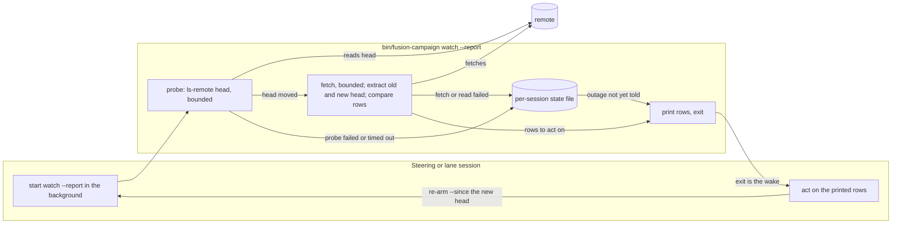
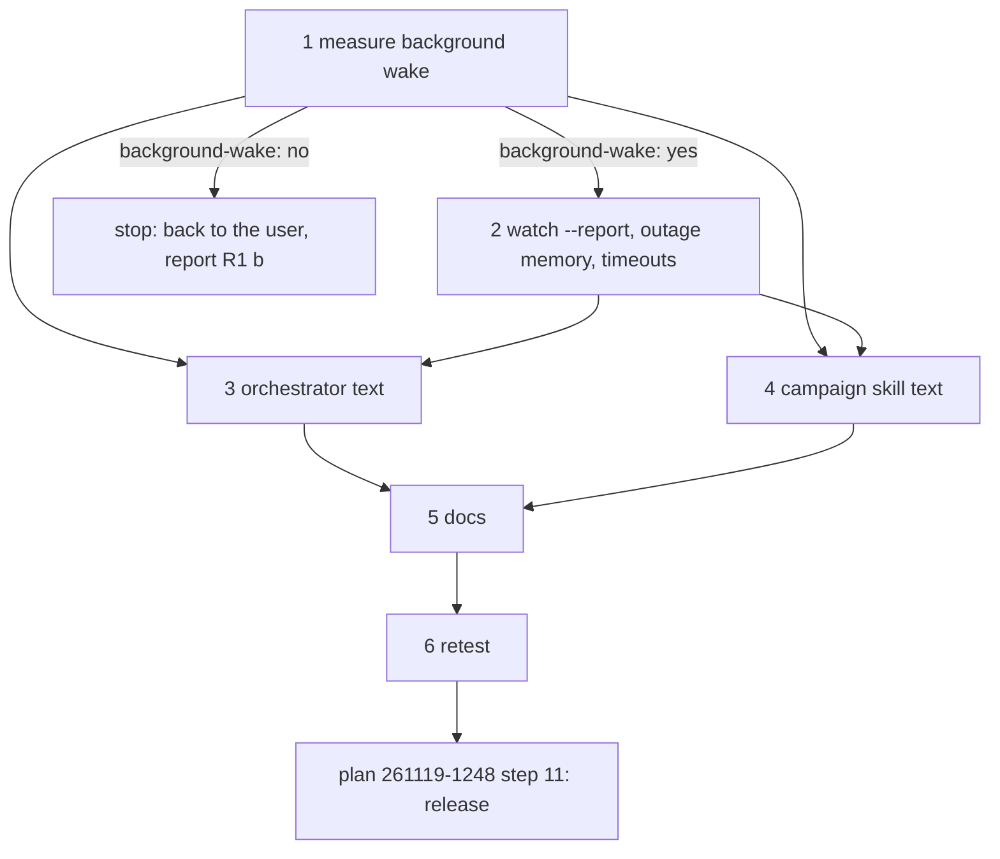

# Implementation Plan: fix the three causes the live trial found, then retest, before 13.6.0

**Date:** 2026-11-23 (revised the same day after review `261123-1220-review-of-plan-261123-1000-before-approval.md`, on the user's ruling to work in all of its changes with its recommendations as defaults)
**Spec:** `261119-1102-spec-campaign-peers-follow-the-steering-session-and-report-back.md` (unchanged; no criterion is relaxed)
**Amends:** `261119-1248-plan-campaign-peers-follow-the-steering-session-and-report-back.md`. These steps stand between its step 10 and its step 11, and its step 11 depends on step 6 below.
**What Approve binds (review B1):** at approval the orchestrator re-adopts `261119-1248-*` at its new revision as the package's plan (`bin/fusion-write adopt-plan --record <container>/package.json --plan <261119-1248's control path>`). **This amendment is not adopted in role `plan`.** Adopting it would move `261119-1248-*` into `references`, clear its acceptance and leave the release steps 11 and 12 and their stop clauses unbound. This record is cited from `261119-1248-*` step 11 and from that plan's `## Where this work stops`, whose clause on this amendment makes the closure read this plan's own stop clauses. Its steps are tracked on this record's own anchors 1 to 6.
**Decidability:** The load-bearing question of cause 1 is *"will a session that is woken with nothing to report write nothing?"* That is not decidable from any input the shipped mechanism has. It is model compliance, and the trial measured it failing 24 times out of 24, also where `skills/campaign/SKILL.md` Step 9 said "say nothing". The mechanism therefore changes so that the question is not asked: the session is woken only when there is something to tell. Three decidable questions replace it. (1) *Is there a row to act on between the last head and the new one?* Decidable: the helper extracts both fetched heads and compares the rows, as `overview --since` already does. (2) *Has this session already reported this outage?* Decidable: a per-session state file beside the watch's pid file, read with its age. (3) *Does a live campaign's lane name this checkout, before the brief question is put?* Decidable: `sync --read`'s `lane=` row, which names the lane of a `running` **or `paused`** campaign (`campaign-sync.ts` `mineOf`), read in STEP 1 before the question. That mechanism removes every wake only if the watch can run without the `Monitor` tool's 30-minute expiry, which no helper can suppress. Step 1 measures whether a background command wakes an idle session on exit. **If it does not, the work stops after step 1 and returns to the user** (review B2): under `Monitor` the expiry wake and the exit notice both rest on text, which is the measured failure.
**Open at approval, the user's ruling (review S5, S7): do the steering acts also commit and push in the same turn as the answer?** The answer step commits and pushes at once in both variants; the user's choice of option is the confirmation.
- **(a) The answer and the steering acts** `open`, `pause`, `resume`, `move`, `reassign` and `end` commit and push in the turn they are confirmed. Step 4 writes the commit route once, in Step 6's report paragraph, and Step 8 cites it. Step 6's retest pushes the pause by the act itself. Skill bound: about 63 bytes under (Step 9 −281, Step 8 +61 +50, Step 6 +107, planner drafts).
- **(b) The answer only.** Step 6's report keeps "the record travels with your next commit and push". Step 4 writes the commit route into Step 8. Step 6's retest pushes the pause with an explicit `commit` typed by the user before Q2 is answered. Skill bound: about 39 bytes under (Step 9 −281, Step 8 +61 +181).

Ruled: (a), by user, 2026-11-23, at plan approval. Variant (b) is not executed.

Ruled after step 1, by user, 2026-11-23: step 1 measured `background-wake: no` on (c) alone (analysis `261123-1414-can-a-background-command-wake-an-idle-session.md`). The user chose the amended reading: steps 2 to 5 proceed on the `Bash` route as written. The woken turn reads the background task's output file to learn the row, and the texts in steps 3 and 4 say so. Step 6 adds one criterion: every wake's row was read from the output file and acted on, with no wake left unread.

  Steps 3 and 5 and the orchestrator bound are the same under both. The variant chosen at approval is written into steps 4 and 6 by its letter; the other is not executed.

## Directive

The user's ruling of 2026-11-23 on the live-trial report `261121-1826-live-trial-two-checkouts.md`: fix all three causes, then run a short retest that includes the untested rows, then release. The criteria stay as spec `261119-1102-*` wrote them. This answers the report's open question R1 in favour of fixing. The report's R4 (does the answer step commit) and R5 (pull the answer before the transition) are planned here as well, because both cost a sentence and fit inside the cuts these steps make. Issue `261120-2050-*` (no timeout on `ls-remote`) is folded into step 2 (review S3): with no expiry left to kill a hung probe, it becomes a real failure.

## Current State

Measured at `41f7bcb5`.

- `bin/fusion-campaign watch` (`hooks/lib/campaign-watch.ts` `watchLoop`) prints `moved=` for every change of the upstream head, the session's own pushes included, and `failed=` once per run of failures inside one process. A re-arm is a new process, so a continuing outage is reported again (C5.6, F3). Neither `probe`'s `ls-remote` nor `fetchRef`'s fetch (`hooks/lib/campaign.ts`) has a timeout.
- Both texts arm `Monitor` with `timeout_ms` 1 800 000 and re-arm on every expiry: `skills/campaign/SKILL.md` `## Step 9: the watch` (part `catalog/profiles/skill-campaign/parts/09-claude.md`, 1 257 bytes) and the campaign-lane paragraph of `agents/orchestrator.md` `## Human approval rules` (part `40a-claude.md`, 1 175 bytes). Every expiry and every own push is a turn, and in the trial every such turn ended with text to the user (C2.4, C5.3, C5.4, C5.5, F1).
- `agents/orchestrator.md` STEP 1 (part `07-claude.md`) asks a bare opening for its brief before Setup step 5 reads the campaign (C2.1, F2).
- Step 8 of the skill (part `08-claude.md`) does not say whether the answer is committed in the same turn, and requires a `question=` row "from an overview of this use". The steering acts' report (Step 6, part `07-claude.md`) ends with "the record travels with your next commit and push" (F5 a).
- 5a's lane clause says "read the answer at the fetched head", and the wait re-reads with `sync --read`, which fetches without pulling (F5 b).
- The `Monitor` tool caps `timeout_ms` at 1 800 000 and reports a watch's exit as a notice. The harness's Bash tool documents `run_in_background` as "keeps running across turns and re-invokes you when it exits", with no cap stated. That is a reading of tool descriptions, not a measurement.
- Claude Code's `--resume` and `--continue` keep the session id (`hooks/session-id.ts`, header), so "a new session has a new id" holds for a new process only.
- Bounds, measured at `41f7bcb5` (review `### 2`, replicating the tests' `growth()` arithmetic):

| Surface | Room | Reading this plan keeps |
|---|---|---|
| dispatch path, orchestrator (`DISPATCH_HEAD_ROOM` 0) | 292 bytes measured | **0**: `agents/orchestrator.md` may not grow. The 292 bytes come from the rules component and `CLAUDE.md`, which the next rule edit will spend. |
| `skills/*/SKILL.md` (`SKILL_HEAD_ROOM`) | 0 bytes | every byte added to a skill is cut in the same step |
| `agents/*.md` (`AGENT_HEAD_ROOM`) | 953 bytes | not binding: the stricter dispatch-path reading binds first |
| hook-test lines (`TEST_LINE_HEAD_ROOM`) | 402 lines | ceiling 380 for this plan: step 2 at most 370, steps 3 to 5 at most 10 together (pin entries) |

## Approach

**The helper decides what is worth a wake, and the session is woken only with that.** This is one change to the one watch both sessions use. It removes F1's four wake kinds (own pushes, pushes that carry nothing for this session, repeats, and with `Bash` the expiry) and F3's repeat. The texts get shorter, because "say nothing when nothing is new" is no longer an instruction the model has to follow: such a wake does not happen.

`watch` gains `--report steering|lane`. It probes as today, with each probe and the delta's fetch bounded. On a move it extracts the old and the new head and compares the rows. It prints only rows the session must act on, then exits. A move with no such row updates the last head silently and goes on probing. A move whose fetch or read fails keeps the old last head and counts as a failed probe, so no question is lost. A failure prints `failed=` once per outage per session, remembered in a state file beside the pid file, and then exits. A watch that finds a fresh state file stays silent until a probe succeeds, then removes the file and goes on, printing nothing for the recovery.

| Mode | Prints, then exits | Computed from |
|---|---|---|
| `steering` | `new-question=`, `new-ready=` rows; `campaign=<id>\t<state>` when the campaign left `running` | `overview --since <old>`'s delta, in process |
| `lane` | `answered=<question>\t<answer>` for this checkout's questions whose answer is no longer `none`; `paused=` or `campaign=` when this checkout's campaign left `running` | `sync --read`'s rows at both heads, in process |
| both | `failed=<state>`, first failure of an outage this session has not yet been told about | the per-session state file and its age |

Because the watch exits after a report, a session holds one wake per reportable event, and re-arms with `--since` set to the head it acted on, so nothing is reported twice. The one duplicate the mode allows is `note=since-unknown` (a `--since` the remote no longer holds), which counts every row as new; the header says so. The arming tool is `Bash` `run_in_background`, on step 1's `yes`. On `no` there is no step 2.

Coherence check. Two layers, the session and the helper, plus the remote. Every edge into the remote comes from the helper. The only edge from the helper back to the session is `OUT`, so a wake has exactly one origin, which is the design's claim; with `Monitor` this would not hold, since its expiry and exit notices are wakes from outside the helper (review `### 3`, finding 3.5), and that is why step 1's `no` stops the work. The cycle `ARM → … → ACT → ARM` is intended: it is the re-arm, entered only through `OUT`. A move with no row and an outage already told have no edge to `OUT`, which is the silence. A failed delta goes to `STATE`, not past it, so the last head does not advance on a failure. Each node is built by a step below: the helper in step 2, `ARM` and `ACT` in steps 3 and 4.

**Step dependencies:**

Every edge between steps is a `Dependencies:` line below, and every `Dependencies:` line is an edge. `STOP` is the first clause of `## Where this work stops`. The last edge is recorded in `261119-1248-*` step 11.

## Implementation Steps

1. **Measure whether a background command wakes an idle session after more than an hour**
   - Executor: `analyst`
   - Files: `fusion-workbench/work-packages/261119-0905-campaign-peers-follow-the-steering-session-and-report-back/analyses/<stamp>-can-a-background-command-wake-an-idle-session.md` (new); probe scratch under `/Users/kai/.fusion-tmp/114caf11/live-trial/bg-probe/`, not committed.
   - Changes: A measurement in a main-loop session, as plan `261119-1248-*` step 1 did for `Monitor`. The analyst writes `bg-probe/arm.txt`, the one instruction the user pastes: start `bg-probe/wait.sh` with Bash `run_in_background`, then end the turn. `wait.sh` prints nothing for 3 900 s (past two 30-minute marks), then prints `woke <UTC> rows-follow` and a second line, and exits 0. A second script, `bg-probe/twin.sh`, starts `fusion-campaign watch --interval 60` twice in one session against a scratch bare remote and records whether the second exits at once with `state=already-watching`. The session runs under the user's normal permission mode. The report answers yes or no, with timestamps:
     - (a) the background command is still alive at minutes 31 and 61, with no notice at either mark;
     - (b) its exit at minute 65 starts a turn in the idle session with no user input;
     - (c) that turn shows the command's stdout, both lines, without the session reading an output file;
     - (d) `TaskStop` ends a background command, as the "stop watching" row needs;
     - (e) whether starting the command again (the re-arm) waited on a permission prompt, and which allow rule removes the prompt.
   - Acceptance: the report exists and answers (a)–(e) with timestamps. **Its verdict line reads `background-wake: yes` only if (a), (b), (c) and (d) are all yes**; anything else reads `background-wake: no`. (e) is not in the verdict; it names the allow rule steps 4 and 5 write. **On `no`, the work stops here** and the orchestrator returns the report to the user with the trial report's R1(b), the option of relaxing C2.4, C5.3 and C5.5 to one line per expiry. The user's ruling not to relax any criterion assumed a mechanism that removes the expiry wake; the user rules again before steps 2 to 5 run. No automated test applies.
   - Approval: **yes.** It needs one of the user's sessions idle for about 70 minutes. Every command the user types fits on one terminal line; anything longer is a script under `bg-probe/`, run by path.
   - Dependencies: none
   - Source: issue `261123-1000-lane-sessions-narrate-every-monitor-wake-against-step-9s-say-nothing.md` (the expiry half); `rules/critical-stance.md` §4; review B2, S4.

2. **`watch --report steering|lane`, an outage told once per session, and bounded probes**
   - Executor: `code-implementer`
   - Files: `hooks/lib/campaign-watch.ts`, `hooks/campaign.ts`, `hooks/lib/campaign.ts` (`fetchRef`: an optional timeout its other callers do not pass), `hooks/lib/campaign-sync.ts` (read; the row computations `mineOf` and `laneViewOf` are already exported), `hooks/dist/campaign.js` (committed build), `bin/fusion-campaign` (`## Usage`, `## probe and watch`, exit table), `hooks/lib/__tests__/campaign-watch.test.ts`, `hooks/lib/__tests__/reference-resolution-lint.test.ts` (pin re-approval only, with an attributed entry naming this step), `hooks/lib/__tests__/fixtures/surface-growth.golden`.
   - Changes:
     - `watch --report steering|lane [--since <sha>] [--interval <s>]`. Plain `watch` stays as it is; the report mode is built on the same `probe` and the same pid file. It exits after a report, because step 1's `yes` makes the exit the wake.
     - On a move, fetch once and extract the old and the new head once each, through `steeringAt`, `steeringSince` and `withSince` (`hooks/lib/campaign.ts`) and `mineOf` and `laneViewOf` (`hooks/lib/campaign-sync.ts`). Mode `steering` prints the `new-question=` and `new-ready=` rows `overview --since <old>` would print, and `campaign=<id>\t<state>` for a campaign that was `running` at the old head and is not at the new. Mode `lane` prints `answered=<question>\t<answer>` for each `question=` row of this checkout whose answer is not `none` at the new head and was `none` or absent at the old, and `paused=<id>` or `campaign=<id>\t<state>` where this checkout's campaign left `running`. Then `head=<new>` and exit 0. With no such row, the new head becomes the last head and probing goes on with no output. A head this checkout pushed is therefore silent unless it carries a row for this session, which is the whole of the own-push fix; no record of own pushes is kept.
     - **A delta that cannot be computed** (the fetch fails or times out, or an extraction or codec read is `unread`) keeps the old last head and counts as a failed probe, under the state-file rule below (review S2).
     - **Timeouts** (review S3, issue `261120-2050-*`): each `ls-remote` and the delta's fetch are killed after 60 s and count as `failed=fetch-failed`. `overview` and `sync` keep their fetch without a timeout, as today.
     - **The state file** `campaign-watch-<session>.state` beside the pid file, under what `bin/fusion-tmp path` prints (review S1). Every failed probe writes it or refreshes its mtime. A file older than two intervals is stale and counts as absent, so a session resumed with `--resume` into a new outage hears of it. On a failed probe with no fresh file, the watch writes the file, prints `failed=<state>` (git's stderr once on stderr) and exits 0. A watch that finds a fresh file probes silently. On the first success it removes the file and goes on, printing nothing for the recovery. The header's sentence is "a new process, or a resumed one after the file went stale", not "a new session has a new id".
     - `state=already-watching` is unchanged. The header states that in report mode it is the only exit with no row to act on, and that `note=since-unknown` is the one duplicate report the mode allows.
   - Acceptance: `cd hooks && npx vitest run lib/__tests__/campaign-watch.test.ts` passes against a local bare remote with `--interval 1`. The new cases:
     - steering: a push carrying a new open question prints its `new-question=` and exits; a push carrying no new question or ready package, its own included, prints nothing and the watch keeps running; an ended campaign prints `campaign=` and exits;
     - lane: an answer to this checkout's question prints `answered=` and exits; an answer to another checkout's question prints nothing; a pause prints `paused=`;
     - outage: two successive watches of one session over one blocked remote print `failed=` once in all; a watch of another session prints it again; a state file older than two intervals with a blocked remote prints `failed=` once; a success removes the file and prints nothing;
     - delta failure: a move whose fetch fails keeps the last head, prints `failed=` once, and after recovery reports the question the move carried;
     - timeout: a remote that accepts the connection and never answers gives `failed=fetch-failed` within the bound.

     Then the full `cd hooks && npm test`. The only red allowed before the golden is regenerated is `surface-growth-bound.test.ts`'s golden comparison. Any other red is a stop, the hook-test bound included. The step adds at most 370 hook-test lines, the pin entry counted; past that it stops and reports, with no raise.
   - Approval: no.
   - Dependencies: 1
   - Source: issues `261123-1000-the-campaign-watch-wakes-its-session-on-that-sessions-own-pushes.md`, `261123-1000-a-re-armed-watch-reports-a-continuing-outage-again.md` and `261120-2050-campaign-watch-sets-no-timeout-on-ls-remote-so-a-hanging-remote-silences-it.md` (all three closed by this step); spec C4 criterion 1, C5 criteria 3 to 7; review S1, S2, S3.

3. **The orchestrator: no brief question in a lane, the report-mode wait, the answer pulled first**
   - Executor: `code-implementer`
   - Files: `catalog/profiles/orchestrator/parts/07-claude.md` (STEP 1), `catalog/profiles/orchestrator/parts/37-claude.md` (sub-step 5a, the lane clause), `catalog/profiles/orchestrator/parts/40a-claude.md` (the campaign-lane paragraph); `agents/orchestrator.md` (rendered); `hooks/lib/__tests__/fixtures/surface-growth.golden`; `hooks/lib/__tests__/fixtures/rules-emission.golden` if its regeneration records the movement; `hooks/lib/__tests__/reference-resolution-lint.test.ts` (pin re-approval only, attributed to this step).
   - Changes, every one in a `claude` part:
     - **STEP 1.** "It carries none (a bare opening, a lone setup request) → ask now" becomes: first run `[ -x "$FUSION_PLUGIN_ROOT/bin/fusion-campaign" ] && "$FUSION_PLUGIN_ROOT/bin/fusion-campaign" sync --read`; a `lane=` row is the brief, so ask nothing and go on; without one, ask now. A `lane=` row names a running or a paused campaign's lane. In a paused one, Setup step 5 reports the pause and the session stops; in a finished lane (`next=none`) it reports that the lane is finished and stops, both as 5a does today (review S6). A failed fetch prints no `lane=`, and the question is asked as before.
     - **5a, the lane clause.** "read the answer at the fetched head" becomes "pull it first (after a `sync --read`, run `sync`)". A `deferred=` row then means the pull did not happen; 5a's existing handling of `sync`'s lines reports it (review note 1.7).
     - **The wait (40a), from "With nothing left" to the end.** Say once that the session waits for the steering session, and start `"$FUSION_PLUGIN_ROOT/bin/fusion-campaign" watch --report lane --since <last head= read>` with Bash `run_in_background`; it ends only with something to act on. `answered=`: run `sync` and act as 5a does. `failed=`: one sentence. `paused=` or `campaign=`: act as 5a does and stop watching (review S6). Otherwise start it again with `--since` the printed `head=` while a `question=` row of this checkout is open. Any other wake gets no text. The permission statement moves to the docs (step 5).
   - **Bound (dispatch path, read as 0 bytes of room).** Planner drafts, measured with `wc -c` against the parts at `41f7bcb5`: STEP 1 +12 bytes after the cut; 40a +8; 5a +14; **cuts named:** (i) STEP 1's rationale sentence, *"The one input only the user can give comes first, so the session never makes them wait mid-Setup and a session opened without work does not pay for ceremony it will not use."* (174 bytes with its trailing space; the argument stays in the record STEP 1 cites, `260827-1330_*_does-the-session-ask-for-its-directive-first-and-wait-silently.md`); (ii) in 5a's lane clause, "; with no `lane=` row nothing in this paragraph applies" (55 bytes), which the clause's own lead "In a campaign lane (a `lane=` row …)" already states. Net about −21 bytes. If the executor's text comes out over, it cuts further inside these three parts and names each cut; it touches no other part and raises nothing.
   - Acceptance: `cd catalog && npm run render -- claude && npm test` passes. The Prior render is byte-identical before and after, by `cmp` in scratch, stated in the report. `wc -c agents/orchestrator.md` is no larger than at `41f7bcb5`. `cd hooks && npm test` passes in full; the regenerated goldens are the only files of `hooks/lib/__tests__/fixtures/` that change, and `dispatch-path.baseline` and every `*_HEAD_ROOM` constant are unchanged. At most 5 hook-test lines (the pin entry). The behaviour is proven in step 6.
   - Approval: no. The cuts are named here, and plan approval covers them.
   - Dependencies: 1, 2
   - Source: issues `261123-1000-a-reopened-lane-peer-asks-its-own-user-for-a-brief-before-it-arms-its-watch.md` and `261123-1000-the-lanes-answered-transition-is-refused-until-the-answer-is-pulled.md` (both closed by this step); spec C2 criteria 1 and 4, C4 criteria 1 and 2; review S6.

4. **The campaign skill: the report-mode watch, and the answer committed in the same turn**
   - Executor: `code-implementer`
   - Files: `catalog/profiles/skill-campaign/parts/08-claude.md` (Step 8), `catalog/profiles/skill-campaign/parts/09-claude.md` (Step 9); under variant (a) also `catalog/profiles/skill-campaign/parts/07-claude.md` (Step 6's report paragraph); `skills/campaign/SKILL.md` (rendered); `hooks/lib/__tests__/fixtures/surface-growth.golden`; `hooks/lib/__tests__/reference-resolution-lint.test.ts` (pin re-approval only, attributed to this step).
   - Changes:
     - **Step 9**, rewritten: start `"$FUSION_PLUGIN_ROOT/bin/fusion-campaign" watch --report steering --since <last head= read>` with Bash `run_in_background`; its output is the notice. `state=already-watching`: say nothing. `new-question=`: offer to answer it (Step 8); `new-ready=`: Step 3's words; nothing else. `failed=`: one sentence. `campaign=` not running: say nothing more. Then start it again with `--since` the printed `head=`, except after `campaign=`. Any other wake gets no text. The stop conditions stay (pause or end in this session, "stop watching" via `TaskStop`), as does the resume at the next use, and one sentence names the allow rule step 1 (e) found.
     - **Step 8, precondition** (review S5): the `question=` row from an overview of this use, **or** its `new-question=` row from the watch with that `head=`.
     - **Step 8, after exit 0**: the choice was the confirmation, so the answer is committed and pushed in this turn with no further question, and the report says the peer reads it within about 5 minutes if its session is open (replacing "reaches the peer with this session's next commit and push, not before", and the trial's "cannot be said from here").
     - **The commit route** (review S5): commit the pair under `"$FUSION_PLUGIN_ROOT/bin/fusion-commit-lock" with campaign`, then run `"$FUSION_PLUGIN_ROOT/bin/fusion-campaign" sync`, which pushes it, as the orchestrator's Step 4 does.
       - Variant (a): the route is written once, replacing Step 6's "and the record travels with your next commit and push, so until then no other checkout sees it", so every steering act commits and pushes in the turn it is confirmed; Step 8 says "commit and push the pair as Step 6 does".
       - Variant (b): the route is written into Step 8 alone; Step 6 is unchanged.
   - **Bound (skill, 0 bytes of room).** Planner drafts, measured with `wc -c`: Step 9 1 257 → 976 bytes (−281, the `Bash` permission sentence included); Step 8 precondition +61. Variant (a): Step 8 tail +50, Step 6 +107, **net about −63**. Variant (b): Step 8 tail +181, **net about −39**. The cut is Step 9's `moved=`, `overview --since`, `note=since-unknown` and expiry text, which report mode makes dead. **Reserve cut**, named in case the executor's text or a fallback comes out over: in Step 8, "`state=holds-package` is Step 7's. " (36 bytes), which "the others as in Step 7" in the same paragraph already covers. Past that, the executor cuts further inside these parts and reports; it does not raise `SKILL_HEAD_ROOM`.
   - Acceptance: `cd catalog && npm run render -- claude && npm test` passes, and the skill profile still has no `prior` part. `wc -c skills/campaign/SKILL.md` is no larger than at `41f7bcb5`. `cd hooks && npm test` passes in full with `SKILL_HEAD_ROOM` and every baseline unchanged. At most 5 hook-test lines (the pin entry). The behaviour is proven in step 6.
   - Approval: no. The variant is ruled at plan approval (head of this plan).
   - Dependencies: 1, 2
   - Source: issue `261123-1000-the-answer-step-does-not-say-whether-it-commits.md` (closed by this step); spec C3 criterion 3, C5 criteria 3 to 5; review S5.

5. **Docs: the report-mode watch**
   - Executor: `code-implementer`
   - Files: `docs/campaign.md` (`## The two watches` and the permission paragraph under it), `docs/upgrading-to-v13.md` (the 13.6.0 section, item 2, the `Monitor` instruction), `README-hooks.md` (the `lib/campaign-watch.ts` row of the lib table and the `bin/fusion-campaign` row of `### The bin/ helper roster`).
   - Changes: Each place says the watch wakes a session only with a row to act on or the first failure of an outage, exits after reporting, and is restarted by the session in the background with Bash `run_in_background`; that probes and the delta's fetch are bounded at 60 s; and that an outage is told once per session. The permission statement stays, for the tool now used: the allow rule step 1 (e) names, in place of the `Monitor` pre-allow (review S4). `docs/campaign.md` says once that the Prior orchestrator's STEP 1 keeps its brief question in a lane, which is out of scope by the spec (review N4). Mechanism stays in the helper header and is cited.
   - Acceptance: `cd hooks && npm test` passes in full. The gates for this step are `reference-resolution-lint.test.ts`, `workbench-citation-lint.test.ts`, the README lib-table pin and `derivable-enumerations-lint.test.ts`. `grep -n 'Monitor' docs/campaign.md docs/upgrading-to-v13.md` returns no statement that the watch runs under `Monitor`. At most 5 hook-test lines (a pin entry, if one moves).
   - Approval: no.
   - Dependencies: 3, 4
   - Source: spec C6 criteria 2 and 4; review S4, N4.

6. **Retest over two checkouts: the six `no` rows, the five n/t rows, and the two untested halves**
   - Executor: `analyst`
   - Files: `fusion-workbench/work-packages/261119-0905-campaign-peers-follow-the-steering-session-and-report-back/analyses/<stamp>-retest-two-checkouts.md` (new); a fresh scratch tree under `/Users/kai/.fusion-tmp/114caf11/live-trial/retest/` (bare remote, `steer/`, `peer/`), not committed. The first trial's clones hold a completed campaign and stay untouched.
   - Changes: The analyst builds the scratch project the way plan `261119-1248-*` step 10 did, from the work tree at the commit that carries steps 2 to 5, and writes the protocol into the report's first half. **Every command the user types fits on one terminal line.** Anything longer is a script under `retest/`, run by path: `start-steer.sh`, `start-peer.sh` (each `cd`s, unsets `FUSION_CHECKOUT`, `FUSION_SESSION_ID` and `FUSION_PERSON`, and starts `claude` from the work tree), `block.sh`, `unblock.sh`, `c34.sh` (the C3.4 test, printing the exit code and `git status --short` before and after) and `collect.sh` (the first trial's `### 6` copy-back into one file, pointed at the retest clones' own transcript directories under `/Users/kai/.claude/projects/`).
     - **Packages.** Lane 1 names the peer: P1 `autonomous`, with a choice the brief reserves to the user (Q1) and a part that does not depend on it; P2 `ordinary`. Lane 2 names a checkout id no session uses: P3 and P4, both `autonomous`.
     - **Run sheet, each row a criterion:**
       - steering `/fusion:campaign`: overview, watch on, nothing asked (C5.1);
       - peer opened with a bare `Hallo`: no brief question; claims P1, files Q1, does the independent part, says once that it waits, starts its watch (C2.1, C1.3, C2.4 first half);
       - steering reports Q1 once, with the offer (C5.4, C5.5);
       - `c34.sh` while the peer holds P1: exit 8, `state=holds-package`, tree unchanged (C3.4);
       - steering given a named small task that claims no work package: "add `e.txt` containing `E` to the project root, without a work package" (review S7); as the checkout no lane names, it asks the Step 5 question (C1.7). A claim would make every later `answer` refuse with exit 8, so the task names that it takes none;
       - `block.sh` for 32 minutes, then `unblock.sh`: each session reports the failure once, and says nothing at the recovery (C5.6, both sides);
       - over that whole stretch, at least 35 minutes, neither session writes anything else (C2.4, C5.3, C5.5). With `Bash` there is no 30-minute mark to pass, so the row shows the absence of wakes, which is what the criterion asks; the report says so (review `### 4`);
       - peer closed with `/exit`; steering answers Q1; the answer is committed and pushed in that turn with no question;
       - peer reopened with `Setup.`, the first trial's run-sheet word (review S7): no brief question; it finds the answer, the `answered` transition lands on its first attempt, P1 finishes, and it files "may I take P2?" (C2.1, C4.6 with the answer arriving while closed, C4.2, C2.3);
       - steering `pause`, **pushed before Q2 is answered**: under (a) by the act itself, under (b) by the user typing `commit` at the steering session right after it (review S7). The peer, waiting on Q2, gets one wake, `paused=` from its watch, reports the pause as 5a does and stops watching (C1.5, C1.6). The steering watch stops at the pause (C5.2);
       - steering answers Q2 "yes" while paused; nothing at the peer, whose watch is stopped;
       - steering `move` P4 into lane 1, then `resume`, each pushed as the variant says: the steering watch is on again at that use (C5.2);
       - the peer, told `weiter` by its user as the pause rule requires today, reads Q2's answer and claims P2, and later takes P4 by itself with no question; P3, still in lane 2, is never taken (C1.4, C1.5; review S7's correction: P2 is taken on Q2's "yes", P4 by itself);
       - steering "stop watching": `TaskStop`, nothing more (C5.2); then `end`.
     - **Watch life (C5.7).** The report records the age of the longest-lived watch at each side; it must exceed 60 minutes without the user (review S7).
     - The rows that were `yes` in the first trial are recorded as observed where the run shows them, and otherwise cited from `261121-1826-*`.
   - Acceptance: the report lists C1.1 to C5.7 with an observation each, and every one of C2.1, C2.4, C5.3, C5.4, C5.5, C5.6, C5.7, C1.4, C1.5, C1.6, C1.7, C3.4, C4.6 (answer while closed) and C5.2 (pause, "stop watching") is observed in this run. **Any `no` blocks the release step** and goes back to the user with the row or message that shows it. No criterion is waived or relaxed by this step; a row the run could not show is `n/t` and goes back to the user as well.
   - Approval: **yes.** It needs two of the user's sessions for about 80 minutes, and a terminal for the scripts.
   - Dependencies: 5
   - Source: user ruling of 2026-11-23; report `261121-1826-*` R6; issue `261123-1000-lane-sessions-narrate-every-monitor-wake-against-step-9s-say-nothing.md` (closed by this step, since its acceptance is behaviour only a live run shows); review S7.

## Where this work stops

- Step 1's report carries the verdict line `background-wake: yes`, or the work stopped after step 1 with the report and R1(b) returned to the user before steps 2 to 5.
- Steps 2 to 5 are `done`, and the catalog suite and the hooks suite were green at the commit step 6 ran from.
- No `*_HEAD_ROOM` constant, no `DISPATCH_HEAD_ROOM` and no baseline changed in steps 2 to 5; `agents/orchestrator.md` and `skills/campaign/SKILL.md` are each no larger than at `41f7bcb5`; steps 2 to 5 together added at most 380 hook-test lines.
- The variant of steps 4 and 6, (a) or (b), was ruled by the user at approval, and only that one was executed.
- Step 6's report records every row it was asked to observe as `yes`, before plan `261119-1248-*` step 11 starts.
- Any `no` or `n/t` in step 6's report went back to the user, and the release waited for the user's ruling on it.
- The six issues of `261123-1000` and issue `261120-2050-*` are each closed with a `Resolved:` line by the step that names it in its `Source:` line, the narration issue after step 6.

## Data Structures

No codec or schema change. One new scratch file per session: `campaign-watch-<session>.state` beside `campaign-watch-<session>.pid`, under what `bin/fusion-tmp path` prints. It is present and fresh (younger than two intervals) while an outage this session was told about lasts, and absent otherwise. Its content is the failed state and the time, for a reader; only its presence and its mtime are read.

## API Changes

`bin/fusion-campaign watch --report steering|lane [--since <sha>] [--interval <s>]`: new mode. It prints `new-question=`, `new-ready=`, `answered=`, `paused=`, `campaign=`, `failed=` and `head=` rows as listed in `## Approach`, and exits 0 after any of them. Plain `watch` is unchanged. The helper header, `## probe and watch`, is the authority. `fetchRef` gains an optional timeout that only the report mode passes.

## Testing Strategy

- Unit and integration: `campaign-watch.test.ts` (step 2), with the cases in its acceptance.
- Render and catalog: `cd catalog && npm run render -- claude && npm test` in steps 3 and 4, the Prior render compared byte for byte in step 3.
- Bounds: `surface-growth-bound.test.ts` and `rules-emission-golden.test.ts` in steps 2 to 5, with no constant and no baseline moved, plus `wc -c` of the two rendered files against `41f7bcb5`.
- Behaviour no unit test reaches: step 1 for the harness, step 6 for the whole route.

## Risks & Mitigations

| Risk | Mitigation |
|---|---|
| A background command is capped, does not wake an idle session, or its notice carries no stdout | Step 1 measures (a) to (d) for more than an hour. A `no` stops the work before any code, and the user rules again with R1(b). |
| A hung `ls-remote` or delta fetch silences a watch that no expiry resets | Both are bounded at 60 s and count as a failure (step 2, issue `261120-2050-*`). |
| A move whose fetch or read fails loses the question it carried | The last head does not advance on a failed delta (step 2, with a test). |
| A resumed session finds an old state file and stays silent in a new outage | The file is refreshed on every failed probe and is stale after two intervals (step 2, with a test). |
| A background re-arm waits on a permission prompt | Step 1 (e) records it and names the allow rule; steps 4 and 5 write it. |
| The model writes text on a wake that brings a row, beyond what C5.4 allows | The rows are the whole message: the text tells the session to render them and nothing else. Step 6 checks every steering message against C5.4. |
| Silence at recovery leaves the user believing the remote is still down | C5.4 allows only questions and ready packages unprompted. The next row reported, or the next use of `/fusion:campaign`, shows the remote answering. The default stands unless the user rules otherwise at approval. |
| `already-watching` under `Bash` exits and so wakes the session once | The text gives that wake no text. It happens only on a double arm, which the re-arm rule avoids. |
| STEP 1 now fetches on every bare opening in every fusion project with a remote, and Setup step 5 fetches again | One round trip more on bare openings only. Offline, or with a credential failure, the fetch prints no `lane=` and the question is asked as before (review N5). |
| The pause and the answer travel in different commits, so the peer acts on Q2 at a head still `running` | Step 6 pushes the pause before Q2 is answered, under either variant. |
| The cuts do not reach zero | Steps 3 and 4 stop at their own parts, use the named reserve, and report any shortfall. No constant is raised without a ruling. |

## Open Questions

- [ ] **The variant of steps 4 and 6, (a) or (b)**, as set out in this plan's head. The user's ruling at approval selects one.
- [ ] **The vehicle and what Approve binds** (review B1), as set out in the head: re-adopt `261119-1248-*`, do not adopt this record. The codec does not allow these steps inside `261119-1248-*`: `transition --steps` refuses an id the stored plan lacks (`codec/src/cli/ops.ts`, `unknown-step-id`), and the conventions forbid adding a step after filing (`rules/fusion-workbench-conventions.md` `### Planning files`, decision `261001-1804_*_what-stable-step-anchor-does-an-imported-plan-carry-and-which-criteria.md`).
- [ ] **Silence at recovery** (risk row 7): the review's recommendation, kept as the default. The user may allow one line at recovery instead.
- [ ] **The setup skill's own questions.** A peer reopened with `/fusion:setup` still gets that skill's installation questions (`bypassPermissions`, the checkout's name) in its first turn. They are not lane questions (report F2) and are not changed here. Step 6 reopens with `Hallo` and `Setup.`, which do not run them.
