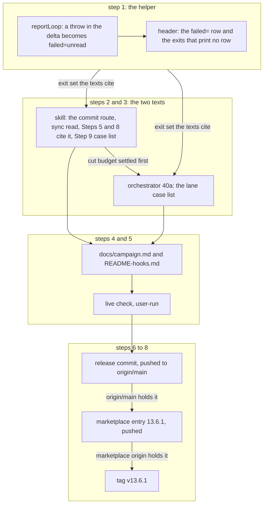

# Implementation Plan: fusion 13.6.1, the four Medium findings of the closing review of 13.6.0

**Date:** 2026-11-27
**Spec:** `261119-1102-spec-campaign-peers-follow-the-steering-session-and-report-back.md` (C3 criterion 3, C5 criterion 7), unchanged. Findings from review `261126-2111-reviewer-closing-pass-over-13-6-0.md`.
**Decidability:** Two questions carry this plan. (1) *Did a steering act or an answer reach the remote?* This can be decided from `sync`'s page: `state=ok` plus a `pushed=` line carrying the commit's subject means yes, and any other page means no. The skill reads the page, so the session no longer infers delivery from having run the command. (2) *Is the watch still running after its notice?* This can be decided from the task's output file and from whether this session stopped it. After step 1, every exit 0 prints exactly one of `state=already-watching`, `failed=`, or rows followed by `head=`. Every other ending prints none of them, and the watch is then off. The mechanism changes on one point: a throw inside the delta was an unannounced exit 1 and becomes a `failed=` the outage rule governs. One residual cannot be decided by any mechanism: whether a session follows the text. Step 5 measures it.
**What Approve binds:** the orchestrator sends `adopt-plan` with this record in role `plan`. `261119-1248-plan-campaign-peers-follow-the-steering-session-and-report-back.md` then moves to `references`. All twelve of its steps are `done`, and its stop clauses were read at 13.6.0. Two of them still do not hold: the two decisions under `## Where this work stops` below. That plan is transitioned `closed` at the same time, which closing permits with every step done.
**Ruled:** by the user, 2026-11-28, at approval.
- Q1: step 5, the live check, runs.
- Q2: 20 951 bytes binds `skills/campaign/SKILL.md`, and the `skills/` surface margin is not spent.
- Q3: the help paragraph is joined as "Coming from 13.5.1 or 13.6.0", and no paragraph is dropped.
- Q4: option (b). The three Lows B2, B3 and B4 move to a new work package when this one closes.
- Q5: yes. A reviewer pass over the 13.6.1 range runs before the release commit. It is gate R in `## Approach`, and step 6 depends on it.
- Q6: this plan is bound. The coordinator runs `adopt-plan` at this revision and closes `261119-1248-*` itself.

R is a gate, not a numbered step, for this reason: a filed plan's step numbers are its anchors, and no step is added or renumbered after filing (`rules/fusion-workbench-conventions.md` `### Planning files`). `bin/fusion-write` has no subcommand that adds an anchor. Anchors 1 to 8 therefore stay as filed. R's state is the state of the review record it produces, as G's is the user's regenerated golden.

## Directive

Fix the four Medium findings of the closing review as release 13.6.1, inside this package, and then close the package. The user ruled this on 2026-11-26/27. The four are A1, A2 and B1 of the review, and the issue the task lists fourth, A3. The review graded A3 Low, the user's task counts it among the four, and this plan follows the task. Two Lows go into the same edits because they touch the same files at no growth cost: A4 (the frontmatter) and C1 (`docs/campaign.md`, which A1's docs sentence touches as well). The other three Lows stay out of this plan, and stay open: B2, the outage file going stale at short intervals; B3, the fetch's stderr and its untested bound; B4, the duplicated row format. Each needs its own change in `hooks/lib/campaign-watch.ts` or `hooks/lib/campaign.ts`, with tests, and none fixes a Medium. Where they live once the package closes is open question Q4.

| Issue | Finding | Step(s) | `Resolved:` appended in |
|---|---|---|---|
| `261126-2111-the-steering-commit-route-reads-no-sync-result-and-reports-an-unpushed-answer-as-delivered.md` | A1, Medium | 2, 4 | step 4 |
| `261126-2111-campaign-step-5-ends-with-the-two-sentences-step-6-no-longer-has-so-lanes-may-stay-uncommitted.md` | A2, Medium | 2 | step 2 |
| `261126-2111-a-report-mode-watch-that-exits-with-none-of-its-rows-dies-silently.md` | B1, Medium | 1, 2, 3 | step 3 |
| `261126-2111-the-steering-commit-route-drops-the-orchestrators-apostrophe-check-on-its-absolute-paths.md` | A3 | 2 | step 2 |
| `261126-2111-the-campaign-skill-allows-monitor-which-it-no-longer-uses-and-not-write-which-step-6-uses.md` | A4, Low, folded | 2 | step 2 |
| `261126-2111-docs-campaign-says-a-watch-restarts-from-its-printed-head-which-a-failed-watch-does-not-print.md` | C1, Low, folded | 4 | step 4 |

**Found while planning, same class as A2 and fixed in step 2:** the skill's preamble (part `03-claude.md`) still says that `sync` "is the orchestrator's commit-cycle read and is not run from here", while Step 6 has run `sync` since 13.6.0. A session can read that sentence two ways. No issue is filed, because this plan fixes it (`## Record filing`, the issue row).

## Current State

- **Skill** `skills/campaign/SKILL.md` measures 20 916 bytes and is rendered from `catalog/profiles/skill-campaign/parts/*.md`. The profile has no `prior` part. Step 6 (part `07-claude.md`, line 17) runs `git reset -q && git add <absolute paths> && git commit -F <that file>` under `fusion-commit-lock with campaign`, then `sync`, "which pushes", and reads nothing back. Step 8 (part `08-claude.md`, line 10) says "the peer reads it within about 5 minutes" unconditionally. Step 5 (part `06-claude.md`, line 25) refers to "the two sentences" of Step 6. Step 9 (part `09-claude.md`) ends its case list with "Else restart it `--since` the printed `head=`. Any other wake: no text." The frontmatter (part `01-claude.md`) allows `Monitor`, not `Write`.
- **Orchestrator** `agents/orchestrator.md` measures 98 661 bytes. The lane wait sits in part `40a-claude.md` (1 258 bytes) and has the same "Else … Any other wake: no text" pair. Sub-step 5a and the apostrophe check sit in part `37-claude.md` and are the model for this plan. They are not edited.
- **Helper**: `reportLoop` (`hooks/lib/campaign-watch.ts`) calls `deps.delta` with no `try`. Every throw inside `reportRows` (`fetchRef`'s `mustGit`, `realpathSync`, `withScratch`/`tmpPath`, `sideAt`, and `extractAt`'s `git archive` and `tar`) leaves the process at the outer `catch` of `hooks/campaign.ts` with exit 1 and an empty stdout. The header of `bin/fusion-campaign`, `## probe and watch`, says that in report mode `state=already-watching` is "the only exit with no row to act on". That stops being true at the first non-zero exit.
- **Bounds, measured 2026-11-27 at `ecc47a05`:**

| Bound | Now | Ceiling for this plan | Source of the ceiling |
|---|---|---|---|
| `skills/campaign/SKILL.md` | 20 916 | 20 951 | the seventh `SKILL_HEAD_ROOM` raise (`README-hooks.md`), which bought this body up to 20 951 for this package alone |
| `skills/` surface | 247 426 | 249 041 | the suite's own budget, 1 615 bytes of margin. This plan spends none of it on the campaign body (Q2) |
| `agents/orchestrator.md`, and the orchestrator row of `dispatch-path.baseline` | 98 661 | 98 663 | zero head-room; any addition is cut inside part `40a-claude.md` |
| hook-test lines | 28 617 | 28 872 | budget 24 037 + 4 835. This plan allows at most 60 lines |

## Approach

**One shape, reused in both places.** The orchestrator's Step 4 sub-steps 5 and 5a define the commit route: message in a file, an apostrophe check on the paths, stage and commit as one held command, then `sync`, whose lines are read and not its exit code. The skill gets the same route, written once in Step 6 under the name **the commit route**. Step 5 and Step 8 cite that name, so no second copy exists to drift. The skill does not cite `agents/orchestrator.md` itself, because a session running the skill has not loaded that file.

**Finding 4, and whether `git reset -q` stays. It does not, in the skill.** The orchestrator resets the index because anything staged there was staged by a child run of the same session, which `git commit` would otherwise carry under the wrong message. That reason does not hold in the steering checkout. Anything staged there is the user's own work. A reset would leave the files untouched but would throw away the user's selection, including hunks staged with `git add -p`. Running without the reset, `git commit` would carry the user's staged work under the campaign's message. Both are wrong, so the route commits by pathspec: `git add "<path>" … && git commit -F "<file>" -- "<path>" …`. A commit with paths commits only those paths and leaves every other index entry staged. The `git add` comes first so that a path new to the index is known to git. The apostrophe check is the orchestrator's, word for word in substance: one path holding a `'` is an approval matter. Each path is double-quoted inside the single-quoted string, so a space in the user's project location does not split it. The orchestrator text says nothing about spaces either, and this plan does not change it. Each path is formed as Step 0's `WORKBENCH=` joined to the workbench-relative path the write printed (`path=`, or `set-mode`'s `<control path>`).

**`sync`'s result.** The route reads two outcomes and no more. `state=ok` with a `pushed=` line whose subject is this commit's means the act or answer reached the remote. Every other page means it did not: `conflict`, `rejected`, `fetch-failed`, a state of exit 5 or 7, an empty stdout, or an `ok` without that line. The session then says the act is committed in this checkout and not pushed, in git's words, and the user resolves it. Nothing is forced. That is the whole of 5a's state handling that applies to a checkout holding no package. 5a's hash-in-record rule does not apply, because the skill writes no hash into a record. A non-zero exit of the held commit command comes before all of this: the act is written and not committed, the stderr is quoted, and `sync` does not run. Without this branch, `sync` would print `ok` with no line for the commit, and the session would report "committed, not pushed" for an act that was never committed.

**The watch's end is a case list over what the output file holds, taken first case first.** This one table is the specification for both texts. Step 2 writes its steering column into the skill and step 3 its lane column into the orchestrator:

| # | Ending | Steering (skill Step 9) | Lane (orchestrator `40a`) |
|---|---|---|---|
| 1 | this session stopped it (`TaskStop`) | no text | no text |
| 2 | `state=already-watching` | no text; one runs | no text; one runs |
| 3 | `failed=` | one sentence; restart with the same `--since` | the same |
| 4 | rows, then `head=` | `new-question=`: offer Step 8; `new-ready=`: Step 3's words. A `campaign=` row ends the watching; otherwise restart `--since` that `head=` | act on the rows as 5a does. After `paused=` or `campaign=`, stop watching; otherwise restart `--since` that `head=` while a `question=` row of this checkout is open |
| 5 | none of the above (a non-zero exit, an empty stdout, a kill from outside) | one sentence quoting its stderr; it stays off | the same |

The table is disjoint, because the first case that holds wins. It is complete, because case 5 is the complement. After step 1, case 5 holds only for causes that a restart would repeat: exit 2 (a `--since` outside the grammar), exit 3 (no workbench), exit 1 before the first probe (no scratch directory, a missing module, the lane's identity), and a kill from outside. So "it stays off" is correct there, and the user is told. The next use of `/fusion:campaign` starts the watch again (Step 9's first sentence).

**Why `unread` and no new state for a throw in the delta.** The header already defines `unread` as "a move's new head did not read". A throw while fetching or extracting that head is the same event, seen from inside. The session handles every `failed=` identically, so a new token would widen the vocabulary without changing any branch. The cause still reaches the user: the error's message becomes the stderr line passed on once with that `failed=`.

Coherence check. There are four layers, and every edge runs downward. There is no cycle. Nothing fans out of one node: the helper feeds the two texts, which is the shared exit set. `H1 --> H2` is inside step 1. Each edge between subgraphs is a `Dependencies:` line below, and each `Dependencies:` line is an edge: 2←1, 3←1, 3←2, 4←2, 4←3, 5←4, 6←5, 7←6, 8←7. Step 6 also waits for the user's golden regeneration G. G is an act of the user, not a step, so it has no node. Step 3 depends on step 2 for one reason only: issue B1's `Resolved:` line is written once, by step 3, after both texts are in. The order of the last two edges is the point of the release subgraph. 13.6.0 pushed its tag before its marketplace entry, against plan 261119-1248's stop clause. Here the tag step cannot start until the marketplace step's push is read back from the remote.

**The golden regeneration (G) is the user's act.** A classifier denied `UPDATE_SURFACE_GOLDEN=1` to subagents. Steps 1 to 4 therefore each accept with exactly one expected red: the golden comparison in `hooks/lib/__tests__/surface-growth-bound.test.ts`. Any other red is a stop. After step 4, and before step 6's validations, the user runs `cd hooks && UPDATE_SURFACE_GOLDEN=1 npx vitest run lib/__tests__/surface-growth-bound.test.ts`, reads the diff and runs the suite once more. The `reference-resolution-lint.test.ts` pin is not a golden. An executor moves it, with an entry attributed to its step, as at 13.6.0.

**The reviewer pass (R) runs after step 5 and before step 6 (Q5).** The orchestrator dispatches `Agent(fusion:reviewer)` with `**Work package:** 261119-0905-campaign-peers-follow-the-steering-session-and-report-back`, domain code, over the range `v13.6.0..<last fix commit>`. The last fix commit is the commit that carries step 4, or a later one if step 5's outcome led to a further fix. R writes a review file into this package's `reviews/` store and files its findings as issues there. **A finding of Medium or higher blocks step 6 until the user has ruled on it.** Lows do not block; they are named in the release commit message. R, like G, is not a node in the diagram below.

## Implementation Steps

1. **The helper: a throw in the report delta becomes a failed probe**
   - Executor: `code-implementer`
   - Files: `hooks/lib/campaign-watch.ts` (`reportLoop`, `ReportDeps`); `hooks/dist/lib/campaign-watch.js` and `.d.ts` (rebuilt by `cd hooks && npm run build`, committed); `bin/fusion-campaign` (header, `## probe and watch` and `## Exit codes`); `hooks/lib/__tests__/campaign-watch.test.ts`; `hooks/lib/__tests__/reference-resolution-lint.test.ts` (pin only, if it moves, with an entry attributed to this step).
   - Changes:
     - In `reportLoop`, the call `deps.delta(seen)` is wrapped. A throw becomes `{ failed: "unread" }` and carries the error's message, ending in a newline. That message is passed to `deps.warn` exactly once, with the `failed=` that the outage rule prints. When the outage file is fresh, it is not printed again. The last head stays where it was, as on every failed delta.
     - Nothing else is caught: not the probe, not the start-up before the first probe.
     - In the header, the `failed=` row of the report mode reads: `unread` where a move's new head did not read, *its read stopped on an error included, whose message is then the stderr line*.
     - The sentence "In report mode `state=already-watching` is the only exit with no row to act on" becomes this: of the exits at 0, `state=already-watching` is the only one with no row to act on. A non-zero exit prints nothing on stdout and leaves the session unwatched. Exit 2 is a `--since` outside the grammar, exit 3 is no workbench, and exit 1 is a watch that could not start.
     - The exit table's 0 row stays as it is.
     - Test: one case in `campaign-watch.test.ts`, inside the `watch --report` describe block. It runs a steering watch with a `PATH` that puts a `tar` shim first, which exits 1. It pushes a question from a peer clone and expects `failed=unread` and exit 0 within the bound, with stderr non-empty. It then removes the shim, restarts the watch with the same `--since`, and expects the question's `new-question=` row followed by `head=`.
   - Acceptance:
     - `cd hooks && npx vitest run lib/__tests__/campaign-watch.test.ts` passes.
     - `cd hooks && npm test` has exactly one red, the golden comparison in `surface-growth-bound.test.ts`. Any other red is a stop.
     - A `cmp` of the rebuilt `hooks/dist/lib/campaign-watch.js` against a scratch `npx tsc --outDir` compile reports equal.
     - At most 40 hook-test lines are added.
     - No `*_HEAD_ROOM` constant and no baseline is changed.
   - Approval: no.
   - Dependencies: none
   - Source: issue `261126-2111-a-report-mode-watch-that-exits-with-none-of-its-rows-dies-silently.md` (helper half); review B1 and `## Recommended sequencing` item 2.

2. **The skill: one commit route that reads `sync`, cited from Steps 5 and 8, and Step 9's case list**
   - Executor: `code-implementer`
   - Files: `catalog/profiles/skill-campaign/parts/01-claude.md` (frontmatter); `03-claude.md` (preamble); `06-claude.md` (Step 5, last line); `07-claude.md` (Step 6, the paragraph after the refusal flags); `08-claude.md` (Step 8, the exit-0 paragraph); `09-claude.md` (Step 9, first paragraph); `skills/campaign/SKILL.md` (rendered by `cd catalog && npm run render -- claude`); `hooks/lib/__tests__/reference-resolution-lint.test.ts` (pin only, if it moves, attributed to this step); the issues of A2, A3 and A4 (`Resolved:` appended).
   - Changes: the target wording is below. An executor may shorten it but may not add a branch or drop one. Every case is stated once, and no sentence refers to a count of sentences elsewhere.
     - **Frontmatter:** `allowed-tools: [Bash, Read, Write, AskUserQuestion, TaskStop]`. `Monitor` is dropped and `Write` added (A4, −2 bytes).
     - **Preamble (cuts):** the first sentence ends after "its hand on the campaign record". The colon clause listing what the overview shows and what the acts do goes, because the frontmatter description already carries it (about −325 bytes). The `--ref` sentence loses ", and `sync` is the orchestrator's commit-cycle read and is not run from here", which became false at 13.6.0 (−77 bytes).
     - **Step 6, the commit route:** "Exit 0 prints `path=` and `revision=`. The confirmation covers committing it now, by **the commit route**. `Write` its message to `fusion-commit-msg-<session-id>-<act>.txt` under what `"$FUSION_PLUGIN_ROOT/bin/fusion-tmp" path` prints. Each path is Step 0's `WORKBENCH` joined to a written path; a path holding a `'` is an approval matter. Run `"$FUSION_PLUGIN_ROOT/bin/fusion-commit-lock" with campaign -- bash -c 'git add "<path>" "<path>" && git commit -F "<that file>" -- "<path>" "<path>"'`, which leaves what the user staged out of the commit. If that does not exit 0, the act is written and not committed: quote the stderr and stop. Otherwise run `"$FUSION_PLUGIN_ROOT/bin/fusion-campaign" sync`. Only `state=ok` with a `pushed=` line of that subject means the act was pushed. On any other page, say that the act is committed here and not pushed, in git's words, for the user to resolve. On a push, report the act in a sentence and end with: **the act reaches a working session at the holding session's next commit**, and no time is given for that." The parenthesised list of six act reports goes; "report the act in a sentence" covers it.
     - **Step 5, last line:** "On every option, commit what was written, the lanes and each `set-mode` control file, by Step 6's commit route." This replaces "End with the two sentences Step 6 ends every steering report with." The lanes are committed and pushed in the turn, because `skills/help/SKILL.md` says every steering act is, and a peer reads its `lane=` row only from the remote (A2).
     - **Step 8, exit 0:** "The choice confirms it: commit the pair (`.record.json` and the `.md` beside it) by Step 6's commit route. On its push, say the peer reads it within about 5 minutes if its session is open." On no push, the route's own sentence applies, and no time is given (A1).
     - **Step 9:** keep the first sentence (start with Bash `run_in_background`, `TaskStop` ends it). Replace the rest of the paragraph with the steering column of the case table in `## Approach`, in this order: "Its notice does not show its output: read the task's output file and take the first case that holds. You stopped it, or `state=already-watching`: no text. `failed=`: one sentence, then restart it with the same `--since`. Rows and `head=` (the helper's header, `## probe and watch`): `new-question=`, offer to answer it (Step 8); `new-ready=`, Step 3's words. A `campaign=` row ends the watching; without one, restart it `--since` that `head=`. Anything else: one sentence quoting its stderr; it stays off." The paragraph on stopping the watch stays as it is (B1, text half).
     - **Measured on drafts of this wording at `ecc47a05`:** −44 bytes net, so 20 872 against the ceiling of 20 951.
     - **Shell check of the route, in scratch under `"$FUSION_PLUGIN_ROOT/bin/fusion-tmp" path`.** Build a repository whose path contains a space, with an unrelated tracked file staged. Run the route's held command exactly as the text spells it, on one new and one modified file. `git show --name-only HEAD` must list exactly those two, and `git diff --cached --name-only` must still list the unrelated file. Record the result in the step's report.
   - Acceptance:
     - `cd catalog && npm run render -- claude && npm test` passes, and the profile still has no `prior` part.
     - `wc -c skills/campaign/SKILL.md` prints at most 20 951.
     - `grep -c 'two sentences' skills/campaign/SKILL.md` prints 0, and `grep -n 'git reset' skills/campaign/SKILL.md` prints nothing.
     - The shell check passed as stated.
     - `cd hooks && npm test` has exactly one red, the golden comparison in `surface-growth-bound.test.ts`. Any other red is a stop.
     - At most 5 hook-test lines (a pin entry).
     - The `Resolved:` lines of A2, A3 and A4 are written before that suite run.
     - If 20 951 cannot be reached without dropping a case or a refusal the user reads, the step stops and reports the figure. It takes no raise and spends no surface margin (Q2).
   - Approval: no.
   - Dependencies: 1
   - Source: issues A2 (`261126-2111-campaign-step-5-ends-with-the-two-sentences-step-6-no-longer-has-so-lanes-may-stay-uncommitted.md`), A3 (`261126-2111-the-steering-commit-route-drops-the-orchestrators-apostrophe-check-on-its-absolute-paths.md`), A4 (`261126-2111-the-campaign-skill-allows-monitor-which-it-no-longer-uses-and-not-write-which-step-6-uses.md`) and A1 and B1 (text halves); review `## Cross-cutting observations`, the first and second bullets.

3. **The orchestrator: the lane watch's case list, cut-neutral inside part `40a`**
   - Executor: `code-implementer`
   - Files: `catalog/profiles/orchestrator/parts/40a-claude.md`; `agents/orchestrator.md` (rendered); `hooks/lib/__tests__/reference-resolution-lint.test.ts` (pin only, if it moves, attributed to this step); issue B1 (`Resolved:` appended).
   - Changes:
     - Replace the passage from "It exits only with a row to act on" to "Any other wake: no text." with the lane column of the case table: "Its notice does not show its output: read the task's output file; the first case that holds. You stopped it, or `state=already-watching`: no text. `failed=`: one sentence; restart it with the same `--since`. Rows and `head=`: act on them as 5a does. After `paused=` or `campaign=`, stop watching; otherwise restart it `--since` that `head=` while a `question=` row of this checkout is open. Anything else: one sentence quoting its stderr; it stays off."
     - The bytes are paid inside the same part. First cut: "(Step 4 sub-step 5a's `lane=` row)" becomes "(5a's `lane=` row)"; the part already says "as 5a does" twice. Second: tighten the wording of the new list itself.
     - Keep "as the Bash `run_in_background` command itself" and "so `TaskStop` ends it" as they are. Both carry the trial's finding and case 1.
     - Measured on a draft: +1 byte, so 98 662.
     - Sub-step 5a and part `37-claude.md` are not touched.
   - Acceptance:
     - `cd catalog && npm run render -- claude && npm test` passes.
     - The Prior render is byte-identical before and after, by `cmp` in scratch, stated in the report.
     - `wc -c agents/orchestrator.md` prints at most 98 663.
     - `cd hooks && npm test` has exactly one red, the golden comparison in `surface-growth-bound.test.ts`. The dispatch-path case of `rules-emission-golden.test.ts` must be green; any other red is a stop.
     - `dispatch-path.baseline` and `DISPATCH_HEAD_ROOM` are unchanged.
     - B1's `Resolved:` line is written before that run. It cites steps 1 to 3 by file and heading.
     - If no cut inside `40a` reaches 98 663 without dropping a case, the step stops and reports.
   - Approval: no.
   - Dependencies: 1, 2
   - Source: issue `261126-2111-a-report-mode-watch-that-exits-with-none-of-its-rows-dies-silently.md` (lane text half); `rules/critical-stance.md` §4.

4. **The docs: delivery after a push, and the watch's endings**
   - Executor: `code-implementer`
   - Files: `docs/campaign.md` (`## Questions go to the steering session`, `## The two watches`); `README-hooks.md` (the `lib/campaign-watch.ts` row and the `bin/fusion-campaign` roster row, read, and edited only where they say the watch exits only with a row); `docs/upgrading-to-v13.md` (the 13.6.0 section, read, and edited only where a statement became false); `hooks/lib/__tests__/reference-resolution-lint.test.ts` (pin only, if it moves, attributed to this step); issues A1 and C1 (`Resolved:` appended).
   - Changes:
     - `## Questions go to the steering session`: "so the steering session commits and pushes it in the same turn; a peer whose session is open and waiting reads it within about 5 minutes" becomes this. The steering session commits it in the same turn and pushes it with `sync`. Once that push has landed, a waiting peer reads it within about 5 minutes. A push that did not land is reported to the user, and the answer stays committed in the steering checkout.
     - `## The two watches`: the sentences "It exits only when … first failure of an outage" and "starts the watch again from the `head=` it printed" are replaced by a citation of the helper header, `bin/fusion-campaign` `## probe and watch`, for the exits. The paragraph then states the three restarts the texts make: after rows, from the printed `head=`; after `failed=`, with the same `--since`; after `state=already-watching`, none, because one runs. It also says that any other ending leaves the session unwatched until the next use of the command (C1).
   - Acceptance:
     - `cd hooks && npm test` has exactly one red, the golden comparison. `reference-resolution-lint.test.ts`, `workbench-citation-lint.test.ts`, the README lib-table pin and `derivable-enumerations-lint.test.ts` are green.
     - `grep -n 'within about 5 minutes' docs/campaign.md` shows every hit conditioned on a landed push, or on the steering session's push as in `## What "next commit" has meant in practice`.
     - The `Resolved:` lines of A1 and C1 are written before the suite run.
     - At most 5 hook-test lines.
   - Approval: no.
   - Dependencies: 2, 3
   - Source: issues A1 (`261126-2111-the-steering-commit-route-reads-no-sync-result-and-reports-an-unpushed-answer-as-delivered.md`, docs half) and C1 (`261126-2111-docs-campaign-says-a-watch-restarts-from-its-printed-head-which-a-failed-watch-does-not-print.md`).

5. **Live check of the new branches in one steering session, user-run**
   - Executor: `analyst`
   - Files: `fusion-workbench/work-packages/261119-0905-campaign-peers-follow-the-steering-session-and-report-back/analyses/<stamp>-live-check-13-6-1.md` (new); scripts under `live-check/` in what `bin/fusion-tmp path` prints, not committed.
   - Changes:
     - The analyst builds a scratch project: a bare remote, a steering clone and a peer clone. It is built from the work tree at the commit that carries steps 1 to 4, with an open campaign and one lane.
     - The analyst writes the protocol, with every command the user types on one line and anything longer as a script run by path, the way analysis `261126-0814-c56-recheck-run-sheet.md` did.
     - The user runs one steering session (`FUSION_PLUGIN_ROOT=<work tree> claude --plugin-dir <work tree>`), and the analyst writes the report from its transcript. Each row is answered yes or no, with the line that shows it:
       - **L1:** `pause` with an unrelated tracked file staged beforehand. The commit holds only the campaign file, the unrelated file is still staged, and the report ends with the next-commit sentence.
       - **L2:** `resume` after the peer has pushed, with a dirty tracked file in the steering clone (rebase deferred, push rejected). The session says the act is committed and not pushed, quotes git, and gives no next-commit sentence.
       - **L3:** `answer` under the same rejection. No "within about 5 minutes".
       - **L4:** `lanes` on option 3. The lanes file is committed and pushed in the turn.
       - **L5:** a watch whose delta throws (the `tar` shim on the session's `PATH`, then a peer question). One sentence, and a restart with the same `--since`. With the shim removed, the question is offered.
       - **L6:** the watch killed from outside (`pkill -f 'fusion-campaign watch'`). One sentence quoting the stderr, and no restart.
     - The lane side (orchestrator `40a`) is not run live. Its case list has the shape L5 and L6 test and is checked by a text read in this report, row by row against the case table.
   - Acceptance:
     - The report answers L1 to L6, each with the transcript line.
     - **Any `no` blocks step 6** and goes back to the user with that line. A row the run could not show is `n/t` and goes back to the user too.
     - No automated test applies.
   - Approval: **yes.** The user runs the session, and Q1 asks whether this step runs at all.
   - Dependencies: 4
   - Source: user task of 2026-11-27 (decide whether a live check is needed); analyses `261121-1826-live-trial-two-checkouts.md` and `261124-2015-retest-two-checkouts.md` (the trial found the two-readings class twice, where a text read had passed it).

6. **The release commit for 13.6.1**
   - Executor: `code-implementer`
   - Files:
     - `.claude-plugin/plugin.json` (`version` 13.6.1; the `description` is read beside the marketplace one and left unchanged)
     - `install.sh` and `README.md` (the `FUSION_REF=tags/v13.6.1` examples)
     - `catalog/profiles/skill-help/parts/21-claude.md` and `21-prior.md`, then `skills/help/SKILL.md` (rendered)
     - `docs/upgrading-to-v12.md` (read only: this release changes nothing it describes, and the step says so)
   - Changes:
     - Follow `README-agents.md` `## Releasing` step 0, and step 1 on this side.
     - The help update topic: 13.6.1 needs no migration, so it joins its predecessor's paragraph. "Coming from 13.5.1:" becomes "Coming from 13.5.1 or 13.6.0:", and that paragraph gains one clause on what 13.6.1 corrects: a steering act or an answer is reported as delivered only once its push has landed, and a watch that stops is said to have stopped.
     - The added bytes are paid inside that same paragraph (Q3). Nothing is dropped, because a joined patch drops no paragraph. The Prior part says that nothing changes on Prior beyond the version.
     - Run `cd catalog && npm ci && npm test`, `cd hooks && npm test`, `claude plugin validate .`, the smoke test `claude --plugin-dir . --agent fusion:orchestrator -p "reply SMOKE-OK"`, and `bin/fusion-review-coverage --since v13.6.0`.
     - The release commit message, which the orchestrator writes, carries the coverage result. It cites R's review file by basename, with R's reviewed range and its totals by severity, and it names each Low that R left open.
   - Acceptance:
     - `grep -n '13\.6\.1' .claude-plugin/plugin.json install.sh README.md skills/help/SKILL.md` shows a hit in each file.
     - All four validations exit 0, after the user's golden regeneration G. `cd hooks && npm test` is fully green; no red is allowed here.
     - `skills/campaign/SKILL.md` is still at most 20 951. The `skills/` surface grows by no more than `skills/help/SKILL.md`'s net, which is 0 under Q3's default.
   - Approval: **yes.** The orchestrator commits it and pushes it to `origin/main`, and every push to `main` is what the next `fusion --update` installs.
   - Dependencies: 5, the user's act G, and the reviewer pass R with no Medium-or-higher finding left unruled
   - Source: `README-agents.md` `## Releasing`, step 0 and step 1; `261015-1559-does-the-help-update-topic-at-13-1-3-drop-the-v13-migration-paragraph-or-fold-the-patch-into-the-13-1-2-paragraph.md`, option 2.

7. **The marketplace entry at 13.6.1**
   - Executor: `data-implementer`
   - Files: `/projects/productive/F03-CLAUDE-plugin-marketplace/claude-plugins/.claude-plugin/marketplace.json` (fusion's `version`).
   - Changes:
     - First read `git ls-remote origin refs/heads/main` in the fusion repository, which must name the release commit of step 6. If it does not, the step stops: the release is not on `origin/main` yet.
     - Then `git -C /projects/productive/F03-CLAUDE-plugin-marketplace/claude-plugins pull --rebase origin main`, and fusion's version goes to 13.6.1. The description stays byte-identical to `plugin.json`'s.
     - The orchestrator commits and pushes the marketplace repository.
   - Acceptance:
     - `grep -n '"version"' <that file>` shows 13.6.1 for fusion.
     - A `cmp` of the two description strings, extracted with `node -e`, reports equal.
     - After the push, `git -C <marketplace clone> fetch origin && git -C <marketplace clone> show origin/main:.claude-plugin/marketplace.json` shows 13.6.1. The push is read back from the remote, not from the local ref.
   - Approval: **yes.** The file is outside the project tree, and the push goes to another repository.
   - Dependencies: 6
   - Source: `README-agents.md` `## Releasing`, steps 2 to 4.

8. **Tag `v13.6.1`, only after both pushes are read back**
   - Executor: `code-implementer`
   - Files: none (a git tag).
   - Changes:
     - Read the two preconditions from the remotes first, never from local refs. (a) `git ls-remote origin refs/heads/main` names the release commit of step 6, or a descendant of it whose further commits touch only `fusion-workbench/`. (b) The marketplace clone's `origin/main`, freshly fetched, shows fusion at 13.6.1.
     - If either fails, stop and tag nothing.
     - Otherwise `git tag -a v13.6.1 -m "fusion v13.6.1" <release commit>` and `git push origin v13.6.1`.
   - Acceptance:
     - `git ls-remote origin refs/tags/v13.6.1` names an annotated tag whose commit is step 6's release commit.
     - The report quotes both precondition reads, with the time of each, and the time of the push. Each read comes before the push.
   - Approval: **yes.** A pushed tag is what `FUSION_REF=tags/v13.6.1` resolves against. The orchestrator may run this step itself under the same checks.
   - Dependencies: 7
   - Source: `README-agents.md` `## Releasing` step 5; plan `261119-1248-plan-campaign-peers-follow-the-steering-session-and-report-back.md` `## Where this work stops`, the tag clause that 13.6.0 broke.

## Where this work stops

- Steps 1 to 4 are `done`. The catalog suite, the hooks suite (after G) and `claude plugin validate .` were green on the release commit.
- No `*_HEAD_ROOM` constant, no `DISPATCH_HEAD_ROOM` and no baseline changed. `skills/campaign/SKILL.md` is at most 20 951 bytes, and `agents/orchestrator.md` is at most 98 663, on the release commit. If the user ruled otherwise under Q2, the ruling is cited here instead.
- Step 5's report records L1 to L6 as yes before the release commit, or the user ruled under Q1 that it does not run and the ruling is cited here.
- **Before the tag `v13.6.1` is pushed:** the release commit is on `origin/main`, read with `ls-remote`. Its message carries the `bin/fusion-review-coverage --since v13.6.0` result. The marketplace entry at 13.6.1 is on `tenzoki/claude-plugins` `origin/main`, read after a fetch. `skills/help/SKILL.md` carries 13.6.1. Each of these is read before the tag push, and step 8's report shows the order.
- After the tag: `fusion --update` on this machine prints 13.6.1. The six issues of the table in `## Directive` are `closed`, disposition `fixed`, each with its `Resolved:` line.
- Owed since 13.6.0 and still unmet at `ecc47a05`, so the package does not close without them: decision `261119-0851-how-does-a-campaign-steer-its-peers-and-get-their-results-and-questions-back.md` is `implemented` with the pushed hash of the 13.6.0 release commit. Decision `261119-1248-how-does-an-answer-name-the-peer-question-it-answers-and-how-does-the-peer-remember-what-it-set-aside.md` is `implemented` with the pushed hash of 13.6.0's step 5. Both stand `answered` today.
- Q4, option (b): before this package closes, the three Lows left out have moved into a new work package. They are B2 `261126-2111-the-outage-file-goes-stale-within-one-watch-when-the-interval-is-at-most-the-remote-timeout.md`, B3 `261126-2111-the-report-mode-fetch-passes-gits-stderr-on-every-failed-delta-and-its-timeout-has-no-test.md` and B4 `261126-2111-campaign-watch-copies-the-overviews-question-row-format-instead-of-sharing-it.md`. The new package is filed with `bin/fusion-write create --kind package`, and no issue is left `open` inside this package's container.
- This plan and `261119-1248-*` are `closed`, and the package is closed with its outcome.

## Data Structures

None. No codec, schema or record format changes. The helper's vocabulary is unchanged: `unread` gains one cause, and no token is added.

## API Changes

- `bin/fusion-campaign watch --report`: a throw inside the delta now prints `failed=unread` with the error on stderr and exits 0, under the outage rule. Before, it exited 1 with an empty stdout. No flag and no other exit changes.
- `ReportDeps.delta` keeps its signature. The catch sits in `reportLoop`, so a test can drive it with an injected `delta` that throws.

## Testing Strategy

- **Unit and integration (step 1):** the `tar`-shim case in `campaign-watch.test.ts` proves the helper half end to end on a real remote. The existing outage cases already cover the rule that the shim's failure enters.
- **Shell check (step 2):** the held commit command, as the text spells it, in a scratch repository with a space in its path and a foreign staged file. This is the one part of the text whose correctness a shell can decide.
- **Text read (steps 2 and 3):** each case list is read against the case table in `## Approach`, row by row, and the reading goes into the step report: every row present, no row twice, first case first.
- **Live check (step 5), and why it is needed.** Unit tests cannot reach what a session says. The two trials found the two-readings class twice in text that a read had passed, and this release changes exactly the sentences about delivery and about the watch's end that those trials exercised. The run is bounded: one steering session, no second live session, six provocations. The lane text gets a read, not a run. That is a stated gap: the lane column is the same case shape that L5 and L6 test, and a second live session would cost the two-checkout trial again for no new branch. If the user rules under Q1 that a text read suffices, the reason recorded is that the helper half is proven by test and the text changes are a case table read row by row. The cost recorded is that the two-readings class has escaped that check twice before.

## Risks & Mitigations

| Risk | Mitigation |
|---|---|
| The pathspec commit behaves differently from `reset && add && commit` for a path new to the index | `git add` comes first, and the shell check in step 2 covers one new and one modified file |
| The skill has 35 bytes of head-room and the drafts net −44 | step 2 stops at the figure rather than spending surface margin (Q2) |
| The orchestrator is at +1 against 2 bytes of margin | the cut is inside `40a` with two named candidates; step 3 stops rather than cutting 5a |
| The tag is pushed before the marketplace entry, again | step 8 reads both remotes first, and the stop clause reads its report |
| A persistent cause (no `tar`) silences the watch after one `failed=` | that is the outage rule as designed: told once, silent while it lasts, reported again once it clears; the stderr names the cause |
| The Prior bundle digest changes with `hooks/dist` | no bundle is built or delivered by this plan, as at 13.6.0; the next bundle build picks up 13.6.1 |

## Open Questions

- [ ] **Q1, the live check.** Does step 5 run? Recommended: yes, for the reason in `## Testing Strategy`. The alternative is a text read only, with the gap named in the release commit.
- [ ] **Q2, the skill's ceiling.** This plan holds `skills/campaign/SKILL.md` to 20 951, the figure the seventh raise bought for this package, and spends none of the `skills/` surface's measured 1 615 bytes of margin. The suite would pass up to that margin. Is 20 951 the binding ceiling? Recommended: yes, and step 2's drafts fit under it.
- [ ] **Q3, the help paragraph.** Is the 13.6.1 clause paid inside the joined 13.6.0 paragraph (default, net 0), or from the surface margin? Dropping the oldest of the six paragraphs is not offered. That concerns the open issue `261106-0830-the-help-update-topic-carries-six-install-from-paragraphs-against-the-release-rule-of-three.md`, which this plan leaves alone.
- [ ] **Q4, the three Lows left out.** B2, B3 and B4 are open issues inside this package's container. When the package closes, do they (a) stay open there and get picked up by the next release that touches `campaign-watch.ts`, as the review's sequencing item 4 suggests, (b) move to a new work package of their own, or (c) get closed `deferred`? Recommended: (b), because a closed package should not hold open defects.
- [ ] **Q5, a review pass over the 13.6.1 range.** `bin/fusion-review-coverage --since v13.6.0` will report the fix range as unreviewed unless a reviewer pass runs before step 6. Should one run (recommended, short, scoped to the range), or does the release go out with the gap named in the commit message?
